# 李宏毅2024春《生成式人工智能导论》 - P21：第10讲：今日的语言模型是如何做文字接龙的 — 浅谈Transformer 已经熟悉 Transformer 的同学可跳过) - 啥都会一点的研究生 - BV1BJ4m1e7g8

好那今天的课程呢有两个部分，前半段呢终于要深入语言模型的内部，看一下语言模型内部的那个类神经网络，也就是大名鼎鼎的transformer，他背后做的事情是什么。

特别需要把transformer这段提出来讲，是为了要为下半段的课程做铺垫，因为在下半段的课程，我们要来探讨大型语言模型，他的心理究竟在想些什么，但在探讨他的心里在想些什么之前。

你必须要先真的了解它的运作的机制，我们才能够深入他的内心哦，所以我们先来讲，今天语言模型是怎么做文字接龙的，在这个课堂上啊，我们已经就这个再三跟大家强调过，说语言模型做的事情就是文字接龙。

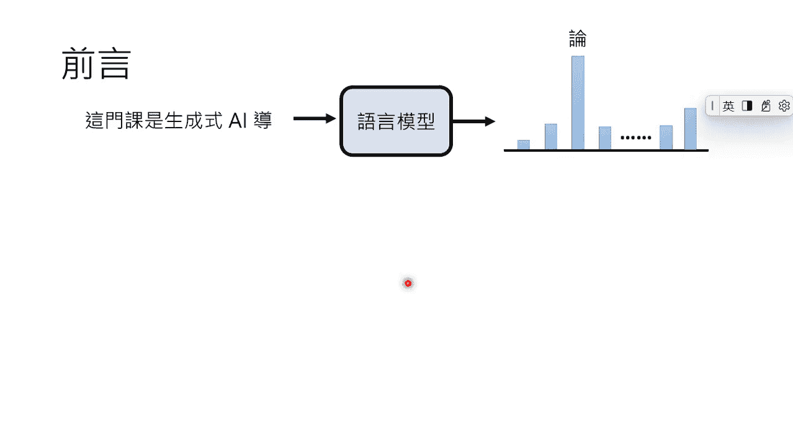

那我们也跟大家讲过，说这个语言模型文字接龙的能力，就是从大量的训练资料所学出来的语言模型，它是一个韩式内部有很多未知的参数，而我们可以用这些训练资料，找出这些未知的参数。

但是这个我这个语言模型背后的这个函式，到底长的什么样子呢，我们今天就来看看，这个函式到底内部运作的过程是什么。

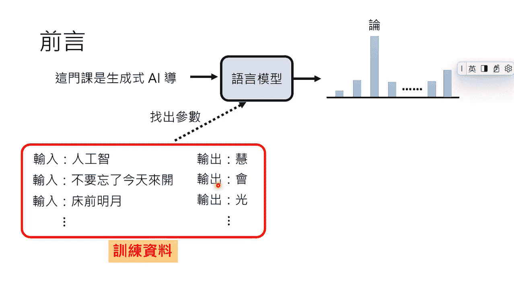

那可能很多同学都知道今天的语言模型，它背后用的就是类神经网络的技术，也就是它背后的韩式就是一个类神经网络，那类神经网络有很多种，那今天语言模型最常用的类神经网络的类型，叫做transformer。

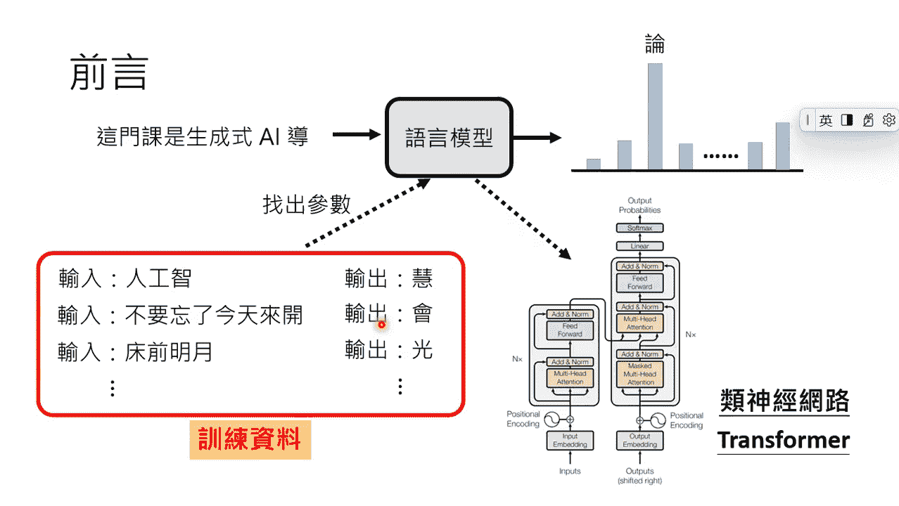

那么今天就要来看看transformer，背后运作的过程，那语言模型不是一直都使用transformer，这样的类神经网络，那这些投影片上讲的是语言模型的演进史，最早的时候在深度学习还没有开始发达以前。

那时候人们还不知道要用深度学习的技术，用内神经网络来做语言模型，在有类神经网络之前，那时候通常是用一个叫做n gram的模型啊，它就不是类神经网络的技术，那后来呢就用了类神经网络的技术。

比如说feedforward network，那在be forward network之后，人们知道要用RNN recurrent neural network，那这些太过冗长。

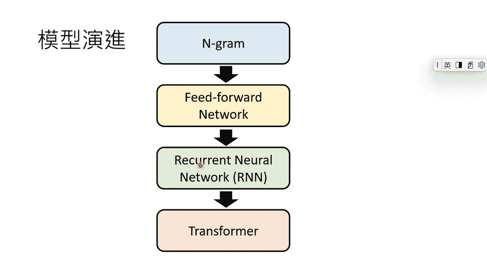

所以今天我们都不会细讲，假设你想要知道语言模型的眼镜，是可以参看我过去上课的录音，我把录音的链接留在投影片上。

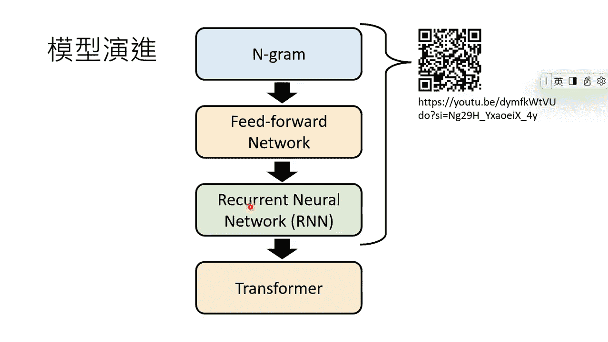

那今天呢我们主要会focus在transformer上面，那切GBT的这个T呀，它指的就是transformer的T，所以可见，这个transformer，对于大型语言模型是非常重要的。

那今天讲的呢是一个简化的版本，并不是transformer的全部，如果你真的想要更深入的了解transformer，那我这边附上了两段过去上课的录音，大家可以看这两段上课的录音。

更了解transformer内部运作的原理哦。

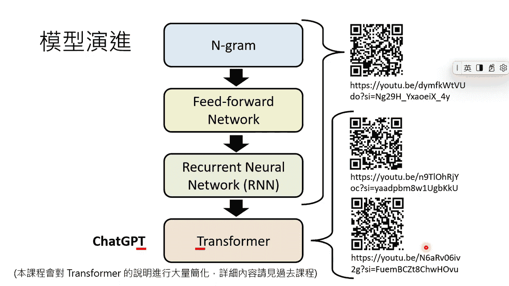

那在开始，那我们现在先来看一下transformer这个模型，它整体运作的过程，我们先来对transformer做一个概述，当一句话被语言模型读进去的时候，经过了哪些步骤才得到输出的这个几率分布呢。

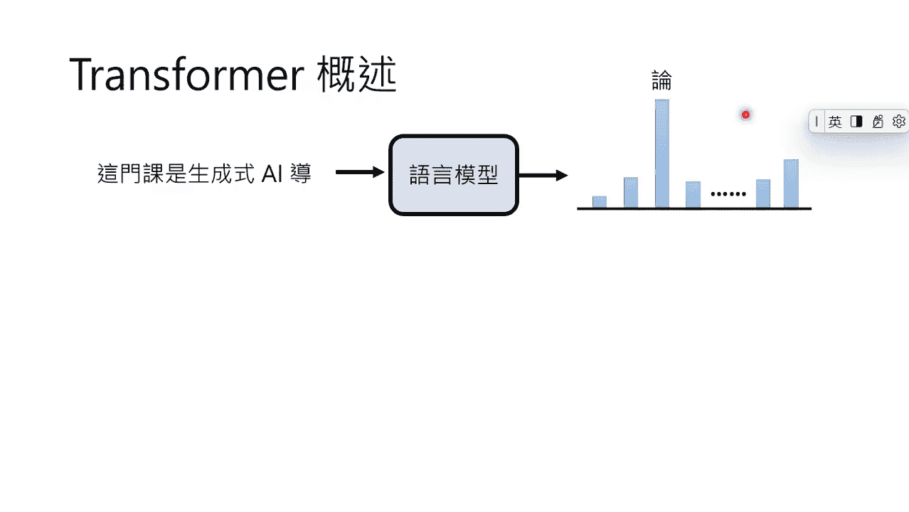

首先第一个步骤叫做TOIZATION，Toization，这个步骤是把文字转为token，那等一下在下一页，投影片会再跟大家讲的更清楚，这边所谓的token指的是什么，那把文字转成token之后。

接下来呢语言模型有一个input layer，会去理解每一个token，但是光理解每一个token还不够，我们还要考虑token和token间的关系，怎么考虑token和token间的关系呢。

这边是透过一个叫做attention的模组来进行的，Attention，这个模组会理解上下文，那attention理解上下文之后，再经过一个feedforward network，你可以想成。

他是把attention的模组的输出进行整合，再进一步思考，那attention加FEFORWARD合起来啊，叫过做一个transformer的block。

那一个transformer里面有很多很多的block，block的数目是你自己定的，而block呢会被使用很多次，那代表说机器在做反复的思考，那最后有一个output the layer。

把这个transformer bug的输出转成几率的分布，那接下来我们就来仔细看每一个bug。

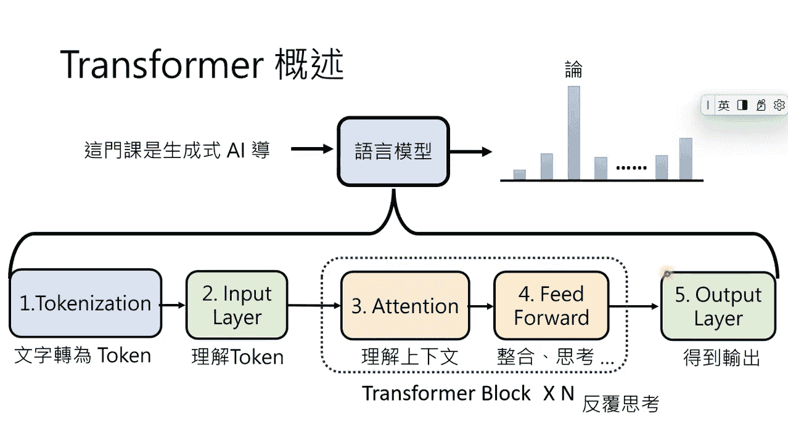

在做什么样的事情好，第一个block呢是把文字转成token，那因为对一个语言模型来说，他真正处理的单位叫做一个token，它的输入和输出的单位，都是以token这个东西来作为单位的。

所以当你把一个句子给语言模型的时候，他做的第一件事情是把这句话转成token，The sequence，它才好做进一步的处理，举例来说。

假设输入的句子是introduction of generative AI，那经过TOXIZATION之后，它就会被切成一个一个token。

比如说introduction可能会切成int跟RODUCTION两个，token of本身就是一个token，Generative，会变被会被切成general跟T两个token。

那AI本身就是一个token，所以输入一段话，它会变成一个token的sequence，那怎么把一句话切成token sequence呢，我们怎么知道一个语言里面有哪些的token呢。

你要先准备一个token的列表，所以一开始你在打造你的语言模型的时候，你就会根据你对语言的理解，准备一个token的列表，那这个token的列表就是你的语言模型，处理文字的基本单位。

那这个token的类列表怎么来呢，它是根据你对这个语言的理解自己定的，所以不同的语言模型，它的这个token的列表是不一样的，那很多这个中文的模型呢，往往就会把一个中文的方块字当做一个token。

因为对我们这个中文的使用者来说，把方块字当作单位往往是最自然的，所以很多中文的模型是以一个方块字，当做他的token，但是像确GVT它并不是特别为中文所打造的，它是为了各种不同语言所打造的。

它就不是拿一个中文的方块字当个token，再去对确GPT来说，好几个token才能够组成一个中文的字。

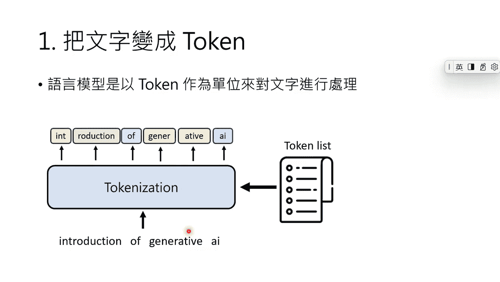

那token呢其实也有办法自动取得，有一个演算法呢叫做by peer encoding BP，一，它可以从大量文字里面找出常常出现的pattern，那把这些pattern当做token。

那BP1并不是唯一找token的方法了，还有很多其他的方法，BP1只是特别有代表性的一个，那PPPP1，这个方法精神就是看看你先收集大量的文字，看看这些文字里面有没有哪些英文的。

有没有哪一些符号常常一起出现，比如说呃JENNER常常一起出现，active常常一起出现，那他们就是他们就是一个token，那如果有一些比如说像generative这样的这个呃，符号的序列没有很常出现。

那它就不会被当做一个token哦，所以可能active很常出现是一个token generative，它出现的次数还不够多，所以就没有被当做一个token来看待。

而那总之呢要怎么做TOXIZATION啊，这个要问你自己，也就是要问这个打造语言模型的人类，那这个部分没有需要训练的参数，它是一个人定好的module。

反正就是把一个句子转成token的sequence，token本身是一个比较模糊的概念，它是人定出来的，它本身是一个比较模糊的概念，所以你如果拿一个符号来问我，说他是不是一个token。

我其实是没有办法回答你的。

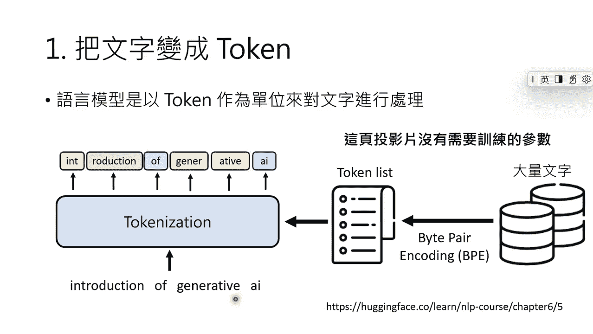

而每个语言模型用的token也都是不一样的，如果你想要知道现在的GPT3天，我跟GPT4用的token有什么，那其实有一个网站OpenAI提供了一个网站，你可以把一篇文章贴给他。

他会告诉你这篇文章里面有哪些token，比如说我贴给他这篇文章，他就告诉我，这篇文章总共有65个token所组成，他会告诉你说哪一些字是一个token，比如说language本身是一个token。

Model，本身是一个token，但probabilistic不是一个token，probabilistic是被拆成两个token，然后像这边1980这个年代，也是被拆成两个token。

198是一个token，那零呢是被当做另外一个token，那里面没有1980这个token，所以1980会被拆成198跟零两个token，那至于为什么会这样，这个都是OpenAI事先定好的好。

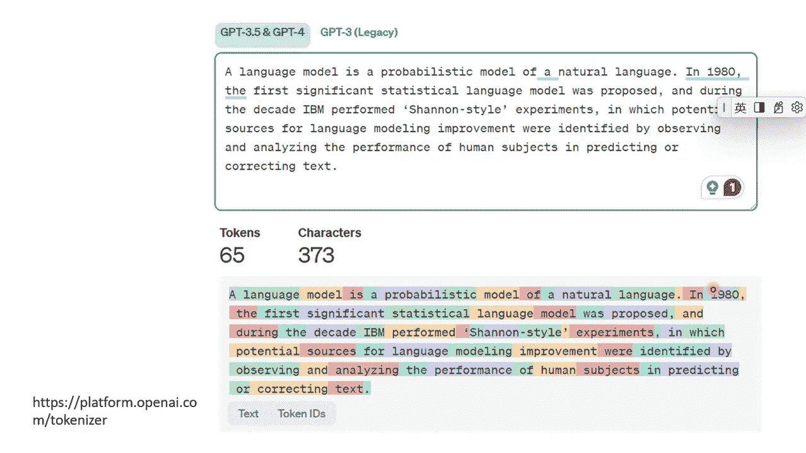

那我们现在把一句话拆解成token之后，下一个步骤呢是要知道每一个token是什么意思，那怎么知道每一个token是什么意思呢，这边会把每一个token呢用一个向量来表示。

也就是每一个token本来是一个符号，但是丢进这个第二个模组之后呢，每一个token会变成一串数字，每一个token会变成一个向量，那这个把token变成一串数字，也就把token变成一个向量的过程。

叫做embedding的意思就是把本来一个物件，一个东西变成一个向量啊，这个过程呢就是embedding，那把这些token变成向量有什么好处呢，原本每一个token都是独立的符号。

就apple是个符号，cat是一个符号，这边本来是想要打斗啊，狗啊想要打dog啦，不然不小心写成大的了也无所谓啊，run是一个符号，jump是一个符号，虽然run跟jump都是动作。

感觉他们应该跟run跟jump彼此比较相近，跟cat跟apple可能距离比较远，他们比较不相近，但是从token的角度来看，因为每一个符每一个token都是一个独立的符号。

所以如果我们是用token来处理语言的话，run跟jump并没有什么特别的关系，run跟apple也没有什么特别的关系，就当你用token来看待一个语言的时候，每一个token都是独立的。

他们彼此这些词汇，这些token彼此之间的关联性，并没有办法被反映出来。

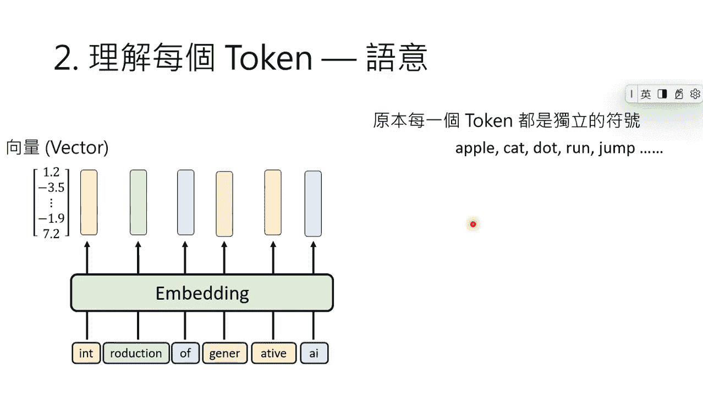

所以怎么办呢，呃今天我们把每一个token呢表示成一个向量，那有时候这些向量，我们就直接把它称之为embedding，每一个token会被表示成一些，表示成一个embedding。

而语义越相近的token，它的embedding距离就越接近，所以如果你把这些token的embedding拿出来，画成图的话，你可能会发现哦，所有的动物他们的token聚集成一群。

而所有植物可能聚集成另一群，所有的动词可能聚集成一群，名词又聚集成另外一群，所以透过把这些本来独立的token变成embedding，可以让接下来在处理的时候，接下来的这个类神经网络。

接下来剩余的模组在处理这些token的时候，能够知道这些token和token之间的关联性好。

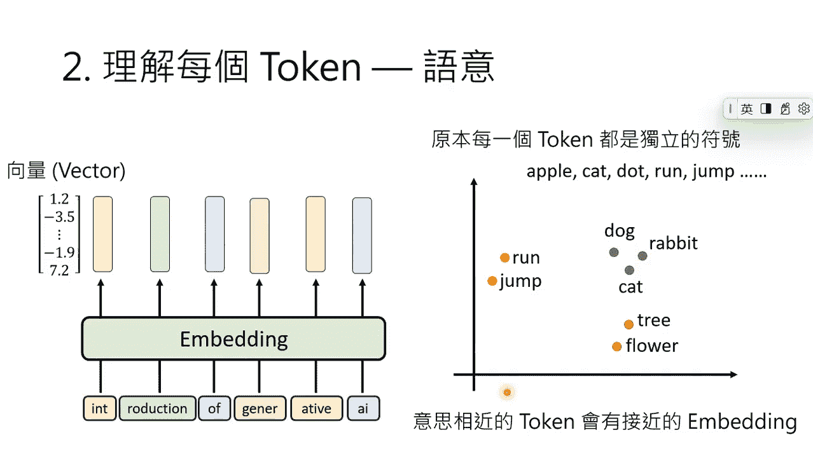

那我们已经知道说相邻的token，我们希望给它相近的embedding，但是到底是怎么把相邻的token给他，相近的embedding呢，这边你会有一个token embedding的列表哦。

所以在transformer里面，你会有一个table里面存了所有的token，跟它每一个token所对应的embedding，每一个token所对应的向量哦，所以呢在做embedding的时候。

实际上你做的事情就是查表，看看有什么样的token去这个表里面查一下，看看INT对应的token是什么，就把它拿出来，看AI对应的呃，看INT对应的embedding是什么，就把它拿出来。

看AI对应的embedding是什么，就把它拿出来，但下一个问题是，这个表是从哪里来的呢，我们怎么知道每一个token，应该对应的向量是什么呢，这个每一个token所对应的向量啊。

就是这个语言模型里面的参数还记得吗，我们说语言模型里面有很多未知的参数，这些未知的参数是要透过训练资料找出来的，而这个呃每一个token所对应的embedding，就是我们代表的参数的一部分。

所以这些token的embedded，你并不需要人去设定它，它是自动由训练资料所找出来的啊，但是到目前为止，我们虽然可以把token转成embedding，但这些embedding有一个限制。

有一个问题就是没有考虑上下文，同一个token，它的embedding就是固定的，就是同一个，比如说bank，我们知道bank这个词汇有两个意思，他可能指的是银行，也可能指的指的是河岸。

但是不管现在bank在句子里面，是表示银行还是河岸，他用的embedding都是同一个啊，他用的token embedding都是同一个，那在第三阶段，我们才会开始把上下文考虑进来。

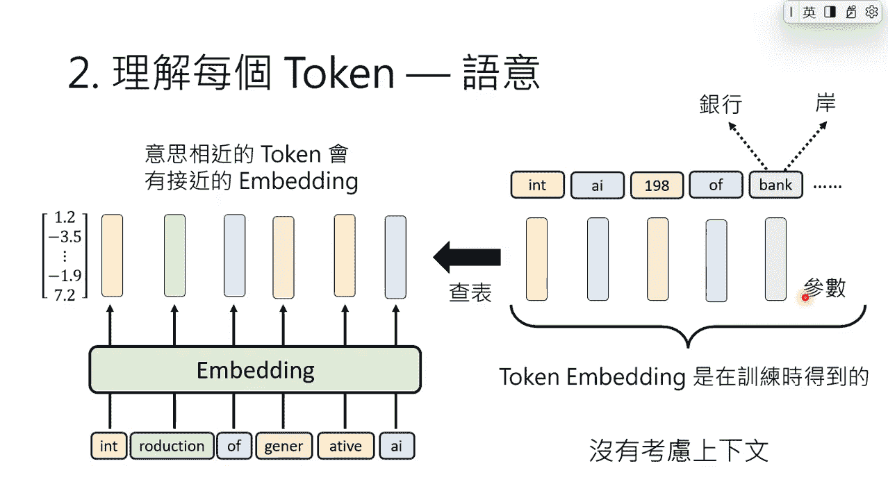

好那刚才是考虑了语义的资讯，那其实还需要考虑位置的资讯，我们需要知道每一个token，是在句子里面的哪一个位置，因为横的token在句子里面的不同位置，它可能会代表了不同的意思。

所以我们需要把未知的资讯也加到每一个，token的embedding里面去哦，那怎么把未知的资讯加到token的embedding，里面去呢，一个可能的做法是，为每一个位置也设置一个向量哦。

设置一个向量，设置一串数字代表位置一，另外一串数字代表位置二，另外一串数字代表位置三。

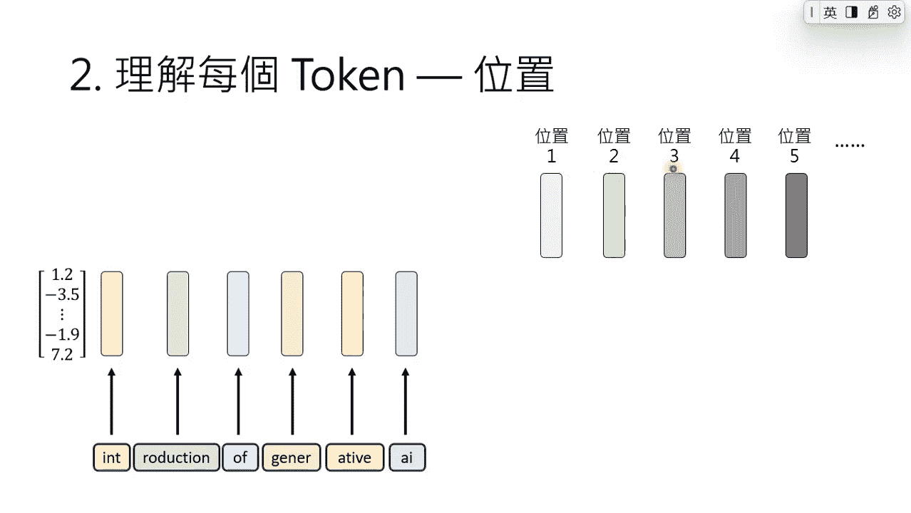

以此类推，接下来呢就把位置一的token的embedding，加上代表位置一的向量，那就等于是把位置一的资讯加进去，把位置二的资讯加进去，把位置三的资讯加进去，以此类推，那这样子。

你的embedding里面就不只有包含语义的资讯，也包含了未知的资讯，这些向量啊，这些向量呃，每一个位置会给它一个独特的向量，那这些向量呢又叫做positional embedding。

他们是代表了位置的embedding，那怎么找到这种positional embedding呢，你可以用人设哦，最早的这种transformer，他的token的embedded就是人设计的。

你自己决定好说位置一它的香料长什么样子，位置二它的向量要长什么样子，这个近年来呢，这个positional embedding也是可以学的。

你可以把positional embedding也当作参数的一部分，用你的训练资料，自动的找出这些positional embedded好。

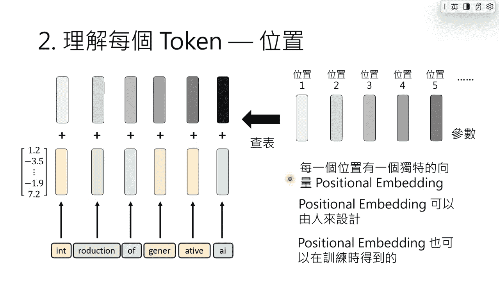

接下来第三步呢我们就要来考虑上下文，那这个可以考虑一整个句子，考虑上下文资讯的模组呢叫做attention，那刚才我们有讲过，说，最开始的这个token embedding，是没有考虑上下文资讯的。

所以不管是苹果电脑的果还是来吃苹果的果，他的token embedding都是一模一样的，不管这个果是代表苹果电脑，还是代表一个可以吃的苹果，它的token embedding都是一样的。

但在经过这个attention之后，attention会考虑整个句子的上下文，那苹果电脑的果跟来吃苹果的果，因为他们上下文不一样，所以这两个果通过了attention之后。

他们的embedded就会变得不一样，这种有考虑上下文的embedding呢，又叫做contextualized的embedding，就你用contextualize意思就是有考虑上下文的。

这个时候同的token语义不一样，那比如说bank有可能是银行，有可能是河岸，当它代表的意思不一样的时候，可能就可以有不同的embedding。

那这种embedded叫做contextualized的token，Embedding。

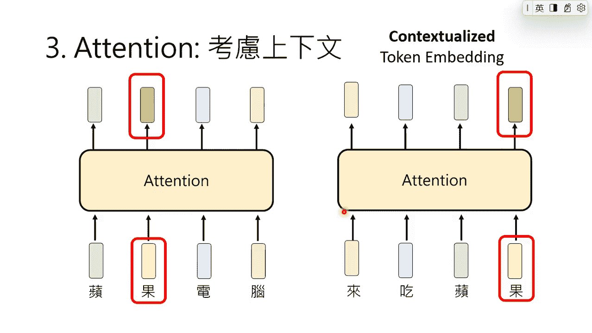

而讲到这个attention，就有一篇赫赫有名的文章，叫做attention is all you need，那这是上古时代的文章了，是2017年发表的，那很多人误以为是这一篇文章。

提出了attention这个想法啊，其实这是一个误解了，在早在有这篇文章之前，attention就是语言模型里面常常使用的一个机制，只是过去觉得说attention要搭配RNN一起使用。

才能够发挥比较好的结果，那attention is all you need这篇paper，他真正的贡献是告诉世人说，其实可以把RNN拿掉，他说我把RN拿掉，结果没有比较差，那时候大家都惊呆了。

原来可以不用RNN呐，那因为RN本身训练的时候，有一些训练上的效能的限制啊，所以当时人们是希望可以拿到RN的，所以attention is all you need。

真正的贡献并不是发明了attention，而是发现不需要使用RNN，那从它的名字里面也可以看出来，它的名字叫做attention is all you need，就告诉你说他只用attention。

就告诉搞定了语言模型，这个任务他不需要再使用RNN这样的技术哦。

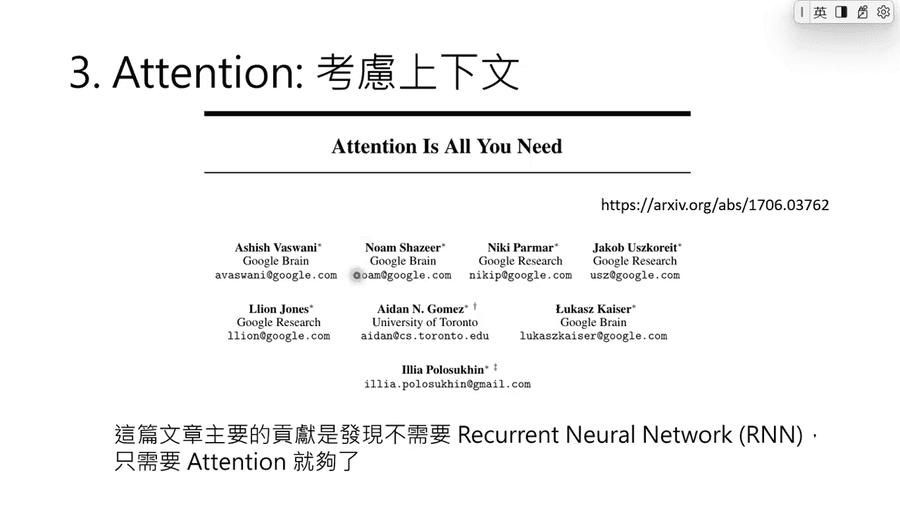

那接下来我们就来看一下，这个attention是怎么运作的，是怎么考虑上下文的，那假设等一下讲的东西你听不太懂的话，反正你就记住attention做的一件事情，呃。

呃你就记住attention做的事情就是输入一排向量，在这一排向量里面，每个向量都代表一个token，那它会输出另外一台一样长度的向量，那对每一个token来说。

就是把上下文的资讯加进他的embedded里面去，好假设你等一下讲的东西听不懂的话，就记得这个大原则就可以了，好，那接下来我们就来深入看一下，attention是怎么运作的，我们来看一下。

当我们看中间这个embedding进入attention的时候，是发生了什么事，让他得出输出的这个embedding。

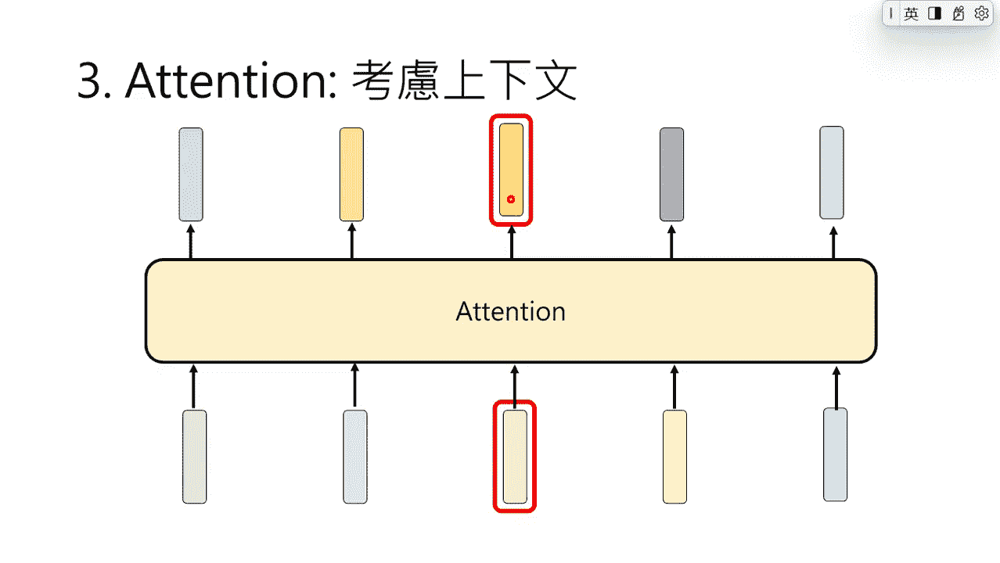

好在attention这个模组里面，第一件要做的事情，是要先从整个句子里面找出相关的token，所以会有一个叫做计算相关性的模组，这个模组他做的事情，就是把你现在要考虑的这个embedding读进去。

再把整个句子里面的某一个，token的embedding读进去，他就会输出一个分数，这个分数代表这两个token之间的关联性，那这个分数是怎么计算出来的呢，那这个计算相关性的模组它也是一个韩式。

我们这边用F来表示它，它输入就是两个embedding，输出就是一个分数，那这个F里面呢是有参数的，所以它也是需要学的，这个F里面是有参数的，怎么计算相似性，也是透过训练资料所得到的好。

那总之我们现在有一个可以计算相似性的模组，给他两个token ebedding，他就告诉你说这两个token embedding有多相近。

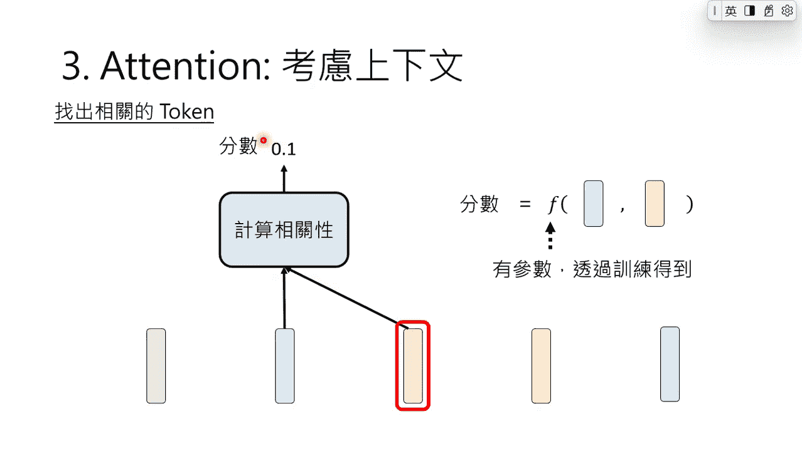

那接下来呢，你就会把这个向量跟这个句子里面的，每一个向量，包括他自己都来计算一下相关性。

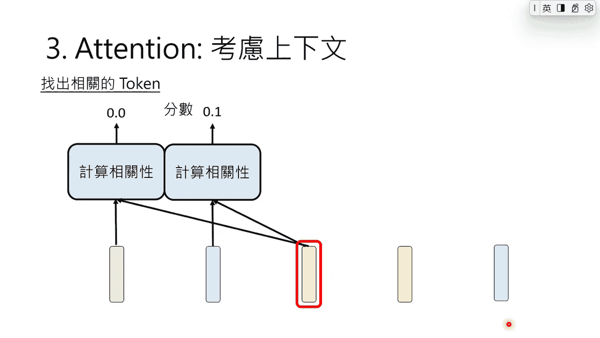

跟每一个向量都计算相关性，那这个相关性呢有一个名字叫做attention的weight，而总之中间这个向量会跟每一个向量，计算一个相关性。

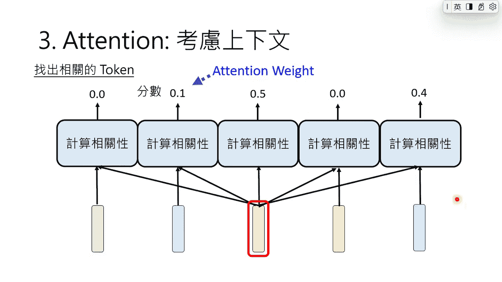

这个相关性呢叫做attention的weight，那计算出这个attention的weight以后，下一步要做什么呢，下一步就是根据这个attention的weight。

把这个句子里面的embedding加起来，这一个embedding它的位置是0。1，这个embedding是0。5，这个embedding是0。4，你就把0。1乘上这个向量，把0。5乘上这个向量，0。

4乘上这个向量全部加起来，就是你的attention的模组的输出哦，所以输入这个向量怎么得到它的输出呢，就是先计算出attention，根据attention的权重做WAKSON。

然后就得到你现在这个attention的模组的输出，等于就是先看看哪些资讯是相关的，再把相关的资讯集合起来，就是attention这个模组的输出哦。

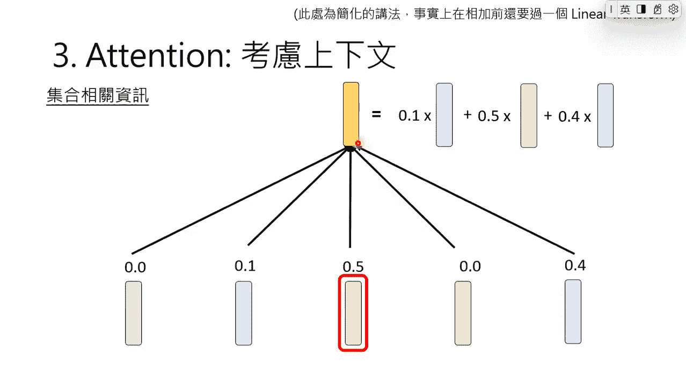

那刚才是举说输入中间这个怎么得到输出，那我们再呃我们再反复看一下，如果那如果是得到右边数来做第二个向量。

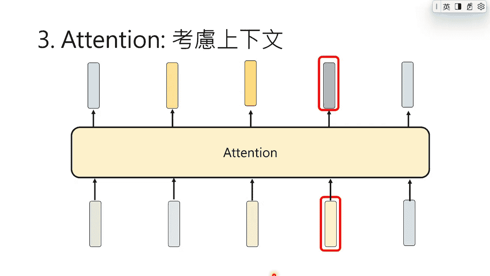

怎么得到它的输出呢，那跟刚才的原理是一样的，就拿这个向量去跟其他所有的向量都去计算。

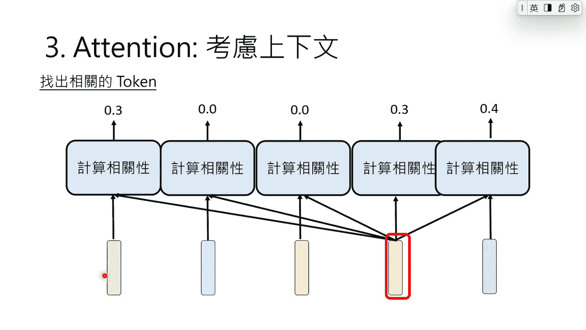

相关性，有了这些相关性以后，你就可以做VK上把绿色的向量乘0。3，加黄色的向量乘0。3，加蓝色向量乘0。4，全部加起来就得到这个位置，attention module的输出好吧。

相关的资讯集合起来就得到这个位置，attention module的输出啊，这个是attention这个模组的基本概念，当然这边其实做过一些简化了，如果你真的想了解他。

可以再参考原始论文或过去上课的录音哦。

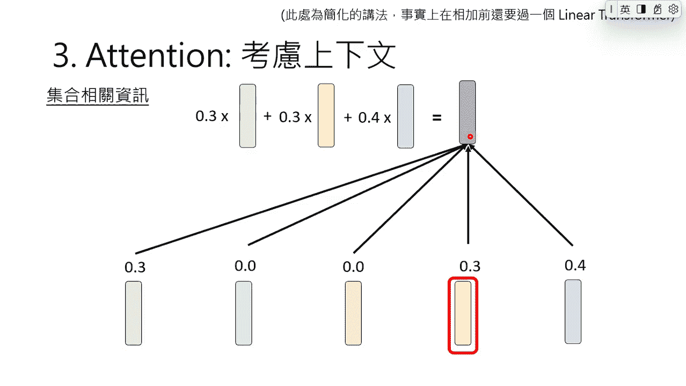

那根据刚才的讲法，我们需要计算所有token两两之间的相关性，也就是我们需要计算所有token，两两之间的attention位，所以第一个vector要跟这五个vector计算attention位。

第二个vector要跟这五个vector计算attention为，以此类推，所以现在假设有五个vector的话，我们就会计算出5×5，总共25个attention weight。

那这些attention way的集合起来也是有名字的。

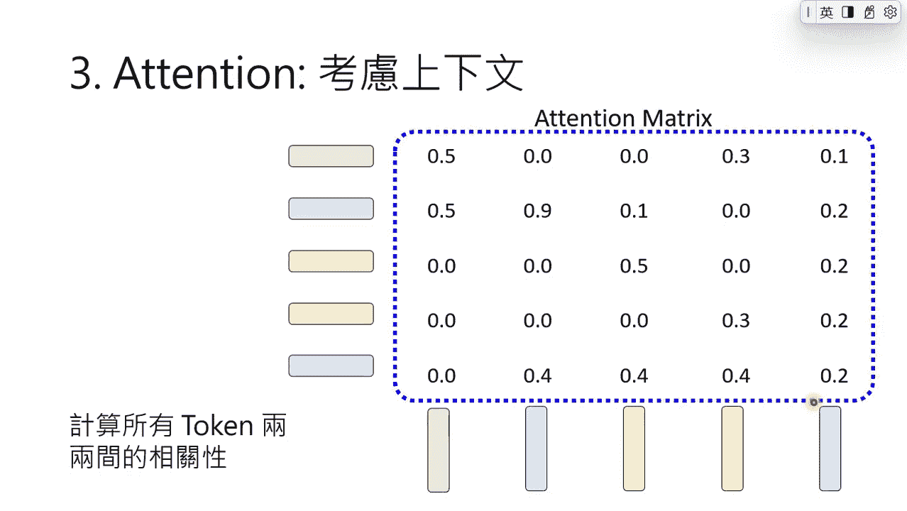

叫做attention的matrix，但实际上语言模型在实做的时候，我们只会考虑每一个token的左边，也就是每一个token前面的那些token。

我们计算某一个token的attention weight的时候，不会去管它右边的token，只会管它左边，也就只会管它在这个句子前面的token，那为什么会这样，等一下再为大家揭晓，我们先无视这件事。

我们先无视这件事哦，那这种只考虑前面，也就是左半边的token的这种attention呢。

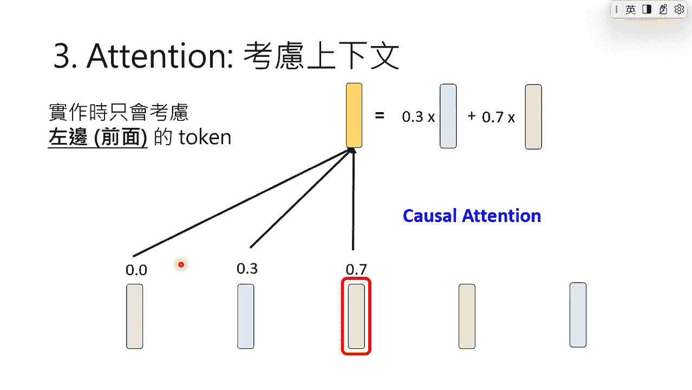

它是有名字的，它叫做coal attention，好，那attention里面其实还有一个特别的设计，叫做morty head attention，那今天其实我们的语言模型用的都是MORI。

Head attention。

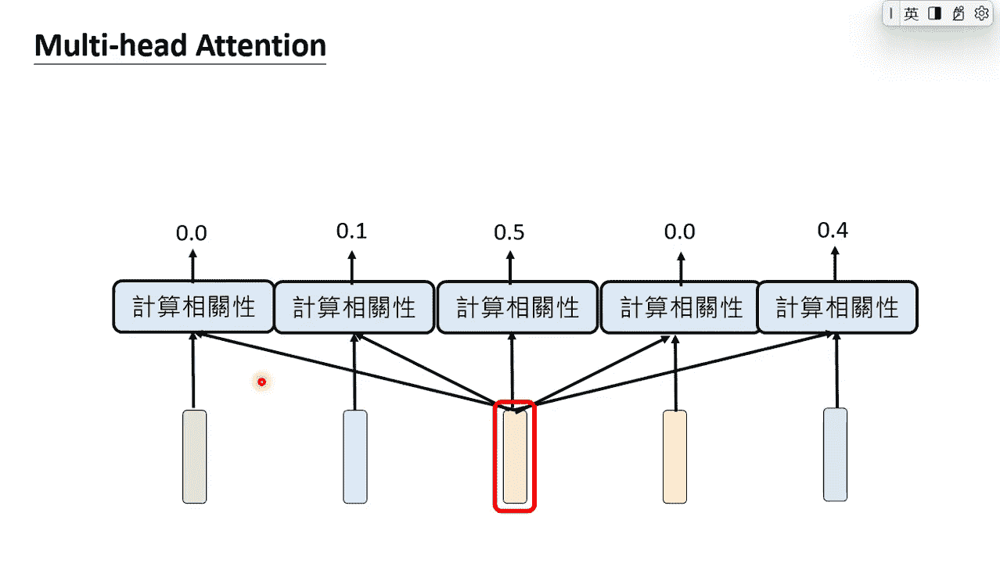

那为什么要考虑more i head attention呢，因为相关性是不止一种的，你要问两个词汇的相关性，那所谓的什么叫做相关，是可以从不同面相来看待的，比如说dog和cat啊，都是动物。

所以它们相关dog跟bark它也相关，为什么，因为bark是狗可以做的一个动作，所以他们也是相关，但这个跟狗跟cat的关联性是不一样的，所以关联性有很多种，用一个只用一个计算关联性的模组。

可能没有办法准确的计算关联性，所以怎么办呢，我们需要有多个计算关联性的模组，所以刚才只用蓝色的这个计算关联性的模组，计算出attention weight，这是不够的，还需要其他的计算关联性的模组。

这边假设有另外一个黄色的计算关联性的模组，它可以计算出另外一组的attention的way哦，就是另外一个计算关联性的模组，它里面也有他自己的参数，这些参数也是透过训练资料学出来的。

那如果透过训练资料学出另外一组参数，那这个黄色的模组就会计算出另外一组，跟蓝色的模组不一样的，attention的位，实际上在实做的时候，这个mod i have attention呢也不会只有两组。

通常也至少会弄个16组啊，这么多哦，所以是非常多组的这个attention weight好。

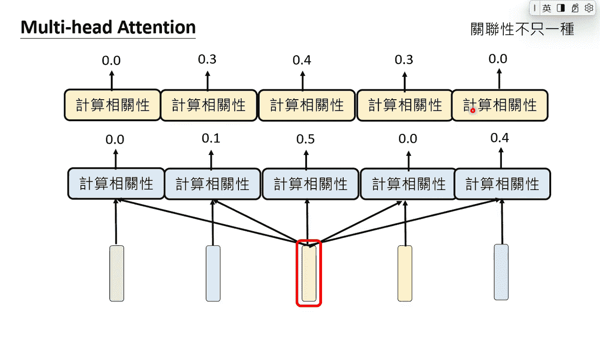

那接下来呢就根据每一组attention weight，去做WAKEUP，那在刚才的例子里面，只针对第一组attention we做wait su。

那如果我们有第二组attention weight的话，你也要对第二组attention weight做wait song，第二组attention会说蓝色的要乘0。3，红色要乘0。4，黄色的要乘0。

3，加起来也就得到另外一个输出。

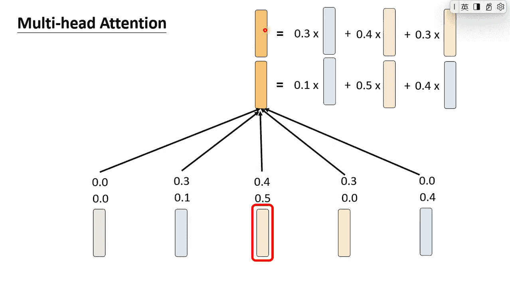

所以实际上呢这个attention mojo，给我们的不是只有一组输出，而是多组输出，每根据每一种关联性都会给我们一组输出好，那attention的这个module呢。

attention的这个模组给我们多种输出以后，接下来我们需要再整理一下。

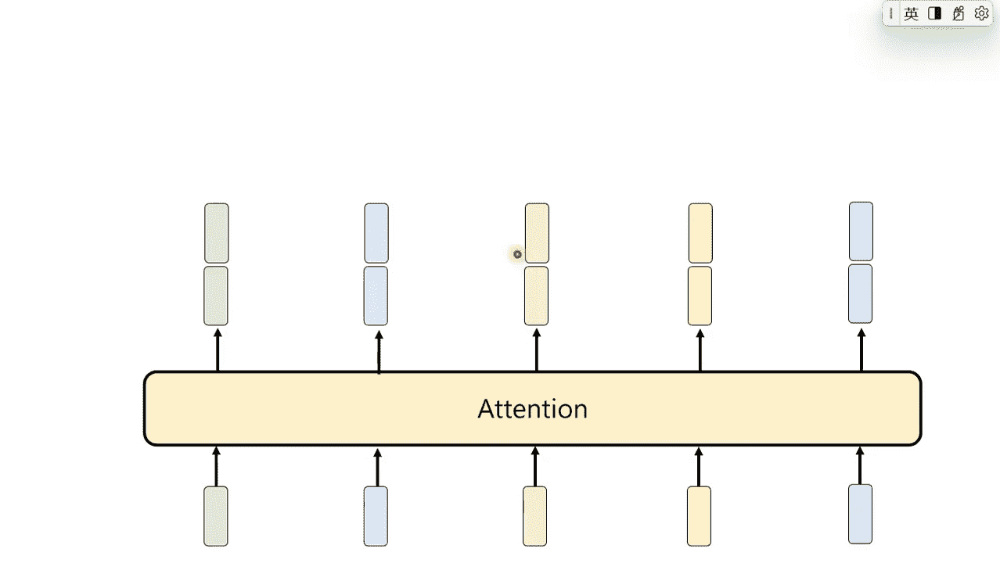

把多种输出把它整合起来，所以你这边需要另外一个模组，这个模组是一个feedforward network，那这个feedforward network做的事情，就是把这个attention的输出呢。

这个多个向量呢通通丢进去，综合考虑一下，最终输出一个向量出来，把多个embedding综合考虑一下，输出一个embedding出来，那attention加上FEEDFORWARD这个模组。

FEEDFORWARD这个模组也是一个neural network，其他里面也有很多层，那里面是有很多的参数，这些参数也是透过训练资料被学习出来的，然后呢。

这个attention的模组加上FEEDFORWARD模组合起来呢，就叫做一个transformer的block，所以这是一个transformer里面的单位，基本单位。

那一个transformer里面。

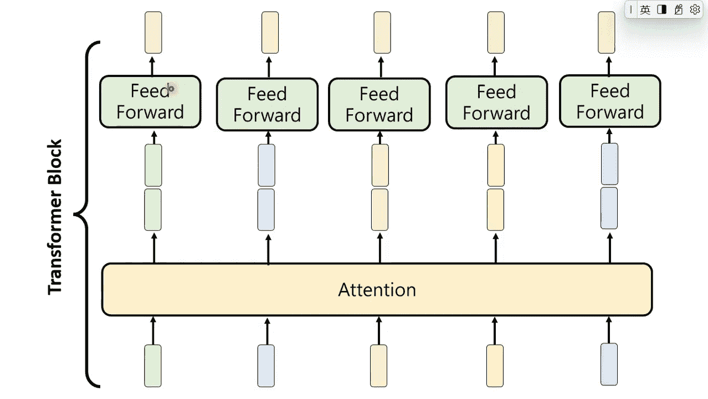

不会只有一个transformer blog，会有多个transformer blog哦，所以一开始我们通过这个呃，呃这个呃第一个模组是做那个token ization。

第二个模组是token embedded，得到第一组的token embedding以后，你就会通过transformer的blog里面有attention，有feedforward network。

你会得到另外一组embedding，这种embedding是考虑过上下文的，Embedding，光通过一个transformer plus是不够的。

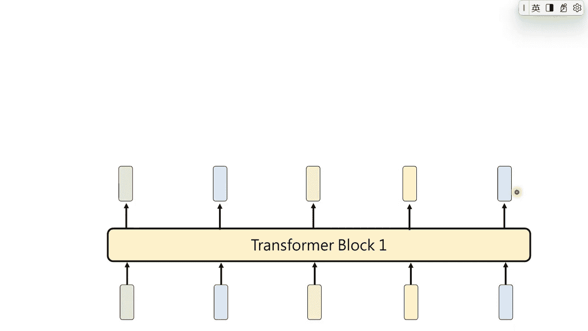

你会把它再通过下一个transformer bug，一直一直下去，就看你要兜几个transformer bug，你就可以通过几次transformer bu，那通常在文献里面。

每一个transformer bug我们会成为一个layer啊，虽然实际上如果从neural network的角度来看，一个transformer bug里面也有很多层的。

已经有很多层的neural network国，在文献上，通常一个transformer bug就视为一个layer哦，所以输入的这个embedding，会通过多个transformer block。

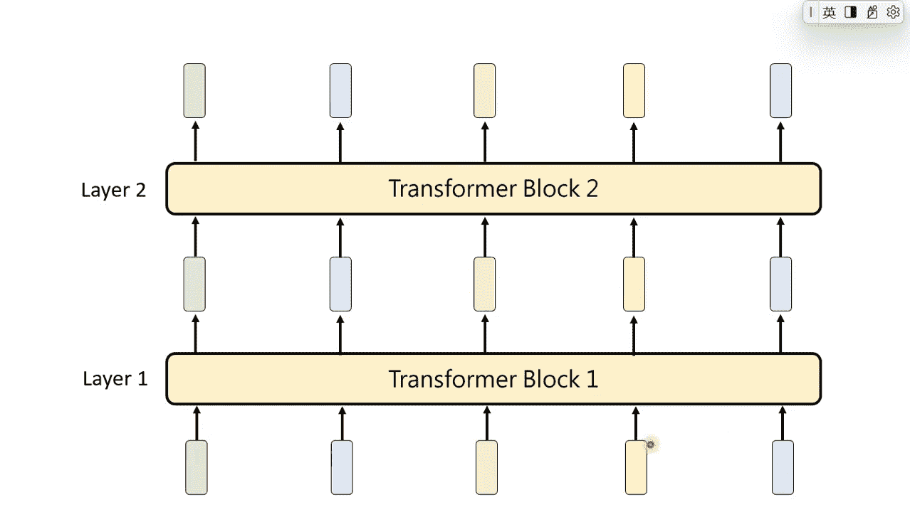

一直到通过最后一个transformer block之后。

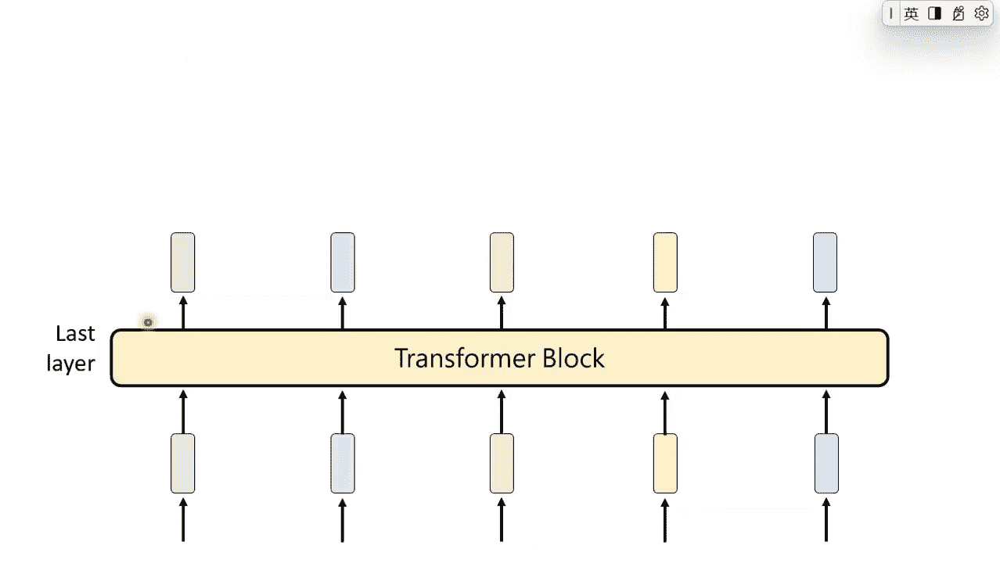

把句尾的这一个向量拿出来，再把句尾的向量呢通过一个output layer，Output layer，它也是一个function，这个function里面做的事呢，是不好意思，这边打错了。

这是linear transform，不是leading a transformer，应该linear transform，这个output layer里面呢有一个linear transform。

有一个soft max，然后呢会得到一个几率的分布，那如果这个地方你没有听得很懂的话，反正就是把这个transformer block，最后一层的最后一个输出丢给另外一个模组。

这个模组呢就会输出一个几率分布给我们好，那所以到目前为止呢我们就知道了一句话，一个句子从输入到transformer，一直到最终输出一个几率分布，代表下一个token应该接哪一个token的几率。

这整个过程到底发生了什么事。

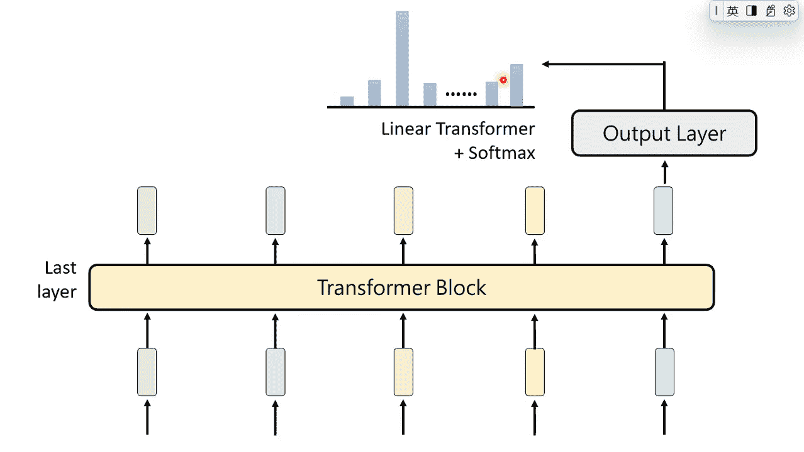

而接下来呢我要回答的问题是，为什么语言模型在做attention的时候，只考虑他左半边，只考虑它前面的token呢，那就要回到语言模型的运作的基本逻辑了，我们知道语言模型在运作的时候，它就是做文字接龙。

所以当你问CHEGBT，问语言模型一个问题的时候，他实际上看到的输入可能是user冒号哦，你打的文字AI冒号，然后接下来语言模型要做文字接龙，它可能先接触第一个token叫做w one。

那接下来他会把w one再当做输入，再让语言模型根据这一整串的文字，再做一次文字接龙，就输出WQ再把w two贴到刚才的句子，刚才的输入后面变成有这一整串输入，再让语言模型再去做一次文字接龙，以此类推。

直到产生结束这个符号，这是语言模型产生答案的过程，那现在我们已经知道，语言模型背后运作的机制了，那我们再来想一次语言模型是怎么运作的，当你输入这一串文字是怎么产生w one的呢。

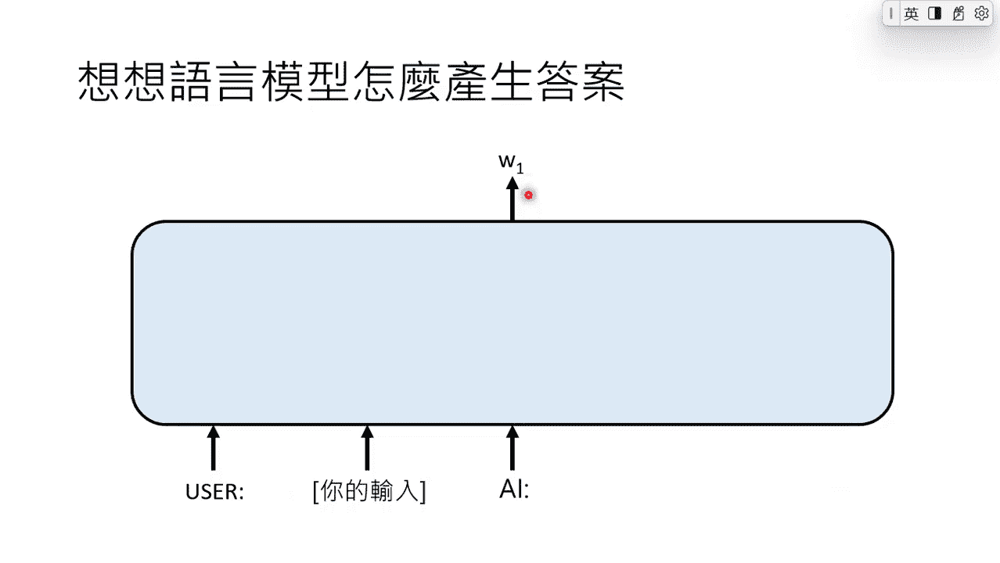

里面有一大堆的transformer的block，每个transformer block里面有attention跟FEEDFORWARD，network模组，那在attention这个模组里面。

AI这一个token，它是在这整个句子最右边的那个符号，所以它会跟在他左边的所有的符号，去计算相关性，去计算attention的week，那这个计算attention weight的过程。

会在每一个transformer block里面反复发生，transformer block有好多个啊，直到最后产生一个token出来，而产生这个token之后。

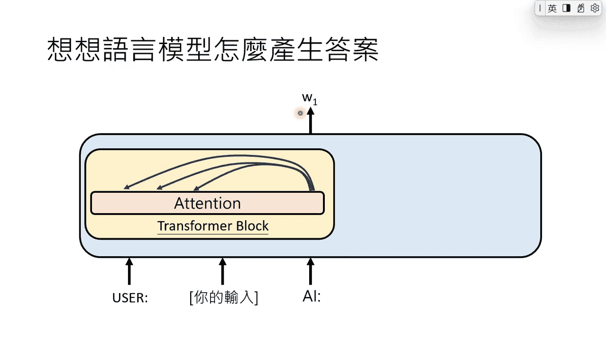

你会把这个token变成输入，也会把这个token串在原来的输入后面，再把同样再把这一串句子，输入给同样一个语言模型，那因为输入的语言模型是一样的，所以你再想想看AI这个token。

它跟左边的这些token之间的相关性，刚才已经算过了，所以当你输入一个新的句子是user，输入AI后面再加上w one的时候，AI跟左边这一些token，他之间的关联性已经不用再计算第二次了。

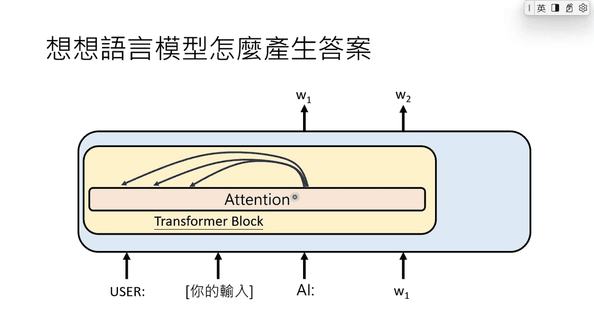

所以这边的关联性，AI跟左边这些token的关联性是算过的，你完全不需要再算一次，刚才在前一个步骤，在刚才在前一个时间点产生w one的这些attention，把它记录下来就好了。

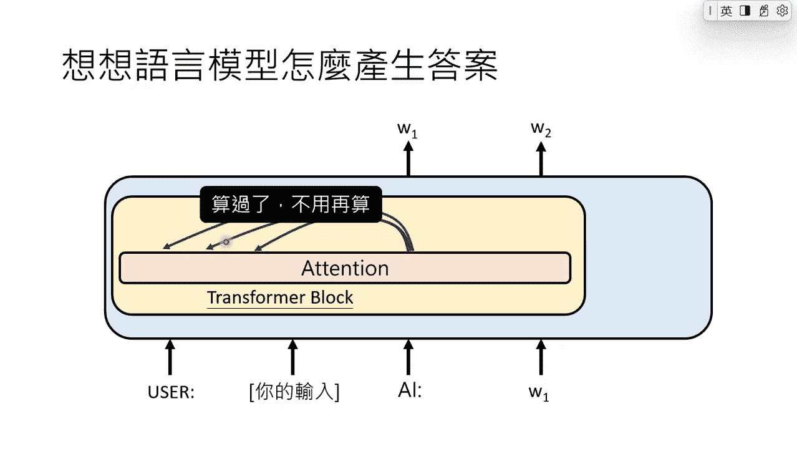

不需要再重算第二次哎，哎你需要重算AI冒号，这个token跟w one之间的attention，因为这是刚才在前一步产生w one的时候，没有计算过的东西，这是需要耗费额外的资源来进行计算的。

但能不能够干脆就不要算了呢。

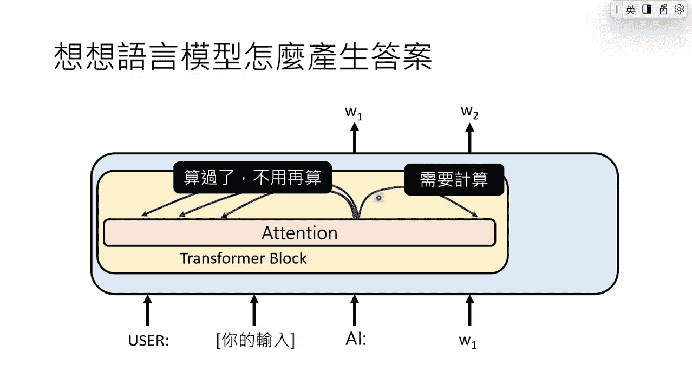

可以。

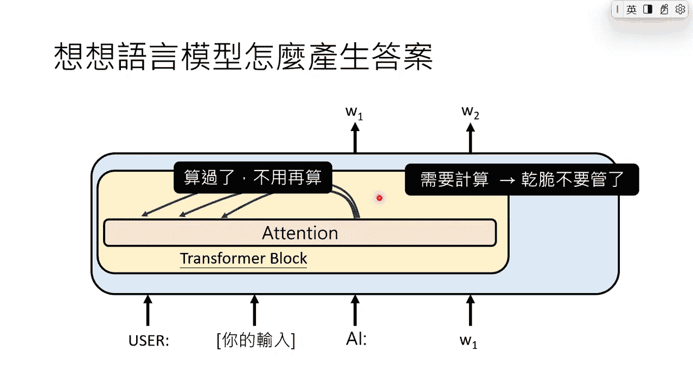

所以现在就是发现说，你根本不需要再去管AI跟w one的attention，管AI跟他左边的attention就好了，你可能想说诶，如果我attention算多一点，我能不能用算力来交换更好的结果呢。

让AI不只考虑，让AI这个token不只考虑左半边这些token，连新出的这些token也考虑，我应该会得到更精确的结果吧，那现在的实验就是告诉你说呃，一过去确实有一些模型采取了类似的做法。

他不只考虑左半边的attention，他会把完整的attention都算出来，但是现在看起来这些模型的表现并没有比较好，而确GBT那个系列的语言模型，都是只考虑左半边的attention。

所以而他们的表现是非常惊人的，所以现在的认知就是，你其实不需要再多计算额外的attention，把刚才有计算过的，就跟左边这些token的attention保留起来就足够了。

好那你现在了解了语言模型的机制以后，你就知道，为什么处理超长的文本会是一个巨大的挑战，你知道今天各路各大语言模型在炫耀他们，语言模型的效能的时候，往往其中一个炫耀的指标，就是它可以读多长的文本啊。

那为什么输入超长的文本会是一个挑战呢，如果你了解attention的运作机制，你就会知道到底困难出在哪里，到底困难出在哪里呢，困难出在说，假设你今天输入是100K的token，对于你的语言模型来说。

它里面的attention的模组，不是把100K的token读过就算了，他需要把100K的token两两之间去计算attention，所以它需要计算attention的次数。

是你输入长度的平方是100K的平方哦。

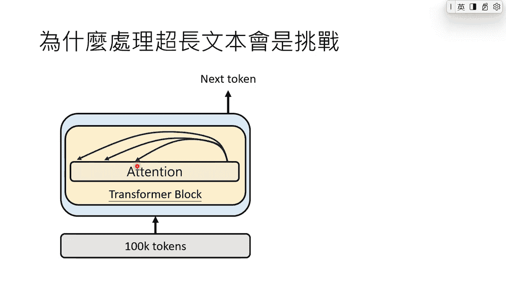

所以假设你把文本的长度当做横轴，计算attention的次数当做纵轴的话，你会发现说计算attention的次数，它的增长是非常快的，而计算attention的次数，是跟文本的长度的平方成正比的哦。

所以你会发现说计算attention的次数，它的成长是非常迅速的，这就是为什么要处理长的文本，会需要耗费大量的算力，而这个算力的耗费并不是跟文本的长度成正比，而是跟文本长度的平方成正比。

这就是为什么你处理超长的文本会是一个挑战。

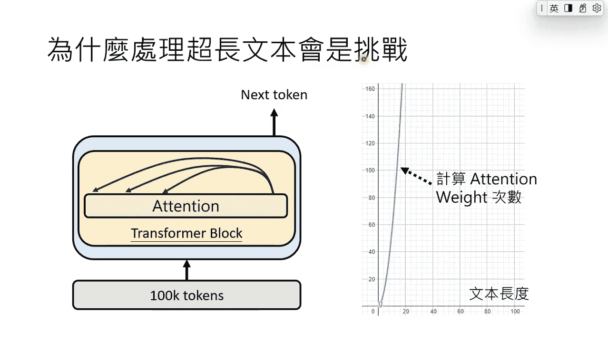

好，那今天这个他这一堂课呢，就是跟大家非常简单的介绍了attention的机制，那为下一堂课呢做铺垫哦，那有一些呃特别值得关注的研究方向，那比如说我刚才讲说attention。

它是一个非常耗费算力的东西，因为它跟输入文本的长度的平方成正比，所以怎么加快attention的计算，就变成一个非常关键的议题，那如果你想了解怎么加快attention的计算的话。

可以看我过去上课的录音，我对加快技术attention计算的方法，做了一个非常完整的整理哦，那近年来也有一些文献表明，他们期待能够做到无限长度的attention啊，这个听起来就非常帅。

他可以做无限长度的attention，那这件事要怎么做呢，我这边就是留了两篇文献给大家参考，这两篇文献采取的是截然不同的做法，就告诉你说要研究怎么把attention做好。

今天仍然有非常多可以思考的方向，另外呢要收集超长的文本，这超长的文本你可能可能很难收集到非常多了，我们有没有可能在训练语言模型的时候，训练在比较短的文本上，但是在测试的时候，他读得懂比较长的文本呢。

虽然他在练习阅读的时候都只看过短篇小说，但是他能不能够在练习完之后读长篇小说，也没有问题呢，能不能够train short test long呢，那有一系列的技术来告诉你。

怎么达到sure testle这件事，那我就把一些比较重要的文献列在这边，给大家参考，那transformer不一定是语言模型最终的答案，今天还有其他可能的类神经网络的架构，正在研究中。

看看有没有办法取代attention，那其中比较知名的就是member系列，ma系列啊，它其实跟recurrent neural network很像，只是他去掉了recurrent network。

训练的时候比较没有效率的那个问题，所以感觉如果member复兴的话，就像是recurrent neural network，you回来了。

就之前attention取代了recurrent neural network，现在recurrent neural。

recurrent neural network又要回来取代掉attention了哦，那还有一个最近有一个模型叫做JA，他就是MANA的一个延伸了。

就可能会说attention和recurrent neural network，一定是互斥的吗，能不能把它结合起来，其实肩膀就是把把那个member。

也就是类类似return neural network的东西，跟那个transformer结合起来啊，这个都是非常新的论文，总之这个部分呢，我们今天就不适合在今天的课堂上细讲。

这个日后有机会再跟大家分享啊。

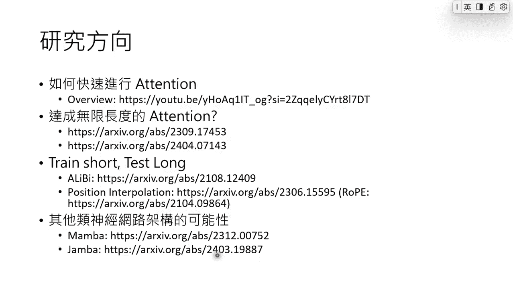

今天最主要想跟大家讲的就是，conformance背后的运作机制。

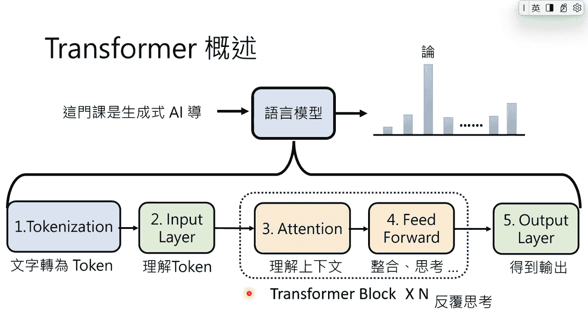

一个句子读入语言模型的时候，它是怎么通过一连串的步骤。

