# 李宏毅2024春《生成式人工智能导论》 - P24：（延申）Transformer (下) - 啥都会一点的研究生 - BV1BJ4m1e7g8

好各位同学大家好，我们来上课吧，好那接下来啊我们要讲decoder啊，那我们上上周已经讲了encoder，那接下来呢我们要讲decoder，那decoder呢其实有两种啊，等一下呢会花比较多时间介绍。

你比较常见的这个叫做auto regressive的decoder啊。

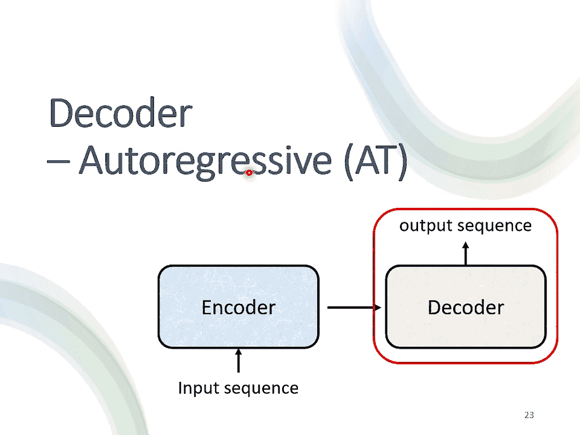

那这个auto regressive decoder是怎么运作的呢，那等一下我们是用语音辨识来当做例子，来跟大家说明，不过用在作业里面的机器翻译，其实是一模一样的，你只是把输入输出改成不同的东西而已。

好那语音辨识是怎么做的呢，语音辨识你知道语音辨识就是输入一段声音，输出一串文字哦，那你会把一段声音输入给顶coder啊，比如说你对机器说机器学习啊，机器收到一段声音讯号。

声音讯号呢进入encoder以后，输出会是什么呢，输出会变成一排vector，那我们上周花了很多时间讲，encoder里面有什么样的内容啊，它里面非常的复杂，如果你忘了的话就算了。

你就记得说encoder做的事情，就是输入一个vector sequence，输出另外一个vector sequence，那接下来呢就轮到decoder运作了啊，decoder要做的事情就是产生输出啊。

接下来轮到decoder产生语音辨识的结果，那decoder怎么产生这个语音辨识的结果呢，那decoder做的事情，就是把encoder的输出先读进去，那至于怎么读进去，那这个我们等一下再讲。

我们先你先假设3号就是用某种方法，把encoder的输出读到decoder里面，这步我们等一下再处理好，那decoder怎么产生一段文字呢，啊语音辨识机器的输出就是一段文字。

decoder怎么产生一段文字呢，那首先呢你要先给他一个特殊的符号，这个特殊的符号呢代表开始，那在助教投影片里面呢是写begin of sentence，所写是BOS，我这边会怕你不知道BOS是什么了。

所以我就把它的意思明确的写出来啊，就是开始就是begin的意思，那这个是一个special的token，你就是在你的那个啊lesson里面呢，你就在你可能本来decoder可能产生的文字。

里面呢多加一个特殊的符号，多加一个特殊的字，那这个字就代表了begin，代表了开始这个事情好，所以decoder呢就吃到这个特殊的符号，那在这个呃机器学习里面呢，假设你要处理NLP的问题。

每一个token，你都可以把它用一个one hot vector来表示，one hot vector就其中一位是一家都是零，所以begin也是用one hot back来表示，其中一位是一其他实力好。

那接下来呢decoder会吐出一个向量，这个向量里面有什么呢，这个vector里面有什么呢，这个vector的长度啊啊它很长，它的长度呢跟你的vocabulary size是一样的。

这边有vocabulary则是什么意思呢，你就先想好说你的decoder输出的单位是什么，假设我们今天做的是中文的语音辨识，我们decoder输出的是中文。

那你这边的vocabulvocabulary size啊，可能就是中文的方块字的数目啊，那中文的方块字有多少呢，那不同的字典给你的数字可能是不一样的，那常用的中文的方块字大概两三千个。

那一般人呢可能认得了四五千个，那在更多都是罕见字，冷僻的字你可能看到也不知道他要怎么念，你平常写也写不出来哦，所以你就看看说，你要让你的decoder输出，哪些可能的中文的方块字，你就把它列在这边。

举例来说，你觉得这个decoder能够输出，常见的3000个方块字就好了，那你就把它列在这个地方，那不同的语言呢它输出的单位不见不会不一样，这个取决于你对那个语言的理解。

比如说英文你可以选择输出字母A到Z，输出英文的字母，但你可能会觉得字母这个单位太小了啊，有人可能会选择输出英文的词汇和英，英文的词汇是用空白作为间隔的，但如果这种词汇当做输出又太多了。

所以你会发现刚才在助教投影片里面，助教说他是用somewhere当做英文的单位，就有一些方法可以把英文的字首字根切出来，拿字首字根当做单位，那如果中文的话呢，我觉得就比较单纯。

通常今天你可能就用中文的这个方块字，来当做单位啊，那在这个向量里面啊，这个向量的长度就跟中文里面的方块字，你希望机器可以输出的方块字的数目，是一样多的啊，那每一个中文的字都会对应到一个数值。

那因为在产生这个向量之前呢，你通常会先跑一个soft max啊，就跟做分类一样啊，做分类啊，在得到最终的输出前，我们不是要跑一个soft max吗，诶跑一个soft max，所以这个向量里面的分数啊。

它是一个distribution，也就是呢它这个向量里面的值呢，它全部加起来总和呢会是一好，那得到这个向量以后还不是最终输出的结果，这个向量会给每一个中文的字一个分数。

那分数最高的那个中文字它就是最终的输出，他在这个例子里面啊，G的分数最高啊，所以G呢就当做是这个decoder第一个输出，然后接下来你把G当做是decoder新的input。

原来decoder的input只有begin这个特别的符号，现在它除了begin以外，它还有G作为它的input，那G呢也是表示成一个one hot vector，当做decoder的输入哦。

所以decoder现在还有两个输入，一个是begin这个符号，一个是G根据这两个输入呢，它就要得到一个输出，它输出一个蓝色的向量，根据这个蓝色向量里面，给每一个中文的字的分数。

那呃我们会决定第二个输出是什么啊，谁哪一个字的分数最高，他就是输出啊，气的假如气的分数最高，那气就是输出啊，那decoder接下来会拿气当做输入，然后现在decoder看到了begin，看到了鸡。

看到了气，那他接下来呢还要再决定接下来要输出什么，那他可能就输出血啊，这个过程就反复的持续下去，机器输入学以后学会再被当做输入，所以现在decoder呢他看到了begin，机器还有学。

那encoder这边其实也有输入了，那我们等一下再讲encoder的输入，encoder是怎么处理的，所以decoder看到encoder这边的收入，看到鸡看到气，看到血，决定接下来呢要输出席。

它会输出一个向量，这个向量里面习这个中文字的分数最高的啊，所以他就输出席啊，这个process呢就反复持续下去，而在这边有一个关键的地方，我们特别用红色的虚线把它标出来，也就是说。

decoder看到的输入，其实是他在前一个时间点自己的输出哦，decoder会把自己的输出当做接下来的输入，会把自己的输出当做接下来的输入，所以当我们decode在产生一个句子的时候。

他其实有可能看到错误的东西，人家看到的是自己的输出嘛，那如果今天decoder有语音辨识的错误，他把机器的气便是错成天气的气，那接下来decoder就会看到错误的辨识结果。

他还是要想办法根据错误的辨识结果产生，他想要产生的期待是正确的输出，那你可能会觉得说让decode看到错误的输入，让头decoder看到自己产生出来的错误的输入，在被decoder自己吃进去。

会不会造成问题呢，会不会造成error propagation的问题呢，所以error propagation的问题就是啊一步错步步错哎，就是在这个地方，如果不小心把机器的气不小心写成天气的气。

会不会接下来就整个句子都坏掉了，都没有办法再产生正确的词汇了，有可能，那这个等一下我们最后会稍微讲一下，这个问题要怎么处理，我们现在呢先无视这个问题，继续走下去好。

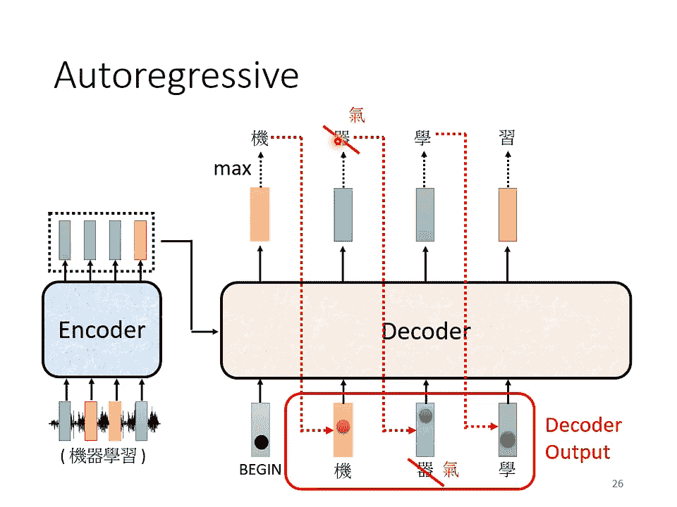

那我们这那我们来看一下这个decoder啊，它内部的结构长什么样，那我们这边呢把encoder的部分先暂时省略掉，那在transformer里面，decoder的结构呢长的是这个样子，看起来有点复杂。

比encoder还稍微复杂一点。

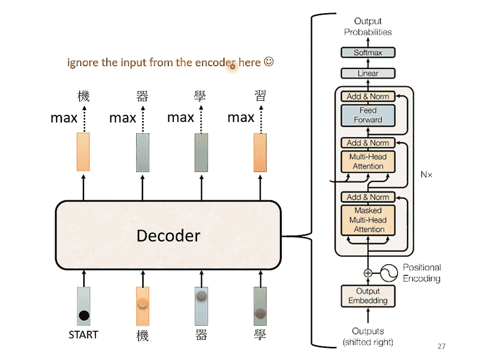

那我们现在先把encoder和decoder放在一起，稍微比较一下它们之间的差异，那你会发现说如果我们把decoder中间这一块，中间这一块把它盖起来。

其实encoder和decoder并没有那么大的差别，你看encoder这边moi head attention，然后at anofeedforward，At ano，重复N次。

encoder其实也是一样，当我们把中间这一块遮起来以后，我们等下再讲遮起来这一块里面做了什么事，但当我们把中间这块遮起来以后，A那decoder也是有个motor，Hattention。

And annv forward，然后and and NO，所以encoder和decoder其实并没有非常大的差别，除了中间这一块不一样的地方，被遮起来的地方以外。

其实encoder和decoder是一样的，那只是最后呢我们可能会在做一个soft max，使得他的输出变成一个几率，那这边有一个稍微不一样的地方，是在decoder这边呢。

More high head attention，这个block上面还加了一个mask，这个mask是什么意思呢。

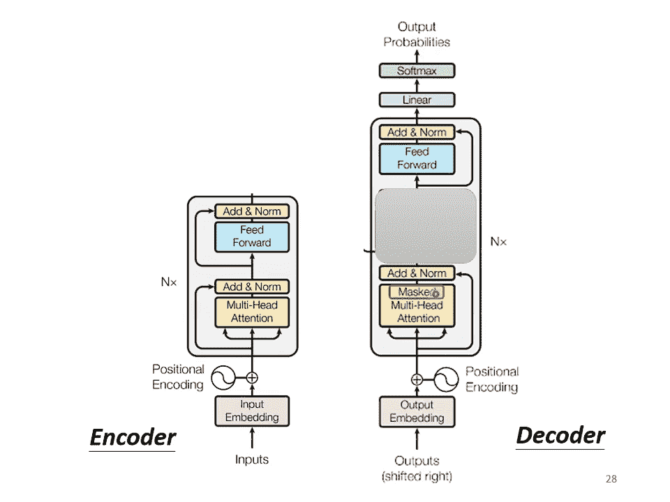

这个mask的意思是这样子的，这是我们原来的self attention input，一排vector output，另外一排vector，这一排vector。

每一个输出都要看过完整的input以后才做决定，所以输出b one的时候，其实是根据A1到a four，所有的资讯去输出b one。

当我们把self attention转成mask attention的时候，它的不同点在哪里呢，它的不同点是现在我们不能再看右边的部分，也就是产生b one的故事后，我们只能考虑a one的咨询。

你不能够再考虑A6A3A四产生b two的时候，你只能考虑a one a two的资讯，不能再考虑A3A4的资讯，产生B3的时候呃，你就不能考虑A4的资讯，产生B4的时候。

你可以用整个input sequence的资讯，这个就是mask的self attention，讲得更具体一点，你做的事情是这样，当我们要产生b two的时候，我们只拿b two的。

我们只拿第二个位置的query，去跟第一个位置的key和第二个位置的key，去计算attention，第三个位置跟第四个位置九，不管他不去计算attention，我们是这样子呃。

呃不去管这个a two右边的地方，只考虑a one跟a two，只考虑q one，Q two，只考虑k one，k two qq只跟K1跟k two去计算attention。

然后最后只计算v one跟v two的wait up，那当我们输出这个b two的时候，b two就是考虑了a one跟a two，就没有考虑到A3跟A4，那为什么会这样呢。

为什么需要加masking呢，这件事情其实非常的直觉，怎么说，你想想看我们一开始decoder的运作方式，它是一个一个输出，他的输出是一个一个产生的，所以是先有a one，再有A6，再有A3，再有A4。

这跟原来的self attention不一样，原来的self attention，a one跟A4是一次整个输进去你的model里面的，在我们讲encoder的时候。

encoder是一次把a one跟a four都整个都读进去，但是对decoder而言，先有a one才有A2，才有A3，才有A4，所以实际上当你有a two，你要计算b two的时候。

你是没有A3跟A4的，所以你根本就没有办法把A3A4考虑进来，所以这就是为什么在那个decoder的那个图上面，transformer原始paper特别跟你强调说，那不是一个一般的attention。

这是一个mask的self attention，意思只是想告诉你说decoder它的token，它输出的东西是一个一个产生的，所以他只能考虑它左边的东西，它没有办法考虑它右边的东西。

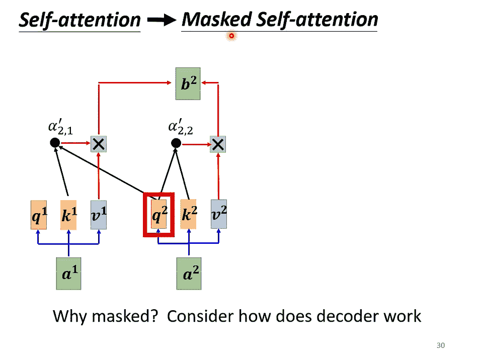

好但是讲到这里啊，呃我们讲了一下，我们讲了decoder的运作方式，但是这边呢还有一个非常关键的问题，最关键的问题是，decoder必须自己决定输出的sequence的长度。

可是到底输出的sequence的长度应该是多少呢，我们不知道，你没有办法轻易的从输入的sequence的长度，就知道输出的sequence的长度是多少，并不是说啊输入啊是四个向量，输出一定就是四个向量。

这边在这个例子里面，输入和输出的长度是一样的，但是你知道实际上在你真正的应用里面，并不是这样，输入跟输出长度的关系是非常复杂的，你我们其实是期待机器可以自己学到。

今天给他一个input sequence的时候，output sequence应该要多长，但在我们目前的这整个decoder的，这个运作的机制里面，及其不知道他什么时候应该停下来啊，它产生完习以后。

它还可以继续重复一模一样的process，就把习呢当做输入，然后也许decoder呢就会接一个冠，然后接下来呢就一直持续下去，永远都不会停下来啊。

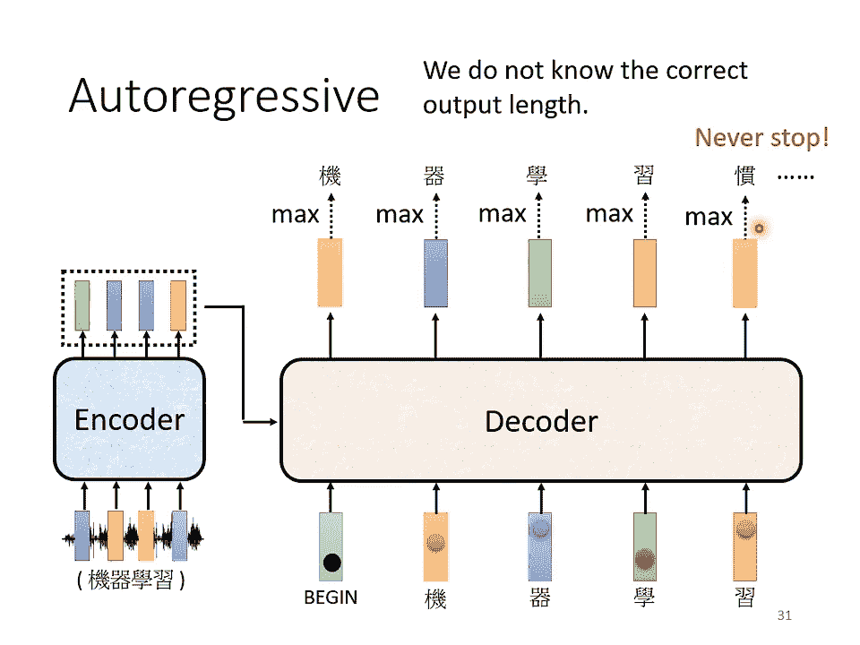

这让我想到什么呢，这让我想到推文接龙了，我不知道大家知不道是什么，这是一个这个古老的民俗传统了。

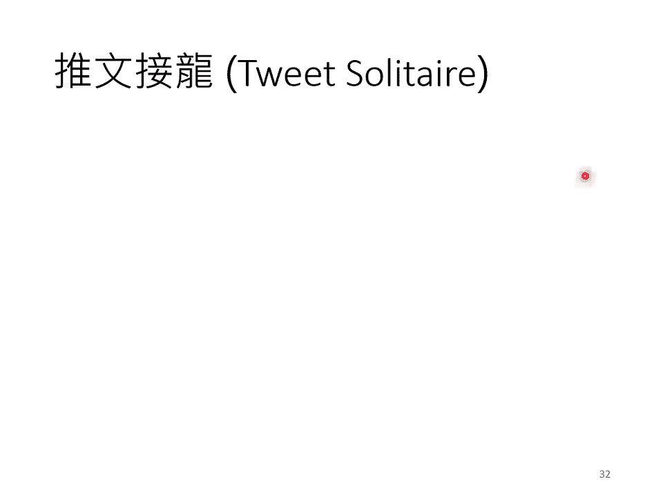

还流传在PTT上面啊，这个民俗传统是怎么运作的呢，就有一个人呢先推个中文字啊，推一个超，然后接下来呢就会有另外一个乡民呢，去推另外一个字，然后可以接上去的，所以就就可以产生一排的词汇了，一排字啦。

就是超人，正大冬天外飞仙草，不知道在说些什么啊，这个是cos呢，可以持续好几个月都不停下来，我也不知道为什么啊。

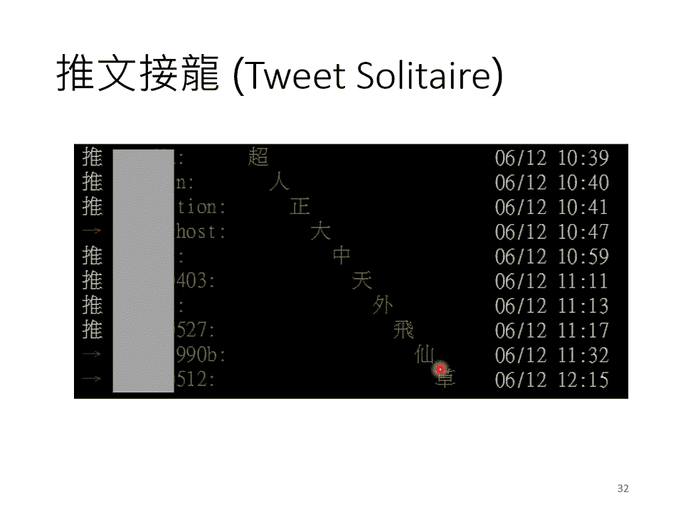

那怎么让这个process停下来，那要怎么让他停下来呢，要有人冒险去推个段，推个段他就停下来了哦，所以我们要让decoder做的事情也是一样。

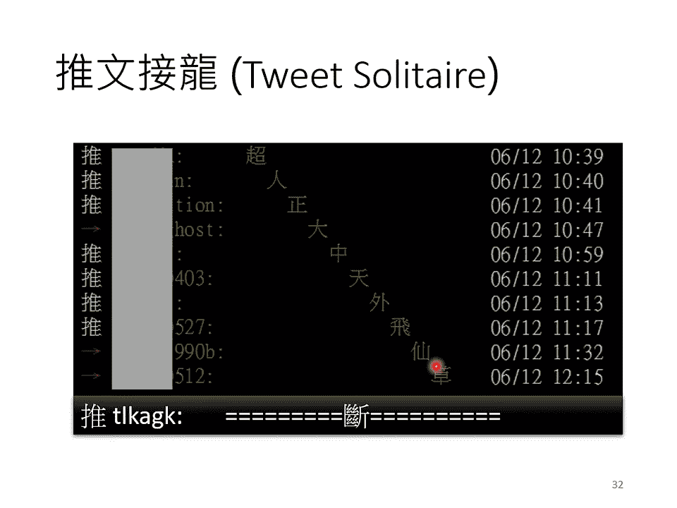

要让它可以输出一个段，所以你要特别准备一个特别的符号，这个符号呢就叫做段啊，我们这边呢用END来表示这个特殊的符号，所以除了所有中文的方块字，还有begin以外，你还要准备一个特殊的符号叫做断。

那其实在助教的城市里面呢，它是把begin和end，就是开始跟这个段用同一个符号来表示，反正这个啊这个begin只会在输入的时候出现，断，只会在输出的时候出现，所以在助教城市里面。

如果你仔细研究一下的话，会发现说end和begin用的其实是同一个符号，但你用不同的符号也是完全可以的，也完全没有问题，好，所以我们现在呢这样，decoder它可以输出段这个符号，输出and的这个符号。

那我们期待说当今天呢产生完习以后，再把习当做decoder的输入以后，decoder就要能够输出段，也就是说当把C当做输入以后，就decoder看到encoder输出的这个embedding。

看到了begin，然后机器学习以后看到这些资讯以后，他就知道说这个语音辨识的结果已经结束了，不需要再产生更多的词汇了，它产生出来的向量里面，这个and就是断的那个符号，它的几率必须要是最大的。

然后你就输出段这个符号，那整个运作的过程，这个decoder产生sequence的过程就结束了，好那这个呢就是auto regressive的decoder，它运作的方式好。

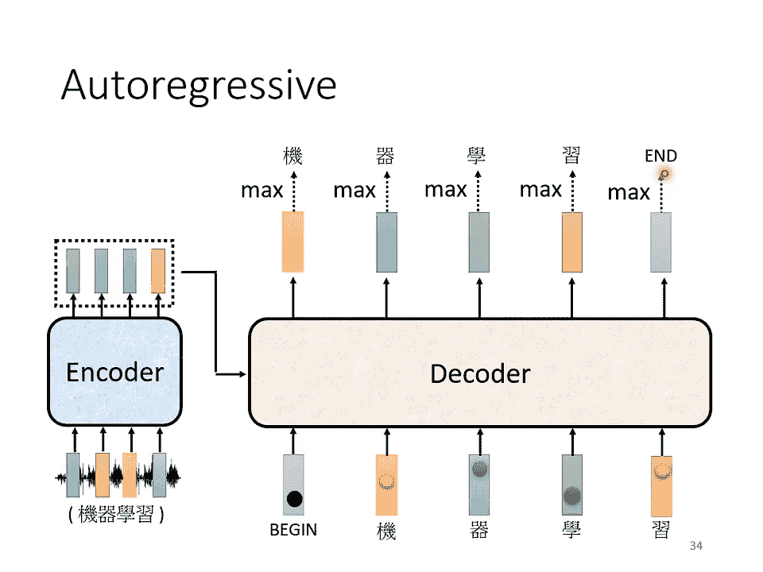

那接下来呢我们用两页投影片，非常简短的讲一下nauto regressive的model啊，那auto regressive model呢通常缩写成NAT啊。

所以有时候auto regressive的model也缩写成AT。

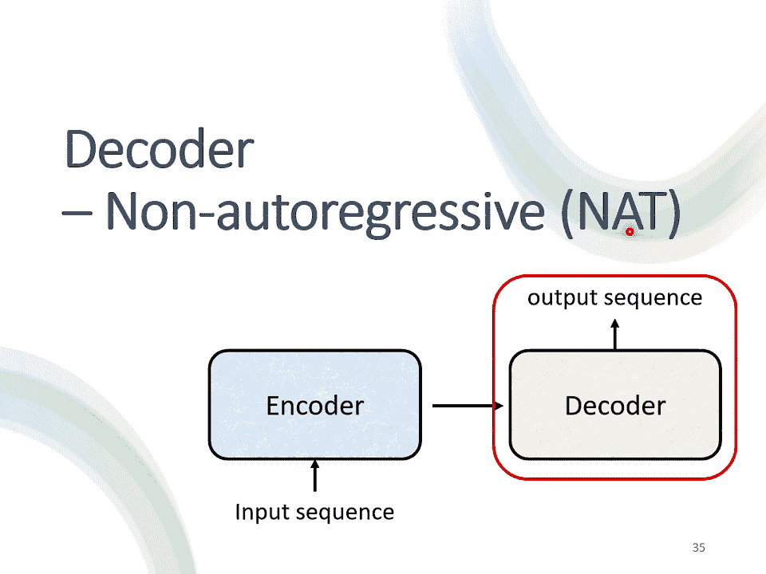

那auto aggressive the model是怎么运作的呢，这个auto regressive model是先输入begin，然后出现w one，然后再把w one当做输入，再输出w two。

直到输出N的位置，那NAT是这样，它不是一次产生，就假设我们现在要产生的是中文的句子，它不是一次产生一个字，它是一次把整个句子都产生出来，怎么一次把整个句子都产生出来呢，NT的decoder啊。

他可能吃的是一整排的begin的token，你就把一堆一排begin of token都丢给他，让它一次产生一排token就结束了，举例来说，如果你丢给他四个begin的token。

它就产生四个中文的字，变成一个句子就结束了，所以他只要一个步骤就可以完成句子的生成啊，这边你可能会问一个问题，刚才不是说不知道要有多少输出的长度，应该是多少吗，那我们这边怎么知道begin要放多少个。

当做a native decoder的输入呢，没错这件事没有办法很自然的指导，没有办法很直接的指导，所以有几个，所以有几个做法，一个做法是你另外弄一个classifier。

这个classifier呢它XENCODER的input，然后输出是什么，输出是一个数字，这个数字代表decoder应该要输出的长度哦，所以你就扔一个classify。

这个classify可能吃encoder的input，可能是把encoder output的那些向量读进去，还output的数字，比如说output4不四以后，decoder就会吃到NT。

decoder就会吃到四个begin的token，然后它就产生四个中文的字，这是一种可能的做法，另一种可能的做法就是你就不管372 11，给他一堆begin的token，你就假设说你现在输出的句子长度。

绝对不会超过300个字，你就假设一个句子长度的上限，然后begin呢你就给他300个begin，然后就会出现输出300个字嘛，然后呢呃你再看看说什么地方输出了，断什么地方呢，输出N输出N的右边的。

就当做他没有输出就结束了，这是另外一种处理NAT的这个decoder，它应该输出的长度的方法，而那NT的decoder它有什么样的好处呢，它第一个好处是平行化哦，这个AT的decoder啊。

它在输出它的句子的时候，是一个一个一个字产生的哦，所以你有，而你的假设要输出长度100个字的句子，那你就需要做100次的抵扣，但是NAT的decoder不是这样，不管句子长度如何。

都是一个步骤就产生出完整的句子，所以在速度上，NT的decoder它会跑的比AT的decoder要快，那你可以想象说这个nt decoder的想法，显然是在由这个transformer以后。

有这种self attention decoder以后才有的，对不对，因为以前如果你是用那个LSTN用RN的话，那你就算给他一排，给他也没有办法同时产生全部的输出，他的输出还是一个一个产生的。

所以在有在没有这个self attention之前，只有LRNNZVLOSTN的时候，根本就不会有人想要做什么NT的decoder，不过自从有了self attention以后，那NT的decoder。

现在就算是一个热门的研究的主题了哦，那nt decoder还有另外一个好处，就是呃你比较能够控制它输出的长度，怎么说呢，呃举语音合成为例好了，其实在语音合成里面，NT的DECOD算是非常常用的。

它并不是一个什么稀罕罕见的招数啊，比如说有啊，就语音合成，今天你都可以用sequence to sequence的模型来做，那最知名的呢是一个叫做tackle tron的模型。

那它是AT的decoder，那有另外一个模型叫fast speech，那它是NAT的decoder，那NAT的decoder有个好处，就是你可以控制你输出的长度。

那我们刚才说怎么决定n t decoder输出多长呢，你可能有一个classifier，决定NT的decoder应该输出的长度，那如果在做语音合成的时候，假设你现在突然想要让你的系统讲快一点加速。

那你就把那个classified output除以二，他讲话速度就变两倍快，然后如果你想要这个讲话放慢速度，那你就把那个classify输出的那个长度啊，它不会出来的长度乘两倍。

那你的这个decoder呢说话的速度就变两倍慢哦，所以你可以如果有这种NT的decoder，那你有explicit去model output的长度，应该是多少的话。

你就比较有机会去控制你的decoder输出的长度，应该是多少就可以做种种的变化，那为什么n t decoder，最近是一个热门的研究主题呢，它之所以是一个热门研究主题。

就是它虽然表面上看起来有种种的厉害之处，尤其是平行化是它最大的优势，但是NAT的decoder呢，它的performance啊往往都不如AT的decoder。

所以发现有很多很多的研究试图让nt decoder，the performance越来越好，试图去逼近AT的decoder，不过今天你要让NT的decoder跟a t decoder。

performance一样哈，你必须要用非常多的trick才能够办到，就a t decoder随便转一下n a t a decoder，你要花很多力气。

才有可能跟a t a performance差不多，那为什么n t decoder performance不好呢，有一个问题我们今天就不细讲的，叫做more time modelity的问题。

那如果你想要这个深入了解NT，那就把之前的上课助教。

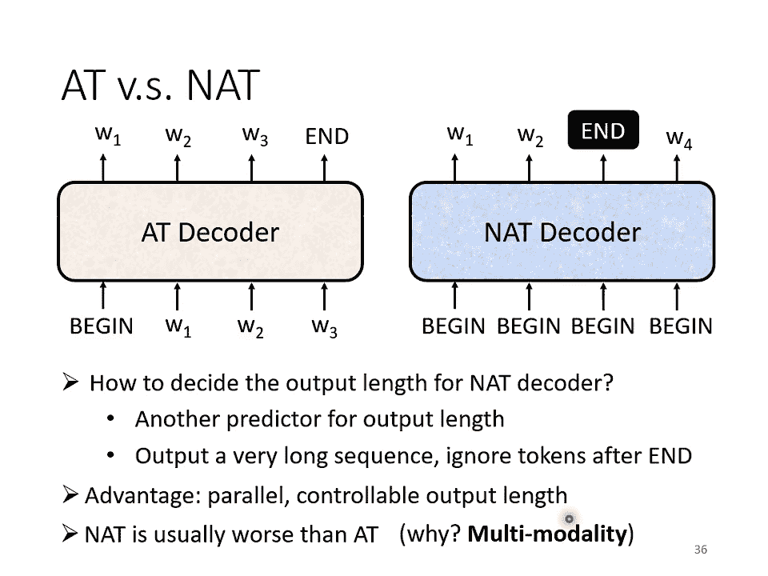

这个上课补充的内容呢放在链接，放在这边给大家参考，NAT也是一个大坑啊，助教也是讲了一个半小时，才稍微给大家一个NP的大概大致的描述，所以这也是个大坑，不是我们今天可以讲的，就只是告诉大家说。

世界上有NAT这个东西而已好。

那接下来呢我们就要讲encoder和decoder。

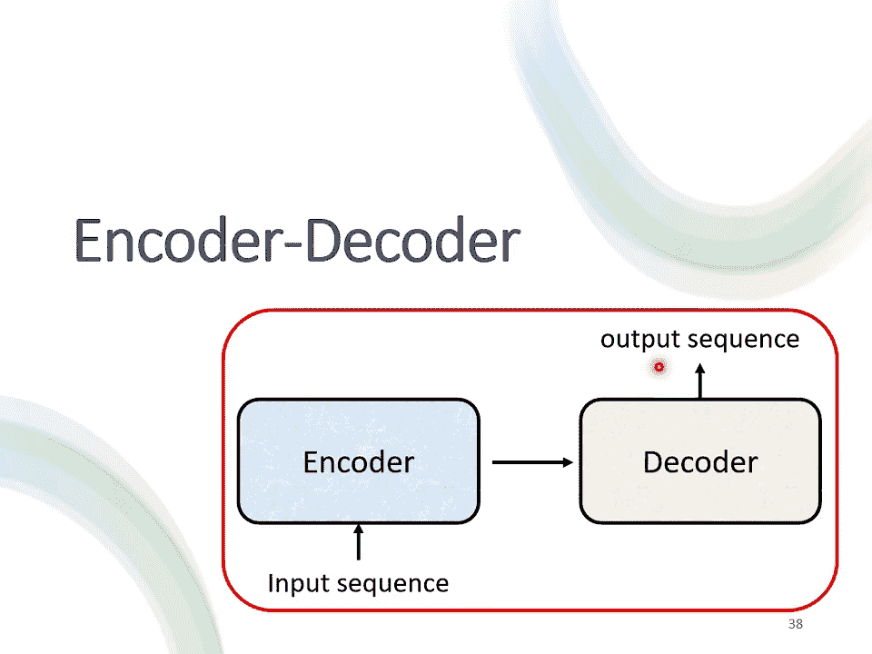

他们中间是怎么传递资讯的了，也就是我们要讲，刚才我们刻意把它遮起来的那一块，那如果你仔细观察这一块的话，这块呢叫做cross attention，它是连接encoder和decoder之间的桥梁。

那这一块里面呢，你会发现有两个输入来自于encoder，encoder提供两个箭头，然后decoder提供了一个箭头啊，然后所以从左边这两个箭头，decoder可以读到encoder的输出。

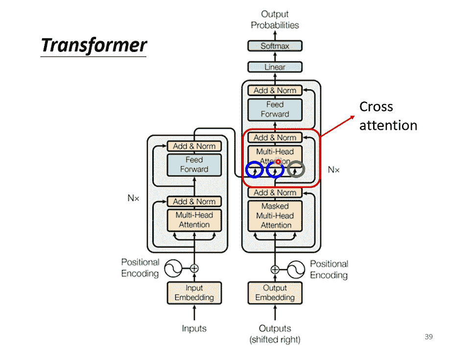

好，那这个模组实际上是怎么运作的呢，那我们就实际把它运作的过程，跟大家展示一下啊，这个是你的encoder输入一排向量，输出一排向量，我们叫它a one a two a3好。

接下来呢轮到你的decoder，你的decoder呢会先吃begin，当做begin，这个special的token，那begin这个special token读进来以后。

你可能会经过self attention，这个self attention是有做mask的，然后得到一个向量，就像self attention，就算是有做mask还是一样，输入多少长度的向量。

输出就是多少向量，所以输入一个向量，输出一个向量，然后接下来把这个向量呢乘上一个矩阵，作为一个transform，得到一个query，叫做Q，然后这边的a one a two a3呢也都产生KET。

One t two t3，那把这个Q跟K8，K9K3去计算attention的分数，得到阿尔法阿尔法two阿尔法三，当然你可能一样会做soft max，把它稍微做一下normalization。

所这边加一个pie，代表他可能是做过normalization，接下来再把阿尔法一，阿尔法two阿尔法三乘上v one v two v3，再把它wk上加起来，你得到V。

那这个VR就是接下来会丢到fully connected network，做接下来的处理，那这个步骤就是Q来自于decoder，K跟V来自于encoder，这个步骤就叫做COATTENTION。

所以decoder就是凭借着产生一个Q，去encoder这边抽取资讯出来，当做接下来的decoder里面的fully connected network input好。

那这个就是cross attention的运作的过程啊，当然啊这个就就现在假设产生第二个，第一个这个中文的字产生一个G，接下来的运作也是一模一样的，输入begin，输入机产生一个向量。

这个向量一样乘上个linear的transform，得到Q派，得到一个query，这个query一样，跟k one k two k3去计算TENTION的分数一样。

跟v one v two v3做VT上做加权，然后加起来得到v pi，直接交给接下来的fully connected network做处理好。

所以啊这就是这个cross attention的运作的过程好。

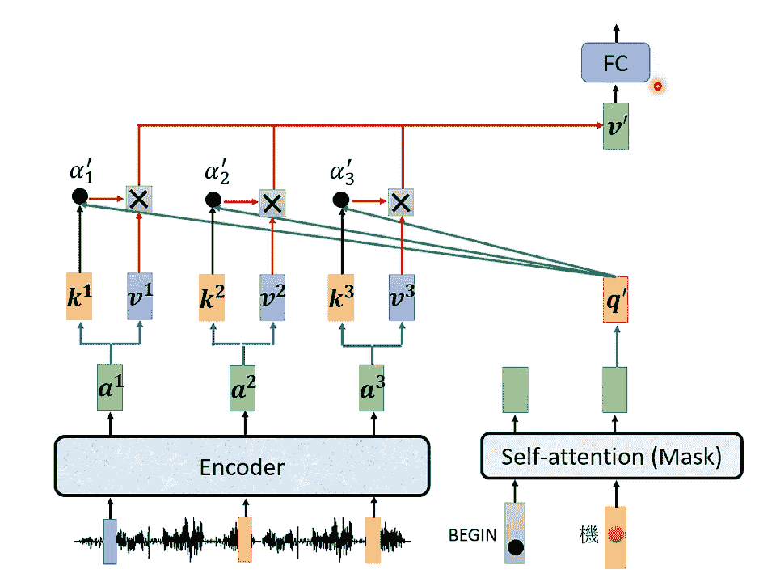

那这边呢有一个实际的文献上的cross attention，他所做的事情的效果展示，不过我这边要稍微说明一下这个图啊，并不是来自于transformer这篇paper呢。

它的title叫做listen attend and spill，是比较早的使用sequence to sequence model，成功做语音辨识的一篇文章。

他发表在IE20162016年的IPASS，我记得那一次是在上海办的，我还特别有啊，亲耳听了这篇paper的报告啊，这现场是人山人海，大家都觉得哇这个非常的神奇。

Sequence to sequence，硬座居然可以做语音辨识，而且跟呃state of the AR的结果，当时也就只差了一点点而已，当然这篇paper里面的结果。

它展现了sequence to sequence model，其实没有赢过，Stay on vr，就是当时最好的语音辨识系统，但是只差一点点而已。

所以让大家觉得说哎sequence to sequence，用在语音辨识上似乎是有潜力的哦，所以他其实不是那个transformer，那时候的encoder和decoder都是用LSPN。

不过那个时候就已经有cross attention，这样子的机制哦，所以在有transformer之前，其实就已经有cross attention这样的机制，只是没有self attention的机制。

所以是先有boss attention，后来才有self attention，然后那个时候啊，如果你是用sequence to sequence model。

不知道为什么paper的title一定要有三个动词，这样对，那个时候一定要有三个动词，才能够代表你是在做sequence to sequence model。

所以像这篇就是listen attend and spell，告诉他说机器要听声音，然后做attention和cross attention，spell就是把他听到的东西把它拼出来，然后特别放这个图。

是想要跟你让你想可以比较容易想象，这个cross attention是怎么运作的，好这一段是声音讯号，是机器的输入，那声音讯号输入给这个encoder的时候，它是用一串向量来表示，一排向量来表示好。

所以这是时间，然后这边是一排一排一个一个的向量，然后这一排呀是decoder的输出，decoder一次只吐一个英文的字母哦，所以它会to h two o two w就代表how。

那如果他已经到一个词汇的边界，它会自动吐出空白，空白当做是一个特殊的字母来处理，所以机器decoder有可能输出空白，代表一个词汇结束了，换一个新的词汇，接下来输出NUCH就是much，然后再输出空白。

再输出W啊，这句话其实是一个英文的绕口令啊，这句话完整的句子是how much would would chua，这样子哈，实际上内容是什么，其实不太重要，它就是一句绕口令就是了哦，那很神奇。

机器可以一次吐一个字母，然后而且它可以拼对正确的词汇，好，那这个这边这个值是什么呢，这个值呢就是attention的分数哦，所以当你要产生这个H的时候，在产生这个H之前。

你的decoder会去对encoder的输出做attention哦，所以他就在这个地方，然后产生H，然后现在这个地方产生o end，在这个地方产生W这边颜色越深。

就代表说那个attention的那个分数啊，就那个阿尔法的值啊越大，所以你会发现说它长成H的时候，他就是听到这个地方有H的声音，所以产生H，那接下来再往右移一点产生O，再往右移一点产生W。

然后接下来呢end在这个地方产生space，然后在这个地方产生N，那你会看到说这个attention的这个weight，是由左上到右下移动，跟你想象attention应该运作的机制很像。

因为当我们这边每次产生一个词汇的时候，我们想要专注，我们想要考虑的声音讯号应该就是由左向右，所以确实如果你看model attention的话，它可能是从左上，他的这个分数高的地方。

可能是从左上一直排到右下好，那讲到这边，也许有同学会问说，那这个encoder有很多层呢，decoder也有很多层，从刚才的讲解里面，好像听起来这个decoder不管哪一层。

都是拿encoder最后一层的输出，这样对吗，嗯对对，在原始paper里面的词作是这样子的，那一定要这样吗，不一定要这样，你永远可以自己兜一些新的想法，所以这边就是引用一篇论文告诉你说啊。

也有人尝试不同的across attention的方式，encoder这边有很多层，decoder这边有很多层，为什么decoder这边每一层都一定要看encoder，最后一层的输出呢。

能不能够有各式各样不同的连接方式，这完全可以当做一个研究的问题来study好。

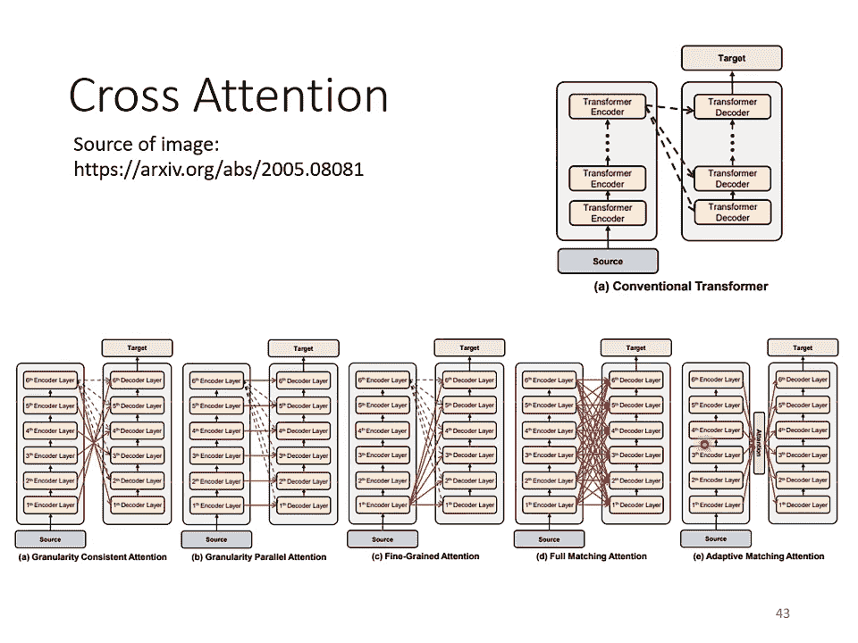

那最后呢我们就要讲训练这件事了，我们已经讲了encoder，Decoder，Encoder，decoder怎么互动的，我们已经你已经清楚说in the sequence，是怎么得到最终的输出。

那接下来就进入训练的部分，我们刚才都还没有讲训练的部分哦，我们刚才讲的都还只是假设你模型训练好以后，它是怎么运作的，他是怎么做acing的，他是怎么做，Influence。

influence叫testing了，所以当我说influence的时候，我指的就是testing。

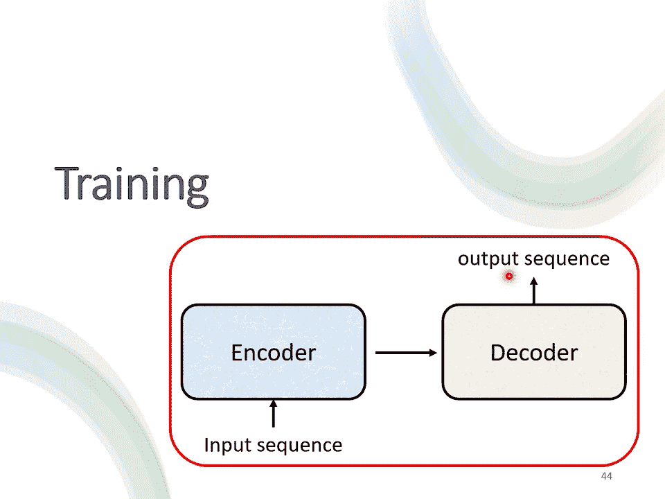

我指的是同一件事情哦，那是怎么做训练的呢，接下来就要讲怎么做训练，那如果是做语音辨识，那你要有训练资料，需要什么样的训练资料呢，你要收集一大堆的声音讯号，每句声音讯号都要有攻读声来听，打一下。

打出说他的这个对应的词汇是什么啊，公主真听这段是机器学习，他就把机器学习四个字打出来，所以就知道说呃，你的这个transformer应该学到，听到这段声音讯号，它的输出就是机器学习这四个中文字啊。

那怎么让机器学到这件事呢，我们已经知道说输入这段声音讯号，第一个应该要输出的中文字是几哦，所以今天当我们把begin，丢给这个in decoder的时候，他第一个输出应该要跟G越接近越好。

什么叫做跟G越接近越好呢，鸡这个字啊会被表示成一个one hard vector，在这个vector里面只有G对应的那个维度是一，其他都是零，这是正确答案。

那我们的decoder它的输出是一个distribution，是一个几率的分布，我们会希望这个几率的分布，跟这个one hot vector越接近越好。

所以你会去计算这个光tum跟这个distribution，它们之间的cross entropy，然后我们希望这个cross entropy的值越小越好，就这样，那你可能会发现说这件事情跟分类很像，没错。

他就跟分类很像，刚才助教在讲解作业的时候也有提到这件事情，你可以想成每一次我们在产生每一次decoder，在产生一个啊中文字的时候，其实就是做了一次分类的问题，就中文字假设有4000个。

那就是做有4000个类别的分类的问题啦，好，所以实际上训练的时候，这个样子，我们已经知道输出应该是机器学习这四个字，那你就告诉机器说，你就告诉你的decoder说，现在你第一次的输出，第二次的输出。

第三次输出，第四次的输出应该分别就是机器雪跟喜，这四个中文字的one tap，我们希望我们的输出跟这四个字的one half factor，越接近越好，在训练的时候。

每一个输出都会有一个cross entropy，每一个输出跟one hot vector跟它对应的正确答案，都有一个cross entropy，都有个cross entropy。

都有个cross entropy，我们要希望所有的cross entropy的总和，最小越小越好，所以这边做了四次分类的问题，我们希望这些分类的问题，它总合起来的cross entropy越小越好。

但这边不要忘了还有断这个东西，还有an这个东西，所以其实今天假设这个句子，它的中文的字是四个，但是你学习的时候，你要decoder输出的不是只有这四个中文字，你还要叫他记得说这四个中文字输出完以后。

你还要记得输出段这个特别的符号，所以你要告诉你的decoder说，你最终第五个位置输出了，这个向量应该跟段的one hot vector，它的cos entropy越小越好。

那这个就是decoder的训练，你把光truth给他正确答案给他，希望decoder的输出跟正确答案越接近越好，那这边有一件值得我们注意的事情，这件事是这样的，看看decoder的输入是什么。

decoder的输入是正确答案，我们会给decoder在训练的时候，我们会给decoder看正确答案，也就是我们会告诉他说，在已经有begin有机的情况下，你就要输出器有比电影有鸡有气的情况下。

输出学有begin，有鸡有气有血的情况下，输出稀有begin，有鸡有气有血有吸的情况下，你就要输出段，在decoder训练的时候，我们会在输入的时候给他正确的答案。

那这件事情呢叫做teacher forcing，那我也不，其实我不太确定为什么叫teacher forcing，好像是老师会强迫你做什么事情一样，听起来好像没有很好。

但是这个技术呢就叫做teacher forcing，也就是我们把正确的答案当做decoder的输入，那这个时候你马上就会有一个问题啊，这个训练的时候，decoder有看偷看到正确答案了。

但是测试的时候显然没有正确答案，可以给decoder看呢，刚才有强调说，在真正使用这个模型，在influence的时候，decoder看到是自己的输入，这中间显然有一个mismatch。

对这中间有一个mismatch，那等一下我们会有一页投影片，说明有什么样可能的解决方式好。

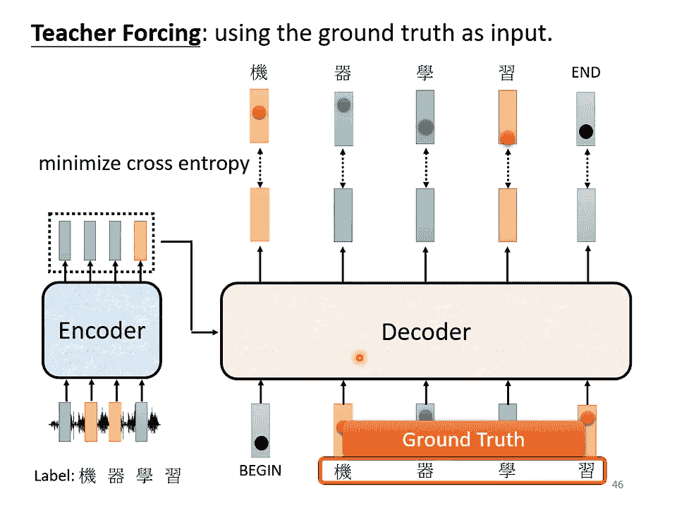

那接下来呢就是要讲训练，transformer的一些训练，这种但不局限于transformer了，训练与训练这种sequence to sequence model的一些tips好。

第一个tips啊是copy mechanism，对很多任务而言，在我们刚才的讨论里面，我们都要求decoder自己产生输出，但是对很多任务而言，也许decoder没有必要自己创造输出出来。

他需要做的事情，也许是从输入的东西里面复制一些东西出来，那我们有没有办法让decoder复制，从输入复制一些东西出来呢，其实是有办法的，那像这种复制的行为在哪些任务会用得上呢，一个例子呢是做聊天机器人。

举例来说，好人对机器说你好，我是库洛洛，库洛洛就是团长了，他是谁，其实也没那么重要，已经很久没有见到他了，嗯我是库洛洛，然后机器应该回什么呢，机器应该回答说诶库洛洛你好，很高兴认识你，那对机器来说。

它其实没有必要创造库洛洛这个词汇，这对机器来说写一定会是一个非常怪异的词汇，所以他可能很难在训练资料里面，可能一次也没有出现过，所以他不太可能正确的产生这个呃，这段词汇出来，这段句子出来。

但是假设今天机器他在学的时候，他学到的并不是它要产生库洛洛这三个中文字，他学到的是看到输入的时候说我是某某某，就直接把某某某不管这边是什么，复制出来，说某某某你好，那这样子机器的训练显然会比较容易。

他显然比较有可能得到正确的结果，所以复制对于对话来说可能是一个需要的，需要的技术，需要的能力啊，我这边举另外一个例子啊，小杰不能用念能力了啊，对他不能用念能力了啊，你很快回答说。

你所谓的不能用念能力是什么意思，对机器来说呃，他要做的事情去复述这一段，他听不懂的话，那他不需要从头去创造这一段文字，他要学的也许是从使用者人的输入，去copy1些词汇。

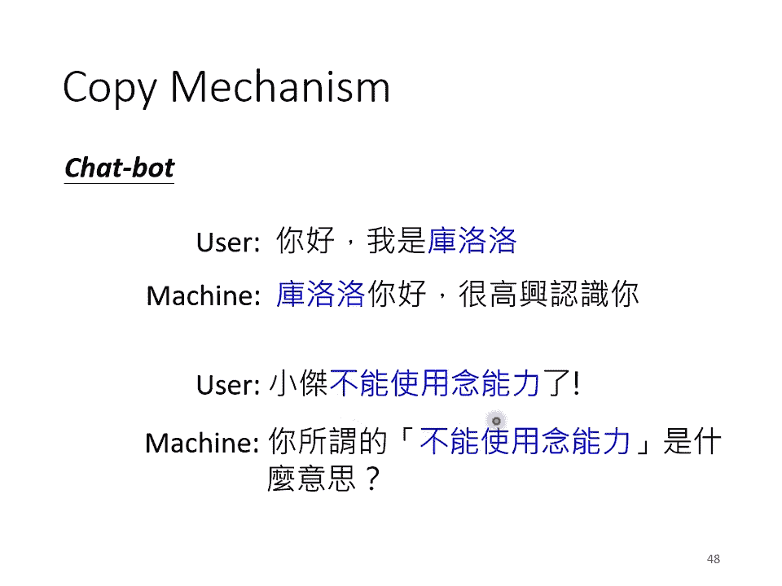

当做他的输出哦，或者是在做摘要的时候，你可能更需要卡比这样子的技能，所谓的摘要就是你要训练一个模型，然后这个模型呢去读一篇文章，然后产生这篇文章的摘要，那这个任务呢完全是有办法做的。

也就是收集大量的文章，那每一篇文章呢都有人写的摘要，然后你就去练一个sequence to sequence model就结束了，哎你要做这样的任务，只有一点点的资料是做不起来的啦。

有的同学收集个呃几万篇文章，然后训练一个这样的sequence to sequence model，发现结果有点差，然后来问我为什么，这时候我就告诉你说，你要训练这种，你要叫机器说合理的句子啊。

通常这个百万篇文章是需要的啦，所以如果你有百万篇文章，那些文章都有人标的摘要，那有时候你会把直接把文章标题当做摘要，那这样就不需要花太多人力来标啊，你是可以训练一个直接可以帮你读一篇文章，就下一个标题。

做个摘要的模型，但是我们知道说做摘要的时候啊，有时候很多的词汇，你其实就是直接从原来的文章里面复制出来的，对不对，小时候老师叫我们写博文课的课文的，翻的摘要的时候，其实你也没有自己创造词汇，对不对。

你就是从这个课文里面呢找一些句子出来，然后把它改写一下，其实就变成摘要，所以对摘要这个任务而言，其实从文章里面直接复制一些资讯出来，可能是一个很关键的能力。

那sequence to sequence model有没有办法做到这件事呢。

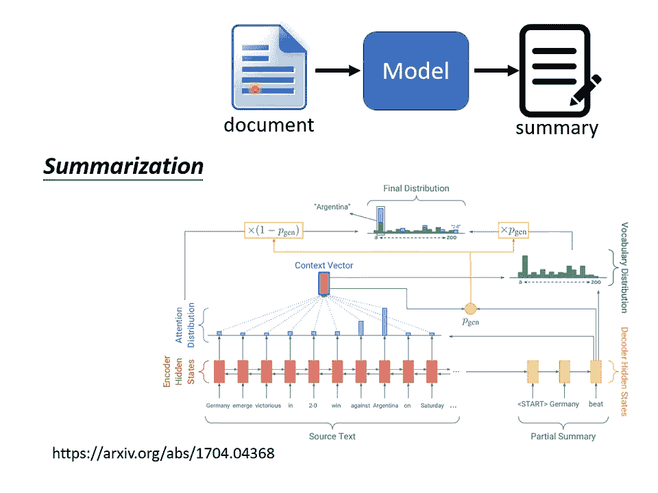

啊简单来说就是有，那我们就不会细讲，最早有从输入复制东西的能力的模型，叫做pointer network，那这个过去上课是有讲过的，我把录音放在这边给大家参考。

那后来呢还有一个变形呢叫做copy network，那你可以看一下这篇copy mechanism is，Sequence to sequence。

来看看sequence to sequence model，是怎么做到从输入复制东西到输出来的好。

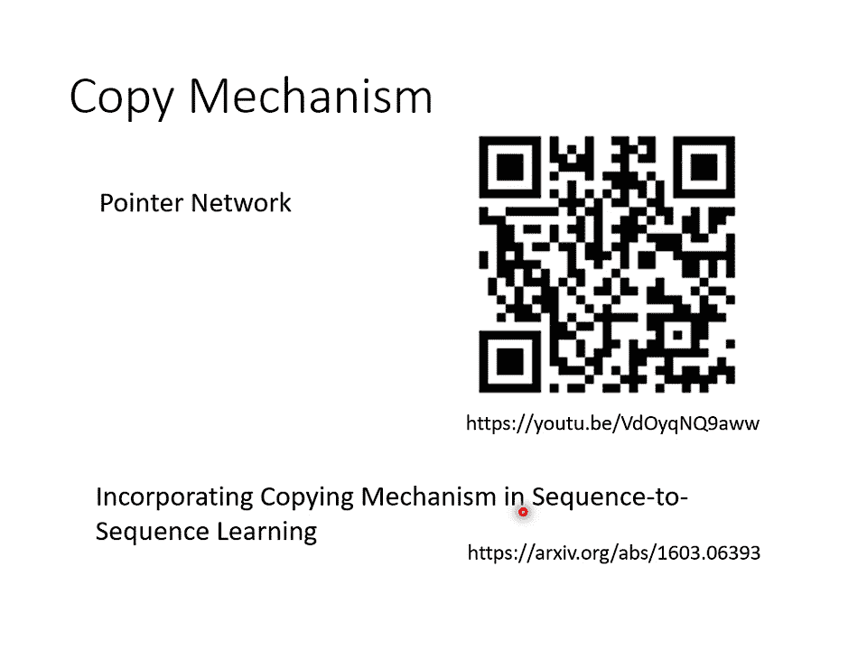

那其实这个sequence to sequence model啊，呃因为你知道机器就是一个黑盒子嘛，有时候它里面学到什么东西，你实在是搞不清楚，那有时候他会犯非常低级的错误，什么样低级的错误呢。

这边就举一个真实的低级错误的例子，这边举的例子呢是语音合成，那今天语音合成你完全可以就是训练一个，Sequence to sequence model。

Sequence to sequence mode，大家都很熟嘛，transformer就是一个例子，你就拿出来，然后输入是什么，你就你就收集很多的声音，文字和声音讯号对应关系。

收集很多的文字和声音讯号对应关系告诉你的，然后接下来告诉你，Sequence to sequence model，说看到这段中文的句子，你就输出这段声音，然后就没有，然后就硬吹一发就结束了。

然后机器就可以学会做语音合成了，那像这样的方法做出来结果怎么样呢，其实还不错，举例来说呢，我叫机器连说四次发财，看看他会怎么讲，机器输出的结果是这样，发财发财发财发财发财发财发财，这很神奇。

哎我输入的发财明明是朋友的词汇，只是重复四次，机器居然自己有一些抑扬顿挫，你说他为什么抑扬顿挫，你再仔细发财，发财发财发财发财发财，四个发财的声音不是一样的，发财发财发财发财是有抑扬顿挫的。

他怎么学到这件事，不知道他自己训练出来就是这个样子，那你让他讲三次发财发财，发财发财发财发财也没问题，让他讲两次发财发财发财发财发财也没问题，让他讲一次发财发财发财啊，发现诶怎么没有念发不发啊。

为什么就是不知道为什么这样子，就是你的sequence to sequence model train出来，就是会产生莫名其妙的结果，也许在训练资料里面，这种非常短的句子很少，所以机器他根本没有办法。

除不知道怎么处理这种非常短的句子，你叫他念发财，他把发省略掉，只念财，你居然叫他念了四次，发财，重复四次没问题，就他只念一次，居然会有问题，就是这么的奇怪的啊，但其实这个例子并没有那么长，出现了。

就这个用CQU9CQU论出来，TTS也没有你想象的那么差，这个要找这种差的例子也是挺花时间的，要花很多时间才找到这种差的例子，但这样的例子是存在的好，所以怎么办呢，有一个可能的方法是。

因为我们刚才发现说机器居然漏字了，输入有一些东西他居然没有看到，我们能不能够强迫他，一定要把输入的每一个东西通通看过呢，这个是有可能的啊，这招呢就叫做ided attention。

那像这种该点的任务都用得上，我觉得最适合的是像这种语音辨识啊，语音合成这种任务，因为像像语音辨识这种任务其实很难接受，说诶你讲一句话，今天辨识出来，居然有一段机器没听到或语音合成，你输入一段文字。

语音合出来居然有一段没有念到，这个人很难接受，那如果是其他应用，比如说缺乏或者是summary啊，可能就没有那么严格，因为对于一个缺乏来说，你说过一句话，他就回一句话，他到底有没有把整句话看完。

其实你3号也不在乎，你其实也搞不清楚，但是对语音辨识，语音合成，该DIATTENTION可能就是一个比较重要的技术，该idea attention要做的事情就是要求机器啊，去我们要去这个GAI的。

去领导这个attention的过程，要求机器他在做attention的时候，是有固定的方式的，举例来说，对语音合成或者是语音辨识来说，我们想象中的attention应该就是由左向右啊，在这个例子里面。

我们用红色的这个曲线，哪来代表attention的分数啊，这个越高就代表attention的值越大，那如果今天不管是从语音辨识还是语音合成，我们与语音合成为利好了，那你的输入就是一串文字嘛。

那你在合成声音的时候显然是由左面到右哦，所以机器应该是先看最左边书的词汇产生声音，再看中间的词汇产生声音，再看右边的词汇产生声音，如果你今天在做语音合成的时候。

你发现机器的attention啊是颠三倒四啊，他先看最后面，接下来再看前面，那再胡乱看整个句子，那显然有些事做错了，显然有些是有些something something is wrong。

就是有些事做错了，那那显然这样子的attention是有问题的，你在做语音合成的时候，你显然没有办法合出好的结果，我说该地的通宵做的事情就是强迫attention，有一个固定的感冒。

那如果你对这个问题本身就已经有理解，知道说语音合成TTS这样的问题，你的tension的分数，tension的位置都应该由左向右，那不如就直接把这个限制放进你的training里面。

要求机器学到attention就应该要由左向右，那这件事怎么做呢，有一些关键词汇我就放在这边，让大家自己google了。

比如说某某tonic tension或location aware attention，这个部分也是大坑，也不细讲。

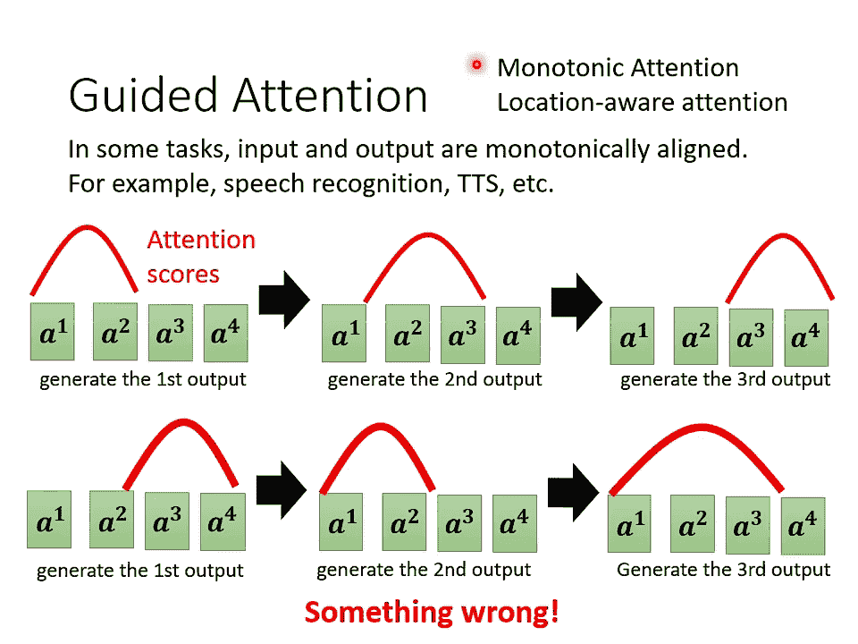

那就留给大家自己研究好，还有个东西叫做been search，been search这个东西呀，刚才助教在讲解作业的时候，也是有提到这个词汇的，B42选是什么呢，我们这边举一个例子，在这个例子里面啊。

我们假设说呢我们现在的这个decoder，它就只能产生两个是两个字，我们假设说这个世界上呢，就只有两个可能的输出，一个叫做A，一个叫B甲，世界上只有两个字，A跟B哦，那对decoder而言。

他做的事情就是每一次啊，在第一个TESTANT，然后决定了A以后再把A当做输入，然后再决定ab要选哪一个，举例来说，他可能选B当做输入，再决定ab要选哪一个，那在我们刚才讲的process里面呢。

每一次decoder都是选分数最高的那一个，对不对，记不记得我们每次都是选max的那一个，所以假设A的分数0。6，B的分数0。4，decoder第一次就会输出A，然后接下来假设B的分数0。6。

A的分数0。4，decoder就会输出V啊，然后再假设把B当做input，就现在输入已经有A有B了，然后接下来呢A的分数0。4，B的分数0。6，那decoder就会选择输出B。

输出就是A跟B跟B那像这样子，每次找分数最高的那个token啊，每次找分数最高的那个字来当做输出，这件事情叫做greedy decoding，但是greedy decoding一定是更好的方法吗。

有没有可能我们在第一步的时候，先稍微舍弃一点东西，比如说第一步算B是0。4，但我们就先选0。4，这个比好，接下来我们选了B以后，也许接下来的B的可能性就大增，就变成0。9，然后接下来第三个步骤。

B的可能性也是0。9，如果你比较红色的这条路跟绿色这条路的话，你会发现说绿色这条路虽然一开始第一个步骤，你选了一个比较差的输出，但是接下来的结果是好的，这个就跟那个天龙八部的珍珑棋局一样，对不对。

先毒死自己一块，结果接下来反而赢了，所以如果你比较红色这一条路跟绿色这一条路，红色这条路第一步不好，第一步好，但接下来全部乘起来是不好，比较差的，然后绿色这条路一开始比较差，但最终的结果其实是比较好的。

那我们其实是不是应该要选绿色这条路呢，这就让我想到什么，让我想到切薄了，你就知道诶，我知道这个假设是你人生的转折点，你再决定要签下去还是不签下去，然后签下去虽然短时间内比较辛苦，但也许未来是比较好的。

不签下去你就去找工作，短时间内可以赚到比较多钱，但也许未来是比较不好的，所以你到底应该是签下去还是不签下去呢，我到现在都没什么念博班啦，所以我们上课的时候，就是冷不防的开始夜配念博班这件事情好。

那所以如果我们要怎么找到这个最好的绿色，这一条路呢，也许一个可能是爆收所有可能的路径，但问题是，我们实际上并没有办法报收所有可能的路径，因为实际上每一个转折点可以的选择太多了，如果是在对中文而言。

我们中文有4000个字啊，所以这个数啊，每一个地方分叉都是4000个可能的路径，你走两三步以后，你就无法穷举，所以怎么办呢，有一个演算法叫做been search。

它用比较有效的方法找一个approximate，找一个估估测的solution，找一个不是很精准的，不是完全精准的solution，这个技术叫做in search，这个也留给大家自己啊。

自己google好，那这个been search这个技术到底有没有用呢，有趣的事就是它有时候有用，有时候没有用，你会看到有些文献告诉你说。

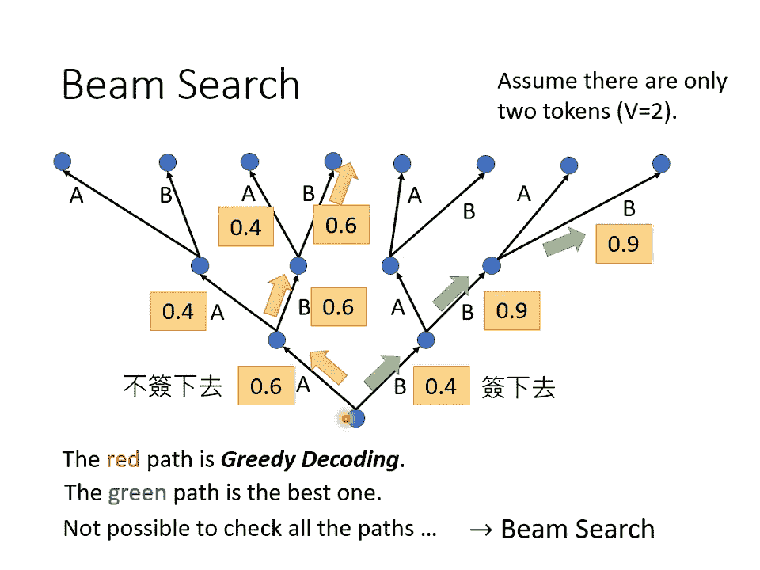

been search是一个很烂的东西，怎么说呢，比如举例来说，这篇paper叫做the curious case of neural text degeneration。

那这个任务要做的事情呢是sentence completion，也就是机器先读一段句子，接下来呢他要把这个句子的后半段把它完成，你给他一则新闻或者是一个故事前半部哇，他自己发挥他的想象创造力。

把这个文章把故事的后半部把它写完，那你会发现说been search，在这篇文章里面一开头就告诉你说，been search自己有问题呀，如果我用，如果你用been search的话。

会发现说机器不断讲重复的话，他不断开始陷入鬼打墙啊，无穷回圈啊，不断说重复的话，那如果你今天不是用been search，有加一些随机性，虽然结果不一定能完全好，但是看起来至少是比较正常的句子。

所以有趣的事情是，有时候对decoder来说没有找出分数最高的路，反而结果是比较好的，那这个时候你又觉得乱乱的，对不对，就是刚才前一同学才说要找出分数最高的路，现在又突然又找又讲，说找出分数最高的路。

不见得比较好，到底是怎么回事呢，那其实这个就是要看你的任务的本身的特性了，就假设一个任务，他的答案非常的明确，举例来说，什么叫答案非常明确呢，比如说语音辨识，说一句话，面试的结果就只有一个可能嘛。

就那一串文字就是你唯一可能的正确答案，并没有什么模糊的地带，我觉得对这种任务而言，通常been search就会比较有帮助，那什么样的任务been search比较没有帮助呢。

就是你需要机器发挥一点创造力的时候，这时候been search就比较没有帮助，举例来说，在这边的sentence completion，给你一个句子，给你文故事前半部，后半部有无穷多可能的发展方式啊。

那这种需要有一些创造力的，有不不是只有一个答案的任务，往往会比较需要在decoder里面加入随机性，还有另外一个decoder，也非常需要随机性的任务啊，叫做语音合成，TTS就是语音合成的缩写。

那这个呢我印象很深刻，因为我们现在是一开始想要用这个seven，two sequence model做语音合成的时候，有很长一段时间呢都做不起来，都合不出声音来。

有一次有个google的人呢来visit我们实验室visit，我们就拿这个问题来跟他请教，然后就说哎你们不知道在做TTTTS的时候，decoder要加noise吧，这听起来很神奇。

这完全违背就是正常的machine learning会做的想法，你知道在machine learning有时候你在训练的时候会加，比如说你训练的时候会加抓包，所以我们这门课还没有讲抓爆。

但有些同学可能知道，那如果你不知道的话，你在想象我们在训练的时候，我们会加上一些杂讯，让我们在训练的时候，机器看多看过更多不同的可能性，在训练的时候会比较强健，比较能够对抗他在测试的时候没有看过的状况。

那没有人会傻，到时候你在测试的时候居然还要加一些杂讯，那不是把测试的状况弄得更困难，你不是结果会更差吗，但TTS神奇的地方是，测试的时候模型训练好以后，测试的时候你要加入一些杂讯，合出来的声音才会好。

这样非常的神奇，你用正常的decode方法产生出来的声音，就有点像是机关枪，那根本听不太出来是人声，然后产生出比较好的声音，居然是需要一些随机性哦，所以这也是一个非常神奇的地方。

有时候我们其实期待decoder有随机性，反而会得到比较好的结果啊。

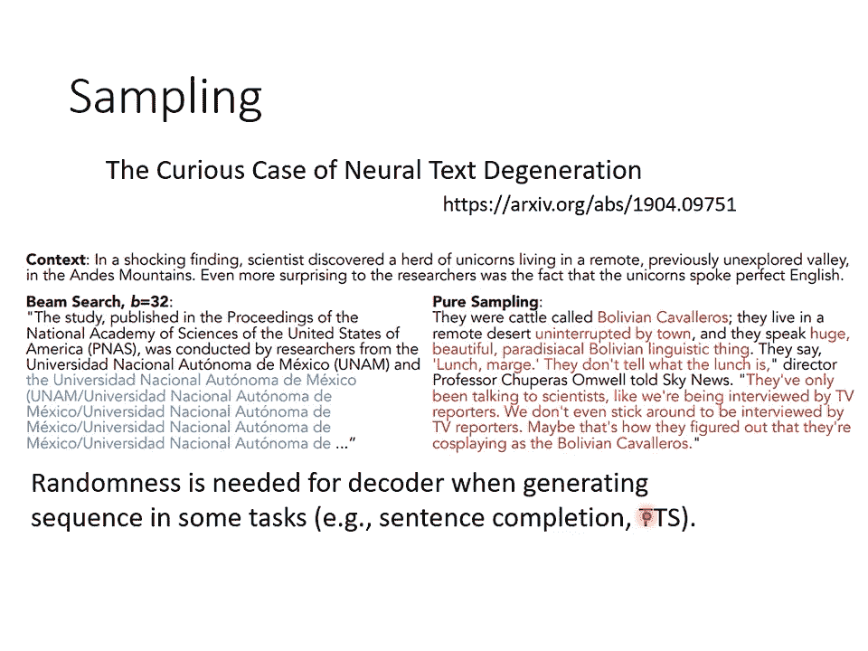

这也许就呼应了一个英文的谚语，就是啊要接受没有事情是完美的啊，真正的美也许就在不完美之中，对于TTS for sentence completion来说，decoder找出最好的结果。

不见得是人类觉得最好的结果，反而是奇怪的结果，那你加入一些随机性结果反而会是比较好的好，那接下来还有另外一个问题，大家知道说我们今天呢，在我们就拿我们的作业为例，我们在我们的作业里面呢。

我们评估的标准用的是blues go，那blue sky怎么量呢，blue sky是你的decoder，先产生一个完整的句子以后，再去跟正确的答案一整句做比较，我们是拿两个句子之间做比较。

才算出blue scope，当我们在训练的时候，显然不是这样啊，训练的时候，这边每一个词汇是分开考虑的，训练的时候，我们minimize是cross entropy，Minimize。

Cross entropy，真的可以maximize blues go吗，不一定，因为这两个根本就是他们可能有一点点的关联，但他们又没有那么直接相关，他们根本就是两个不同的数值嘛。

所以我们minimize cross entropy不见得可以让blue score，blue score比较大，所以你发现说在助教的城市里面，比如说在助教在做validation的时候。

并不是拿cross entropy来挑最好的model，它并不是挑cos entropy最低的那个model，而是挑blue score最高的那一个model。

所以我们训练的时候是看cross entropy，但是我们实际上你作业真正评估的时候，看的是blue score啊，所以你FA dation set其实应该考虑用blue store，对不对。

那接下来有人就会想说，那我们能不能在training的时候就考虑blue score呢，我们能不能训练的时候就说我的loss啊，就是blue score乘一个负号。

那我们要minimize那个loss嘛，假设你的loss是blue scor乘一个负号，那等于就是maximize blue score，但是这件事实际上没有那么容易。

你当然可以把blue score当做你训练的时候，你要最大化的一个目标，但是bruce code本身很复杂，它是不能微分的，你把它当做你的loss，你根本不知道你要怎么算。

Gradient descent，这边之所以采用cross entropy，而且是每一个中文的字分开来算，就是这样我们才有办法处理，如果你是要计算两个句子之间的blue sk。

这这一个loss根本就没有办法做微分，那怎么办呢，这边就教大家一个口诀啦，这个口诀就是，遇到你在optimization无法解决的问题，用RL硬圈一发就对了。

这样遇到你无法optimize the loss function，把它当做是RL的reward，把你的decoder当做是agent。

把它当做是RL reinforcement learning的问题，硬座其实也是有可能可以做的，那有人真的这样试过吗，有人真的这样试过，我把reference列在这边给大家参考。

但这是一个比较难的做法啦，那并没有特别推荐你在作业里面用这一招。

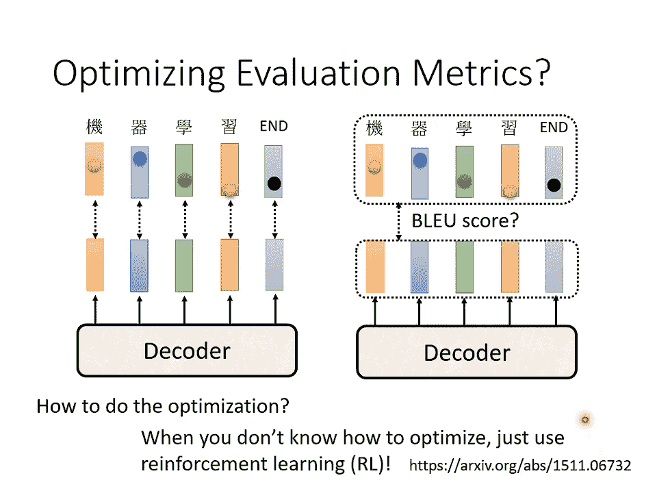

好那我们要讲到我们刚才反复提到的问题了，就是训练和测试居然是不一致的，测试的时候decoder看到的是自己的输出，所以测试的时候decoder会看到一些错误的东西，但是在训练的时候。

decoder看到的是完全正确的，那这个不一致的现象呢叫做exposure bias，那假设decoder在训练的时候，永远只看过正确的东西，那在测试的时候，你只要有一个错，那就会一步错步步错。

因为对对decoder来说，他从来没有看过错的东西啊，要看到错的东西会非常的惊奇，然后接下来它产生的结果可能都会错掉，这要怎么解决这个问题呢，有一个可以的思考的方向。

是给decoder的输入加一些错误的东西，就这么直觉，你不要给decoder都是正确的答案呐，偶尔给他一些错的东西，他反而会学得更好。

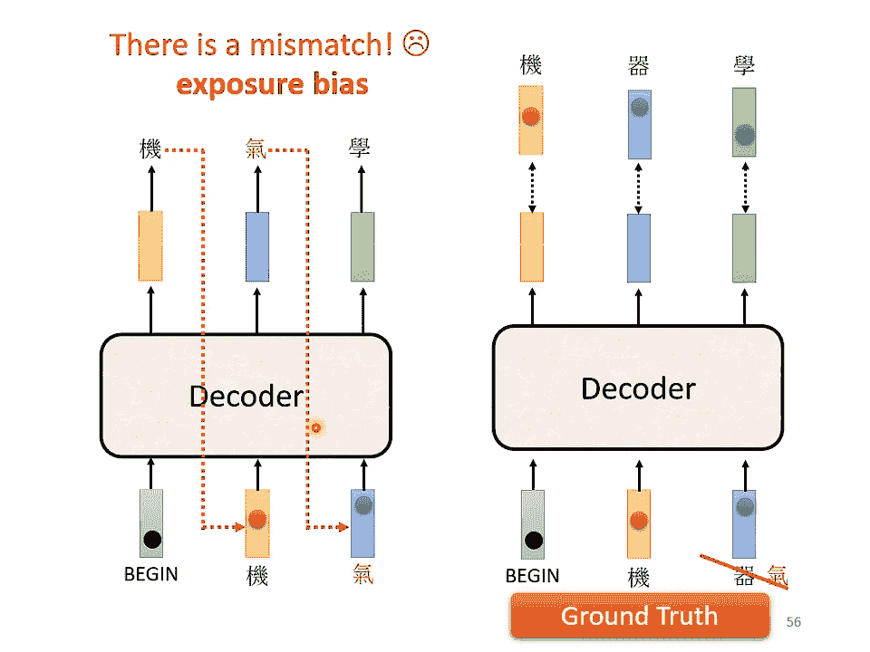

这一招叫做schedule simply，他不是那个schedule learning ray哦，刚才助教讲schedule learning ray，那是另外一件事不相干的事情。

这个是schedule simply，schedule simply呢其实很早就有了啊，这个是15年的paper，很早就有schedule sampling，在还没有transformer。

只有LSTN的时候，就已经有schedule sampling the schedule sample，这一招啊，呃他其实会伤害到transformer的平行化的能力，那细节可以再自己去了解一下。

所以对transformer来说，他的schedule symp另有招数跟传统的招数，跟原来最早题在这个LSDN上，被提出来的招数也不太一样，那我把一些reference的列在这边给大家参考好。

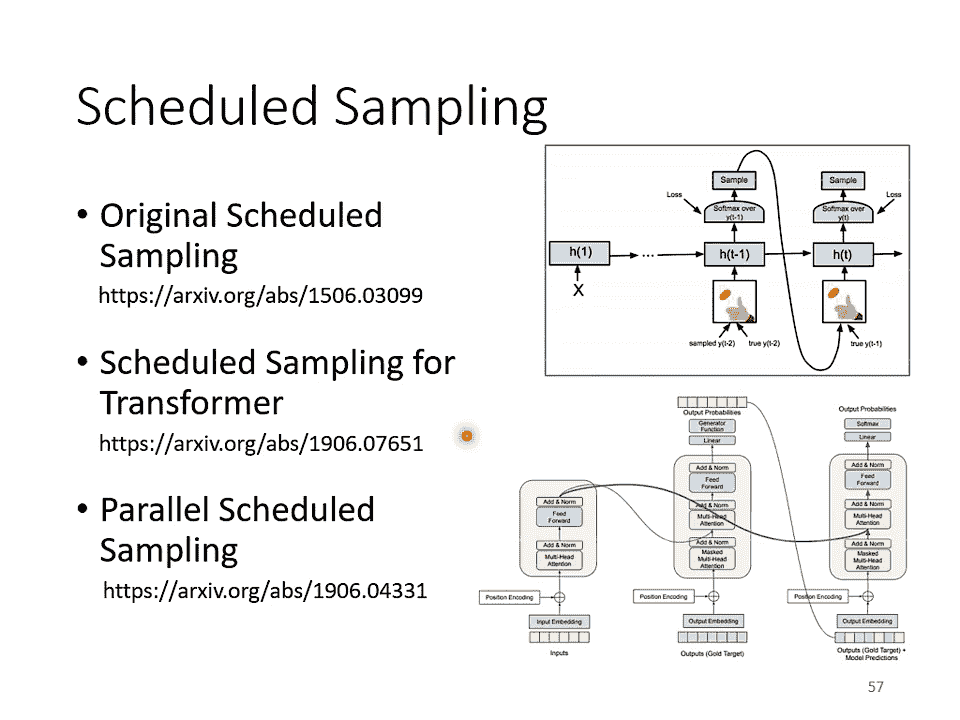

那以上呢我们就讲完了，transformer和种种的训练技巧，这个我们已经讲完了，encoder讲完了，decoding也讲了他们中间的关系，也讲了怎么训练。

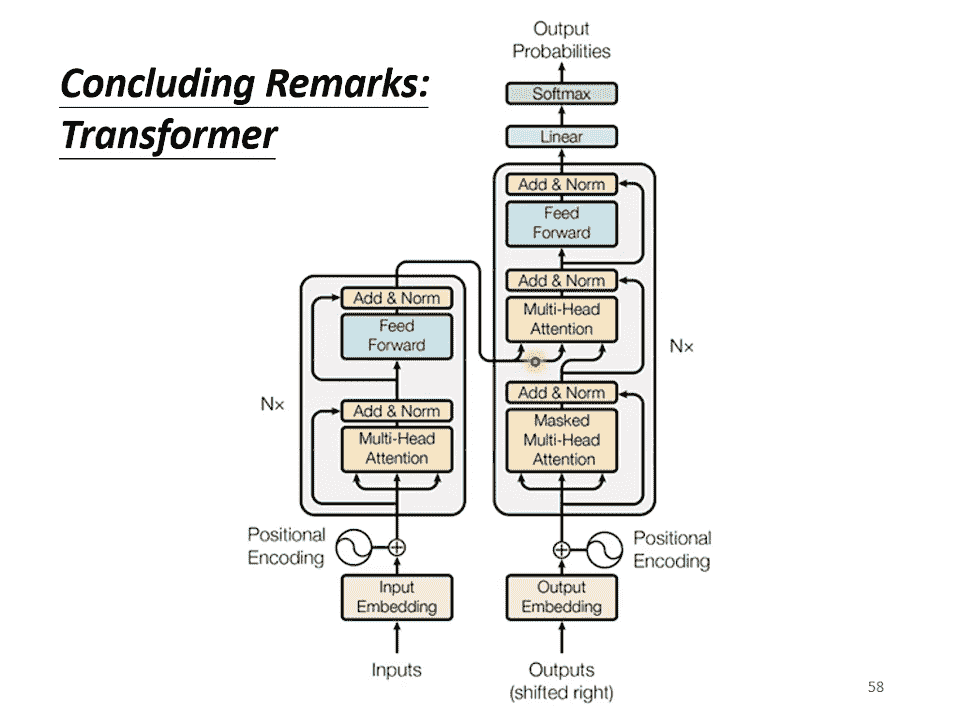

也讲了种种的地步好。