# 李宏毅2024春《生成式人工智能导论》 - P25：（延申）用语言模型來解释语言模型 (上) - 啥都会一点的研究生 - BV1BJ4m1e7g8

好那各位同学大家好啊，那我们今天呢要先来讲用AI来解释AI，那这个呢是OpenAI最近发的一篇论文，那同样的也有发一个VLOG啊，这也是一个呃非常知名的消息，就是用语言模型来解释。

另外一个语言模型里面的类型的，这个类神经网络在做什么样的事情，好，那我把blog的连接呢和paper的链接。

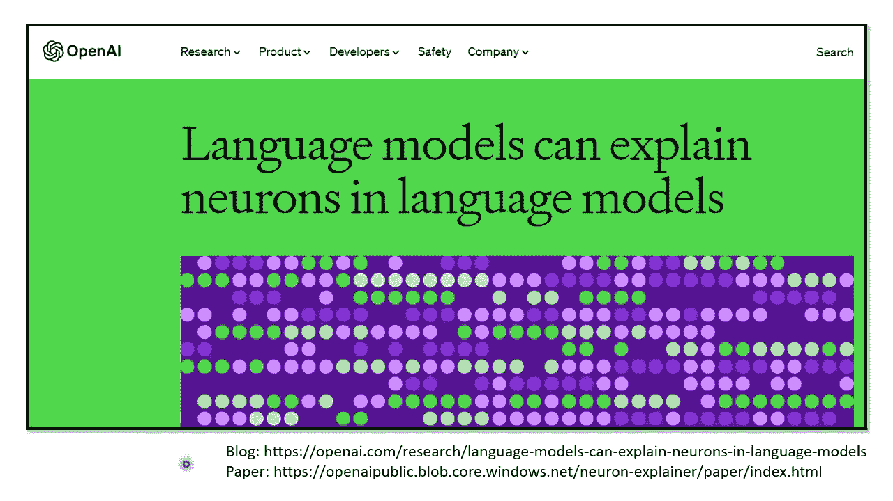

都放在这个投影片上啊，那可解释性的AI啊，其实我们这门课已经讲了非常多了，那其实可解释性的AI并不是单一一个技术，随着你的目标不同，你要解释的东西不同，有各式各样不同的技术。

那所以在讲OpenAI的这篇文章之前，第一个要问的问题应该是。

这篇文章到底想要解释什么样的东西，那这篇文章想要解释什么呢，这篇文章想要知道一个神经元，一个neural的作用什么意思呢，他想要知道根据一个神经元何时会起反应，何时会有activate。

也就何时会输出比较大的数值，来猜测一个神经元的作用，举例来说，我们知道一个语言模型，他都是这个transformer，那里面都有很多layer，那每一个layer里面都有很多的neural。

当我们今天给这个语言模型一个句子的时候，这个语言模型工作就是给一个句子，把接下来下一个应该输出的字把它拆出来，那今天假设这个语言模型，在读到某一个词汇的时候，我们可以把它里面每一个神经元输出的数值。

记录下来，那透过观察某一个神经元，看到不同的输入的时候，它会有什么样的输出，我们可以试着来猜测这个神经元的作用，举例来说，假设有一个神经元呢，每次读到right啊或correct啊等词汇。

它就会输出比较大的数值，那我们就可以猜测，这个神经元呢是一个正确的神经元，他在侦测发生正确的事情，当你的句子里面提到了正确的事情的时候，这个神经元呢就会被启动啊。

那可问说这些是在神内神经网络里面的神经元，他们真的都代表某种特别的含义吗。

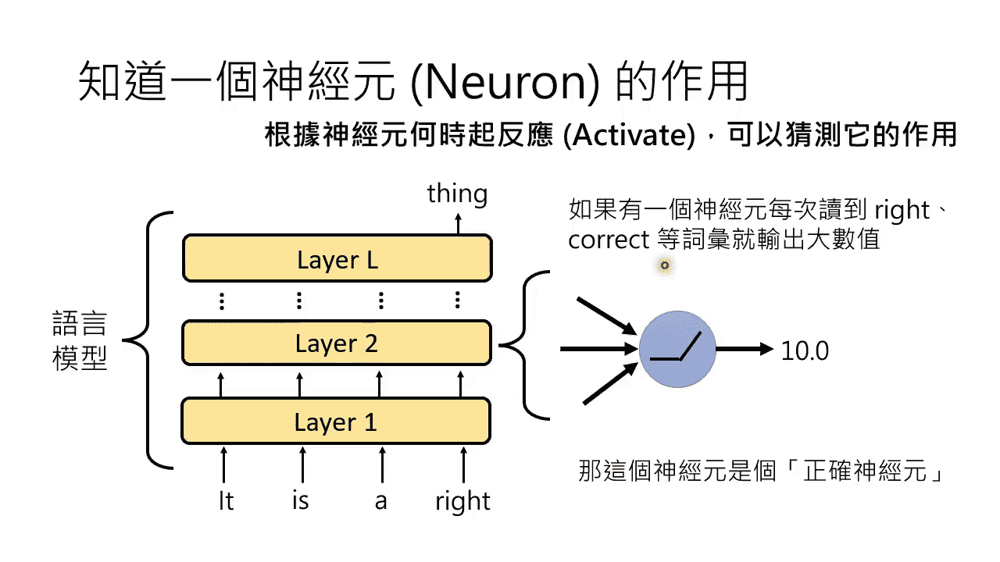

其实多数神经元都不太清楚他在做什么，但你确实可以找到一些神经元，有非常独特的应用，比如说有一篇VLOG的文章，那这也是蛮最近的，VLOG是今年2月的一个VLOG。

那这篇VLOG的开头是we found an neural，1g p t two，那这个n neural并不是打错字啊，它是一语双关，就是他们发现了一个神奇的神经元。

这个神经元在g p t two的第30，一个layer的编号892号，这个神经元当他在读句子的时候，他的ACTIV的这个模式啊是这个样子的，那这边用蓝色的颜色呢代表这个神经元的输出，颜色越深。

代表它输出的数值越大，那从这个例子里面，你可以很明显的看到说，这个神经元在读这个句子的时候，读到in，他突然输出很大，在读这个句子的时候得到have输出很大，读到这个句子的时候，读到how输出很大。

如果你看他读到的那个词汇，你可能会找不出这个神经元到底在做什么，但如果你看下一个词汇，发现都是an，所以这个神经元神奇的地方是，他在预测接下来会出现N这个词汇，当这个神经元被启动的时候。

这个GPDQ就是预期，接下来他会读到an这个词汇啊，就是这么神奇，它是一个专门预测N会不会出现的神经元，他当然还有一些神经元在做更复杂的事情，那些神经元的行为比较复杂，也许人也没有办法一下子看出来。

这些神经元在干嘛，那怎么办呢，就把它交给g p t for来解释，这就是OpenAI所说的，用语言模型来解释语言模型，那怎么做呢，这个技术啊真的是非常的简单。

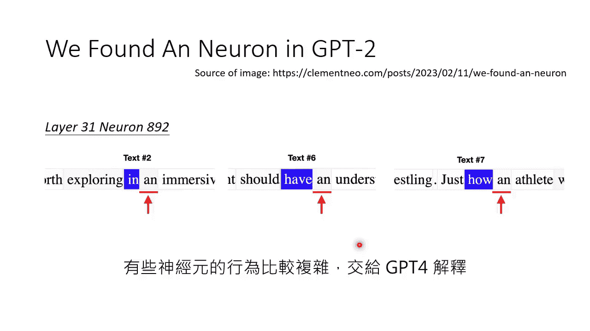

你自己也有办法做，真的是说穿了不值钱，他们的技术就是这样好，假设我们要知道某一个神经元的行为，那怎么办呢，先把呃他们要解释的对象都是g p t two了啊，就把g p t two拿出来。

让他读很多的句子，然后呢把某一个神经元输出的数值记录下来，那今天呢在这张投影片里面越颜色越深，就代表那个神经元的输出的数值越大。

好，接下来再把这些神经元的活动的行为呢，丢给gt four，然后问GPT four说，你觉得这个神经元的功用是什么，期待gtt four就可以自动回答，你这个神经元的功用，那你这边会遇到的第一个问题是。

我们怎么把某一个神经元它的ACTIV的行为，它的输出的数值，它读每一个词汇的时候，输出的数值丢给g p t four啊。

那这个OpenAI呢有详细的公布了他们的pump，他们的pump长这个样子，首先呢要先描述一下我们在做的事情，比如说告诉GB或者说我们正在这个研究呢，是在类神经网络里面的神经元，然后接下来告诉他说呢。

我们会给你某一个神经元的activation，这个activation的format是这样子的，我们会给你词汇，然后呢接下来给你那个神经元输出的数值，那这边叫做activation。

那这个输出的数值范围呢一定介于0~10之间，那这边特别做了一个normalization，虽然神经元的数值，输出的数值不一定会介于0~10之间吧。

就算你有做review CD releavation function，你只知道这个神卷输出数值一定是正的，不一定小于十，不过这边呢要做一个normalization，让它最大的数值就是十哦。

然后呢呃你要根据这些神经元的输出，然后告诉我们说的这个神经元在做什么，所以这个g b t four，看到的神经元的活动的轨迹就长这个样子。

有一个句子的sense of to get this in our town is strong，然后每一个token后面的这个数值，就代表那个神经元输出的数值，那多数的时候呢神经元输出的数值都是零。

那有时候呢神经元看到他想要看的东西，它就会输出比较大的数值，那OpenAI他们还发现说呢，你光给一整一个完整的句子，还有里面每一个token神经元的输出是不够的，那我其实也试过了。

我自己先亲自按照他们的这个框回来试了一下，确实只有给这样子的描述呃，机器没有办法做的很好，如果你要得到很好的结果的话，你要把所有零的输出是零的那些token拿掉，然后再未给机器记一次。

因为输出是零的状况实在太多了，所以你让机器看这么长的句子，这么复杂的呃，pattern他可能觉得很困惑，所以只给他看，你要把这个有零的输出是零的这些token拿掉，把没有输出是这个正数不是零的。

那些token再给g p t four看一次，他会得到比较好的结果，然后接下来就直接问gbt for，说叫你解释神经元编号一的行为啊，这个神经元是在寻找什么呢，那g p t four就回答。

你说这个神经元呢在寻找跟community，还有unity有关的concept啊，还在找一些跟联合联盟有关的概念，那确实感觉是如此，比如说看到together together，那他就被启动了。

代表他在找一些跟联盟连接有关系的概念。

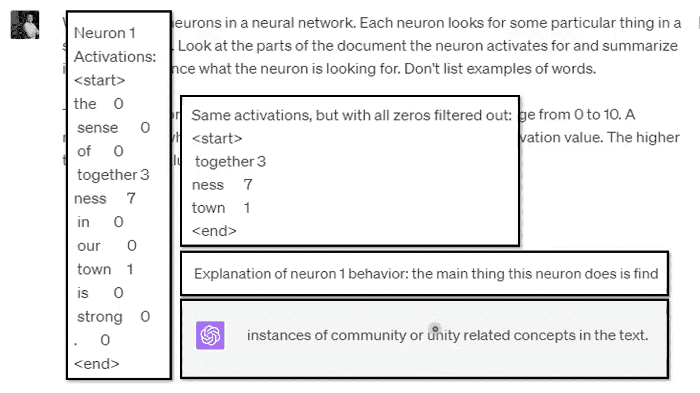

然后就说完了没了啊没了啊，那接下来呢就是给大家看一些成功的例子，还有一些失败的例子，好大家来看一下啊，这是一个神经元，这个是一个g p t for，可以成功侦测这个神经元在做什么的例子。

比如说有一个神经元看到is done property，来看property的时候就会启动了，它就输出很大的数值，他看到it's done right就被启动了，那这个神经元的功用是什么呢。

那我相信大家都看得出来。

那g p t four也看得出来，他就是我们一开始举例的时候，提到的正确的神经元，所以g p t for说这个神经元呢，就是在找word或phrase，在找这个词汇或者是片语。

这些词汇或片语跟什么有关呢，跟把事情做对有关哦。

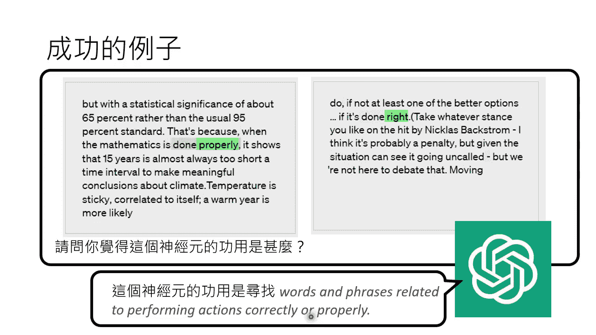

那还有另外一个例子，这个例子呢，呃这个神经元它在侦测的东西，是比较抽象一点的，这个程序员看到个句子说like water mix with water，就像水交融于水一样就被启动了啊。

这个神经元看到说like tea that ride a bike，就像一个小孩在骑脚踏车，他看到这个句子，他的这个神经元呢也被启动了。

然后你问这个g p t for，说这个神经元是在干什么呢，g p t for说这个神经元，那他是在侦测有关比较的叙述，尤其是他在寻找比喻啊，他在寻找，当句子中有比喻的时候，它就会被启动。

所以这是一个比较抽象的神经元。

它是一个侦测比喻的神经元啊，那这也是另外一个成功的例子，这边有个很复杂，有点不知所云的句子，什么from the table from the front from behind等等等等。

然后这个神经元呢，看起来一开始他看到第一次放的时候，没有被启动看，但是看到pd pattern反复出现的时候，他这个神经元就越来越兴奋，输出的数值就越来越大，而同一个神经元呢再看这一串文字的时候。

advertisement advertisement advertisement一直重复，他就越来越兴奋，而这个神经元呢看到什么，Map020304，一直到零九的时候也越来越兴奋。

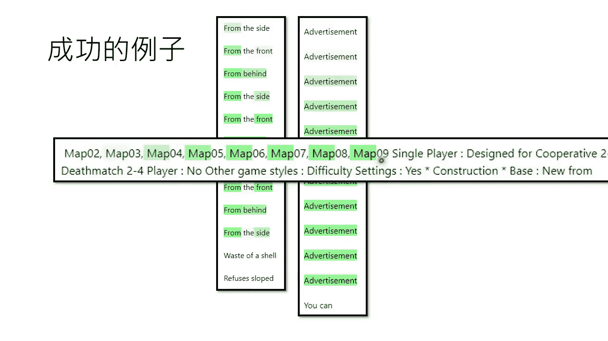

那这个神经元在做什么呢，我想你应该看得出来，那g p t four也看得出来，这个神经元就是在找某种反复出现的pattern，当你的文章里面有某些词汇反复出现的时候，这个神经元就会被启动啊。

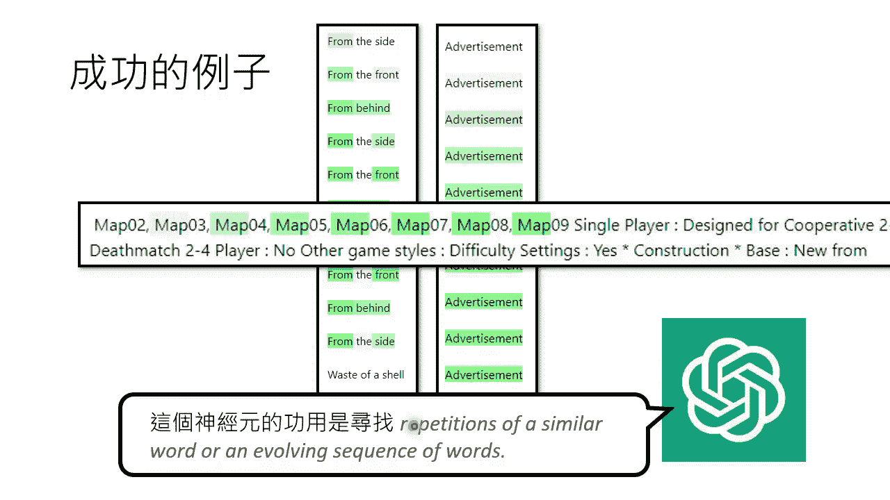

那以上是一些成功的例子，那其实有蛮多失败的例子的。

举例来说，大家看得出来这个神经元在做什么吗，这个神经元在第一个例子里面，他看到破的时候被启动了，在第二个例子的时候，看到portrait被启动了，第三个例子的时候看到JILL被启动了，好像没有规律可言。

有人看得出这个神经元在做什么吗，我想一时之间，你可能很难看出这个神经元在做什么。

GB t four也非常的困惑，他就觉得这个神经元是在寻找跟general的concept，title and partial turns有关的词汇，所以显然这个gp four也不知道自己在说什么。

他觉得这个神经元好像什么事都做，那人去分析一下以后，就是根据open abug的讲法，这个神经元呢是一个侦测前面有错字的神经元，被发现说这几个例子前面都有一个错字哇，这是个侦测错字的神经元，不过其实呃。

我看了更多这个神经元启动的例子以后，我觉得他也不完全是在侦测错字，有时候是看到罕见的词汇的时候，它就会启动，所以有点复杂，所以这个g p t for，没有办法找出这个神经元到底在做什么。

也是情有可原的哦，还有另外一个例子，这个例子我觉得对人类来说其实也挺困难的，这个神经元看到12345red的时候，就被启动了。

这个神经元看到table table table table hitos就被启动了，这个神居然看到like and laughing head and try，And when the cn。

看到混的时候就启动了这个神卷，看到阿尔法一，阿尔法二，阿尔法三，看到阿尔法五的时候就启动了这个神卷，看到1WASHINGTON2ADAMS，三，Jefferson，4medicine5。

EBULLION突然就启动了，就前面四个是美国总统的名字啦，这个EBULLION显然不是美国总统的名字好，那这个神经元到底在做什么呢，我想你可能也很难看出来jpg four也看不出来。

他就随便瞎掰一下，他在看numbers，他在看ordinal，The term，不看possessive construction，那就随便给个答案好，那根据OPENAI的讲法，这个神经元在做什么呢。

它的功能还蛮奇怪的，它的功能就是发现一个规律被破坏的时候，这个神经元就会启动，这个做的事情真的非常抽象，所以这边比如说12345，然后出现颜色规律被破坏，所以就会启动了，前面这四个都是美国总统的名字。

第五个不是美国总统的名字，所以他就规律被破坏了，所以这个神经元就被启动了，这是一个侦测规律被破坏的神经元好。

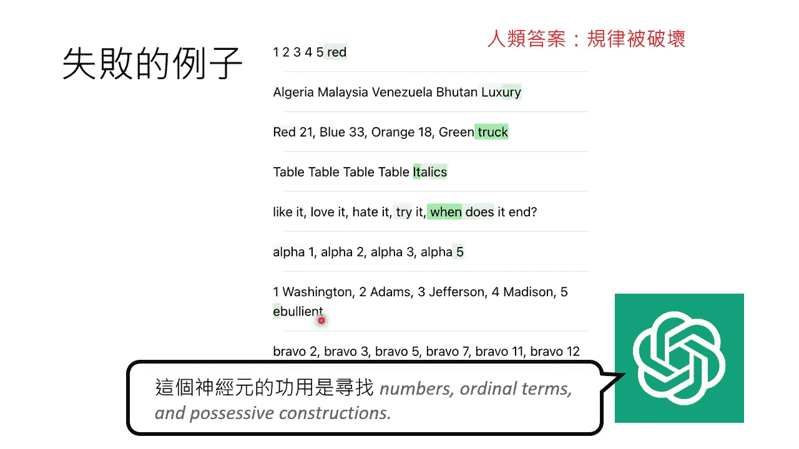

那刚才讲的是确GPT解释的一些结果，但我们怎么知道这个g p t for，它的解释好不好呢，为了平凉gbt four解释的好不好，这是OpenAI他们做的事情。

这个g v d four不是很擅长做角色扮演吗，他可以扮演成各式各样的人，但是现在叫他扮演成自己的一个神经元，它是一个类神经网络，它里面有上亿个神经元，但现在他要扮演一个神经元。

那怎么让g p t four扮演一个神经元呢。

你就这样跟他讲，你就跟他说，现在有一个神经元编号1938，它的功能呢就是做以下这件事情，现在给你一个句子，你认为这个神经元读到这个句子的，最后一个token，它会输出多少数值呢，叫gt four。

扮演神经元编号1938，根据神经元编号1938的这段解释，那这个解释刚才GPT破自己产生的，根据这段解释还要决定说，如果他是这个神经元的话，读到这个句子的最后一个字，最后一个token他会不会被启动好。

那这边呢也许他就启动个九吧，因为这边的描述是说啊，这个神经元就是在侦测正确的事情，那这个句子最后一个字是花盆里哦，所以他可能会被启动输出一个很大的数值。

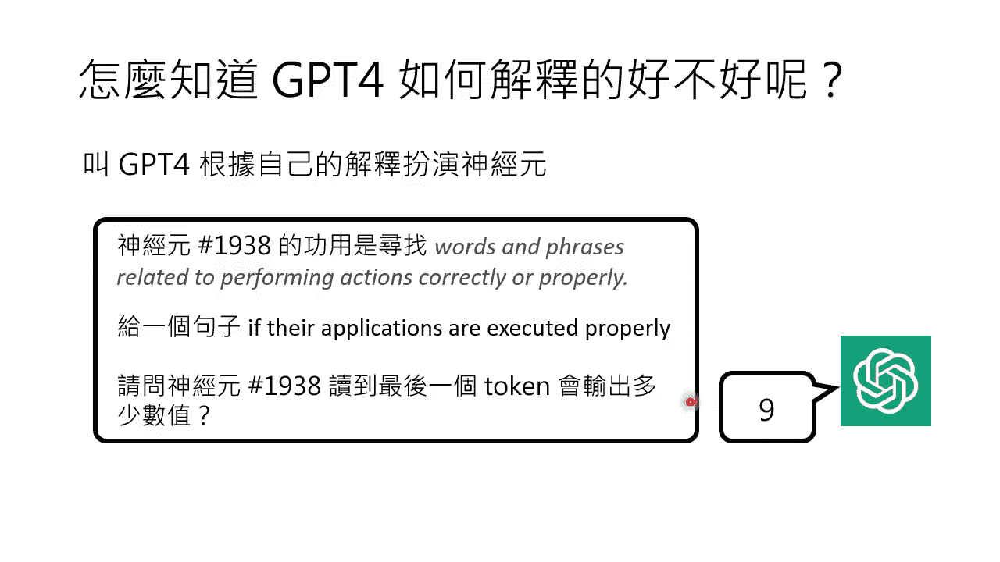

那怎么知道这个输出的数值是不是正确的呢，你其实可以轻易得到正确答案，因为这个神经元是g p t two里面的一个，真实存在的神经元，所以就把同样的句子丢到GBTQ里面，然后看看编号1938。

这个神经元它真实的输出是多少，然后跟确GPT跟g p t four，生出来的答案做一个比对，那如果真正的1938输出的数值，就读同样的句子的时候，真正的1938输出的数值跟gp four。

预测出来的数值很接近，那就代表说这个解释是精确的，因为这个解释蛮精确的，g p t four呢就可以按照这个解释，真的扮演一个神经元，那根据这个接近的程度啊。

呃呃OpenAI他们定了一个explanation score，一个解释力的分数，那怎么把这个相近的程度换成解释力的分数，我们今天就先不讲，你有兴趣的话再自己去读他的文章，这个分数是介于0~1之间。

依旧代表说呢，呃真实神经元的输出跟g b t four的输出，非常的接近，很接近，都是一一啊，很不接近，就是零那一呢就代表解释非常精确，零就代表解释不精确哦。

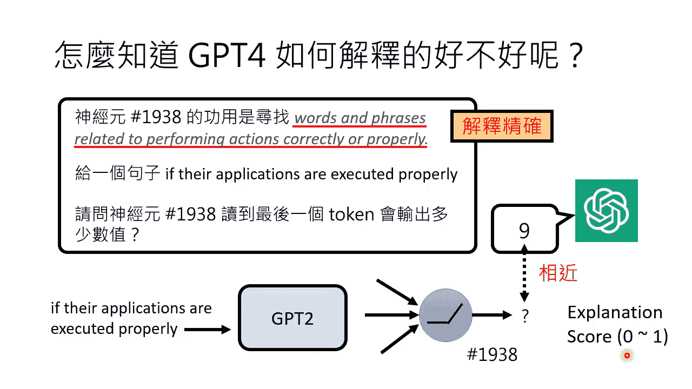

那实际上的pump呢长的是这个样子的啊，这个是实际上呢呃OpenAI他们用的pump啊，这个pump呢就是要先跟他说，有一个神经元编号四啊，这个神经元编号四的作用是什么呢，在这个例子里面。

这个神经元的作用呢，就是在侦测这个结尾是ING的动词，然后呢你就给这个gbt for一个句子i am，然后问他说最后一个token，这个神经元编号是应该输出什么呢。

gp four就是说应该输出里的蛮聪明的，其实我试一下，3。5也可以达到类似的事情哦，那如果你输入的不是N而是n running哦，这个时候神经元就被启动了啊，这个g p t four就可以预习说。

这个神经元的输出的数值应该是十啊，这都是真实的例子啊，然后呢你输入i am running q，然后最后一个token是Q，那这个时候gp d four的输出就是零，因为他知道。

这个时候这个编号四的神经元不会被启动哦。

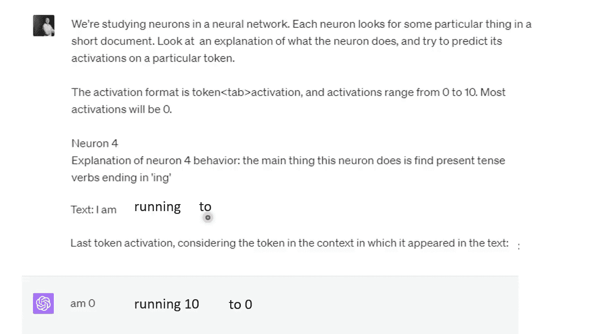

那可以成功的解释神经元吗，在讲说到底有没有成功之前呢，先来看一些大趋势，纵轴呢是可解释性的那个分数分数越高，代表g p t four的解释越好，那我们先不要在意这边实际的数值。

反正这数值越高代表解释的越好，那横轴是什么呢，横轴是其实有尝试解释了不同的language model，从比较小的到比较大，那看起来呢是如果模型比较小的话，它里面的神经元比较容易被解释。

如果模型比较大的话，那里面的神经元比较不容易被解释，比较小的类神经网络里面，也许每一个神经元它的作用比较明确哦，所以比较容易知道这个神经元在做什么啊，比较大的网络里面有好多神经元。

也许好多的神经元合起来才负责一件事，所以看单一的神经元比较不知道他在做什么哦，那另外一个大趋势呢是，如果你看同一个类神经网络的不同层，里面的神经元，这边每一条曲线代表一个内神经网络。

不同颜色的虚线代表不同的类神经网路，由左到右是指由浅到深，那它大趋势是什么呢，大趋势是越底层的神经元，它的行为越容易解释，越高层的神经元他的行为越不容易解释，但这也是很合理的。

越高层的神经元他做的事情往往越抽象，那这些神经元他们可能还是有某些固定的用途，但是因为它们的用途比较抽象，所以对g p t four来说，他就比较难以解释，那比较底层的神经元，有很多神经元。

他的行为是非常单一的，甚至很多神经元就是看到某个词汇，它就会被启动，那对g p t four来说，这些底层的神经元是比较容易被解释的好，那我们现在来看看这个explain。

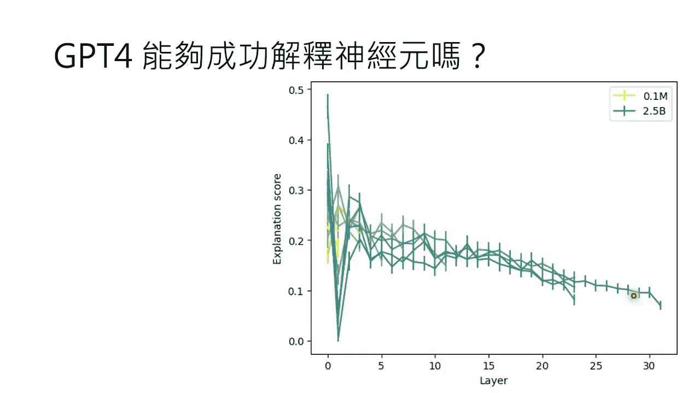

explanation的分数到底好或不好呢，刚才我们说有一个神经元叫做正确神经元，专门侦测正确的事情是否有发生，那个正确神经元，那个解释正确神经元的解释，得到的分数是0。42啊，那我们刚才有说说。

有一些神经元根本就很难知道他在做什么，gp four根本就不知道这些神经元在干嘛，那一种神经元，刚才的例子里面得到的分数是0。14，然后呢呃其实gt four的解释。

平均得到的explanation的分数是0。15，所以就会发现说多数神经元里得到的解释，就是这种等级的，只有非常少数的神经元，你才能够找到很明确的解释哦，所以你可能会觉得说哎这个结果有点失败的。

多数的神经元其实都没有找到很好的解释，但是OpenAI他们有另外一个实验，他们说这是因为g p t four提供的解释很差吗，不一定，也许是因为有很多神经元，你真的就是不知道在干嘛。

他们找的人类来提供解释，就算是人类提供的解释，就由人类提供解释，但仍然由g p t four来扮演一个神经元，根据人类提供的解释来预测这个神经元的输出，但就算是人类提供的解释，这个解释是利益的分数呢。

其实也只有平均也只有0。18而已，所以其实并没有比GETF提供的解释，好上太多，总之这边也许我们得到的结论是，在一个类神经网络里面，多数的神经元我们真的是不知道在干嘛。

但有少数的神经元可以透过gpp for提供个解释。

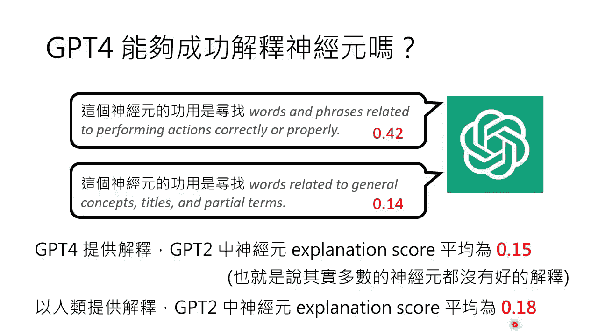