# 李宏毅2024春《生成式人工智能导论》 - P26：（延申）用语言模型來解释语言模型 (下) - 啥都会一点的研究生 - BV1BJ4m1e7g8

好那这个是用AI解释AI的这个方法的概览，就首先我们有一个被解释的模型，要被解释的模型subject model。

然后这个被解释器的模型呢，我们可以从它里面得到某一个神经元。

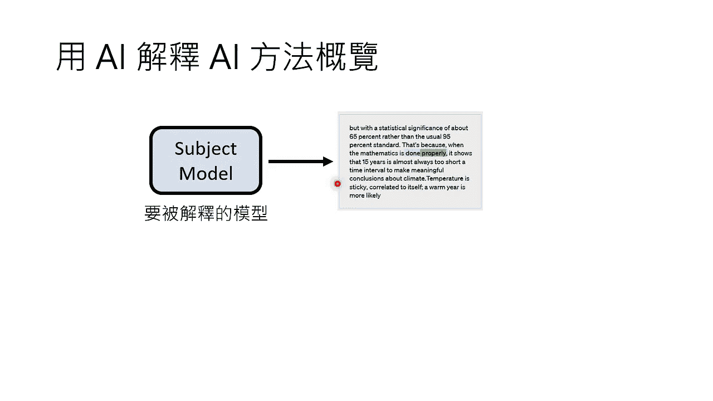

读不同句子的时候，它activation的位置，那把这些资讯呢丢给一个负责解释的模型。

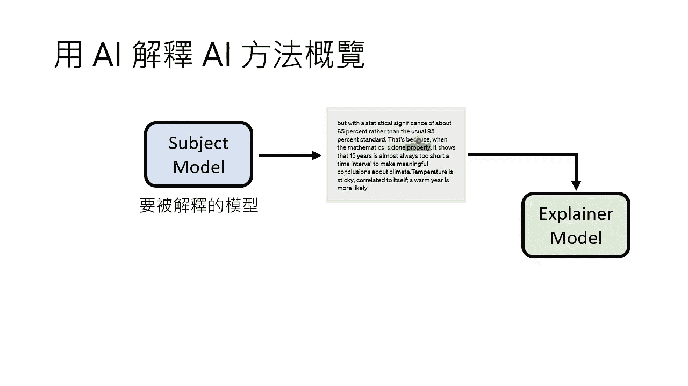

它产生解释的结果，然后要有一个负责角色扮演的模型，叫做simulator的model，根据这个解释扮演一个神经元，再根据半年的结果，我们就可以知道说，这个解释是不是一个好的解释。

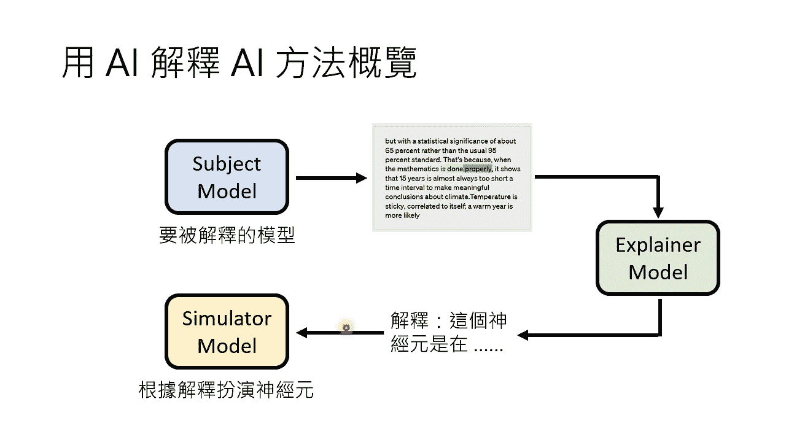

要被解释的模型是g p t two，那扮演负责解释的，还有负责扮演一个神界的模型，都是g p t four，但这边这三个模型被解释的，负责解释的，还有做角色扮演的模型，他们不需要是同一个模型。

也不一定要是GDP for，理论上可以套用任何有能力的语言模型，当做这个负责解释的模型，还有负责角色扮演的模型好。

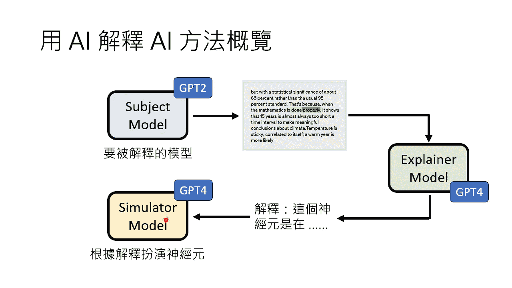

那我们刚才怎么判断g p t four扮演的神经元，像不像是真实的神经元呢，我们是看这个g p t four所扮演的神经元，它的输出跟真实神经元，GBTQ里面某一个真实神经元，它输出的相近程度。

但是光看输出，神经元的输出不一定是一个好的结果，因为有可能某一个神经元，它处在的位置非常的关键，它的输出有一点小小的变化，对输出对整个类神经网络的输出有巨大的影响，我这个神券的位置根本就不重要。

这个神经元就算他的输出有很大的改变，对整个类神经网络的输出也没什么影响，所以也许真正重要的是整个内神经网络的输出，那怎么办呢，你可以用g p t force扮演的神经元。

来取代g p t two里面的某一个神经元哦，假设这是g p t two里面的某一个layer，然后呢g p t four呢就负责扮演其中的神经元，本来这个神经元应该按照其他神经元的输出。

来决定它真正的输出，但是现在这个神经元呢被一整个g p t four，取代了，所以gt t four的输出就是这个神经元的输出，所以把内神经网络里面某一个神经元，用GPTF扮演的神经元替换掉。

这个听起来真的非常的诡异，现在他扮演一个神经元，虽然它里面有可能170个b lion的参数，但是他要负责扮演一个神经元而已，好，当你把用g p t for来扮演g p t two。

里面的某一个神经元的时候，这个g p t two的open会有多大的变化，我们用这个变化的程度来代表，这个神经元扮演的到底好不好哦，所以用不同的方法来验证神经元扮演的好坏啊。

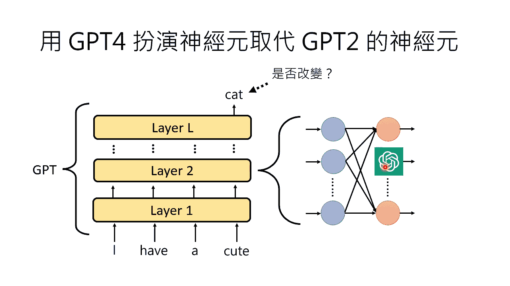

不过呢OpenAI有这张图告诉我们说，其实不同的扮演方法，这个结果是差不多的，这个横轴的correlation score，是拿g p t for扮演的神经元的输出，跟真实神经元的输出来比较它们的差异。

这个application score是把g p t two里面的某个神经元，直接换成一个g p t four，然后看看这个GPT two的输出会不会有所改变，而两个分数之间他们是呈现非常正相关的。

所以OpenAI的文章就说，我们其实只要选其中一个来进行解释就好，只要看其中一个数值就可以了。

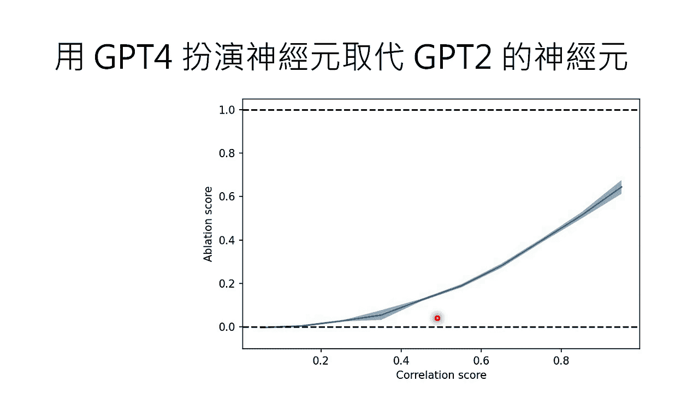

当然另外一个令人担心的问题是，会不会今天这些神经元扮演的好坏，其实也跟一个解释的好坏没关系，我们今天之所以叫gp four扮演一个神经元，就是为了看说gp four自己生出来的解释，够不够精确。

够不够作为脚本，让g p t four来扮演一个神经元，那会不会其实扮演的好坏，跟那个脚本那个解释好坏没什么关系，那这个OpenAI又做了一个human study啦，就找人来看一下那些解释。

然后发现说的人觉得解释越好，那他们的那个explain，因为他们的这个解释力的分数算出来也越高，所以他们的解释力的分数确实跟这个呃，呃写出来的这个解释，gp four写出来的解释的好坏是呈正相关的呃。

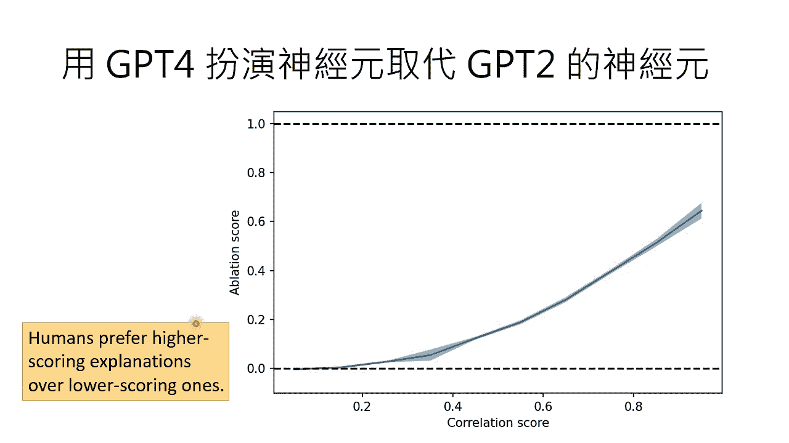

要在一个模型要被解释的时候，我们需要让这些模型去读一些句子才好，知道某一个神经元，它输出的pattern和activation的pattern，但是要让这个模型读哪些句子呢，其实就会大大幅的影响结果。

让他看不同的句子。

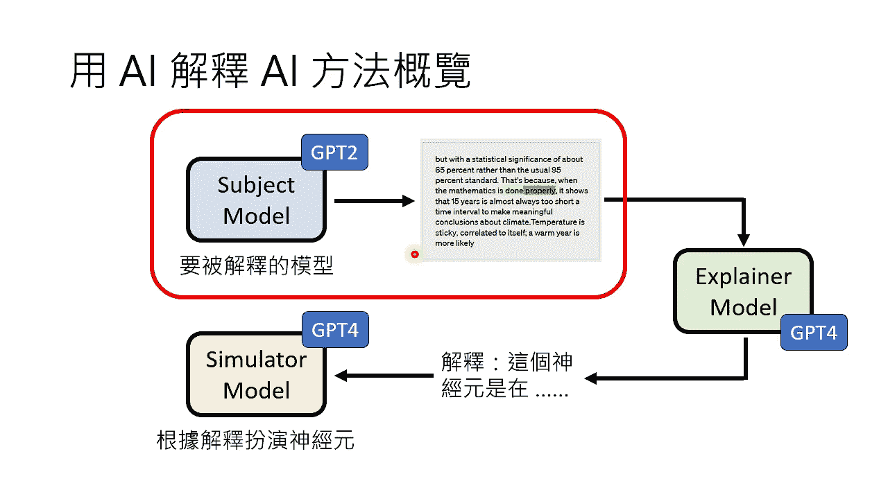

那个结果会是非常不一样的，一个通常比较直觉的做法呢，你就把这个g p t two呢读过非常大量的句子，只有这个在这些大量的句子里面，那个我们要解释的神经元在哪些句子里面，它的输出的数值是特别大的。

然后就把输出数值有特别大的那些句子，把它挑出来，那这边挑句子本身是必要的，你没有办法让g p t two跑过，比如说上万个句子，然后把上万个句子，某一个神经元它的输出通通都丢给gt four来看。

因为GPU for它的输入终究是有个上限，他没有办法看太复杂的输入，所以你只能给他有限的输入，那在只能跟有线输入的前提之下，怎么选那些输入呢，那就看你要解释的那个神经元，在哪些句子上有特别大的输出。

就把那一些句子给GPT破开，但这样子的选资料的方法有什么样的盲点呢。

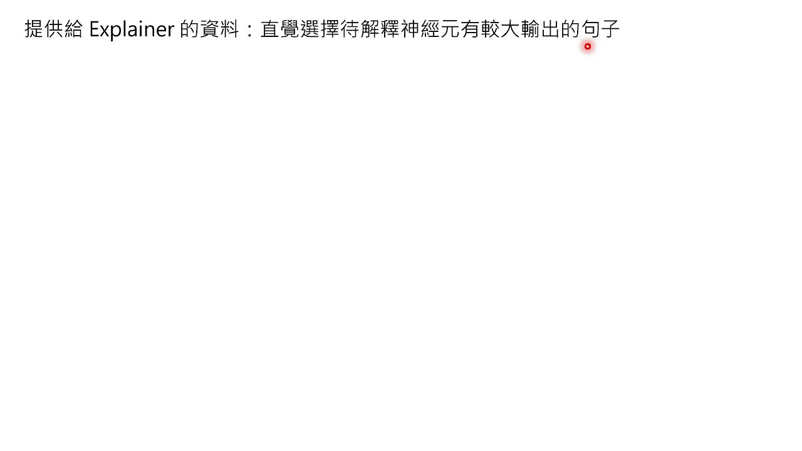

这样选资料的方法还是有一些盲点的，举例来说，我们来看这个例子，这边让g p t two读过三个句子以后，看某一个神经元的反应，你会发现说这个神经元在看到O的时候，在看到O的时候，在看到O的时候。

它就会被启动，那可能很直觉的会得到一个解释，是这个神经元就是在寻找O，看到O的时候就会被启动，但真的是这样吗，实际上这个神经元在做的事情是看not all，而不是all，但是你所给的资料里面。

并没有办法告诉g p t for，说这个神经元是在找NALL，而不是all，因为对g p t for来说，虽然这些句子里面的O前面都有点难，但gp four倾向于给一个比较宽的解释。

所以他认为这个神经元就是在侦测O的存在，你没有任何的资料可以告诉g p t for，说这个神经元只看那O而不是所有的O。

所以怎么办呢，有一个方法是让机器自己产生额外的句子，产生特别关键的句子，然后在又要被解释的g p t two，来跑过这些g p t for自己产生的句子，就假设我们本来已经知道说某一个神经元。

它现在做的事情就是侦测哦，然后我们就把这件事情呢输入给gp d four，叫它生成更多这个神经元可能被启动的例子哦，我们知道某一个神经元就是侦测all，叫g p t four。

生出更多可以让这个神经元取的例子，它就生出一大堆里面有包含O的句子，然后接下来呢再把这些句子呢去跑过g p t two，把这些句子真的丢到要被解释的g p t two里面，看看我们要解释的那个神经元。

有没有输出很大的数值，结果发现说本来我们误以为这个神经元，它是看到O就会被启动，但是看到这个句子，All the students，他没有输出大的数值，那就代表说这个解释是有问题的。

所以你可以把这些新收集到的资料，还有这些新收集到的资料，上面的神经元的这个activation。

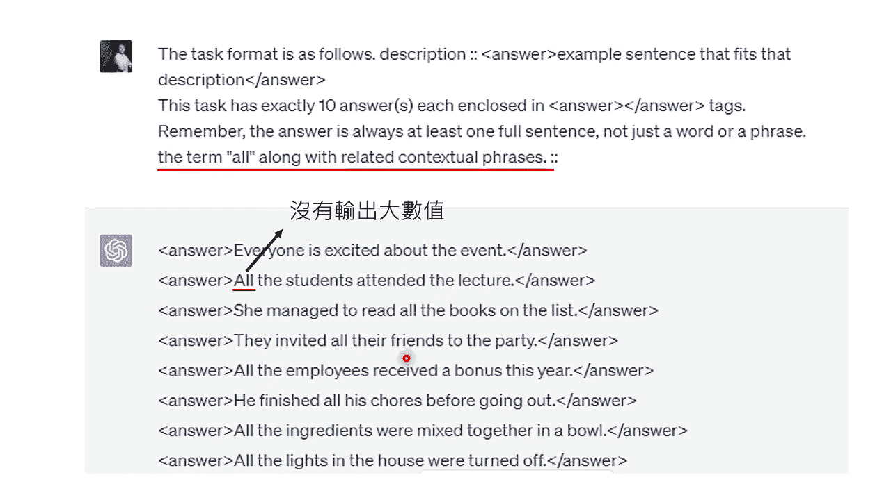

加上之前收集到的资料一起丢给g p t fork，gp fork就可以得到结论说之前看到那O的时候，这个神经元被启动。

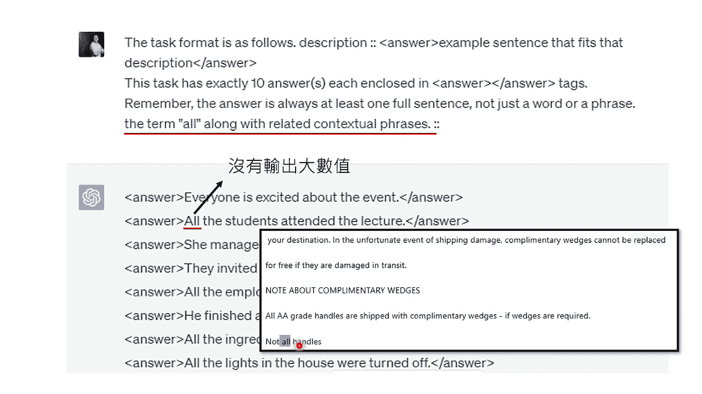

但是看到or没有NT的时候，这个神经元没有被启动，所以这个神经元实际上的功能是在寻找NANO，而不是只有O而已哦。

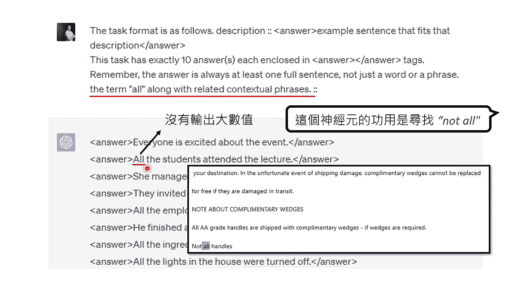

那这一招有没有用呢，啊那在这个图上的纵轴呢是解释力的分数，那这个数值是越大越好，那baseline就是什么都不做，你就直接挑数个呃，某一个神经元activate最剧烈的句子。

来给g p t for来解释，那你得到的解释力的分数大概是这个样子，刚才讲的方法其实是revision啊，那这个revision是在这边，revision有两个啊，第一个是revenge random。

Revision，render的意思是说，如果我们今天让这个GPT呢，在随便生成一些句子，或是我们从database里面再多随机抽一些句子出来，那其实我们如果抽比较多的句子，Performance。

其实这个解释力的分数是还是可以有进步的，但是我们随机另外找出来的句子，它不一定是最合适的句子，它不一定可以提供给我们最关键的资讯，所以如果我们是用g p t four，再产生更多的句子。

再给GPT two拿去做level的话，你得到的解释力的分数是会更好的，因为G力four，可以产生一些带有更关键资讯的句子，然后让你最后解释的结果变得更好。

所以总之你可以用g p t for生成更多的资料，然后呢用更多的资料，你可以得到更多某一个神经元，Activation pattern，然后最后得到更好的解释，结果好。

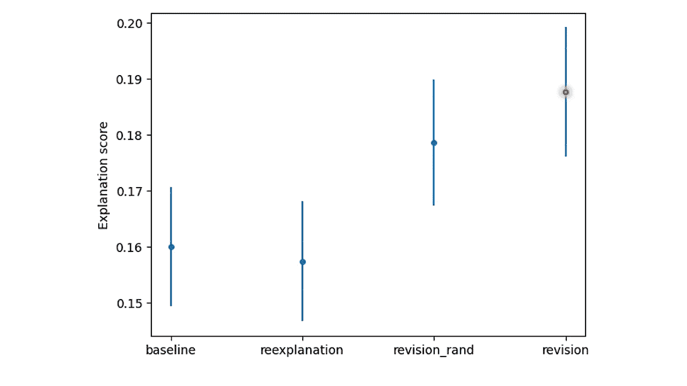

那这个呢就是用AI来解释AI这篇文章，全部的东西，就有一个被解释的神经元，有一个要被解释的network，然后让这个EXPLAINER，也就是一个GBDF，观察这个神经元的这个activation。

然后得到解释，然后再把这个解释丢给simulator，来扮演一个神经元，然后看看扮演的结果，根据扮演的结果的好坏来得知这个解释的好坏，但我知道说这个套路。

这个framework中间有太多有可能被吐槽的东西，举例来说，大家最喜欢吐槽的一个点，就是这个就是用AI来解释AI，用一个我们不懂的东西来解释，一个我们不懂的东西，这样真的没有问题吗，对于这个论述啊。

我个人是觉得还好，为什么，因为你想想看，explainable AI也是用人脑去解释AI啊，你说AI是个黑盒子，人脑也是一个更大的黑盒子，所以你觉得用AI解释AI有问题，难道人脑解释AI就没有问题吗。

但是在整个想法里面，有还有很多其他配被质疑的东西，第一个就是他的目标，因为这整个work，他的目标就是要解释单一一个神经元的作用，但是解释单一一个神经元的作用有意义吗，也很有可能单一个神经元。

它根本就没有什么特别的功能，很有可能是很多个神经元集合起来成为一个sap，成为一个组以后，他们才有特定的功能，所以解释单一个神经元，可能对我们了解整个network的运作帮助非常有限。

其实你可以再仔细去读一下OpenAI那篇paper，它里面有一段有讲到说，他们有试图让g p four不是只解释一个神经元，而是去解释一组神经元，那这个就留给大家自己看，那另外一个会可以可能被质疑的点。

就是，我们现在是试图用语言，来解释一个神经元的行为，但是有没有可能，一个神经元的行为，是无法用人类的语言来描述的，就他有固定的行为，他有重要的行为，但这个行为就不是人类语言，可以描述的一种行为。

也许它很复杂，所以我们人类的语言根本就没有，可以描述这种行为的词汇，因为它毕竟是一个神经元啊，他又不是人类，所以他做的事情本来就不一定能够，简单的用人类的语言来描述。

有没有可能这些神经元其实它有非常重要的，非常明确的工作，只是我们不知道怎么用语言来描述它。

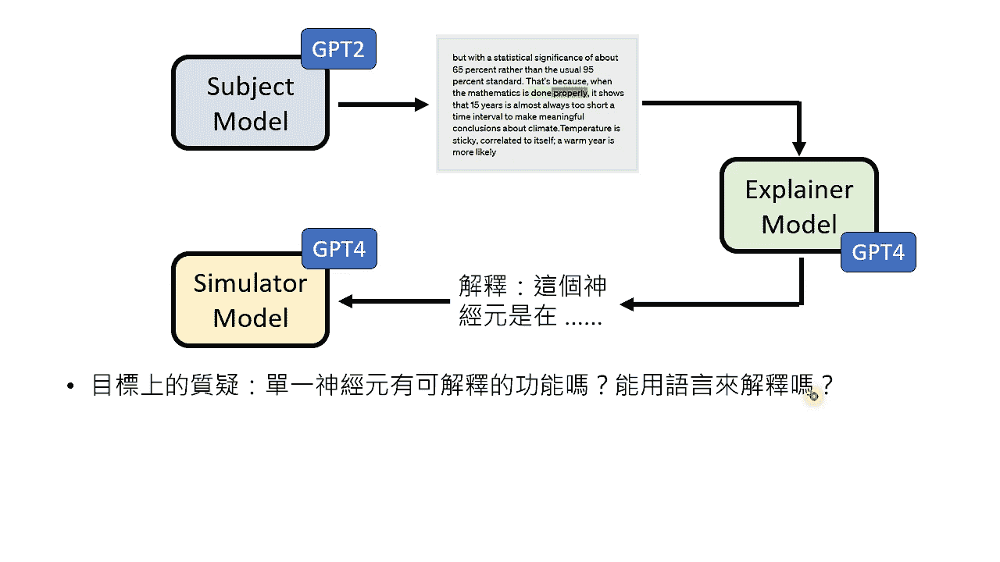

那另外会被质疑的点就是整个方法上的质疑，就这整个方法是透过explain先产生解释，再透过simulator去验证这个解释，那有没有可能今天假设simulator很弱，这是一个很烂的simulator。

这个解释不管多好，这个simulator就是没办法，根据这个脚本cosplay一个神经元，这也是有可能的，那可是从explanation score，从最后解释力的分数。

我们只知道EXPLANNER跟simulator两者合作起来，到底做的好不好，那如果explanation score第一，我们不知道到底是解释不好，还是simulator做的不好，而且有没有可能。

你就算得到的解释力的分数很高，其实这个解释搞不好是人看不懂的，因为现在explained model跟simulator model，他们两个都是内神经网络啊，会不会他们之间有什么神秘的暗语。

inspider model出现的这个解释是人看不懂的，但simulator看得懂还是可以正确的，sim的一个审计原则，搞不好也有可能有这样的现象，但是我们不容易，从现在这个方法的这个框架里面去验证。

这件事情好，总之就是跟大家分享，最近传的沸沸扬扬的。

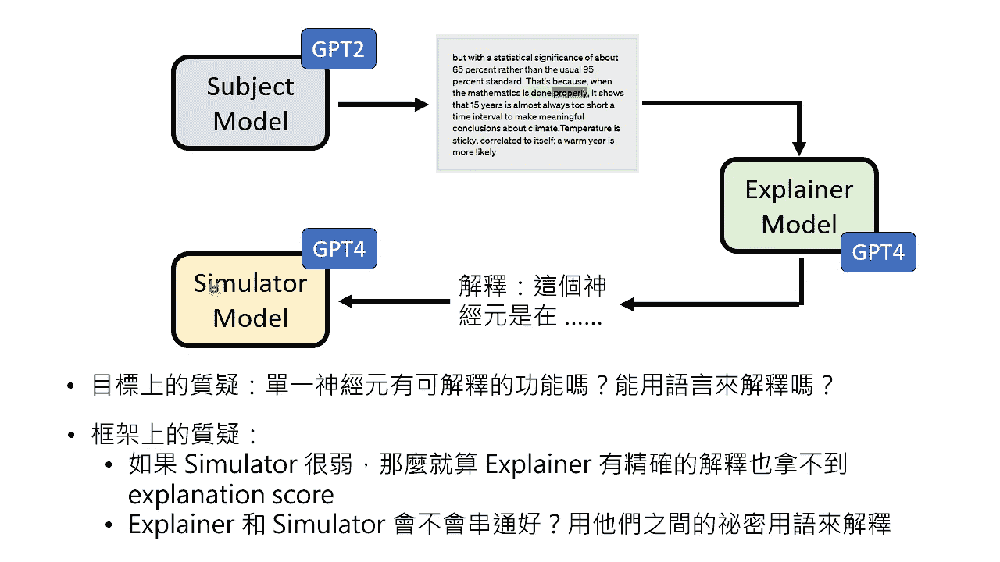