# 李宏毅2024春《生成式人工智能导论》 - P2：第1讲：生成式AI是什么 - 啥都会一点的研究生 - BV1BJ4m1e7g8

好来上课了好，那这个第一堂课啊，要告诉大家的就是什么是生成式人工智慧，那在讲深层次人工智慧之前，也许我们需要先知道什么是人工智慧，Artificial intelligence，Ai。

人工智慧从它的名字来看，听起来就是人所创造出来的智慧，是机器所展现的智慧，不是人本身的智慧，从他的名字你可以知道他是机器的智慧，但是智慧又是什么呢，当我们说人工智慧就是让机器展现智慧的时候。

我们只是从字面上去解释，但是什么又是智慧呢，讲到这边就已经卡住了，因为每个人心里所想的智慧通通都是不一样的，我常常会接到有人请我讲跟AI相关议题的演讲，那最近呢我通常是讲切GBT，那大家也都蛮能接受。

说哎这个欠GBT就是一种人工智慧，但是我也有听过有人抱着不一样的想法，他说你讲切GBT那个不叫做人工智慧，要一个机器人跑来跑去才算是人工智慧，或确GP不是人工智慧，电脑要会选土豆才是人工智慧。

所以每个人对于什么叫做智慧，其实是有非常不一样的想象，所以人工智慧这个词它没有一个标准的定义，每个人心里所想的人工智慧都是不一样的，所以如果你读人工智慧相关的论文，你会发现人工智慧相关的论文里面。

几乎不会提人工智慧这个词，因为它是一个没有清楚定义的词汇好，但是不管你怎么定义智慧这个词汇，人工智慧可以说是一个目标，是一个我们想要达到的目标，它不是一个单一的技术，并没有哪一个技术叫做人工智慧。

人工智慧是一个目标好。

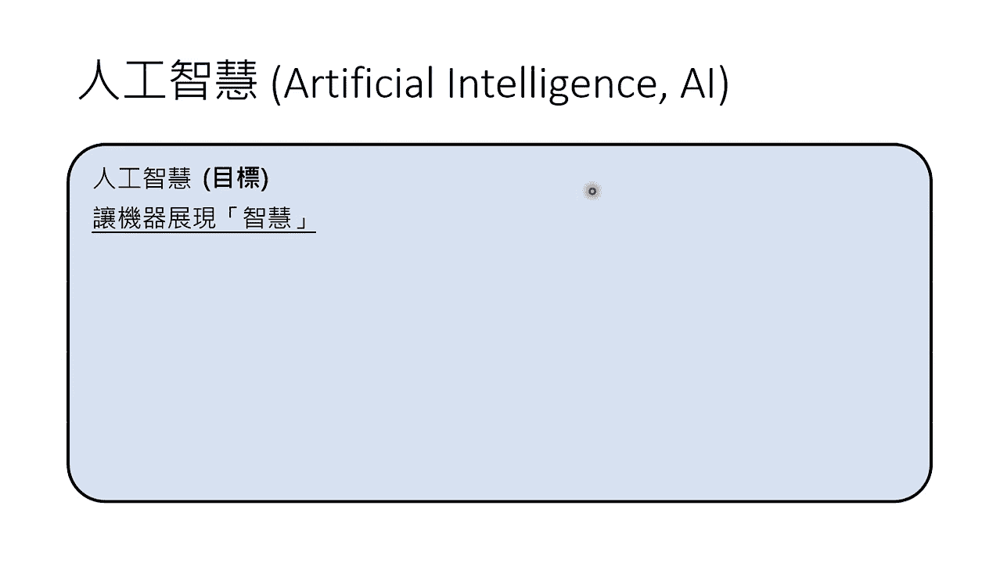

那什么又是生成式人工智慧呢，通常翻译成generative AI，生成式人工智慧的定义就比较明确了，生成式，人工智慧是要机器产生复杂而有结构的物件，举例来说，什么东西是复杂而有结构的呢，比如说文章。

文章也有一连串的文字所构成的，比如说影像，影像是由一堆像素所组成的，比如说语音，语音是由一堆取样点所组成的，那如果你不知道取样点是什么，也没有关系，这个我们日后讲语音的生成式AI的时候。

再跟大家详细说明。

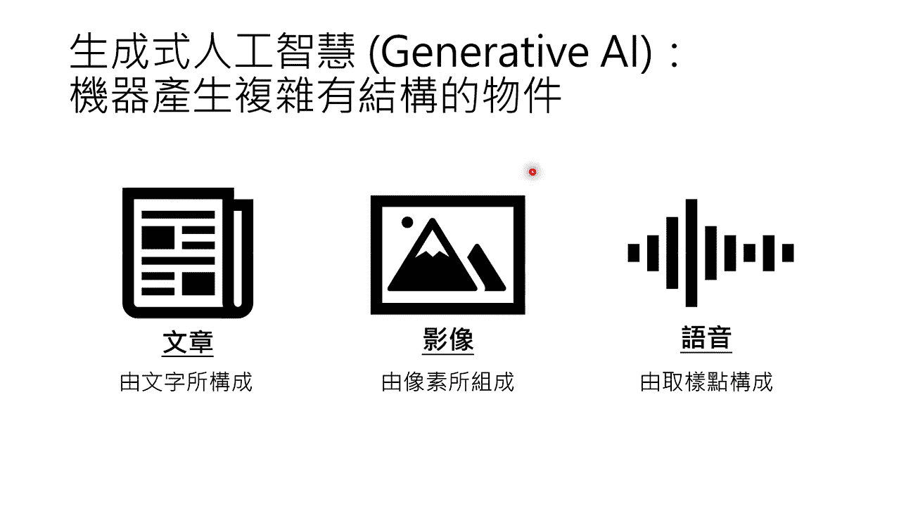

但是所谓的复杂有结构又是什么意思呢，这个复杂到底应该要复杂到什么程度呢，要复杂到没有办法穷举，没有办法穷举到底是什么意思呢。

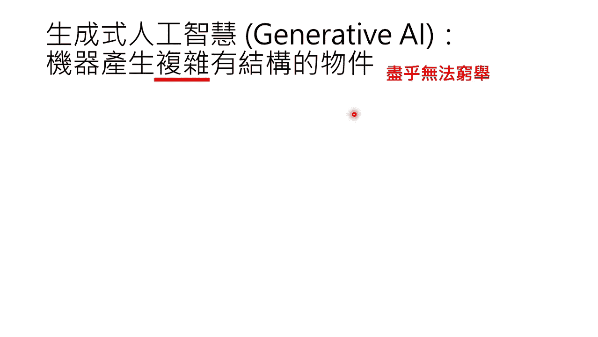

我们来想象一个情景，今天你在CHEGBT上跟他说，用100个字写一篇中文的文章，标题是缝隙的联想，那缝隙的联想是今年只考的作文题目了，而且绝对T他当然可以写一篇文章给你，但你有没有想象过。

当人工智慧写一篇文章给你的时候，背后到底是做了什么样的事情，到底是解了一个多困难的问题，写一篇文章到底有多困难呢，想想看，假设你要写一篇100字的文章，到底有多少种可能性。

你要把各种不同各式各样的中文的字组起来，组成100字的文章，到底有几种可能呢，啊，这个都是一个我们高中学过的排列组合的问题，我们假设中文常用的字是1000啊，当然中文实际上常用字是远超过1000啦。

为了计算方便，就假设是1000好，那100字的文章有多少可能性呢，就是把1000连成100次，1000连乘140是多少，是1000的100次方，也就是十的300次方，十的300次方是一个很大的数目吗。

它是一个大到不可思议的数目，宇宙中原子的数目，估计只有十的80次方而已哦，所以今天当机器要写一个100字的文章的时候，它的可能性有十的300次方那么多，而机器要从十的300次方里面。

挑出一个合理的答案作为他给你的答复哦，所以这显然是一个非常困难的问题，当机器解这个生成式AI的问题的时候，他需要从近乎无穷的可能中。

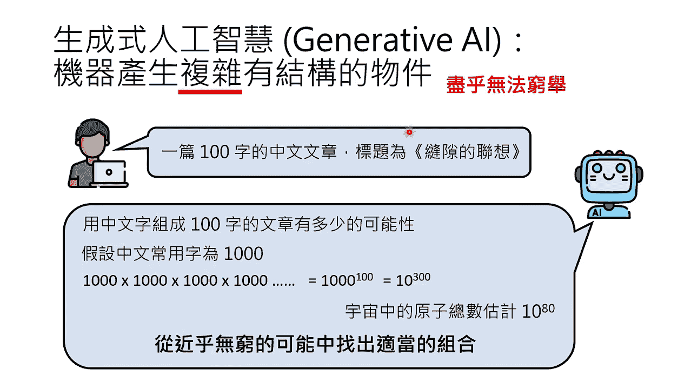

找出一个适当的组合哦，那也许我们可以反过来说，什么样的问题不是生成式AI的问题，这样可以让你更了解什么是生成式AI，这边举个例子分类，它的英文是classification，它就不是生成式AI的问题。

分类这个问题里面，是要让机器从有限的选项中去做选择，你已经告诉机器说有哪几个选项是可以选的，当机器从有限的选项中做一个选择的时候，这不是一个生成式AI的问题，有什么样的问题可以归类为分类的问题呢。

举例来说，GMAIL有这个垃圾邮件侦测的功能，有时候它如果侦测到一封信是垃圾邮件，会自动放到垃圾邮件夹里面，GMAIL在做垃圾邮件侦测的时候，只有两个选项，给他一封信，他只有两个可得答复。

是垃圾邮件或不是垃圾邮件，这种选项有限的情况下，就不是生成式AI，或者你作为一个影像辨识系统，这个影像辨识系统只能够分类一张图片，里面有猫还是有狗，它只会说有猫或有狗，只有两个可能的答案。

从有限的选项中做选择，则不是生成式人工智慧，所以从有限的选项中做选择，这种问题今天叫做分类，它不是生成式人工智慧的一种好。

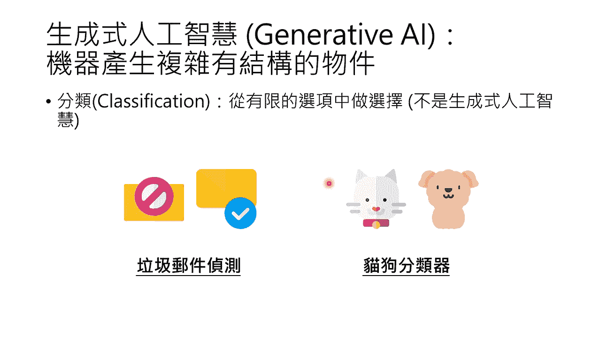

所以我们已经知道说深层次人工智慧是什么，它是一个目标，要机器产生复杂而有结构的物件哦，所以生成式人工智慧是人工智慧的一种，人工智慧是一个虚无缥缈的目标，每个人的想象都不太一样，而生成式人工智慧。

是人工智慧众多可能的目标之一，让机器可以产生复杂有结构的物件，比如说文字，比如说图片，比如说一段声音。

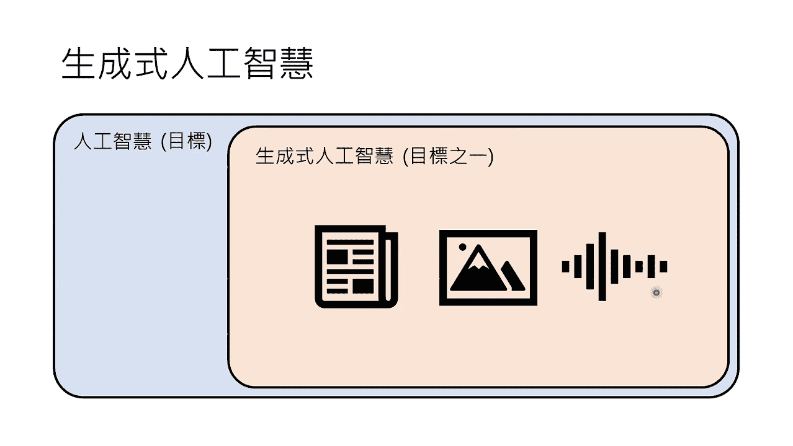

那在继续深入探讨深层次人工智慧之前，我们来介绍另外一个，跟人工智慧常常一起被提到的概念，叫做机器学习，它的英文是machine learning，什么是机器学习呢，机器学习讲起来就很明确了。

机器学习是让机器可以自动从资料里面，找出一个函式，如果你觉得这句话讲起来很抽象的话，那我直接举一个具体的例子，告诉你什么叫从资料里面找一个函式，以下这个问题是你在国中的时候，一定做过的问题。

你在国中的数学课本里面是不是有这样的问题，我给你一个韩式，这个韩式的输出叫做Y输入，叫做X这个函数，我们用IPHONEX来表示它，这个函式里面长什么样子呢，当X输进去的时候，它会先乘上A再加上B啊。

这个函式写成ax加B，那接下来题目里面就往往有这样的叙述，假设输入等于四的时候，X等于四的时候，输出Y等于五，假设输入X等于二的时候，输出Y等于一，问你ab应该多少，然后呢你就经过一番运算。

你忘了怎么运算也没有关系，反正解出来A等于三，B等于七好，那A和B这两个未知数啊，在机器学习的领域里面，我们又叫做参数啊，它的英文是parameter哦，所以如果我今天提到参数的时候。

我指的就是我们要找出来的那个未知数好，那有了这个三跟七以后，你就可以带入新的X算出Y是什么，有一个新的X等于一啊对吧，一的乘以3-7，要得到四，就知道输入X等于一的时候，Y输出应该是四。

这整个问题都非常的简单。

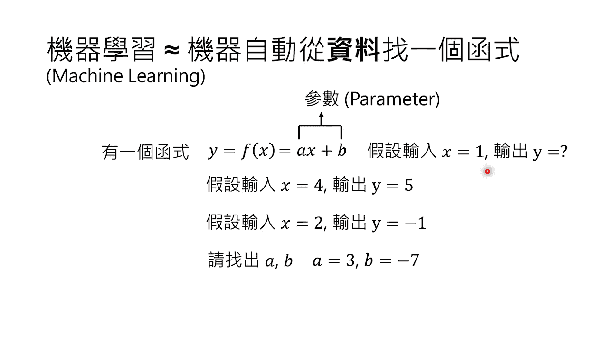

这里国中的时候一定已经学过，那机器学习跟你国中的时候解了这个问题，有什么不一样的地方呢，它唯一的不同是国中的时候，你是用人力去算出这个参数，而机器学习是一系列的方法，自动的把参数算出来，把题目给好以后。

参数就可以自动被算出来，但为什么我们不用人力解，要让机器自动找参数呢，因为我们真正要面对的问题，往往比我们国中的时候学过的，FX等于ax加B还要复杂得多。

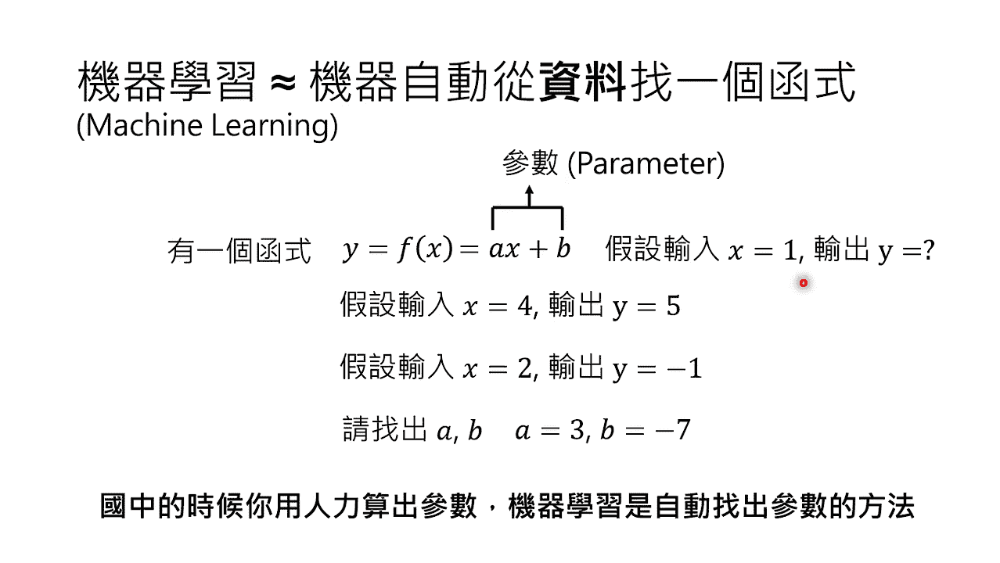

假设我们今天呢要让机器学会分辨一张图片，里面是有猫还是狗，那你需要的可能是加一个函数，这个函数叫做F图片啊，这个函式的输入是一张图片，那至于韩式怎么把一个图片作为输入，那这个我们日后再讲。

今天就想象有一个函数叫做F，它的输入是一张图片，它的输出只有两个，可能猫跟狗，但如果你可以找到这个函式，你就可以拿它来辨识一张图片是猫还是狗，那这样子的函式显然非常的复杂，如果我说这个函数值等于X加B。

它显然不可能可以辨识猫跟狗，它非常的复杂，里面可能需要有上万个参数，那我这边用ABCD来表示参数了，好不过，用ABCD英文字母作为符号来表示参数，显然是不够的，我们这边可能这个式子里面会有上万个参数。

而是一个有上万个参数的式子，到底长什么样子呢，你可能这辈子从来没有看过，一个有上万个参数的数学式，它到底应该长什么样呢，等一下会再告诉你，一看就心里想象有一个上万个参数的式子。

那这个有上万个未知参数的函数啊，又叫做模型，那我知道说模型这个词汇，其实在不同的文献上往往有不同的称呼，专指在机器学习的领域里面，往往同人不同人提到模型的时候，他指的是不一样的东西，但在这门课里面。

当我讲模型的时候，我指的是一个带有大量未知参数的函式。

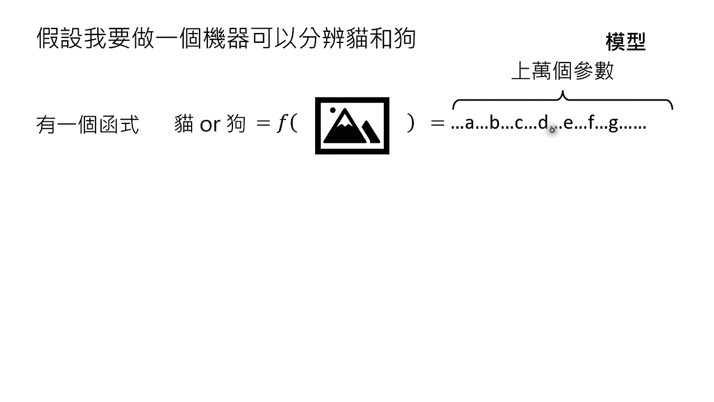

好，那接下来呢就要给你这个题目的叙述了，他这个题目的叙述是，如果输入这个函式的输入是这只白色的猫的话，输出就是猫，这个答案输入是棕色的狗，输出就是狗，输入是这个超人猫，输出就是猫，输入是这个黑色的狗。

输出就要是狗，而有了这些输入和输出的关系以后，接下来机器学习这个技术，就可以帮助你把上万个参数给它找出来，这里有上万个参数，人人类都没有办法想象，这个韩式应该长成什么样子，但是机器学习这个技术。

可以帮助你，在给定这些输入输出的条件限制的情况下，把这上万个参数找出来，你说这个呃，呃这个这个机器学习的学习到底在哪里，这个学习呀，指的就是把这个上万个参数找出来的过程，这个把上万个参数找出来的过程。

又叫做系训练training，或者是又叫学习learning，所以我们讲机器学习的时候，所谓的机器学习，指的就是把这个上万个参数找出来的过程。

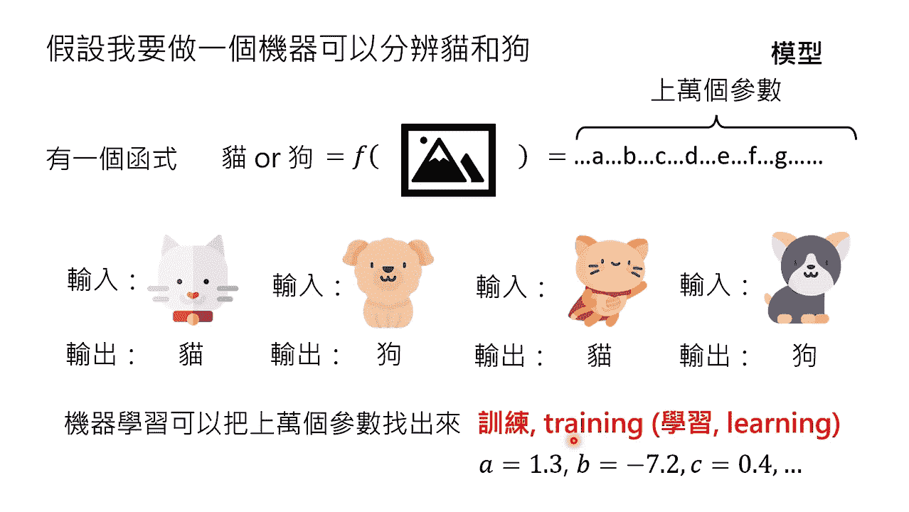

好那这个帮助你找出上万个参数的输入，输出的限制就叫做训练资料，那找出这上万个参数以后，你就可以把这些参数带入刚才的模型里面，你就知道这个韩式长什么样子，有一张新的图片进来，正在打电脑的猫。

期待机器就可以给出正确的输出，那找出参数以后，给这个还是一个新的图片，看看它会输出什么，这件事情叫做测试，Testing，我要做又会又叫做推论，Influence，这边就跟大家讲完了。

机器学习的基本概念。

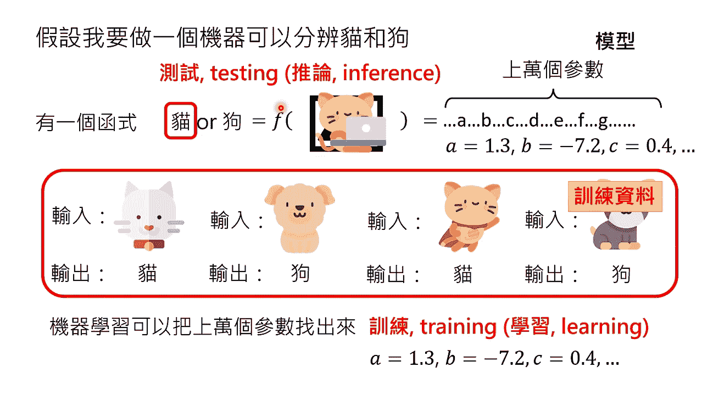

有上万个未知数的这个函式，你非常难想象它是什么，而今天在机器学习的领域，通常怎么表示这个有上万个参数的函数呢，今天往往它被表示成一个类神经网络，也就是neural network，那有人可能会想说。

内神经网络听起来就跟人类的大脑，好像很有关系，诶，类神经网络不是应该是什么哎呀，模仿人类的大脑学习的吗，我告诉你这个讲法就是骗你的，你知道吗，这农场文随随便便讲出来骗麻瓜的，其实一个类神经网络。

就是一个有非常大量参数的函数，当你今天把你的这个有大量参数的函数，表示成一个类神经网络，然后把这些参数解出来，这个技术就叫做深度学习的learning啊，所以深度学习是机器学习的一种。

你当然有其他方法来描述这个函式，但是当你用内神经网络来描述它的时候，你做的事情就是深度学习哦。

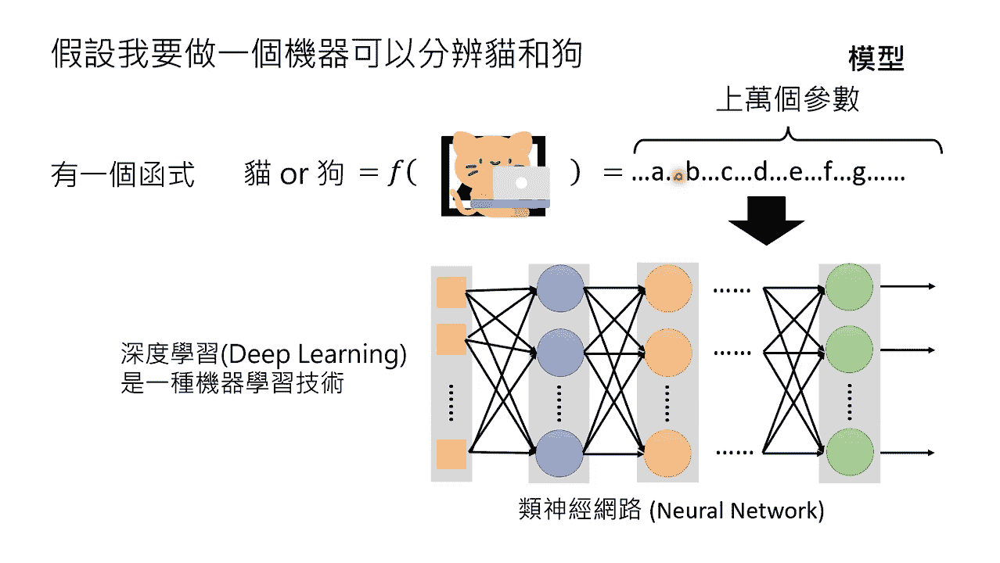

那这些投影片讲的是机器学习，和深层次人工智慧的关系，是机器学习，它是一种手段，所以他跟深层次人工智慧的关系，我是画成这样的，他们有交集的部分，但也有各自独立的部分，生成式人工智慧。

你当然可以用机器学习来解党一页，可以用非机器学习的方法来解，机器学习不是只能解深层次人工智慧，也可以解其他的问题，比如说分类的问题。

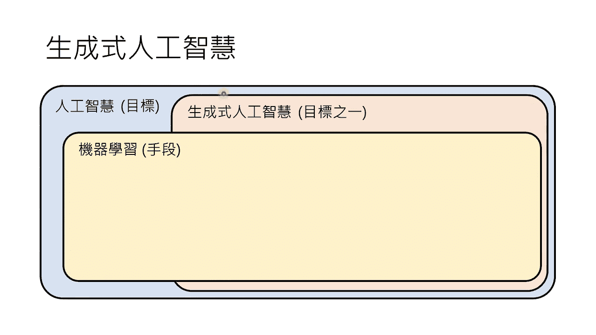

而深度学习是机器学习的一种，那我相信你在网络上更常看到的，生成式人工智慧。

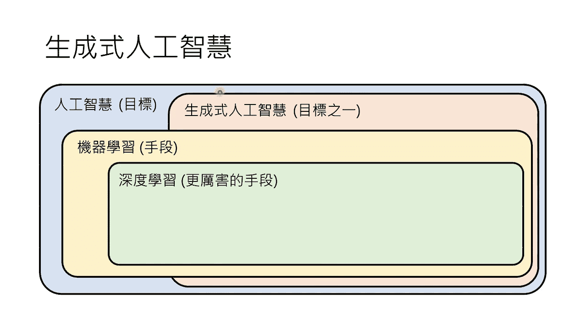

深度学习，机器学习的关系是化成这个样子，那你把深层次人工智慧放在机器学习里面，我也勉强能够接受，因为今天深层次人工智慧，是一个非常困难的问题，也许其他手段都不足以达成让你满意的结果哦。

所以今天生成式人工智慧，通常都是以深度学习技术来达成的，所以如果你看网络的文章在描述机器学习，深度学习生成式人工智慧关系的时候，往往会说深层次人工智慧是深度学习的一种，这我也可以接受。

虽然他们所要讲的是不一样的东西，深度学习是一个技术生成式，人工智慧是一个目标，但是今天通常会用机器学习的，都通常会用深度学习技术，来达成深层次人工智慧，所以我也可以接受。

你把深层次人工智慧放在深度学习里面好。

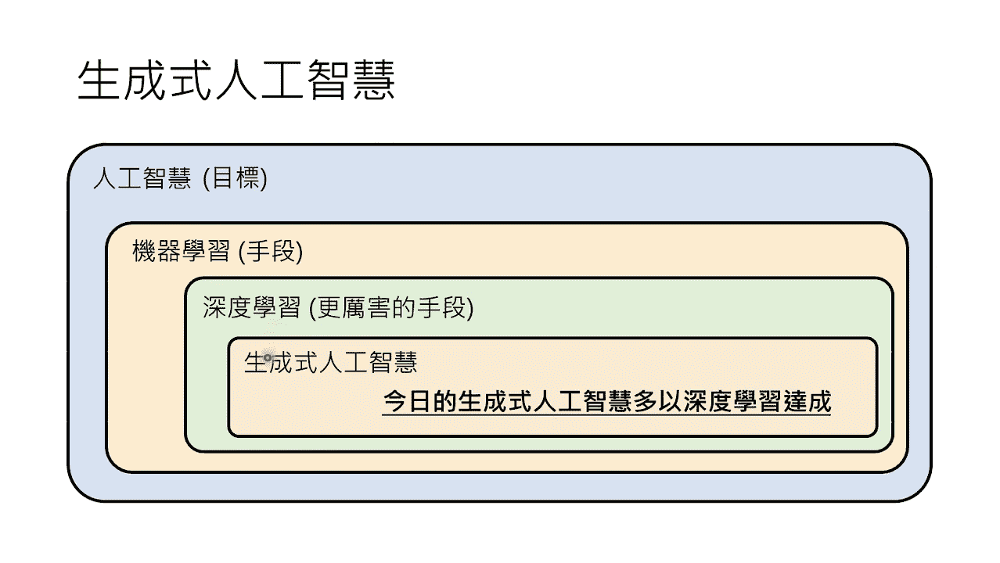

那到底深度学习，机器学习要来怎么解深层次人工智慧的问题呢，想一想确GPT按照机器学习深度学习的概念，它可能是怎么被打造出来的，其实确GBT也可以想象成是一个韩式，这个函式的输入就是一段文字输出。

就是全GVT给你的回复，但像确GVT这么厉害的人工智慧，你问什么他都能够有问必答，它显然背后的函式非常非常的复杂，复杂到什么地步呢，复杂到它里面可能有上亿个或数10亿个参数。

它的模型里面可能有上亿个参数。

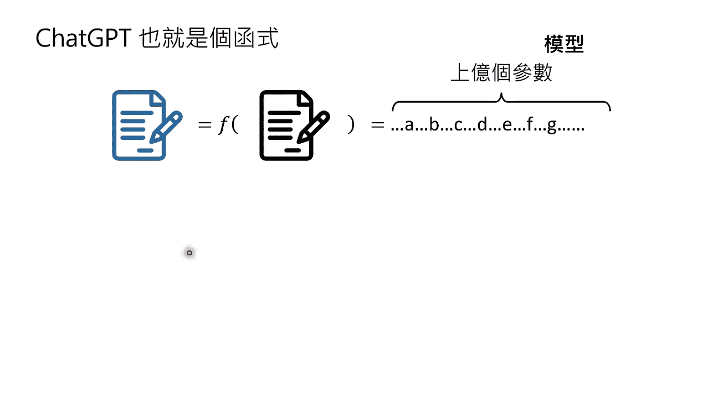

那这个有上亿个参数的模型，也就是类神经网络，今天有一个特别的名字叫做transformer，Chegbt，背后用的模型叫做transformer，它是内神经网络的一种，那我们在往后的课程会再跟大家介绍。

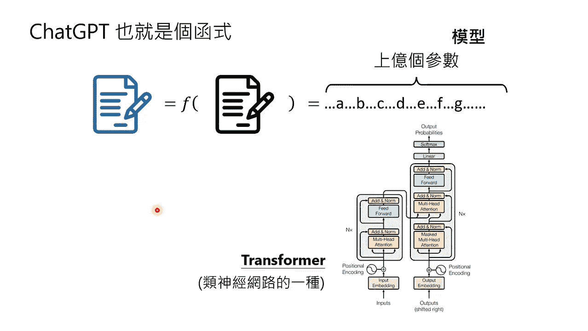

那就机器学习的概念而言，要打造CHEGBT这样子的人工智慧，要找出一个可以坐上去GP这样事情的函式，也许你需要的就是准备一大堆的输入和输出，告诉你的模型，说输入人工智慧啊，输出就是这样输入，这样就输出。

这样输入，这样叫输出，这样输入，这样叫输出，这样也许准备一大堆输入和输出的关系，让机器学习和深度学习的技术，把上亿个参数找出来，我们就可以打造出一个全GBT，或者是用同样的概念。

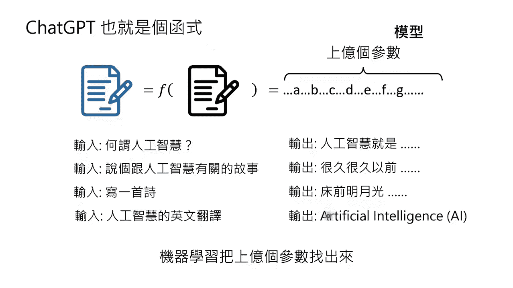

也可以打造一个可以画图的AI，今天有很多可以画图的AI，比如说stable diffusion，比如说me journey，比如说DI这些可以画图的AI，你也可以把它想成是一个函数。

这些函式的输入是什么，输入就是一段文字，输出是什么，输出就是一张图片，而这个函式显然也会非常的复杂，显然也该有上亿个参数，那怎么把这个函数找出来呢，我们就需要告诉机器输入和输出之间的关系。

现在是输入文字。

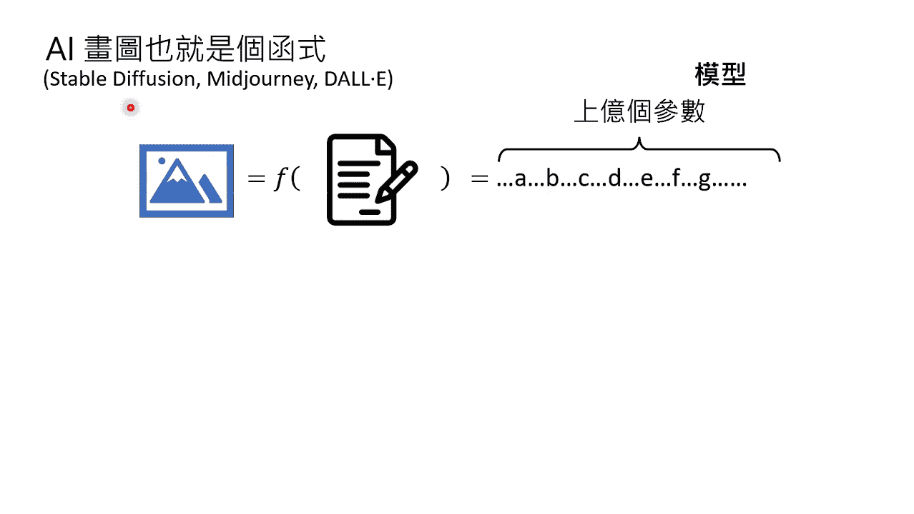

输出图片，所以你就要告诉机器说，如果有人告诉你彩色的卡通猫，那你输出应该涨价，有人输入奔跑的猫，输出应该涨价，有人输入海滨的黑狗应该长这样等等等等，你收集一大堆文字跟它对应的图片。

然后就可以交由深度学习的技术找出函式，把上一个参数找出来，你就可以找出一个函式。

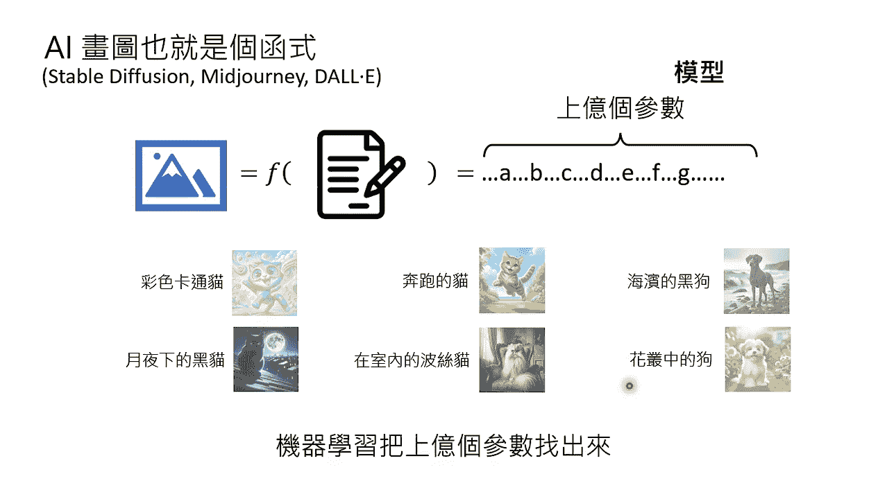

就可以让机器输入一段文字，输出一张图片，那其实生存这件事啊，我在课堂上，过去的机器学习课堂一直都是有提到的，这些投影片是来自5年前，2019年机器学习课堂的投影片，这些投影片是这样讲的。

大家不知道有没有看过猎人这个漫画，猎人是这样子的一个故事的，你以为的五大洲并不是世界的全部，这只是世界的一小部分。

其实我们都是活在一个很大的湖里面，湖外面才是真正的世界，叫暗黑大陆，里面有各式各样的神奇生物，而就机器学习的领域而言，分类这种从有限的答案中去得到一个选项的。

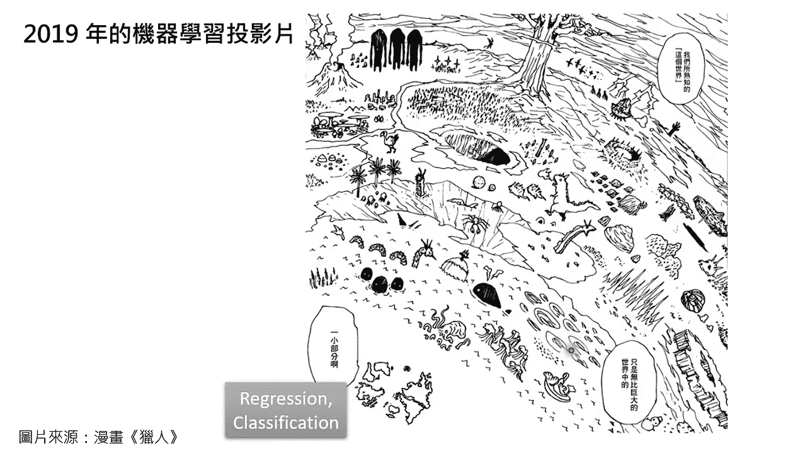

这种问题就是你所熟知的时间，但是外面还有更困难，更有挑战性的技术，过去我说就是让机器产生有结构的复杂的东西，比如说文具图片。

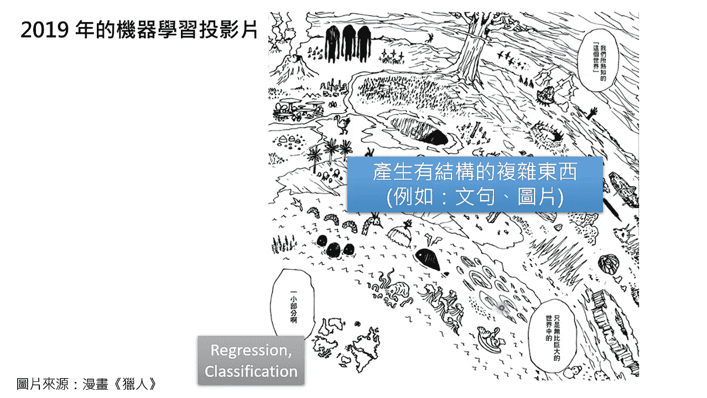

它就是生成，那如果机器可以成功做到生成。

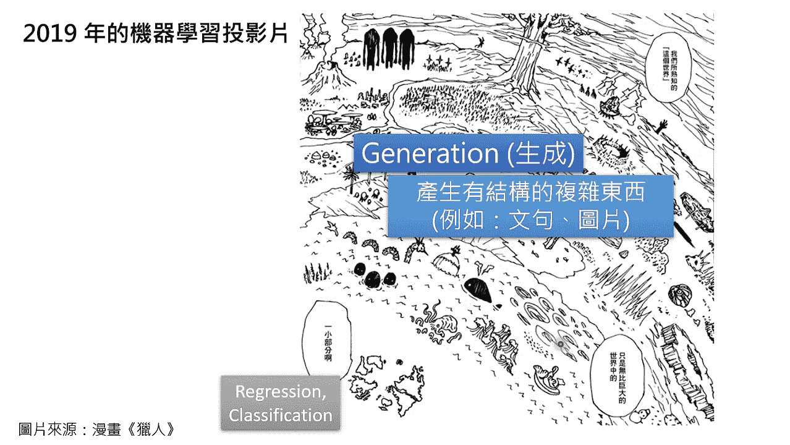

我在2019年的时候就说用拟人化的讲法，可以说他学会了创造，不过在2019年的时候，我会说，暗黑大陆离我们还很遥远，就像库拉皮卡，不知道什么时候才会登陆暗黑大陆一样。

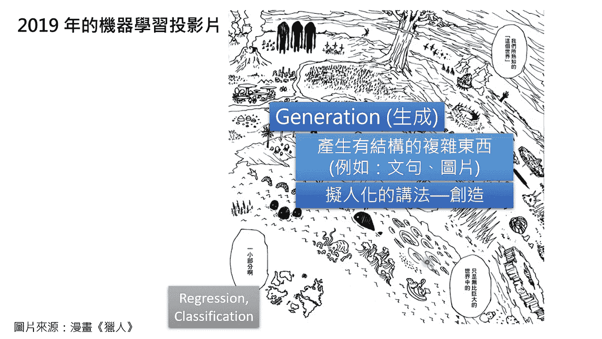

但现在已经是2024年了，库拉皮卡离暗黑大陆还遥遥无期，但是我觉得现在可以说是，已经见到暗黑大陆的守门人了，有了那到底生成式AI的挑战是什么呢，按照刚才的想法，我们只要收集够多的资料。

找出一个韩式就可以做生成式AI。

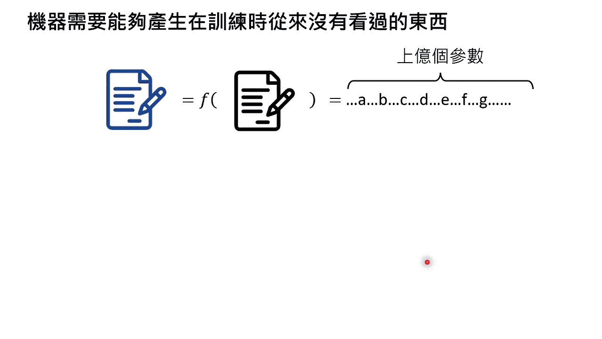

但你再仔细想一想，我们的训练资料也许怎么收集都是不够的，今天对生成式AI而言。

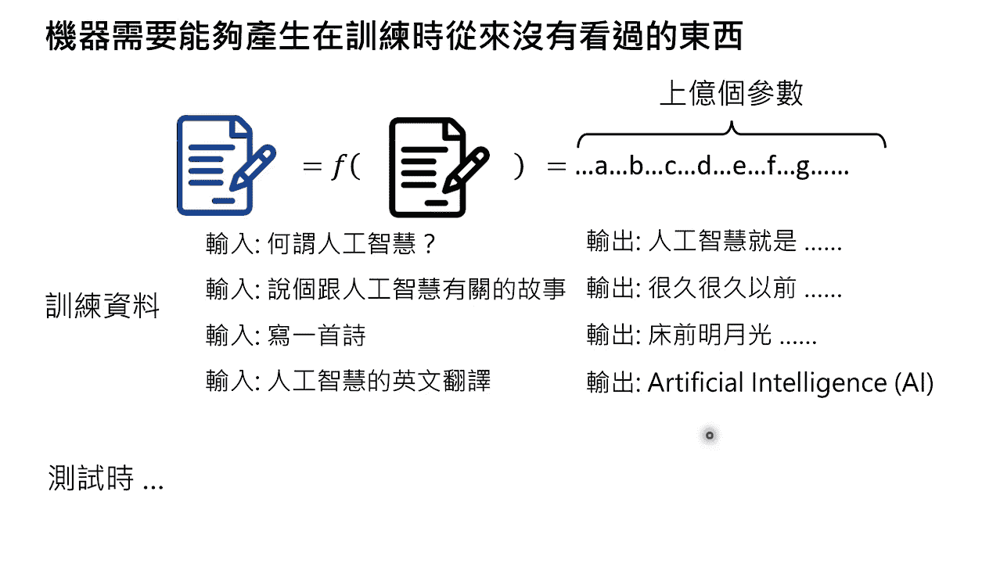

人类在测试的时候可能会问任何的问题，机器的答案需要跟虚拟机和，机器需要得到的答案，可能跟训练的时候完全不同，今天有人问，叫你写一篇跟缝隙的联想有关的文章哈，今年只考的作文啊。

这个要求过去可能在你的训练资料里面，一次都没有出现过，因为如果出现过的话，那就泄题了嘛，所以这是一个全新的问题，在训练资料里面一次都没有出现过，但如果你的模型要得到正确的答案，他显然需要创造全新的文具。

是训练的时候一次都没有出现过的文具，那到底机器要怎么做到这件事呢，如果机器可以做到在测试的时候产生，训练的时候从来没有出现过的文具，也许我们就可以说极其具有某种程度的创造力，但我这边是加了一个引号啦。

也许有人并不认同，只要能够产生训练的时候没有看过的文具，就算是有创造力，也许这也许这样的定义，不是每个人都可以认同的，但我这边的创造力指的意思就是机器可以产生，他训练的时候一次都没有看过的答案好。

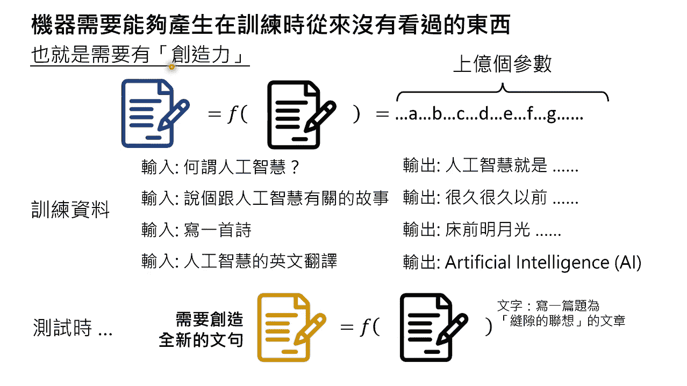

那今天像QGVT这样子的人工智慧，是怎么做到，产生一次都从来没有看过的答案的呢，这边我先用一页投影片跟大家说明，未来我们还会讲的更仔细一点啊，之所以需要先说明，是为了往后的课程，为了让你能够听懂。

能够更了解课程的内容，我们还是需要用一页图片先跟你讲一下，全TVT背后的原理，那HHET背后的核心精神是什么呢，它的核心精神可以用四个字来概括，就是文字接龙，原本我们在做生成式AI的时候。

觉得是一个很难的问题，因为一段文具的可能性是无法穷尽的，但是在确GBT里面生成一个答案，被拆解成一连串的文字接龙的问题，本来你问机器台湾最高的山是哪座，你今天的目标是要机器打出御三这个答案。

但实际上却GBT做的事情并不是，直接把完整的答案生出来，他做的事情是去做了一系列的文字接龙，先把台湾最高的山是哪座，问号这个句子当做一个未完成的句子，他去预测说，这个句子后面应该接哪一个字是合理的。

比如说可能接遇是合理的，那产生一个合理的，可以接在输入后面的字以后，再把这个字贴到前面去，再做一次文字接龙，台湾最高的山是哪座，问号玉后面接哪个字是合理的呢，也许接三是合理的，那再把三贴到输入去。

现在的问题变成台湾最高的山是哪座，问号玉山，然后要机器输出什么呢，也许机器觉得，也许机器觉得已经没有什么好输出了，这个就是句子的结束了，他就输出结束这个符号，那整个生成的过程就结束了。

机器也得到了御三这个答案哦，这个能够做文字接龙的模型，有一个名字就叫做语言模型，那我相信大家在报章杂志上，最近经常最近经常常听到语言模型这个词汇，其实它指的就是一个在做文字接龙的模型。

那把本来要生成一个完整答案，这件事情改成一系列的文字接龙，有什么样的好处呢，本来我说深层4A的难点就是可能的，答案是无穷无尽的，但我们再来想想文字接龙这个问题，文字接龙的答案是有限的。

现在机器要解的问题是一系列，同样的文字接龙的问题，而文字在做文字接龙的时候，机器要做的就是猜出下一个字可以接什么，那如果中文的常用字可能就是三四千个，是有限的，所以这个时候本来生成是A的问题。

把它变成文字接龙以后，它就变成了一系列的分类的问题，机器回到从有限的选项中选出答案的问题了，而从有限的选项选出答案，是我们人类一直都知道怎么做的事情，所以本来很困难的生成一整段文章的。

这些问题就变成文字接龙的问题，一系列分类的问题而变得可以解了，但至于实际上到底是怎么解的，才变成像今天这么厉害，的确GBT，那这个就是往后课程的内容了好。

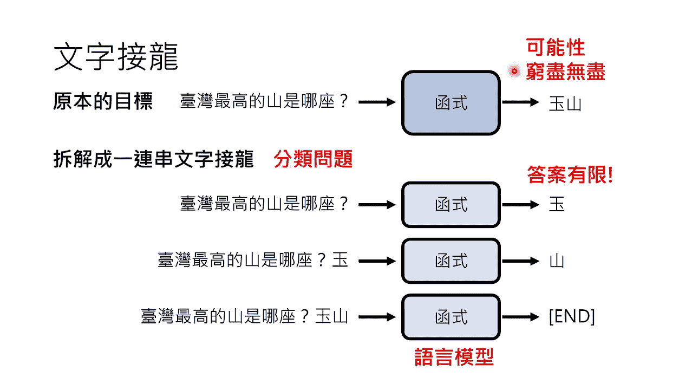

但是语言模型并不是生成式人工智慧的全部，它只是生成式人工智慧的其中一个技术而已，事实上生成并不一定要用文字接龙的方式生成。

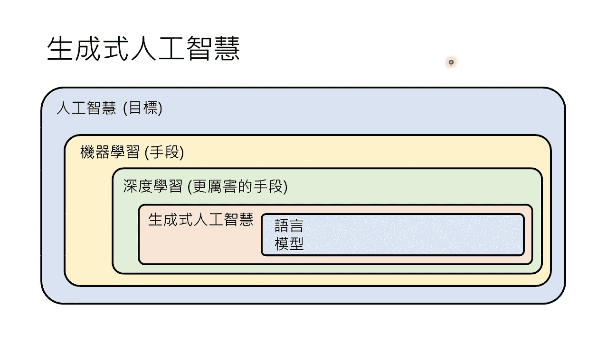

可以有不同的策略，在我们刚才的叙述里面，我们说怎么生一篇文章，因为文章是由文字构成的，所以生一篇文章，这个这个这个任务可以看作是，生成一个序列的文字，那其实同样的概念，好像也可以拿来生成其他东西。

比如说生成图片，我们知道图片是由像素所构成的，所以既然文字接龙可以解生成文章的问题，像素接龙也有机会可以解生成普遍的问题，这种把复杂的物件拆解成较小的单位，再按照某种固定的顺序。

把这些较小的单位生成出来的这种策略，今天有一个名字叫做auto regressive的generation，那像CHEGBT就是采用了auto regressive的generation。

至于还有什么其他的策略，我们日后都会再讲到，那从欧洲从这个投影片上看起来，生成图片也可以跟CHEGBT一样，用像素接龙的方式来删除片。

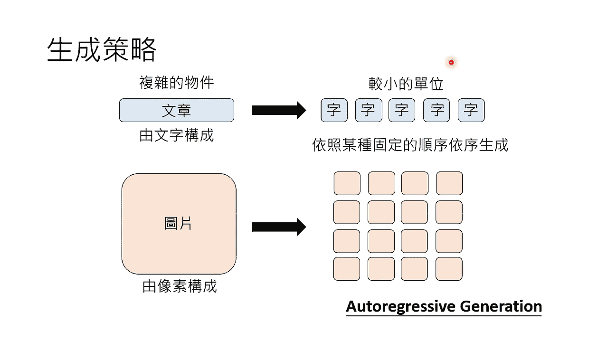

有没有人这样尝试过呢，有，其实OpenAI在很多年前就打造了影像版的GPT，用像素接龙的方式来产生图片，但这个方法后来并没有红起来，为什么没有红起来，这个是往后我们在讲到深层策略的时候。

才会跟大家说明的，那深层次人工智慧啊，不是今天才有的，他一直都有人在研究，其实在2015年，我刚开的第一堂机器学习的课程，并不叫机器学习，它叫机器学习及其深层与结构化，然后打算要强调两个重要的技术。

一个是深层学习，你可问深层学习是什么，跟深度学习有什么关系，它就是深度学习，那个时候呢deep learning还没有统一的中文翻译，所以我是翻成深层学习。

我觉得深层学习比较符合deep learning实际上做的事情，不过后来大家都翻译成深度学习就是了，那什么是结构化呢，结构化学习就是今天的生成式AI，因为生成式AI就是要生成有结构的东西。

所以过去我们叫做结构化学习，不过今天我们叫做深层次学习哦，那过去2015年讲的结构化学习，跟今天的生成式AI，它背后的技术有什么一样的地方呢，你可以看看过去的课程，结论都是没什么一样的地方。

这个技术变化真的非常的快，短短不到10年的时间，技术已有了翻天覆地的变化，但是生成式AI这个概念其实不是今天才有的。

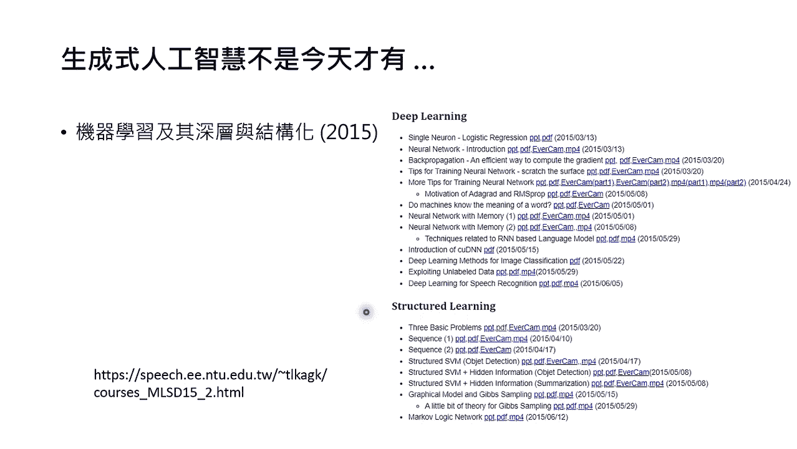

因为生成式A的概念其实不是今天才用，生成式AI相关的应用，早就充斥在你的日常生活中，举例来说，google翻译，大家知道google翻译是什么时候上线的吗，是2006年就上线了哇。

这个非常早就已经足够翻译了，而翻译这件事情本来就是生成式AI的，其中的应用，因为机器需要产生一段文字，这本来就是一种声称是AI，而且翻译的时候呃，人可能会的，可能的输入，你可能要翻译的文具是千变万化的。

不管输入什么样的文具，然后我们得出一个合理的对应的翻译，而这个正确的对应的翻译，可能在训练资料里面一次都没有出现过，所以翻译本来就是一个生成式AI的问题，所以生成式AI不是只有今天才有。

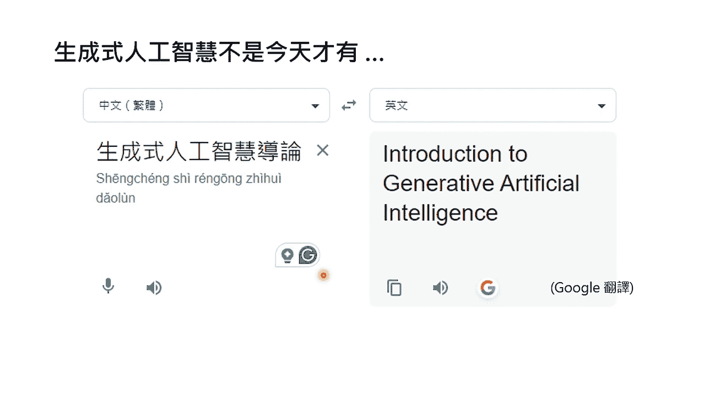

但是为什么今天今日，深层次AI突然爆红起来了呢，到底是发生了什么事啊，这个是我们下一个阶段的课程，会再帮大家剖析的好，那我知道说呃我看一下我们的时间呢，也许您不太够，我讲完下一段课程。

我准备等一下时间就来回答slider上面的问题，然后呢，呃因为今天没讲到什么有技术含量的东西，你一定觉得哎呀这个今天就听了个故事，没听到什么技术含量的东西好吧，如果你要贴有技术含量的东西。

不然你先来找一下我那个课程的哦，那我个人的那个YOUTUBE频道，你在那个YOUTUBE上搜寻我的名字，就可以找到我的YOUTUBE频道，那里面的第一部影片，80分钟讲大型语言模型。

你可以先看一下那一步，了解CHEGBT是怎么被打造出来的，然后等于是一个预期。

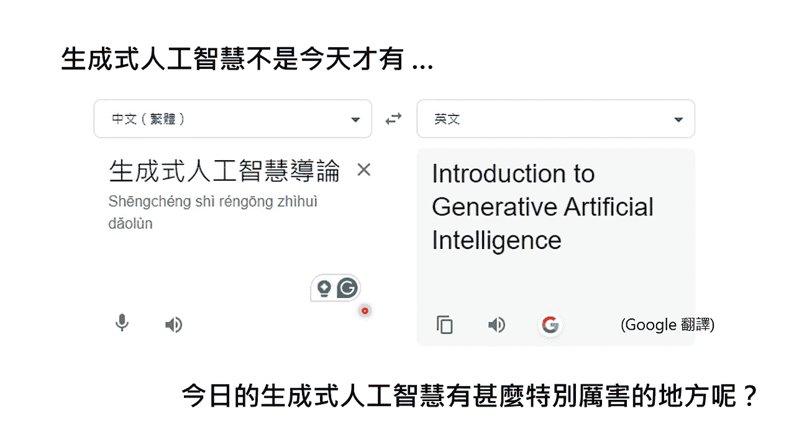