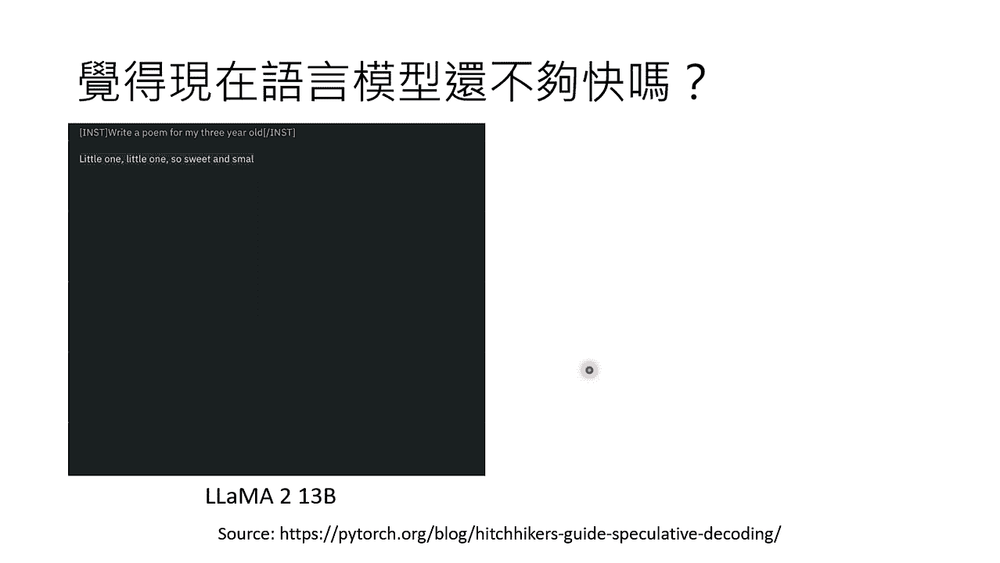
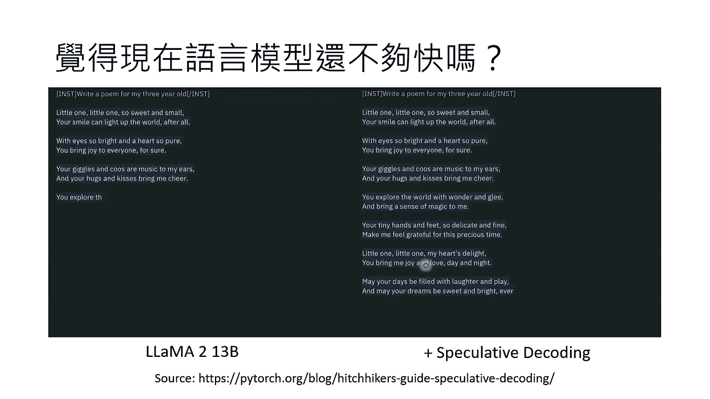
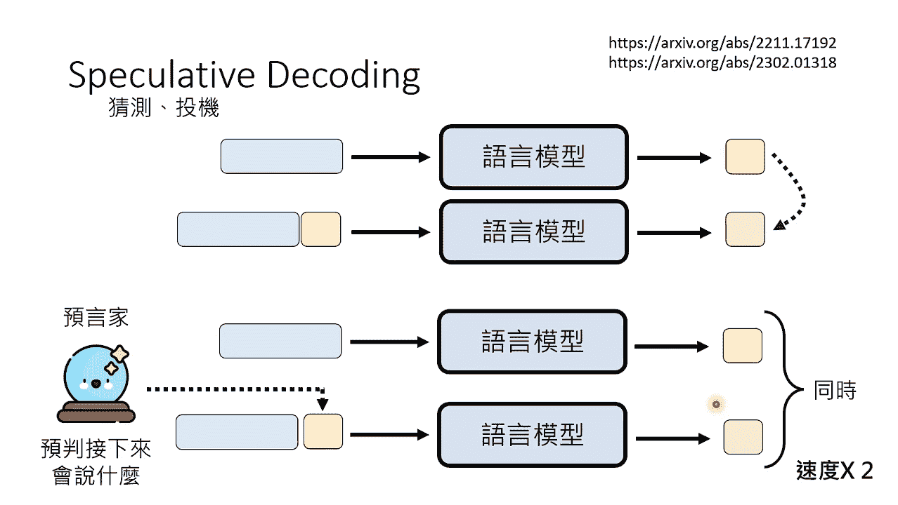
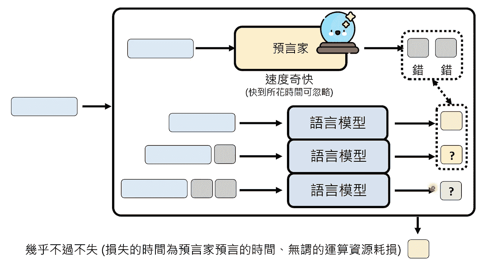
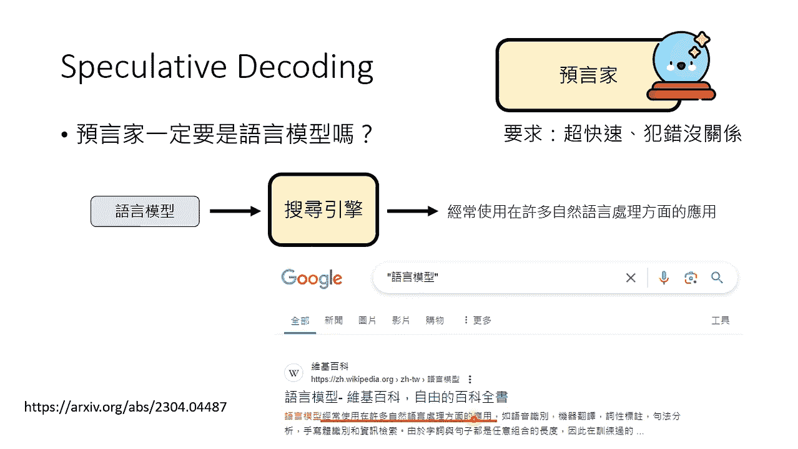
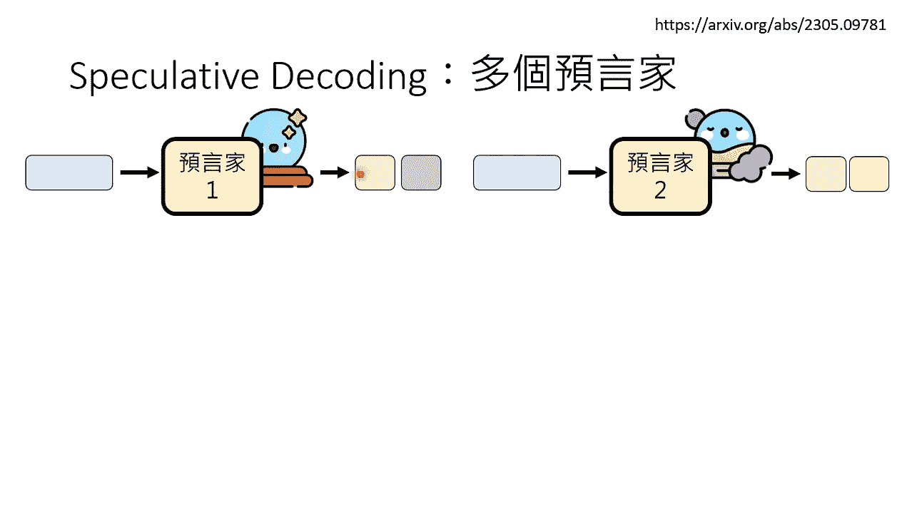
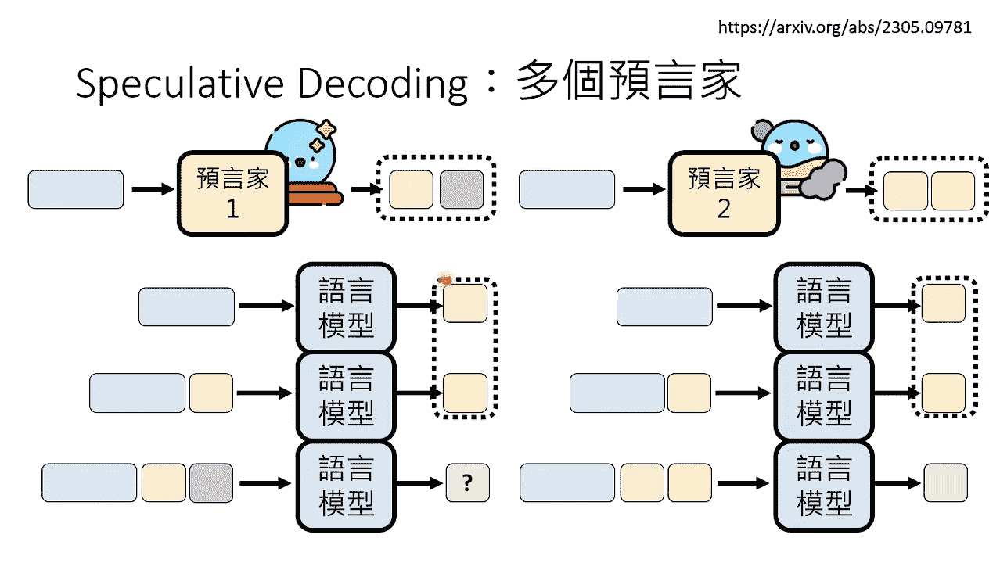
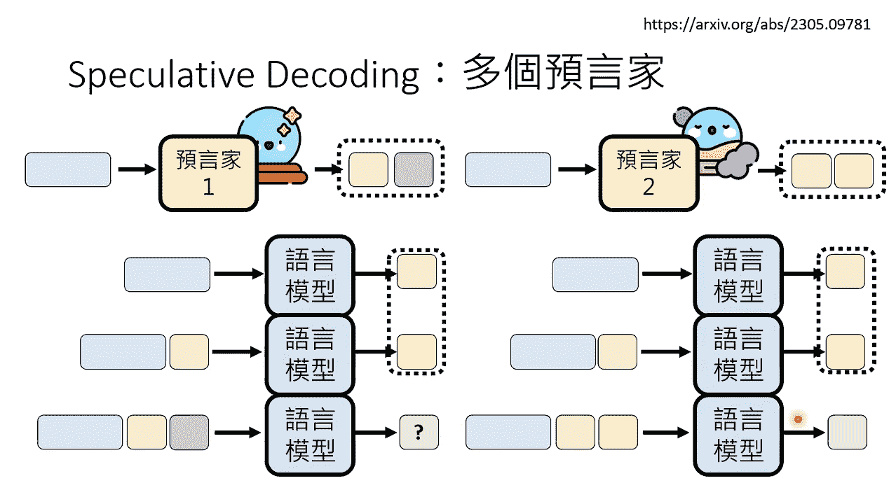
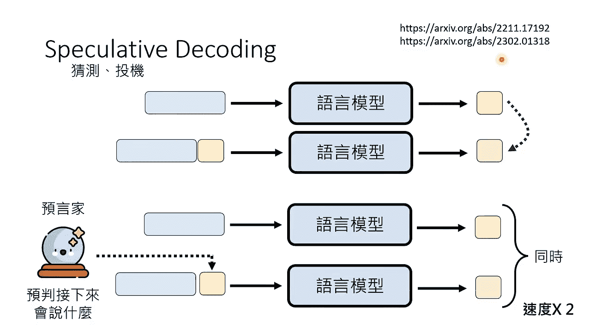

# 李宏毅2024春《生成式人工智能导论》 - P33：第16讲：可以加速所有语言模型生成速度的神奇外挂 — Speculative Decoding - 啥都会一点的研究生 - BV1BJ4m1e7g8

接下来呢我想跟大家分享一个语言模型生成的，新的技术，叫做speculative的decoding，虽然我们说语言模型往往生成的时候，不一定需要生成非常长的结果。

所以用auto regressive也许就够了，但是很多时候当你要生成长篇大论的时候，你也会觉得等待的时间非常的漫长。

有一个方法叫做speculative decoding，它可以加快任何的语言模型生成的速度，这个方法跟你许使用的模型没有关系，这个方法不需要对模型做任何训练，它是一个神奇的外挂。

这个神奇的外挂可以加到任何语言模型上面，那个语言模型生成的速度就突然加快了，所以非常神奇的方法值得跟大家介绍一下呃，那这个上面这个图呢是来自于下面这个连接了，那这个的图就是要对比一下。

说拉马TUS3B的模型，在没有speculative decoding的时候，它生成的速度跟加上speculative decoding，这个外挂之后，它生成的速度。

那可以发现说speculated decoding，它生成的速度大概可以到原来的两倍，甚至到三倍左右，那今天我们看到这个g p t for生出来的结果，却GPT生出来的结果，搞不好。

他已经有用speculative decoding，这种技术来加快原有语言模型生成的速度，也说不定好，所以我们就来认识一下speculative decoding。

这个技术吧，而speculative这个字的意思呢，是猜测或投机的意思，那speculative decoding，这个方法的核心概念是什么呢，我们说auto regressive model。

它的痛点就是需要按部就班循序渐进，第一个token没生成之前，我们没办法升第二个token，Speculative decoding，核心的想法就是这个非常神奇，我们能不能够找一个预言家。

这个预言家他能够做的事情，就是可以预判语言模型，接下来的生成，如果今天预言家他可以根据输入直接预判，说语言模型，等一下就是会产生黄色的这个token，你就可以一次把输入跟输入加上黄色的token。

都丢给语言模型，让他做平行的运算，一次就可以产生两个token，就可以跳过auto regressive，他一定要升第一个token才能生第二个token，这个问题先叫预言家预测接下来要输出什么。

你就可以直接让第二个token，跟第一个token同时被产生出来，那如果可以让第一个，第二个token同时被产生出来，有什么样的好处呢，你的好处就是，你的速度马上就变成原来的两倍了。

你本来只能一次生一个token，一个第一个token生完才能，就要等着才能够生下一个token，现在一次可以升两个token，生成的速度就变成原来的两倍，那讲的更具体一点。

整个speculative decoding的运作方法是这个样子的，当这个红，当这个输入蓝色的这个输入进来的时候，先赶快给预言家看，然后预言家呢快速预测说，接下来语言模型会先升红色的token。

再升黄色的token，那我们这边假设预言家的速度奇快无比，他做预言的时间是几乎可以忽略不计的，而接下来呢预言家已经说，接下来会升红色的token跟深黄色的token了，所以呢我们就可以同时把输入输入。

加上红色的token，输入，加上红色的token，加黄色的token一次全部丢给语言模型，让他直接预测自己，接下来三步会产生什么样的东西哦，它可以预测自己下一步会产生什么。

他已经知道自己下一步会产生什么，这是预言家说的，只要知道自己下下步要产生什么，预言家已经预测下一步跟下下部会产生什么，所以语言模型可以直接预测，下下下部会产生什么，所以下一步下下步跟下下下步。

这三步可以同时被生成出来，那外人其实不知道里面有没有预言家，从外人的观点来看，就是哇一次吐出三个token，速度变成原来的三倍，本来一次只能吐一个token，现在一次可以吐出三个token。

最后从外人看的这角度看，这个语言模型速度就变成原来的三倍，讲到这边，你一定会有一个很大的困惑，预言家如果这么厉害，都可以预言语言模型会输出什么，那还要语言模型，干嘛，都叫预言家生成就好啦。

直接用预言家生成就好了，干嘛还需要语言模型生成的，所以这边的问题就是预言家有可能会犯错，但是我们来看看如果预言家犯错的话，会发生什么样的状况好，那我们现在假设，预言家没有办法精准的预测语言模型的输出。

他又不是语言模型，所以他有可能会预测错，所以第一个token会生成红色的，是预测对的，但第二个token他猜是灰色的，这是错的，语言模型不会生出灰色的token好，但是没有关系。

我们还不知道语言模型会生出什么，所以我们先相信预言家，把输入丢给语言模型，把输入加红色的token丢给语言模型，把输入加红色的token，加灰色的token丢给语言模型。

所以语言模型同时输出三个token，但我们知道说预言家的第二个输出是错的，这个灰色的token是错的，所以语言模型所输出的第三个token，绿色的这个token是不可信的，因为输入本来就已经是错的啦。

所以输出当然也不是对的，但是就算是与就算是预言家犯了一个错误，就算是预言家的第二个token是错的，语言模型只有前两个token是对的，你还是可以一次输出前两个token你还是有赚哦。

原来只能一次输出一个token，现在变成一次输出两个token，你还是有转速度还是变成原来的两倍，那这边问题在这边，你可能会有的问题是，我们怎么知道预言家犯了错误呢，我们怎么知道预言家他输出的是错的。

所以语言模型第三个输出的token不可信，不应该被当做最后的输出，只有第一个跟第二个token可以被输出呢，怎么知道预言家是错的呢，你就看语言模型真正输出的结果，再去比对预言家的输出。

你就知道预言家是不是对的哦，所以在这些token被输入语言模型之前，我们不知道预言家做的怎么样，但是当语言模型产生它的token之后，你就可以去跟预言家做比对哦，语言模型下一个token是红色的。

下下个token是黄色的啊，你就知道预言家的下下个token是错的，所以如果输入有下下个token，那输出就不要理他了，输出就有可能是错的，只把肯定是对的部分拿出来给使用者来看，就算部分有错。

预言就算预言家部分有错，最终速度上还是有赚到哦，但是假设预言家烂到不行，他输出来的结果通通都是错的呢，假设预言家很烂，很不幸的，他的预测完全都是错的哦，所以当你把输入给语言模型。

输入加预言家预测的下一个token，还有输入加预言家预测的下一个token，跟下下一个token都丢给语言模型的时候，只要有预言家的输出都不可信，只有这一个结果是对的，那你至少可以输出一个token。

当你可以输出一个token的时候，整体来讲你几乎可以说是不赚不赔，因为本来一样的时间，你也只能够输出一个token啊，现在只是变成没有预言家的状态而已，那当然你还是要损失一些东西啦，没损失的是什么。

损失的就是首先你要等预言家预言哦，所以这是一些时间的浪费，但是我们这边假设预言家就是要奇快无比，所以我们可以忽略预言家所耗费的时间，当然你还有另外的损失，就是运算资源无谓的耗损，你在这个地方的输入。

它的输出，你在这个地方输入预言家的呃，预言家预言的一个token，然后得到输出，这边输入预言家预言的两个token，得到的输出，这些运算都是白费了，没用没派上没派上用场，但没关系。

假设你真正在意的是时间，这边就是这个speculation decoding，这个方法就是假设你不在意运算资源，真正在意的是时间，你就是用了运算资源来换取了你的时间好，那这个接下来的问题就是。

谁可以来担任预言家呢，那我们来想一下预言家的特性，预言家的特性就是要超快，快到他的产生的速度几乎可以忽略，然后再来就是他偶尔犯错没有关系，因为最糟的状况就按他的输出全部都是错的，也就是不得不失而已好。

所以谁可以来担任预言家呢，也许now auto regressive model可以来担任这个预言家，记得我们讲nauto regressive model时候，说说它的特性就是生成快。

所有的所有的输出都是同时生成的，而且它生成的速度很快，但坏处就是他容易犯错，它生成的品质不好，那犯错没有关系，预言家是可以犯错的，所以那auto regressive model。

正好可以来担任这个预言家，如果用nauto regressive model来担任预言家，那speculative decoding也可以看成是一个。

nauto regressive model跟auto regressive model的结合，那另外呢你还可以把你的模型做压缩以，后来作为预言家，大家知道说这种大模型有很多压缩的方式。

比如说你可以对模型的参数进行量化，或你可以对一个啊对模型做knowledge destination，总之有很多不同的技术可以把模型变小，那模型变小以后啊，当然跑起来就快了。

但你会遇到的问题就是模型做过压缩以后，往往脑袋就不好使了，很容易说出奇怪的错误答案，但没有关系，反正这个小模型压缩后的模型，脑袋不好使也没关系，它跑得快，所以他可以来担任预言家，他犯错也没有关系。

反正最后我们是看最终语言模型的输出，然后再来就是预言家，一定要是一个语言模型吗，其实不一定要是语言模型才能担任预言家，我这边有一篇paper，它是使用一个搜寻引擎来担任预言家。

就假设现在的输入是语言模型，你就去某一个资料库里面啊，在学生google当例子啊，但也不一定是google了，就用一个资料库里面去搜寻，看看语言模型后面都接些什么样的句子。

我发现在资料库里面说语言模型后面可以接，经常使用在许多自然语言处理方面的应用，把这个句子直接贴出来，这个就是预言家的输出，但这边是假设说，忽略和搜寻资料库的速度非常快，快到几乎可以忽略。

那你就可以拿一个搜寻引擎来当做这个预言家。

再来就是一定只能有一个预言家吗，其实可以同时有多个预言家，每个人都产生他的预言，最后再看谁的预言最对，谁就可以最多的帮助到语言模型的输出哦，所以预言家可以不只有一个，那在这个投影片上，假设有两个预言家。

两个预言家各自预测语言模型。

接下来会说什么，然后再把他们预测的结果拿去让语言模型生成，接下来产生的token，那因为预言家一呢他有犯一些错误，它产生出来的结果，跟语言模型实际上产生的结果不一样。

那我们就不要用预言家的预言家一的输出。

我们就只看语言模型，采用预言家二的时候好。

我们就只看语言模型，采用预言家二的输出，当做输入的时候所产生的结果，所以总之你可以有多个预言家来强化这个预言，正确的机会啊，预言越正确，预测正确的token越多，你节省的时间就越多好。

总之这边呢就是跟大家介绍一个新的技术，叫做speculative decoding啊，这个想法引入了一个预言家，先去预判语言模型，接下来的输出会是什么，那可以大幅加快速度。

这个方法对所有的语言模型都适用，而且不需要训练，不需要去改动你原来的语言模型，它是一个外挂，挂上去，你原来的语言模型速度就加快了，好那这个部分就是我今天想跟大家分享的内容，然后我们就先暂停个3分钟。

