# 李宏毅2024春《生成式人工智能导论》 - P35：第17讲：有关影像的生成式AI (上) — AI 如何产生图片和影片 (Sora背后可能用的原理) - 啥都会一点的研究生 - BV1BJ4m1e7g8

好那各位同学大家好啊，我们来上课吧，好那今天呢我们要讲跟影像有关的生成式AI。

我们知道生成式AI呢，它本质上要做的事情就是它有一个输入，还有一个condition，根据这个condition要伸出一些东西，那跟影像有关的生成式AI，可以从两个方向来讨论，一个是影像。

它可以是生成式AI的condition，生成式AI可以根据他看到的一张图片，他看到的一段影像来生成一些对应的东西，比如说生成对应的文字，这是一种类的跟影像有关的生成式AI。

那另外一类的生成式AI是这个歇生成式AI，它的目标就是产生图片或产生影片，你给他一个condition，它根据你给他的condition产生对应的图片或影片，那在今天的课程里面。

我们会专注于讨论第二块部分，那我们先来很快的看一下第一类的生成式AI，那这一类可以看图片，可以看影片的生成式AI，也许你已经不是很陌生了。

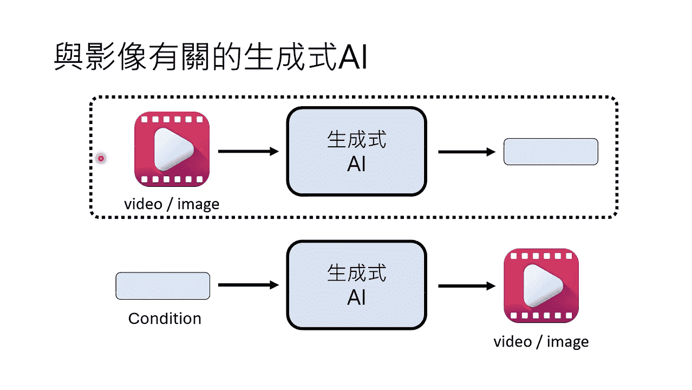

因为现在g p t four他是能够看图片的哦，所以你可以给gp four两张人的照片，那这两个人呢其实都叫李宏毅，那你就问他说这个照片中的哪一个人比较帅，你也不用期待他会回答你。

因为他现在都非常的精明，所以他不会直接回答哪一个人比较帅这种问题，但他会对两人的衣着呢做一些评论，他说左边这一位穿着牛仔外套的年轻人，比较时尚而有型，右边穿白衬衫的眼镜，男士看起来比较专业而有亲和力啊。

但是我不知道谁比较帅，你觉得呢啊，接下来我还想问他说，诶你知不知道这两个人从事什么样的职业啊，根据他们的衣着和打扮，猜一下他们是从事什么样的职业，那g b t four o呢猜的是蛮准的。

他说牛仔外套的年轻人，可能从事时尚娱乐或创意领域的工作啊，这个没错啊，这个李宏毅呢是一个非常知名的演员啊，然后右边这个呢，他是从事学术技术或商业领域的工作，例如教授工程师或者是经理哦。

所以看起来这些照片才拍的都是蛮不错的，让这个语言模型可以根据这个照片呢，大致可以猜出这个人是什么样的职业，然后看起来这些照片都非常符合他对应的，那个人的形象，其实这个g p t four o呢。

他内心深处还是有一个审美标准的啦，哦所以如果你逼迫他说，一定要决定谁比较帅的话，他还是会给你一个答案啦，啊不管我问他几次，他都会说左边那个人比较帅啦啊啊，但是我这边还是特别把他的答案呢秀出来，给你看。

你可以仿照一下，你可以参学习一下g p t for order回答，虽然他觉得左边这个人比较帅，他会强调说右边这个人呢看起来也很有魅力，他的魅力来自于专业性和亲和力哦。

所以g p t four o呢经过了大量的LHF以后，他现在讲话已经非常的精明了，就是个人精，我们可以多学习他讲话的风格啊。

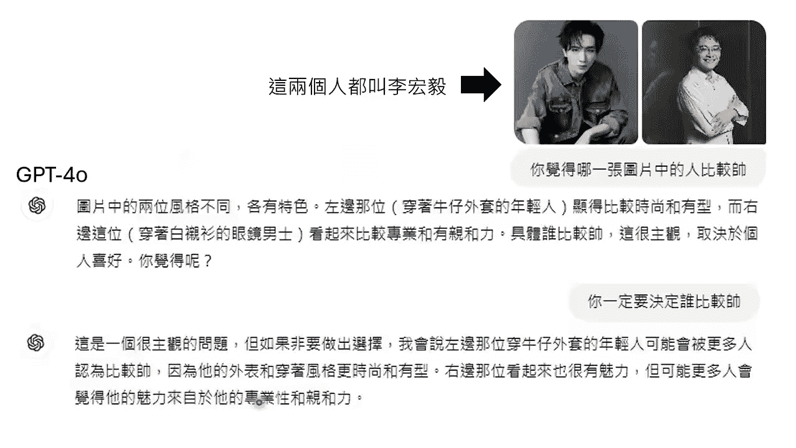

那这个呢是根据影片来产生，根据图片呢来产生文字，那这门课呢我们会花比较多时间来探讨，怎么根据某一个condition来产生影片，或者是产生图片。

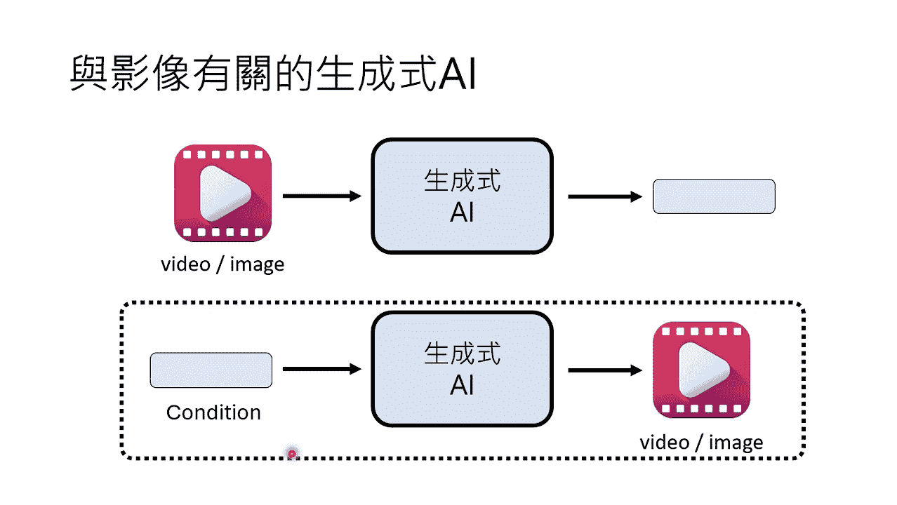

那讲到根据某一个condition来产生影片这件事情，那就不能不提SORA这个模型，好在我们学习初的时候，OpenAI试出了呃，一一个，它不是试出SA这个模型呢。

OpenAI是试出了solar这个模型的demo，然后在这个demo里面，他们就展示说SORA有非常强的力量，可以读一段文字，好这段文字是对于一段影像的描述，SORA这个生成式AI就可以生出。

非常清晰的对应的影响，但在学期初的时候，一时之间造成了非常大的轰动哦，不过SARA到现在呢都还没有真的被开放使用，所以如果你看到网络上有些demo。

那个都是来自于OpenAI它本身的那个blog的demo啊，就四出SOLA这个模型的demo的时候写了两篇VLOG，那多数人的影片其实都是从那两个blog来的，那我把那两个blog的连接呢。

也放在投影片上给你参考，而那根据OpenAI的demo。

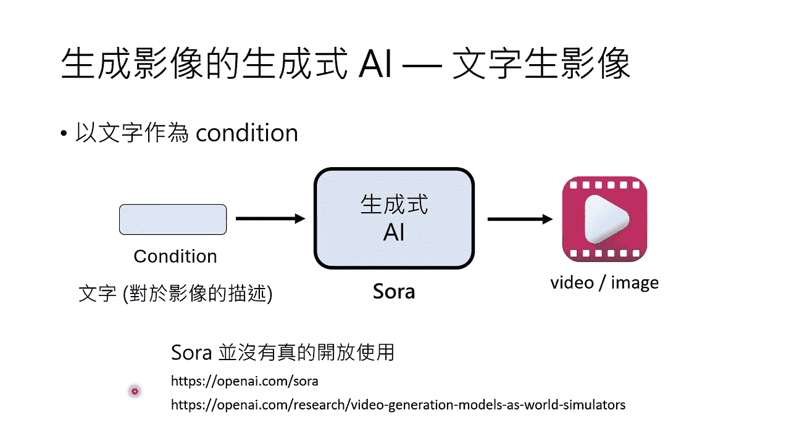

SORA产生出来的影片长什么样子呢，非常的惊人，我这边呢就截取两个例子给大家看，而左边呢哦，下面这段文字是输入给SORA这个模型的文字，它是根据下面的文字去产生出上面这段影片，那左边这个例子里面呢。

是要SARA画一个小怪物啊，这个小怪物呢看着一个逐渐溶解的红色蜡烛，那SA产生出来的影片是这个样子的，那右边呢右边是要画一个纽约的街景，但现在纽约呢沉在海底下好，所以有很多的水生生物。

SORA画起来呢是这个样子的，那这边选的两段影片啊，东风是特别选这个，现实生活中不可能出现的场景，但SARA里面也有很多现实中出现的场景了，它可以产生非常拟真的影片，但你就会搞不清楚说啊。

到底是训练资料里面有一模一样的影片，还是SORA真的创造出这样的影片，所以这边是特别选两段，在现实生活中可能不会出现的场景，来告诉你说，SORA是有可能创造出这些，现实生活中不会出现的场景的。

但你仔细看一下，你还是会发现说这些影片还是有一点点瑕疵的，比如左边这个小怪物，你会发现呃，虽然小怪物没有动，但背后的墙呢一直在左右移动，感觉蛮不自然的，那如果你有仔细观察，这个纽约街道上的水生生物的话。

你会发现这些水生生物啊，还不是一般的水生生物，好多生物都在变形呢，有的生物远远看明明是一只海龟，近看它就突然缩成一只鱼了，而且生物呢是会变形的，那所以SORA呢在生影像的时候，还是有一些瑕疵的。

那这边呢是找了一些比较有趣的瑕疵啊，左边这个图呢是要叫SORA画五只狼的幼崽啊，这个是SA放出来SORA画出来的，狼的幼崽是长这个样子的，把它分裂了，啊越来越多越来越多哦。

所以这个有时候人工智慧还是会犯错的，右边呢是考古学家挖出了一张塑胶椅哦，这个非常曲科幻的一个场景，那我们来看看发生了什么事，我挖了一个东西出来啊，变魔术啊，变出一张椅子，哎呀椅子跑掉啦，你看跑掉啦。

这就算是他产生的影片有一些瑕疵，其实在今年年初的时候，也已经非常让人震惊了哦，那刚才讲的呢是用文字来生一篇，那你其实呢也可以做影片来生影片，那用影片来生影片也有很多的应用啊。

比如说你可以给你的AI1段未完成的影片，叫他把剩余的部分续写完产生出来，或者是你可以叫AI帮你做风格转换，给他一段影片，他把他的风格转换，比如说本来是黑白的影片，然后他把颜色涂上去。

那像这样的技术可能可以被用在影像修复上面，比如说把一些老电影呢做影像修复，让它看起来呢更有现代感，那或者呢也可以做画质的提升啊，本来你有一个影片的解析度是比较低的。

那也许可以透过生成式AI直接帮他提升画质哦，所以影像声影像也有很多的应用哦。

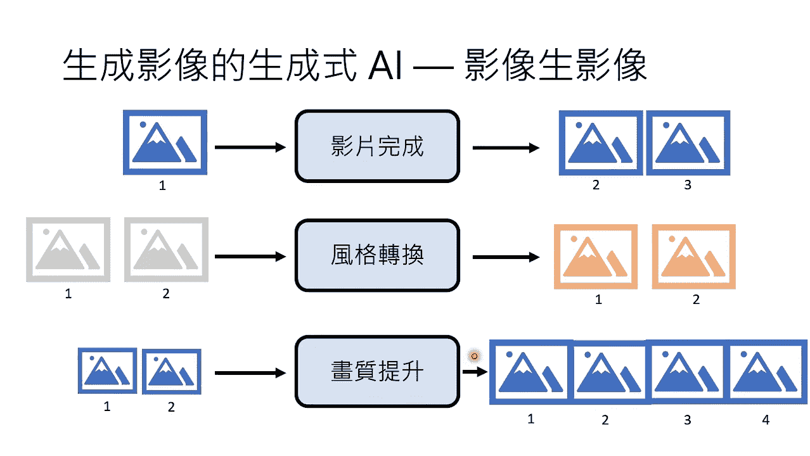

那其实也并不局限于透过影像来生影像，生成影像的生成式AI，还有很多其他的应用，一个今天大家都能够想得到的，而且已经有非常多人在使用的，就是所谓的talking head。

所谓token pad的意思就是，你给这个生成式AI1段你的录音，然后呢你给生成式AI一张你的照片，然后呢他就想象你说这句话的时候，你的嘴心，你的脸应该长什么样子。

那我这边用的呢是一篇今年3月的时候的论文，里面的模型啊，这个模型呢是有开源的，像这种token head生成呢，现在你其实可以找到很多的商用软体，不过通常是要付钱的。

那我这边用的这个呢是一个免费开源的软体，所以是每个人呢都可以试的啊，涨起来呢就给他一句话，给他随便一张照片，他就把这句话呢合到这个照片的人的口中，听起来看起来像是这个样子，这门课是生成式AI导论。

就是我就说这门课是生成式AI导论，那就有看到说啊，这个人呢就配合生成式AI导论，这几句话的嘴型在讲话，这门课是生成式AI导论，而且我照片里面是没有牙齿的啦，啊还硬要帮我加个牙齿上去啊。

加很白皙的牙齿上去哦，所以可以想象说这个有非常多的应用，这个我想马上可以想到的直接的应用，其实就是这个VTUBIRD，对不对，其实这个呃talking head的技术。

只要背后直接接g p t for all，马上就可以直接做一个没有中之人的YOUTUBE了，所以我相信很不远的未来，大概几个月后，你就可能会听到有人说，出现了一个新的VTUBER啊。

这个VTUBER讲话很有趣，然后再过几周以后，他就突然承认说，其实这个VTUBER是不存在的，他背后就是g b t four oder，加一个token he，我已经帮忙，我已经帮忙把这个剧本写好了啊。

大家要用就拿去用一下，我相信在几个月，你一定就会有这样子的故事出现了。

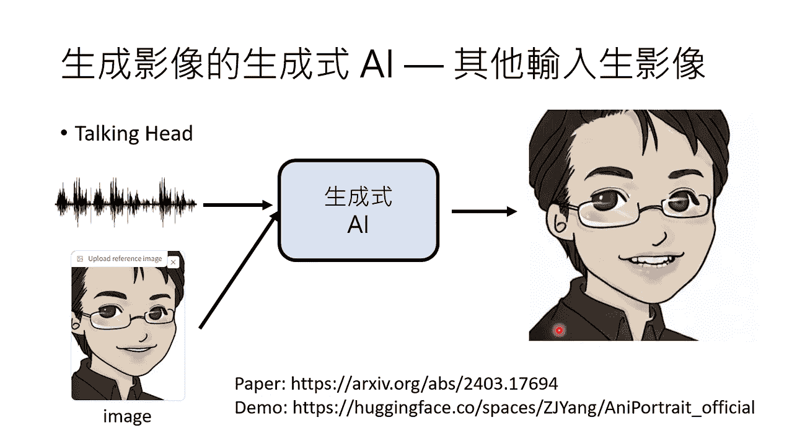

好那额，还可以拿很多其他的东西作为，生成式AI输入的condition，比如说你可以画一个草图啊，叫生成式AI呢，帮你把精细的图画出来，或者是之后就只打一个草稿啊，让生成式AI呢根据草稿呢把图画出来。

或者是给他一个人的站姿，再让他根据这个站姿呢伸出对应的人像哦，所以这篇paper里面呢就讲了，你可以拿各式各样的condition来生成图片啊。

这边paper里面有一个network叫做control net，就是告诉你说怎么加入各式各样的condition，各种不同的condition都可以拿来生成图片。

放呢是讲生图片或影像的AI的种种的应用，那接下来我们就要来讲，这一些神图片或神影像的AI是怎么背造出来的，那在讲图片跟影像是怎么被生成出来的之前，我们来复习一下图片跟影像，它构成的基本单位是什么。

先来讲图片，那我们都知道说图片是由像素所构成的，像素越多，图片看起来就越清晰，左边这张是1024×1024解析度的图片，它里面有1024×1024的像素，所以非常的清晰，但是如果同一张图。

你只用16×16个像素，总共只有16×十6256个点去描述，这张图片，每个点都代表一个颜色，但只有256×256个点，那左边这张图看起来就会非常的模糊。

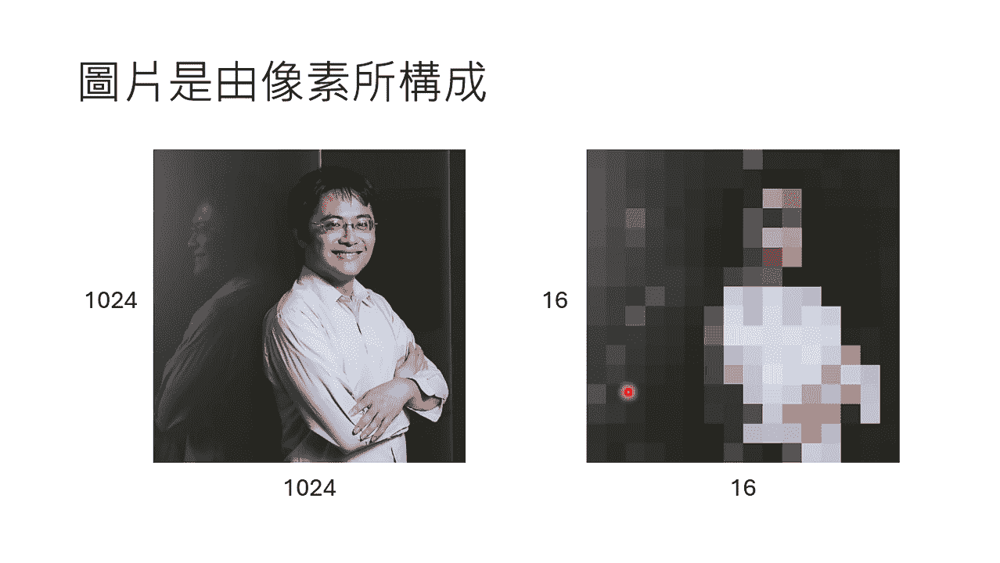

这个是图片，那影片呢，影片其实就是由一张一张的图片所构成的哦，所以一段影片它其实就是一串的图片，在影片里面的每一张图片呢叫做一个frame哦，叫做一个frame啊，中文呢通常翻译成真好，叫做一真哦。

那有一个词汇呢叫做frame per second，缩写是FPS，代表的是每秒的帧数，也就这个影片每秒有几张图片，只要图片够多，人看起来就会是非常流畅的，影片人看起来就不会觉得。

一段影片是由一张一张的图片所构成的。

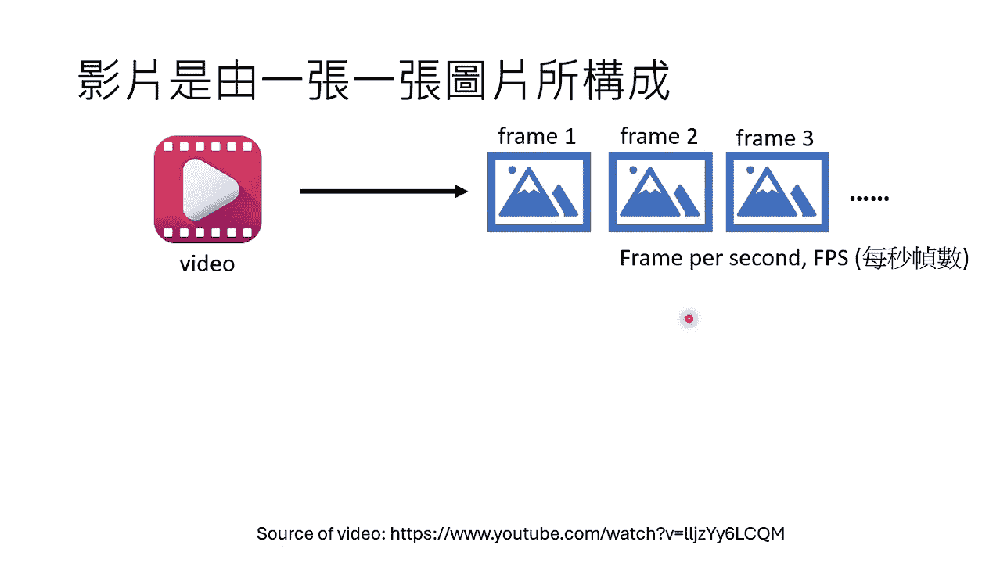

因为我们在YOUTUBE上看的影片呢通常是24fps s，也就是一秒钟呢，是由24张图片接起来所构成的，那看起来呢就是这个样子了。

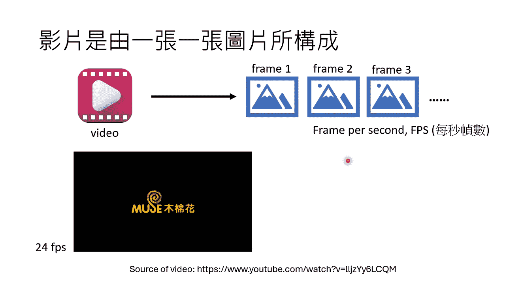

那就是你通常在YOUTUBE上看到的影片呢，就是这个样子。

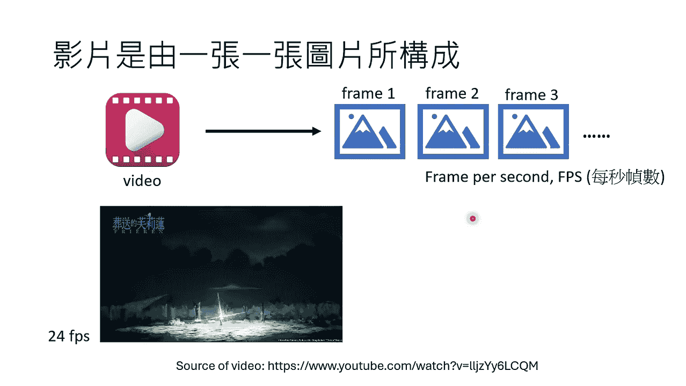

你完全感受不到它是一张一张图片所构成的啊。

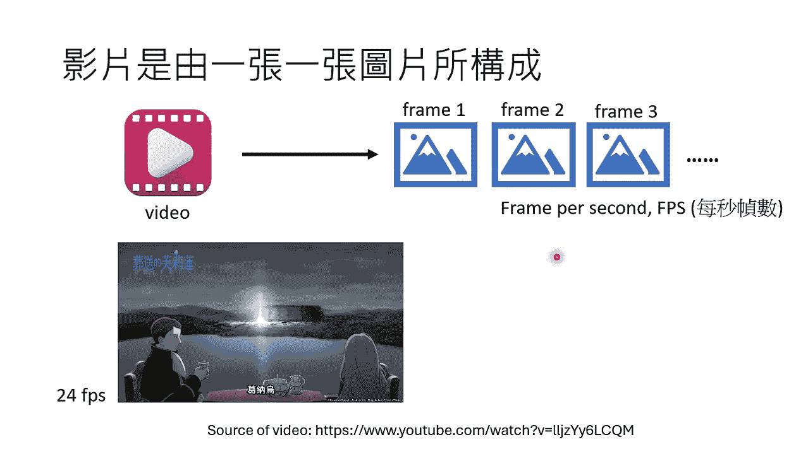

这个就是那个呃狐狸连呢，把一个绝对不可能打破的结界打破的一个段落。

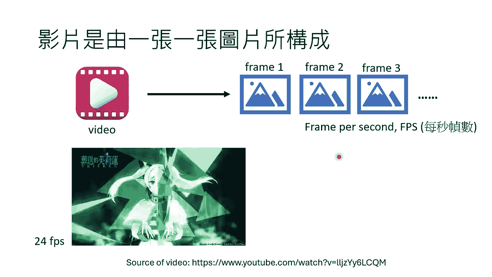

而在右边呢是同一个影片，把它改成EFPS。

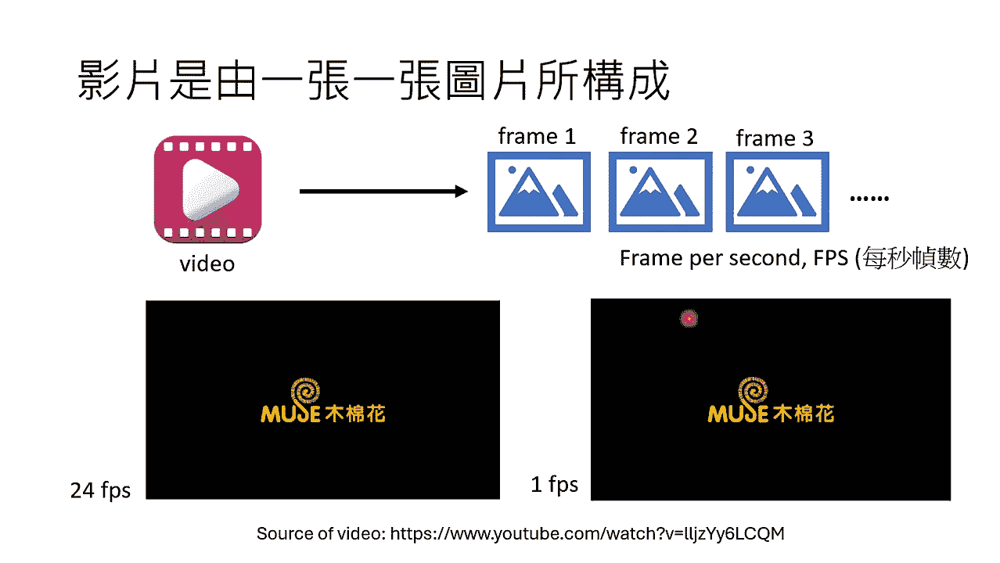

也就每秒只有一张图，那看起来呢就是非常的卡顿啊。

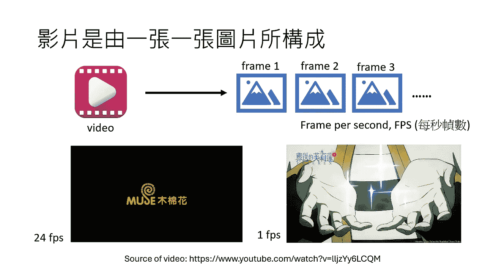

看起来就非常的卡顿，好像你网络不好的时候，这个看起来的影片应该就会问说哎。

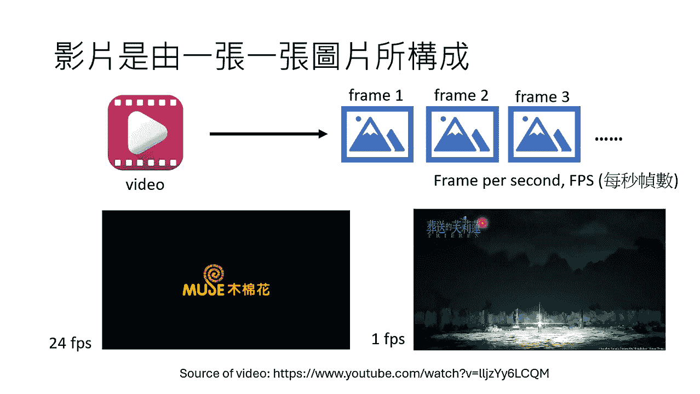

要不要让人好好看动画啦，这看起来就会非常的痛苦啊。

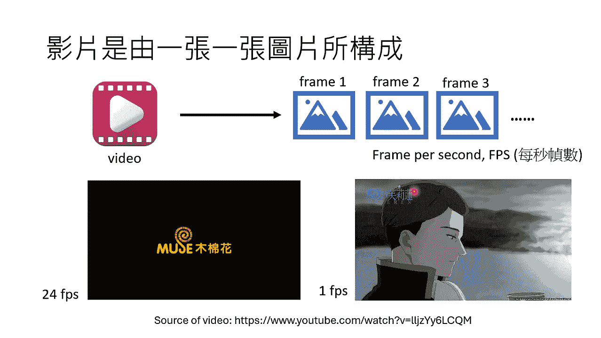

不过24fps呢如果是玩游戏的话，那这个解析度呢还是太低了。

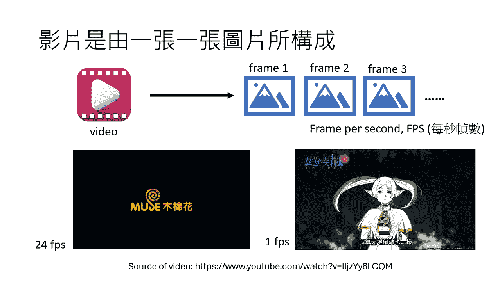

这个每秒的帧数呢还是太低了，如果玩游戏的话。

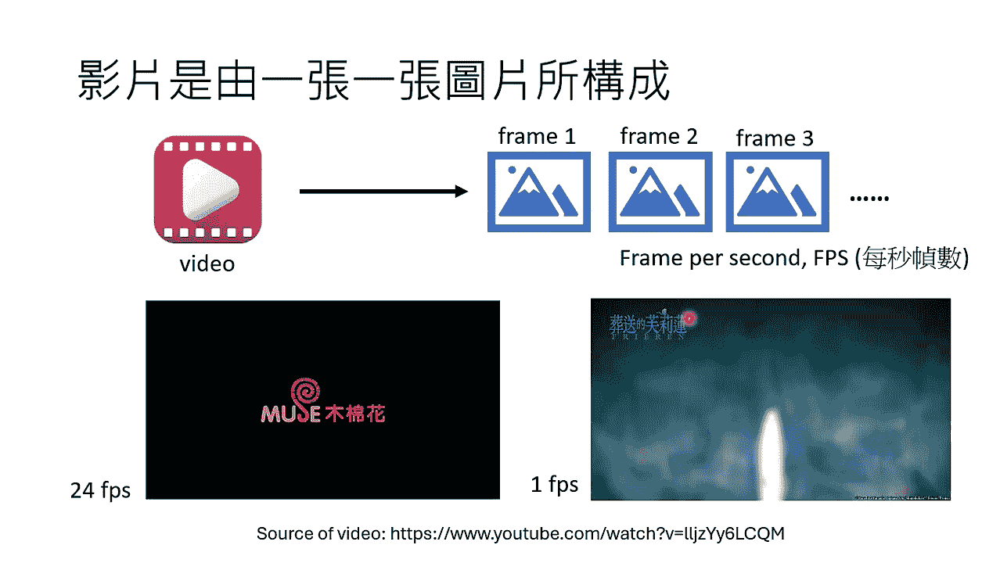

可能要60FPS，你玩起来呢才会觉得丝滑流畅好。

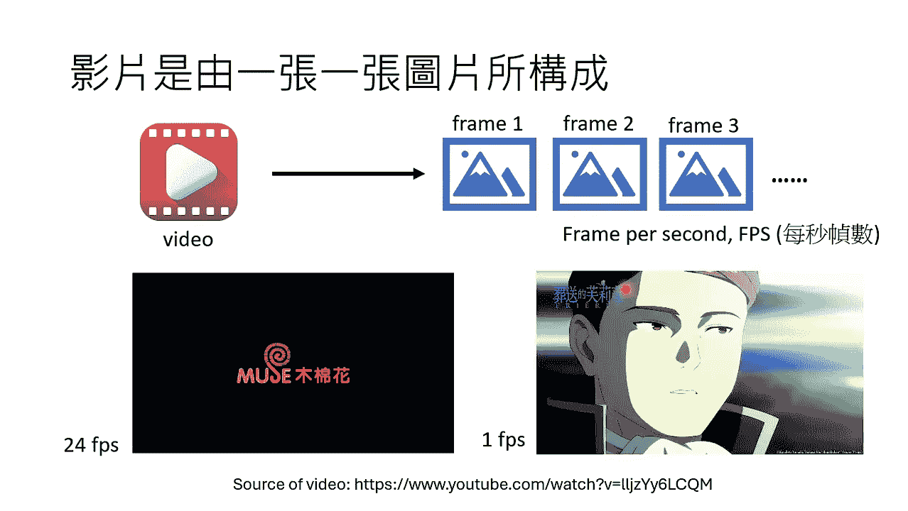

那刚才讲的是图片跟影片是由什么所构成的，那接下来我们再来看一下今天的人工智慧，是如何看待一张图片跟看待一段影像的，其实今天多数人工智慧的模型都不是，直接拿像素当做输入啊。

当然你要直接拿像素当做输入也可以，在比较早的年代，很多人会这么做，但后来发现像素实在是太复杂了，所以今天能够产生非常大张非常清晰的图，其实归功于一些影像压缩的技术，更今天给一张64×64的图片。

你不会让模型直接去产生一张解析度，64×64的图片，对模型来说，对人工智慧模型来说，通常会把图片呢先通过一个编码器啊，这个编码器呢英文呢是encoder，那这个编码器通常做的事情呢。

就是先把图片切成一块一块的，在今天这个例子里面呢，64×64的图片被切成4×4，总共16块，那每一块呢叫做一个patch，那接下来呢每一个patch呢会被进行压缩，那怎么样压缩呢，压缩的结果是什么样呢。

取决于你的编码器长什么样子，那有的方法是会把每一个patch，用一个独特的符号来表示它哦，所以每一个patch就好像是一种新的语言，每一个patch可以看作是新的语言，里面的一个token。

只是一种表示的方式，那也有一些编码器呢，它是把每一个patch变成一个低维度的向量，那本来一个patch里面应该要有很多的像素，但是他把这些像素的资讯全部浓缩起来，用几个数字。

也就是一个低维度的向量来表示它，总之有很多种不同类型的编码器，但是它们都是把影像变得更简单，就是把影像切成一个一个patch，每一个patch用一个简单的方法来表示它。

然后接下来呢你就会把图片里面的patch呢，拉直啊，本来个图片是2D的，但是给人工智慧模型，比如说transformer处理之前，你就把它拉直拉成一条线，然后呢丢给transformer。

那人工智慧的模型，比如说transformer在产生图片的时候，其实它也是产生一排的patch，然后这一台patch呢会通过一个解码器，它的英文是decoder，然后就会还原回原来的图片。

那讲到这边可能有同学会有问题说啊，那这个不就跟只是调低影像的解析度一样吗，我们可不可以说这个编码器做的事情，就是把原来64×64的图片，把它解析度调低变成4×4呢，呃在概念上也许类似。

但是实际上编码器跟解码器做的事情，远比调低调高解析度更加的复杂，事实上这边的编码器跟解码器呢，他们都是很复杂的类神经网络，它们里面往往都是transformer，往往都有非常多层。

所以今天你可能会觉得说，如果我把一张图片变成4×4，总共16个patch，会不会通过解码器还原回来以后，我这个狗呢这个图片呢看起来就是4×4，总共只有16个格子呢，其实不会，这个解码器在还原的时候。

其实会做非常复杂的事情，它不是只看一个patch来还原，他会考虑一个patch跟它所有邻近的patch，甚至是整张图片里面所有的patch一起去做还原，那这边这个压缩跟还原的过程。

其实都是透过内神经网络来进行的，这个压缩跟还原的过程其实都非常的复杂，那我们可以把图片压缩到非常简单，然后还可以把它解回来，而解回来看起来仍然是一样的图片，那至于实际上的细节是怎么做的。

我右边呢就留了一篇论文，那其实类似的技术非常的多，我留一篇比较有代表性的给大家参考，这边讲的是图片的部分。

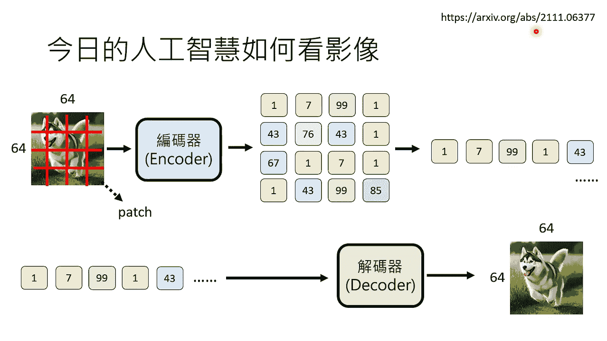

那我们再来看影片，我们知道影片是由一堆图片所构成的，那你当然可以用一个图片的编码器，把影片里面的每一张图片，都分别转成一排的patch，但对于影像来说，你可以做更多的压缩，本来图片是2D的，只有高跟宽。

所以你只能在高跟宽这两个方向上去做压缩，但影片是有时间这个维度的，所以你可以在时间的方向上也进行压缩，比如说常见的做法，可能会把相邻的几个frame合并在一起，一起做压缩，比如说在这个例子里面。

这段影片总共有四个friend，那可能第一个friend跟第二个friend会一起做压缩，第三个friend跟第四个friend一起去做压缩，那这边实际上的做法可能是第一个跟friend。

跟第二个friend他们位置一样的patch，会被再做进一步的压缩，变成另外一个video的patch哦，一样位置的patch进一步压缩变成video的patch，一样位置的patch做进一步压缩。

变成video的patch，我就图片里面同样位置的patch好做压缩，变成新的video的patch，变成影片的patch，然后然后再把影片的patch呢把它拉直排成一排。

那这个就是今天这个生成式人工智慧的，这些模型的输入跟输出的影片的样子哦，所以大家要记住，等于再等一下的这个讨论里面，我们就假设你已经知道一段影片，就是描述成一排的patch。

那我们就不会特别把影片转patch，这个部分再告诉你，总之你心里要知道，对于呃人工智慧来说，一段影片就是一排的patch。

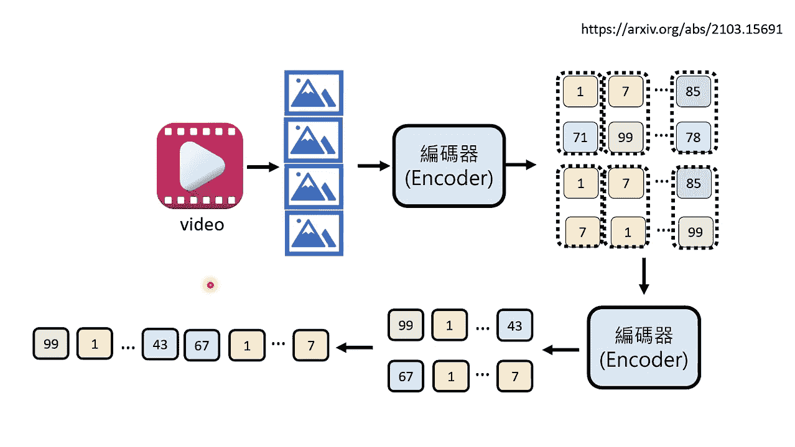

那事实上SORA呢也用了类似的技术，但你知道今天OpenAI它都不会明着告诉你，他做什么样的事情，不过从他画的图里面，你也可以很明确的知道说，他使用了这个patch这个技术，看他的图里面，这是一段影片。

而一段影片呢就说很多张图片所构成的，通过一个encoder，那这个encoder呢会把这个影片呢变成一堆patch，那这个patch的压缩的方向，可以是同一张图里面的长跟宽两个方向。

也可以在时间的方向上面做压缩哦，所以这边每一个小块的patch，可能都对应了影片里面的这个一段长，一段宽跟一段时间我都对应了影片的一小块，最后呢把这些patch呢通通拉直，再丢到你的呃，人工智慧的模型。

比如说transformer里面，那SORA也会使用patch这样子的技术好。

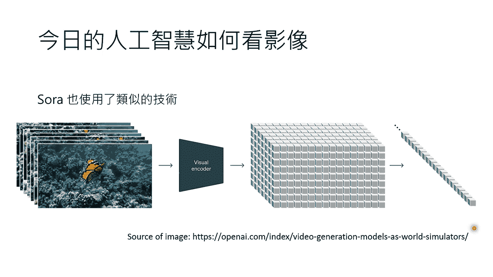

那我们接下来呢就来进入模型的部分，我们来讲文字，我们先用文字生图为例，来跟你讲说这些模型是怎么被训练出来的，那么很快也会讲到文字声一片的部分好，那文字生图，我们就是希望模型呢可以读一段文字。

然后产生对应的图片，那要怎么训练一个模型，可以读一段文字，产生对应的图片呢，你就需要大量的训练资料，可是这边需要什么样的训练资料呢，哇这已经是我们这学期最后一堂实体的课了，不知道你能不能够猜得出。

如果要训练一个模型，输入是一段文字，输出是一张图片，需要什么样的训练资料，我们知道如果今天要教语言模型做文字接龙，你就是要给他一句话，然后告诉他接下来要接哪一个token，那对于图片生成来说。

道理也非常的类似，你要它看一段哦，你要它看一段文字，产生一张图片，那你要教他的就是收集一大堆图片，跟这些图片对应的文字叙述，然后机器就可以学会说，看到这段文字应该要产生这样的图片。

看到这段文字应该要产生这样的图片，以此类推哦，但你知道说，现在这些生成图片的模型都非常的厉害，你输入什么，它往往都可以产生对应的输出，甚至很多时候你直接打一个人名，如果那个人够有名的话。

生成式AI画出来的人脸，还会跟那个名人长得蛮像的，到底是用什么样的训练资料，才能够达到这样的地步呢，现在啊其实已经有非常大规模的开源的。

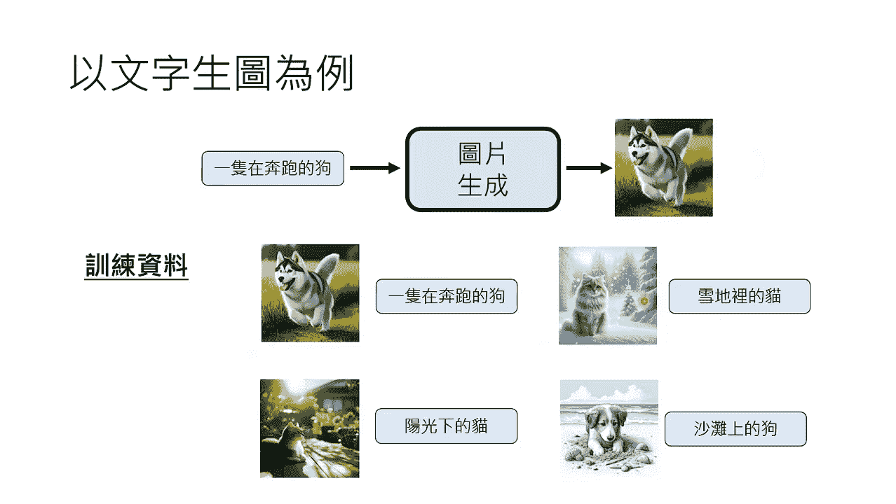

可以拿来训练文字生图的资料了哦，有一个资料集是一个叫做lion的公司所释出的，里面都是大量的图片，那每一张图片都有它对应的文字，你就可以拿这样子的呃，你就可以拿这样子的，大规模的资料来训练一个模型。

教他怎么看一段文字产生对应的图片，lion最大的资料集有多少张图呢，有58亿张图啊，而这个资料集，大到说他们特别做了一个搜寻引擎，你跟这个搜寻引擎上面打一段文字，他告诉你说这个资料集里面有哪些图片。

对应到类似的文字，艾肯会问说，这么大规模的资料集是怎么被收集来的呢，你想也知道，这是一定是从网络上扒下来的，他们做的事情很有可能从网络上扒了一些图片，买到很多网络的图片，其实都有对应的文字叙述。

它们就把图片跟对应的文字叙述扒下来，当然他们也做了一些后处理，比如说把母汤的那些照片拿掉啊，你应该懂我的意思，把18禁的照片拿掉啊，把觉得这段文字跟这个真跟这个图片，其实没有对的，很好的。

也拿掉啊等等啊，整理出这样的资料集，但使用这样的资料集，其实还是有一定程度的风险的，lion这个公司他其实对外宣称说，他只是帮忙收集了这些图片，所以他并没有这些图片的所有权，那你拿去训练。

那是你家的事情的，那你知道蛮多公司都是拿这这些图片去训练的，比如说这个呃stability AI就是做stable diffusion，那家公司，他们都是拿这个资料集去训练的，那后来呢就被一些画家告了。

这样子等下OpenAI就是死都不告诉你，他们是他们的资料是哪里来，搞不好是同一个资料集，但只要不讲就不会被告这样哎呀，总之就是这么回事啦，总之这个lion就只是把资料放在那边，那至于能不能用。

那是另外一件事情好。

那有了这样子的资料集以后，要怎么训练一个文字生图的模型呢，哦所以你已经知道有一段文字，它对应到某一张图片，那我们现在图片都用patch来表示，所以看到这些patch，你知道这代表着某一张图片。

那你用这样子的资料，你就可以去训练一个transformer，也许你可以训练transformer做这个patch接龙，我们都已经知道语言模型去之后文字接龙。

那我们可以去那个transformer去做patch接龙，这个transformer要学到的东西，就是看到这段文字，看到这段文字就先生出一个编号一的patch，然后呢把编号一的patch贴到文字后面。

那再看接下来要升哪个patch，也许升编号七的patch，再把编号七的patch贴到后面，再产生下一个patch，生出编号99的patch，把一张图片里面的page都伸出来。

通过decoder你就可以还原出一张图片，这是某一种用文字生图的可能的方式，但其实在上上周讲深层的策略的时候，也已经告诉你说，其实文字生图很少用这种接龙的方式。

那接龙的方式有个专有名词叫做auto regressive，其实文字生图很少用auto regressive的方式，来产生图片，因为就算把图片表示成patch，一张图里面patch的数量可能还是太多了。

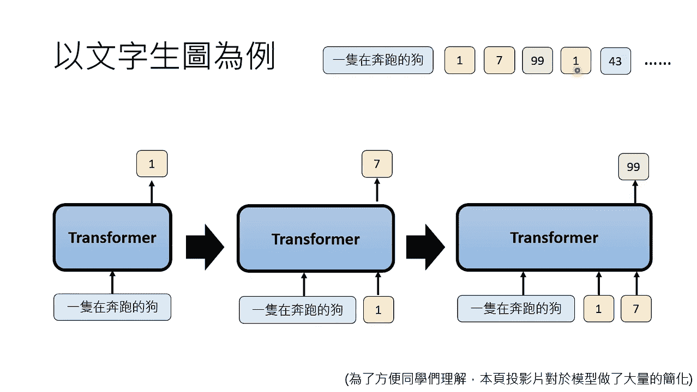

那我们在上上周的课程讲深层的策略的时候，也有特别跟大家提醒说，其实在生图的时候往往就是一步到位，用一个nauto regressive的model，一张图片里面所有的patch是同时被生成出来的。

那在上上周的课程里面，我画的图呢大概都是长这个样子的，就是你有个transformer，然后呢你会告诉transformer，说我们产生位置一的page吧，那就伸出page one。

产生位置二的page8就输出PH7，产生位置三的page8，就生成生成PH99那一张图片里面，所有的patch都是透过同一个模型同时生成的，所以你就不需要等这个patch一个一个被生出来，一张图片里面。

所有的patch都是可以被同时生成的啊，这个是在概念上，所有的patch是被同时生成的。

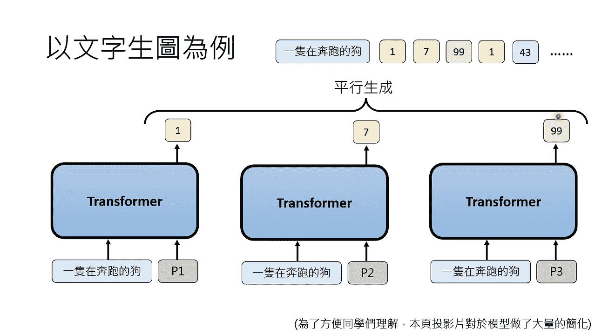

但实际上的做法是这个样子的，我们其实会把所有要，就假设现在总共要升16个patch好，第一张图现在是由4×4，总共16个patch所组成的，那你一开始其实就会告诉同一个transformer。

说我们要升PH1到patch16，然后transformer呢就会同时把16个patch，统统都生出来，所以实际上呢这个第一个位置到第16个位置，他们其实并不是完全分开生出来的。

而是同时丢给一个transformer同时被生出来的，那这样做有什么好处呢，虽然这些PH还是平行同时被生出来的，但是在生成的过程中，你知道transformer里面呢就是会有attention。

attention的意思，就是每一个位置在做处理的时候，都会参考其他位置的咨询，那为transformer里面有attention，所以我们在生成某一个patch的时候。

其实会去参考其他patch生成的过程，再去生成某一个patch，用这个方法你生出来的图片，每一个patch中间它还是有一点关联性的，透过这个attention，它page跟page间还是会有一些关联性。

不会完全毫不相关，不过就算是用这样子的方法，就算是你用transformer里面attention来处理，page跟page之间的关系，其实也不能保证能够解决，我们上上周讲生成这策略的时候。

提到的脑补的问题，就如果每一个位置看到一只在奔跑的狗，每一个位置如果想要发的狗长得是不一样的话，那你可能就会划出很多只狗叠在通胀图片里面，就算是用了transformer，其实也不能够完全解决这个问题。

那至于这个问题实际上是怎么被处理的，我们在等一下的课程中还会再看到，但现在就假设说transformer可以处理这个问题，反正就是告诉他说生16个位置的patch。

他就把16个位置的page一次都生成出来，page跟page之间的关系，我们透过attention来进行处理。

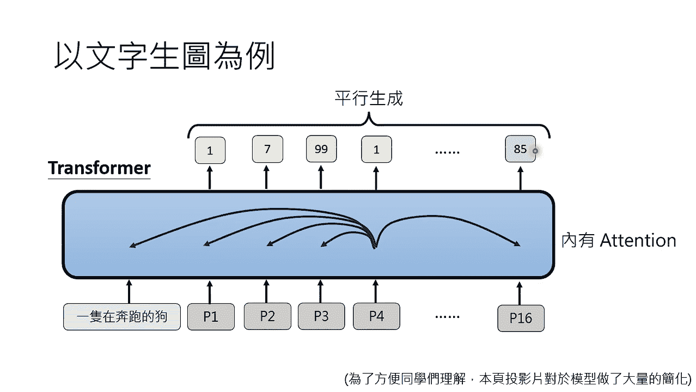

我们现在已经知道在概念上怎么产生一张图片，那我们来谈一下，怎么衡量影像生成模型的好坏哦，如果你今天给你的影像生成模型输出一个指令，它产生对应的图片，那我们怎么知道生成的结果好不好呢。

那你记得我们在讲怎么评量文字模型的时候，我们最后有讲到说，虽然有很多评量的方法，但是人类才是最好的，这个evaluator，人类才是最好的品两者，但是人类的时间又有限，现在人工智慧已经这么强了。

那我们在讲这个语言模型的评量的时候说，也许我们可以让g p t four来代替人类，用比较强的语言模型来代替人类进行评量，其他模型的工作，事实上在影像里面也有类似的趋势，今天怎么知道一个图片生成的模型。

生出来的图，对不对呢，当然你可以人去看啊，人去看，说这个像不像一只奔跑的狗，不过人可能没有力气看太多的图片，所以今天一个常见的做法是，引入一个叫做clip CLI p的模型。

我们先来介绍一下clip这个模型，clip这个模型他训练的时候，他学的事情，就是先从网络上有人收集了非常大量的图片，跟这些图片对应的文字，那你就跟pp说，如果今天给你一张图片跟它对应的文字。

给你一张图片跟它对应的文字，你就要输出高分，你要输出一个比较大的数值，你要输出一个比较高的分数，反过来，如果我今天把我资料集里面的图片跟文字，任意配对，我把阳光下的猫去配这张狗的图。

我把沙滩上的狗去配这个猫的图，再丢给clean的模型的时候，key的模型要学到，说这个配对是一个不正确的配对，所以要给这样不正确的配对低分，所以clip这个模型可以从大量的资料里面学到。

说给正确的配对就是高分，给不正确的配对就是低分，那这种模型是已经被训练好，已经开源的。

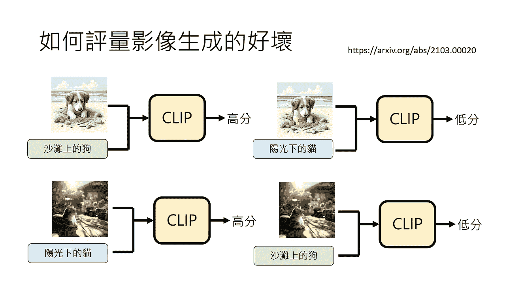

所以今天你会发现很多的以图片生成模型，其实就是直接拿QU来衡量他们，把这个指标呢叫做create score哦，也就是说今天图片生成模型，生成一张图片以后呃，就把输入的文字叙述。

加上这张图片一起丢给clip，看clip给多少的分数，给的clip的分数越高，click spe越高，就代表这一个图片生成的模型做的越好啊，虽然这个方法听起来蛮简单的，而且要依赖clip这个模型的能力。

但是这是今天蛮主流的，衡量图片生成模型好坏的一个做法哦，所以发现说今天我们的时代已经来到了，不只是人来评量这些深层式AI的好坏，今天通常是用另外一个模型，用另外一个人工智慧来评量这些生成式。

AI生成的好坏了好。

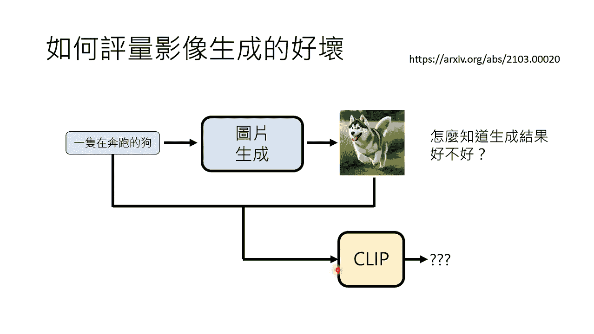

那但是生成图片呢有一个特殊的难点，就是图片是一张图呢是胜过千言万语的，很多东西，你根本难以用文字来描述它到底长什么样子，比如说这是我家客厅的一个钟，我想要让这个g p t four呢。

g p t four背后偷的其实就是DARI啦，我想让DARI呢画一个一模一样的图，可不可以画出一个类似的中。

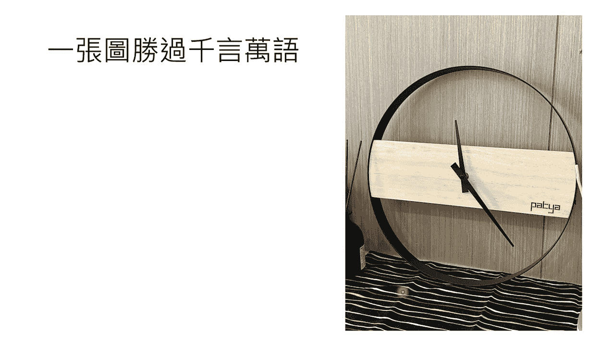

我就试着跟他描述这个钟长什么样子，我跟他说，这是一个有现代简约设计风格的钟，钟面是一个大约圆形的框架，然后是黑色金属材质，没有刻度，然后中的中央是一个木板，上下镂空，木板上还一定有胚芽的字样。

没有其他花纹，那指针的是黑色的设计简约，只有时针分针，没有秒针，让他根据这一些文字来想象，这个周应该长什么样子好，那我就试着逛了很久啊，不断改我的文字叙述，希望产生出来的钟，能跟我家客厅的钟能越像越好。

在我把那天的额度都用完之前，我能够画出来最像的钟呢，也只能够长这个样子而已，跟真正的我想要他画的妆呢，还是有一点点的差距，是已经很像了啦，但是不管我怎么努力的描述，感觉都还是有一些差距。

因为有很多图像是文字难以描述的，所以怎么办呢，也许我们可以做个人化的图像生成，那这个其实就是我们在作业时会做的事情啊，那怎么做个人化的图像生成呢，假设你的桌上有一个很特别的雕塑。

你也很难描述它是什么雕塑，那你就直接帮他取一个特别的名字，我们把它叫做s star，要把它叫什么都可以，就是要拿一个你平常没有在用的符号来称呼，这个你想要克制化的特别的物件，那你就不要拿。

你平常会用的符号，比如说如果你把它叫做狗，那就不好了，以后你就再也画不出狗来了，以后说我画出来的狗都长这个样子，而且他也有可能会被那个词汇的意识所污染，因为刚刚说这是一个狗，只有他可能会把一个狗的头呢。

加到这个雕像上面，因为他觉得这其实应该要长得像一只狗，总之你要选一个没有什么特殊的意思，然后你平常不会再用的符号来代表，这个你要克制化的对象。

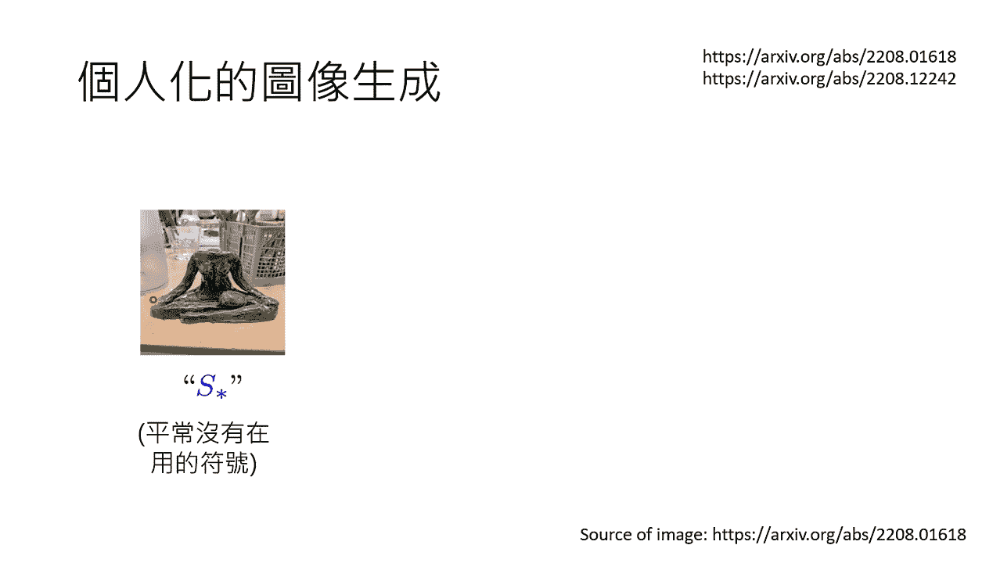

然后接下来呢你就教你的文字生图模型，说以后我跟你讲呃，s star的照片，你就要画这样的图出来哦，跟你讲s star的照片，你要画这样的图出来哦，然后微调你的文字生图模型。

他就可以认得这一个客制化的对象，那之后呢，你就可以把这个客制化的对象，放在各式各样的场景中。

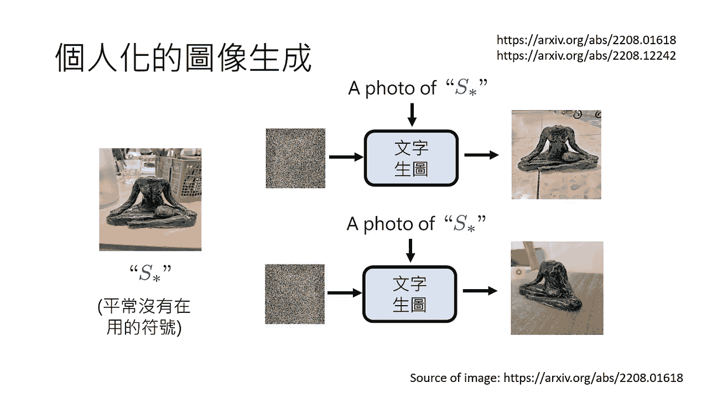

比如说这边的例子是来自于右下角这篇论文啊，他们只用3~5张图片而已，这种各各自化的技术呢不需要太多的图片，他们只教这个文字生图的模型，说这几张图片都是s star这个东西。

接下来他就可以下各式各样跟s star有关的指令。

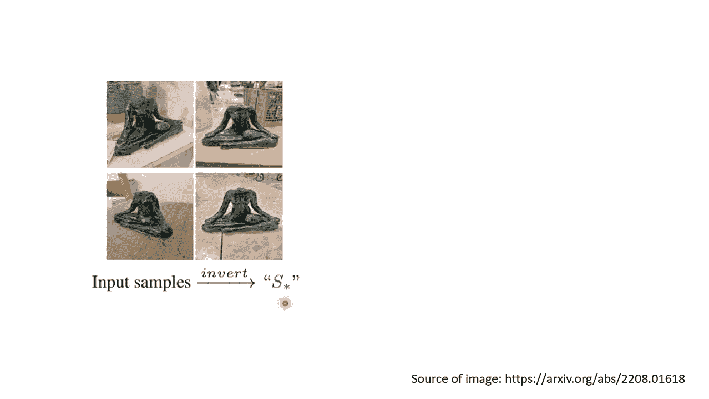

比如说跟他说，And oil painting of s star，这s star的油画我就画一个油画版的s s star，或产生一些s stop的app icon。

放一些aps s s stars star的app icon啊。

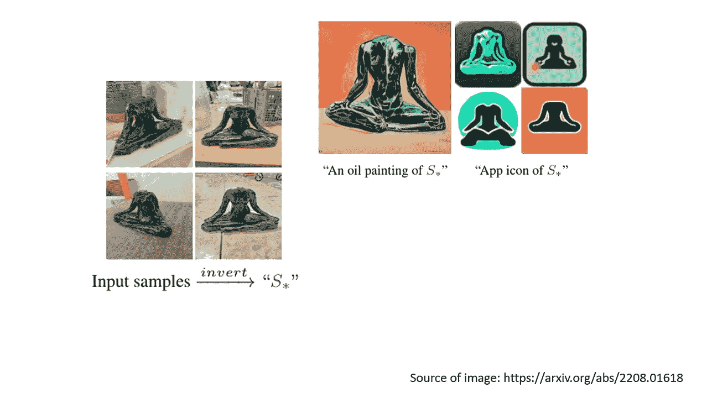

跟他说产生一个ELO啊，ELO就是这个红色怪物，这个ELO呢要做的像一个s star啊，这个模型居然听懂了，画了一个ELO，就是用个盘坐的方式，就跟SR一样，而产生一个这个针织版的SAR哦。

他也知道什么叫做针织版的a star哦，所以你可以透过少量的物件来克制化你的图片，生图的模型，那这个其实就是我们最后一个作业，会做的事情了。

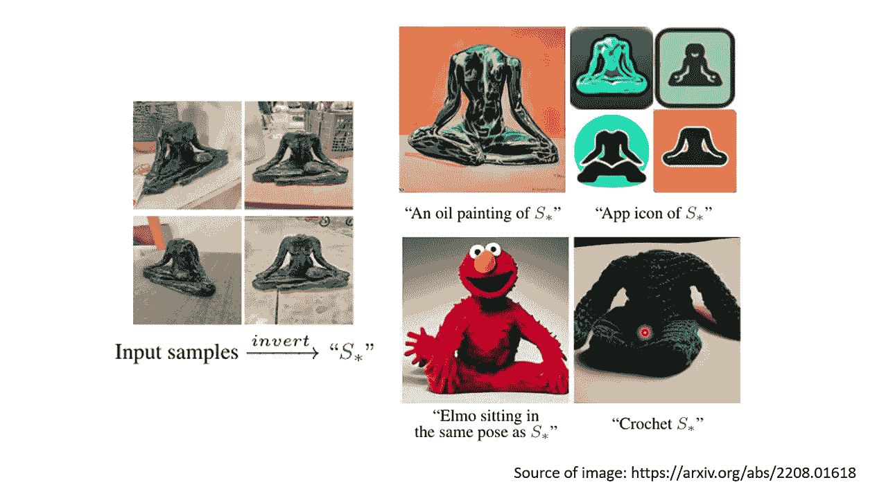

好那刚才讲的是文字生图，那接下来我们来扩展到文字声影片，那文字生图跟文字声影片有什么样不同呢，其实没有什么样本质上的不同，因为本来文字生图就是产生一堆patch。

文字生影片只是产生了更多的patch而已，那如果是文字生图，我产生出来的patch只对应到一张图片，如果是文字声影片的话，你就要产生一大排的patch，然后这些patch集合起来。

就对应到一段影片就结束了，就这样，其实它的原理就这样，你可能想说诶，文字声影片感觉这个道理还蛮简单的，就是生出一大堆的patch，那到底为什么大家觉得，文字声影片是一个很大的挑战呢。

啊那你仔细想一想文字声影片的复杂的程度，而假设呢我们现在每秒钟有24个frame，你一般看影片的时候，每秒钟都是24个frame，那我们现在假设呢，每一个frame用6464个patch来描述它。

那通常依照今天encoder的能力，6464个patch，通常还原回去可能是1024×1024的图，就是一个普通普通的解析度的，这个普通清晰程度的这个影像而已啊。

好那假设每一个friend呢有6464个patch，那一段一分钟的影片应该要有多少的PH呢，我算了一下，一分钟的影片总共有1440个frame，因为每秒钟24个friend。

所以601440个frame，每个FRAP有6464个patch，算出来是600万个patch，600万个patch听起来数量还不是非常的惊人，因为今天你动不动就听到一个类神经网络。

它的参数量是上亿等级的，所以我相信百万对你来说，已经不是一个非常大的数字了，但不要忘了transformer里面是要做attention的，attention是每一个位置跟每一个位置。

两两间都要做attention，所以假设所有的patch两两间都要做attention，600万个patch，要做的attention的次数是600万个平方，600万的平方是36兆啊。

哦所以今天如果你要升一段一分钟的影片，它不是一个特别高清的影片，但你每一次每一层在做attention的时候，居然要做36兆次的attention，这个运算量听起来就非常的惊人哦。

所以文字身影片最大的挑战就是，这个运算量实在是太大了，所以怎么办呢，你会发现近年来一系列的研究，都是在想尽办法减少需要的运算量。

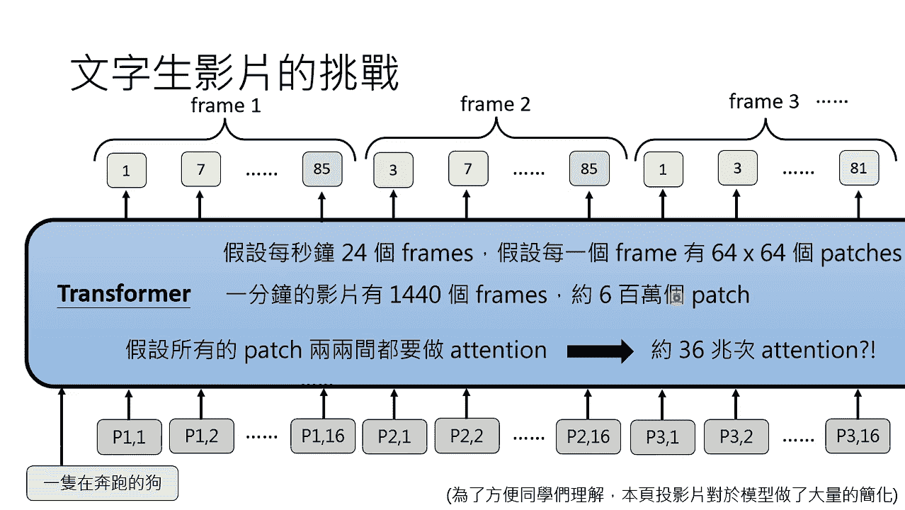

那怎么减少需要的运算量呢，啊首先第一个想法就是改造attention真的有必要，所有的page间通通算attention吗，算attention的目的，就是要让不同的配置之间有关联吗。

这样产生出来的影像，每一个画面才会是一致的，但是一个一分钟的影像呃，最开头的影片，最开头的friend，左上角的patch真的会跟最后一个frame，右下角的page有关联吗。

也许我们根本不需要计算那么多的attention，所以第一个改造的方向是减少attention的运算，就这边是三个frame，每个frame里面有44个patch。

然后这个patch要计算attention的话，它不仅要跟同一个friend里面所有的page做attention，他还要跟同一段影片里面，其他的frame也做attention。

这种既考虑同一张图片里面的资讯，也考虑时间的资讯的attention，叫做special temporal的attention，那今天可能已经很少有人硬做。

special temple的attention呢，因为它运算量太大了，没办法帮你升高清的影像，所以怎么办呢，也许一个简化的方向，就是我们不要管friend跟friend之间的关系。

每一个patch只跟同一个friend里面的patch，来考虑attention，这样至少可以确定，那我一通，这这至少可以确定同一个friend里面，他们的画面是不会太违和的。

同一个friend里面它的画面是一致的，那这种attention呢只考虑了一张图片，里面的长跟宽，只考虑两个方向，它是一个2D的attention，叫做special的attention。

那只考虑special的attention显然是不够的，因为如果只有special的attention的话，你的画面和画面之间就不连续了，就不连贯了，那怎么办呢。

也所以也需要考虑时间的attention，这种考虑时间的attention叫做temporal的attention，它是1D的attention来在考虑这个patch的时候，考虑另外一个friend。

同样位置的patch，考虑另外一个friend，同样位置的patch，但这种attention显然是有问题的，因为他只考虑时间这个维度的咨询，他没有考虑空间这个维度的咨询哦。

所以看起来2D的attention跟1D的attention，spatial attention跟temporal attention，都是有一些局限的，那这两个东西都有局限，你要用哪一个呢。

就是我全都要不要想那么多。

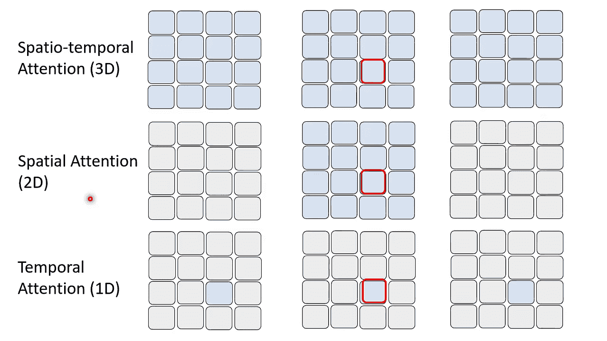

就把这两种tension叠在一起，就可以创造一个伪3D的attention，今天在做这种影片生成的时候，你常常看到这样的架构，就是把special attention跟TEMPORATTENTION。

2D的attention跟1D的attention交替使用，把它们两种attention叠在一起，就可以制造出V3D的attention好，那我们来计算一下这个V3D的attention里面。

需要计算attention的次数。

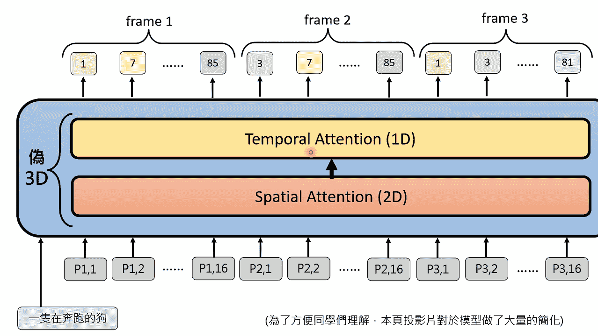

我们刚才已经知道，如果是完整的3D的attention，special temple的attention的话，他算出来的attention的次数啊，真的是一个天文数字。

那我们来看一下special的attention呢，如果今天我们只考虑同个frame里面的patch，两两之间要做attention的话，那要做多少次的attention呢，那一个patch诶。

一个frame里面有6464个图，两两要做tension，64×64的平方，总共有1440个friend哦，我们要生一分钟的影片，总共1440个friend，所以把64×64的平方再乘以1440。

是240亿次的attention，那如果是temporal的attention呢，temporal attention是不同frame里面，同样位置的patch才做attention呃。

我们的时间的那个维度总共有1440的位置，他们两两要做attention，所以是1440的平方，那我们总共有那一个frame，里面有6464个patch，所以假设是temple attention的话。

那要做attention的次数是1440的平方，乘64×64是85亿次哦，虽然这边也是上亿等级的次数，但是你会发现240亿次加85亿次，两个合起来做一个V3D的attention。

跟原来全3D的attention，它的差别是有达到千倍那么多，所以透过把temporal加special的attention，两种attention叠起来，你可以制造V3D的attention。

它需要的运算量是原来真正全3D的，tension的运算量的1而已，这个是今天影片生成模型。

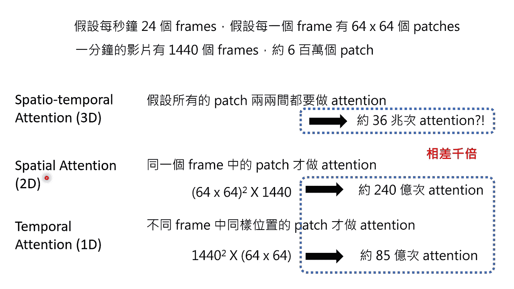

非常常用的一个技术好，那还有什么方法减少需要的运算量呢，那我们上周有讲，我们上上周讲深层次策略的时候，有讲过，我们在生成的时候不一定要一步到位，可以把生成分成很多个步骤依序执行。

那文字生影片今天也常常使用类似的技术啊，我们之前有讲过说呢，你可以给你的生成式AI一个条件，先让它生成第一版的物件，然后呢再有另外一个生成式A的模型，把第一版呢变成第二版。

然后最后有一个模型把第N减一版变成第N版，那人们以为是输入这个条件，直接就产生第N版，那其实中间呢已经做过了非常多，生成式AI的模型，但每个模型只要专注在某一个任务上面，制造一个流水线。

每个流水线的任务都没有很复杂，但是全部接起来就可以做复杂的事情，那影片是影片生成，今天也通常会做非常类似的设计，比如说DK减一版跟DK版的差别，可以是。

DK减一版里面每一个friend的解析度是比较低的，DK版呢它的解析度是比较高的，这个时候生成式AI只需要专注于，把每一张图片的解析度调高，把根据已经产生出来的低解析度的图片，产生高解析度的图片就好。

那有时候DK减一版到DK版，可能是调高了帧数，调高了每秒里面那个帧呐，每秒里面的friend的数目啊，比如说K减100，可能每秒只有两张图片，DK减DK版，就把两张图片扩散到每秒有四张图片。

这个时候对K减一到DK版，的这个生成式AI来说，它只需要专注于去预测两张图片中间，如果你要做interleaving，你要做内插的话，应该生出什么样的内容，才会是看起来比较连贯的。

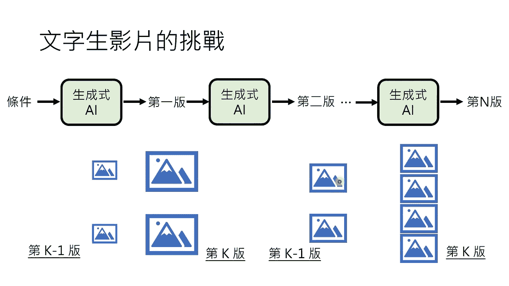

虽然我们不知道SORA是怎么做的，不过我们可以看另外一个google的模型叫做image，image里面呢就用了非常类似的技术，那上面这个图呢是来自于image的论文。

他就告诉你说它最先产生出来的图片呢，这里面每一个框框代表一个模组，代表一个模型，他先用一个最简单的模型，这个模型是文字的输入，它只产生一个这个呃，他的这个这个这个这边有三个数字。

第一个数字是有多少个frame，然后第二个跟第三个数字是生出来的，每一个frame呢它的长跟宽是多少，所以第一个模型只会生16个frame，长跟宽分别是40×24。

然后他说他的这个fraper second每秒的帧数是三，那它升15个十阿升16张图的话，那它生出来的影像长度大概就是五秒左右，而base model生出来这个影片呢。

人呢一定是觉得根本不知道在做什么的，但没关系，有另外一个模组，有另外一个模型，他把三个FBS，每秒三个frame调高到每秒六个F，再有下一个模组把每一个fan的解析度变高，从原来40×24的图。

变成80×48的图，然后呢再有另外一个模型，把解析度再变更高一点，80×48变320×192，然后呢再有一个模型提高一下每秒的帧数，把每秒六帧变成每秒12帧，好，再一个模型呢再把帧数再调高一点。

每秒12帧调到每秒24帧，这个就是你一般呢在看动画的时候的，这个帧数了，然后再来呢这个但是320×192的，这个每个frame，如果它的大小是320×192，这个解析度还是太低了哦。

那把它扩展到1280×768，好，跟你的屏幕一样大，那这样就可以产生清晰的影片好，那这个也是今天文字声影片常用的技巧之一。

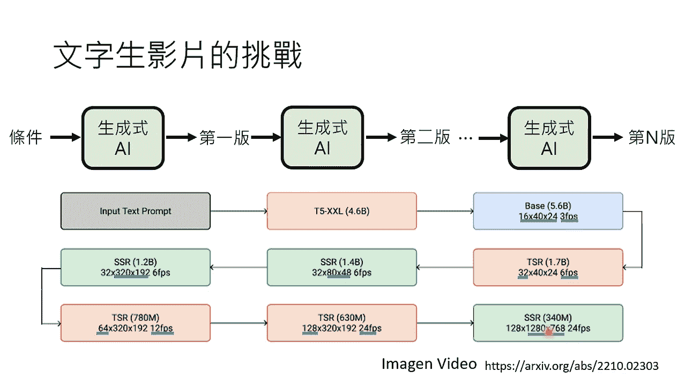

呃，如果你想要学更多，有关影像生成的生成式AI的话，你可以看以下两篇paper，这篇paper讲的是语言模型。

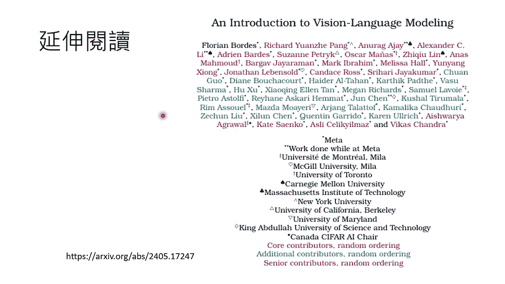

怎么把影像当做输入，那这一篇paper讲的是diffusion model。

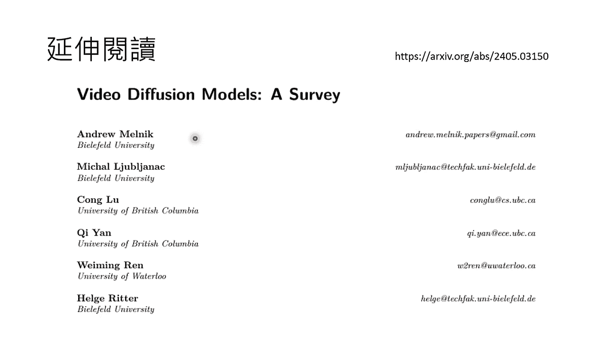