# 李宏毅2024春《生成式人工智能导论》 - P36：第18讲：有关影像的生成式AI (下) — 快速导读经典影像生成方法 (VAE, Flow, Diffusion, GAN) 以及与生成的影片互动 - 啥都会一点的研究生 - BV1BJ4m1e7g8

接下来的下一段呢，我想跟大家介绍一下，一些经典的影像生成的方法啊，那这边会跟大家很快提到的方法，包括variational auto encoder。

它的缩写是v a e flow base model，还有今天大家都耳熟能详的diffusion model，还有generative adversal network，它的缩写是G啊，像SORA呢。

他用的呢就是defusion model哦，如果你在论文或blog里面看到，有个东西是从一大堆的杂讯慢慢生出来的啊，把很多杂讯杂讯越来越少，最后产生高清的图的话。

那这个通常指的就是diffusion的model，那我想用一点时间来介绍这些，经典的影像生成的方法，虽然今天diffusion model可能是最常用的，但是我们可以多介绍几个经典的方法。

让你知道说到底想生成真正的难点，真正被克服的挑战是什么。

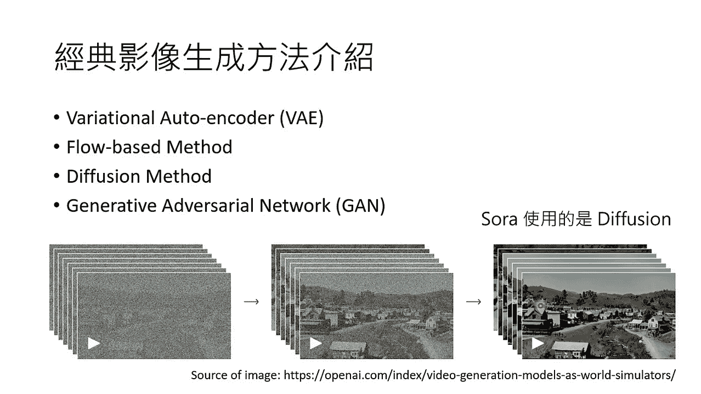

你我那我们刚才已经讲到了，我们在生图片的时候或生影像的时候，今天常常用的类神经网络的架构，就是transformer，那当然过去比较常用CNN，不过今transformer真的是一个非常常用的。

类神经网络的架构，而它的概念呢也非常的简单，就是给一段文字产生一排patch，就可以产生图片了，但是我们在训练的时候，可能会遇到这样子的一个问题，我们可能在训练资料里面，如果你找一只奔跑的狗。

你会发现一只奔跑的狗有很多不同的样子，它可以是一个在草原上奔跑的哈士奇，也可以是在都市里面奔跑的柴犬，一只奔跑的狗，它不止一个样子，对于transformer来说，他得到的教材是。

当所有的文字是一只奔跑的狗的时候，有时候你告诉他要产生这些patch，但有些时候你要告诉他要产生另外一些patch，对这个transformer来说，他就无所适从，你叫它产生一个哈士奇也好。

他能生的出来，你叫它产生个柴犬也好，他可以生的出来，但是你有时候叫它产生柴犬，有时候叫它产生哈士奇，他头脑就会很破，那可能每一个位置，每一个patch想要产生的东西都不一样。

你可能就会产生各式各样奇怪的混种的图片哦，这个就跟你如果去工作的话，如果如果如果老板都只叫你往东，那没问题，都只叫你往西没问题，最怕的就是遇到老板，有时候叫你往东，有时候叫你往西，你就会无所适从。

这个时候是特别痛苦的，对transformer来说，他在学影像的时候也有一样的问题，因为通常影像所对应的文字，没有办法完整的描述整张图片，所以你会有很多同样文字，对应到不同图片的状况。

对transformer来说，他会不知道要如何学习，不知道要听哪一笔训练资料的。

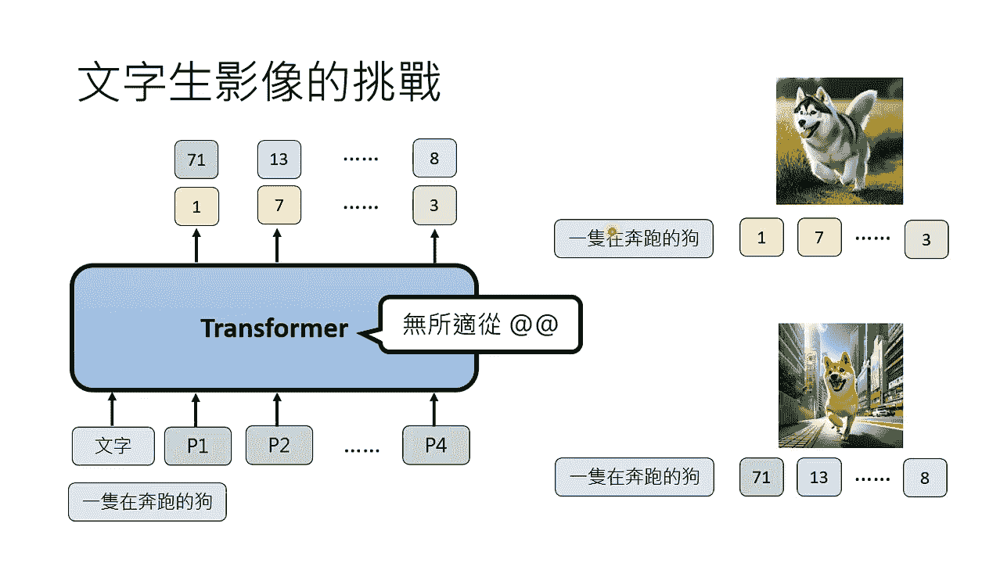

所以怎么办呢，我们现在先把那个影像，图片生成的模型简化一下啦，我这边就直接用个框框呢，来代表那个transformer，那大家知道我的意思哦，就这个框框里面其实是一个transformer。

那给他一段文字，还要生一堆page出来，这些page会变成图好，那我们刚才说图片生成或者是影像生成的问题，也是一样的，它的难点就是，这些文字往往没办法完整的描述影像，那怎么办呢，也许一个可能性是。

虽然我们本来的训练资料里面，这些文字不足以完整的描述影像，但我们自己把本来文字没提到的东西加进去，我们直接把多余的资讯加进去，都跟图片生成模型讲说，你现在不只要生成一只奔跑的狗。

你是要生成一只哈士奇在草原上奔跑的样子，你不是只生成一只狗，你要生成柴犬在都市里奔跑的样子，把额外的原来文字没提到的资讯把它标出来，也提供给图片生成模型，将图片生成模型，在生成的时候。

他就知道说为什么同样的输入，这两只图片会不一样，因为有额外的资讯，它会读取这个额外的资讯，再去生成图片，它就不会有同样的输入，有会有不同的输出的这种问题，他就不会有那同样的输入。

你想要教他产生不同输出的这种问题好，但是这些标注又要从哪里取得呢，也许我们可以训练一个资讯抽取的模型。

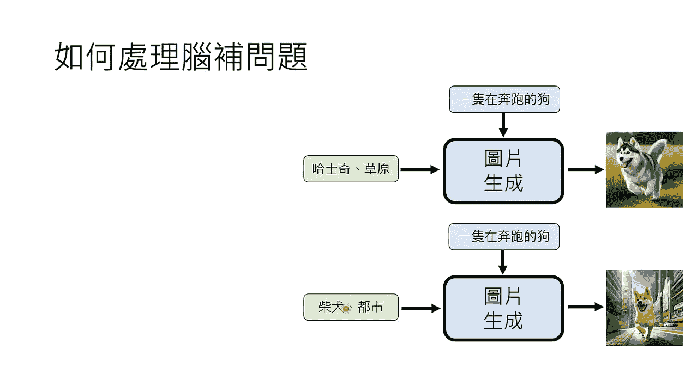

这个资讯抽取的模型，他做的事情就是给他一张图片，给他一段文字叙述，他把这个呃这个图片里面，文字资讯没办法没有描述到的东西，额外抽取出来，丢给图片生成模型，如果我们有这样的一个资讯抽取模型。

我们就可以对训练资料里面所有的图片，都把这些文字没描述到的资讯抽取出来，丢给图片生成模型，这样图片生成模型的学习呢就会更加容易，但现在问题是怎么训练这个资讯抽取的模型呢，你知道你要训练一个模型的时候。

你都要有大量的输入跟输出成对的资料，你要怎么找到这样子的输入跟输出，成对的资料呢，你要怎么找到人去帮你标注，你要怎么轻易的标注出说呃，这张图片里面没有被描述到的资讯，就是这些就是这些了。

这里面有一个方法是，在不需要额外标注资料的情况下。

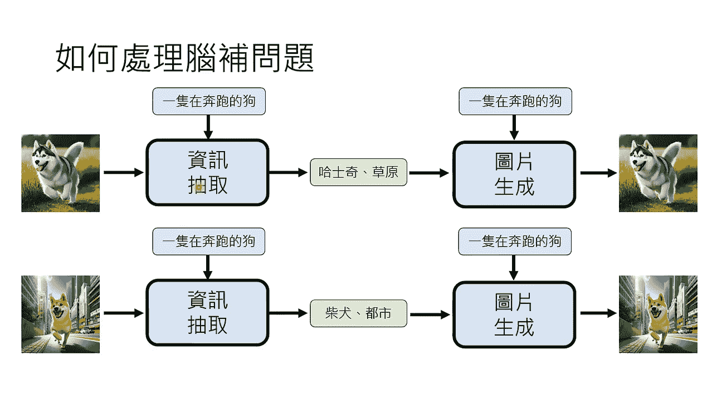

就可以把资讯抽取的模型训练出来，这个方法是这样的，图片生成的模型跟资讯抽取的模型，它们可以一起被训练，他们有一个共同的目标，他们共同的目标是什么呢，他们的共同目标是资讯抽取的模型。

读训练资料里面的一张图片，那训练资料的每一张图片，都有附一段文字的描述，把文字的描述也读进去，它可以看看有哪一些文字的描述没提到的东西，把它抽取出来，那再把这些抽取到的资讯丢给图片生成的模型。

图片生成的模型，看到这些抽取出来的资讯，在读这段文字的叙述，产生一张图片，那资讯抽取的模型，虽然你没有告诉他要抽取哪些资讯，但是资讯抽取的模型跟图片生成的模型，有一个共同的目标。

他们共同的目标就是输入一张图片，经过这一连串的处理之后，最终输出的图片要跟输入越接近越好，所以中间资讯抽取的模型到底抽取出来什么，不重要，我们自己也不知道，我们也没有标准答案，但反正他抽出来的东西。

可以帮助图片生成的模型，生出跟输入一模一样的图，资讯抽取的模型就算是成功了哦，所以资讯抽取的模型跟图片生成的模型，是可以一起被训练出来的，一次解决了两个问题，有资讯抽取模型，抽出文字叙述没办法表。

没有表达到的资讯文字，图片生成的模型，在训练的时候又有这些额外的资讯，辅助它生成图片，这个这整个框架叫做auto encoder，那资讯抽取的这个模型呢又叫做encoder。

那图片生成的这个模型呢又叫decoder，那这个encoder和decoder一起训练，要让输入跟输出越接近越好，这个训练的这个框架呢，这个训练的方法呢叫做oto encoder，这个资讯抽取模型。

它的输出不需要是文字，我们刚才呃的讲法，好像让你觉得资讯抽选模型，它的输出一定是好像是文字，这个只是为了让你方便理解，对于一个图片生成的模型来说，它是又不是人，他不需要读文字，你只要能够传递一些密码。

他读得懂，知道那是什么就好了，所以一般资讯抽取的模型，它的输出不是文字，而是一串数值，也就是一个向量，那通常这个向量里面，每一个维度可能就会对应到某些特别的含义，那在这个例子里面。

第一个维度的数值也许代表是狗的品种，第二维度的数值也许代表的是背景，在什么样的地方，当图片生成的模型给它不同的向量的时候，它就会产生不同的在奔跑的动好，那现在有了这个encoder。

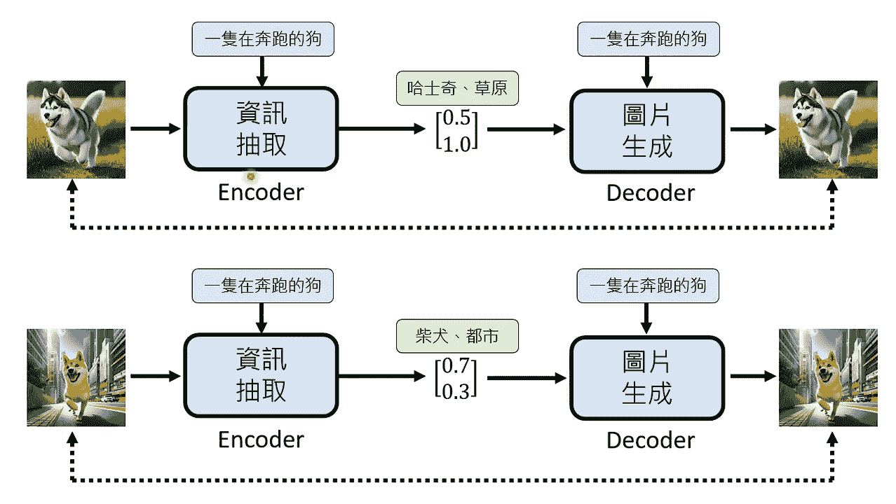

也有了这个decoder之后，但是实际上在图片生成的时候要怎么做呢，想想看，在图片生成的时候，我们只有这段文字叙述，图片生成的模型，是要根据这段文字叙述去产生一张图出来，我们根本不知道这段文字叙述。

没有描述的资讯是什么，因为我们根本还没有把图生成出来啊，这不是在训练的时候，你已经知道这张图是什么了，所以抽资讯抽取模型，可以把文字没提到的资讯抽取出来，在真的使用这个模型的时候。

你根本不知道这些文字没描述的资讯是什么啊，那这个文字没描述的资讯，这个需要脑补的资讯从哪里来呢，我们已经知道这些要脑补的资讯呢，这些文字没有描述到的资讯呢，它就是用某一些数值来表示。

所以当你在用这个图片生成模型的时候，你就会先植个骰子，把这个向量里面的每一个数值都掷骰子，掷出来啊，直到多少就是多少啊，直骰子掷出来图片生成的模型，就根据这段文字叙述，跟这个直骰子得到的脑补资讯。

因为反正现在人没有输入嘛，所以人大概也不知道到底要脑补些什么，我们就用几率呢来产生，我们就把这件事情呢交给上天来决定，然后用几率呢来产生这个要脑补的向量，把这个有脑补资讯的向量，丢给这个图片生成的模型。

图片生成的模型就根据人输入的文字，跟这个随机产生的脑补的资讯，去产生最终输出的结果。

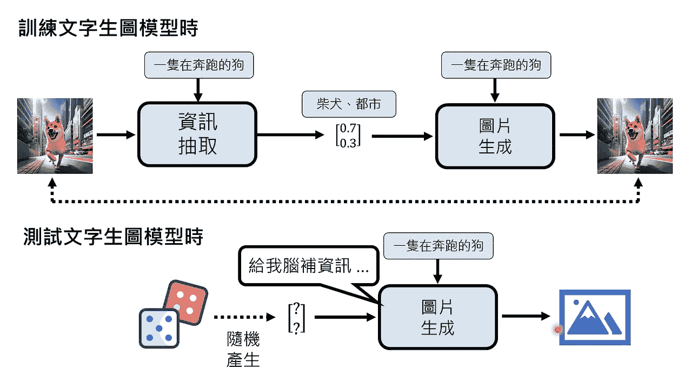

那这个模型呢其实就是VA一样啊，其实就是VAE，我不知道多少同学以前也许有听过VA1，也许你之前听到的讲法不是这样讲的，那我这边就是用一个，也许你比较更容易理解的讲法来告诉你。

为什么VAE的模型是长这个样子的好，所以大家已经知道说，VA的模型就是有个encoder去抽文字，没办法描述的资讯，有个decoder可以把脑补的资讯还原回来，那有另外一个模型叫做flow。

这个flow这个模型呢跟VA1非常的像，它唯一不一样的地方，只有VA1呢需要训练一个encoder，训练一个decoder，那flow这个模型，他想说。

这个encoder跟decoder做的事情不是正好相反吗，一个是从图片里面抽取资讯，一个是把资讯还原回图片，他们做的事情正好相反，我们有必要训练两个不同的模型吗，我们就训练一个decoder就好。

然后接下来我们强迫decoder，一定要是INVERTIBLE的，这个decoder呢一定有一个反函数，这个反函数做的事情呢正好就是decoder的相反，那这个反函数呢直接就可以拿来当做encoder。

在flow base model里面，它跟VA1不一样的地方，就是他只训练了一个decoder，但是他同时呢就有了一个encoder，那在文件上啊，通常会把这个encoder抽取出来的这个东西。

encoder抽取出来的这个东西，也就是decoder要拿来脑补的这个资讯呢，叫做noise，那这个词汇可能会让你觉得说，这个noise里面的资讯都是不重要的，没有用的资讯，但是其实不是。

这个noise里面呢往往也包含了非常重要的资讯。

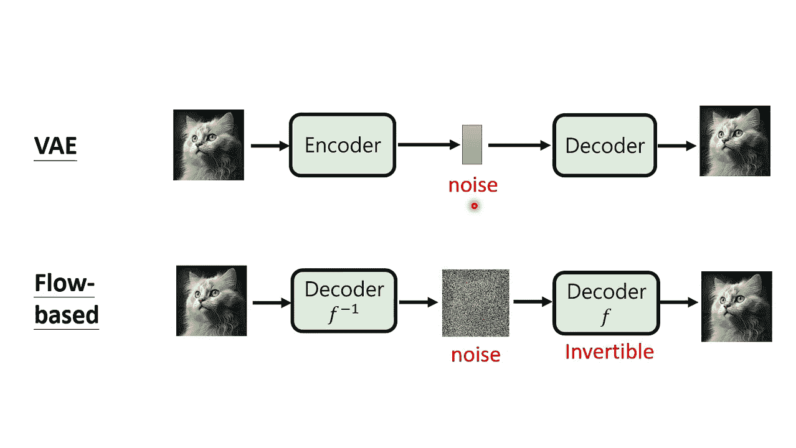

其实有一个真实的实验室，这个样这样子的啊，这个实验呢是为了告诉你说，这些noise里面可能是有包含跟图片的生成，非常相关的资讯的，举例来说，你找一大堆看起来脸很臭的人。

然后把这些脸臭的人呢丢到encoder里面，抽出一个除，抽出一个向量，那这些向量呢全部加起来就代表一个脸很臭的，臭脸的特征的向量，那你把一些看起来在笑的人呢，把他的脸呢丢到encoder里面。

encoder呢会输出一些向量，那这些向量呢平均起来就是笑脸的特征向量，那知道这些事情以后可以做什么呢。

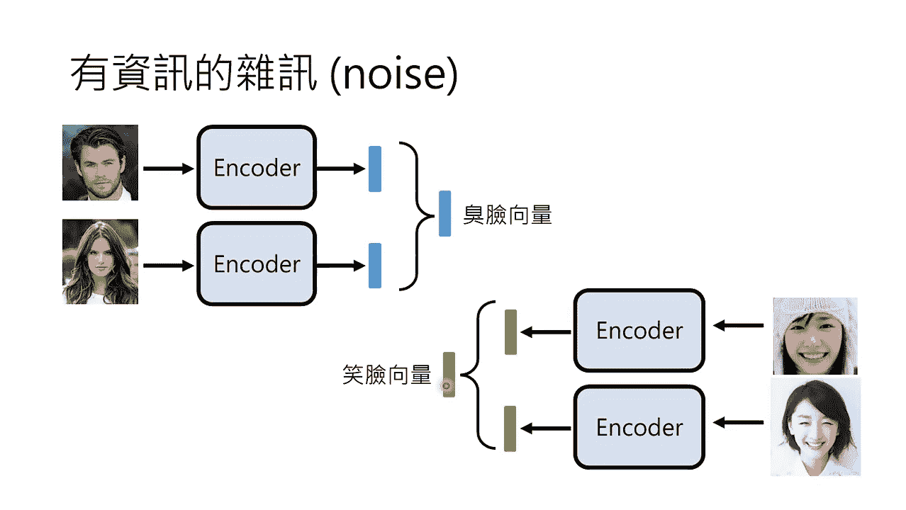

我们刚才说BA1就是有一个encoder，有一个decoder，百张图片就可encoder，它抽出一个向量，decoder可以根据这个向量还原成原来的图片，但是我们可以对这个向量呢直接做一些改造。

因为我们已经知道臭脸的向量长什么样子，如果我们今天的目标是要让这个人呢，啊这是我的脸呐，但是我看起来已经在笑了，但是我们想要让他笑得更开心一点，所以我们就可以把臭脸的向量呢减掉，把臭脸的特征减掉。

再加上笑脸的特征，所以把这个原来这个黄色的向量合出来的，图片是长这个样子，那你可以在这个黄色的项链上再做一些改造，把臭脸的特征剪掉，把笑脸的特征加上去，通过decoder以后。

这个人呢就会笑的更加的开心呃，这些向这向量或叫做noise，它其实里面也是有丰富的资讯的，你甚至可以直接调整这一些向量，就达到调整输出图片的效果好。

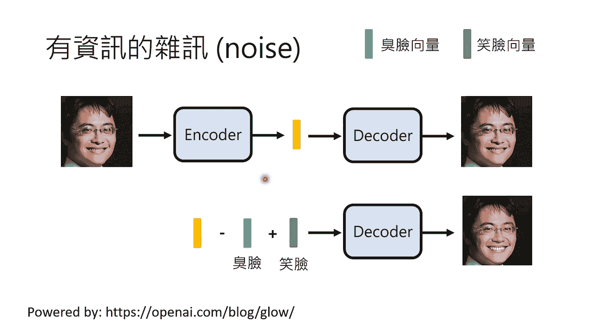

那接下来呢我们就要来介绍diffusion model，我们刚才已经介绍两个模型，BAE跟flow base model，接下来我们来介绍diffusion model，Diffusion model。

它的decoder的输入跟输出，跟刚才几个模型都是一样的，记不记得刚才几个模型都需要输入一个noise，进行脑补，输入一个noise，包含脑补的资讯，然后产生一张图片。

diffusion model里面的decoder做的事情也是一样的，只是diffusion model不一样的地方是，它会反复的使用同一个decoder，那这decoder呢每次在做事情的时候。

每次在申图的时候，他只做一件简单的事情，这件简单的事情是去除杂讯，也就是DNOISE哦，所以你一开始给他一个杂讯，然后呢，这个杂讯被输到这个decoder里面的，一个DNOISE的module。

再加上文字叙述的资讯，那这个DNOIMODULE，就会把这个图片里面的杂讯稍微去掉一点，希望它看起来呢比较像是文字的描述，比较像是学地理的一个猫，那第一次的DNOISE也许不会非常的成功。

只能够去掉一点的杂讯，但是DNOISE的这个master，会锲而不舍不断的去做DNOISE好，所以根据第一次DNOISE的结果，再丢给DNOISE和mole，再DNOISE一次，也许看起来就更像一只猫。

这个过程呢通常会反复进行下去，通常需要反复个500呀，1000次啊，最后你就可以产生一张清晰的图片，通常the future mo的痛点也就在于，这个DNOISE呢必须要用很多很多次。

最后才能够产生出好的结果，而今天diffusion model相关的研究也就集中在，如何用比较少的DNOISE的次数，就可以得到清晰的图片，那如传统的方法都是五百一千次，那很多人就会想说。

有没有办法十次就好，有没有办法五次就好，甚至一次就好，那这个是今天研究的一个趋势哦，那这个dnoise model他要学的是怎么去除杂讯，怎么教这个DNOISE的模组做去除杂讯这件事呢。

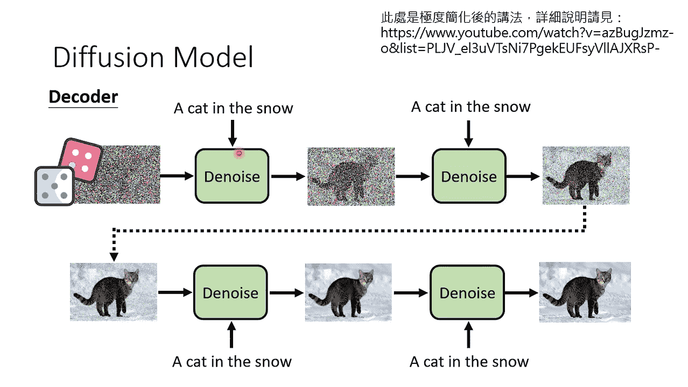

你可以自己制造训练资料，怎么自己制造训练资料呢，你想想看要做DNOISE的时候，就是要教机器怎么把杂讯去掉，所以你需要有杂讯的图跟没有杂讯的图，但是你的训练资料里面都是没有杂讯的图，跟它对应的文字。

那怎么产生有杂讯的图呢，你就自己制造就好啦，所以就自己呃弄一些杂讯来啊，你用掷骰子的方式植出一些杂讯啊，自己产生一些杂讯，把这些杂讯呢加到你的训练资料里面哦，就产生有杂讯的图片。

那通常会加杂讯加很多次哦，这是第一次加杂讯，第二次加杂讯啊，越加越多，直到最后呢完全看不出来，原来图片里面的物件是什么好，所以你就有了透过这个加杂讯的过程，你就有了加杂讯前跟加杂讯以后的图片。

然后接下来就可以训练你的DNOISE，去造的这个模型，就可以训练你的DNOISE的model，就跟这个dnoise model说，之前这一张照片加了这个杂讯就变成这个样子，现在你要学习的就是给你这张图。

跟给你这段文字，跟给你这段文字的叙述，你要还原回他家杂讯前的样子哦。

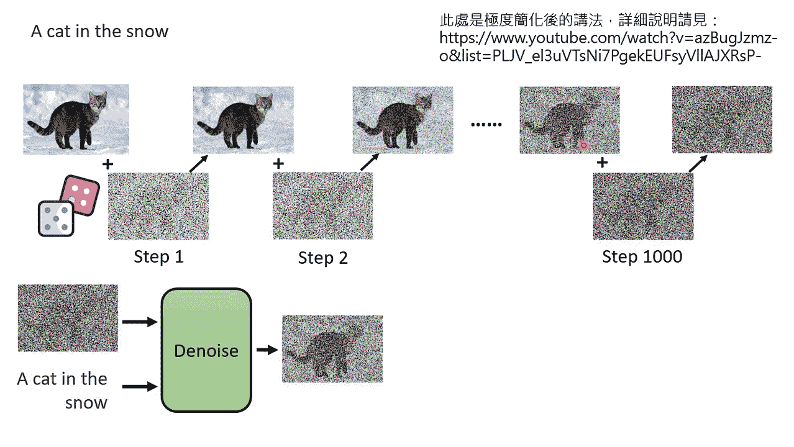

或者是这张图片加了这个杂讯以后，就变成了这个样子，那你就要学到说给你这张图片跟这段文字，你要想办法还原回他杂加杂讯之前的样子，所以就自己加杂讯，然后你就可以教DNOIMODEL。

如何去去掉你自己加入的查询，那之后你就可以用这个d noise的model，来产生图片哦，那当然这个顶noise的model里面，其实它的类神经网络的架构也是transformer。

所以实际上当我们在用这个diffusion的model，来生图的时候，你其实可以结合transformer，这也是今天非常常用的技术，然后在这个SORA的这个paper里面也提到了。

他们用的就是这样的方式，把diffusion跟transformer结合在一起啊，他们就这个diffusion和transformer结合在一起，就是diffusion transformer。

也就是说本来的transformer呢是给一些输入啊，它产生一排patch就可以还原成图片，那现在呢如果是用diffusion model的话，那每一次transformer在做的事情就是DNOISE。

就是去掉一些杂讯，所以一开始输入的patch是都是杂讯的patch，然后第一个transformer去掉一些杂讯，第二个transformer那其实都是同样的参数啊，啊第一个transformer有。

第一次用transformer去掉一些杂讯，然后第二次再用transformer再去掉更多杂讯，第三次再用transformer再去掉更多杂讯，把这个transformer呢用个五百一千次。

最后呢就产生干净的patch，也可以把这个干净的patch丢到decoder里面，还原出图片啊，这个就是SA里面有用到的diffusion transformer。

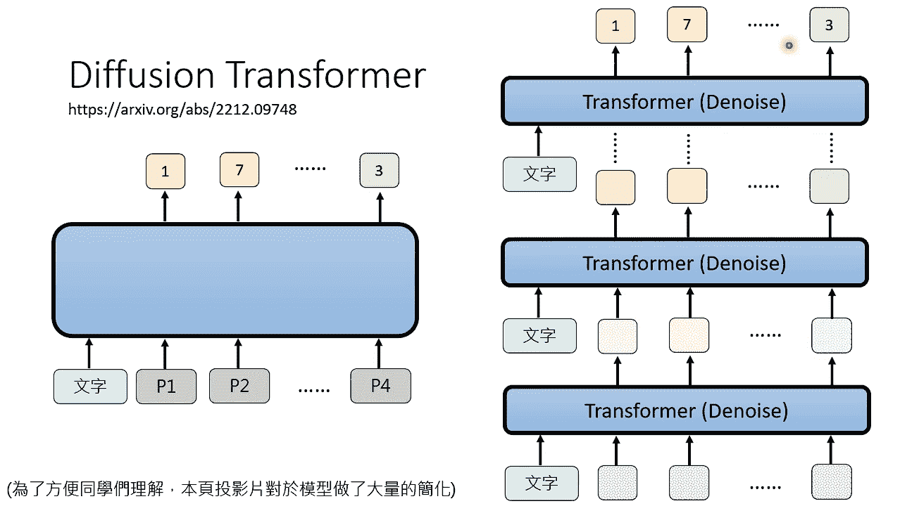

虽然这个例子里面举的是图片，但是要把它extend，把它一般化到生影片也其实都是一样的事情。

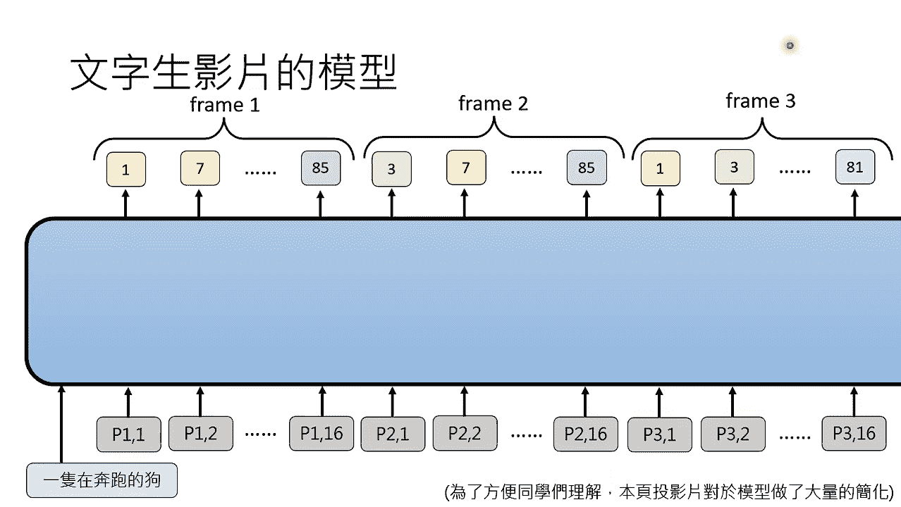

在影片的模型里面，你就是有一堆的transformer，这在这个影片生成的过程中，你就是会不断的做DNOISE，那这个DNOISE是由一个transformer的模型，完成的。

它的输入就是有杂讯的patch，输出就是比较干净的patch，这个transformer会做好几百次，好几千次的去照之后，期待最后产生一堆干净的patch，那这些干净的patch就可以被还原回影像啊。

这个就是今天用diffusion model，加上transformer声一片的模型，那根据SA的blog，他们很有可能也就是用类似的技术来产生。

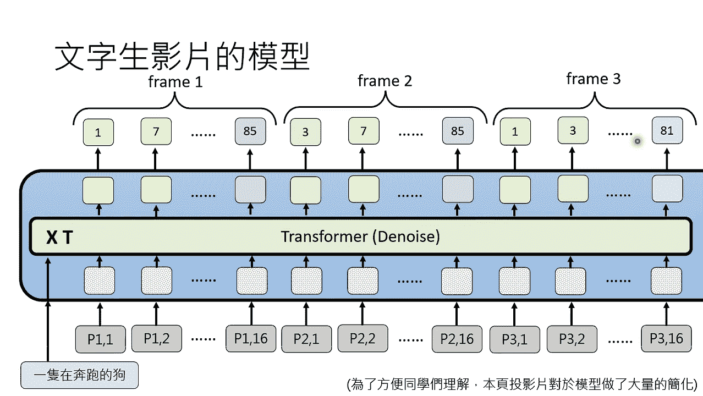

一片的好，那我们现在讲了diffusion的model，那diffusion的model跟刚才的VAE还有flow base model，要怎么来类比呢，刚才的VA1跟flow base model。

都有一个encoder跟一个encoder，对于diffusion model来说，它也有一个decoder和decoder里面做的事情，是多次的DNO，那至于encoder呢。

怎么把一个图片变成一个杂讯呢，对diffusion model来说，他就没有特别训练一个模型做这件事情，因为杂讯是你自己加进去的，你自己把这个图片加了大量杂讯以后，让他看不出来原本不见的样子。

那这个加杂讯的过程呃，对应到其他的模型，就是encoder在做的事情，那在diffusion model的文献里面通常叫做forward process。

那decoder做的事情是reverse的process好，所以今天我们就跟大家很快的讲过，v a e flow base model跟diffusion的model。

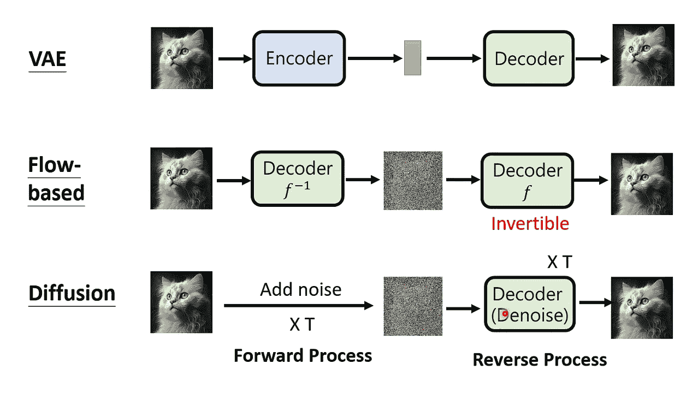

那另外一个也很知名的模型叫做generative，Adversal network，它的缩写是game，我们这边就没有特别把gain呢拿出来，跟其他的模型一起讲，为什么。

因为gain跟其他模型其实有本质上的差异，它比较像是一个额外的外挂，好我们来看看为什么我会这样说，那我们刚才有讲到说，图片生成的困难或影片生成的困难，就是同一段文字可以对应很多度不同的图片。

所以在图片生成的过程中，模型呢会深得晕头转向，它会无所适从，所以怎么办呢，也许我们不应该用这些真正的图片来教，图片生成的模型，也许应该先训练出另外一个模型，先训练另外一个AI。

他先自己咀嚼奔跑的狗应该长什么样子，他先理解好奔跑的狗应该长什么样子，再来教我们的图片生成模型，怎么训练另外一个AI。

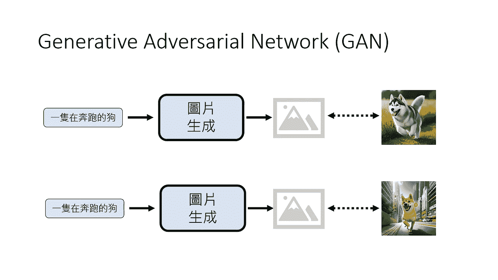

一只奔跑的狗长什么样子呢，这边用的概念跟刚才的clip，基本上是一模一样的，记不记得我们在讲这个怎么衡量文字，生图模型好坏的时候，我们讲了一个click的模型，它会是一张图片，读一段文字。

看看这个图片跟这个文字是不是匹配的，那在game里面也会训练一个，其实就跟clip根本就是一模一样的模型，它只是换了一个名字叫做discriminator。

这个discriminator他做的事情就是给一张图片，给一段文字，还要给个评价，看这个图片跟这个文字有多匹配好，但是如果今天训练discriminator的时候，都只有好的例子。

都只有跟这个影像匹配的文字的话，那discriminator从来没有看过坏的例子，他会他训练的，如果你在训练的时候都只给他好的例子，到时候测试的时候，就算看到坏的例子，他也都会输出，这是好的。

因为只有教他说好，你只有教他输出高分，你只有教他竖起大拇指，你没有教他做其他的事情，所以你同时在训练的时候，也得给他一些坏的例子，那像在clip里面那个坏的例子，就是把图片跟文字呢随便打乱，随机配对。

制造一些坏的例子，那在game里面呢用的是另外一个方法，假设你现在已经有一个图片生成的模型，那就先不要问这个图片生成模型是哪里来的，就假设你有一个它只是有点差而已，你先拿这个图片生成的模型呢。

先生一些图片，你要画一只要奔跑的狗啊，画一个抽象的狗，诶，你知道他画一个阳光下的猫，它画一个背景是黄的，很抽象的猫，但是只有三只脚，还是个三脚猫，然后呢你就跟discriminator说。

看到这个抽象的狗，你要说是不好的，看到这个三脚猫呢，你也要说是不好的，所以给discriminator1些正面的例子，一些反面的例子，他就可以学会评价一张图片。

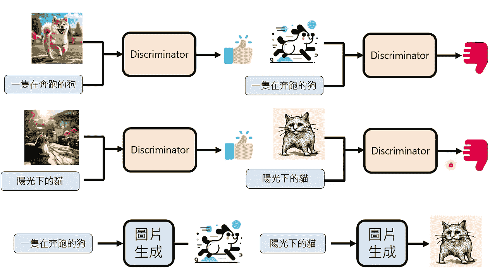

给段文字的叙述是不是匹配的好，那有了这个discriminator以后，接下来啊generator就不去跟正确的真正的图片学，他跟谁学呢，他跟discriminator来学习哦。

所以对generator来说，他要做的事情是他一开始生成一张图片，把它生成出来的图片跟文字叙述，丢给discriminator，那discriminator觉得这个抽象的狗画太差了，给了一个副品。

那generator学习的对象，它调整参数的方向，就是希望去骗过discriminator，Generator，他要做的事情其实就是产生一张图片，这张图片给discriminator啊。

discriminator呢会觉得他做的非常的棒啊，discriminator觉得他做得好，然后generator呢就成功了，那这跟孤跟某一个光TRU，跟某一个正确的图片学习不一样的地方。

就是跟那个正确的图片的，跟正确图片学习的时候，可能同样的文字会对应到不同的答案，但是现在是用的discriminator来评价好坏，所以没有单一的正确解答，只要今天generator可以产生一张图片。

discriminator是觉得好的就成功了，没有什么样的答案是正确的，没有什么样的答案才是标准答案，只要另外一个人工智慧觉得好，基本上就是成功了好，那实际上在做的时候。

那个generator跟discriminator呢会交替训练哦，就你先你先有一个generator，用这个generator你可以去训练discriminator。

然后有了discriminator之后呢，你就回过头来训练generator，让它产生出discriminator觉得好的图片，而discriminator的也会更新它的参数，让自己变得更厉害一点。

那两个人呢选择ATOR跟discriminator，这个图片生成的模型，在gain的那个框架下，往往又叫做generator，这个generator和discriminator呢就会交替的训练。

那讲到这边，有人可能会问说对于一个game这样的generator来说，那还需不需要输入一个杂讯呢，因为我们说输入杂讯的目的，就是为了要让模型可以学会，根据这个杂讯的资讯来毛脑补它。

才能够产知道说要产生什么样的东西，如果今天在有discriminator的情况下，其实是可以不用这个杂讯的，虽然你看在文献上，多数game的模型都还是有给这个杂讯，但我这边实际的经验就是。

如果是图文字生图的话，在有discriminator的情况下，没加这个杂讯，也能够把generator训练的起来，也，那其实我们也可以把game的训练，跟ILHF对比一下，大家还记得IHF吗。

我们在讲大型语言模型训练的最后一段的时候，第三段的时候说大型语言模型训练，第三段就是IOH，那你还记得说在讲ROHF的时候，我们说会训练一个reward model。

language model其实是跟这个reward model学习的吗，那如果对应到game的框架的话，其实这个discriminator就是reward model。

他们唯一不一样的地方只是reward model，在学习的时候，有人的标注人告诉他说这个答案有多好，另外一个答案有多差，而这边discriminator他在学习的时候，其实不需要人的介入。

他就用一个假设，这个假设是只要是AI所生成的图，基本上就都是差的，原来训练资料里面的图就都是好的，所以这个discriminator，其实就是IOHF里面的reward model。

只是他们学习的资料有一点点不同而已，有常常有人会问说哎呀，这个game呢跟diffusion model到底谁比较强呢，其实我觉得这并不是一个好的问题，为什么，因为就好像LHF就是一个方法。

它可以强化语言模型的能力。

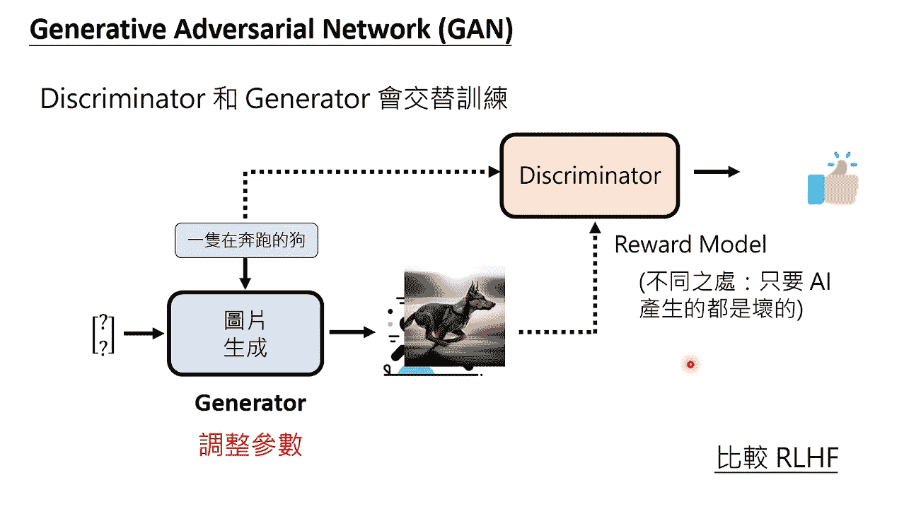

其实gay也是一样，gay是一个外挂，这个外挂你可以挂在VA一上，你也可以挂在flow上，你也可以挂在diffusion model上。

所以刚才所介绍的v a e for或者diffusion model，你其实都可以在他们后面再挂一个discriminator，然后来强化这些decoder，在generator。

在game的框架里面叫做generator，他们的能力好，所以game呢其实是可以跟其他方法结合的，一个外挂呃。

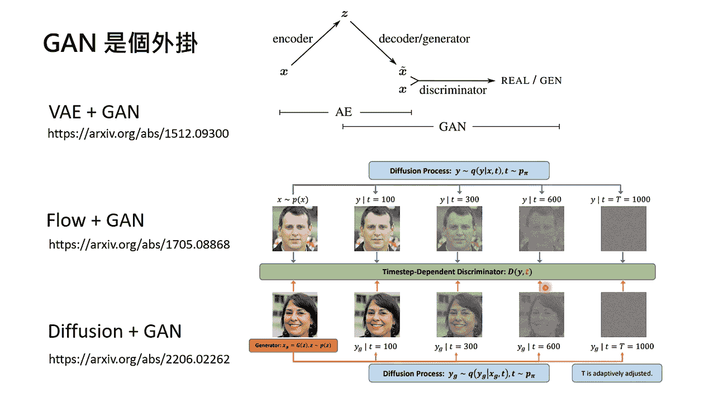

如果你想要知道更多有关经典的这个，影像生成的模型的话，那这些都是我在我的YOUTUBE频道上有对应的影片的，那其实从这些影片，他们是在哪一门课里面被录的，你也可以知道这些模型它的历史的变化啊。

最早的时候有VAE啊，这个是2016年的时候机器学习讲的，然后呢，在2018年的机器学习及生成与结构化，这门课里面，花了13的学习的时间讲game game，可以讲的东西太多了。

所以有一个game的系列啊，2019年的机器学习讲了flow base的model，2023年的机器学习讲了diffusion model啊，这个diffusion model背后有非常多的数学的原理。

那其实要讲的话呢，这个两三周都是讲不完的，那你可以慢慢的消化这些点，如果你觉得刚才讲的东西没有很清楚的话，这更详细的资讯，它背后的数学原理都是在我的YOUTUBE频道上有的好。

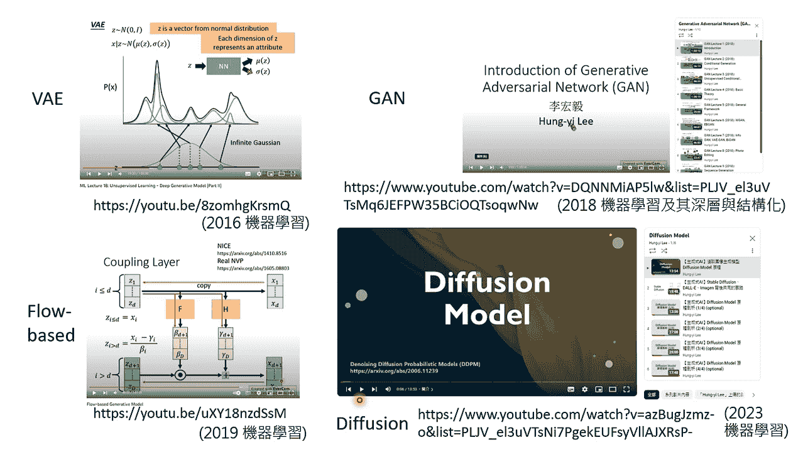

那最后一段呢想跟大家分享的是，现在人工智慧可以生成印象，但是有没有机会让人类跟这些深层的影像，有更及时的互动呢，举例来说呃，每次在讲SORA的时候，大家都会播放这一个女士在东京街头走的影片。

那有没有可能，我们直接用上下左右，来操纵这个女士走的哪一条路呢，那你就可以等于是操控一个AFF塔，在东京街头漫游，你就等于是打造出了一个开放世界的3D游戏，有没有可能做到这件事情呢，还真不是不可能的。

有一篇paper叫做ji generated interactive environment，就是想做类似的事情，我这边先打个预防针，他做的不是3D游戏，他做的都是2D横向卷轴的游戏而已。

那这个拘泥做的事情是这样子的，它的模型可以读一个画面作为输入，不只是读一个画面作为输入，它还可以读一个你输入的动作，所以你可以想象说，你有一个摇杆接到虚拟的这个模型，你可以按上下左右。

它可以把你的动作读进去，而你的动作会影响这个模型的输出，同样的输入画面，你按的按钮不同的时候，你的输出就会是不一样的，然后这个游戏就可以一直下去啊。

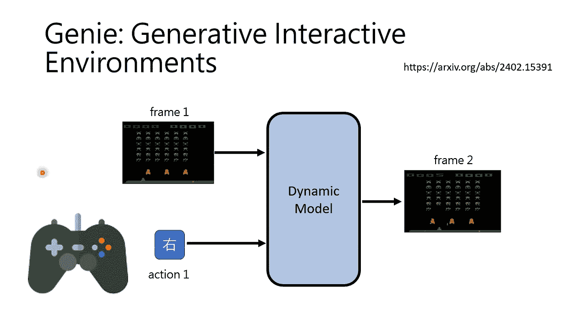

你按了右以后看到第二个画面，第二个画面会变成dynamic model的输入。

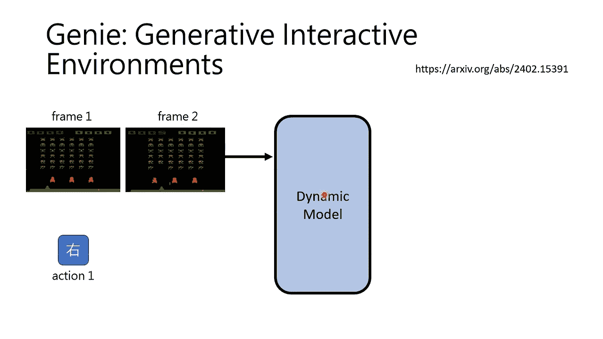

你再按一个A，然后又会产生新的画面，你就可以用这个影像生成的技术来玩一个游戏，你等于是及时的控制了影像生成的结果，那JI呢他想要做的是横向2D卷轴游戏啊。

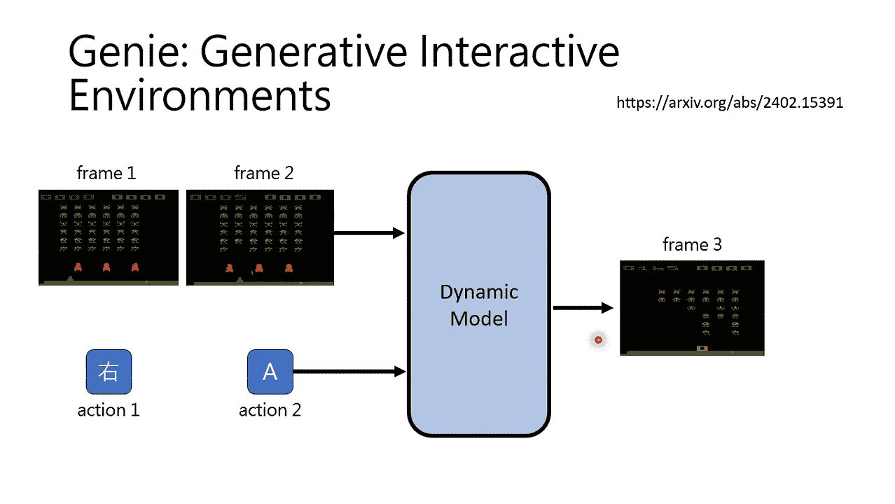

想要做的事情，就是去收集了大量的横向卷轴游戏，但是这边呐你你可以想想看，我们要怎么训练像JI这样子的模型呢，我们需要的是游戏的画面加玩游戏的时候，人的输入，当然不是每一个画面人都会有输入。

我们可以把没有按任何按钮，也当做是一种特别的输入，如果我们可以搜集到人玩游戏的画面，加玩游戏的时候按的哪一个钮，你要训练刚才前一个投影片讲的模型，就易如反掌，你只需要教你的AI说看到这个图片加这个动作。

你就产生这个图啊，生图要怎么做，大家已经都会了吧，啊，看到这两个图加这两个动作，你要生成这个图，以此类推，所以只要有游戏画面加人按按钮的这些动作，你就可以训练一个像JI一样的模型。

但是真天军你训练的过程中，真正的难点就是，他只能从网络上搜集大量的游戏影片，但是他没有使用者输入的动作，他这种游戏画面他不知道产生这些画面的时候，人到底按了什么样的按钮，所以怎么办呢。

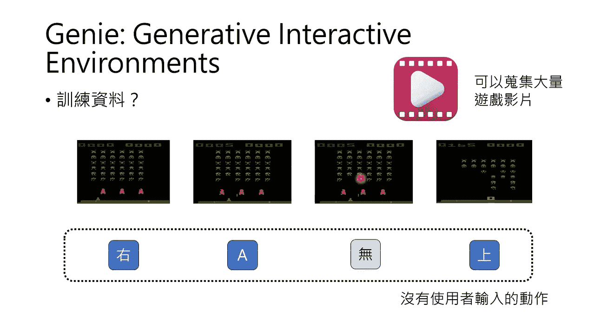

局你用了一个神奇的方法去想办法反推人类，到底输入的按的按钮是哪一个，他用的做法跟我们刚才讲BAE的时候，提到的那个auto encoder概念基本上是一模一样的，记不记得我们刚才才讲到。

说有一个资讯抽取的模型，可以抽出文字没办法描述的资讯，然后图片生成的模型，可以根据这些资讯还原回原来的图片，今天对于JI来说，当给一个之前的游戏画面，要预测下一个画面的时候，他其实也是有缺少资讯的。

他缺少了什么，他缺少了使用者的动作，在不知道使用者动作的情况下，根据之前的游戏画面，是没有办法去预测未来的画面的，你不知道使用者要按左还是按右，你就会不知道使用者所操控那个人物，会往左边跑还是往右边跑。

所以今天图片生成的模型，需要知道使用者的动作，但问题就是我们并不知道使用者的动作啊。

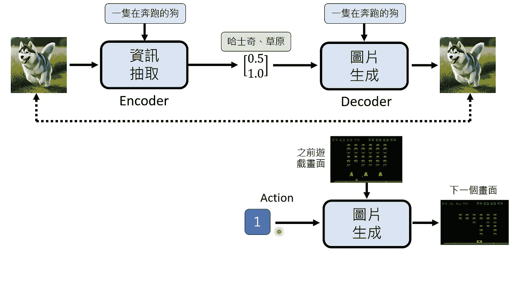

那怎么办，训练一个动作抽取的模型，这个动作抽取的模型就是读之前的游戏画面，在读下一个画面，看看这两个画面间有什么样的差异，然后试图归纳出人所会采取的动作，人到底按了哪一个按钮。

造成之前的游戏画面会变成这个样子，但是我们没有这样子动作的标注啊，怎么办，在训练的时候，就用auto encoder的概念给动作抽取的模型，之前的游戏画面跟下一个画面，他猜现在应该要做哪一个动作。

要按哪一个钮，再把这个按钮的资讯加之前的游戏画面，输入给图片生成的模型，让它输出生成下一个画面的样子，然后我们要让输入跟输出越接近越好，那如果今天动作抽取的模型，可以正确的猜出是哪一个动作的话。

那图片生成的模型可能就可以正确的生图，所以最后如果图片生成的模型可以正确的生图，可能代表周动作抽取的模型，正确的猜出现在人实际上按的是哪一个按钮，不过因为这些动作他不是真正的动作。

他是动作抽取模型猜出来的动作，所以这些动作呢前面加上latent这个字，代表它是被猜出来的，它不是呃真正光明正大的收集到的资料，他是latent的，它是这个动作抽取模型猜测出来的动作好。

那这边在这JI那篇文献里面呢，他就假设说啊人可以按的钮就是八个，把它编号一到，把，那你说这个编号1~8的按钮，到底哪一个对应到上，哪一个对应到下，哪个对应到A哪个对应到B不知道也不重要，你就记得说。

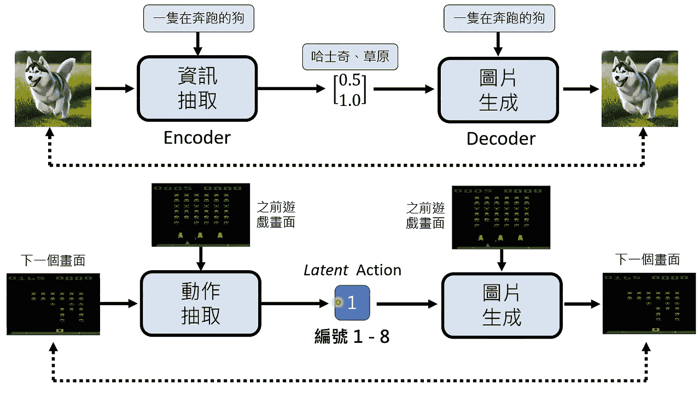

反正有八个按钮可以操控图片的生成，就对了，他们发现说呢确实你如果输入同样的按钮。

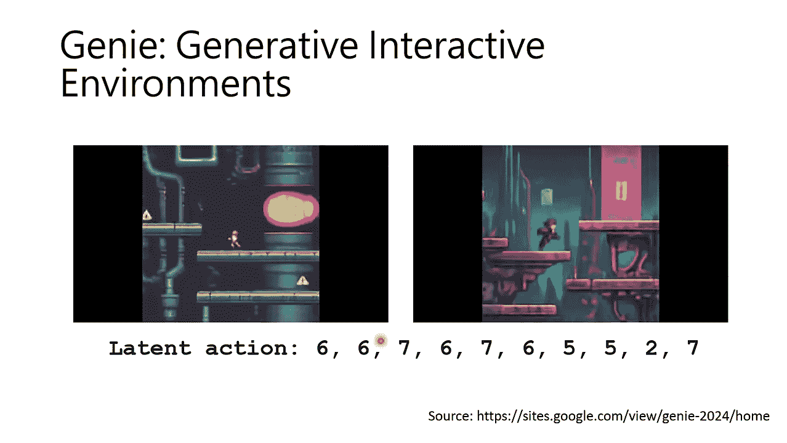

不同的画面里面的变化会是一致的。

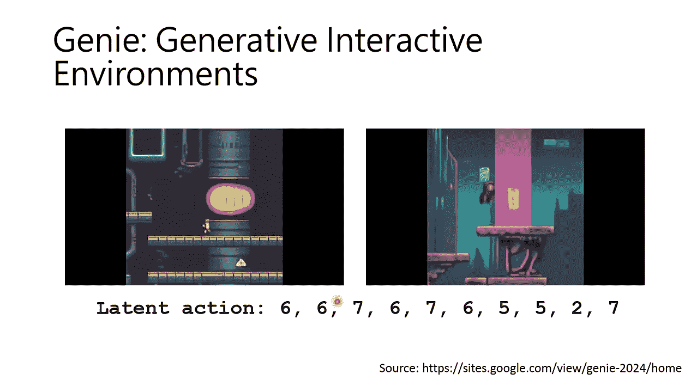

比如说他们发现说如果你输入一串的指令。

这个是6676765527，就按这一串按钮。

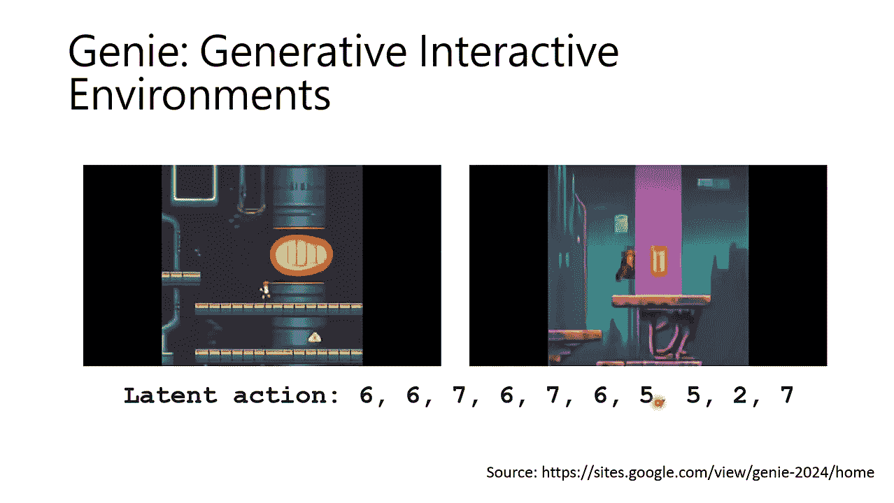

不管是哪一个画面，它都会让人物往右移动，然后整个画面呢会往左下角懂。

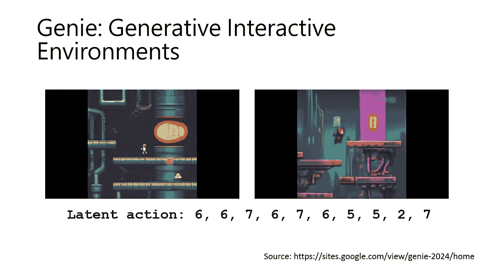

你知道，这个显然就是，可能使用者按了一个右跳的动作啊。

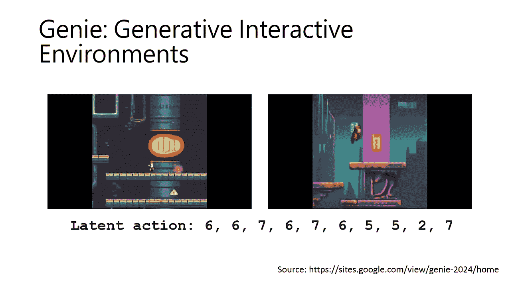

所以大概可以猜一下，透过latent action猜一下使用者，实际上呢所按的按钮是哪一个哦。

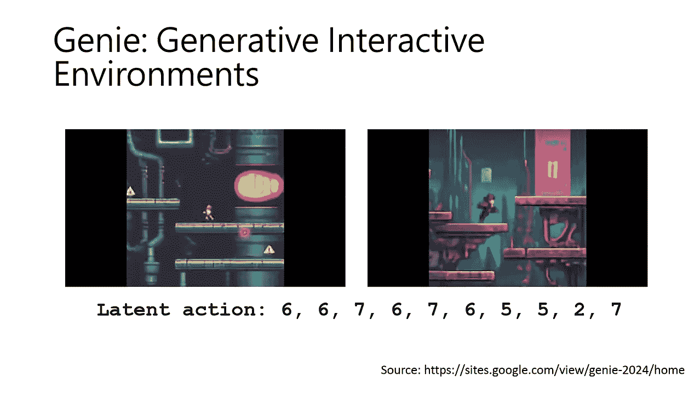

那有了这个东西以后，有了JI以后可以做什么事情呢。

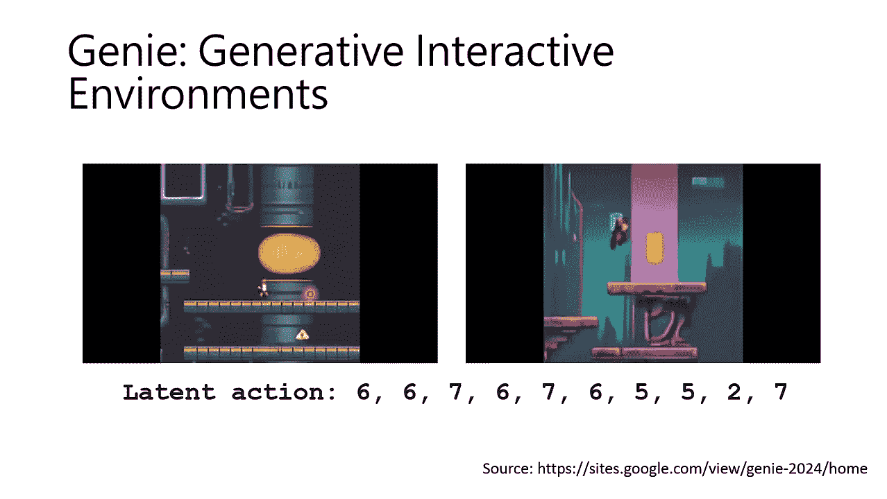

你就可以随便创造游戏，你就给他一张图，就这个随便小孩子的一个涂鸦，然后你就可以把它当做一个游戏的画面，就可以开始玩了，你就可以按一个右上跳的按钮，它就可以往右上跳。

然后甚至连真实场景的照片也可以给一个照片。

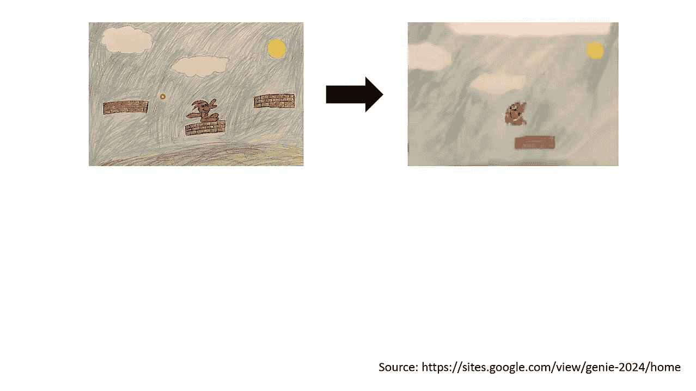

这是一个雷神索尔随便拍了一张照片，然后接下来呢你就把它输入给JI来，再按一个往右上跳的动作。

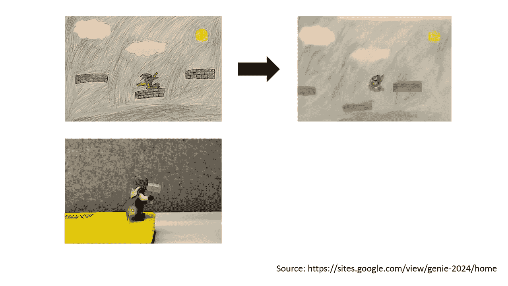

它就跳起来了哦，所以你现在，所以未来，我们就可以更及时的跟影像生成的模型互动，那你可能会问说这样子的模型能干什么，不就只是可以比较快的创造游戏吗，但是你可以想象未来就会有很多其他的应用，比如说呃开车啊。

现在开车的时候你需要去驾训班啊，上完驾训班以后，你要去路考，那路考其实假设你驾训班没有学的很好，但是路考很危险的，那未来你就不需要去驾训班了，你就在自己的电脑前面，你就可以学开车。

那就可以看到荧幕的画面，那就有个假的方向盘，你转方向盘，屏幕的画面就变了，那你可会想说，这个不就跟一般的赛车游戏一样吗，但是一般的赛车游戏它的场景是有限的，场景是城市自动规划好了。

但是有这样子影像生成模型，你又可以跟他互动，那也许未来你就可以在一个开放世界里开车，你就可以一直往前开，然后画面都会一直出现，永远都不会停的。

