# 李宏毅2024春《生成式人工智能导论》 - P37：（延申）Variational Auto-encoder (VAE) - 啥都会一点的研究生 - BV1BJ4m1e7g8

屏幕很黄，我也不知道为什么，就是好好没关系，那呃。

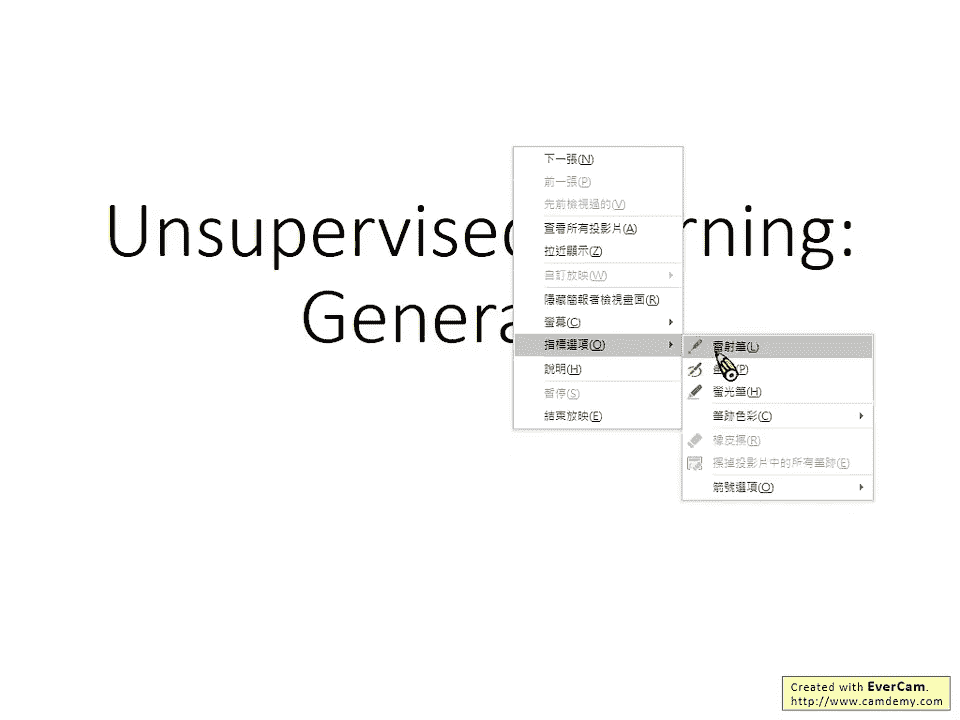

好，那我们上次呢讲了这个呃。

叫做generation这一件事情。

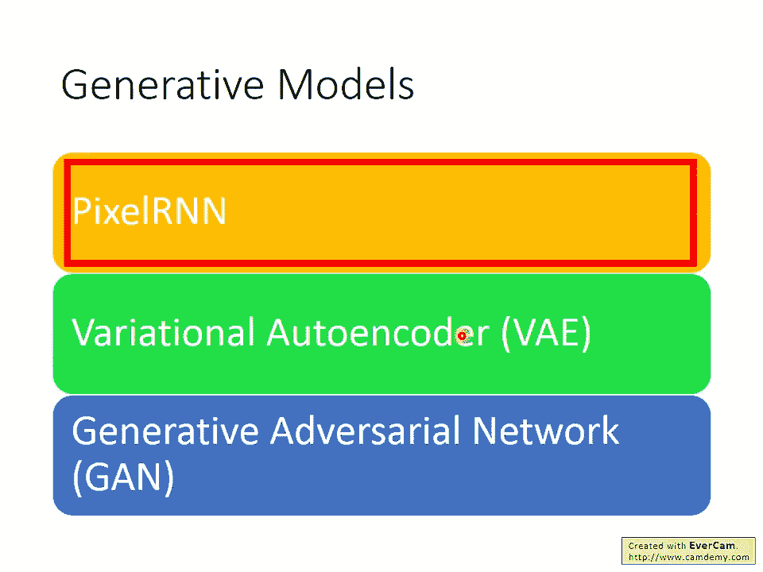

然后呢呃可以用pixel RNN来做，然后这边呢create了一个这个generative的task。

然后呢上次还讲了VA1好，但没有讲太多它的原理，那我们来复习一下VA1做的事情，那vauto encoder我想大家都很熟悉了，那VA1做的事情是什么呢，VA1做的事情呢是说呃。

你有你一样有一个encoder，一样有一个decoder，那你现在呢decoder呢会open两组vector好，这边是一组是M1到M3，另外一组是sigma one的到sigma3。

那接下来呢你会generate一个NO more distribution，那这个normal distr，这你会generate一个vector啊，这个vector呢是从一个normal。

normal distribution的sample出来的，那接下来呢你把sigma这个vector呢去financial，然后呢再乘上呢random sample出来的这个vector。

再加上原来N这个vector得到你的code的C啊，把那code呢丢进decoder里面产生image，那希望说input跟open的越接近越好，另外auto encoder还有另外一项CTRL。

那无限的时候发现我上次的投影片呢，写的是相反的啊，所以差了一个负号啊，所以如果按照原来的写法，这边应该是maximize，那我如果还是用minimize的话，下面就应该加一个符号好。

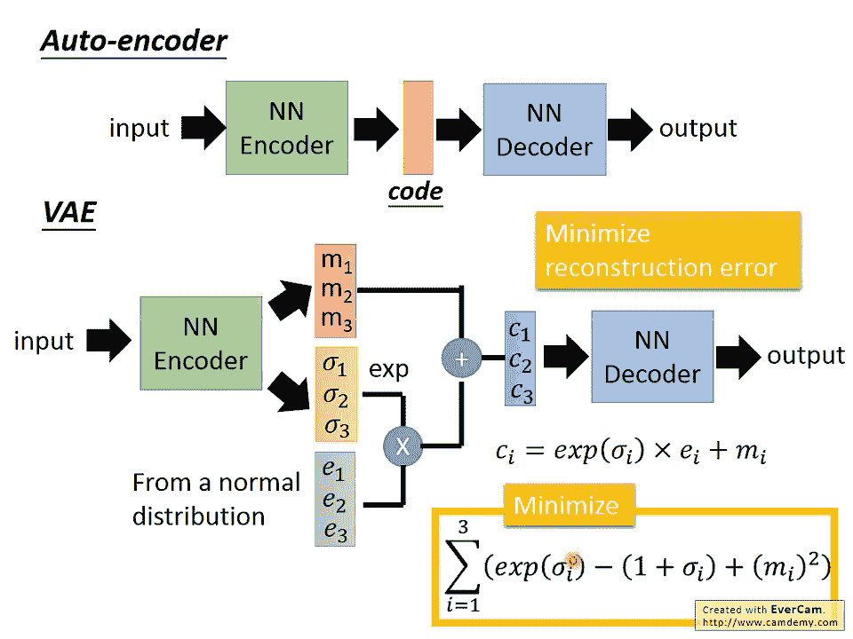

那再来的问题就是为什么要用VA1这个方法，原来的oppo encoder会有什么样的问题呢。

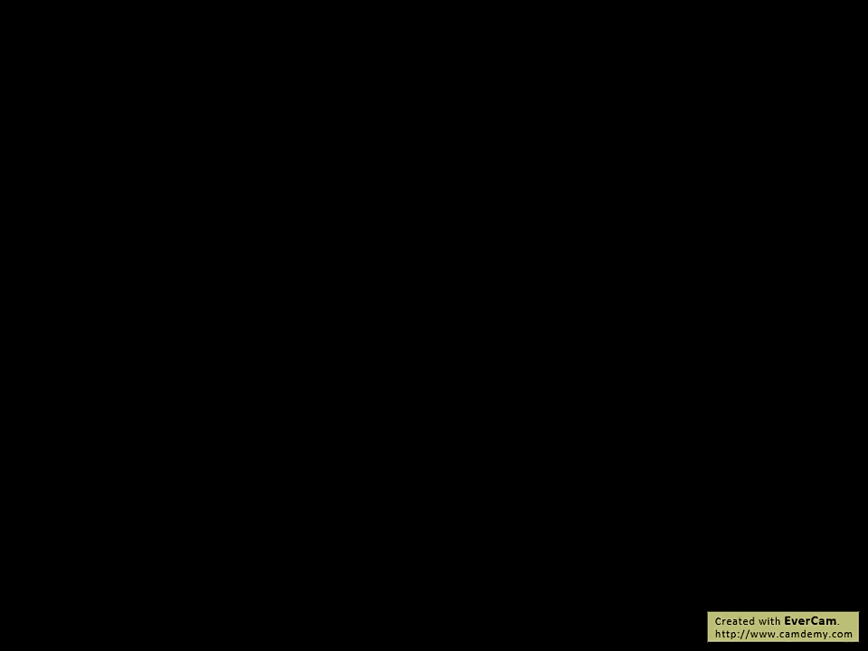

那如果你看文献上的话呢，VA1因为看他原来的paper的话，他有很多很多的式子啊，你是会看的一头雾水的，那在讲那些式子之前呢，我们先来看这个呃intuitive的理由，为什么要用VAE。

如果是原来的auto encoder的话，那原来的auto encoder呢他做的事情是哦，我们把每一张image变成一个co啊，假设我们现在的cod呢就是一维啊，就是这个图上的这一条红色的线哦。

那你把满月的这个图呢变成code上的一个value，然后呢再从这个value做decode，那就把它变回原来的图，那如果是弦乐的图呢，也是一样，变成cold上的一个value。

然后接下来呢你再把从code上那个value，可以把它变回原来的图，那假设我们今天是在满月和弦月的扣的中间，simple一个点，你觉得他原来然后再把这个点做decode，变回一个image。

它会变成什么样子呢，你心里或许期待着说它会变成满月，看看这个呃弦乐中间的样子哈，诶一但是这只是你的想象而已，其实因为我们今天用的encoder和decoder。

我们今天用的这个这个encoder decoder，它都是NVENIA的啊，它都是一个neon network，所以你其实很难预测说在这个满月和弦月中间，到底会发生什么事情。

你可能想象是满月和弦月中间的月相，但未必他可能就是根本就是另外一个东西，那如果用VA1有什么好处呢，如果用VA1的好处是呃，实际上VA1在做的事情，就等于我下面说的这件事情。

当你把这个满月的图呢变成一个code的时候，它会在这个code上面呢再加上nose，那他会希望再加上noise以后，这个code recontr以后还是一张满月，也就是说原来的auto encoder。

只有这个点需要被RECONTRACT为满月的图，但是对VA1来说呢，你会加上noise在这个范围之内的图呢，RECONTRL回来以后呢，都应该仍然要是满月的，这个弦乐的图呢也是一样哦。

弦乐的code呢再加一个noise recontract，回来以后，这个range的code都要变成弦乐组，那你会发现说呢在这个位置，在这个地方，这个扣的的这个点呢，它同时希望被RECTRL回弦月的图。

同时也希望被RECTRL回满月的图，那可是你只能够RECTRL回一张图而已啊，怎么办，那v a e training的时候，你要minimize这个呃mean square error哦。

所以最后产生这个这个位置呢，所产生的图会是一张介于满月和弦月中间的图，而你要同时让它最像满月，也最像弦月，那产生的图会是什么样子呢，也许或许就是介于满月和弦月之间的月相哦，所以如果你用VA1的话。

你从你的这个code的space上面去sample一个code，在产生image的时候，你可能会得到比较好的image，如果是原来的open encoder的话。

你random sample appoint，你得到的东西可能看起来都像。

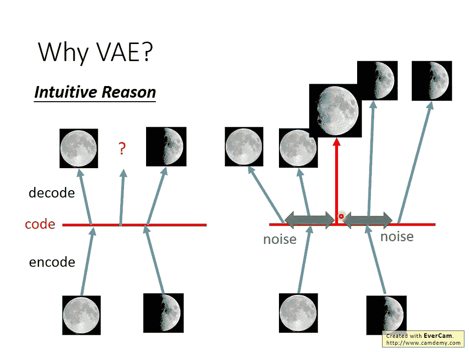

都不像是呃一个真实的image好，所以VA1就是这样，这个N呐，这个encoder的output n呐代表是原来的co，那这个C呢代表是加上noise以后的code。

那decoder呢要根据加上noisy以后的code，把它reconstruct回原来的image，那这个西格玛跟一是什么意思呢，这个sigma呢它就代表了现在这个noise的variance。

它代表了你的noise呢应该要有多大啊，不会因为variance呢是正的哦，所以这边呢会取一个exponential，因为neural network output。

假设你没有用那个activation function去控制它的话呢，它的output可正可负嘛，假设你这边是linear的output的话，它output可正可负啊，那所以取可for ancial。

确保它一定是正的，可以被当做variance来看待好，那现在当你把这个sigma乘上这个一啊，这个一是从一个从一个normal distribution里面，sample出来的值。

当你把这个西格玛乘上一再加到N的时候，就等于是你把这个an呢加上了noise，就等于是你把原来的code呢加上nose，那这个一呢是从个normal distribution samples出来的哦。

所以它variance是固定的，但是乘上了这个不同的sigma以后呢，它的VARI的大小呢就有所改变，所以这个variance呢决定了这个noise的大小，而这个variance的大小呢。

这个variance呢是从encoder产生的，也就是说machine在training的时候，它会自动去认说这个BARRI应该要有多大，但是如果就只是这样子的话是不够的哦。

假如你现在的training，你就只考虑说哦，我现在input down image，然后我中间有这个加noise的机制，难道is the variance自己认的。

然后decoder recontract原来的image，那你要minimize这个reconstruction error，如果你只有做这件事情的话是不够的，你劝出来结果呢是会并不会如同你预期的样子。

为什么呢，因为这个variant现在是自己学的啊，假设你让马逊自己决定说variance是多少，那他一定会决定说这VARI是零就好了，对不对，假如说就让大家决定自己分数是多少，那每个人都会是100分了。

所以这边这个variance，如果你只要么去自己决定的话，他就会觉得说哦variance是零就好了，那你就等于是原来的auto encoder，因为variant是零的话。

就不会有这个不同的image overlap的情形，这样你reconstruction的error是最小的，所以你要在这个variant上面呢去做一些限制，你要强迫他的variance呢不可以太小。

怎么做呢，所以我们另外再加的这一项，其实就是对variance呢做了一下限制，呃，怎么说呢，这一项是这样，你看这边由exponential sigma i减掉一加sigma i。

那exponential sigma i呢画在图上的话呢，它是蓝色的这一条线，这个一加西格玛I呢画在图上的话呢，它是红色的这一条线，当你把蓝色这条线剪红色这条线的时候，你得到的是绿色的这一条线。

绿色的这条线的最低点呢，是落在西格玛等于零的地方啊，注意一下西格玛之后会再乘以SANCIAL，所以西格玛等于零，意味着说他的variance是一哦，exponentially是一哦。

所以sigma等于零的时候，loss最低，意味着说你的variance等于一的时候loss最低哦，所以machine就不会说哦，让variance等于零。

然后minimize reconstruction error，他还要考虑说variance呢是不能够太小的，那最后这一项NI平方对这个code做这个呃。

要minimize code的这个l to n怎么解释呢，其实很容易解释，你就想成是我们现在加了l two的REGZATION，我们本来常常在乘auto encoder的时候。

你就会在你的code上面呢加一些regulation，让他结果呢比较sparse，比较不会OVERFTING，比较不会认出这个太过trivial的solution好，那这个是呃直观的理由。

那如果比较正式的解释的话，要怎么解释它呢，你可以这样，那以下呢就是paper上比较常见的说法，假设我们回归到我们到底要做的事情是什么，假设你现在要叫我们去做的事情是generate，这个宝可梦的图的话。

那每一张宝可梦的图，而一张image假如他是2020的image，也就是400维的点，我们这边呢写作X啊，虽然在图上我们只用一维呢来描述它，但这个其实是一个高维的空间。

那么现在要做的事情其实就是estimate，P o f x，我们要做的事情就是estimate这个POF，只要我们能够estimate出这个p of x的样子啊，注意X其实是一个这个一个vector。

好，假设我们可以estimate出POX的样子，我们就可以根据这个POFX去sample出一张图，那找出来的图那就会像是宝可梦的样子，因为你取这个POFX的时候呢。

你会从几率高的地方呢比较容易被sample出来哦，所以这个PFS，理论上应该是在有宝可梦的图的地方，这有宝可梦的图，就就如果你今天这个图呢，长得像一只宝可梦的话，它的几率是大的啊，它的几率是大的啊。

这个是喷火龙加速，它的几率是大的，这水箭龟加速它的几率是大的，而如果是一些怪怪的图的话，比如这个看起来像是皮卡丘，又有点不像，这个看起来像是一个绵羊，又像是一个雨，这边呢几率是低的哦，这边几率是低的。

呃，如果我们今天能够estimate出这个probability distribution，那就结束了，那怎么estimate一个probability的distribution呢。

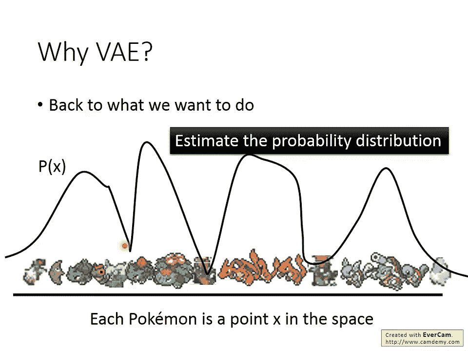

呃我们可以用高选mixture model，我不知道在座多少人呢，知道高选mixture model，我就我只好奇问下，知道高选miture model，同学举手一下，好好手放下好，谢谢好。

很多人都知道高shamixture model好，那太好了哦，比如说如果你学过语音课的话，你可能就会听过高选miture model，那高shamixture model来做什么呢。

因为我们现在有一个distribution啊，长这个样子，黑色的啊很复杂很复杂，那我们说这个很复杂的黑色distribution，它其实是很多个高选，我们这边这个蓝色的呢代表高选啊。

有很多个高选呢用不同的weight结合起来的结果，只要你今天高悬的数目就够多，那就可以产生复杂的distribution哎，所以虽然黑色的很复杂，但它背后可能其实是有很多高选，结合起来的结果。

那这个式子怎么写它呢，你会呃把它写成写成这样哦，首先呢如果你要从这个p of x sample，一个东西的时候，你怎么做，你先决定你要从哪一个高选sample东西，而假设现在呢有一把高悬，有一把高悬。

那这个每一个高选呢它背后都有一个weight好，每一个高选一个自己的weight，那这边呢有一把高选，每一个都有它自己的位，那接下来呢你在根据这个每一个高选的weight呢。

去决定你要从哪一个高选sample data，然后再从你选择的那个高选里面sample data，而如果你选择一这个高选的话，那你就是从这个地方sample data，那如果你选择二的话。

就从这个地方三，就从这个地方四之后从这个地方五，就从这个地方以此类推，OK所以怎么SAM从高圈mixture model sample一个data呢，你就这样做哦。

首先呢你有一个这个MONTANOMIAL的distribution，你从这个montanomial distribution里面决定了，你要去sample哪一个高选，今天M代表第几个高选。

它是一个integer，那决定好你要从哪一个n sample高选以后啊，你要从哪一个高选sample这个data以后，决定哪一个高选以后，每一个高选有自己的这个mean哦，mu上标哎。

有一个自己的various sigma上标哎，所以你有了这个and以后，你就可以从你就可以找到这个mean跟variant，根据这个min跟variance，你就可以sample一个X出来哦。

所以今天整个p of x呢写成some mention over，所有的高选，那个高选的weight p o n，再乘上有了那个高选以后，从那个高选sample出X的几率，p o x given a好。

那额在高学mixture model里面有种种的问题，比如说你需要决定这个mixture的数目，但是如果你呃你知道mixture的数目的话，接下来呢给你给你一些data tx，你要estimate。

这一把高手跟他的每一个高深的weight，跟他的命跟VANCE其实是很容易的，那你只要用ENL滚轮就好了啊，你不知道这个是什么，没有关系，反正就是这是很容易的事情，OK好那呃现在每一个X呢。

它都是从某一个mixture被sample出来的，这件事情其实就很像是在做classification一样哦，每一个我们所看到的X，它都是来自于某一个分类，而它都是来自于某一个class。

但是我们之前有讲过说把data做classification，做clustering其实是不够的，呃，更好的表示方式是用distributed的representation。

也就是说每一个X呢它并不是属于某一个class，某一个cluster，而是它有一个vector来描述它的，各个不同的面向的attribute，描述它各个不同面向的特性哦。

所以VA1其实就是高选mixture，model的这个distributed representation的版本，那怎么说呢，首先呢我们要sample一个Z好，我们要sample一个Z。

这个Z呢是从一个normal distribution sample出来的啊，Z是一个vector啊，它从一个normal distribution呢被sample出来，那这个Z是一个vector。

这个vector的每一个dimension，就代表了某种attribute，代表你现在要sample的那个东西的某种特质哦，Z的每一个dimension，就代表了他要sample的某种东西的特质啊。

假设Z呢它长这样啊，假设Z长这样，他是一个高深distribution，那现在我们在这个图上呢，就假设它是一维的，但在实际上这个Z可能是一个十维的，100维的vector，到底有几维是你自己决定。

假设现在Z呢就是一维的一个高选，然后接下来呢你sample出这个Z啊，以后根据Z呢你可以决定mu跟sigma，你可以决定高选的mean跟VANCE，刚才在那个高深mixture model里面。

你有十个mixture，也就是十个me跟十个VARI，但是今天在这个地方，你有无穷，你的Z有无穷多个可能，但是continuous它不是discrete，所以你的Z呢有无穷多个可能。

所以你的谬跟整个整个这个mean跟BARRI，也有无穷多的可能，那怎么找到这个mean跟variance呢，怎么给一个自己找的命跟variance呢，你这边的做法就是假设这个M跟表示。

mean跟variance呢都来自一个function啊，都来自一个function，你把Z带进产生命的这个function，他就给你mu of z啊，mu of z代表说现在如果你的这个呃。

呃这个这个这个呃你的这个hidden的东西呀，你的这个attribute呢是Z的时候，那你在这个X这个space上面的mean呢是多少，那同理呢，西格玛Z代表说，这个你的这个variance呢是多少哦。

代表说你现在如果从这个latent space里面，得到Z的时候啊，你的variance是多少哦，那所以实际上这个你要从p of f，其实所以实际上这个p of FX是怎么产生的呢。

每一个在这个Z这个space上面，每一个点都有可能被sample到啊，只是在中间这边呢，这个点被sample到的几率比较大，在tell的地方呢，点被sample到的几率比较小。

而当你sample出一个点以后，当你在Z的space上面sample出一个point以后呢，那个point会对应到一个高深，这个这个点对应到这个高选，这个点对应到这个高选，这个点对应到这个高选。

这个点对应到这个高选，这个点对应到这个高选等等，而每一个点都对应到一个高选，那至于某一个点对应到什么样的高选，它的命跟variance是多少，是由某一个function呢所决定的，所以当你用这个概念。

当你今天你的这个高选，是从一个normal distribution所产生的时候，现在呢你等于就是有无穷多的高选，原来高选miture model里面最多什么呃，就512个那个太少，现在有无穷多个高选。

那另外一个问题就是呃，那我们怎么知道每一个Z，应该对应到什么样的命，跟variance呢，这个function怎么找呢，那我们知道说neural network就是一个function。

所以你可以说我就是圈一个neural network，这个neural network呢IMPATHY，然后呢它的output呢就是两个vector，第一个vector代表了input z的时候。

你高选的me这个西格玛呢代表了variance，那variance虽然说他是一个这个呃matrix，你可以说你可以把matrix拉直当做他的open，或者是你可以指open逮goal的地方。

然后假设呢逮goal的地方都是零啊，这样都是可以的，这样都是可以好，反正呢我们有一个neural network，它可以告诉我们说在这一个space，在Z这个space上。

每一个点它对应到x space的时候呢，你的这个distribution min跟variance分别是多少，那现在这个p of x的distribution会长什么样子呢。

这个p of x的distribution呢，就会变成是这个PFZ的几率跟呃，我们知道Z的时候，X的几率在对所有可能的Z呢做积分哦，这边不能够是这个相加，而不能够是SUBMENSION，必须要是积分。

因为这个Z呢是continues的，那有人可能会有个困惑，就是为什么这边一定是这个高选呢，为什么这边一定是高选的，这个你可以可以不是高选，这样它可以是一朵花的样子啊，在文献上。

确实有人会就是把它弄成一朵花的样子，它可以是任何东西，它可以是任何东西，这个是你你自己自己决定的啊，当然设高选呃，呃说起来是合理的，你就假设说呃每一个attribute呢，它的分布就是高选。

就比较极端的case总是比较少的嘛，那比较没有特色的东西总是比较多的嘛，然后HB和HBUTE之间是是independent的啊，这个这样假设其实也是合理的，不过这个形状呢是你自己假设的。

你可以假设任何形状，你可以假设任何形状，那现在这个呃，但是你不用担心说呢，你如果假设高选，会不会对这个PFX呢带来很大的限制，会不会说如果是假设Z是高选distribution的话。

PX有些POFX你就不会没有办法描述，其实就不用太担心这个问题，因为不要忘了这个NN是非常powerful的，NN可以represent任何方式，只要内容够多，N培represent任何方式。

所以今天从Z到X中间的mapping可以是很复杂，所以就算是你的Z是一个normal distribution，最后这个p of FX呢，它也可以是一个非常复杂的distribution，好了再来呢。

所以我们现在的式子是这样子的，我们知道POFX可以写成呢呃对Z的积分，然后乘上POFZ好，乘上POX积分，ZPOFZ是一个normal distribution。

哎这个这个x given z呢是我们先知道Z是什么，然后我们就可以决定了，这个X他是从什么样的mean，跟variance的高CTION里面呢被sample出来。

但是这个function有Z他有什么样的命，跟various他们中间的关系是不知道的，是等着要被找出来的，但是问题是怎么找呢，他的criterion就是要maximize我们的likelihood哦。

我们现在手上已经有一笔data x，那你希望找到一组MD的，找到一个mu的function，找到一个sigma的function，它可以让呢这个你现在已经观察到的data啊。

你现在手上已经有了image，他的这个这个每个X代表一个image啊，现在手上已经有了m image，它的PFS取log以后呢，它的值呢相加以后呢是被maximize的啊，这个就是maximize。

我们已经看到了image的LIKELIHO啊，这边只是复习一下这个Z怎么产生，这个mu跟sigma呢，它是透过一个NN，所以我们要做的事情，就是调这个NN里面的参数。

调这个NN里面每个neon的weight和bias，使得这个likely ho呢可以被maximize，那在这边等一下呢会引入另外一个distribution哦，它叫做Q的z given x。

而它跟这个NN是相反的，它是given z决定这个X的命，跟variance这边是given x，决定在Z这个space上面的这个命跟VARI，也就是说我们有另外一个NN啊，这边写成nn plan。

你input x以后，它会告诉你说对应的Z的min哦，跟对应的Z的variance哦，你给它X以后呢，它会决定这个Z呢要从什么样的命，跟什么样的variance呢，BASSAMPLE出来。

那上面这个NN呢，其实就是VA1里面的decoder，下面这个NN呢，其实就是VAE里面的encoder好，那我们现在先呃不要管NN这件事情，我们现在就先只看这个式子就好啊，这个POS1even z。

我们先不要在意它是不是从NN产生的，反正这个就是一个几率，我们要去把它这个找出来啊，怎么找呢，这个log p o x啊，它可以写成呢积分O对o over z的积分，然后q of z given x。

然后log p o x dz一样，诶想说这个嗯为什么是这样呢，因为呃q of z given x r它是一个distribution哦，这个式子对任何distribution都成立。

我们假设q of z given x，就是现在就是一个从路边捡来的distribution，它可以是任何一个distribution，那任何一个distribution你都可以写成了额。

写成了这个样子哦，对不对，因为这个积分呢跟这个p p of x是无关的哦，所以你可以把p of x这一项提出来，然后积分的部分呢就会变成一哦，所以左四呢就等于右四啊，这个没有什么好讲。

这个式子是什么都没有做好，再来呢也是一个呃其实是什么都没有做的事子，这个p of x呢可以写成p of f z x除以PLZ，基本X那你把你把POZ1even x展开一下。

就会发现说呢这一项等于这一项啊，这也没什么好讲的，那接下来呢又是一件什么都，又又是一个什么都没有做的事，就是呃本来呢我们把PLZX除掉，Q o z 1even x，然后呢再把q of z基本X除掉。

p o z given x左式也等于右式，因为这个Q呢其实是可以消掉的，那这个呢小学生应该就知道，这个式子也等于是什么事都没有做，这样子好了，接下来呢这个东西被放在log里面。

我们知道log相乘等于呃拆开后相加哦，所以log这一项乘这一项等于，log这一项加log这一项好，接下来呢观察一下这两项代，到底代表了什么事情，右边这一项它代表了一个hell divergence。

这个p of z given x啊，是一个好，是一个distribution，q of z given x呢是另外一个distribution，现在X呢是给定的哦，所以你有你有两个。

你有两个distribution，那当有两个distribution的时候，你可以算一个东西叫做kl divergence，Kl diversion。

代表的是这两个distribution的这个相近的程度啊，他们两个相近的程度啊，如果这个kl divergence呢它越大啊，代表这两个distribution越不像这样。

distribution1模一样的时候呢，ko divergence会是零啊，所以ko divergence它是一个距离的概念，它衡量了两个distribution之间的距离。

所以这一项就是kl divergence的式子，这一项是个距离哦，所以它一定是大于等于零的，最小的也是零而已，那至于呃这个为什么KO打辩证什么的，这个嗯反正你就记起来就是好。

那呃因为这一项呢一定是大于等于零的啊，那所以呢这一项会是L的lower b哦，就L1定会大于等于这一项，那这一项你可以再猜一下，p of z x等于p of x given z乘上PLZ哦。

所以L呢一定会大于这一项，那这一项呢就是一个lower bar，我们叫它LB好，那现在我们知道事情是这样子的，这个log probability啊，就我们要maximize的这个对象。

它呢是由这两项加起来的结果，那LB呢它长得这个样子，它就长这个样子，在这个式子里面，PLZ呢是normal distribution，是已知的。

我们不知道的是p o x given z跟Q导x given z，那我们本来要做的事情是呃找那个p of，我们本来要做的事情是要找这个p of x given z，让这个呃P呢让这个log like。

让这个likelihood呢越大越好，现在我们要做的事情变成找p of x given z，看q of z，given x zl v呢越大越好，我们本来只要找这一项啊，本本来只要找这一项。

现在顺便也要找这一项，把这两项合起来，我们我们需要同时找这两项，然后呢去maximize这个LB好，那呃怎么你说突突然多找一项，到底是要做什么呢，如果我们现在只找这一项的话。

呃如果假设我们现在呢只找这一项，然后去maximize lv的话哦，你可以找你，你你如果maximize这一项，你如果调整这一项，你如果找找这一项，P用x given z让LB被maximize的话。

那因为你要找的这个logo，你要找的这个likelihood呢，它是lb的UERBB，所以你增加LV的时候，你有可能呢会增加你的likelihood，但是你不知道你的这个likelihood。

跟你的lower bn之间到底有什么样的距离，就是理想上你希望的做到的事情是，当你的LOL棒呢上升的时候，你把然后当你的logo棒上升的时候，你的lily ho是会比logo棒高。

然后LIKELIHO呢也跟着上升，但是有可能会遇到一个比较糟糕的状况，是你的logo棒呢上升的时候，likelihood呢反而下降哦，虽然他还是LOL棒，它还是比LOL棒大，但是它有可能下降。

因为根本不知道他们之间的差距是多少，所以引入引入Q这一项呢，其实可以呃解决刚才说的那个问题，为什么呢，因为你看这个是LIKELIHO，likelihood等于LB呢加hero divergence。

如果你今天去这个调这个q of z，given x条Q这一项去maximize lb的话，会发生什么事呢，你会发现说首先Q这一项跟log p o x啊，是一点关系都没有的，对不对。

log p of x只跟p of x t跟Z有关，这个Q带到底带什么东西，这个值呢都是不变的，所以这个值呢都是不变的，这个蓝色这一条长度呢都是一样。

但是当我们但是我们现在却去maximize the l b，maximize l b呢代表说你minimize的这个kl divergence，也就是说呢。

你会让你的lower bb跟你的这个likelihood呢，越来越接近，如果你maximize这个Q这一项的话，remaximize cube这一项的话，所以今天呢假如你固定住这个呃。

假如假如你假如你固定住这个P啊，假如你固定住这个po x given自己这一项，然后一直去调这个q of z given x这一项的话，你会让这个lb呢一直上升，一直上升一直上升。

最后这个ko divergence呢会完全不见，假如你最后呢可以找到一个Q，它跟这个POZ1分X，正好完全distribution1模一样的话。

你会发现说你的LIKELIHO就会跟lower bound，完全平在一起啊，他们就完全是他们就完全是一样大的，这个时候呢如果你再把logo棒上升的话。

那因为你的likelihood一定要比lower放大，所以这个时候你的likelihood呢，你就可以确定它一定会上升，所以这个就是引入这个Q这一项它有趣的地方，那今天也会得到一个副产物。

就当你在maximize q这一项的时候，你会让这个ko divergence越来越小，意味着说呢，你就是让这个Q呢跟这个PLZ基本X，注意一下这个这个这两项是不一样，这个方向是不一样。

你会让这个q of z given x，跟p of z given x呢越来越接近哦，所以我们接下来要做的事情呢，就是找这一个跟这一个，然后可以让lb呢越大越好，让LB越大越好。

就等同于我们可以让likey who呢越来越大，那而且你顺便呢会找到这个Q呢，他可以去across my p o z1问X好，那这一项LB呢它长什么样子呢，这一项LB呢我们刚才讲过，它就是它长这个样子。

然后呢呃log里面相乘可以把它拆开哦，可以把它这个拆开，我们把PLZ跟QPLZ除以QZ，given x呢放在一边，把这一项呢是放在另外一边，那如果你观察一下的话。

会发现这个PLZ是个distribution，cuz given x也是个distribution，所以这一项呢是一个kl diversion，这一项呢是这个QFZ跟QFZ。

even x的这个kl divergence，那如果复习一下这个这个Q是什么呢，Q是一个neural network，QC一个neural network啊，QC一个neural network。

当你给X的时候，他会告诉你说这个q z given x啊，他是从什么样的mean和variance的高CTION里面呢，sample出来的，那所以呢我们现在如果你要minimize。

这个p of z跟q of z even x的ko divergence的话呢，你就是去调呢这个open，这个open就调你的这个呃，Q带一对对应的那一个neural network。

有调理的那个Q对应的那个neural network，让它产生的distribution，可以跟这个一个normal distribution呢越接近越好，这件事情，这这个推导呢我们就把它放在这个这个。

这你就请参照这个VA1的原始的paper，那minimize这一项其实就是我们刚才说的这一项，就刚才说的在reconstruction error y。

另外再加的那个看起来像是regulation的式子，他要做的事情就是minimize这个ko diversion，他要做的事情就是希望说这个q of z。

given x的output跟normal distribution呢是接近的，那我们还有另外一项，另外一项是这样，另外一项呢是要这个积分over q到Z。

基本X乘上log p of x given z对Z呢做积分，这一项的意思就是呃，这一项的意思就是，你可以想象是我们有一个log p o s t分之一。

然后呢他用Q到z given x来做这个wait su呃，来做wait sun，那所以你可以把它写成呢这个log p of x given z，根据q of z given x的这个这个期望值。

根据它的期望值，所以所以这边这个四则意思呢，这边这个四则意思就好像是说，我们从Q到Z积分X去simple data，就给我们一个X的时候，我们去计算，我们去根据这个q of z。

given x这个几率分布去sample一个data，然后呢要让log p FX steven自己的几率呢越大越好，那这件事情其实就是auto encoder在做的事情，什么意思呢。

怎么从q of z given x去simple一个data呢，你就把X丢到neural network里面去，它产生一个mean跟一个VARI，根据这个mean跟variance。

你就可以sample出一个Z，然后接下来我们要做的事情，就是你已经做这一项了，我这边就是这一项哦，你已经根据现在的x sample出一个Z，接下来呢你要maximize这一个Z，产生这个X的几率。

那这个Z产生这个X的几率是什么呢，这个Z产生这个X的几率，是把这个Z丢到另外一个neural network里面去，它产生一个mean呢，跟various ok，那要怎么让这个几率越越大越好呢。

要怎么让这个n n output所代表的这个distribution，产生X的几率越大越好，假设我们无视这个呃variance这件事情的话，因为后来在一般在实作里面。

你可能就不会把variant这件事情考虑进去，你只考虑命这一项的话，那你要做的事情就是让这个mean呢，让你的这个这个mean呢跟你的X呢越接近越好，你现在是一个normal di，你现在是一个高深。

你现在是一个高深distribution嘛，那高深distribution在mean的地方的几率是最高的，所以如果你让这个nn output，这个min正好等于你现在的这个DX的话。

那这一项log p of x given z，它的值呢是最大哦，所以现在这整个case就变成说input个X，然后呢产生两个vector，然后呢sample一下产生一个Z，再根据这个Z呢。

你要产生另外一个vector，这个vector要跟原来的X越接近越好，这件事情其实就是就是auto encoder在做的事情哦，你要让你的这个input和output越接近越好。

它就是auto encoder在做的事情哦，所以这两项合起来，就是刚才就我们前面看到的这个VA1的这个，这个loss function这样子哎，如果你听不懂的话，也呃也没有关系，就是了。

我前面有提供一个比较intuitive的想法。

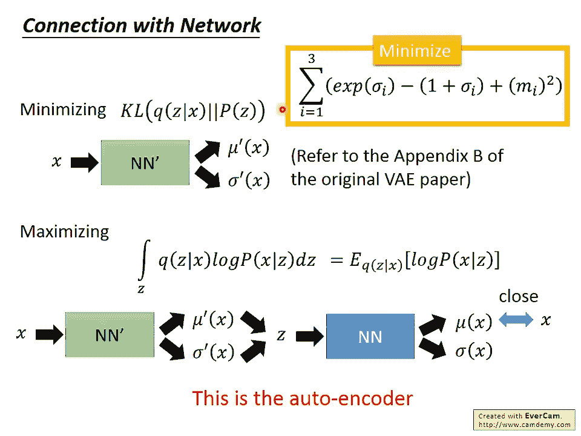

而且VAE有另外一个是叫做这个conditional的，V a e，Conditional va，我们今天就简单的讲一下概念就好，conditional va1它可以做的事情是说呃。

比如说如果你现在让VA1，可以产生手写的数字啊，让VA1可以产生手写的数字，它就是看一个给他一个digit，然后他把这个DJ的特性抽出来呃，他抽出它的特性，比如说它有呃多它的笔画的粗细啊等等。

然后接下来呢你在丢进encoder的时候，你一方面给他有关这一个数字的特性的一个distribution，您另外一方面告诉你，告诉decoder说他是什么数字，那你就可以JANUARY1大排。

以及你就可以根据这一个digit january，跟他style呢很相近的dig，这个是在这应该在ENNX上面的结果哦，reference在下面哦，这是ENNEX上面的结果。

这是在另外一个数字的这个COOPUS上面的结果，你会发现说呢，Conditional v i e，确实可以根据某一个dig，画出其他的这个style相近的数字啊。

这边呢是一些reference给大家参考，那VA1其实有一个很严重的问题，就是因为他有这个问题，所以之后呢又propose了game，又propose的GAN，那via1有什么样的问题呢。

VN1其实他从来没有去真的学，怎么产生一张看起来像真的image，对不对，因为他所学到的事情是他想要产生一张image，跟我们在database里面的某张image越接近越好，但是他不知道的事情是。

我们在evaluate它产生的image跟database，跟image的相似度的时候，我们是用比如说呃mean square error等等，来与VALUARY两张image中间的相似度。

今天呢假设我们这这个这个呃，这个decoder的output，跟真正image之间有一个pixel的差距，他们有某一个pixel是不一样，但这个pixel不一样的，pixel它落在不同的位置。

其实是会得到非常不一样的结果，假设这个这个不一样的pixel它是落在这个地方，它落在这个地方，它只是让七的笔画比较长一点，跟它落在另外一个地方，它落在七这个地方，对人来说。

你一眼就可以看出说这个是machine generate，他是怪怪的，的确这个嗯搞不好是真的，因为根本看不出来跟原来这个七的有所差异，它只是稍微长一点，看起来还是很正常。

但是对VA1来说都是一个pixel的差异，对他来说这两张image是一样的，好或者是一样的不好哦，所以VA1他学的事情只是怎么recon，怎么产生一张image。

跟database里面的image1模一样，他从来没有想过说要真的产生一张，可以以假乱真的一面，所以呃如果你用VA1来做training的时候，其实你产生出来的image啊。

via1所产生出来的image往往都是data base里面的，image里面的linear combination而已，因为他从新从来没有学过说要产生新的image，他唯一做的事情只有模仿而已。

他只是他只是唯一唯一做的事情，只有呃呃希望它产生image跟data base某张image越像越好，他只是模仿而已，或者是最多就是把原来database里面的image or linear。

Combination，他做一些combination，它没有办法产生一些新的image。

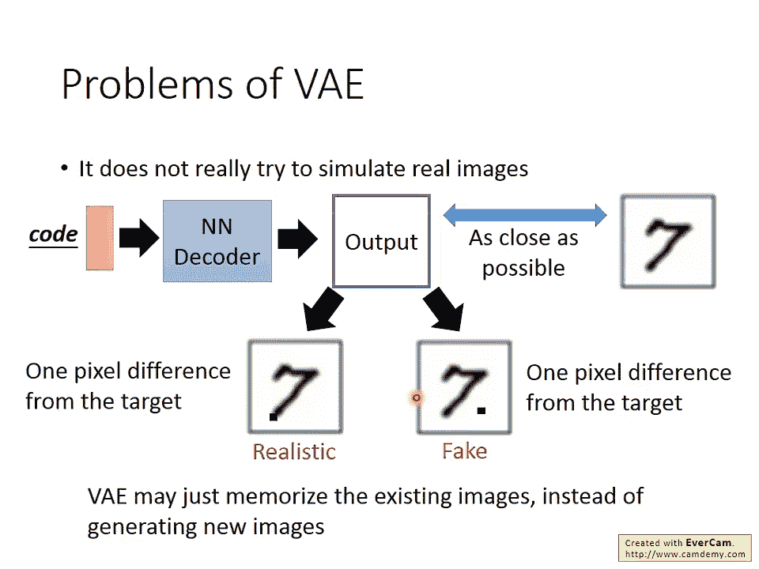

所以这样感觉呢没有非常intelligent，所以接下来就有propose，另外又有另外一个方法，叫做这个generative adversarial，Network。

adversarial是这个对抗的意思，然后缩写呢是game的诶，发现它是很新的paper，它最早出现的时候呢是2014年的12月哦。

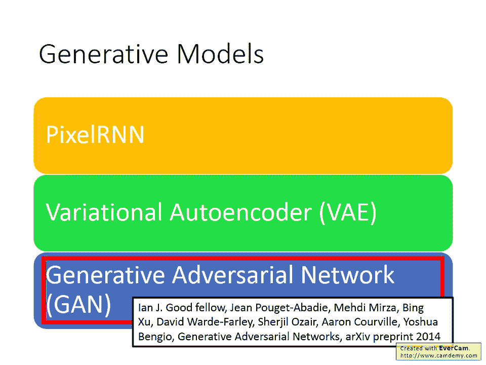

所以大概呢是两年前的paper，而以下呢我这边引用了这个YANAQUEN。

对gain的common哦，就是有人在quarrel上面呢问了说这个呃，这个on supervised learning approach，哪一个是最最可有potential的。

然后央纳克他亲自来回答啊，他说呢这个adversarial training is the coolest feet，Since slice，Spread，Since slispread。

大家知道什么意思吗，我google了一下这个片语，那如果翻译成中文的话，就是有史以来的意思，这个thin slispread是什么意思呢，SLISPREAD是切片面包的意思，那这个这个这个片语的典故呢。

好像是说在过去面包店是不帮你切面包的，就吐司面包烤完以后他不帮你切，所以你买回去要自己切很麻烦，然后来就有人发明说应该要先切了以后再卖，然后大家都很高兴这样子。

所以since slice spread呃，呃它在英文片里面就有史以来的意思，你看他说这是有史以来最强的最强最酷的方法，诶啊这还讲了一些比讲了一些别的啦。

他说what miss what Missing the moment is a good understanding of it，So we can make it work，Relily。

it's very这个呃，Finicky some of like convolution，Ninety s when i had the reputation of being the only person。

Who could make them work，Which vn true，这样子啊，就这其实get的非常难劝，就感觉感觉好像只有呃em good fellow propose，当然可以做起来。

其他人做起来你可以google一下那个呃，这个这个game的那个扣，很多人都在ENNEX上面，它们产生的BG呢呃都不是很好看，就我们毕业一随便做都可以打包那些东西，所以真的产生1米9很怪。

所以但是你如果看paper的话，他的performance呢是蛮好的，呃所以它里面有很多不，还有很多不为人知的技巧，让过去大家相信说只有央A可能可以劝的起来。

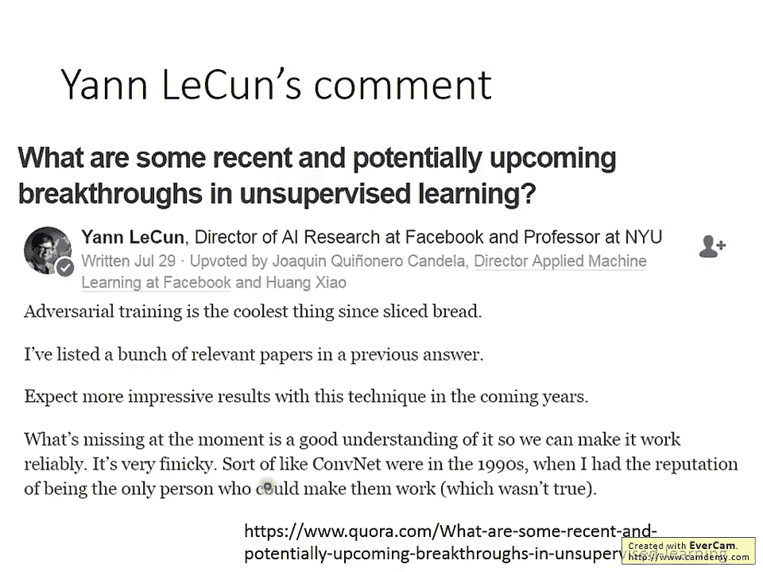

CNN不过不过其实不是这样子，可啊那其实我很无聊。

我诶我又收集了，另外我找到另外一则了，这样就有人问说呃有没有什么呃，最近的BREAKFOOD在deep learning里面，然后ya坤又又来回答了。

他说the most important one in my，Opinion is adversarial training also called game。

然后uh this is the idea of proposed by yang gfellow，他说这个是the most interesting idea in the。

Last ten years in n l y，哎啊这我就要看这个呃在这10年来，这这10年内最有趣的想法到底是什么样，这个呃gain的概念啊，像是有点像是这个拟态的演化，比如说这是一个枯叶蝶啊。

这个是一个枯叶脸，他长得就跟这个枯叶一模一样，那枯叶蝶是怎么变得跟枯叶一模一样的呢，它怎么变成这么像的呢，也许一开始他长得是这个样子，然后呢，但是他有天敌，就是类似麻雀的天敌，比如像波波这样子。

还有天敌，然后天敌呢会会吃这个会吃这个蝴蝶，那天敌辨识是不是蝴蝶的方式，就是他知道蝴蝶不是棕色哦，所以它就吃不是棕色的东西，那所以蝴蝶就演化了，它就变成了是棕色的，但是它的天敌呢也会跟着演化。

波波我现在会变成比比鸟这样子，然后这个比比鸟知道说蝴蝶是没有叶脉的，所以它会吃没有叶脉的东西，它会ignore有叶脉的东西，所以蝴蝶要再演化，就会变成枯叶蝶，它就产生叶脉，但是它的天敌也会在演化。

其实这个好像是神兽，这个好像不是波波演化来的，不过没有关系，然后这个它的天敌也还会在演化，所以这两个东西呢就会天敌和被列在探看，这个枯叶蝶呢，它们就会共同的演化，所以枯叶蝶就会长得越来越像枯叶。

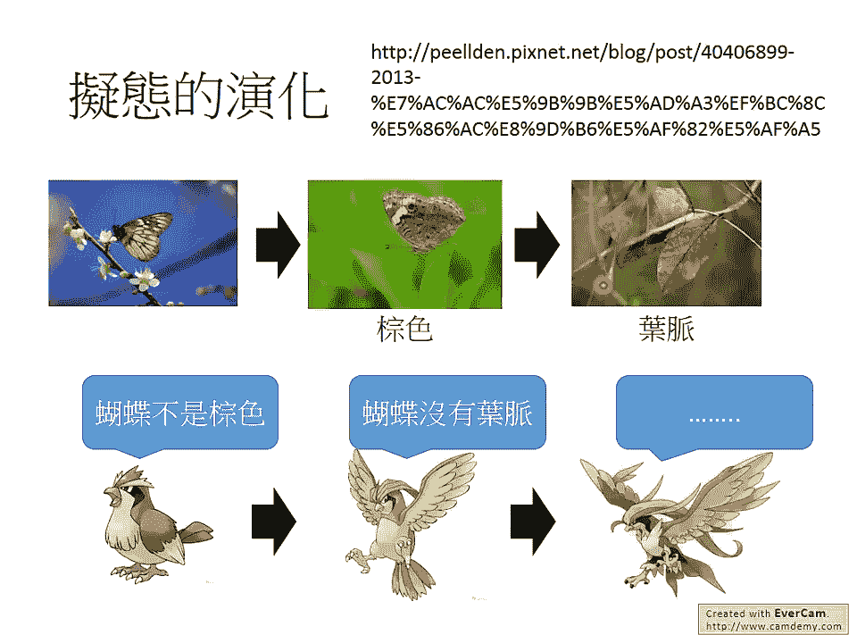

直到最后没有办法分辨为止，所以这个game的概念呢是非常类似的。

game的概念是这样，首先有一个第一代的generator，第一代generator很废，他可能是根本就是random的，知道generate大堆奇怪的东西，看起来不像是真正的image的东西。

假设我们现在叫generator，是DJ，然后接下来呢有一个第一代的discriminator，他就是那个天地，那discriminator做的事情是。

他会根据real的image跟generator所产生的image，去调整它里面的参数，去评断说一张image是真正的image，还是generator所产生的image。

接下来呢这个generator根据这个discriminator呢，等下会讲说，generator该怎么根据discriminator去演化啊。

generator根据discriminator他又去调整了它的参数，所以它第二代的generator，它产生的参数呢，它产生的地区呢就可能就更像真的，然后接下来discriminator呢。

会再根据第二代的generator产生的digit，跟真正的digit去再产生再产，再再update它的参数，那接下来呢有了第二代的discriminator，会产生第三代的generator。

那第三代的generator产生的数字呢，又更像真正的这个数字，就第三代的generator，它产生的这些数字可以骗过第二代的generator，第二代产生的这些数字。

可以骗过第一代的generator，但是这个呃第一代的discriminator，就是它产生的速度，可以骗过第二代的discriminator啊，但是呢discriminator会在演化。

然后他会可能又可以在呃分辨第三代的generator，产生的数字跟真正的数字之间的差距，那你要注意的地方就是这个generator啊，他从来没有看过真正的image长什么样哦。

discriminator有看过真正的image长什么样子，才会比较真正的image跟generator的output的不同，但是generator从来没有看过真正的iv。

他做的事情只是想要去骗过discriminator而已，所以就因为generator从来没有看过真正的image，所以generator产生很它可以产生出来。

那些image是database里面从来都没有见过的，所以这比较像是我们想要么去做的事情。

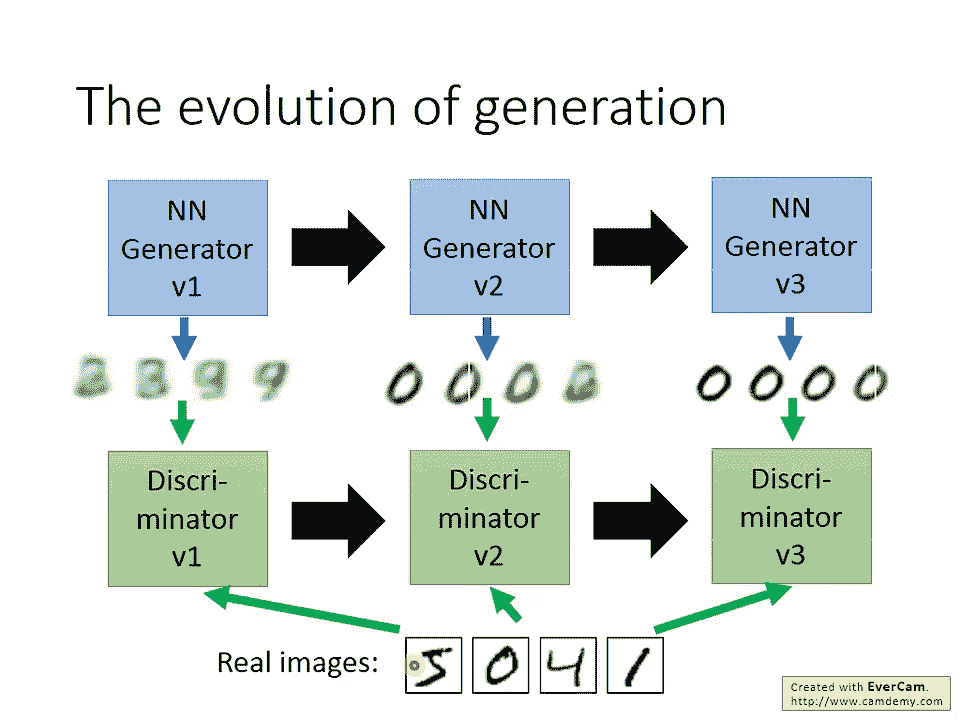

我们现在看这个discriminator是怎么劝的，这边是比较直觉的，这个discriminator呢它就是一个neural network，它的input就是一张image。

他的output就是一个number，OK你output就只要给它，它output就是一个SCALA，那可能通过sigmoid function，让它的值呢介于0~1之间。

依旧代表说input这张image是真正的image，假如你只要做手写数字辨识的话，那input的image就是真正的人手写的数字，那零呢代表是假的，是generator所产生的。

那generator是什么呢，generator在这边，它其实它的那个架构啊，就跟VAE的decoder是一模一样，它也是一个neural network。

它的input就是从一个distribution，它可以是normal distribution或是任何其他distribution。

从某一个distribution sample出来的一个vector，你把这个sample出来的vector丢到generator里面，它就会产生一个数字，产生一个image。

那你给它不同的vector，它就产生不同样子的image好，那先用generator呢先产生一堆假的image，然后呢再看那disc，然后呢我们有真正的image。

那discriminator就是把这些generator所标注的，所产生的image都label为零，也都label为fake，然后把这个真正的image都label为一，也是都都label为TRU。

接下来呢就只是一个binary classification的problem，Of bary classification，Problem，大家都很熟，那你你就可以认一个discriminator好。

接下来怎么learn这个generator呢，那generator论法是这样子，现在已经有了第一代的discriminator，那怎么根据第一代discriminator。

把第一代的generator在update呢，我怎么update呢，首先呢如果我们随便给输入一个vector，它会产生一张随便的image。

那这个image呢可能没有办法骗过这个discriminator，那你把这个generator产生的image，丢到discriminator里面，他可能说呢这有八十七八项这样子。

然后呢接下来要做的事情是什么呢，接下来我们要做的事情是调这个generator的参数，调这个generator的参数，让现在discriminator会认为说。

generator generate出来的image是真的，也就是说要让generator generat出来的image，Discrimination。

discriminate丢到discriminator以后，discriminator的output必须要越接近一越好哦，所以你希望说generator，generator是长这个样子的英名。

他可以骗过discriminator，Discriminator，而不是1。0，觉得他是一个真正的image，这件事情怎么做呢，其实因为你知道这个generator是一个neural network。

那discriminator也是一个neural network，你把这个generator的output，丢到这个当做discriminator的input，然后再让它产生一个SCALA嗯。

这件事情其实就好像是，你有一个很大很大的neural network哦，你有一个很大很大的neural network，他这边有很多层，他这边也有很多层，然后你丢一个random的vector。

它output呢就是一个SCALA好，所以一个generator加个discriminator，它合起来呢就是一个很大的network，它既然合起来是一个很大的network。

那你要让这个network在丢进一个random vector，它output1这件事情是很容易的，你就做gradient descent就好了，你用gradient descent调参数。

希望丢进这个vector的时候，它的output呢是要接近一的，但是你这边要注意的事情是，你在调这个参数的时候，你只能调你在调这个network的参数的时候。

你在做back propagation的时候，你只能够调整这个generator的参数，你只能算卷了RR的参数，对output的这个gradient，然后是uptake generator的参数。

你必须要fix住discriminator的参数，如果你今天不fix to discriminator参数，会发生什么事情呢，你会发生说对discriminator来说，要让它output1，很简单啊。

他就BIOS设他这个最后output的时候，BIOS设一，然后其他之后都设wait，都设零，它output不就一了，所以discriminator你你要让这整个network input。

Your random vector，output是一的时候，你要把discriminator的这个参数锁住，discriminator参数必须要是fix住的，然后呢input generator。

然后他才能然后只调generator的参数，这样generator产生出来的image呢，才会像才是一个可以骗过discriminator的image，好。

这边有一个来自GG的那个原始paper的toy example，那我们来说明一下这个toy example呢，是什么意思，这个TOEXAMPLE是这样子的，他说现在我们的这个z space。

也就是呃这个这个呃decoder的input，我们知道decoder input就是一个Z嘛，就是一个hidden的vector，he hidden的这个factor。

这个Z呢它是一个one dimensional的东西，那它丢到generator里面呢，它会产生另外一个one dimension的东西，这个Z可以从任何的distribution里面sample出来。

那这边在这个例子里面，它显然是从一个uniform distribution里面呢sample出来的哦，然后呢你把这一个Z呢通过neural network以后，它会每个不同的Z会给你呢不同的X。

那这个X的分布呢就是绿色的这个分布，绿色的这个分布，那现在要做的事情是，希望这个generator的open可以越相real data越好，它这边的real data呢就是黑色的这个点。

而假设有一组real的data就是黑色的这个点啊，你要找的这个distribution是黑色这个点，那你希望你的generator的output，也就是这个绿色distribution。

可以跟黑色的这个点呢越接近越好，那如果按照game的概念的话，你就是把这个generator的output x跟这个real的data，这些黑色的点呢丢到discriminator里面。

然后让discriminator去判断说现在这个value，其实现在这个呃这个X啊，还有这个real data都只是一个SCALLERY啊，现在这个SCALA它是来自真正的data的几率。

跟来自于generator的output的几率啊，如果他是真正的data的话，就是一啊，反之就是零，那discriminator的output呢就是绿色的坑哦，那假设现在呢generator呢它还很弱。

所以它产生出来的distribution是这个绿色的distribution，那这个discriminator呢，它根据real data跟这个呃generator的distribution。

它的样子呢，你给它这个X的值，它的output可能就会像是这一条蓝色的线，这条蓝色的线告诉我们说，这个discriminator认为说，如果是在这个Z1带的点，它比较有可能是假的啊。

他的这个值呢是比较低的，他若是落在这一带的点，它比较有可能是从GENEROR产生的，落在这一带的点，它比较有可能是real data，然后接下来呢。

generator就根据discriminator的结果，去调整它的参数，generator要做的事情是骗过discriminator，既然discriminator认为。

这个地方比较有可能是real的data，generator呢，就把他的open往左边移啊，它就把它的open往左边移，那你说呃有没有可能会移太多，就比如说就通通偏到左边去了，是有可能的。

所以get很难确认的，这个要小心的调参数，小心的调参数，让它不要移太多啊，这个绿色解释fusion就可以稍微偏一点，就比较接近真正real的黑色的点的这个distribution，OK啊。

所以generator为了骗过它，它就产生了新的distribution，然后接下来discriminator呢会在update呢，这个绿色的这一条线。

那这个process呢就不断反复反复反复的继续进行，直到最后呢generator产生的open跟real data1模一样，那discriminator呢会没有任何办法分辨，真正的data a诶。

你有问题吗，就是想问一下，那么同学历那个，其实这就是现在劝game的时候所遇到最大的问题，你不知道discriminator是不是对的，因为因为你说哦，discriminator现在得到一个呃呃很好的。

很好的结果，那可能是generator太费，而有时候discribe discriminator，得到一个很很差的结果，比如说他认为说每一个地方的每个地方。

他都无法分辨说是real的value还是fake的value，这个时候并不代表说generator generate很像，有可能只是discriminator太弱了。

所以这是一个现在还没有好的solution的难题，所以真正在train gain的时候，你会怎么做呢，你会一直坐在电脑旁边看他产生image，这样你懂吗，就generator。

因为你因为你从那个discriminator跟generator，那个loss啊，你看不出来他generate出来的image有没有比较好，所以就变成说你每跑你generator update一次参数。

就discriminator update一次参数，你就去看看它，你就让generator general学一些MEIMAGE，看看我比较好，这样那如果变差了，你就方向走错了，再重新调一下参数，这样哦。

所以这个非常非常的困难，非常非常困难，而我们这这边其实有人在线上放了一个demo。

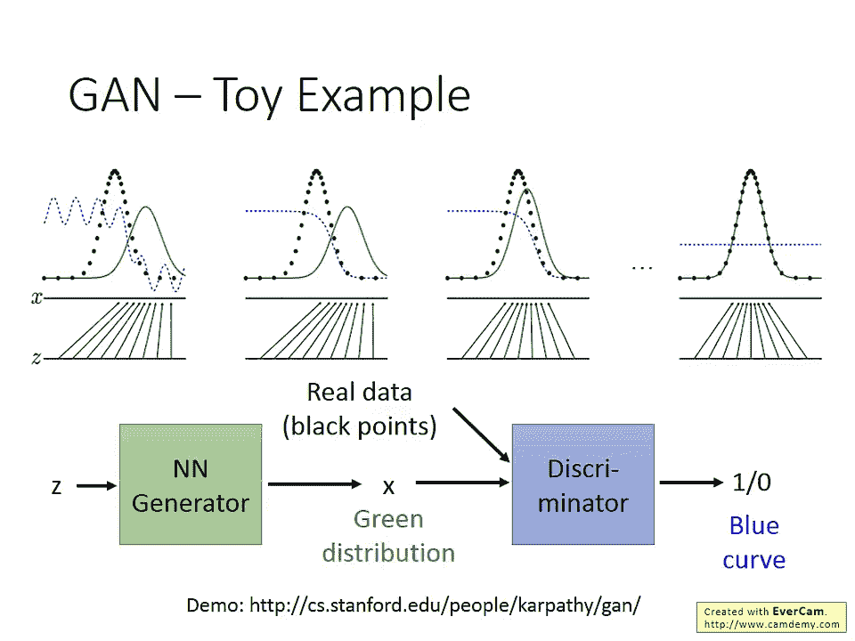

我们来看一下这个day demo，非常realistic的image啊，这个是OpenAI产生的image，那好那呃如果我们问你说，你觉得左边是real imax还是右边是real image。

你觉得左边是这个电脑产生英语学的同学，举手一下，好啊，有人啊，那请放下，你就右边是电脑产生image的同学，举手下，把手放下，对其实其实他还是没有办法骗过人啊，你看这边有很多怪怪的东西，就是很多怪怪的。

有像都很像这个马还蛮像这个马还蛮像，那这个有飞鱼，有大嘴巴毛，有很多怪怪的东西，所以他其实没有办法骗过人，那我我觉得如果放单一一张，比如光看这个马的话，他可能可以骗过人。

就这个OpenAI还没有做那个实验就可以，好像可以骗过额，有21percent的image会被就有21percent machine，generated image会被误判成real的。

所以他其实是可以骗过部分的人的啊，另外这边又有另外一个很很惊人的结果，在文献上非常惊人的结果，就是说呃先拿很多那个房间的照片，让我们兴趣get train game，然后给generate房间的照片。

那我们说那个generator就是你input一个vector给他，他就output一张image给你嘛，那你现在可以在那个那个那个in input的那个space，上面去调你的vector。

去产生不同的output，所以他说他先random找几个vector，而random找五个vector，产生五张房间的图，产生五张房间的图，接着呢再从这个点移动你的这个vector到这个点，这样啊。

所以就发现说你的image呢逐渐的变化，逐渐的变化，然后跑到这个点，然后在逐渐的变化，再跑到这个点，你会发现一些有趣的地方，比如说这边有个窗户，它慢慢的就变成了一个类似电视的东西，然后这边有个电视啊。

它慢慢的呢就变成了窗户这样子，而我觉得最惊人的结果呢是有人，我在我有日本人拿来用电话，很神奇的很神奇的东西。

就传说中你只要能够一旦你能够成功地使用它，它就可以召唤出不可思议的力量，但是大部分时候你都没有办法成功的召唤它，还有点像是那个神之卡的感觉的，你只要能够，你只要能够操控那个神，就可以获得不可思议的量。

但大部分时候你都无法，你都无法操控它，其实我昨天晚上我想说，我会不会自己generate1些宝可梦图，我弄到五点我都搞不起来，这话想还是去睡了好了，这很麻烦就很麻烦，因为他最大的问题就是。

你没有一个很明确的signal，它可以告诉你说，现在的generator到底做的怎么样啊，没有一个很明确的signal，我可以告诉你，告诉你这件事在在一个standard的NN的training里面。

你就看那个loss哦，loss越来越小，代表说现在圈里越来越好，但是好在game里面，你其实要做的事情是，keep你的那个generator跟discriminator，他们是well match的。

他们必须要不断处于一种竞争的状态，他们必须要不断处于可以，他们要像这个卡尺量跟近藤光一样，不断处于一种这个呃势均力敌的状态，他们必须要成为对手哦，那个那个没有第三堂课的时候啊。

会请作业123做的特别好的同学，来分享一下他是怎么做的诶，你作业三有人用game呢，所以这样代表是有人有做起来了，好那呃这很麻烦很麻烦，因为在店店里面呢。

你要让discriminator跟generator，他们一直维持一种势均力敌的状态，所以你必须要用不可思议的平衡感来调整，这个这两个这个呃discriminator跟generator参数。

让他们一直处于呢势均力敌的状态，那今天这个其实很像是在做那个阿尔法狗一样，你有两个A卷，然后你要让他们一直是处于一样强的状态，那当今天你要discriminator fill的时候。

因为我们最后training的这个终极终极的目标是，希望generator产生出来的东西是discriminator，完全无法分别的，就discriminator他在鉴别真或假的image上面。

它的正确率是零，但是往往当你发现你的discriminator，整个fill掉的时候，并不代表说generator真的generate很好的image。

往往你的遇到状况只是因为你的generator太弱，这样，那很多时候我在train的时候，常遇到的状况就是generator，他不管input什么样的呃。

vector他output都给你一张非常像的东西，那那一张非常像的东西，不知道怎么回事，就骗过了discriminator，就那个是个discriminator照门，他无法分辨那一张image。

那他整个就fail掉了，但并不代表说你machine呢真的得到好的结果。

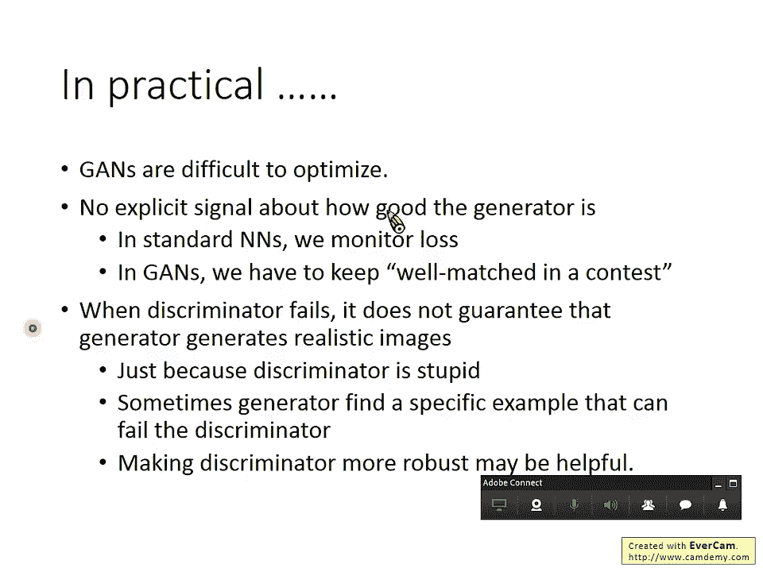

这样子好，我我要说的呢大概就是这个样子。

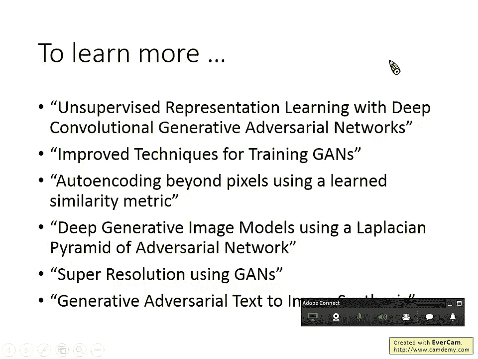