# 李宏毅2024春《生成式人工智能导论》 - P38：（延申）Generative Adversarial Network (GAN) - 啥都会一点的研究生 - BV1BJ4m1e7g8

有神奇好，那就开始上课啦，好各位同学大家好啊，我们今天要讲这个generative adversarial network啊。

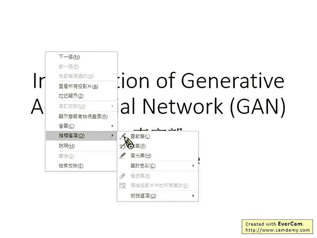

它缩写呢是GAN啊，就是cap好，那在一开始呢我们要做的第一件事情是，我们要先知道这个GN呢要怎么正确的发音，这样子，所以我们就用google小姐来念一下，J是怎么发音的呢，啊可以啊可以啊。

好所以其实他是有非常多人在研究这个技术的，然后在听到路上有人大声的说，割案四神，他们其实就在讨论这个技术，好那我今天呢就要来讲这个技术。

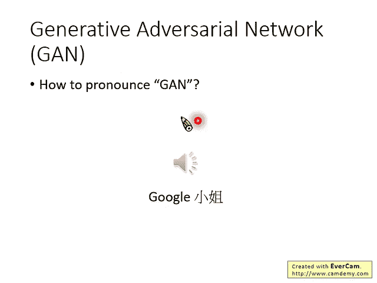

那首先呢先说一些抬轿的话，让你知道说这个技术呢有什么样的重要性，而且有一个人呢在CORO这个论坛上问，说，最近在unsupervised learning的领域。

有什么样的breakthrough it，然后young lecom呢他就亲自来回答了，然后他说adversal training，就我们今天要讲的这个GG的技术呢。

是the coolest thing in since slice bread，Since lispread，是什么意思呢，这边你可以学到一个新的英文片，Since slice pread。

如果翻成中文的话呢，你可以翻成有史以来的意思，那我google了一下，是因为说在过去啊，在卖这个吐司面包的时候是没有切片的哦，所以家庭主妇买这个吐司面包回去的时候，自己切片觉得很麻烦。

那后来有人就发明了切片的吐司，然后大家就觉得很高兴哦，所以有一个好东西问世的时候，你就会说since slice spread，可以可以翻译成有史以来的意思哦，所以他说game这个技术呢。

是有史以来他觉得最酷的东西啊，这个是另外一个问题啊，有人问说这个在deep learning的领域，最近有没有什么break food，然后young的KO呢他也亲自来回答了。

他说GA跟它的种种变形呢是呃，这个近10年来他觉得NL的领域最有趣的idea，所以这个YANA克呢，他给这个game这个技术非常高的评价好，那你在网络上呢你可以找到一个game的动物园。

你就直接google game加上zoo game的动物game，动物园你就可以找到各式各样相关的技术，因为现在呢你如果发明了一个新的，跟game有关的技术，你就要在GJAN前面呢加一些英文的字母。

但是你知道英文的字母其实只有26个，所以很快的名字就统统都被用尽了，就会发现有两个这个名字都统统都撞在一起，比如说有两个LS梗，一个是list square game。

一个是lost sensitive game，完全是不一样的东西，但是因为英文字母是有限的，很快的呢名字呢就都被用尽了，那这个图是什么，这个图是讲说呃这个game，这个game的这个动物园里面呢。

收录了各种有名有姓的game，你可以自己去查查看，里面光s game就有四个以上，那他就统计了一下，到目前为止呢已经有接近300种不同的game了，因为因为英文字母是有限的，所以甚至会发生这样的情形。

比如说这篇是variational approach for auto encoder，Generative adversal network，按照它的名字。

它应该叫做a game或者是a e game，但作者在peer里面写说a e game已经被用掉了，然后看起来其他的英文字母也统统被用掉了，他只要把它叫做阿法game，这。

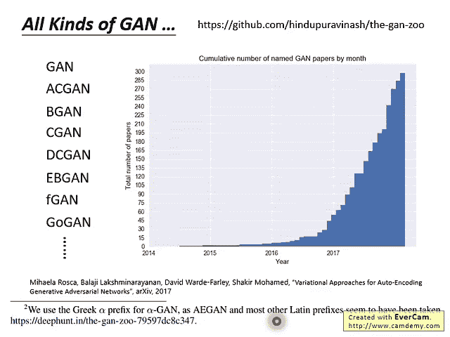

哦那在其他领域不只是machine learning的领域，当然电呢是非常的重要的，在其他领域，game其实也有很多的应用，我知道大家在image processing上会看到很多game的应用。

但在其他和image processing没有那么直接相关的领域，你也可以看到很多game的应用，举例来说呢，我呃最近才刚去了i cast。

i cast呢是signal processing的conference，那在i cast里面呢，我呃我其实给在，我其实给了一个game的tutorial啦，那在tutorial的开场。

我就统计了一下近年i cast的跟game有关的paper，那我用这个呃关键字看看这的哪些paper呢，有包含这些呃，关键字来看看说哪些paper呢，跟这些关键字是有关系的。

那我用generative这个关键字，你会发现说从2012年到2017年，觉得看generative有关的paper都很少，但还是有一接啦，因为generative model不是这种店而已。

还有很多其他generative model，但是没有非常多，那又如果用ADVERSAL这个network这个词汇呢，呃在2013年的时候，有两篇paper。

他的title有adversal network，呃，呃呃VERAL这个词汇，不过他们跟game呢是完全没有关系的，2016年这边有一篇，他跟game其实也是没有关系的。

2017年呢有两篇他确实是跟gay有关系，但到今年2018年就有40篇了，所以他成长的速度呢是20倍，所以按照这个速度，明年应该要800篇，然后我其实也用了reinforcement。

reinforcement这个词汇呢当做对照组，那就会发现说其实reinforcement这个词汇呢，他成长的速度就没有adversarial呢，他成长的速度那么快哦。

所以game呢它变成一个非常重要的技术好。

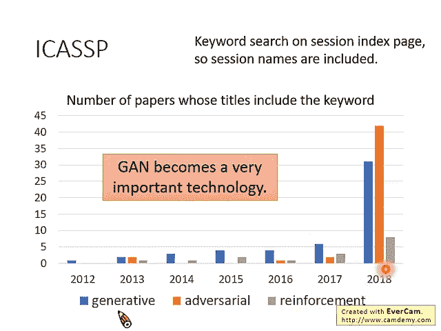

那我今天呢就要来额，接下来的四周啊，我们都要来讲电这个技术，那今天我们要讲的是最basic的idea，就给你一个大的概念，就假设你还不知道电视什么的话，那给你一个大概念，让你知道说这个技术运作起来呢。

大概是什么样子好，那我们就先从game的最基本的概念呢开始说起好。

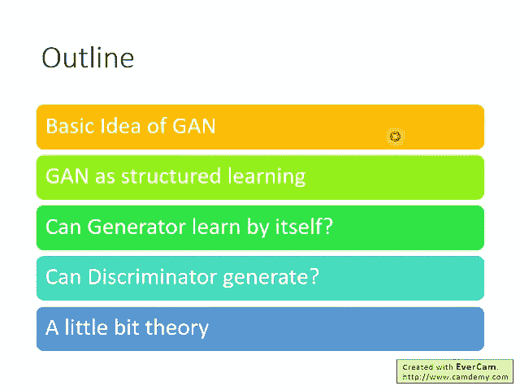

那在店里面我们所要想要让机器做到的事情，是要让机器来深层东西，举例来说，让机器生成影像，或者是假设在文字处理的领域，你会让机器来写诗，让它产生句子，让它来产生文章。

那在generation这样的process里面，你需要做的事情就是训练出一个generator，那如果你要做的是影像生成，那这个generator做的事情就是，你随便给他一个输入，举例来说。

你random sample，一个vector，你可能有一个高深distribution，你从高点distribution里面呢，Random sample。

一个vector把这个vector丢到generator里面，generator呢就要产生一张image，那你丢不同的vector，它就应该产生不同的image。

这个是image的准generation，在文字的generation，在sentence的generation是一样，你丢一个vector，那generator就输出，How are you。

你输入另外一个vector，他就说good morning，你再输入另外一个vector，他就输出good afternoon等等好，那我们用GA来达成的目标。

就是要训练出这样子的NN的generator，那你可能会有点困惑，说输入一个render的vector，让他output一张image或者是output1段词汇，有什么用，具体而言就是没有什么用。

这样子，我们之后我认为呢，在呃比较有用的是conditional的generation，也就是你可以输入一些条件，比如说输入文字，让机器产生对应的图片，我输入图片，让机器产生另外一张对应的图片。

这个我们之后会讲到，如果现在机器你不是输入一个random的东西，而是输入一个你了解那是什么，你可以control的东西，比如说文字或者是影像，然后让机器产生对应的东西，那这个技术就有非常多的应用。

那这个呢我们之后再提，我们今天呢就只focus在让机器吃一个随机的向量，他就要output你想要的object这样子的application上好。

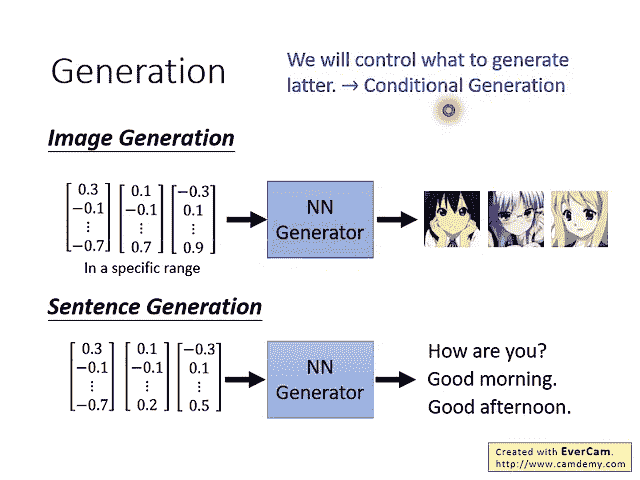

那我们刚才讲过说，在game里面我们想要训练的东西，我们想要让机器我们想要找出来的东西，就是一个选择ROR，那这个generator它是一个neural network。

那我们都知道说所谓的neural network，它其实就是一个function input的东西，output一个东西，那在game里面呢，它的input就是一个vector，如果今天是影像的生成。

他的output就是一张image，或是讲的更具一体，人就更具一体一点，在影像深层的话，generator的output就是一个high dimensional的向量哦，选择rate of是一个向量。

那这个向量呢非常非常的长，那这个向量的每一个dimension，就对应到影像中的一个pixel的颜色，那你把这个high dimentor向量排成一张影像的样子。

那你就可以让generator呢产生一张图片，或者是讲的更具体而言，假设你今天要想要让机器，做二次元人物头像的生成，那可能得到的结果就是这样啊，你个generator随便给它一个向量。

它的输出呢就是一个二次元人物的头像，那这张图呢是机器真正生成的，我是用右上角这个城市呢生成的，而通常输入的这个向量，它的每一个dimension会对应到图片的某种特征。

也就是说你改变了其中一个dimension的数值，你就会发现说你产生出来的图片的某种特征，有所改变，举例来说，假设我们觉得假设第一个dimension，对应到的是头发的长度，那你把这个vector。

他的第一个dimension的值从0。1调到三，那generator的output就会是一个长头发的角色，或者说假设这个input vector，它的倒数第二个dimension。

对应到头发是不是蓝色的，那值越大代表头发越蓝，那你把这个值呢从2。4调到5。4，那你产生出来的角色就会变成蓝头发的角色，那这两个角色看起来非常像，因为你只改了倒数第二位而已，其他维度的值是固定不变的。

你只改了倒数第二维而已，所以它只改变了头发的颜色，那其他的特征呢仍然会是很相似的哦，或者是说呢，假设最后一个维度代表的是嘴巴的大小，那本来这个值很小哦。

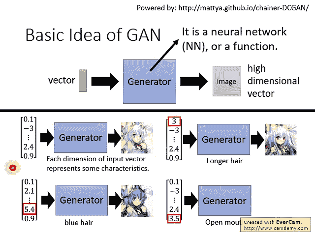

所以他是无口的状态，对把这个值调大，然后他就笑起来了，就笑口常开，这样子啊，那这个是generator，那在game里面一个比较神奇的地方呢，就是你同时会训练一个discriminator。

那么等下会讲说，这个discriminator和generator之间有什么样的关系，那我先来看一下，这个discriminator做的事情是什么。

这个discriminator它也是一个neural network，我们刚才有讲过说neural network就是一个function，吃一个东西当做input就输出一个东西。

那discriminator他是吃一张图片，当做input，假设你今天要产生的是图片的话，他就是吃图片，当做input，假设你今天要产生的不是图片，是文具的话，是句子的话，那他就吃句子。

当做input好，discriminator是一张图片，当做input，它的输出呢是一个SCALA，是一个数值，这个数值代表什么意思呢，这个数值代表说产生出来的这张图片的quality，这个数值越大。

就代表说产生出来的这张图片的quality越高，它看起来呢越像是真实的图片，他看起来呢越realistic好，所以啊这边要这句要讲的，就是说产生出来的这个数值越大，写这个数值越大。

Discriminator，OPPO的数值越大，就代表输入的图片呢越真实，举例来说，假设你现在是要做这个二次元人物头像的生成，那你让机器吃这张图片，还有这画的很好啊，所以就是1。0啊，这个也画的很好。

所以output就1。0，我假设1。0就是它可以输出最大的值啊，或者是假设这个画的很差。

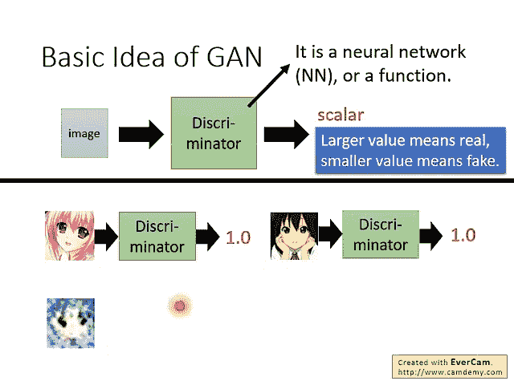

那机器可能就给他0。1分，这个也画的很差，机器就给他0。1分，这个就是discriminator呢做的事情哦，等一下那个呃第三堂课的时候，助教呢会来讲一下作业啊，我们那作业三做的呢。

就是二次元人物头像的生成那一样呢，分成这个34341342343了，样子好好，那三之一就是做二次元人物的头像生成。

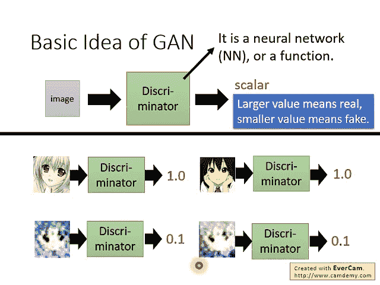

那等下细节呢就交给助教来讲，好那在那在game里面呢，我们说有一个generator，有一个discriminator，那它们之间的关系呀，就好像是这个猎食者跟他的猎物之间的关系，怎么说呢。

右上角这个啊，这是一只枯叶蝶，这不是一个枯叶，这是一只枯叶蝶，那么知道枯叶蝶长得跟枯叶非常的相似，那为什么枯叶蝶可以长得跟枯叶非常的相似呢。

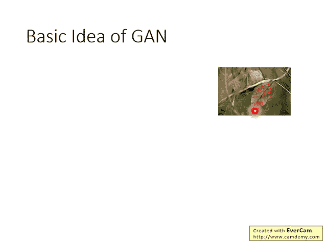

那是因为有天泽的压力，那枯叶蝶的祖先呢呃它也是彩色的，但是你知道因为麻雀呢会吃这个枯叶蝶。

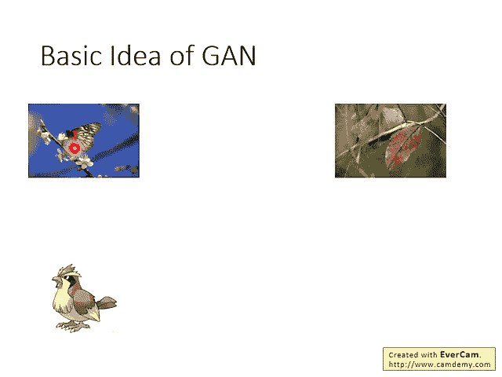

所以枯叶蝶在天泽的压力之下呢，它就变成是棕色的啊，因为麻雀判断一个呃蝴蝶的问吃的标准呢，就是看说它是什么样的颜色，而如果它是彩色的，就会被吃掉，而如果是棕色，就不会被吃掉，在天泽的压力下呢。

枯叶蝶的祖先呢就变成是棕色，但是枯叶蝶的天敌呢它也是会演化的，比如这个东西他是波波。

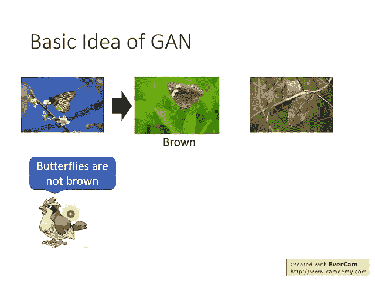

对不对，然后波波进化呢就会变成比比鸟，这样，如果说错了，等下记得纠正，我这样还是比比鸟会进化变成波波，还没有，应该是不含什么是比比鸟，这样对不对，我记得的是对的啊，所以这个是比比鸟。

好像所以波波后就进化成比比鸟，那比比鸟判断一个一个东西呢不能吃的标准呢，并不是看颜色，而是看它有没有叶脉的纹路啊，如果没有燕麦的纹路，还是会被吃掉的哦，所以辉瑞迪的祖先在天泽的压力之下呢。

他就产生了看起来像是叶脉的条纹。

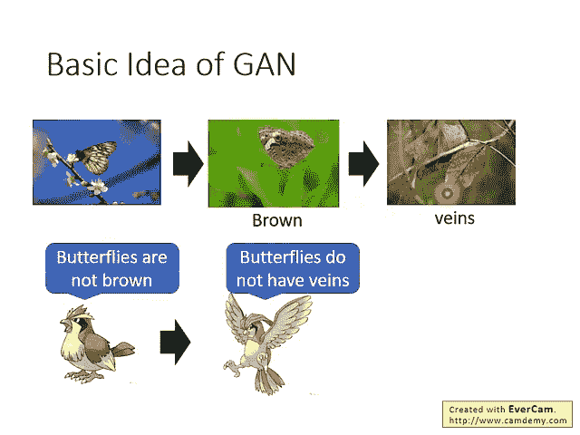

它可以骗过呢这个比比鸟，但其实比比鸟呢也会在进化，它在进化呢，它可能有别的标准，来判断这个东西是不是可以吃的，那枯叶蝶呢也会在不断的进化哦，所以他们这个猎食者和天敌。

就会就会这个就会在这个互相的拮抗之中呢，变得越来越强，而这个这个这个枯叶蝶啊，就像是generator，而它的天敌呢就像是discriminator哦，所以今天假设你要让机器做二次元，人物头像的生成。

那首先呢你要准备一个database，这个database里面有很多真实的二次元人物的头像，接下来呢一开始你的generator，他是我们说generator就是一个network嘛。

在一开始它的参数是随机的，所以一开始你的generator，他也不知道要怎么产生二次元人物的头像，所以他只能够产生看起来像是杂讯一样的东西，那discriminator做的事情就是给他一张图片。

判断说呢这张图片像是generator生成的，还是像是真实的图片，然后接下来呢generator要做的事情，就是去想办法骗过第一代的discriminator，第一代discriminator。

可以分辨第一代的generator的output，和真实图片之间的差异，举例来说，他可能就用有没有颜色来判断它们之间呃，来他就用一张图片，有没有颜色来判断它是真实的，还是被生成的图片啊。

所以第二代的generator它进化了，他想要骗过第一代的discriminator，所以他就会产生有色彩的图片，但是discriminator跟着也会在进化，第一代的discriminator。

会被第二代generator产生的图片骗过，但是第二代的discriminator，他会学着去分辨这两种图片之间的差异，举例来说，他可能会发现说哦，如果是真实的图片，它是有嘴巴的，如果是第二代。

选择RA产生的图片是没有嘴巴的，他就用这个标准来判断，说一张图片是不是真正的图片，是不是真正人画的二次元人物的头像，那选择RATOR呢就会跟着在进化，变成第三代的选择ATOR。

那第三代的generator产生出来的图片。

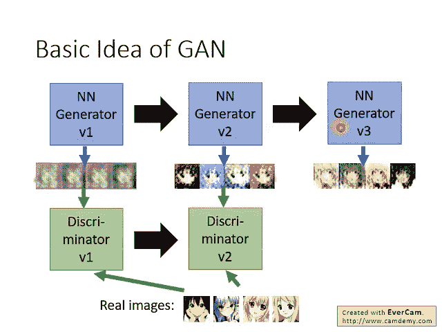

可以骗过第二代的discriminator，但是第二代的discriminator，会进化成第三代的discriminator，所以这个generator discriminator呢。

他们就会不断的进化，所以generator产生的图片呢就会越来越真实，那因为今天这个generator和这个discriminator呢，有一个对抗的关系，他们像是天敌与被猎食者之间的关系。

那所以呢用adversary这个词汇，adversary就是对抗的意思，用ADVERSAL这个词汇呢来命名，这个技术叫做generative adversal network，那有人就会问说。

那为什么是让呃两个network互相对抗呢，为什么他们不能彼此合作呢，为什么世界不是充满爱与和平呢，其实这个东西只是呃，只是一种拟人化的说法而已，就现在这个讲法让你觉得他们是在对抗的。

因为这个是来自于呃这个game，这个技术是yn good fellow，在14年的时候提出来的，如果看他原始的paper的原始的paper，它是用一个这个做假钞跟警察的例子。

就generator他就不断的在做假钞，他是个坏人，他要做假钞，那discriminator是检是警察，他要去判断说现在这张钞票是真钞还是假钞，然后最后选择RATOR会做的，这钞票会越来越像真钞。

直到discriminator完全没有办法分辨，分辨为而为止，那这个呢举例子我其实没有很喜欢，因为这是一个充满暴力与犯罪的例子，这样子，那所以因为那个因为你从那个例子看起来。

generator跟discriminator是对抗的关系，但是你只要换一个例子，generator和discriminator，其实可以看作是和和这个合作的关系，你可以想成是generator。

就是一个学生，那discriminator呢是一个老师，是指导教授，GENERERRA要学习怎么画二次元人物的头像，Discrimination，看过很多真人画的二次元人物的头像。

他知道二次元人物的头像应该长什么样子，所以一开始呢generator，第一代generator就是一年级的学生，他不知道怎么画二次元人物的头像，所以他画出来的东西呢就非常的模糊，非常的奇怪。

然后就把这些图片拿给老师看，那一年级的老师呢会给他低倍告诉他说，你这些图片跟真实图片差异是真实的，图片呢有两个圈圈，当然这只是一个拟人化的讲法，等下我们会具体的告诉你说。

实际上在train network的时候是怎么样子，但这个network他这个他在，你不要以为说他真的会讲话，他不会讲话，OK他这个只是个比喻的想法，等一下会讲。

说实际上training的时候是什么样子的好，而discriminator发现说这两种图片的差别是，这个有两个圈圈，它都没有圈圈，所以他就会把这个资讯deb给generator，告诉generator。

说你画的这些图片跟真实图片的差异呢，是你没有画两个圈圈哦，那这个generator呢接下来就升上2年级，所以他会记得老师的教诲，他知道说在画这个二次元人物头像的时候，应该要把两个圈圈呢点上去。

然后他就把他画出来的头像呢，再给2年级的老师看，他本来以为老师会说他好棒，但其实老师只会说他好棒棒而已，因为2年级的老师呢就变得更严格了，那2年级的老师就告诉他说，你画的跟真实的图片仍然有很大的差异。

因为真实的图片呢是彩色的，你画的是没有彩色的，所以generator呢接下来升上3年级以后呢，它产生的图片就会变成是彩色的，而generator就会不断的进步。

那discriminator会变得越来越严格，学生会画的越来越好，然后老师会变得越来越严格，最后学生呢就可以画出非常像是真的人所画的，二次元人物的头像，在这个互动的过程中。

你其实会发现有你其实会有两个问题。

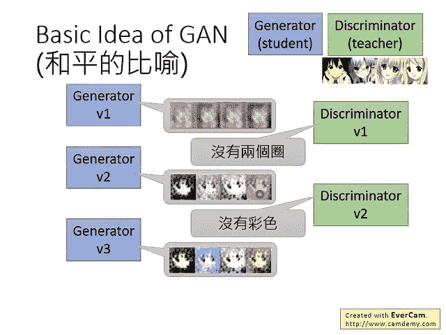

第一个问题是，为什么generator没有办法自己学呢，为什么一定要有一个discriminator介入，为什么generator没有办法，直接从这些范例里面学习，怎么产生二次元人物的头像。

为什么一定要碰透过discriminator才能学习呢，那等一下我们会我会试着来回答这个问题，第二个更大的问题是，discriminator这么会批评，为什么他不自己做呢，我相信大家都有这个困惑。

对不对，老师为什么都不自己扣顶呢，老师为什么都只用嘴巴扣顶呢，等一下我们要来回答这个问题，好所以这个generator和discriminator之间的关系啊，他们就是呃写作敌人念做朋友这样啊。

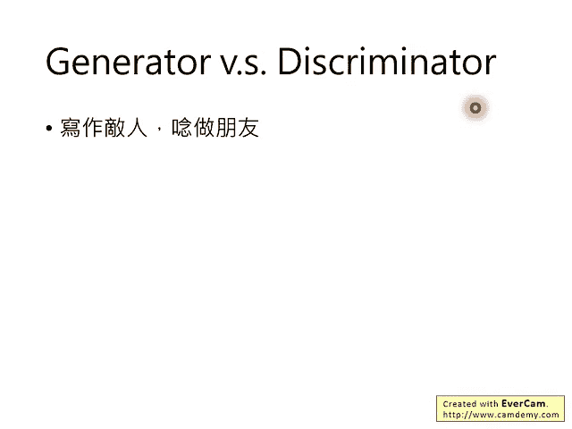

写作点念做朋友意思知道吗，就是像是塔矢亮和进藤光的关系。

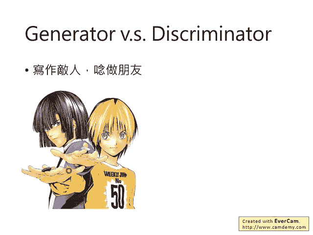

或者像是佐助与鸣人的关系一样哦，所以他们是朋友也是敌人好，那接下来呢我们就来正式讲一下，这个generative adversarial network，它的演算法是怎么运作的。

那我们之后会讲到它的原理，还有它背后的理论，那我们今天先不讲理论，我们就只讲他操作起来看起来像是什么样子，那就算你对他的理论现在还没有任何的了解，你其实从这个操作的过程，从这个演算法。

你其实也可以体会到说，为什么它是一个有用的方法好，那我们有一个generator，有一个discriminator，他们都是network，那么知道turn network的时候。

一开始你的参数呢就是render initialized的，所render initialize，generator和discriminator的没word参数好，接下来呢你要iterative的去劝。

这个generator和discriminator，在你要跑很多个iteration，在每个iteration里面呢，你要做两件事，有两个步骤，第一个步骤，你把选的writer呢。

fix组把generator参数固定住，你只去调discriminator参数，你只去TRADISCRIMINATOR，把generator固定住好，怎么做呢，你有个固定住的generator，然后呢。

你今天呢把一大堆的random的vector，丢到这个generator里面，那这个generator呢就会产生很多的图片，但因为一开始这个generator它的参数是随机的。

所以它产生出来的图片并不会特别好，可能是非常糟的，那接下来呢你有一个data base，我们刚才讲过说，如果你既要让机器产生某种东西，你要收集那种东西的范例，你要让他产生二次元人物的头像。

你要收集很多二次元人物的头像当做范例，也要让机器写诗，你要收集很多的诗词作为范例哦，所以你有个database里面都是二次元人物的头像，你会从这个二次元人物的头像。

database里面呢sample出一些example哦，所以你现在有两组图片，一组图片是从data base里面sample出来的，另外一组图片呢是generator所生成的。

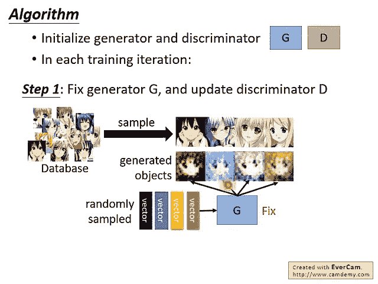

那接下来呢你就要去训练你的discriminator，要去调整你的discriminator的参数，那怎么调discriminator参数呢，你的目标就是如果今天这个image是realistic的。

就给他比较高的分数，如果今天这个image是generator所产生的，就给他比较低的分数哦，如果是从database sample出来的image就是高分。

从generator产生出来的image就是低分，那你可以把它当做是一个，比如说regression的problem，你可以把它当做是一个classification的problem，反正不管你怎么做。

你就是要训练这一个network，让这组图片就把这组图片丢进去，output的分数就是大的，把这组图片丢进去，output的分数就是小的，我讲的更具体一点，你可能会说。

你训练的目标就是把这些四张图片丢进去，Discriminator，它output的值要离一越接近越好，把这四张图片丢到discriminator里面，它open的值要离零呢越接近越好。

反正用这个criterion呢去训练你的discriminator，那我相信这个在石桌上对大家来说都不是问题，就跟一般训练什么呃，去做训练一个network，做regression。

或者是训练一个network做classification，意思是一样的好，那接下来下一步呢我们要固定住discriminator，我们只去调generator的参数。

好上来前一步是固定住generator纸条，discriminator在discriminator训练好了，固定住discriminator只挑generator，那怎么调generator的参数呢。

你先把一个vector丢到generator里面，generator呢会产生一张图片，接下来把这张图片呢丢到discriminator里面，discriminator会给他一个分数。

那generator，他训练的目标就是要去骗过discriminator，但所谓的骗是一个拟人化的讲法，实际上做的事情是，我们希望generator产生出来的图片。

discriminator可以给它比较高的分数，我们固定住discriminator参数，只去挑选的rate参数，希望选了RA的output就到discriminator以后。

它output的值可以越大越好，那你可以想见说刚才在前一步骤语里面，我们已经把discriminator训练好了，这个训练好的discriminator，看到好的image就会给他好比较大的分数。

那今天既然generator可以调整它的参数，使得他output的image discriminator给他高分，那显然generator产生出来的image会是比较真实的。

因为discriminator是看到真实的图片，才会给他高分，generator既然可以调整参数以后，产生出来的图片是discriminator会给高分的。

那显然generator产生的出来的图片会比较真实好，那在实际上你在implement这个co的时候，你是怎么做的呢，实际上你在implement的时候。

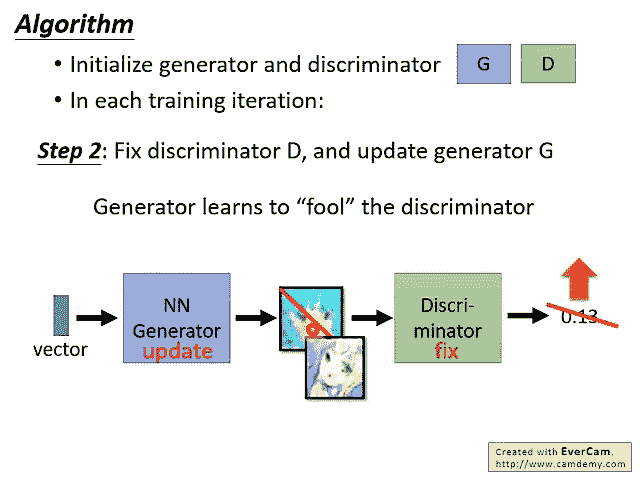

你会把generator跟discriminator合起来，当做是一个巨大的network，这样大家知道我的意思吗，就假设你的generator是五层，你的discriminator也是五层。

也就是把这个前面的五层，跟后面的五层接在一起，变成一个有十层的network，而这个十层的network input是一个vector，它的output就是一个数值。

但在这个十层的network里面的其中一个hidden layer，它很宽，而它的output就是一张image，让大家了解我的意思吗，假设你这个是6464的image。

那你就会有其中一个T单layer，他的output会output6464的数值，它会output6464，为你把那个peter类的output拿出来，你就可以把它看作是一张image。

而你在确认这个network的时候，你就是固定最后几个hidden layer纸条，前面几个hidden layer让他的output的值越大越好，那因为我们现在是让output越大越好了。

所以不是gradient descent，gradient descent是让你的目标越小越好嘛，那你做的事情其实是gradient asset。

我gradient descent跟gradient ascent，其实意思是一样的啦，对不对，你只是把你object function乘一个负号而已哦，所以实际上在做的时候。

你就是把generation discriminator接起来，变成一个巨大的network，然后把这个巨大的network的最后几个layer fix住，只TRA前面几个layer。

那目标是要让整个network output的值越大越好，那你会发现说，因为你的目标是要让整个network值output越大越好，所以固定住最后几个layer是非常有道理的。

假设你不固定住最后几个layer发生什么事呢，因为目标是要让output越大越好嘛，那他其实只要调这个最后就是output一个SCALER，但其实只要调最后一个layer的weight。

让它的值越大越好，马上就可以让最后的output爆表，这样子，但是因为最后的这几个layer是固定住的，你只能够调前面几个layer，想办法让最后的output越大越好好。

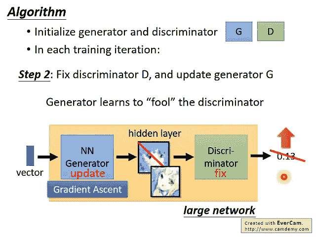

那我们等一下讲完这一页以后呢，停下来问一下大家有没有什么问题，那我们这边呢更正式的把这个ALISM呢再讲一次，我们有一个discriminator，它的参数是CAD，我们一个generator。

它的参数呢是feta g好，那整个演算法呢就是这个样子，你就抠一下这个演算法，就可以完成作业三之一了啊，这个演算法是这样走对啊，这是不是这样的，呵呵就你有一个data base。

当然这个data base在作为三支里面是我们提供的，而提供你一个很大的data base，二次元人物头像的data base有好几万张的图片好。

那接下来呢你从这个data base里面simple出M，比example sample出N张image，那这个M其实就是那个batch size。

就像是我们train network时候batch size，那哎你要调一下，比方说32啊，64啊，他是batch size好，那同时呢你有你要找你有一个distribution。

那这个distribution其实我个人觉得没有那么重要，那你可以在作业里面verify一下，你觉得这个distribution对你的结果有多大的影响。

这distribution可以是一个uniform distribution，可以是高选distribution都可以，我们假如它高清distribution。

你从高清distribution里面simple出in个vector，那至于这个vector dimension要多少，要五维还是十维还是100维，这个你自己决定，这是一个参数，你要调的啊。

也就sample出N个vector，从一个高深distribution里面sample出angg vector好，那接下来呢你就根据这N个N个vector，你会去产生N张image。

我们刚才有说generator就是吃一个vector，Output，一个image，那我们把generator产生出来的image呢，用x pa呢来表示。

那就把这N个vector丢到generator里面，让它产生N张N张图片，好让它产生N张图片，然后接下来呢你就要去调整你的discriminator哦，所以前半部是在训练你的discriminator。

那怎么调discriminator呢，以下这个式子啊只是一个范例啊，只是一个范例，你可以用这个式子，也可以用别的，那我们之后会讲说，也许用别的结果会特更好，但这个只是最原始的game paper。

它的式子是这样写的，他说呃我们要去maximize这个objective function，我们要去maximize这个object function。

这个objective function是什么意思呢，首先呢我们把N张真实的图片拿出来，把它们都通过discriminator得到分数，然后呢取一个log，再把N个图片得到的分数通通平均起来。

那我们要让这个objective function的值越大越好，那意味着我们要让log d FX越大越好，也就是我们要让d of FX越大越好哦，所以这个式子告诉我们说。

我们要训练discriminator，让他可以给真实的image，让他可以给这些真实的image的值越大越好好，那这是第一项，第二项是什么，第二项是说把这些假的图片。

eta把这些generator产生出来的图片，s ta丢到discriminator里面，产生出一个value，那这边你的discriminator。

其实会你的那个output a会先通过SIGMOID啦，这样值呢或是介于0~1之间的，那你其实不要SIGMOID也可以啦，我这边如果没有SIGMOID的话，你一减掉大于一的值再取log会有问题啊。

所以你这边就给一个题目好，所以这个D的值呢一定是落在0~1之间，那可能问说为什么一定要这样，这个不一定要这样，这样做没有比较好，这样子之后我们在接下来的课程会告诉你说，这样做其实不是最好的方法。

这个只是就是最原始的方法，但你用这个方法是做得出来作业1/3的好，那你今天呢把这个假的generated算英语，已交到discriminator里面看，给他一个分数对吧，一呢减掉这个分数再取log。

然后取平均值，再希望这一项越大越好，希望这项越大越好，意思就是希望一减BOXQ它的值越大越好，希望一减DOX的值越大越好，意思就是说你希望d o x ta越小越好，也就第二项的意思是说。

你希望训练你的discriminator，这些discriminator，如果把general generate出来的image当做input的话，它output的值要越小越好，好。

你有这样一个object function，你要去miximize self object function，怎么maximize self object function呢。

你就套一下gradient assent，那如果是gradient descent的话，这边是减的，如果你要让这个object function，你要让你的loss function越小越好的话。

你会取GRADI，然后成这个learning rate，然后把它剪掉，但是因为现在是要让它越大越好哦，所以这边是加的，你对你要jk function，取它的硅点，算它的硅点，然后乘上人林瑞。

然后呢再加上这个呃原来的参数，那就得到新的参数呢再打D，那至于learning r要怎么调，你永远可以用一些什么ADEN啊，等等的进阶的技术来设定这个learning r好。

那这边呃这边在这个式子里面呢，我们只写说把这个set up d啊，update一次参数，但至于说你要update几次参数，其实这是另外一个另外一个hyper parameter，是你要调的。

你可以说在这边我执行这一项三次哦，我执行这一项五次都可以，这是一个参数，你要去调它的好，这个是训练discriminator，那你把discriminator训练好以后，接下来呢我们要来训练呢。

generator好，那怎么训练generator呢，我们一样呢去simple出N比data，而N个这个random的vector，那这N个random的vector。

不需要跟这N个random的vector一样啊，他们可以就是另外sample n，比N个random的vector好，接下来你训练的目标，我们刚才说选择RATOR。

要想办法去骗过discriminator，如果把它的式子写出来是什么样子，把式子写出来，就这样，你把这个render的vector丢到选的ROR里面，选的ROR会产生一张AI，这边看起来有点复杂。

log d of g of z看起来有点复杂，但我们一个一项一项来看，g of z就是一张图片哦，把自己丢到generator，让它产生一张图片，就Z是一张图片。

把这张图片丢到discriminator里面，d of jz是一个数值，然后呢再把它取log，再对所有的sample出来的data，一个bench里面的data呢取平均，那你希望这个值越大越好。

也就是你的意思是说，你希望generator output出来的这个image，丢到discriminator以后，它输出来的值呢越大越好，这个是你要训练的目标。

然后接下来就grading ascent去调你的generator参数，希望它可以让这个objective function的output呢，只越大越好哦，那红色的部分就是训练generator。

那这两个步骤就会反复的执行，你训练how discriminator，接下来训练generator，再回头去训练discriminator，再训练generator，这两个步骤会反复的执行好，讲到这边。

大家有没有问题要问的呢，针对这个algorithm有没有问题要问的呢，好没有的话呢有吗没有哈，好没有的话呢，我们就看一下，实际上你应该要做出什么样的结果。

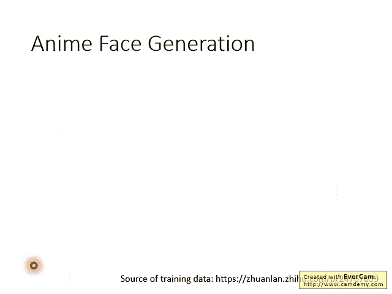

好，那这个是我实际上自己做了一下，enemy face的generation的，那在网络上可以找到database，那连接在下面了啊，我们用的database其实不是。

这在做里面用的其实不是这个database，我等下告诉你说那个database是哪来的啊，就载了一个database下来，然后你就可以call一个game，你就可以开始去劝他了，哎开始劝他了哦。

那这个是update100次参数以后的结果，看起来像是这个样子，那update1000次以后诶，这个时候GENERDERRATOR就知道说二次元的人物有，应该是有眼睛的，好像就把眼睛点出来。

update2000次以后，这个时候呢我发现他把嘴巴也点出来，update5000次以后，这个时候M讯发现说呢，动画人物就是应该要有水汪汪的大眼睛，有发现说这个眼睛都变得很大，所以他们都有一个反白。

有一个反白，然后接下来update10000次以后，得到的结果像是这样，那看起来有点像是水彩画的感觉，还有很多地方都晕开了，看见有的地方都晕开，但有一些地方看，看起来比较有二次元人物的头像的样子。

只是感觉画的没有很好，是用水彩画的，所以有一点晕开的感觉，好像这个是update20000次的结果，这个是update54000的结果，那我就停在update54000的地方。

那会发现说这边有很多头像呃，已经看起来非常真实了，但这个其实并不是真的做的特别好的，这个是上学期同学教给我的结果，可以做到这样，所以理论上你应该可以做到这样，呵呵哎对。

然后其实我们这一个学习用这个是那呃，他们其实用了自己收集的data，那我们对他们的data是自己收集，那我们这学期用的就是他们收集了DA，要感谢他们提供他们收集的data a给我们。

所以理论上你这学期做出来，应该就是要是像这个样子哎，所以这看起来非常的真实，对不对，比，很多做做画画，作画会崩坏的动画公司画的都还要好了，还是有一些崩坏啊，对看你可不可以做的更好一点嗯。

好那这个是呃二次元人物的生成，那这个就是我们的作业三之一啊，那呃也可以，当然也可以做三次元人物的生成，然可或做真实人脸生成，这些人脸都是机器生成的，网络上有一个这个呃鸣人的脸的那个database。

只要载下来，你就可以呃让机器学习产生真实的人脸，那你可能会问说审成真实的人脸有什么用呢，基本上没有什么用，这样子，因为随便去路边拍一张人，拍一个人都会比机器产生的还要更加真实。

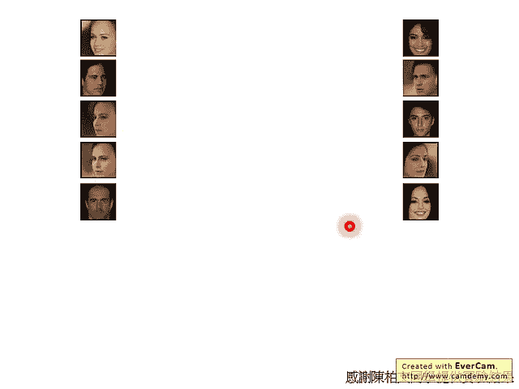

但是有趣的地方是，机器可以产生你没有见过的头像，我们刚才有说你input vector，代表了输出的图片的特性，所以如果你input假这个只是举例啊，实际上你这个input vector通常不会设二维。

这样至少做个十维或者是50维之类的啊，等或者是100维啊，假设你应付领领，他要不是这个人，Input 0。90。9，奥布是这个人，接下来呢你可以input这两个vector之间的内差。

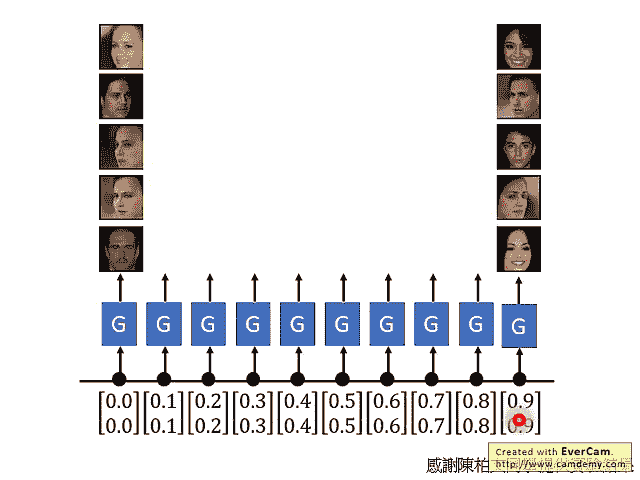

input这两个vector之间的input in interpolation，你就会得到这样的open结果。

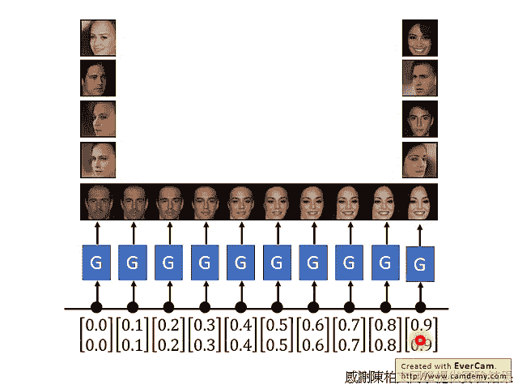

你会看到这两个人脸之间的连续的变化，在上面的是更多的例子，那我发现说机器真的可以学到，说举例来说，这个人脸他是朝右看的，这个人脸是朝左看的，当机器要产生这个朝右看的人脸，跟朝左看的人脸之间的内差的时候。

他并不是把两张脸叠起来，变成一个双面人，他自己知道说朝右看的脸跟朝左看的脸，如果内插的话，就是朝正面看，所以机器自己知道说把这个人的脸转正，然后呢再转过来，然后这边呢有更多的例子。

那这个机器要学到这件事情，完全不需要handcrafting，就并不需要给他什么规则啊，物理模型啊，都不用看很多真实的照片以后诶，他自己就可以学到这些事情了，那这个是蛮神奇的。

啊那刚才讲的呢是game的操作，那其实如果你嗯知道那些操作，你应该就可以做得出作业31了，那接下来我想要花一些时间，从概念上讲一下电的原理，为什么它是这样运作的，那我们在开学的时候。

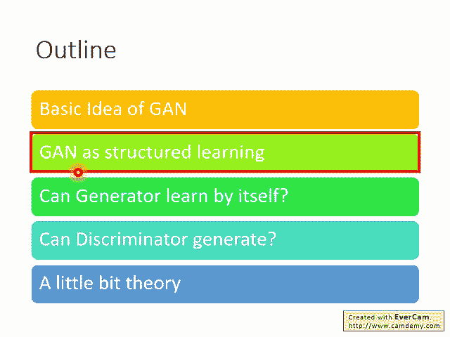

其实就有讲过说，game其实可以被视为一种structure learning的技术，那什么是structure learning呢，其实我们开学就讲过了，但我们在非常快的复习一下。

所以structure learning意思是说我们都知道说machine learning，就是找个function input一个东西，output另外一个东西。

那我们说如果是regression test machine，就是output一个数值，如果是classification的test machine就是output一个class。

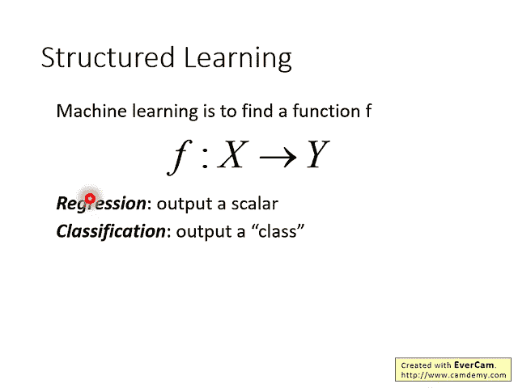

但是如果你今天遇到问题是更复杂的，你要机器的output不是一个数值，也不是一个press，它可能是一个sequence，它可能是一个mattress，可能是一个graph，可能是一个train。

这个时候这个任务就叫做structure learning。

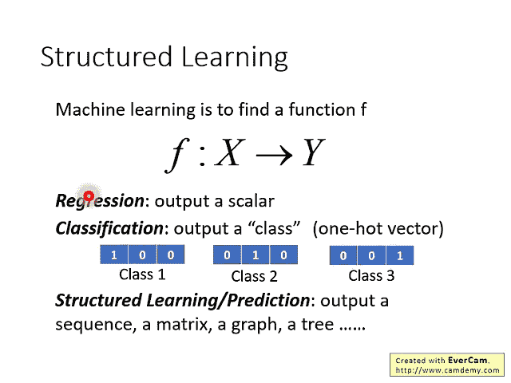

那我们这个我们也讲过了啊，举例来说，translation是structure learning问题，因为machine呢要输出一个句子，语音辨识是structure learning问题。

machine要输出一个句子，缺乏，其实大家在作业2~2里面已经有做了，缺乏缺乏其实也是一种呃structure learning的问题，所以也是input sequence。

Output sequence，那可能就是想说哎，那我们说get seer可以用在structure类的技术，可不可以把game用在缺乏上呢，可以这样子，你那个secret to sequence。

如果串的起来的话，你其实可以再加上discriminator，可以让他的回答更好，这样子，那你要先把那个sequence to sequence先确认到，Ok，这样子不知道大家做的怎么样了。

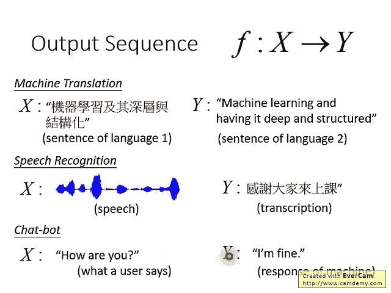

好那也可以书让机器产生一个matrix，什么时候让机器产生matrix呢，如果你要机器画一张图。

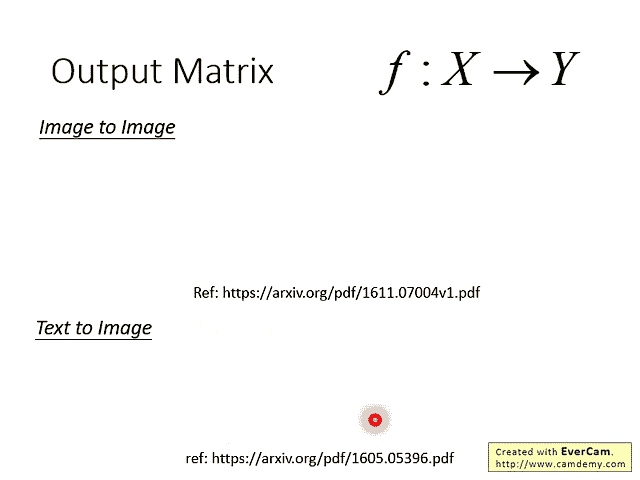

那就是产生MATRI，那我们之前有讲过说，徐来水也可以输入这种图案。

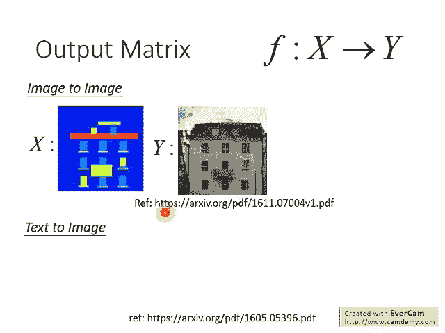

让它产生这样子的呃，真实的房子，或是输入黑白黑白图片。

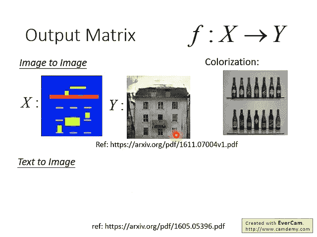

让它产生彩色的图片，那你甚至可以输入文字。

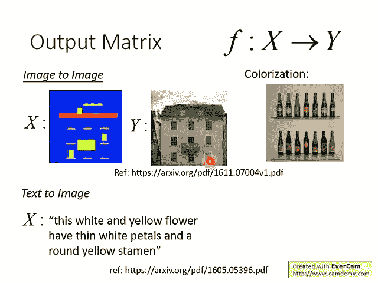

让机器产生image，那所以我们在作业342里面要做的事情，就是要大家做输入一段呃，输入一些这个呃二次元人物头像的特征，比如说头发颜色，眼睛的颜色，然后输出对应的二次元人物的头像。

这个是在作业32要大家做的事情，细节我们就下周再公告好，那为什么structure learning，他是一个特别具有挑战性的问题呢，首先我觉得structure learning。

它可以被视为是一个one shot learning或者是zero shot learning，什么叫做one shot learning或者是roll shot learning呢。

假设你今天有一个分类的问题，那你知道在做你要做分类的问题的时候，每一个类别你都要给机器一些例子，举例来说，你要机器分别苹果和橘子之间的差异，你要给他100张苹果图片，100张橘子的图片。

他才能够分辨说给他一张，给他一个水果，他是苹果还是橘子，但所谓弯下learning或者说下learning的意思是说，假设有些类别你根本没有任何的范例，或者是只有非常非常少的范例，那你能不能够做得起来。

那我觉得structure learning这个问题，他可以想成是一个极端的弯下learning，或者是zero下learning的版本，因为在structure learning里面。

你output的东西是一个structure，比如说一个句子，那在你的整个training data里面，从来没有可能没有任何句子是重复的，你的testing data和training data。

它们的句子可能也是完全没有重叠的，假设我们把每一个不同的句子，就假设你今天做的是structure learning，三二机器output的句子，比如说翻译。

假设你今天把各种不同可能的每一种output，都视为一个class的话，那每一个class在training data里面，每一个class它可能就只出现一次，在testing data。

而testing data出现那些class更惨，他根本在training data里面根本就没有出现过，所以假设我们把每一种机器可能的output，视为一个class的话。

那其实structure learning是一个极端的，one shot learning或者是zero shot learning的problem哦，所以因为这些class他都只会出现一次。

所以在这种structure ltask里面，如何学到一般化，如何学着去输出，从来没有看过的东西，就变成一个很重要的问题，那你可以想象说要让机器做到这件事情，要让机器可以输出。

它在training的时候从来没有看过的东西，那这个机器是需要有一定程度的智慧的，或者是讲的更拟人化一点，讲的更像农场，稳一点的话，机器必须要学会创造。

他才能够解structure learning的问题，因为他在testing的时候，他需要输出正确答案，很有可能是training的时候他一次也没有看过的，那这个东西我们就可以把它视为是一种创造。

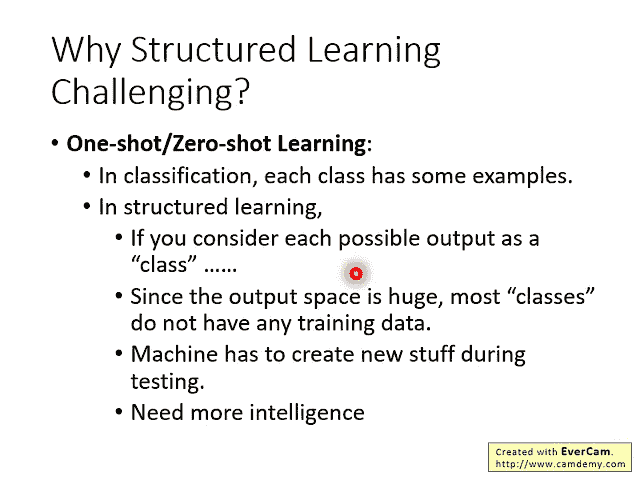

那如果今天机器要解决structure learning的问题，他必须要有规划的概念，它必须要有大局观，因为今天机器要产生一个很复杂的物件，而这个复杂的物件是由很多比较简单的，component所组成。

举例来说，如果是影像生成的话，机器每次是产，其实机器是产，仍然是产生一个一个pixel，但是所有的pixel合起来必须要能够变成一张人脸，那机器在产生这张图片的时候，他一定要在心里plan清楚。

说我画这个，我点这个pixel上去代表是眼睛，点这个pixel上去代表是嘴巴，才不会变成说哦画三只眼睛，画两张嘴巴等等哦，所以今天在这个structure learning里面。

真正重要的不是你产生了什么component，而是component和component之间的关系，举例来说，假设你今天说哦，我要让机器学会呢画一个数字，写一个数字出来，那机器一开始周哦。

那我在整张图上面呢，中间点一个点，那点一个点，这件事情它本身是中性的，它不见得代表结果会是好的，也不见得代表结果会是不好的，因为假设最后机器画出来的数字长这样，那结果是好的，想画出来的数字是长这样。

那整个呢就是坏掉了，文字的生成也是一样，机器要产生的是一个完整的句子，甚至是一篇完整的文章，单碳生成的一部分，你没有办法判断它是好的还是不好的，这让我想到一个可能是纪晓岚的故事，纪晓岚故事是说。

有一天纪晓岚呢去帮翰林的老婆祝寿，然后就写了一个诗，诗的开头，就是这个婆娘不是人，然后大家都生气了，这样子然没还有下一句就是九天玄女下凡尘，然后大家就高兴了，所以这就告诉我们说呢。

第一个如果只看第一个句子，它是一个负面的句子，但是把第一个句子和第二个句子合起来，如果有大局观的话，如果可以看整个完整的输出的话，它就变成一个正面的句子。

而这个东西是机器在做structure learning的时候，它必须要学会哦，所以这边想要表达的事情是。

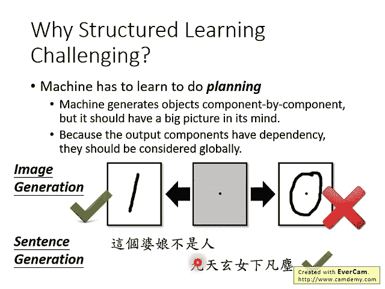

structure learning是一个有趣而又富有挑战性的问题，好，那我觉得game呢，它其实就像是它其实是一个structure learning的solution。

那其实在传统的structure learning的文献里面有两套方法，一套方法呢是button up的方法，一套方法呢是up down的方法，所以button up的方法是说。

我们今天要产生一个完整的物件，机器是一个一个component分开去产生这个物件，那这样的缺点就是很容易失去大局观，那所谓ton的方法是说，从产生完一个完整的物件以后，再去从整体来看看。

说这个产生的物件好不好，这样讲有点抽象，等下会具体告诉大家说，这件事实际上是怎么做的，但但是这边的坏处就是用这个方法你很难做，Generation，这个我会讲到。

而generator可以就视为是一个button up的方法，而discriminator可以视为是一个top down的方法。

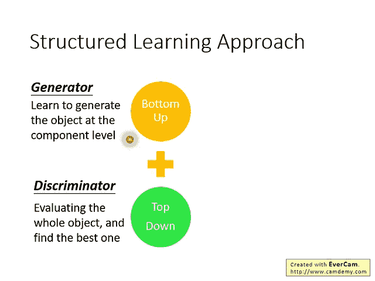

那把这两个方法结合起来呢，就是generated visual network。

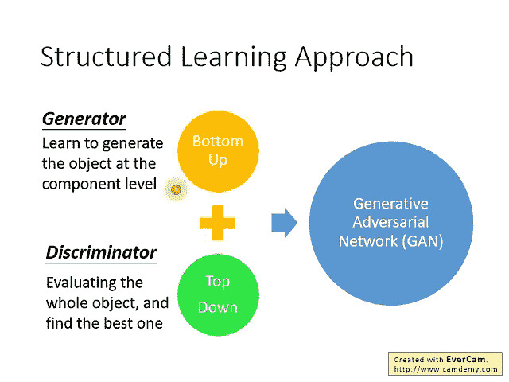

就是get好，那接下来我们想要跟大家分享的是说，我们刚才不是说有两个问题吗，那第一个问题就是为什么generator不能够自己学，我们接下来看看说generator是不是可以自己学。

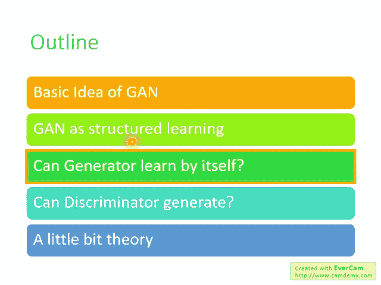

事实上generator是可以自己学的，我们说今天generator的学习就是input vector，Output，一个image，就假设我们现在用手写数字当做例子，你用output一个vector。

output一个数字的图片，output不同vector就要产生不同的图片，那要训练这样一个network generator，训练这样一个NN的generator怎么做呢。

我们知道说在传统的supervised learning里面，你就给network input和output的pair，然后就是劝下去就得到结果了，对不对。

那今天我们要选的ROR输入就是vector输出，就是图片，我们能不能够收集这样的pair呢，你当然可以搜集这样的pair，因为假设你有一个database，里面都是一大堆的数字的图片。

接下来你给每一个数字assign个vector就结束了，这样哎就结束了，因为你接下来就可以说哦，我圈一个network，然后呢，我们看说这个一他的vector是0。10。9哦，所以输入0。10。

9丢到这个选择ATOR里面，我需要output一张图片，这个图片呢跟他的目标也就是个一呢，越接近越好，这完全跟一般train supervised learning是一模一样的。

你就用gradient descent train下去就结束了，相信大家都可以秒implement这种network，那这个跟这是trainer classify是一样的，只是好像有点反过来。

因为这边是输入一个vector，输出一张图片，那虽然说输出图片，你平常不会做输出图片这件这件事，但实际上你做的就只是输出，一个很很长的向量而已，就只输出一个很长的向量而已，可能跟一般的分类都是相反的。

一般分类是输入一个图片，然后输出一个向量，这个向量的每一个维度呢代表了额呃，呃代表对应到呢某一个数字，好像这两种generator training和classify training。

其实根本就可以用同样的方式来劝它，但是这边的问题是你怎么产生这些数字呢，你要怎么产生这些数字呢，但你可以说我随机产生，但是如果你随机产生的话。

到时候这个generator training可能会非常困难，因为这两个一是很像的，那但如果他们input的vector非常不一样的话，那你可能可能很难能认出一个network input。

非常不一样的东西，却output非常像的东西，所以总会希望说，如果今天这两张图片他们有共同的特征，它们输入它们对应到的这个vector，就应该有某些相似之处，举例来说。

我在这边在在这个vector的时候呢，一呢我都给它定义为是0。12的第一位，给它0。23的第第一位给它0。3，然后如果向左斜呢，就给它赋，第二回就给它赋的值，向右斜呢，第二回就给它正的值等等。

你可能会希望你input额这个vector，它跟output的东西的特征还是有关系的，那这件事情怎么做到呢，你怎么样产生这样子的vector呢。

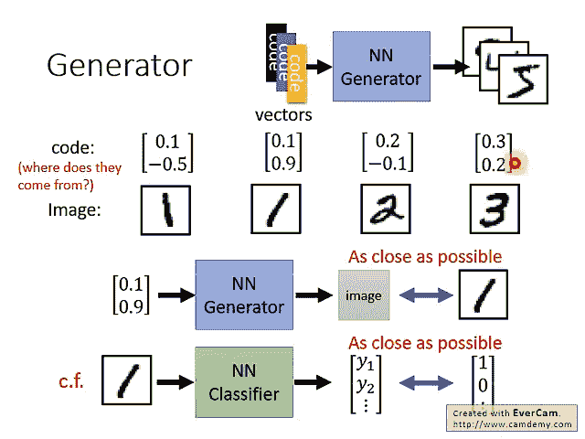

还是有办法的，你可以认一个encoder，这个encoder是给他一张图片，他把这个图片的特征用一个向量来表示，那这个向量就是这边的扣，给他一个图片，它把它这个图片的特征用向量来表示。

这个向量就是这边的口。

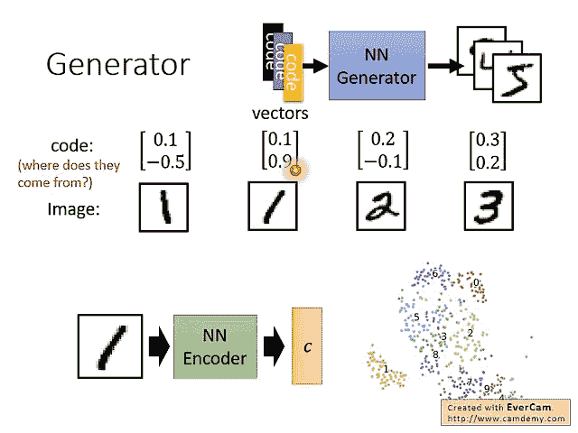

那怎么确认这样的一个encoder呢，记不记得我们在讲machine learning的时候，我们讲过一个技术叫做auto encoder，那这个我想大家都应该记得。

我只是很快很快的复习一下auto encoder做的事情，就是给一张图片，它把它变成一个code，它就open encoder里面有一个encoder，有一个decoder。

encoder做的事情是给他一张图片。

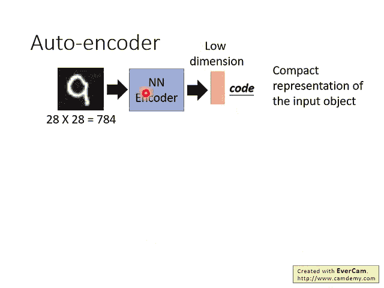

他把这个图片变成一个code，但是encoder本身不能够自己劝，一定要再加一个decoder才有办法权，decoder是一个code，他要把这个code变成一张图片。

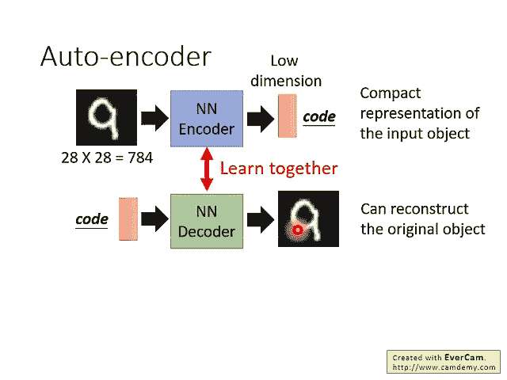

在training的时候给一张image，这张image被encoder变成一个vector，然后encoder会把这个vector解回原来的image，那你希望input跟output越接近越好好。

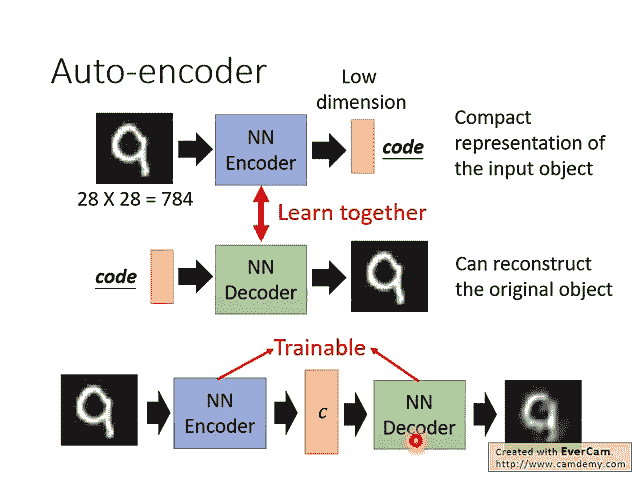

所以你今天在圈一个oo encoder的时候，你就随便选一张图片，这张图片变成code，这个code透过decoder变回原来的image，那会希望input跟output越接近越好，但你仔细想想。

这个decoder其实就是一个generator，我们刚才说那个generator做的事情，就是给他一个code，要它产生某一张对应的图片，那我们现在已经告诉你说，我们有一个encoder。

他的目标就是他的做的工作，就是产生一个图片的code，所以这张图片它对的，扣的就是这个那decoder的学习，就是看到这个code要产生那张code，对那个code对应的图片。

所以这个decoder根本就是我们要学的generator，所以事实上你认好一个auto encoder以后，你把decoder拿出来，那个就是我们的generator，它就可以拿来产生一名。

就可以随便丢一些东西，他就会output，你想要的安全举例来说。

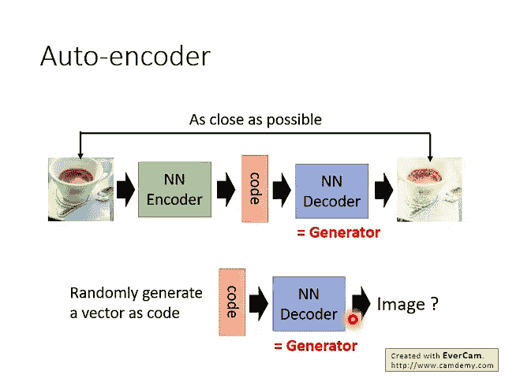

你完全可以认一个数字的产生器，这个非常简单，你回去一秒钟就可以做出来，就那个auto encoder，它的中间的code是两位，然后呢你把那个decoder拿出来，随便给他个两维的vector。

它output呢就是一个数值，举例来说呃，假设你现在给它这个是真实的例子，给他-1。50，他就输出这样子的一力，你给它呃1。50，他就输出这样子的image。

那如果你在这一个四方形的范围内等距的sample。

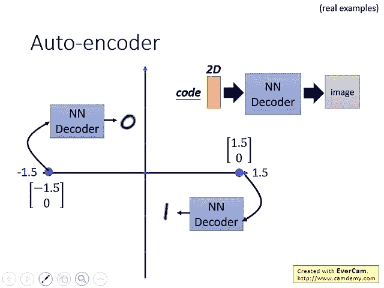

你就可以看到一堆数字的连续的变化，而举例来说，第一维可能跟他有没有圈圈有关，就越越往左就呃有圈圈哦，往右就是棍子，那如果是看这个纵轴的变化的话呢，可能跟他的方向有关，比喻来说本来是朝左偏的。

往上以后呢就会变成朝右偏的好。

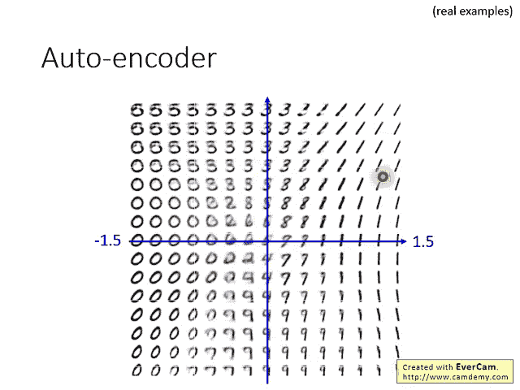

那这个是auto encoder可以做的事情，那用auto encoder会有什么样的问题呢，你可能会遇到这样子的一个问题，因为你的training data里面的image是有限的。

generator可能可以认到说，看到vector a产生这张图片，看到vector b产生这张图片，但是看到vector a跟vector b的平均，它到底会产生什么样的图片呢。

你可能觉得说vector a对应到的一是向左的，vector b对应到一是向右的，把这两个东西合起来，应该产生一个是正的一，但是实际上并不一定是这个样子，因为oonly the generator。

它是一个network，它是非线性的，A可以产生这个图片，B可以产生这个图片，把他们平均以后丢进去，未必产生出来的是数字，你可能凹不出来的东西，就是noise，这样你实际看看看看。

很有可能会发生这样子的状况。

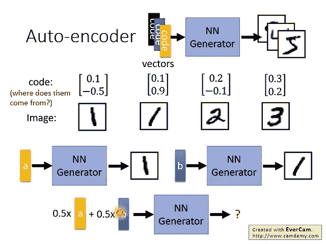

那要怎么解决这个问题呢，这个也是在machine learning neon课里面我们讲过的技术，这个技术呢就是variational auto encoder。

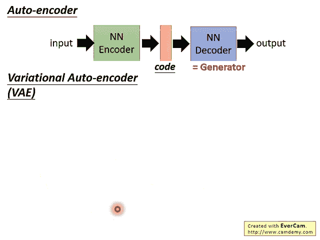

也就是BAE那在variation auto encoder里面，我没有说encoder不只是产生一个code，这边这个N呢代表它产生出来的code，它不只是产生一个code。

它不只是产生一个vector，它还会产生每一个dimension的variance，接下来从normal distribution里面呢去sample1堆noise出来。

把这些noise跟这个variance相乘，把这个noise加到你的code上面去，代表有加noise code丢到decoder里面。

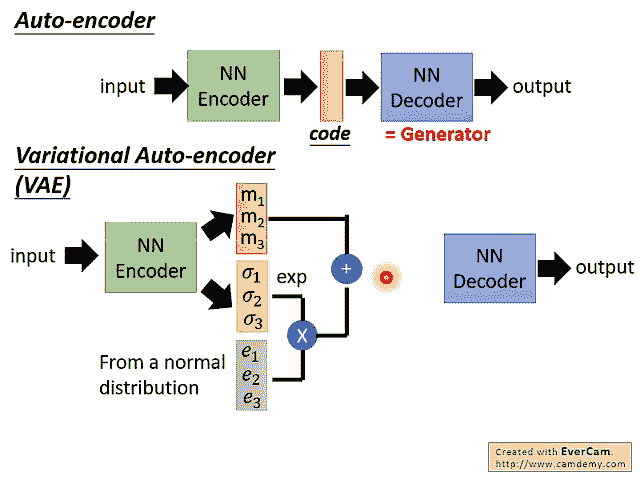

然后decoder要根据有noise的code，还原出原来的图片，那如果有这个技术的话，machine就会知道说他不止看到vector a要产生数字，看到vector b也要产生数字。

看到vector a加一些noise，看到vector b加一些noise，产生出来的东西也必须要是数字啊，所以有了variational open encoder，你可以把你的这个encode。

你可以把你的这个decoder呢train的更加稳定，你可以让你的decoder就算input，这个vector是在training的时候从来没有看过的，Vector。

它output的东西仍然可能是合理的，UPD哦，那这个都是复习我们在machine lear那门课，曾经讲过的东西，接下来我们要讲的是说，那这整套技术它少了什么样的东西，还少了什么样的东西，哎讲真的。

不知道大家有没有什么问题想要问的呢，哎你说你说哦那个是你自己决定的，他就跟network参数一样，是你要调的，但是通常这个code啊它会是一个low dimension的东西。

这样就说因为我们通常的假设是这个样子，假设你今天做的是哎，假设你今天做的是image的generation，那你的decoder的output是image吗。

那虽然image它本身它是一个high dimension Mac，但我们相信说呢这个image他是这个这个这个image，它在high dimensional中。

它其实是一个low dimensional的metaphor，然后本质上它的分布是low dimension的，所以你今天要产生这个image。

你input的code不需要是high dimension的东西，它是它只需要是一个low dimension的vector就好了，那所以但是到底dimension该多少，到底是15维。

十维还是50维这个东西呢，你是需要调一下的，你是需要调一下的，如果没钱发财，确认不起来，增加dimension会有效，但是增加dimension以后未必会得到你要的东西。

因为我们今天确认的是一个auto encoder，但你训练的目标是要让input和output，越接近越好嘛，对不对，那你要达到这个目标其实非常简单啊，你把中间那个扣的开的跟input一样大。

那你把中间那扣开的跟input一样大，那你其实就不会有任何loss，因为mach只要学着一直卡比就好了，但是这个其实并不是我们要的结果，所以今天虽然说哦你input的vector拍的越大。

你的loss可以压的越低，但loss压的越低并不代表你performance会越好，所以这个东西是需要调一下的，诶你说你说，为什么要trans，那为什么要有西格玛是吗，你说为什么西格玛要是train的。

那我把这话没错没错，所以所以今天呢假设我们没有任何额外的control，我们只想要minimize reconstruction error，我们最后你圈出来的结果sigma就会变成零。

但是实际上在training的时候，还有另外一个条件，这个条件是说这些sigma的值呢不能够太小，他要越接他其实需要呃，在TRA的时候，criterion是希望这些sigma的值越接近一越好。

你不需要西格玛太大，但是它也不可以太小，那所以所以所以在这个前提之下，最后认出来sigma并不会变成零的，哎这样回答到大家的问题吗，然后你说就是这个就在这就在想啊，就这想就这想。

其实大家如果对这个东西有困惑的话，你可以去看一下machine learning的录音，这个其实是我们在machine learning那一堂课呢有说过的，哎，在这个部分大家还有没有什么问题想要问的呢。

OK吗，如果OK的话，我们要继续哦。

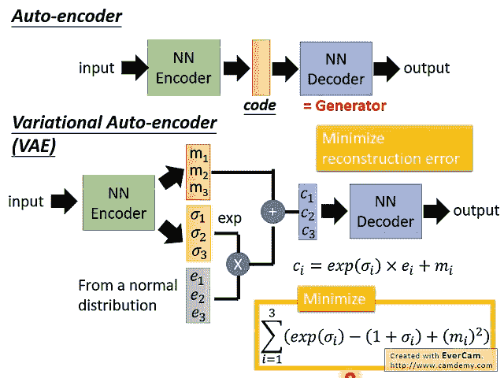

好那这一部分我想要接下来想要讲的是说，那这个auto encoder的training呢，他到底少了什么样的东西，那仔细想想看今天这个generator他在train的时候。

他的目标是希望他的output，跟某一张图片越像越好，举例来说，这个二是你input的图片，那你就希望generator的output跟这个二越像越好，但什么叫做越像越好呢，通常你计算的就是这两张图片。

他们pixel by pixel的差距，那通常每一个pixel他就是一个数字，所以真的在算这两张图片的的的的的，他们是不是相似的，所以你真正做的事情，就是把这两张图片表示成两个vector。

接下来呢你就算这两个vector的，比如说uclean distance，那这个东西就是你要去minimize的对象，这个两这两个vector，Uclean distance。

就代表这张这两张图片的差异的程度，那就希望这个他这两张图片他们的呃，l one distance或l two distance，越小越好好，但是事实上啊，假设今天generator他确实可以完全堪比。

那你的target那可能就没有什么太大的问题，但真正在training的时候，generator是会犯一些错的，generator的capacity不会大到。

说他output的image一定跟他的target1模一样，他势必会有一些取舍，他没有办法完全copy这个output，他会选择在某些地方不得不做一些妥协，没有办法跟他的目标一模一样。

但是这个时候选择在什么地方做妥协，就会变得非常的重要，举例来说，举例来说，这个是你的目标，今天有四个不同的generator，他们产生了四张这样子的图片，如果我们今天是看这个图片。

跟这个图片在pixel上的相似的程度，你会发现说这两张图片插了一个pixel，这两张图片插了一个pixel，而下面这个图片跟他差了六个pixel，这个图片跟他差了六个pixel。

对对一个generator来说，假设你learning的时候，是希望output的图片跟目标越像越好，那如果他第一天不得不犯一些错误，他会倾向于产生这样子的图片。

因为这样子的图片它的错误只有一个pixel，这样图片它的错误还有六个pixel。

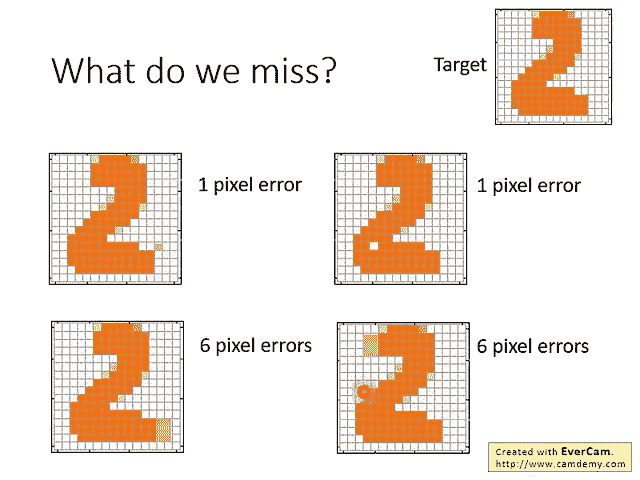

但事实上假设你从人的观点来看，你会知道说这个是不行的，这个戳一个pixel，整个图片看起来就不对了，整个看起来就不像是人手写的，数字看起来就是错的，但是下面这个case他只是把笔画弄得长一点而已。

他只是把笔画弄得长一点而已，所以其实你是可以接受的，这个你是觉得可以的，这个你是觉得可以的哦，所以今天变成说，你不能够只是单纯的去让你的output，你的目标越像越好。

单纯让你的output跟你的目标越像越好，你可能generator就会选择产生这种图片，而不是这种图片。

嗯嗯而今天呢在做这个structure learning的时候，我们讲过说structure learning output就是一个比较复杂的结构，那里面有很多很多的component。

那今天component和component之间的关系呢，是非常重要，我们觉得这张图片是不行的，并不是因为这边放了一个pixel有什么不好，在这边放一个pixel，这件事情本身是没有错的。

因为你如果说这边放一个pixel，但是你可以把这边补满，这边补满，它仍然是一个像是人手写的数字，所以并不是说你把一个pixel放在这边涂黑，是有错的，而是打这边涂黑以后，在相邻的地方你没有把它跟着涂黑。

所以今天在一个structure learning里面，component和component之间的关系是非常重要的，但是其实在缺一个generator去生成图片的时候。

你会发现说一个network架构其实没有那么容易的，让我们把component和component之间的关系，放进去，举例来说，今天假设你是做图片的生成。

那假设layer l就是整个generator的最后一个layer，就最后一个layer，就这个layer layer l它生出来的就是一张图片，那这个a layer l的每一个neural。

它显然就对应到图片里的每一个pixel，它output的数值就是那个pixel图的颜色的深浅，但是也发现说在这整个架构里面，假设layer l减一的值是给定的，假如这个值是给定的。

那事实上每一个layer的output，就假设你的weight已经给定了，那前面这边的输出也已经给，这边的layer l j的输出已经给定了，但事实上每一个呃dimension。

他的output其实是int，其实是independent，也就是说这边假比如说假设这个neural，它产生了颜色，他希望他旁边的人也跟着产生颜色，产好产生一个和好。

看起来像是realistic image，但发生实际上这件事情是没有，是没有办法做到的，因为他们之间并没有办法互相影响，他就自己产生他自己的，他就自己产生自己的，他们并没有办法互相配合。

一起去产生一个好的音mage，所以这个就是你单纯的任意一个generator，困难的地方，呃，我当时那个generator困难的地方，但这个问题其实也不是没有办法解的。

因为假设虽然说如果呃只有只看一个dimension，你没有办法考虑pixel和pixel之间的correlation，但是如果你再多加几个hidden layer。

你就可以把这种correlation考虑进来，所以今天如果你不一不想要用discriminator，只单纯用auto encoder技术想要做generation这件事情，根据我们的经验。

如果今天你有同样的network，一个是用game train，一个是用auto encoder train，往往就是用gain的那个可以产生图片。

但是auto encode那一个你需要更大的network，才能够产生跟gain接近的结果哦，所以今天如果你要把这个呃correlation考虑进去，那你其实会需要一个比较深的network好。

那这个是一个toy example了，那这个实验要做的事情是说，我们TRA一个generator，而这个generator的input呢是一个二维的，高选的noise。

那它的output呢是呃就是绿色的这些点，那他在output的时候，他的目标啊，我们是希望希望他能够学会output这个绿哎，但绿就蓝色的，是这个卷的不好歉，刚才讲错了，刚才讲错了。

因为刚才我刚才把这个将东西讲成绿色，抱歉抱歉，这个rate的output a是蓝色的这些点哦，是蓝色的这些点，绿色的呢是他的目标，是他学习的时候的目标，我们希望选择reader。

产生出来的是绿色的这样子的distribution，但实际上如果你用variational auto encoder，技术去愣下去以后，你会发现说，你最好只能够让这个generator产生蓝色的这些点。

因为对卷的RATOR来说，要考虑pixel和pixel，也就dimension，one和dimension to之间的correlation是有点困难的，他并不知道说哦，今天如果在XY的值很大的时候呃。

x2如果值很大是好的，如果值很小也是好的，但如果值介于不大不小中间是不好的，他不太容易学到这件事，你就会发现说呢他在这个distribution和这个distribution之间，还有一大堆的点散布。

在这个distribution和distribution是有很多的点散步，而这两个distribution这两个mixture他们靠的太近了，generator根本就没有办法把他们分区分开了。

那这个呢是用variation opencoder可能会遇到的问题，好那我想我们在哎在休息之前呢，我们可以我想给大家看一个东西，就是实际是实际我们实际现场的来，有了好，关掉一些东西就可以了。

好那一边一边train还是可以一边继续讲的好，那接下来我们要问的第二个问题就是，为什么discriminator他没有办法自己产生image的，其实discriminator它可以自己产生image。

只是他非常的卡，这样子他非常的卡好。

所以我们来复习一下discriminator是什么，discriminator就是输入一个option，输出一个分数，这个分数代表说输入的东西有多好。

那事实上呢这个discriminator在不同的文献上，它可能有不同的名字，举例来说，它可能叫做evaluation function，它可能叫potential function。

它可能叫energy function，但是其实你如果你在别的不同，别的其他的领域曾经看过这些名词function的话，比如说potential function，你想看他是不是也是是一个input。

然后就output一个scale，这个scale就决定说这个input有多好，或者是多不好啊，所以discriminator在不同的领域。

其实是有不同的名字的，那我们能不能用discriminator来生成object呢，其实是可以的。

那怎么用不同的discriminate，怎么用discriminator来做generation呢，你就套下面这个式子啊，不过在讲它怎么做之前呢，我们先来讲说discriminator。

相较于generator有什么样的优势，那我们刚才有说过，generator在产生object的时候，它是每一个component，一个一个独立去生存，所以对他来说。

要考虑component和component之间的correlation，是比较困难的，但对discriminator来说，要产生考。

要考虑component和component之间的correlation，就比较容易了，对discriminator来说，因为你是产生完一张完整的image以后。

再把这张image丢给discriminator，让discriminator去给他评价，看它好还是不好，所以对discriminator来说，他可以轻易的告诉你说这张图片就是不好的，应该得到底分给他。

这张图片是好的，就应该拿到高分，那怎么实际上怎么做到这件事情呢，可能你的discriminator，它也是一个convolutional neural network。

在convolution neural network里面有一个filter，是长这样子的filter，这个filter呢会去DETE说有没有isolated的pixel，有没有pixel。

它周围都没有其他pixel，如果有这种，那就给他低分，所以对discriminator来说，当产生完一张完整的图片以后，要检查这张图片里面的。

component和component之间correlation对不对，是比较容易的，在生成的时候，因为是一个一个COMPONER独立生成，不容易考虑它们之间的关系，但是等整张图片已经生成完以后。

要再去检查这个关系对不对，是比较容易的，好这个就是discriminator所占到的优势，那接下来我们要讲说，那怎么使用discriminator来产生东西呢。

也就套用下面这个是，假设你已经有一个discriminator，这个discriminator它确实可以鉴别说input on s，它是好的还是不好的，那怎么拿这个discriminator来做生成呢。

也就说穷举所有可能的S，一个一个丢到discriminator里面，看哪一个x discriminator会给他最高的分数，或给他很高的分数，但那个东西那个x discriminator会给他高分的。

X就是生成的结果结束，那你可能会觉得非常的surprise，说哎有可能穷举所有的X1个一个去检查，说呃他丢到discriminator以后，会得到高分还是低分吗，假设你今天的XC加image。

那image就是由一堆pixel所组成的，有可能穷举所有pixel的颜色的组合，看说怎么样，pixel颜色的组合会得到高分吗，仔细想想嗯好像有一些难度，但这边我们要是我要给你的答案，就是无视这个问题。

这样子我们先假设这一个穷举所有的X，看哪一个S可以得到高分，这件事情，3号就是有某一个演算法可以做到这件事情，假设你你很仔细的思考以后，也许你可以想出一个演算法。

来解这一个arg max的problem，如果你可以解这个arg max的problem，你就可以用discriminator来做生成，但是这个生成呢是非常痛苦的。

因为这个discriminator呢他擅长的就是批评，他不擅长做有建设性的建议，他只擅长批评，这样就跟政论节目的名嘴一样，你给他什么东西，他都他都说这个是不好的，但叫他真的想个好的东西。

其实他是很难想出来的，这样但是很痛苦好，那但是我们现在假设说他就是有办法啊，他就是有办法生成东西，接下来的问题是，在他有办法生成东西的前提之下。

我们怎么样训练这个discriminator，当我们在训练discriminator的时候，简单来说就是要给他很多好的example，告他说最好的example是高分的，给他一大堆烂的example。

告诉他烂的example就是低分的，但是实际上我们手上只有好的example，我们手上真正有的假设，也是做二次元人物的生成，你手上的data是人生成的，data是人画出来的，二次元人偶的头像。

这些东西统统都是好的，这些东西discriminator都应该给他高分，但是这个时候你的discriminator只有positive，Example，只有正面的例子。

完全没有反面的例子，如果你只拿正面的例子去劝你的discriminator，会发生什么样的问题呢，你会发现说这个discriminator之后，就会学到说看到什么东西，他都会觉得是正面的例子都给他高分。

因为他训练的时候只有高分的东西，他从来没有看过任何低分的东西，所以他就学到说看到什么东西都给他高分，就是对的。

那这个显然不是我们要的啊，所以怎么办呢，我们需要给machine1些next example，但是从哪里找next example，这件事情就变得非常的关键了。

如果你今天你找出来的next example非常的差，举例来说，你跟机你只能够整，你就说跟机器说哦，人画的就是好的，就是要给高分，然后呢呃随机产生一大堆的noise啊，这些noise就是要给它低分。

那对机器来说，他当然可以轻易的分辨这两种图片的差别，看到这种给他高分，看到这种给他低分，但之后给他这种图片也许画的很差，但是他觉得说嗯这个其实还是比noise好很多，也会给他高分，那这个不是我们要的。

所以今天怎么产生好的native example，就变得很重要，假设你可以产生非常真实的negative example，就他这个其实还是有些错误，比如说这两只眼睛的颜色不一样。

那你可以产生非常好的nt example，这样discriminator才能够真的学会，鉴别好的image跟坏的image，但是现在问题就是，怎么产生这些非常好的next example呢。

你要产生这些好的net example，其实你也需要一个很好的process，去产生这些net example，但是我们现在就是不知道要怎么产生image，我们才才要train model。

这样就变成一个鸡生蛋蛋生鸡的问题，就我们要有好的net example，才能够训练discriminator，我们要有呃discriminate，好的discriminator。

才能够帮我们找出好的next example。

但这样就陷入一个鸡生蛋蛋生鸡的问题，所以实际上怎么解决这个问题呢，你是用一个iterative的方法来解这个问题，所以你要怎么训练你的discriminator呢，这个训练方法是这样的。

假设你有一堆positive example，假设你有一堆netics example，那一开始你的positive example是人话的image。

你的net example是random sample出来的一堆noise。

那在每一个iteration里面，你的discriminator学会做的事情，就是给这些POSITIEXAMPLE高的分数，给这些negative example低的分数。

接下来当你学会学出一个discriminator以后，你可以用这个discriminator去做generation，我们刚才说或discriminator是可以做generation的。

你只要会解这个arg max的话，问，你就可以用这个discriminator做generation，你可以用这个discriminator generate出一些一堆，他觉得是好的的image。

这些image我们用XTA来表示它，有了这些原来的dio nor觉得是好的image以后，接下来在下一个iteration，你把原来random的image，换成这些第一代的discriminator。

觉得是好的image，接下来呢再update discriminator参数，告诉他说这些是好的，这些是不好的，但你又了有了新的discriminator。

新的discriminator再解一次arg max版本，因为discriminator变了，所以它可能会产生更好的一面，那这个process呢就一直反复的循环下去。

你可以只有一个discriminator，他去分辨图片的好坏，它参数update以后，他可以去产生更好的image，然后接下来你就可以认更好的discriminator，不断的反复这个process。

好那这边是一个图示化的方式来讲说，实际上的运作看起来像呃，这个运作看起来像是什么样子，那这个红色的线呢代表的是discriminator的value啊，你input一个object呃。

这个object其实如果是image的话，它是分布在一个很高维的空间中，那现在为了简化起见，我们就说假设我们的object分布在一维的空间中，那object随着它分布位置不同。

discriminator会给他不同的分数，好，那你的real example假设是落在这个地方，discriminator当然要给落在这个区域的东西，高的分数。

他应该要给其他的区域就不在这个高分的区域，低的分数，但是因为实际上呢，这整个object可以分布的space是非常巨大的，如果在一维空间里面，你可能会觉得说啊，反正这个地方是高分的。

那两边就应该给他低分的，但是如果是一个高维的空间，你很难去呃，没有出现real example的地方的分数，都把它都把它压低，那所以实际上是怎么做的呢。

实际上的做法看起来像是这个样子，我们刚才讲说discriminator在train的时候，它是iteration的，it iterrace you to trend的。

假设你的re1开始你的real data的分布长这个样子，那你有一些generate出来的data，你有一些native example，它的分布是蓝色的这个样子。

接下来呢discriminator会去学着说，给绿色的点高分，给蓝色的点低分，因为他只知道说给这个区域高分，给这个区域低分，他可能没有学到说到底要给这个区域多少分数，所以搞不好弄完以后。

这个区域的分数还比real data分数要高，这个是有可能的，因为你并没有给机器constrain，说这个地方分数是怎样嘛，一直说这边分数要高，这边分数要低，但这个地方要怎样，你其实是不知道的好。

接下来你认出第一个discriminator以后，用这个discriminator去产生example，也就是说去找出这个discriminator的，好像是找出这个discriminator的弱点。

我们刚才说在这个iterative process里面，你论discriminator，然后接下来用discriminator去产生negative example。

也用discriminator去找出自己的弱点，那用discriminator产生net example的时候，我没有说怎么让discriminator做生成，就是看说哪些图片。

discriminator会给他高分，那些东西就是native exa，如果是看这个例子的话，如果是看这个例子的话，discriminator呢是给这些图片高分。

就如果你看这个discriminator，他其实在这边分数是特别高的，所以他是给这些图片高分，那这些图片就是discriminator自己产生出来的，Netic example，然后在下一个步骤里面。

discriminator产生出这些next example以后，他要学到说他给这些example，低分，这些example高分，那discriminator形状就会改变，可能就变成这个样子。

然后这个process呢就反复继续下去，你就想说你就这就好像是discriminator，不断去寻找它的这个function里面的弱点，看看哪边分数特别高，就某个地方如果不是real example。

但他又凸起来，就在那边sample1些negative example，然后再下一个iteration discriminate，就是把那个区域的值压下去，这样让大家听得懂我的意思吧。

然后再问大家有问题要问吗，好这边OK，按你说那这样就不会OVERFIT吗，其实这个问题问得很好，这个问题其实还蛮难回答的，因为今天machine在做生成的时候。

他就是看说他的real data长什么样子，他要产生像real data的东西哦，所以如果你今天你的data很少，确实有可能有over fe的状况，如果你今天自己再去配合，所以可以看看。

如果你的非常很少，其实也更也圈了起来，但是他劝出来的结果，你会发现说那些图片就是beta背景也有的图片，所以你会希望说你给他学够多，它可以产生一些database里面他也学到generalize的东西。

产生database面没有的图片，但是这个又跟一般的training和testing不太一样，所以今天在做game的生成的时候，你其实很难知道说你到底有没有over feat。

哎这样大家还有什么问题要问吗，OK那其实最后你就希望训练到说，现在呢呃在对discriminator来说，在这个input space上面，只有呃有出现real data的地方，分数才是高的。

这个时候你的net example跟positive example，他们的distribution就会重合在一起好，当next example跟positive example。

他们distribution重合在一起的时候，那这个training process就会停下来好，那这个是discriminator的training，就假设我们今天知道说。

discriminator其实可以拿来做生成，你其实根本就不需要generator，你光凭借着你的discriminator。

你也可以做生成这件事，你可以想说，有人真的拿discriminator来做生存这件事吗，有的其实有满坑满谷的work，都是拿discriminator来做生成这件事。

假设你熟悉整个graphical model的work的话，你仔细回去想一下，事实上我刚才讲的那个train，discriminator的person。

其实就是general的graphical model的training，只是在不同的method里面讲法会略有不同而已，举例来说，我VIVO不知道大家对graphical model熟不熟啊。

这graphical model其实就是structure learning的一种，然后graphical model里面呢又分成很多类，比如说vision network。

比如说有Mark of random field等等，然后有很多很多的技术，这样，那这边其实并没有列完，所有汉graphical mother有关的技术，这边列的其实是呃过去NLDS会讲的东西。

这样子啊，其实LLDS的名字是machine learning，having deep and structure吧，所以本来这门课其实是有一半的时间会讲structure learning。

这个这个技术了，只是只是现在后来呢发现说讲到后来，大家都不想听了，这样子，可大家都只想要听deep learning，structure learning那个大家不知道是什么东西。

所以大家其实是比较不想听的，所以后来就不太讲structure learning的东西，但是game其实也可以被视为是structure learning的一种技术。

而在structure learning的技术里面，其中一个非常具有代表性的东西，其实就是graphical model，如果你熟悉graphical model。

比如说michael random fill或fashion network的话，你想想看在michael random fd里面，fasion network里。

fasion network里面你是第一个graph，你去定一个graph，那这个graph上面有一个potential function，这个东西其实就是你的discriminator。

其实那个graph就是一个discriminator，然后你输入你的observation，然后那个graph会告诉你说，这组data产生出来的几率有多少。

那个几率就是discriminator assign的分数，就假设你不熟规graphical model话，这边你听不懂没有关系，但如果你熟悉的话。

你回去比较一下是不是graphical model里面，你的那个graph，你的potential function，你的micro random field。

你的vision network其实就是discriminator，你再回想一下，当你去train map of random field，或者你TRANSSTRUCTIONSVN。

全种种的graphical model的时候，种种看structure learn有关的技术的时候，你是不是iterative的去train的，你是不是你做的事情是不是就是呃有positive。

有next example，训练出你的model，接下来用你的model sample to nect example，再去update model，其实就跟我刚才讲的。

training discriminator的流程其实是一样的，只是把同样的事情换个名词来讲，让你觉得不太一样而已，再仔细想想，他们其实就是同一回事。

好那这边呢就讲了generator和discriminator，那我们来比较一下generator和discriminator，各自所遇到的问题，generator遇到的问题。

generator的优势就是它很容易做生成，因为generator在生成时候，很快就是个feforward network嘛，那很快就可以生一个东西，它的缺点就是它不容易考虑。

component和component之间的correlation，他在学习的时候，他只是去模仿某一个目标，所以他只学到了那一个目标的表象，他没有学学到他的精神，假如讲你能花一点，就是他只学到表象。

因为他只学pixel和pixel之间的相似的程度，但他学不到大局，他学不到他的精神，如果我们看discriminator的话，discriminator的优势就是他可以考虑大局。

但他的劣势就是你要叫discriminator声的东西，真的是千难万难，这样我们要去解一个arg max的problem，而要解那个arg max的problem。

你势必就要必须要对你的discriminator model，做一个假，做一些假设，比如说在传统的文献里面，你都必须要假设说，你的那个discriminator model是线性的。

你才有办法解那个arg max的BUBER，但是你设置以后，你你限制它是线性的，那意味着你又限制了他的能力，如果他是非线性的，你搞你不知道要怎么解那个arg max的problem。

所以这个就是一个大问题，这就是一个大问题，那过去讲到在讲structure learning的时候，讲到这一段讲到要解ag max par，本同学就问我说啊，怎么解呢，我上我都只能说你就假设你可以解。

然后大家听了生气了，所以后来就都没有人要听这一段这样子。

但是现在不一样的地方就是我们有了generator，generator做什么事情呢，generator就是取代了这一个arg max的版本，所以想象成说，我们本来要想一个ALISM。

来解这个arg max的problem，往往我们都不知道要怎么解，那个arg max的problem，使得整个这一套framework假设可以解压，去best的problem听起来没有问题。

但就是因为你不能解，所以听起来就有很多的问题，但是现在我们用generator来产生next example，用generator来解这个arg max的problem。

也就是说我们说generator它就可以产生出sq的，它产生出来的expo的，就是那些可以让discriminator给他高分的image，你记不记得generator是怎么劝的。

generator在training的时候，他是不是就是去学着产生一些image，这些image是discriminator会给他高分的，所以可以想成是generator。

就是在学怎么解a arg max的这个problem，对不对，他在学习过程中，他就是在学说怎么产生，会discriminator会给他高分的那些image哦，所以过去我们是解这样的一个L解。

加一个optimization problem，那现在比较不一样，我们是用一个比较intelligent的方法，虽然比较intelligent，所以他是个network。

我们用network来解这个arg max的problem好，所以从额从所谓game有什么好处呢，从discriminator的角度来看，过去不知道怎么写arg max的。

华为现在用generator来解arg max的花纹，显然是比这个方法更加有效，而且更容易一般化的，从对对对这个general generator来说，它在产生object的时候。

仍然是component by components的产生，但是他得到的feedback不再是什么l y l two loss，不再是pixel by pixel的，去算两张图片的相似度。

它的loss将是来自于一个有大局观的，Discriminator，那希望透过discriminator代理generator，可以学会产学会产生有大局观的结果好。

那这个是一个呃用game来产生的toy example，那这个example跟刚才我们讲VA1的时候，看到example其实是一模一样的，我们只是换了一下颜色而已，我们只是换了一下颜色而已。

就刚才是蓝色跟绿色，这边换成蓝色跟红色好，那蓝色的点是我们要generator去产生的，distribution是generator学习的目标，红色的点是最终generator可以得到的结果。

而我们这边用的generator的架构，跟前面一页的那个VA1，用的generator架构是一样的，但你发现说在学习之后有了discriminator，这边，Generator。

学出来的结果是比via e的generator还要更好的，你会发现说在这个mixture和mixture之间，是几乎没有点的。

是几是几乎没有点的，而对应到真实的应用，举例来说，假设你要让我们去产生图片，产生人脸，但如果你用VA1产生的人脸就会比较糊样，所以假设说真实的人脸清晰的人脸是一个mixture，但因为via1产生的。

会产生那种nature和nature之间的sample，这就产生这些这个比较糊的人脸，那如果你是用game，那你就会产生比较清晰的人脸，好，那今天这一页啊，是要跟大家比较一下gain跟VA1之间的差别。

但这是来自于google的一篇一篇paper，那这篇paper其实他本来想要他要做，他其实这篇paper主要内容，其实是想要比较各种不同game的技术，他比较了这个我们之后会再提到这些名。

他比较的nn game，N ngame，L s game，W gaw game，Gp dragon，还有b game加就有各式各样的game，然后他其实得到一个结论，是农场文最喜欢的那一种。

他得到的结论就是所有各种不同game，其实performance都差不多，这样之前做的事情都是白忙一场，这样子呵，那这个农场人最喜欢的结论，那这个图怎么看呢，这个纵轴啊，他是算一个这个FIDSCE啊。

这个我们之后再讲这个fid score啊，是拿来量你产生这边做的都是那个image的generation，但fid score越小代表所产生出来的图片，越像真实的图片，所以这边的值呢是越小越好。

那对于不同的game呢，他们都试了各种不同的参数，那你知道gain呢，其实在圈里的时候是非常的sensitive的，所以往往可能只有特定某一组参数，你才圈了起来，所以他会发现说game用不同的参数。

它的performance有一个非常巨大的range，然后他们看不出说他们做两个不同converse，一个是enlist，一个是S8ten，有生成数字跟生成十种不同类别的图案啊。

他们他们做这个enlist跟这个呃三八配，然后发现说呢，如果比较这两个COPUS不同的方法之间的差距，其实就看不出不同的game有什么样的不同，只知道说他们的range都非常大，你可以产生很好的图。

也可以产生很快一个字，但有一件事情虽然他们paper里面没有强调，但我觉得是蛮有意思的，是如果你比较VA1跟这些game的话，你可以发现VA1倒是明显的，跟game有非常大的差别，什么样的差别呢。

首先VA一比较稳，VA1是比较稳的，你会发现说给他不同参数，VA1的分布是非常的集中的，但是假设我们比较各种不同，mo可以产生的最好的结果的话，我们刚刚讲说DA产生的图片毕竟是比较模糊的，虽然它比较稳。

但它比较难做到最好，所以你比较每一个model，可以产生的最好的结果的话，你会发现VA1相较于get其实还是输了一截的好。

那额是这样，剩下还有一些投影片，但是我觉得我们下次再讲好的。

因为剩下是要接下来呢，就是要今天就是讲的是一些比较直观的东西，那下一堂课开始呢。

就是要讲一些呃有数学的比较理论的东西，这样子，那其实如果可以的话呢，你先去预习一下，我把之前上课的录影呢放在这边，你可以因为是比较困难的主题，所以你可以先呃建议你先预习一下。

那等一下助教呢其实也会提到一些新的技术，就是今天没有，今天这个课里面没有cover的技术，都是未来，但是都是未来会讲到的，那你听到这些呃新的技术的话，也不用太呃心慌，其实作业1/3你不用那些新的技术。

你应该也是可以过得了baseline的哦。

