# 李宏毅2024春《生成式人工智能导论》 - P39：（延申）Flow-based Method - 啥都会一点的研究生 - BV1BJ4m1e7g8

今天要讲一个叫做flow的技术，那flow这个英文单字呢就是流的意思，流动的流的意思，那他是一个generative model，就和game样，你知道可以用game生东西吗。

go是另外一种选择relative的model，那它不像game那么有名，所以我相信多数的同学都没有，这么熟悉这个技术，那我们今天呢要来讲一下flow，这个generative的model。

在这个课程录影里面呢，我们已经介绍过三种选择RATIVE的model，那这一页投影片呢是从上课的录影截录出来的，那我假设你是有看上课录影的，所以你应该知道这一页投影片里面的。

三个component都在讲些什么，那我们之前讲说generative的model有三种，第一种呢是component by component的generation，就是要产生的一个object。

非常复杂，比如说你要产生一张图片，那么知道说图片是由很多的pixel所构成的，你一次产生一个pixel，那上课的时候，我们用生成宝可梦来作为，component by component的例子。

但其实这种component by component的generation呢，更常见的名字叫做auto regressive的model，所以知道有人常常听到说。

用auto regressive model来做generation，其实指的就是component by component的generation啊。

那我们也讲了VARIATIONAL的auto encoder，我们也讲了game，我们讲了三种generative的model，其实还有第四种model。

第四种model就是我们今天要介绍的low bs model好。

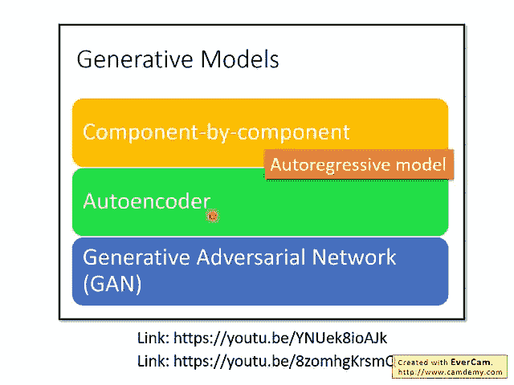

那我们之前讲过的三种generative model，各自有各自的问题，这个auto regression model，也就是component by component的model，他的第一个问题是。

既然component是一个一个生成的，那到底这个生成的顺序怎么样才是对的呢，如果是影像生成，今天通常是从左上角的第一个pixel开始，生成一个一个的这个roll。

一格一格的roll把pixel生成出来，那为什么是从左上角呢，为什么不是从右下角呢，没有很好的答案，因为用右下角你也会问同样的问题就死了，所以今天这个component by component的生成。

你不知道这个component的顺序怎么样才是对的，因为component和component在一个image上面，所有的component之间都是有关系的，如果像game这样的方法。

它是一次产生整张阴历，你不会有哪一个component先生成，哪一个component depon，前面component生成这样的问题，但在这种component by component。

就order aggressive model里面有这种问题，你不知道谁应该先出现，谁应该接续在另外一个pixel后面出现好，那也许有一些种类的生成，有一些种类的物件。

它的component的先后顺序是非常清楚的，比如说语音，你也可以用这样子的技术，auto regressive model来生成语音，一次生成声音讯号的一个sample。

但是你知道那那声音讯号它就是有顺序性的嘛，所以你一定是从第一个sample开始生成，再生，第二个再生，第三个再生，第四个一下，所以今天你在做这个生成的时候啊。

如果你今天要用这种generation model再做云合成，你一秒钟至少要升20万个sample point，才能够让你听起来觉得那个声音是好听的，像是人的声音的，那如果你要一个一个sample生成。

那显然非常的慢，之前有一个知名的auto regressive生成声音的技术，叫做web name，那他虽然生出来的声音非常真实，可以以假乱真，但是WESNET最大的问题就是一个一个sample生成。

一秒钟要产生至少20万个sample，太慢了，所以有人就说他试着生成一秒钟的声音，要花90分钟的时间啦，所以根本就不不不这不太实用，这样哎好。

那这个是component by component生成的问题，其他技术也有问题，像VA1有什么问题呢，我们在讲VA1的时候，我们证明了VA1，他今天他在optimize的对象是啊。

这个log likey hood的一个lower榜，他不是真的去maximize，我们要maximize的那一个呃likelihood。

而是去maximize likelihood的一个lower bb，那我们不知道这个lower bb，跟我们真正想要maximize的对象中间差距有多大，这是VAE的一个问题。

那等下看到了for的model，它可以解决这个问题，他并没有用approximation，它并不是optimize一个lower bb，他是直接optimize probability的本体，等一下。

我们看说这个flow是怎怎么做到这件事的，那当然还有一个非常强的model，就是GGIN，可能是今天用来做生成或产生出来的quality，就假设你要做image generation产生。

要产生quality，最好的东西的话还是要用game啊，你用别他model game就笑了，这样子诶，就今天看到用flow生成结果，我觉得还是没有真的可以打败game，game还是最强的。

但大家都知道说game很难劝，因为他在圈里的时候，你也觉得rate跟discriminator目标是不一致的，很容易劝一劝就不小心就坏掉，那等一下讲的时候，他没有这样子的问题。

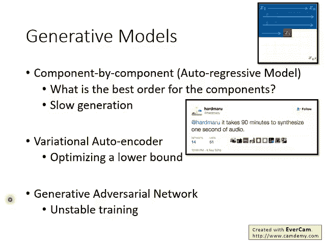

但他有别的问题，等下我们看看他有什么样的问题好，那我们回过头来看一下，这个generation是一个什么样的问题，那这个generator啊，在它是一个network。

我们这边卷的RATOR呢用G来表示啊，这个G呢它的这个卷的RATOR呢是一个network，这个network其实它定义了一个probability的distribution，这边用pg来表示好。

怎么说一个network是一个probability distribution呢，我们现在有一个generator g哦，我们给他input一个Z，他就会output一个X。

那如果我们今天是要做举例来说人脸的生成，那这个X呢就是一张人脸好，这个X呢会是一个非常高维的向量，这个向量里面的每一个element，就是人脸的一个pixel好，那这个Z啊。

我们通常假设它是从一个很简单的distribution，举例来说，normal distribution里面sample出来的，我们每次sample出一个Z。

我们就把这个Z丢到这个generator里面，让这个generator去产生一个对应的X，虽然input的这个Z啊，是从一个normal distribution里面sample出来的。

但是通过这个G以后，X可能会形成一个非常复杂的distribution，这个distribution我们用pg来表示好，那对我们而言，什么样的居是好的呢，什么样的车是我们想要找出来的呢。

我们会希望这个车它所定义出来的那个，Probability distribution，P大G跟real data下的distribution越接近越好，就我们把所有真假设。

我们现在做的这个例子是人脸的生成，我们就把所有的人脸通通集合起来，把所有人脸图片通通集合起来，形成一个distribution，这是我们的p data a，那我一个好的G非常直觉的。

它定义出来的pg应该跟PDA越接近越好，怎么让pg跟PDA越接近越好呢，常见的做法是我们训练G的时候，他的训练目标是maximize来可混。

也就是说我们从p data这个distribution里面simple出M，比贝塔那讲更具体一点，你就是从这个呃人脸的照片里面，随便simple n张照片出来，然后在训练的时候。

你的目标就是希望这N张照片由pg所产生出来，所sample出来的likelihood越大越好哦，所以你要找一个G，他可以maximize the object function。

这个objective function是什么呢，这个object function是log pg of xi，我们要让xi它被pg所产生出来的几率越大越好。

那这件事情就是大家都熟知的maximum like paper，那maxim likelihood，如果你觉得没有办法非常了解说，为什么要让产生这些data的几率越大越好的话。

那呃我这边提供给大家一个更直观的解释，就更直观的解释是，其实啊maxim like pho等同于minimize，pg跟PDA的k l divergence，至于为什么这个我们在上课录音里面有。

我把reference呢列在这边给大家参考，总之maximize likeho，等同于让pg跟p data他们的ko divergence越相近越好，也就是让pg跟p data他们越想越好。

好那flow这个model有什么厉害的地方呢，因为G是一个内work，所以pg它显然非常的复杂，一般我们不知道怎么去maximize the object function。

那fold base model他说不用担心，他有一个好方法可以直接optimize这个object function，可以直接maximize likelihood。

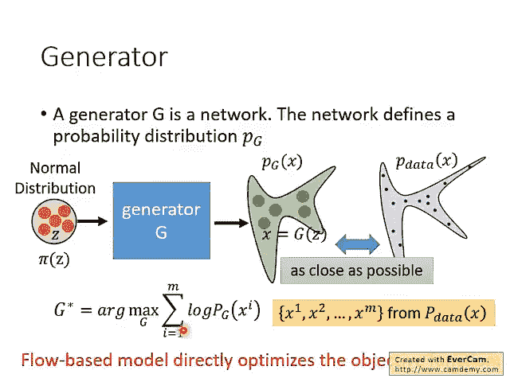

需要讲一些数学啊，For base model，我想比较没有那么呃知名的原因，也许就是因为他背后需要用到的数学，真的是比较多的，其他方法都可以有比较非数学的理解方式。

但是proface model需要用到数学是比较多的，在跟大家讲说base model之前，你需要知道三件事，第一个事情就是讲COVI，第一个事情是你要知道什么是determinate。

第三个事情是你要知道什么是change gevariable，那我就跟大家很快的讲一下这三件事情好。

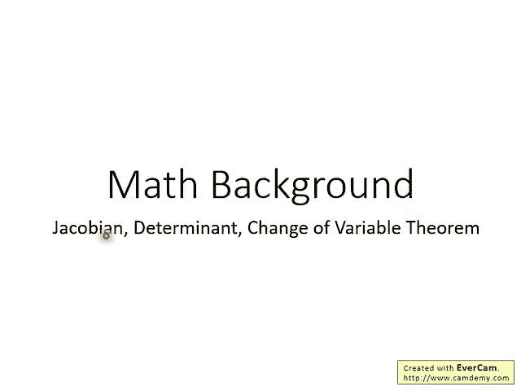

怎么是讲后边呢，讲后边意思是说我们现在有一个function f，这个function f的输入是要做ZZ是一个二维的向量，假设这边Z是一个二维的向量，他的输出叫做xx这边呢也是一个二维的向量。

但实际上更general的jahoian input和output dimension，不需要是一样的，不需要是一样，不过我们这边先就在举例的时候，就假设是一样。

那你可以想象说这个F其实就是你的generator z，就是你的input x就是你generate出来的东西，所以你可以想象说，等一下一定是会就是这个这个讲。

后面跟这个generation是很有关系的好，那所谓的甲coin是什么呢，这个F这个function它的甲HOIAN呐，就是把input component跟output component。

两两去做偏微分以后全部收集起来，形成一个matrix，这形成一个矩阵，这个矩阵就是这个F5的甲后边，这是Z有两个component，X有两个component，把这两个ZYZQ分别对XY和x2。

去做偏微分，你总共有四种组合吧，这四种组合集合起来就是function f f的，加covia metric啊，那个在写这个讲后面的MATRI时，你的定义啊是不同的roll。

不同的row放不同的output的variable，不同的color，不同color放不同的input variable哦，就是呃第一个roll你的分子的地方就是XY。

然后第二个roll你要分子的地方就是x2，然后第一个colon你的分母的地方是z one，第2color你要分母的地方就是z two，好，那我们举一个例子啊，假设我们现在有一个方程F它长这个样子。

就是你input z y z two，那你x1呢是z one加z two，你的x2呢是两倍的z one，那这个function f它是讲后面matrix长什么样子呢，你就带左边这个式子啊。

把ZY对XY做偏微分，把ZY对XY做偏微分得到多少，得到一把一放在左上角，ZQ对x1做偏微分，你已经觉得有点无聊了，ZQ对x1做偏微分得到一好，放在右上角好左下角呢z one跟x2做偏微分。

z one对x2做偏微分得到二放在这边，ZQ在XU做偏微分，ZQ在XQ做偏微分得到零派这边好，这个就是方选好，那假设我们现在有一个FF的inverse的function，它吃x opposite。

那这个f inverse它的jakia match就写成这个样子，就本来是IMPAZOPOS，那现在变成input s opposite，所以这个X跟Z的关系呢就倒过来。

就是f inverse的甲COION，那f inverse的甲coin跟F的甲coin，它们之间是有一个关系的，什么样的关系呢，你把这一个方式，这不是function。

你把这个matrix跟这个matrix相乘，他们会是identity magic，也就是说这两个MATRIC它们互为inverse啊，互为对方的inverse，所以为什么我就不解释。

我直接举个例子给你看，说他们互为inverse好，这边这个F的inverse长什么样子呢，F的inverse就是input x1 x2啊，Input x one x two。

z one的地方就把x2除二，z two的地方呢就把x1减掉二分之x2，好，这个这样子XYXQ跟ZYZQ有关系，是F的inverse好，那你把M的inverse的角后边算出来。

按照左边这个式子代进去算一算，你会得到f inverse加COVI是长这个样子，你实际乘一下JF这个match乘上jf inverse，这个match会等于identity的mat。

它们互为inverse，就是如果f inverse是F的inverse function，那F的甲co变跟F的inverse甲co变，它们之间也会有inverse的关系，这个很神奇。

方程是inverse的，他们方方程之间有inverse的关系，那他们的JACCOON也会有inverse的关系。

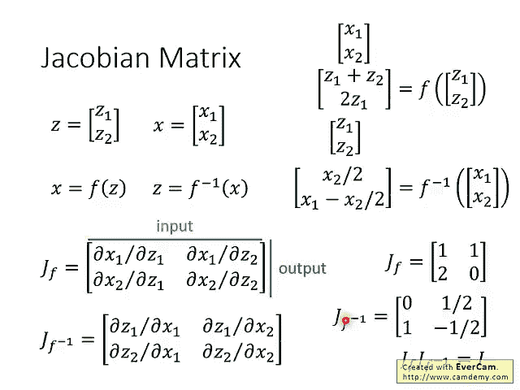

就这样，determinate是什么呢，DETERMINAL就是给你一个mattress，有一个operation，把这个match带进去，算一算就可以算出一个SCALA。

这个SCALA就叫做DETERMIN，那这个operation长什么样子呢，高中的时候都学过determinant的公式啊，就是如果是2×2的矩阵，它长这样，有个2×2的矩阵。

它四个component是ABCD，它的determinate是长什么样子呢，它determinate就是把A乘上D1减掉，B乘上C这个高中的数学教科书都有公式，33的matrix。

determinate也有公式哎，就是你把33的matrix的对角线相乘，然后再把这些这三个东西相乘，这个再把这三个东西相乘，然后再减掉一大堆东西，这个公式其实等一下用不上，没有那么重要。

只是想告诉你说determinate就是这么一回事，你高中都学过了啦，那你会说4×4怎么样呢，4×4大学线性代数我教过啦，不过我相信你大概就是忘记了这样子诶，好总之就是这么一回事。

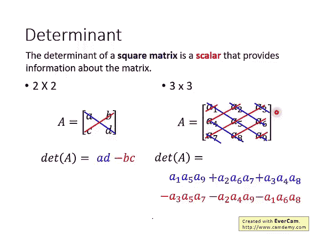

好他这个determinate是这样子的，这个matrix a的determinant等于matrix a的IMBURST，determinant的导数，或者是说呃因为这个A跟A的inverse。

他们的determinate有导数的关系，有导数的关系，所以F这个方选的JACCOIA，跟F这个方向的inverse jacobian，他们的determinate也有导数的关系。

这两项如果把JF区determinant跟cf inverse区，Determinate，他们中间会有导数的关系，那我要跟大家讲的就是这个结果。

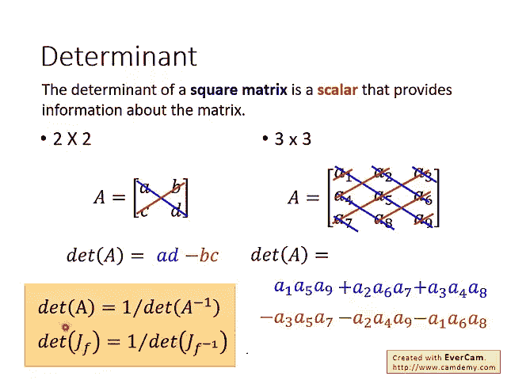

你要记得这个东西，然后determinate这个东西有什么含义呢，determined的含义我们等一下是用得上的，不是呃，每一本现代教科书都会告诉你，determinate有什么含义。

很多教科书就是直接给你个定义，那个套进去算一算啊，考试有可能会考，然后就结束了，这样子，那determinate这个东西到底代表了什么意思呢，determinate这个东西。

而如果是低维22的match或33的MATRI，你比较容易理解，如果是一个22的MATRI，你把它的每一个role拿出来啊，你把ab拿出来，把AB当做一个vector拿出来。

你把CD当中的vector拿出来，那matrix a的determinate到底是什么呢，matrix a的determinant取绝对值，就是AB跟CD这两个roll展开出来的面积。

就是它的DETERMINOR好，那这个33的matrix呢，你把33的matrix这三个roll拿出来，展开成一个立方体，这个立方体的体积就是这个3×3。

d matrix的determinate取绝对值，至少取绝对值，是因为determinate有时候算出来是负的，有可能是正的，等于负的，但体积一定是正的啊，所以你要取个绝对值。

你把determinate取绝对值就是体积，所以同理，你可以想象说，假设一个44的matrix，把那四乘，把那个44的MATRI的四个roll都拿出来，它就是展开出一个四维空间中的立方体。

但它也不能够叫做立方体啦，因为它在四维空间中的一个什么东西，它展开出来，这个DE他算出来，determinate就是四维四维空间中的体积，但这个体积要加一个双引号啊，四维空中那个东西并不叫做体积。

我也不知道该怎么描述它，它是一个它是一个东西，它是一个东西，你甚至可以想成是determinate，这样子好，所以这样大家稍微知道一下，determinant的物理意义，这个等一下是会用得上的。

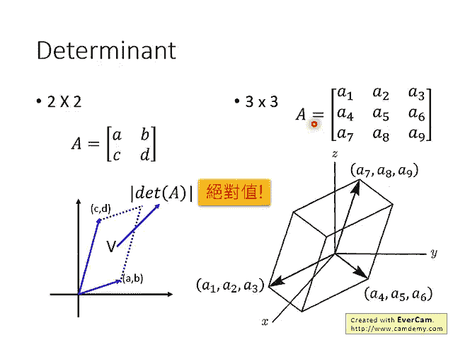

好，再来要讲这叫variable好，那刚才那个determinate，就是为了要解释change gevariable的部分，主要讲一下那个determinate好。

那change gevariable什么意思呢，假设我们有一个distribution pile of c，假设我这个Z带进F以后会得到X，这个X也形成了一个distribution到p o max。

我们现在想知道，POZ跟POX中间有什么样的关系，如果我们可以写出PYOZ跟POX之间的关系，假设只在知道AF的情况下，我们可以写出这两者之间的关系，其实你就可以分析一个generator，对不对。

因为这个是generator input distribution，这是generator output distribution，你写的出PLZ跟POX之间的关系。

你就可以知道generator给他一个input distribution，output到概会长什么样，这两者之间的关系写不写得出来呢，这两者之间的关系是写的出来的，我们现在问的问题就是。

假设在input这个Z的这个space上面有一个Z块，它通过F以后会得到一个FYZ派，他的probability density的value是PONZ。

PXMINE和popular density的value是p of x y，到底Python z派跟POPXY之间有什么样的关系。

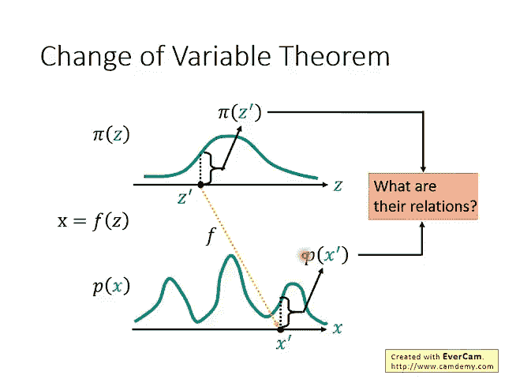

好，我们先举一个简单的例子来说明，我们要问的问题是什么，假设我们现在有一个distribution叫做POF，它是一个非常简单的uniform distribution。

它的分布就在Z等于零跟Z等于一之间，所以它只有Z等于零，跟Z等于一之间有值，其他地方probability desity function的值都是零，在Z等于零到Z等于一之间。

probability density的方向是一个固定的值，那这个固定的值的高度应该是多少呢，我们知道probability density function，它的积分呐要等于一。

就你把他有Z对所有的Z进行积分要等于一，今天既然这个底是一，那这个方形的面积必须要是一，所以这个高呢就是一，那这个都是机率学过的东西，我相信对大家来说都很都非常非常的简单，非常非常的直觉好。

那现在假设S跟Z之间的关系是，X等于两倍的Z加一好X等于两倍的Z加一，所以本来在零的位置，两倍的Z加一就跑到一的位置，摆在一的位置，两倍的Z加一就跑到三的位置，所以本来在0~1之间的分布。

通过这个方选F以后，这个方选F是二，Z加一分布就跑到1~3之间好，那这边本来是uniform的，所以跑到这边应该也仍然是uniform，那它的高是多少呢。

我们只要说这个distribution这个X的distribution，它的这个积分也要是一，那现在既然底变宽了，底变原来的两倍，那高度就会变原来的1/2，所以本来高度是一。

因为现在通过了F这个方式以后，把Z乘上两倍，所以底变成两倍的宽，所以高度就变成原来的1/2，因为这两个面积必须要是一样的嘛，这两个面积都是一，所以底变宽了，高度就变成原来的1/2好。

那现在从Z派到XP中间，这个POZ派跟P5XP中间有什么样的关系呢，你把POZ派乘上12就变成POXY，这个非常直觉，对大家来说应该都不成问题。

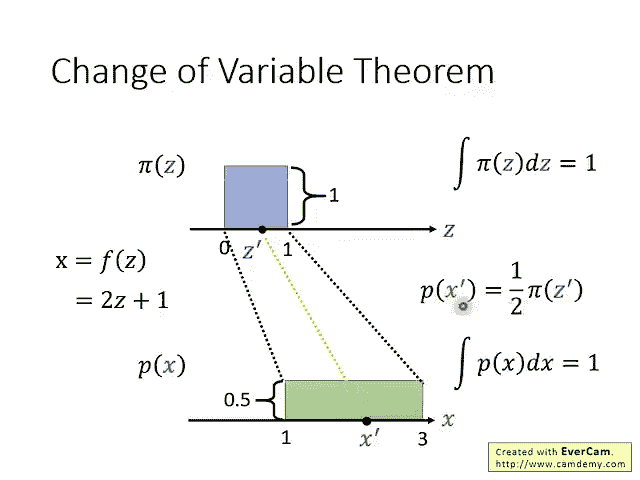

接下来我们来考虑更general的case，我们有一个不知他的方式，我们不太确定是长什么样子的distribution，叫做PALY，我把它distribution用个浅蓝色的线画一下。

那它通过一个transform以后变成另外一个distribution，叫做POX，我用浅绿色的线画一下，那本来在Z派的位置，通过了一个function f以后就跑到了X派的位置，本来在Z派的位置。

你的probability density是拍的Z派，跑到X派以后，你的probability density变成POX派，这个PLE，Z派跟p of s pi之间有什么样的关系呢。

我们现在并不知道说这个pd z in general长什么样子，pu x in general长什么样子，但是我们能不能够写出，假设我们知道中间的方程长什么样子的话，我们能不能够写出PC派跟PO和X快。

之间的关系呢，其实是可以的，这个就是全球variable的概念好，那呃，我们现在假设我们把Z派呢做一点小小的移动，从Z派的位置移到C派加DAC，我们把Z派加DAZ带到function f里面。

它会产生x point加DOTX，你可以想象说，本来分布在这一段里面的probability density，现在被拉宽分布到XY到XY加刘海X之间，那我们现在假设说在这个范围之内的。

Probability density function，可以把它看作是uniform的，因为从这个这个x point，这个delta z假设是一个非常小的值啊。

所以这中间的probability density就假设是uniform，而假设这个delta x这一段距离之内的，pability density也是uniform。

那这个uniform的值在这边等于POZ派，在这边等于POXY，这个时候我们就可以写出，POZ派跟POX派的关系，因为我们现在是把这个蓝色的方块拉宽，变成绿色的方块，所以这两块的面积是一样的。

所以蓝色方块跟绿色方块它们有同样的面积，所以P我们XY层丢台，就这个绿色方形的底层高，等于蓝色方形的底层高等于PAROZ派乘以DELTZ，现在把delta z挪到右边，这个没做什么大不了的事。

所以用XY等于PNZ派乘上DAZ除以DAX，就我们现在知道派有Z派跟POX派，它们之间的关系，它中间差的就是标AZ除以6TX，DAZ除以DAS是什么呢，假设这个DA非常非常小的话。

你就可以把DA换成D对不对，哎，就是所以这个德尔塔X分之delta z，就是X对Z的微分结束就是这样，就是X对Z的微分，那我们怎么知道X对Z的微分呢，如果你知道X跟Z他们中间的那个方选的inverse。

你就可以算X对Z的微分，所以在知道方向的前提之下，X对Z的微分是可以被算出来的，所以就可以算出他有Z派跟PO，X派之间有什么样的关系，那实际上他们中间的关系呢，要记得加上一个绝对要加上一个绝对值。

为什么要加上绝对值呢，最简单的想法是这个底X分之底，Z是有正有负的啦，对不对，微分可以是正的，也可以是负的，既增加X也跟着增加，或者X增加，下面是XX增加Z也跟着增加，这一项是正的底XN比例也正。

但是有时候X跟Z的关系是相反的，就是X增加Z可能倒过来，反而减少，这个也是有可能的，这个时候DX分之dz就会是负数，是是负的，是小于零的，但如果它是小于零的，也不会影响我们这一个式子。

因为我们本来是把这个范围内的东西，拉宽到这边，我们如果是改成，把这个范围内的东西拉宽到这边，虽然本来是左边跑到左边，右边跑到右边，下面，右边跑到左边，左边跑到右边，但是还有Z派跟POX派。

中间这个高度的关系仍然是不会变，所以我们直接把底X分之，底Z加一个绝对值就可以解，我们刚才说的这两个case实际上关系是一样的，但是这个微分算出来不一样的问题好，所以这边要加一个绝对值啊。

假如说大家有吼问题要问吗，好了，这边是一维的case，就假设Z跟X都是一维好。

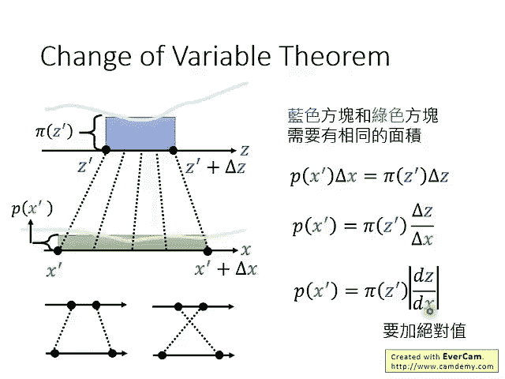

那如果Z跟X不是一维，是二维的，那是怎么样呢，我们现在就举一个二维的例子好，现在Z跟X都是二维的，Vector，都是二维的vector，现在把z pine丢到一个方式里面，他会得到XY。

现在我们要问的是z pine的probability density，pi of z派跟XP的probability density，这个POS派它们之间有什么样的关联性，好那这个我们现在假设啊。

我们在这个po z pl附近取一个小小的正方形，假设这个小小正方形之内的probability density，都可以写作PELSEA，这个小小的正方形的宽是DAZY，高是DADQ。

这一个小小的蓝色正方形，投影到这个XYXU的space上面，变成一个绿色的菱形哦，就左下角跑到左下角，右上角跑到右上角，那这一点可能跑到这一点，这一点可能跑到这一点好。

所以这个蓝色的方形通过一个function以后，变成绿色的菱形好，那这个绿色的菱形的面积，我们是可以算这个假设这个绿色的菱形呐，这个边这个边这个这个向量，它底下这个边的这个向量的是DA的。

X轴是delta x y y y轴是delta x2 one，这个向量它的X轴是da x1 two，它的Y轴是da x2 two，这个菱形的面积，可以直接用这两个向量所形成的矩阵的。

determinant的绝对值算出来，所以今天我们刚才有讲过，说PONZ派乘以这个正方形的面的体积，就拍我自拍，现在变成是这个正方形的高啊，第三维跟我就在跟投影片垂直的方向，只在这个投影片上。

我画不出来而已，这个po z pine乘以正方形的面积，要等于p of x pine乘以这个菱形的面积，所以式子写出来就是这样哦，这个啊KFZ派乘以标塔，ZY乘以标塔，ZQ跟PLXY乘以这个菱形的面积。

这菱形的面积怎么算呢，把这个向量跟这个向量拿出来，当做matrix的两个RO，把丢塔x1 one，丢塔x2 one，丢塔x1 y，丢塔x2 one跟丢塔x1 two跟丢塔x2 two。

丢塔x1 two跟丢塔x2 two拿出来变成两个向量，再去determine呢，再取绝对值，就是这个菱形的面积吧，菱形的面积乘以PLXY，应该等于蓝色方形的面积乘上拍2米派，就这样。

假如这样大家可以接受啊，好如果大家没有问题的话，接下来就是对下面这个式子做一番整理，就结束了，作一番整理就结束了，在进行整理之前呢，先跟大家讲一下这个delta x1 one，他是什么意思呢。

它是力望改变的时候x1的改变量，这个dota s two one是什么意思呢，它是z one改变的时候，s two的改变量DAXYQ是什么意思呢，它是ZQ改变的时候x2的改变的呀，啊说错x1的改变量。

它是ZQ改变的时候x1的改变量，那da s two two呢，它是ZQ改变的时候x2的改变量，这个是这个这四个delta x的含义。

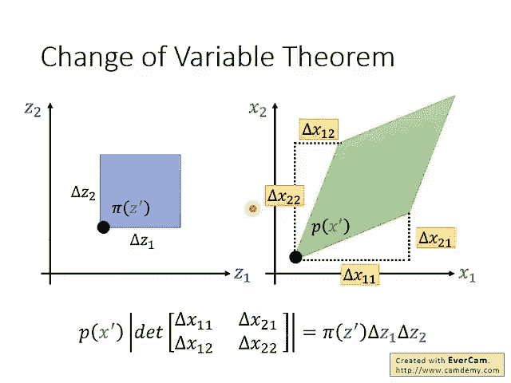

好那接下来就是做一发整理，做一发整理，首先把delta z one跟delta z two除到左边来来，除到左边来好，然后接下来呢你要把这个dota z one啊跟da z two啊，分别除掉，除进去。

determinate的第一个roll跟第二个roll，你把DHAY外除第一个row，把dhaz two除第二个弱，你可会问说，怎么不是直接上下两个roll都除，da zone跟DADQ呢。

没有为什么DETERMIN人的定义就是这样，懂吗，就是你你你你就是你你这个东西，把da z one提出来，跟da z two提出来，他们是会变成这个样子，就这一项跟这一项相等的。

如果你这边是上下都属da zone，跟da z two上下是不会不会相等的，这个有点难在这门课里面解释啊，就假设你线性代数很熟的话，你就知道说这个应该就是这个样子的，你把一个MATRIC成两倍。

它的determine呢不是变成两倍，如果这个matrix它的这个呃，他是个N百N的metro的话，你把它乘两倍，它determine的会变成二的N次方倍，DETERMIN呢就是这么回事，这样子哎。

所以这边你要让这个框这个绝对值里面的东西，跟这个绝对值里面的东西相等的话，那你是把delta zone除在第一个roll，把DADQ除在第二个RO，好那这个把DOTAXYY除以DAZY是什么意思呢。

DAXYY的意思是当z one改变的时候，x1的改变量，所以da x1 one除以delta，z one就是z one对XY的偏微分啊，就z one对XY的偏微分，同理dota s T1是什么。

dota s two one是z one改变的时候，x2的改变量，所以da x2 one除以da z one，就是z one对s two的偏微分，同理下面这两项也都可以分别画作是偏微分。

然后接下来我们把对角，我们把这个矩阵呐做这个transpose，一个矩阵做transpose，不会改变它的determinate，好一个矩阵做乘pose不会改变它的DETERMINA。

所以我们可以放心的把这两项做对调，不会改变它的DETERMIN的好，接下来这一项是什么呢，这一项其实就是function f f的jack hobia的match哦。

所以我们知道说p of x pine跟pi of z pine，之间有什么关系呢，你把p of x pine乘上，现在这个S跟Z之间的关系的。

这个function f的jakia mess determin在一起，绝对值就变成pile1块，就这样，所以POZ派跟POXY之间的关系，是可以写出来的，他们中间就差一个甲抠扁。

那你可以把这个甲co扁除到右边去，你可以把这个甲抠扁除到右边去，然后这个甲COBE呢一除以DETERMIN了，JF可以换成determinate jf的IMPRES，所以你就知道说。

POZ派要怎么变成POFX派呢，你把POZ派乘以f f inverse这个方式的加，后面再去点terminate，再去绝对值就变成POXY，这个就是全球variable，如果刚才讲的东西你没有听得很懂。

那你唯一要做的事情就是背下来这两个式子。

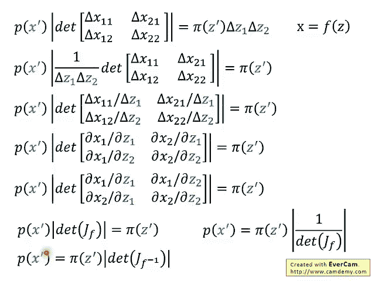

知道说如果今天Z乘三个方向，F会变成X那Z的distribution跟effort distribution，他们中间的关系就是差一个JCB的，determinant的绝对值就是这么回事。

好接下来我们就进入flow的部分。

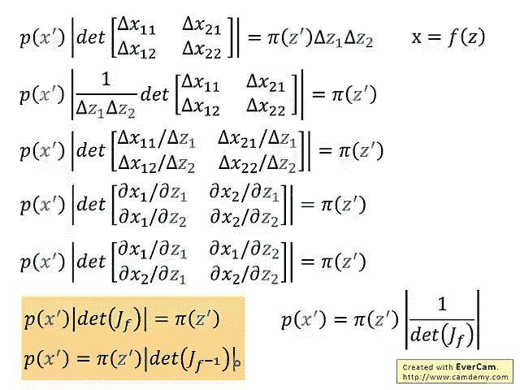

把我们刚才学到的圈9variable的式子呢，写在右上角好，那我们回到generation这件事，我们说generator啊是怎么称出来的呢。

generator训练的目标就是要maximize pg of xi，xi是从real data里面sample出来的一笔data，我们需要maximize pg of xi，那pg和SI长什么样子呢。

有了change of variable的formulation以后，我们就可以把pg of x i写出来了，因为P区我们XI等于PDLE，ZI乘上居inverse的JCB的determinant。

再取绝对值，我们就带这边这个change change your variable的式子，我们就得到P只有xi跟拍的VI的关系，而ZI是把SI带进g inverse以后，得到的结果就是P呃。

把SI带入g inverse后的结果就是ZI好，那我们可以把这个p gon xi呢取log啊，左右呢都取log，所以log p g用xi等于log拍的，把这个ZI呢换成g inverse of xi哦。

等于pi of区inverse of xi，加上log she inverse jakia mesh的determinate，绝对，所以现在我们知道log p9FX来长什么样子，就是这个样子。

那我们只要能够maximize这个式子就结束了，就可以TRAGENERATOR，但是想要maximize这个式子，假设你用gradient design，maximize这个式子。

那你得知道这一个我们要maximize的function，长什么样子，而要知道这个function长什么样子，有一些前提，有什么样的前提呢，首先你要知道怎么算这个g universe。

JCOBIAN的determinate，那或者是说你要知道怎么算G的，JCBEAN的determinate，要算generator的讲后边还比较有办法。

因为你只要知道你怎么计算partial z分之PARTIX，你怎么计算Z对X的变化，你就可以算G的角co边，但是这一个讲hobia metric可能很大，如果你今天input是1000维。

output是1000维，那这个讲后边的metric就是10001000那么大，那这么大的matrix要算他的determinate，是非常花时间的，22的matrix你会算DETERMINAL。

3×3，你会算DETERMINAL，再大一点，就运算量就非常可观了哦，所以今天我们需要好好设计我们generator的样子，让他的讲cbe a matches很容易算determinant的。

那第二个条件是，今天我们需要能够把SI变成ZI，所以我们必须要知道she inverse长什么样子，这个generator如果他是一个network的话，你要计算GOZ不成问题。

但是我们如何保证我们有办法算区inverse呢，我们也要好好的设计下内work架构，让区inverse变成是好算的，变成是容易算的，变成是可以算的，为了确保G它会是INVERTIBLE的。

所以其实在做flow base model的时候啊，Z跟X他们的dimension都会是一样的好，所以假设说你现在是要做image的generation。

那image通常一个pixel有三个channel，那假设现在你要产生的是，100100的大小的image，那你input这个Z，你这个input这个Z它的大小啊，也得是100×100乘以三才可以。

你input z跟output x的dimension必须是一样，他们input和output dimension是一样，并不代表G1定是invisible，但如果他们不一样的话。

那局就不可能是invisible，所以今天至少Z跟X的dimension必须是一样，接下来我们设计NEWORK架构，让g inverse变成是很容易计算的啊，所以这个for base model啊。

他跟店不太一样，你知道在做game或者在做VA1的时候，你的选择RATOR都是input个low dimensional的vector，然后output一个high dimension nodeb。

也就是Z的dimension远小于XZ的每一维，它代表了某种我们产生image的时候的factor，那flow base model不是flow base model。

input和output z跟x dimension居然是一样的，那这个是我觉得for base mother的问题，这一点是有点奇怪的好，然后现在既然我们要能够算G的，加后面的DETERMIN等等。

跟算g inverse，我们显然必须对G做一些限制，所以居它没有办法是任意的，network不好，不像我们今天在做game或者VA1的时候，G可以是CNN，也可以是RNN，它可以是任何的network。

这并不影响我们的演算法，既然既然我们对G的内work架构很大限制，那么就意味着G的能力是非常有限，既然车在能力很有限。

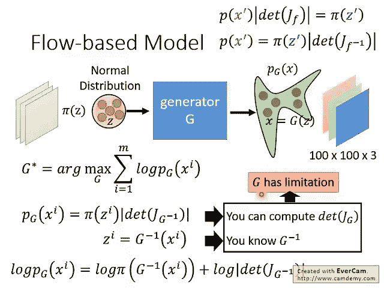

那怎么办呢，一个G不够，你有加第二个吗，所以今天four base model的for的意思，其实就是它有一长串的G，就好像是一条河一样，就类叫做flow base model好，所以我们叫g one。

g one呢，他是拍的max当做input output，p one的FX，接下来p one of FX变成G2的input，产生p two office，p two of x变成G3的input。

产生P3of fex，你可能会叠一大堆的generator，把这些generator统统合起来，单一个generator可能他的能力有限，但所有的generator concatenate起来。

所有的generator compose起来，那他们的能力应该就很可观了，好那我们现在看一下拍跟p one的关系，我们可以写出来POZI乘上g one的inverse。

JACCOBIAN的determinate，再取绝对值就变成p one，那p two呢，p two就是拍到ZI乘上g one的inverse jcbe，再取determinate，再取绝对值。

再乘上G2的inverse，再去加COOPIA，再去determinate，再取绝对值，最终就得到p two，那假设我们现在叠K个generator，最终产生出来的distribution是pk。

那这个pk怎么算呢，你就把一堆的generator的inverse的讲，后边的determinate的绝对值通通乘起来，就得到了pk好，那我们可以对pk取一下log啦，就左右同取log。

那本来相乘就变成相加啊，那这个ZI是什么呢，这个ZI就是呃你有sample到一个real data si吧，这个SI呢通过GK的inverse，再通过GK减一的inverse。

一直到通过g one的inverse，最终呢就得到BI，而接下来我们在训练的时候，我们需要maximize这个probability。

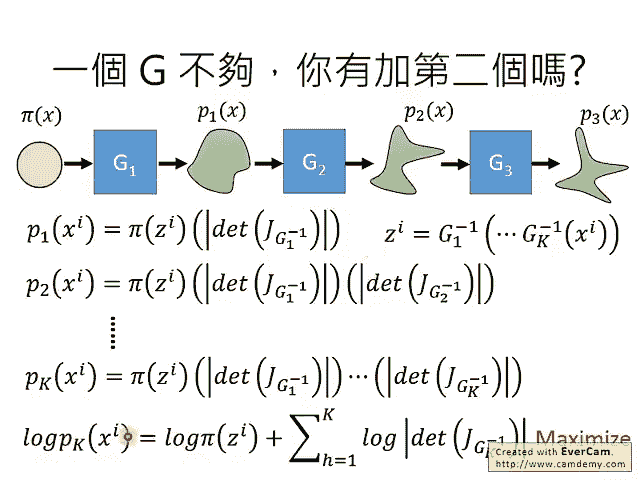

那实际上我们是怎么train这个flow base model的呢，我们先假设我们只有一个generator，我们先考虑一个generator的case，那时候多个generator其实也是一样。

你会发现说，在我们的这个pg和xi这个式子里面呢，其实只有出现g inverse，其实只有出现g inverse，所以实际上我们在训练的时候，我们训练的是gin verse。

我们训练出GAM verse以后再生成的时候，我们把g inverse倒过来，又摇身一变，本来是吃X产生Z，但是摇身一变把车倒过来，那就产input z产生X的，但实际上在训练的时候呢。

我们会从real data里面simple1些xi出来，然后把xi丢到g inverse里面，然后我们就得到ZI好，那我们先来看看我们上面这个式子，这边有两项，第一项。

我们希望把xi丢到g inverse output的这个ZI，可以让log拍到ZI越大越好，我们如果让第一项越大越好，怎么做呢，最容易的做法是，因为我们知道PC的normal distribution。

No more distribution，这个拍这个function input是什么样的东西，会让算出来的几率最大呢，如果input zero vector算出来的几率最大啊。

所以今天如果我们单看第一项的话，generator这个generator的inverse，他会想要做的事情是让output呢都变成zero b。

但是如果今天generator的inverse output都是zero vector，那显然是会有非常大的问题的。

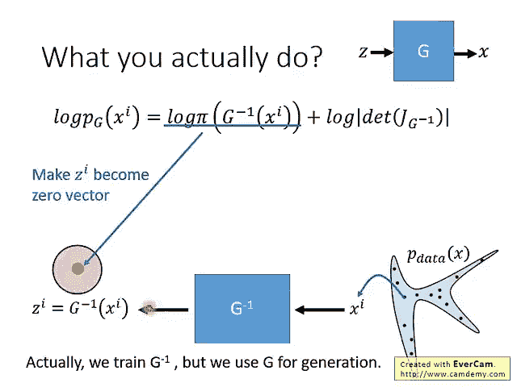

好在我们还有第二项，第二项做的事情是什么呢，如果今天ZI真的统统都都是零，如果你为了要maximize第一项，让ZI通通都变成零的话，那g inverse讲COVI就会变成zero matrix。

因为你input不完，input什么x output通通都是零，input什么东西，output都没有用，output都不会动，input input什么东西，output都不会动。

那你算出来的gradient当然是零，那g inverse加COLIN单词zero metric，Zero，mattress that determinate是零，如果这边带零进去取log。

你就会得到负无穷大，那这样子就没有办法，Maximize pg of f x i，为了maximize pg of si，我们必须同时考虑这两项，一方面第一项会让所有的Z往原点集中。

但是这一项又会要求他对这个g inverse，做一些限制，让他不会把所有的Z统统都making dozero b呃，这就是我们实际上在做for model的时候所做的事情。

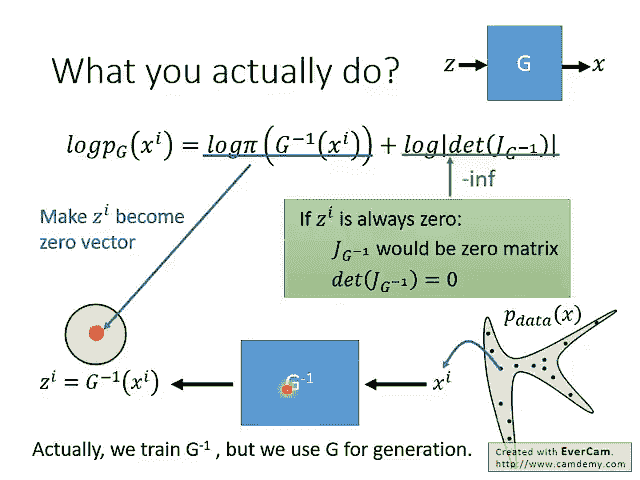

使用的G叫做coupling layer，这个被用在两个知名的flow base model，nice跟real MVP里面，copy lier的意思是说你input是个vector。

叫做z output，Y个vector叫做X我们把Z拆成两部分，Z的前提前D维为一组Z的，后D维为另外一组好，那Z跟X中间有什么样的关系呢，X的前低位是Z的，前提为直接复制过去。

然后我会解释说为什么直接复制过去，因为发现说这样的设计，就是为了要让inverse非常容易被计算，直接卡比过去好，接下来我们把前低维通过某一个function f。

得到一个跟后后面这些维度低维之后的东西，D维之后的东西改MENSION一样的back，这个back里面element，我们用贝塔11到贝塔大D来表示，我们把这个前低维也通过另外一个方式。

H它得到伽马D加一，跟伽马T这边的这个F跟HR可以是任意方式，它不需要INVERTIBLE，它要多复杂都可以，它可以是deep network，可以叠个十层八层，可以是CNN通通都没问题。

等下会讲说为什么F跟H它可以是任何方式，不用是invisible。

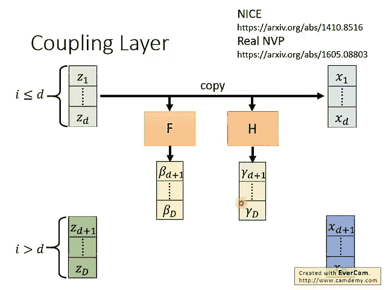

通通都没问题啊，要多复杂都可以啊，接下来呢把这个vector乘上这个vector，这个这个符号意思是这个element wise相乘的意思，把贝塔T加一乘上，立即加一到贝塔大D乘上Z大D。

然后再把这个vector加上去，加上伽马这个vector哦，所以把伽马T加一加上这两个相乘，把伽马D加上这两个相乘，就得到X11到X大一好，所以这个呃output这个X啊。

在低维之后的东西就是ZI乘上贝塔，再加上伽马好，接下来要讲说这一个copy layer怎么取它的inverse，他的inverse非常的简单，如果我们现在不知道前面的Z只有后面的X。

怎么把前面的Z找出来呢，前面的Z的前D为非常容易找，直接复制过来就好，把X的前低位复制过来，就是Z的前低位好，那Z的剩下的ZD加一到Z大于D要怎么找呢，你既然已经找出前D，为了把前低位通过这两个方向。

这两个方向不需要是INVERTIBLE了，他们是正向的，直接算把这个vector通过这两个方程，F跟H你就得到贝塔跟伽马，现在你把好，你把这个X啊减掉伽马再除以贝塔，就得到Z就刚才我们是把Z乘上贝塔。

再加上伽马得到X，现在我们把X减掉，伽马再除以贝塔就得到Z，所以我们现在有X你就可以轻易的把Z算出来，所以这个方向design，让你可以非常容易的把它的inverse算出来，这是第一件事。

再来我们说不只要能够算inverse，还要能够算JACCOBIAN的determinate。

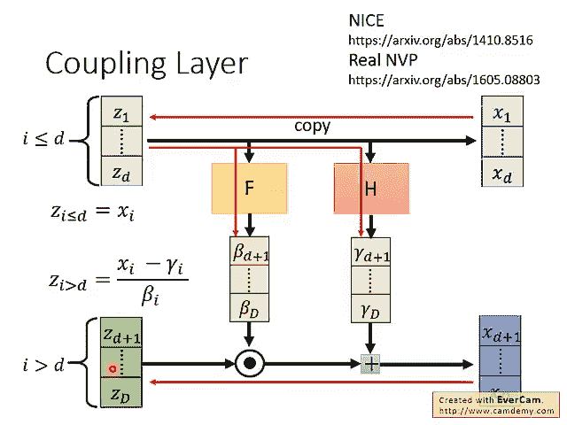

好，这个company layer怎么算加后边的determined呢，它是这样算的，这个是input的Z啊，这个是input的Z啊，这个是output的X，这是output的XZ可以分成两半。

X也可以分成两半，接下来我们先看这个半步跟这个半步，这个半步对这个半步的讲后面长什么样子呢，这个半步在这个半步的讲，后边就是identity matric，对不对。

因为呃你是直接把z one卡比变成x1，你直接把ZD卡比变成XT，所以今天z one跟ZD是完全没有关系的，今天ZD跟x1是完全没有关系的，所以除了对角线的值是一以外，其他部分通通都是零。

浅蓝色的这个vector就是浅绿色，这个vector复制过来的，结果你改变深绿色vector，这里面的值不会影响浅绿色vector里面的值，你改变这个部分的值，根本不会改变这个部分的值。

所以你拿这里面的element去对这里面的element，做偏微分，你得到的是零，所以这边是zero b，那左下角呢，左下角i don't care这样子，为什么i don't care呢。

因为如果左上角是identity matric，这边是zero vector的话，这整个matrix的determinant，会等于右下角这个部分的determinate，你说为什么呃。

就是对这个东西要determinate，就是这个东西的determinate这样子哎，就如果这边是identity matric，这边是zero zero metric。

这整个灰色的大的MERCHDETERMINER，就等于右下角determiner，所以我现在唯一在意的就是，右下角这个部分长什么样，只要知道右下角长什么样子。

右下角这个matches the determinate算得出来，那它等于大的matches determin，右下角这个matrix它是DIAGONONO的，它是DIAGONO的。

为什么它是DIAGONO的呢，因为我们先把这两个vector之间的关系，把它画出来，因为xi等于就是这深蓝色的vector里面的X等于，深绿色里面的Z乘上贝塔加上伽马，所以今天ZD加一只跟XD加一有关。

Z大D只跟X大D有关，ZD加一跟X大D没有关系，B大D跟ST加一也没有关系，所以只有对角线的地方是有磁的，其他地方都是零一个MATRI，如果他是打工弄的，你算他的determinate。

你就只要把对角线乘起来就好了，你只要把对角线乘起来就好了，所以今天这整个MATRIC，这整个jahobia metric determinant，就是这一个右下角的matrix的对角线相乘。

也就是把z d one对SD加一的偏微分乘上，z d two对SD加哎，ZDZD加二对S12的片尾分，一直乘到Z大D对S大D的片尾分，这里面每一项偏微分是什么呢，这边每一项偏微分就是贝塔。

所以今天这个假con的determinate，原来就是F这个function output的这个element相乘，就是讲后面了结束这样子，所以今天如果这个company layer。

他的假copy也是他的甲COVIAN的determinant，也是可以轻易的被算出来的，那也许左下角非常的复杂，因为我们说F跟H可以是任意复杂的方式，因为这边有一些些变动，那通过这么复杂的方式以后。

这边变动一定很复杂，但是i don't care，反正我算DETERMIN的时候也是用不到，左下角这个地方。

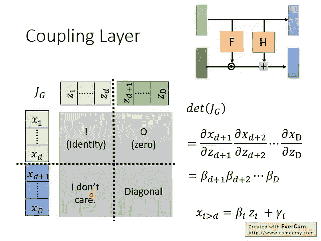

好那我们会把这些carplay layer叠起来，变成一个完整的generator，当我们把这些copy类叠起来的时候，会有一个莫名其妙的问题，这莫名其妙的问题是什么呢。

我们说我们在这个company ne的input和output关系，都是把前半段直接复制过来，所以如果第一层直接复制过去，第二层直接复制过去，第三层也直接复制过去，最后就是什么都没有做这样子。

所以你会发现说哎，你这个output image的前面的部分就是input noise，就你的image，假设这个这边这个部分对应，那INI的左上角的话，你左上角就是这是个noise。

这样这样显然不是我们要。

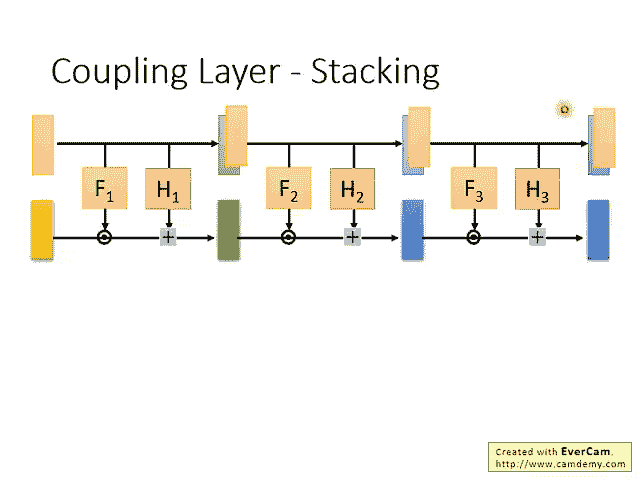

所以在叠这个咖啡layer的时候啊，要做一些手脚，举例来说，一个可以做的手脚是故意把它反向，就是第一个copy layer是复制前面，第二个capital layer就变成复制后面。

第三个CAPITLAYER在变成复制前面，这样子你第一个layer到第2layer这边复制过来，那下面这边也复制过来，上面这边再复制过来，你就但是你就不会把原来input的这边，所以原来最开始的地方。

这个是从那个random的高学NOISAMPLE出来的，又不会把高学noise一直带到最后的output，因高学noise只带到第一层以后，它就会通过1transform就会变成别的东西。

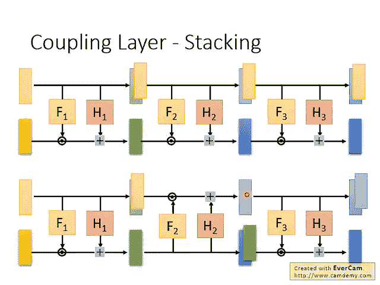

话呢我们再讲更具体一点，如果你今天要做的是影像的生成的话，所以一般我们在做gain的时候，很常用的application都是生成image，如果我们今天要做的是image的生成的话。

那你怎么把一张image拆成两半，一半copy1半做一些其他事情呢，那有两种猜法，一种猜法是你把image里面呃index就index有两个嘛，有纵轴和横轴的index嘛。

纵轴和横轴加起来是这个偶数的卡比，奇数的不卡比做选错讲，这是一个做法，你可能有些layer是奇数的，卡比偶数的做transform，而有些layer是偶数的，卡比奇数的做全form或者是啊。

现在一张image通常都有三个channel嘛，RGB3个channel嘛，按们要put r g b3个CHANNE，你input的每一层通通都会是有三个channel的。

那你就其中某几个channel做copy，某几个channel做transform，那每次copy这channel跟全form的channel，可能每一层都是不一样，就在实做的时候。

这两种case你也可以交替使用，就你有时候是这样，有时候是这样，他们可以交替使用好，coupling layer是一个例子好，那第二个例子叫做11的convolution。

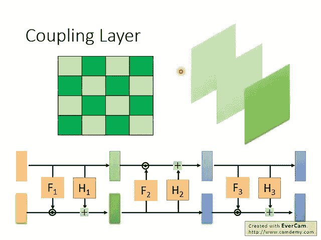

这是用在一个呃非常知名的low flow，face model叫做glow里面，那之所以最近作用，你知道four这个model其实很早以前就被提出来了，举例来说。

我们刚才讲的那个nice或real MVP，都是14年一五年的东西，那就是45年前的那道，在我们在deep learning这个community，45年前的东西，就是上古时代的东西。

这样就上古时代的东西，为什么最近又被人挖出来再讲呢，那就是因为有blow这个model b，这个model是去年被提出来，那它的结果很精湛，我我是觉得他的结果应该是。

还没有电影看起来产生的音乐quality那么高啊，但是重点就是说哇靠你不用gay也可以做到这样，有他的感觉是这样，你这不算变身者的哎，怎么会这么厉，怎么才能出玉米，觉得这么清楚，这样子。

那做这个model里面，它有一种除了刚才讲的coupling layer以外，它还有一个神奇的layer，叫做11的convolution layer，这是这是你的input thy。

这是你的output x，我们知道这个，因为我们现在要产生的是image，那每一张image就是由很多pixel所组成的，每一个pixel里面呢都有RGB3个value，每个pixel里面都有RGB3。

在globe的折射model里面呢，它的11的convolution就是把这边的每一个三，每一个pixel里面的三个value，乘上一个33的matrix，变成看output的。

对应到同样位置的pixel3个value，就是你把这三个value乘上一个33的match，还是33的vector，对不对，你把这个33的vector乘上，这个match还是33的vector。

那它本来放在最左上角，就把它放到最左上角，那第二个pixel的三个value乘上这个MATRI，再变成另外三个value，就把它放在第二个PISO位置，在整张image都做同样的事情好。

那这个W有什么含义呢，这个W隐含的一个意思，那么实际上这个W是认出来的，并不是人手design design，并不是人手设计的，但他很有可能做到的意思是，他可以shuffle不同的channel。

所以如果你有11的convolution，那你的couple layer可以做固定说，我都只copy第一个channel，反正现在有11的convolution。

会在适当的时机把不同的channel进行对调好，举例来说，假设你今天认出来的W长得是这个样子，每一个弱只有一维是一，其他都是零，你现在的input，你现在的input，这三个value是123。

那通过这个33的matrix，它会得到什么东西呢，会变成312好吧，这个vector乘上这个metric变成312，等于就是你把本来第三个channel的东西，挪到第一个channel。

把第一个channel东西挪到第二个channel，把第二个channel东西挪到第三个圈，你等于就是让鲁迅自己愣，说他要怎么交换这些channel的位置，然而company layer就不要动它。

copy layer可能都只固定copy某几个channel，但是channel中间要怎么交换，让W自己学出来好，那这个东西也是我们的G，它也必须要是IMPROTABLE的。

那这个东西能够INVERTIBLE吗，如果W是一个INVERTABLE的mattress，那它就是invisible的，对不对，如果W是一个INVERSIBLE的matrix。

给你X你就可以还原回V对不对，我想这个大家应该都没有问题吧，而且W它只是一个33的MATTRI，33的match，它的inverse是有公式解的，直接带进去一个公式，output就是他的inverse。

但是W认完W是自动认出来的，认出来一定是INVERTIBLE的吗，go这边paper没讲样子，你你知道答案在跟我讲好了呃，他在initialize的时候。

他故意把W用一个INVERTIBLE的matrix，去做initialize，也许他期待说如果initialize的时候是invisible的，愣完以后他仍然是invisible的，但会不会有愣完以后。

突然让invisible的情形出现出现，这个就呃就很难讲这样子，那但是另外一方面而言，VERTIAL这件事情是比较容易出现的，就你随机sample个metric，通常都是INVERTABLE的。

你随机sample一个metric，要是正好不能inverse是比较难的，为什么你想想看呃，一个matrix不能inverse的条件是什么，它DETERMIN了，正好算出来是零。

才会不能inverse啊，那determinate只要算出来是别的值，通通都可以inverse，所以你随便sample一个matches，通常都是可以inverse的。

所以也许一个MATRIC或能能不能，这个W是不是INVENTITABLE，问题不大，因为可能随便论一论都是invisible，总之总之我在paper里面没有看到太多，这方面的解释啊，如果你知道的话。

你就告诉我好了。

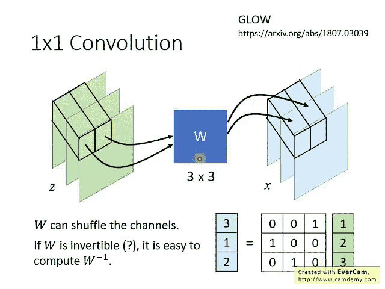

好，那接下来我们要看说从这个什么地方，到这个地方，它的讲后面的determinate，好好好，他讲后面的determinate，我们先来考虑一个比较简单的K，假设有一个简单的方式叫做N这个简单的方式。

F做的事情就是把Z乘上一个33的match w，得到X也就是说呢这个AF呢他做的事情就像右，就像右上角这个样子，那它的甲coin长什么样子呢，它的甲COBE直接就是WB直接就是答题。

就是假设你把一个三三维的vector，Z乘上一个math w得到三维的麦克X，那这一个方选FF他讲coin长什么样，你要自己算一算，他讲coin就直接是这个W，他讲COBE就直接是这个W。

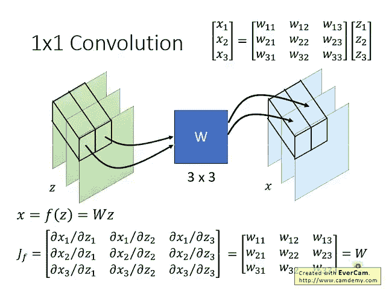

所以现在这个全部的input，这个Z跟全部的output，这个X这一假设你有个generator g吧，这边东西吃进去，但所以实际上做operator很简单。

就是每一个pixel统统都乘上W得到output这个X，你把这个东西吃进去，得到这个output的X，他的generator的这个角后边长什么样子呢，它的generator讲co边就是对角线的地方。

放一大堆33的matrix stu，点放一大堆33的matrix stu，因为这边假设这边每一个vector，都是一个三维的vector，他们都代表在这个image上面的一个position的话。

只有对应到同样的position的蓝色，跟绿色的vector是有关系的啊，这种对应到同样position的蓝色，跟绿色的vector是有关系的，而这个vector跟它就没有任何关系。

所以只有对角线的地方，你要放match w，其他地方值都填平这一个jacoby and the matric，它的determinate是什么呢，如果你线性代数够好的话。

它determinate就是W的determined的D乘以D次方，假设这边有D乘以D的三维的vector，假设这个image reresolution它的解析度是D乘以D。

总共有D乘以D的pixel的话，那这一个matrix，它的甲coin就是它的甲COVI的determinant，这个这个jahobia matches的determinate。

就是W的determinant的第一乘以第一次方，那这个如果你重新线性代数的话，你就知道为什么，如果不重新线性代数的话，你就不知道为什么，反正他就是长这个样子就是了，那W的DETERMIN能不能够算呢。

可以算的，因为W是一个33的矩阵，33的矩阵的determine的公式，高中就我教过你了，你只是把它再乘一个D乘以D次方而已，这个你是可以算的，就这样好，那刚才讲说for base mother。

有现在一个很知名的结果，就是gal那个model，那glow那个model结果真的很好，那你可以google一下这个OpenAI，有做一个model的demo的website，也可以。

他是把它圈在那个select a那co本上，就可以拿它来生成人脸，那几年前生成人脸这个case还非常的潮，不过现在可能看起来就是没那么潮就是了。

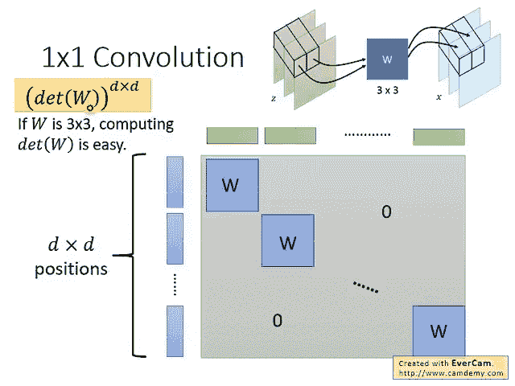

那在open i的那个demo website上，你就可以做到的事情是。

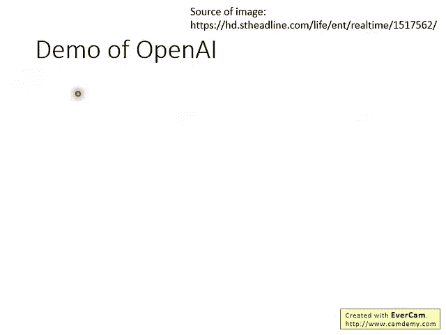

比如说你可以把两张人脸miss在一起，举例来说，这边有这个志玲姐姐的脸，跟她的老公的日本人，我也忘记名字了的脸，这样子好，那我们把志玲姐姐的脸呢通过generator的inverse。

你就会得到它的Z叫做z one，你把她的老公通过g inverse你就会得到ZQ，你再把z one跟z two呢做平均，然后再把这个平均的vector，就是你可以想象说，如果他们这小孩应该长什么样子。

就是这两个vector的平均通过卷的rapper以后。

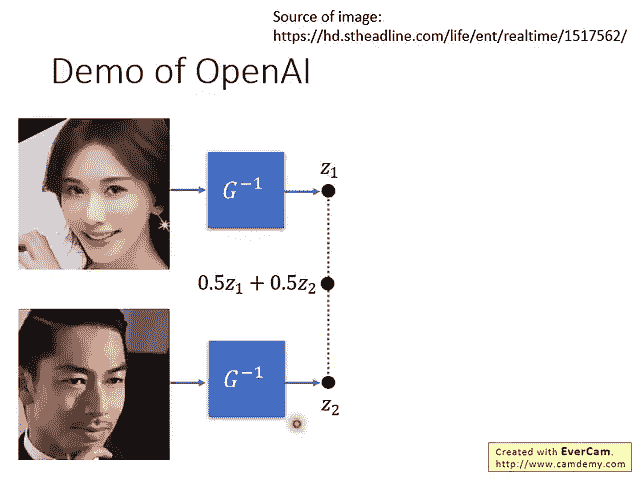

我发现是长这样子啦，哈哈这个这个厉害的地方是什么呢，就是我刻意剪一个脸，他是看左边的，他是看右边的，合起来居然是自动知道要看中间，这样下一半边是黑的，一半边是白的，背景有点奇怪。

但是它自动知道看左边的脸跟看右边的脸，做interpolation做结合以后，就变成是看中间的脸，那他在那个demo web page上面也有一个功能。

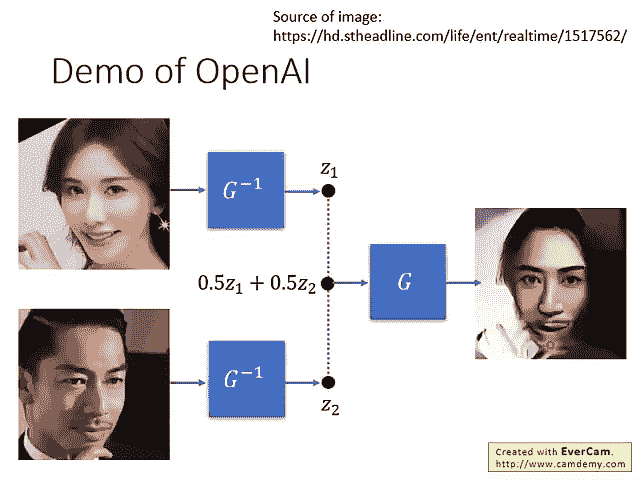

是可以把那个脸做种种的变形，比如说变金头发，或者是让一个人笑起来，怎么让一个人笑起来的。

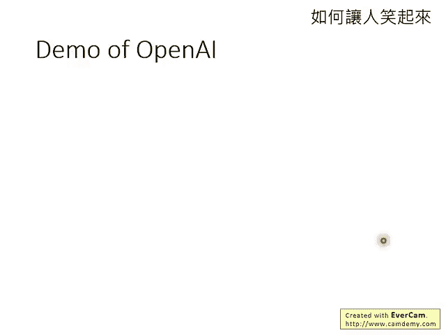

他的做法是这样，你必须要先收集一堆不笑的脸，然后再收集一堆笑的脸，这个部分是需要人去label的，你需要收集一些笑的脸跟一堆不笑的脸，然后呢把不笑的脸的Z都找出来，取一个平均，把笑的脸的Z都找出来。

取一个平均，你把这两个平均相减，你就知道Z的space里面往什么方向移动，会让一张脸笑起来。

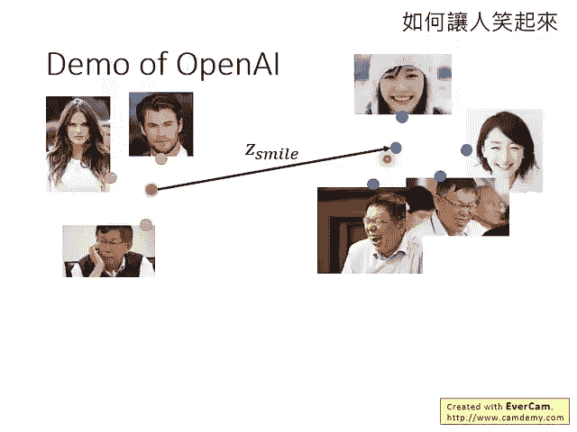

所以你现在就给他看一张脸，其实这个脸本来已经在笑了，这是个死臭酸宅。

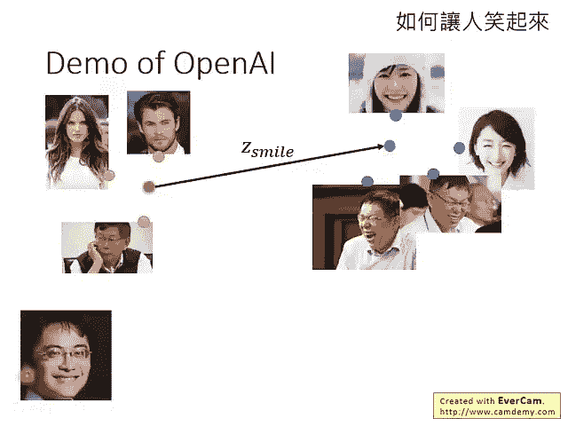

这只是皮笑肉笑而已，这样然后把它通过一个G的inverse，得到一个vector z，把Z呢再加上z smile。

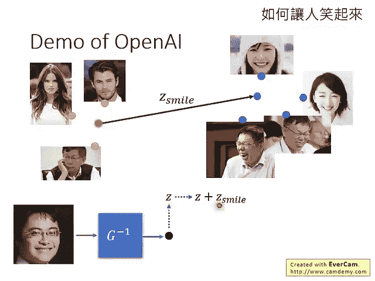

然后再通过选择RATOR，他就笑起来了，就笑起来，你看这边这个他就笑起来，这边牙齿就变得比较多，你看到你看没这个牙齿变得很雪白了，就就笑起来了，就笑起来了，总之这个demo的WPAGE在这边好。

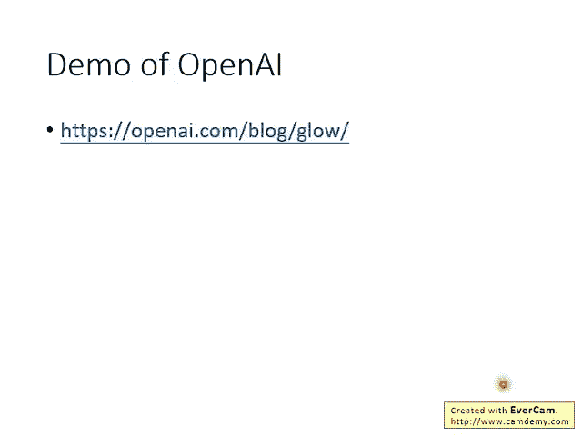

那这个go呢还可以做什么事呢，go现在最常做的应用就是拿来做语音合成，我们刚才讲说语音合成，不知道为什么到目前为止用game都做的都很差，不知道为什么就很惨，这样子用电做语音合成总是没有特别好的结果。

那auto regression model就是一个一个sample产生出来的，结果很好，在刚才问题有讲过，说产生疫苗声音要90分钟，这个使用上怎么可能呢，所以要用gal的model。

比如说这边有gal的变形，一个叫parallel west name，一个叫WEGO来做语音的生成好，那这个就是go的部分，那因为时间关系，我们就赶快停在这边，接下来要请作业前五名的同学呢。

上台来讲一下他们是怎么做的，好在我们这边先休息个3分钟。

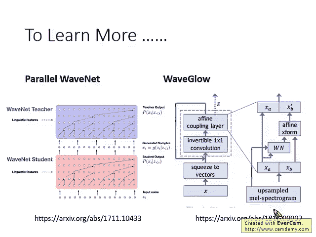