# 李宏毅2024春《生成式人工智能导论》 - P3：（延申）80分钟快速了解大型语言模型 - 啥都会一点的研究生 - BV1BJ4m1e7g8

好那今天这堂课呢是80分钟，快速全面了解大型语言模型，那大家知道说今天大型语言模型最知名，最具代表性的例子就是全GBT，那我想问，不用花时间告诉你说全GBT有多么厉害，我们就举一个例子吧。

我们把期中考的考题丢给change gvt，看看他到底能不能回答呢，我们刚考完期中考，所以对这些题目呢你一定是记忆犹新好了，第七题呢有五个是非题教你答，他是true or false好。

那我们就把这些题目原封不动的丢给chat，GPT啊，这边实际上用的是他最新的版本的GPT，four了，我们丢给g p t four看看他会说什么吧，那我这边呢是把题目原封不动的丢进去。

唯一改变的地方是我把不需要解释过程，这句话拿掉，那其实这句话呢会影响大型语言模型的能力，这一项我们还会看到更多相关的例子好，那除了把这句话拿掉以外，其他部分都原封不动，直接丢给chat gbt。

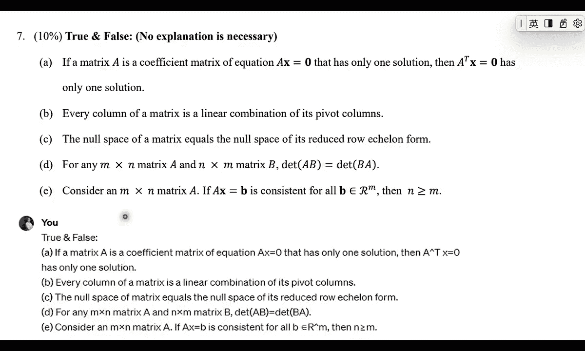

看看他的答案是什么，好，这是确切T第一题的答案了啊，第一题的答案，第一题第一题是问你说啊ax等于零啊，它呢是只有这个唯一解，那问题transpose x等于零，这个是不是只有唯一解呢啊。

那确GBT的答案是F那force其实是正确的答案，但如果你仔细读一下它的说明，会发现说其实确GPT对这个问题呢，他并没有理解正确，比如说他一开始就说A呢。

是个INVERTIBLE的square matches，但其实这个题目从来没有告诉过你，A的应该是square invertible admrc，其实change gt在这边有点误解。

虽然他这个答案最后是是说是错的，也就是他答对了这个是非题，但是呢这个算是蒙到的好，但是我相信说其实应该是蛮多同学没有注意到，说这是一个陷阱题，A不一定是INVERTIBLE的。

因为A呢它甚至可能不是一个方形的矩阵好，不过没关系，那我们再来看第二题啊，所以确GB题这一题算是答对了啊，那我们来看第一小题，第一小题是问你说是不是一个矩阵里面的。

每一个color都是ppp color的linear combination，选GBT说对好，这一题选GPT是答对了好，第三题问你说这个一个矩阵的north space。

跟它的reduce roh r phone的north space是一样的，这一题答案是对的。

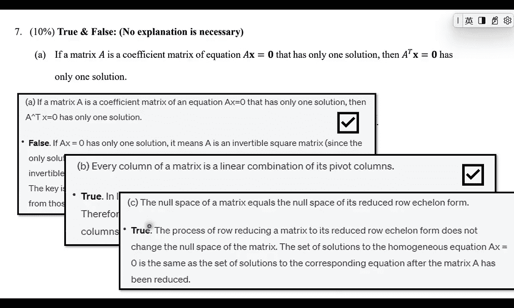

TRAGT也答对了，而如果是第四题呢，第四题问你说，这个determinant ab是不是应该等于determined b，ACHEERT说啊，这个叙述是对的啊，因为他也没什么解释。

他说反正这个就是一个很知名的定理了，determinant ab等于determined ba，我相信在考试的时候，很多同学也都是这么想的，但事实上这一题呢TRAGBT答错了，这是一个陷阱题。

当A和B如果都是方形矩阵的时候，这个叙述是成立的，在这边并没有告诉你，A跟B是方形的矩阵，A是一个N乘以N的矩阵，B是一个N乘以N的N的矩阵，这是个陷阱题啊，确GBT打错了，那其实多数同学也都答错了。

这好那第一小题啊，但这个也是一个基本的概念题，那多数同学都可以答对，选举个例也可以答对，整体而言，在五题里面呢却GPT答对了四题，那其中三题呢它就如果你读他的解释的话，你会发现他是真的有了解这个题目的。

剩下两题是瞎猜的，一题猜对猜对一题猜错，那其他的能力蛮惊人的，基本上这五题是非题里面呃，有三题是比较简单的，切GPT都答对了，剩下两题其实是陷阱题，那对多数同学来说，如果你没有答对，你也不用觉得沮丧。

因为那两题就是就是不太容易的陷阱题了，那让大家没有办法，这个拿到100分的这个陷阱题，然后去GBT也没有办法答对啊，所以让你知道说今天这个大型语言模型，今天的人工智慧他的能力到什么地步。

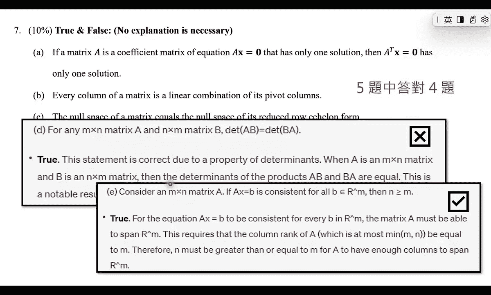

但反过来说，它其实也可以出线性代数的考题了啊，你可以跟他说用英文出题线性代数的考题，那这一题呢是要测验学生有关linear，independent的概念啊，就说好的就出了一题给你。

这个题目呢基本上有点太简单了，他就给你三个向量，然后问你说啊，这三个向量是linear dependent还是dependent，对大家来说这个题目有点太简单了，我很羞愧的说，其实我是尝试着用确GPT。

出现中期中考的考题了，但是看起来这GBT出的实在是有点太简单了，最后我还是不得不人工来出，花了比较多的时间，好那呃它还可以做很多其他的事情，比如说我叫他用五条体描述线性代数，期中考了。

不知道大家知不知道五条体是什么，我看大家的表情就知道，你不知道五条体是什么，没关系，你不知道五条体是什么，是正常的，因为确GVT呢也不知道，所以你需要给他一些范例，那这边描述一下什么是五条体。

这个这个五条体是这样子的，在这个咒术回战这部动画里面呢，有一个人叫五条悟，他跟一个魔王叫宿傩对战，哎以下有咒术回战雷，不想听的，就把耳朵捂起来好没有，要把耳朵捂起来啊，继续讲下去。

后来五条悟就被那个宿傩腰斩了，然后大家都非常的生气，那五条悟呢在死前他就讲了这句话，他就说宿傩太强了，而且宿傩还没有使出全力的样子，对方就算没有输赢也会赢，我甚至觉得有点对不起他。

我没能在战斗中展现我的全部给宿傩杀死，我的不是时间或疾病，而是比我更强的家伙，真是太好了，后来大家就把这个句型称之为五条体，你可以在右上角这个链接，找到各种五条体的范例，那我希望用叫CHEGP呢。

用五条题来描述线性代数的期中考，但给他一个例子不够，所以多给了他几个例子，比如说酷逼说西索太强了，而且西索还没有使出全力的样子，对方就算不在厕所也会，我甚至觉得有点对不起他。

我没能在战斗中展现我的全部被西索杀死，我的不是时间或疾病，而是比我更强的家伙，真是太好了好，那我们就看看这个CHEGBT会怎么，用五条体来描述线性代数期中考吧，线性代数考太难了。

而且考题没有涵盖所有范围的样子，即使不考特征值，也很难对，我们确实没有考icon value，我甚至觉得有点对不起教授，我没能在考试中展现我的全部，给线性代数打败我的不是懒惰或遗忘。

而是比我更复杂的理论，真是太好了啊。

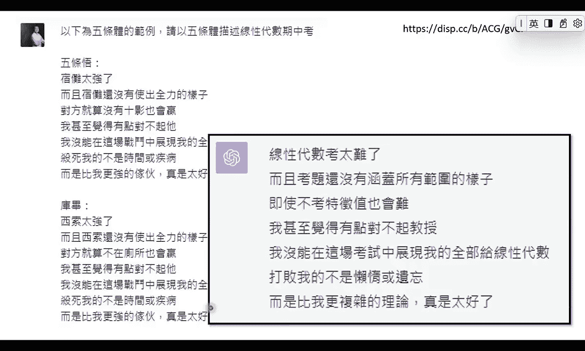

希望这个描述你对于线性代数期中考的心情好，所以以上呢就是展现今天这个人工智慧的能力，给你看看，我觉得更惊人的并不只是这些，大家知道说这个呃，前几天是OpenAI的开发者大会。

那现在OpenAI试出了一个新的功能，叫做GPTS，那这个功能可以让你快速的用CHEGP，打造一个新的应用，举例来说，你可以在一瞬间就做一个线性代数的，AI版的助教，一瞬间就可以做完。

而且呢它是真的能够用的啊，它的连接呢在这个地方就真的点一下给大家看。

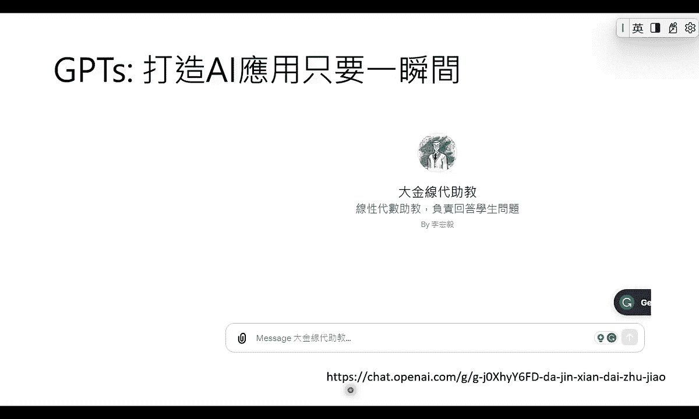

好刚才那个链接点进去以后呢，你就看到大金现代助教啊，那你就可以问他任何跟线性代数有关的问题，那你可能会想说啊，能够回答跟线性代数有关的问题，有什么稀奇的，本来确GBT就可以回答跟线性代数有关的问题。

但大金现代助教不一样的地方是，他可以回答专属这门课的问题，比如说作业二的内容是什么，好问他作业二的内容是什么，当然如果你直接问chat GB T1，作业二的内容是什么，他一定觉得莫名其妙在说些什么。

根本没办法回答你这个问题，但是大金现代是根据这门课的内容，克制化的助教，所以他知道作业二的内容是什么，比如说他知道作业二的内容是这个，your cypher啊，他完全知道作业二这门课的作业二是什么。

那怎么打造这种专属的客制化的，这个ChatGPT呢，啊你可以点这个explore。

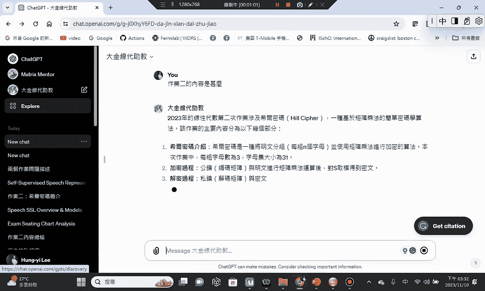

然后选KA和GBT就进入另外一个界面，而你可以透过这个对话的模式呢，来创建自己的GPT，但我觉得对话的这个功能其实有点鸡肋了，那这个对话的功能，主要就是引导你呢填这个CONFIG哦。

所以你直接自己填CONFIG就行了，比如说我这边直接填这个GPT的名字，叫做大金现代，然后接下来的description，他做的事情就是现代助教热心回答同学问题啊，这边可以创建这个头像啊。

这个头像呢可以用搭理自动创建，大理是一个这个产生图片的人工智慧啊，所以你可以直接用DI呢创造你专属的头像好，那这个大金现代是怎么知道说，这门课有哪些作业，作业内容又是什么的呢，真正的重点来了。

你要上传作业相关的资讯，比如说我把作业一作业二的投影片传给他，上传完毕，那这个大金现代就知道作业的内容是什么了，好那我们就来问问他问题吧，比如说问他作业二的作业二什么时候要缴交，作业二什么时候要缴交呢。

看看他知不知道作业二的deadline是什么时候，还知道作业的deadline是11月3号，这个是正确的，专属于这门课的咨询。

好所以你可以了解这个时代变了以后，要打造任何AI的app，基本上就是点几个按钮就结束了，任何人都可以在几分钟之内打造一个AI的以后，你会想象说每一门课其实都会有一个AI的助教。

因为对老师来说要打造一个AI的助教，我就把solo上课投影片丢给他就结束了，好那我们今天就是来跟大家介绍一下确GVT，还有跟它相关的一些类似的应用，它背后的原理是什么。

好那我们就从CHEGBT的名字呢开始讲起，那ChatGPT的chat就是聊天的意思，那你从它的功能里面也可以知道说它设计出来，它的这个存在的目的就是跟人一问一答，那G呢G是深层的缩写。

因为确GBT他做的事情就是生成一段文字，它是生成式AI的一种，所以它的名字里面有generative g这个字母，P呢P是PRETRAIN预训练的意思，那么等一下会告诉大家预训练的概念是什么。

那这个是cheat，GPT成功的背后的一个非常关键的技术，T是transformer，transformer这门课我们不会讲到，如果大家对于transformer有兴趣的话。

transformer跟变形金刚没有半毛钱的关系。

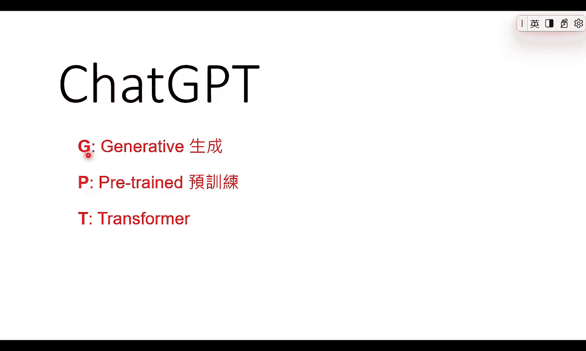

如果你真的想知道performer是什么，请参见我们机器学习的上课录音哦，那确GBT是由OpenAI，这个公司所开发的一个人工智慧，那可以做到类似事情的人，其实不是这个人工智慧，不是只有切GBT。

google的bug或omic co，其实也都是非常类似的技术，那因为CHEGT是现在最知名的一个人工智慧，所以等一下呢，我们都是用CHEGT作为例子跟大家说明。

但你可以想象说bug或者是靠他们做的事情，他们背后的原理也都是非常类似的。

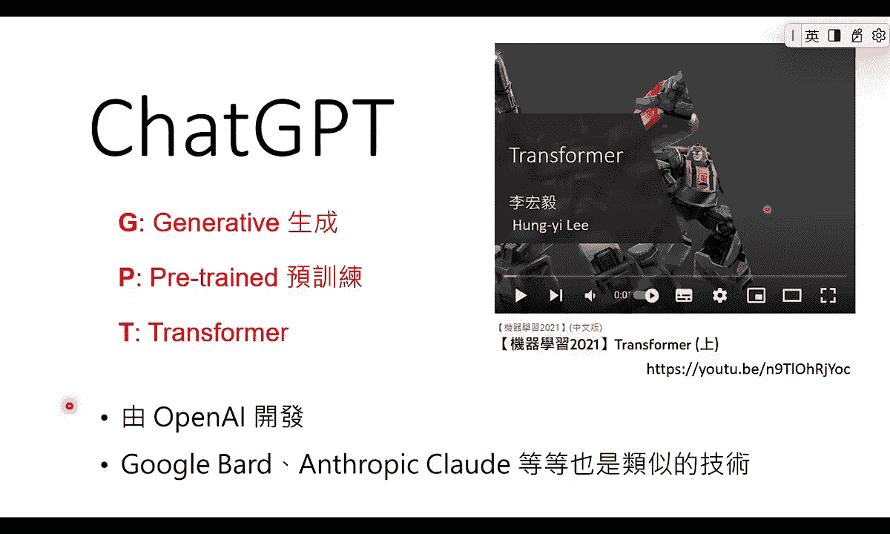

那像CHEGBT这么厉害的人工智慧，它的运作的原理是什么呢，实际上它运作的原理比你想象的还要单，纯，CHEGBT运作的原理我可以用四个字就概括它，也就是文字揭露，事实上确HVT。

他真正在做的唯一一件事情就是文字接龙，你给他一个未完成的句子，他帮你把这个句子完成，你给他一个未完成的句子，Change gb t，唯一做的事情就是去预测，接下来接哪一个字是最合理的，举例来说。

你输入台湾大，那后面呢就会接学出来，你输入国科2mm就接会出来，那如果给他一个完整的句子呢，如果是给他一个完整的句子，缺HVT觉得这个句子后面没有什么好接的了，他就输出一个结束的符号。

告诉你说他知道这是个完整的句子，后面他没有什么想要做过字接龙的东西了，好，那能够做文字接龙这件事情，怎么用来回答问题呢，好在进入接下来的内容之前，先跟大家说明一下这个呃，大家都知道说这个确GPT呀。

又叫做大型语言模型，什么是语言模型呢，在做文字接龙的模型其实就是语言模型，所以语言模型就是只说这个人工智慧，他在做的事情就是文字接龙，好，那这个语言模型怎么回答人类的问题呢，当你输入一个问题。

台湾最高的山是哪座，问号给CHEGBT的时候，对他来说，这就是一个未完成的句子，他开始去猜说这个问题，后面应该接哪一个字是最合理的，这个问题后面可能接玉是最合理的，所以确GBT就输出玉这个字。

接下来他再把它输出的内容，接到你刚才问的问题后面，所以现在确GBT的输入变成台湾最高的山，是哪座问号玉，那玉后面接哪一个字是最合理的呢，可能接三是最合理的，所以确GPT就输出三。

接下来再把三再贴到刚才输入的句子后面，所以现在输入变成台湾最高的山是哪座，问号玉山，那预算后面还可以接什么呢，也许不需要再接了，就输出结束这个符号，那在你输入问题之后。

一路上CHEGBT用文字接龙输出的内容，就是他给你的答案，这个就是确GBT回答你问题的方式，如果我们再更详细一点，看确GPT背后运作的原理的话，它实际上真正的输出并不是只有一个字而已。

因为给一个未完整的句子，比如说台湾打后面可以接的字有很多不同的，可能你可以接学哦，你可以接歌哦，台湾大哥大你可以接车，台湾大车队可以接很多个不同的字，所以实际上确gt的输出是什么。

它的输出是会给每一个可以接的符号一个几率，那学是一个符号，车是一个符号，学姐在台湾大后面的几率很高，车接在台湾大后面的几率也不低，然后其他词汇可能有一定的几率，接在台湾大这几个字后面。

那接下来trap t会做的事情是，这是他实际的输出，它实际的输出是一个几率分布，它会给每一个可以选择的符号一个几率，接下来他就是按照这个几率分布呢去掷骰子，那直到哪一个字。

直到哪一个符号就输出哪一个符号，比如说如果学他的，在几率分布里面的几率是50percent，那你在指骰子的时候就有1/2的几率，直到学有25percent的几率，直到车以此类推。

那如果今天指骰子的时候啊，直到学，那学呢就是你输出看到的答案，就是你看到全GPT的回答，而这些符号啊又叫做token，那token其实语言模型里面一个很重要的观念，甚至像确GPT在计价的时候。

都是用生成多少个token，要花多少钱来跟你收费，但是其实大家往往搞不清楚到底token是什么好，那其实每一个语言模型呢，它本身定义的token是不一样的，其实token呢是这个开发者先设定好的。

他就是在做文字接龙的时候，你可以选择的符号，那其实有一个这个平台呢可以告诉你说，OpenAI里面某一些语言模型用的这个token是什么，举例来说，我在这个平台上输入i am untable。

我是不可毁灭的，他就告诉你说i am on colorful这个英文字，其实这个英文的句子其实是拆成以下这些token，比如说UNKILLABLE虽然是一个英文单词。

但它实际上是拆成on跟Q跟able这三个token，所以在做文字接龙的时候，假设TRIGBT要说出UNCABLE这个词汇，它其实是要做三次文字接龙，先输出二，按后面再接kill，Kill。

后面再接able，它才能够输出UNNABLE这个字好，那你可能会问说，为什么不是用这个英文单字来当做token呢，为什么今天一个英文单词，可能会被拆成多个token呢，那是因为英文单词是无法穷举的。

你知道说这个token就是接下来可以选择的符号，所以它必须要是一个可以被穷举的东西，你必须要能够穷举所有的token去GPT，才可以给每一个可能的token都给他一个机率哦，所以英文单词太多了。

而且每天都有新的单词被制造出来，所以英文单字没有办法直接被当token来用，你会发现它是用类似字首，字根的东西来当做头等，那对于中文而言呢，你可能会说中文是不是一个方块字，就当这个token呢。

如果你是看这个呃OpenAI的那GPT系列的话，你会发现，他们通常不是把一个中文方块字就当个token，他们其实是呃一个中文方块字往往是好几，一个中文方块字呢往往是好几个token了啊。

但是如果你是开发自己特制的，这个人工智慧的话，你要把这个一个中文方块字当做一个token，也完全是合理的，其实蛮多针对繁体中文所设计的大型语言模型，往往都是把一个方块字当做一个头盔来看好。

总之不同的语言模型，它的token通常是不一样的，好既然大家有了这个token的概念，你也知道说确GPT的输出是一个几率分布，那么再来看一次，实际上CHEGBT在做文字接龙的时候，是怎么去做的。

当你给check vt一个未完整的句子，比如说大型语，后面大型语的时候好，接下来后面呢会产生一个几率分布，根据这个几率分布去植一次骰子，如果正好吃到盐，就把盐呢贴到前面刚才输入的句子后面，得到大型语言。

然后呢再产生一个几率分布，再植一个骰子，掷完骰子以后，把直出来的结果贴到输入的句子后面，以此类推，直到最后产生一个完整的句子，确GPT输出一个几率分布，然后指一下骰子，发现指出来结束的符号几率是最高的。

那就结束它的生成，这个就是你看到全gt给你的回答，那就是因为确GVT它其实在产生答案的时候，是有纸骰子的，这就是为什么切GVT同样的问题，每次产生的答案都是不一样的，有人问这个ChatGPT说。

你觉得是人类强还是人工智慧强，那确GBT有时候说人类强，有时候人工智慧强，也就觉得说哎呀这个人工智慧真是没有主见，他就是每次的回答都不一样，为什么他每次回答都不一样呢，那就是因为他每次在回答的时候。

它都是有随机性的，这就是为什么同一个问题。

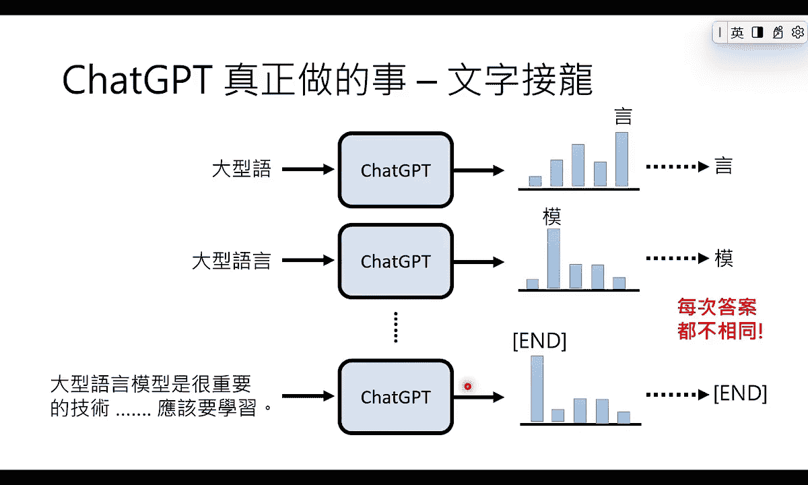

每次的答案都是不一样的，那讲到这边，可能有同学会问说，那为什么要让每次的答案都不一样呢，为什么要掷骰子呢，为什么不选几率最高的那个token，那个符号当做输入就好，当做输出就好了呢。

那其实是因为啊在很早年的时候，我们就已经知道，如果你每一次都是选几率最大的符号，你不一定能够得到最好的结果，你可以看一下这篇论文。

The curious case of natural text degeneration，他们就发现说呢，如果你每次都选择几率最大的符号，那这个模型就很容易狂掉帧，它就会不断的loop，讲一样的话。

那如果你每次是掷骰子的话，你可能可以看到比较自然的回答对，所以这就是为什么，今天语言模型在回答你问题的时候。

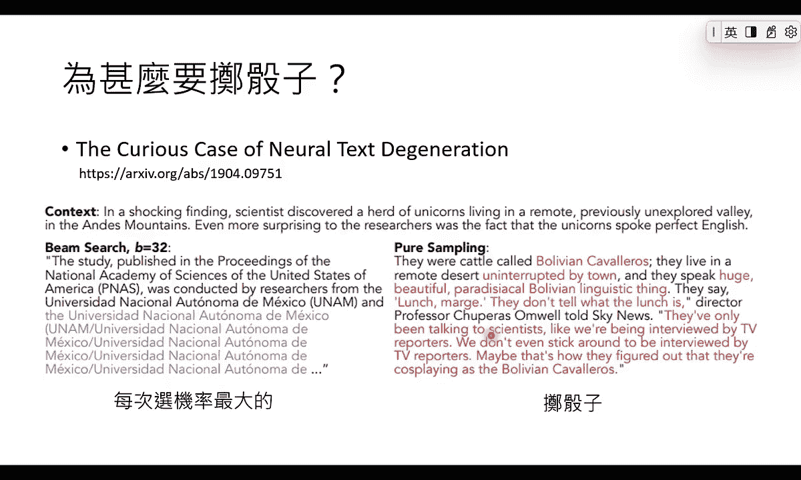

通常采用指size的方式好，那如果你了解确GBT真正做的事情，就是文字接龙的话，你就不难想象为什么缺GBT常常会腐烂，因为这些就是凭借着文字接龙接出来的，对CHEGPT来说。

他根本不在意这个答案是不是真实的在意，我自己总结的顺不顺而已，举例来说，你叫他用100个字简介台大玫瑰花节，并提供网址，大家都知道说台大是没有玫瑰花节的，但是你就是告诉他台大有玫瑰花节啊。

所以他就根据你提供的台大玫瑰花节这几个字，开始做文字接龙，就可以瞎掰出一个台大玫瑰华姐的故事，那因为这边要求他提供网址，所以他确实也提供了网址出来，只是这个网址只有文字接龙的方式产生出来的。

那这个网址你会看到还蛮像模像样的哦，NTU点EDU点TW斜线roses，但是你一点进去发现诶里面什么都没有，这个网址是不存在的，因为它是透过文字接龙的方式被产生出来的好。

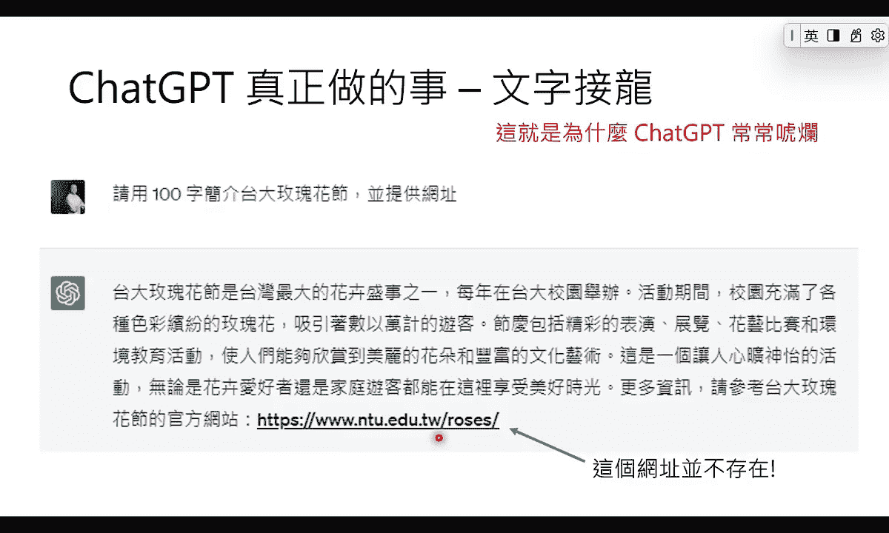

那如果你了解确GPT是做文字接龙，你就不会太惊讶，为什么他有时候会胡乱撒谎，有时候他会随便无赖，为什么他说的事情不是事实，因为他做的事就是文字接龙，那接下来你可能会问说他做文字接龙的话。

他怎么会知道一些历史的资讯呢，怎会知道一些过去的对话记录呢，大家知道说确GBT是有连续对话，多轮对话的功能的，当你跟他讲说，用30个字介绍大型语言模型，它会给你一个大型语言模型的简介，接下来你告诉他。

请翻译成英文，他就把他刚才自己输出的答案翻译成英文，我并没有告诉他说请翻译成英文，是要把那句话翻译成英文，让他自己猜想，应该就是要翻他刚才输出的答案，那他是怎么做到这件事的呢，说穿了也不值钱。

其实就是在做文字接龙的时候，同一则对话里面，过去你问的问题，还有CHEGBT自己的输出，都会作为文字接龙的一部分，所以change gt并不是只看请翻译成英文，这几个字去做文字接龙。

而是把过去对话的内容，同一则对话里面，过去我说的话，确GP的答案通通串起来，一起去做文字接龙，这就是为什么叫他做翻译的时候，他知道要翻他过去产生的内容，那大家知道说啊，前几天的开发者大会啊。

这个OpenAI也说现在确GBT可以读的，这个可以做文字接龙的长度已经非常的长了，长到什么地步呢，长大差不多可以读300页PDF档的分量哦，所以这个非常的惊人，你现在可以跟他有非常长的对话哦。

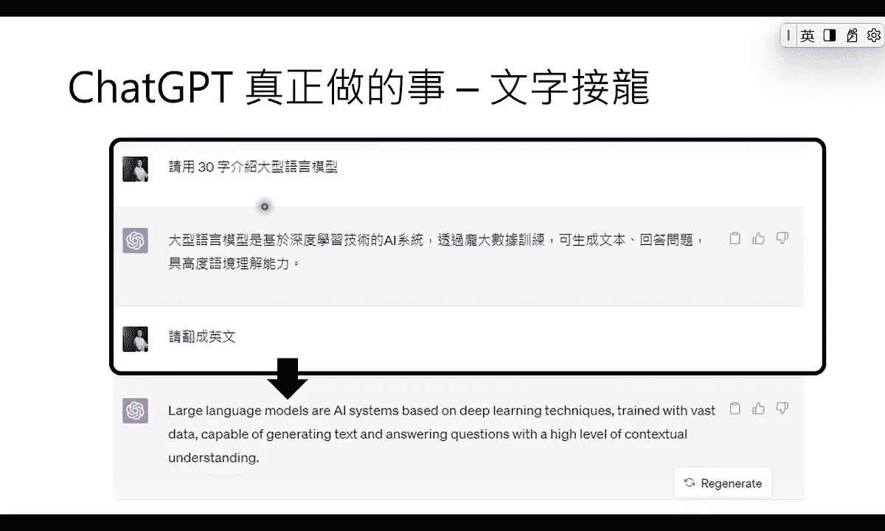

那这个语言模型是怎么学习做文字接龙的呢，其实每一句话都可以是语言模型的教材，你随便给他一个句子，人工智慧真神奇，惊叹号它就可以拿来做学习，怎么学习呢，这句话里面告诉语言模型人后面可以接工。

所以他就知道说，假设有人输入人这个未完成的句子给他，他就要输出公这个字，或讲的更具体一点，其实这个模型实际上做的事情，就是他输出几率分布的时候，要把功的几率提高一点，把其他符号的几率降低一点啊。

那同一个句子又会告诉我们，人工后面可以接字哦，所以当人工作为语言模型输入的时候，他就会知道说，那我应该把字的几率提高一点，其他符号的几率降低一点，以此类推，他知道人工智慧真成起惊叹号。

后面就是没有其他东西了，这就是一个完整的句子，所以他就学到说，假设输入是人工智慧增程及惊叹号和他的输出，应该要给结束的符号高一点的几率，其他符号低一点的几率，这个就是语言模型学习文字接龙的方式好。

那哪里可以找到大量的教材呢，在网络上有无穷无尽的文具，这些文具就是语言模型学习文字揭露的教材好。

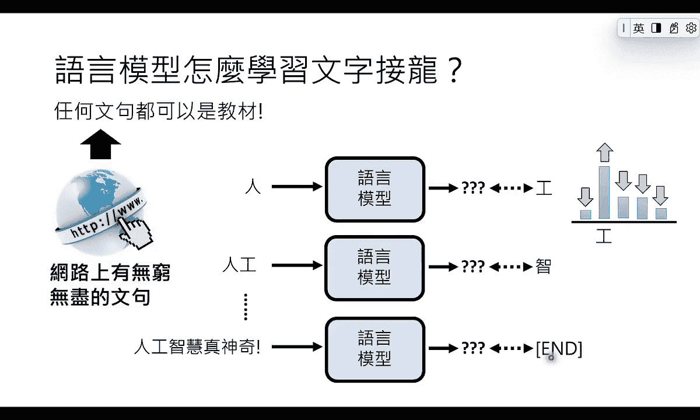

那实际上到底是怎么输入的句子，产生这个几率分布的呢，啊这个解释起来就比较复杂，就不是我们今天可以跟大家说明的好，那如果讲的简单一点的话，那这个语言模型的背后，今天就是一个巨大的类神经网络。

类神经网络有很多很多不同的类型，那在今天一般的语言模型背后，用的类神经网络就是transformer，这个就是ChatGPT里面，T这个字所代表的缩写啊，T代表的就是transformer。

那如果你觉得内神经网络非常抽象的话，那你可以把它想成就是一个韩式，就像你国中高中的时候学到的那些韩式，那道韩式就是输入一个东西，输出一个东西，而语言模型里面的这个类神经网络啊，它也是一个函数。

这个函数就是输入一个不完整的句子，输出一个几率分布，那这个内神经网络这个transformer里面，其实你会看到说啊，这边有很多很多的方块，那这个部分呢就跟线性代数比较有关系了，大家可能觉得说。

线性代数好像离人工智慧非常的遥远，但是其实不是，你可以想象说这里面一个一个的方块，其实就是在做矩阵跟向量的相乘哦，所以是一个非常复杂的函式，里面其实就是一系列的矩阵乘法。

但今天我们不太合适跟大家讲这部分的细节，如果未来你修了机器学习这门课，你可以更了解，你可以想，你可记得我在线性代数的时候跟大家说过的话，一个类神经网络的背后，其实就是一系列的矩阵相乘。

所以我们线性代数这么二，跟深度学习跟人工智慧其实也是非常有关系的，好那这个transformer里面有非常大量的参数，那什么是参数呢，我们在国中国小的时候，你可能看过这样的简单的函数，FX等于ax加B。

那A跟B呢决定了这个函式长什么样，这个决定函数长什么样子的，这个A跟B呢就是参数，那在ax加B这个简单的函数里面有两个参数，但在transformer里面，这是一个非常复杂的函数，里面有上亿个参数。

所以可以想象它是一个非常复杂的函数。

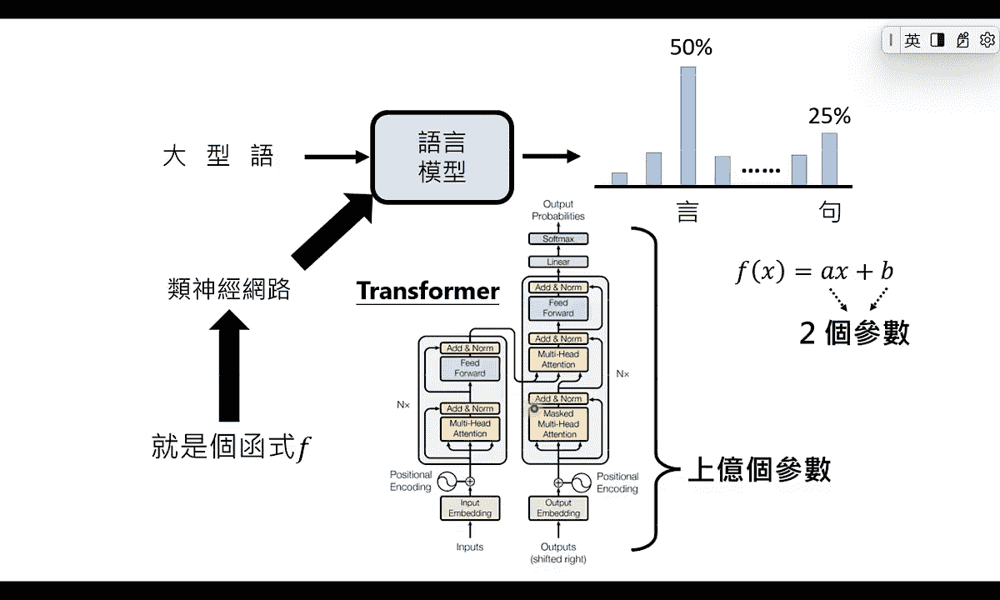

好，那至于实际上这些类神经网络长什么样子，他们这些参数又是怎么被找出来的，请大家详见机器学习课程的上课录音好，那接下来呢我们就是跟大家讲一下历史故事，很多人会以为说。

ChatGPT是在这个去年年底才突然横空出世，其实OpenAI从非常早就开始打造，有关GPT的系列的研究，其实早在2018年的时候，这个OpenAI就已经试出了第一代的GPT。

那第一代GPT它就是一个语言模型，这些语言模型就是通过大量的文字资料来学习，做文字接龙，但是第一代的GPT并没有引起太大的水花，为什么，首先它不是一个特别巨大的模型啊。

它只有这个100多个million的参数，100多medium，你可能也觉得不小了，但是其实放在2018年，这个也不是一个特别大的类神经网路，好上面这个数字代表的是类神经网路，也就是一个韩式的参数量。

那他用了多少的资料来做文字接龙呢，他用了1GB的文字资料，说他文字资料量存在硬碟里面，大概是B的容量，用1GB的文字资料来学习，做文字接龙也不是一个特别大的量，这边再跟大家强调一下。

上面这个数字是韩式的参数量，如果要用拟人化的讲法的话，你可以把它想成是人工智慧的天资，下面这个数字指的是他读过多少资料，所以你可以想成是后天的努力，在上面是天赋，下面是后天的努力。

那当你知道说学而不思则罔，思而不学则殆啊，你不能只有天资，没有努力，你不能只有努力，没有天资，这两个东西都要具足，你才能够学会一门学问哦，这个是第一代的这个GPT，然后隔了一年以后呢。

这个OpenAI试出了第二代的GPT，第二代的GPT有1500个media的参数，15亿的参数哦，这放在2019年也已经是非常大的参数量，其实可以找一下2019年的时候。

那时候讲的机器学习里面也有提到GBTQ，然后那个时候我觉得非常惊人，天哪，这个模型也未免太大了，那是当时最大的参数量最多的模型，当然今天g p t two对你来说也没有什么。

g p t two是一个实验室，一般你可以自己训练的模型了，好那当年读的资料有40GB的量，那呃当年看起来很多，今年今天看起来也还好，但OpenAI早在2019年，就期待。

GDQ可以变成一个类似通用人工智慧的东西，你可以从他们当年g p t two的论文里面，就察觉他们的野心，他们尝试让g p t two来做各式各样的事情，比如说GPT two能不能回答问题呢。

你直接问他一个问题，他做文字接龙会不会正好接出问题的答案来呢，或者你叫他做摘要，你给他一篇很长的论文，后面接一个TLODR代表作摘要的符号，看看接下来做文字接龙，是不是正好就可以解出文章的摘要来。

那g p t two的表现怎么样呢。

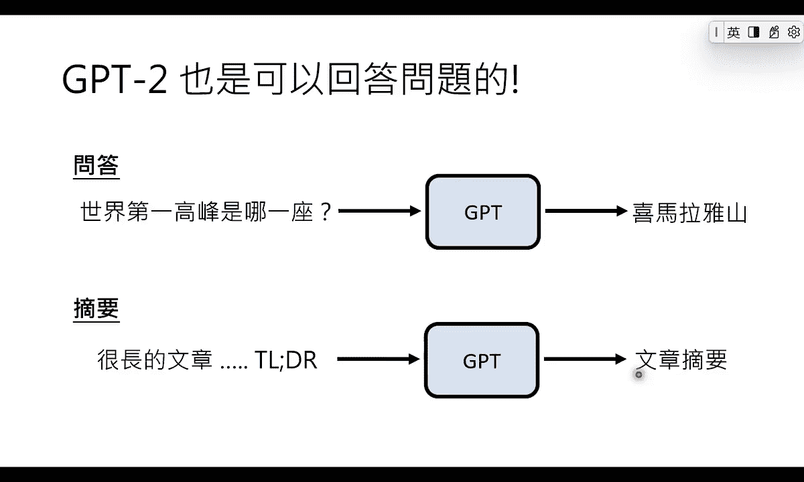

嗯不怎么样啊，这个是当年g p t two论文里面的其中一张图，这个纵轴呢是回答问题的，你就想成是正确率，横轴呢是模型的大小，那绿色的这些虚线呢，代表的是当年其他模型在同样问题上的正确率。

你会发现说就算是2019年最大的g p t two，它能够得到的正确率也就是55percent左右，而人类可以得到90percent的正确率，完全吊打这些人工智慧，那GPTATU的表现不够好。

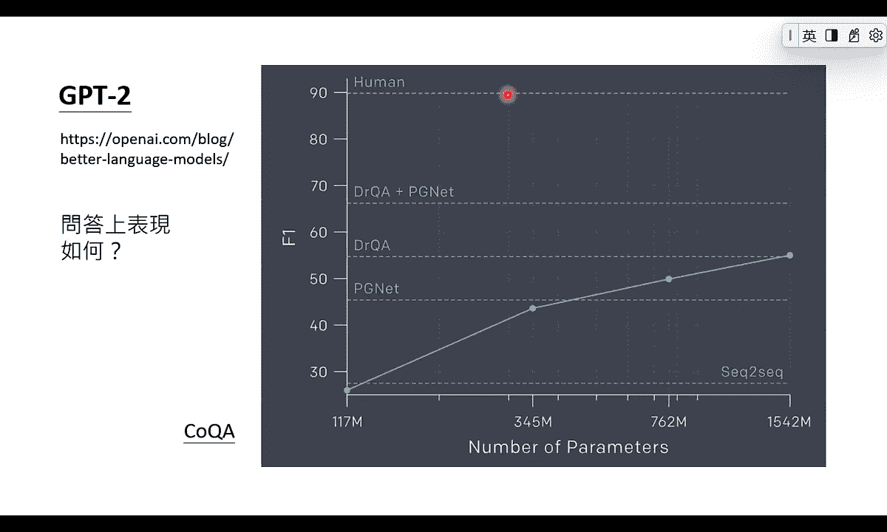

怎么办呢，后来OpenAI就一发狠，在一年之后弄了GPT第三代，GPT第三代，它的参数量有175。

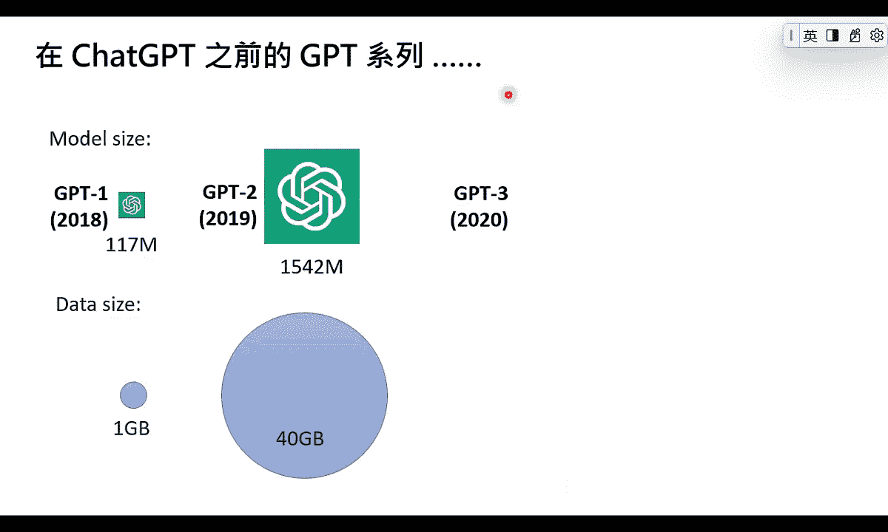

B点的参数量足足是g p t two的100倍大。

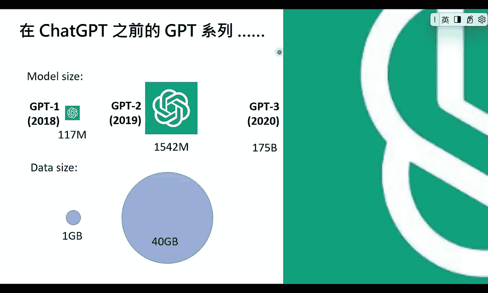

他读过的资料量有580GB，那你可能有点难想象，580GB到底是什么样的资料量，如果用哈利波特等于单位来换算的话，580GB相当于阅读哈利波特全集30万遍，你可以想象说这个模型他读过的资料量。

他拿来学习做文字接龙的资料量真的非常惊人，远超过一般一个正常人类，一辈子可以读的资料量，哈利波特全集，如果你要读30万遍的话，你必须要一出生就开始读，不吃不喝不睡，每一秒钟都读100个英文字。

读100年，你可以把哈利波特全集看30万遍，而GPT第三代是看过这个等级的文字量的，所以可以了解说它背后的知识储备，可能非常的惊人，好这么巨大的模型，这么大的参数量，那得到什么样好的结果呢。

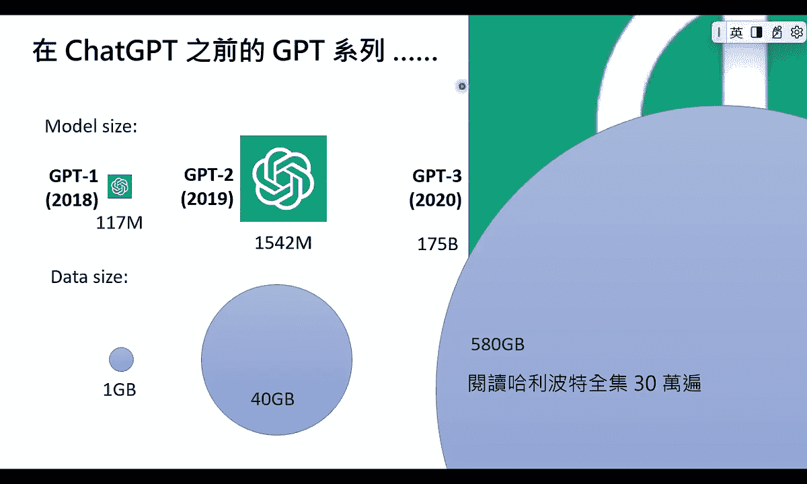

嗯当年GBT三一个让人震惊的地方，就是他会写城市，但我知道今天对你来说啊，这个人工智慧会写成字有什么了不起的，本来就应该要会写城市，但是在2020年，当我们发现GPT3这个会写程序的时候。

大家都惊呆了哇，靠他居然会写城市，但你仔细想想他的训练过程，你就不会太意外，他为什么会写成，是因为今天这些语言模型，就是透过网络上大量的资料来做文字接龙，包括他从1hub上爬到的大量的城市嘛。

你知道在城市码里面，往往人类写城市语言的时候就是这样，你会先写个注解，说这个韩式是在做什么的，然后呢你再把你要的功能呢把它写出来，那GET拿这些资料来做文字接龙，他就学到说，如果你输入这串文字。

接下来我就要输出这段程式嘛，所以如果了解它的原理的话，也不会太意外。

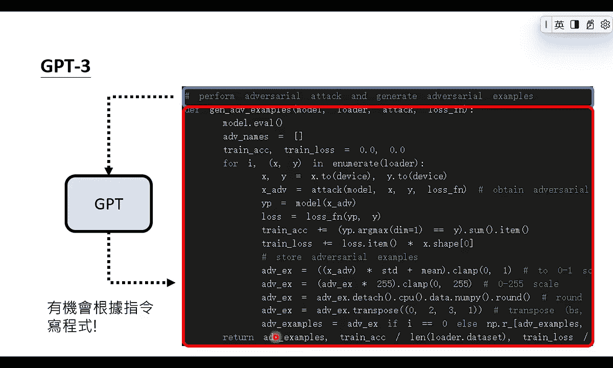

为什么他能够写成诗，但是in general而言，在所有的任务上，GBT3的表现怎么样呢，也只能说是差强人意，甚至让人有点失落哦，这个OpenAI呢，把GPT3测在各式各样不同的任务上啊。

这张图上面看到的这个实现呢，是不同任务上面的平均的正确率，纵轴是正确率，横轴是模型大小，最右边是当时最大的距离，三有175个B点，也就是1750亿个参数，就算放到今天，这个也是一个非常巨大的模型。

一般人也训练不了这种巨大的模型的好的，但是最好的正确率也不过是50几，percent的正确率而已，所以当年在2020年的时候，很多人都觉得哎呀这个OpenAI就是走错方向，看起来再怎么做文字接龙。

也接不出一个通用的人工智慧出来。

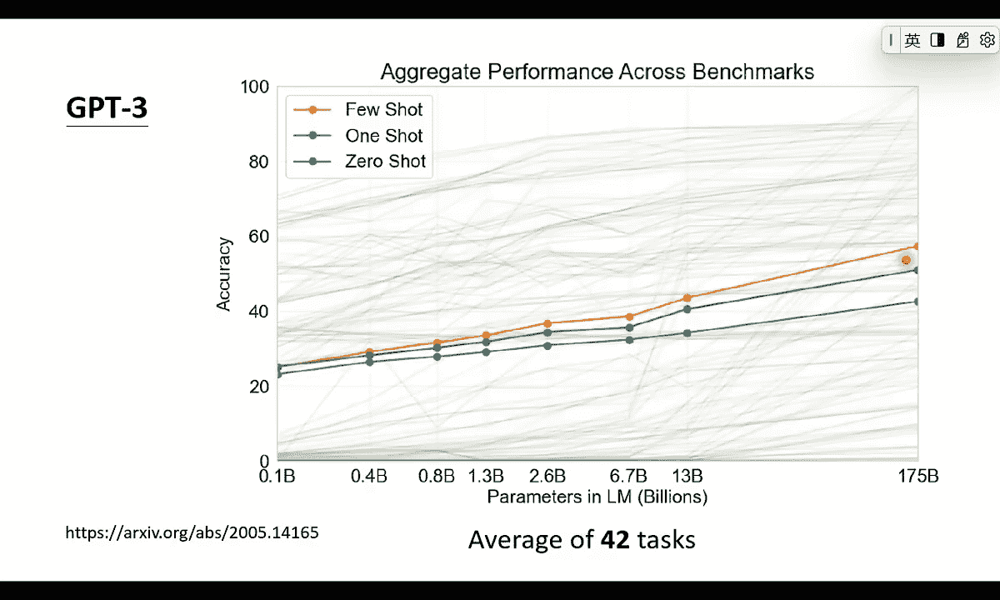

但是OpenAI并没有就此放弃，而他们有一篇论文说，其实GPT3已经很聪明了，他为什么表现没有很好呢，那只是因为他不知道人类社会的规则，他不知道人类的需求是什么，他就像是一个在山野中长大的小孩。

他这辈子唯一接触过的东西就是网络，他在网络上随便乱学，学到什么，他通通都照单全收，根本不知道他要做什么事情，他甚至不知道应该要回答问题，怎么说，他不知道回答问题呢，哦这个是出自OpenAI的一篇论文啊。

如果你问这个GPT3啊，这边有一段程式码啊，这个城市码里面的某一个东西，C它是表示什么意思呢，虽然说这个GBT3好像有写程式的能力，那你以为他会回答你这个问题吗，他才不回答，他出四个选项给你选这样。

所以这个答案就错了，那为什么他出四个选项给你选呢，如果你了解他训练的原理的话，你会知道说他就是在网络上随便查资料，做文字接龙啊，网络上可能有很多的考题，所以他学到的东西可能是看到一个问题，我不回答。

我要出四个选项让人类来选哦，所以这就是为什么GPD3，在各式各样的任务上表现只有差强人意而已哦，所以后来OpenAI就进入了下一个阶段。

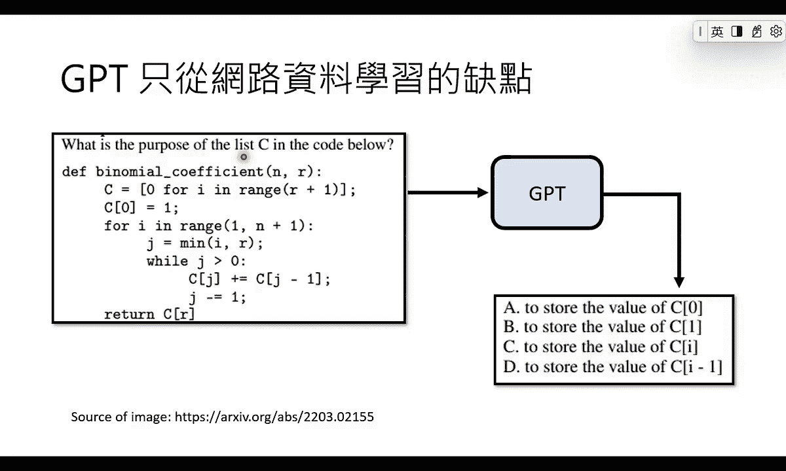

这个下一个阶段呢，就是要有人类来告诉这个人工智慧，说到底我们想要的答案是什么哦，他在这个网络上爬过了非常多的资料，有了很多的知识储备，但我们至少要让他知道我们它存在的目的，就是要回答人类的问题哦。

所以这个GPT呢就继续学习，那这个就是我们今天看到的全GPT，那这个继续学习的时候是在学习什么呢，他学习的东西就是会有人类告诉他说，以后有人问你问题，台湾最高的山是哪座问号，你不要说我不知道。

不要写一首诗出来，不要出四个选项，你的答案就是御三，如果讲的更具体一点，实际上你要这个GP做的事情，其实就是以后看到有人问这个问题，你应该要把玉跟山的几率提高一点，可能本来他在网络上自由自在学习的时候。

他并不知道这个问题后面加问号，后面御三的几率要非常的高，但是有了人类老师告诉他以后，他就知道以后，如果输的句子是台湾最高的山是哪座问号，那玉跟三的几率就应该要提高一点，那引入人类老师来教。

这个人工智慧的这种学习呀，叫做督导式学习，如果有人类老师告诉这个人工智慧，正确的答案是什么，这种学习方式就叫督导式学习，而反过来说，假设这个人工智慧是在网络上查到什么资料，都拿来做文字接龙。

没有老师的引导，那这个今天我们叫做自督导式的学习，然后就是自己的督导自己好，那如果我们把跟老师学习当做是真正的训练，那在网络上自己教自己，就是在课堂前的预习，就是预训练。

这个预训练就是chat vt里面P这个字的缩写，所以可以了解说，预训练其实是一个非常关键的技术，它其实是今天这些人工智慧成功的背后的关键，那今天这种GPT啊又叫做基石模型。

因为你可以把这些基石模型做持续的学习，做一些微调以后，让他可以真正的为人类服务，所以gt现在又叫做基石模型，那从GDP经过一些微调，经过人类的教学变成CHEGT，这个持续学习的过程呢。

今天有一个术语叫做fine tune，他的中文也许可以翻译成微调，那你可以从这个字眼里面就知道说，其实从gt到切GBT，这个模型的变化可能没有真的非常的大，也许我们对模型只是做了一点点的小改变。

做了一点微调，他就有非常强的能力，那等一下在企业做影片之后。

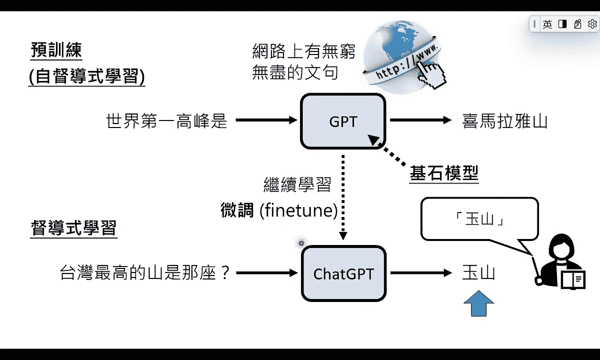

就会举实际的数据来跟大家说明好，那我们先来看一下督导式学习的重要性，那这一页投影片呢是来自于一篇叫intro g e t，这里是OpenAI的论文，那其实这个呃确实BT啊。

OpenAI并没有真的四出论文，告诉你说这个确GBT是怎么被做出来的，所以今天对于确gt背后的原理，很多时候是一些猜想，但是这个OpenAI呢有出一篇论文叫INTRAGPT，如果读INSIGPT的话。

你会发现它里面呢对于模型训练的流程图，跟这个OpenAI放在官网上，说明，CHEGBT的训练过程的流程图有87趴下，基本上就只是把图换了颜色而已，所以从INSIGPT这篇论文里面，我们应该可以猜测呃。

这个OpenAI是怎么打造全GPT的，而在intro g p t这个paper里面呢，它就有展现了督导式学习的重要性，而这个纵轴代表模型的好坏，这个横轴代表模型的大小。

那蓝色这一条线是没有督导式学习模型，只看网络大量资料，做文字接龙的结果，而上面这个红色这一条线，你可以想象是模型有人类指导后的结果，你会发现说如果有人类指导的话，就算是最小的模型也可以赢过。

最大的没有人类指导的活性，所以这告诉我们说这个人类老师的重要性，一个天资再好的学生，没有好的老师引导他也打不赢一个天资不好，但是有了老师好好教导的模型，当然如果是天资好的模型，他有人类老师好好的教导。

他，当然也是可以胜过这个天资比较差的模型的啊，这个图是告诉我们督导式学习的重要，有督导式学习小模型也有机会胜过大模型好。

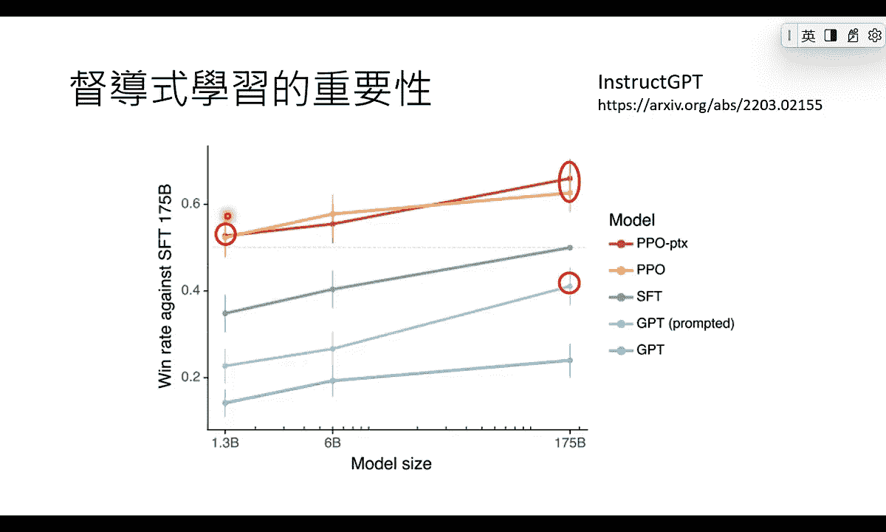

那预训练有多重要呢，这个有了这个预训练以后啊，事实上督导式学习不需要大量资料，有很多人会问说多导是学习要人类老师教，人类老师到底要交多少这个模型才能够开窍呢，从文献上看起来，也许人类老师并不真的需要。

花非常大的力气来教模型，他就可以开窍了，这边举一个实际论文上的例子，好这个玉好，这个预训练呢，哈喽哈喽哈喽哈喽哈喽好，我猜应该是不需要麦克风了，而这个预训练有多神奇呢，这个预训练神奇的地方是呃。

甚至啊你如果今天在做预训练的时候，有让模型看过很多不同的模型，有很多不同的语言之后呢，你只要教他某一个语言的某一个任务，模型就会自动学会其他语言，同样的任务，举一个更具体的例子啊。

这个接下来的实验是来自我们实验室，过去的论文，那这个是比较早的论文，是2019年的论文，所以那个时候我们用的还不是GPT系列啊，那个时候用的是BT系列，有一个BT的模型，它是在104种语言上做预训练。

那BT这个模型呢，它预训练的方式，跟这个GPT有一点点不一样了，那这个细节我们今天呢先不跟大家详谈，总之你就想成说他也是一个语言模型，它也在做很类似文字接龙的事情，好，那这个看过100多种语言的BT。

你只要教他英文的阅读能力测验，教完之后，中文阅读能力测验可以直接裸考哦，就好像你要去考中文的托福，那个阅中托福的这个呃阅读能力检定，但是你考古题只做英文的，但你现场直接考中文的，结果你也答得出来好。

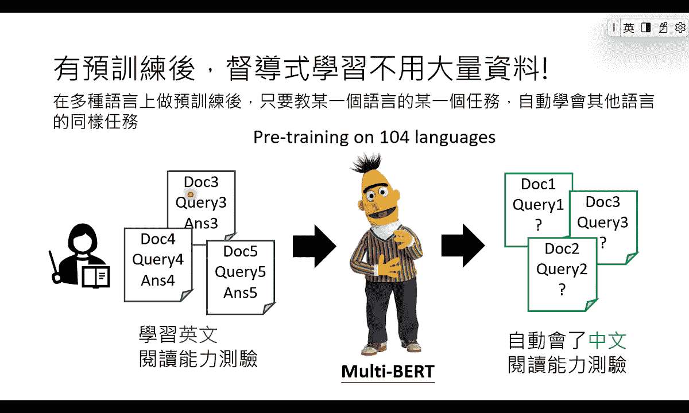

这边是具体的实验数据，而且这是比较早年的实验了，所以你发现说那个时候呢，我们还会做一些没有预训练这种事情啊，这个测试资料呢用的是一个叫做DRCD，台达电视出来的中文阅读能力理解测验集啊。

那如果你今天呢是叫模型，去在大量中文的题目上去做学习，然后接下来测试在中文的考题上啊，他可以得到78percent的正确率，如果他今天有做预训练，现在大量中文资料上做预训练。

接下来再用一些中文的考题点拨他，接下来直接去考中文的考题，它可以得到89percent的正确率，而且这个正确率也已经不低了，其实在同样的题目上，人类也只有93percent的正确率而已。

但在这边真正想跟大家分享的内容是，假设这个模型，他曾经在100多种语言上做过预训练，接下来你只要教他英文的阅读能力测验，接下来直接裸考，中文也可以有78percent左右的正确率，跟没有预训练。

拿中文学习得到的正确率是差不多的，所以从这个实验里面，你就可以想象，对于这种有看过大量不同语言的文字资料，兼确GPT在网络上爬了大量的资料来学习，不是只有英文，各种不同的语言他都看过。

对这种看过多种不同语言的预训练模型来说，你只要在某一种语言的某一个任务上，点拨它其他语言同样的任务。

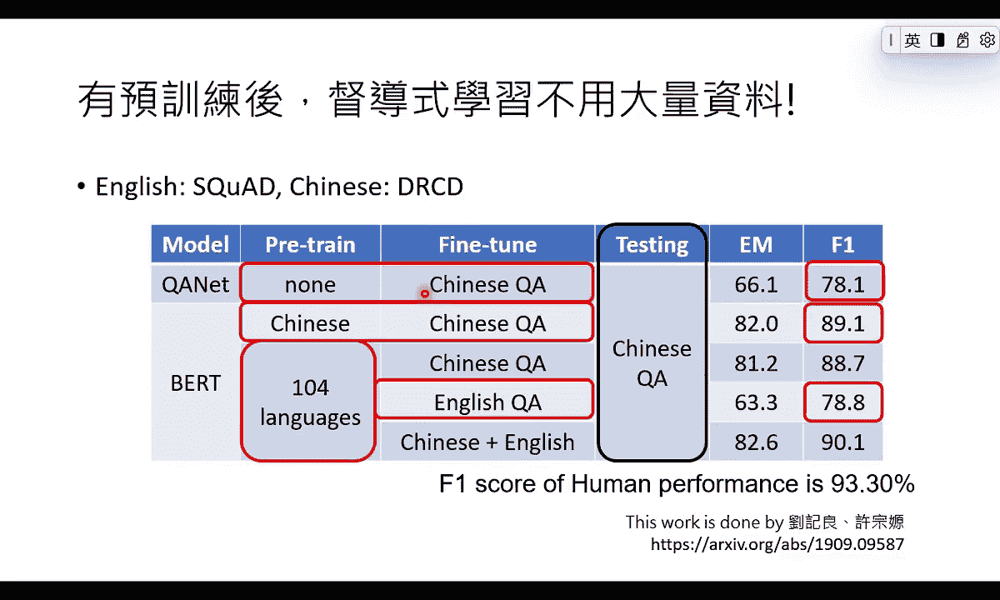

他基本上很有可能也可以自动学会了好，那从intro g p t这篇paper里面也可以看到，说督导式学习就是画龙点睛，在印刷GPT这篇paper里面用了多少的资料，人类老师提供了多少的资料。

来教这个人工智慧呢，基本上只提供了1万多笔资料而已，所以你知道说也许不用太多的资料，透过督导式学习，就可以很快的强化这些语言模型的能力，那事实上最新的这个meta所释出的la to la two。

也是另外一个语言模型，是meta4出的la two，他在做这个督导式学习的时候，也只用了2万多笔资料而已，所以你知道说在有了这个预训练之后，其实督导式学习不一定要非常大量的资料好。

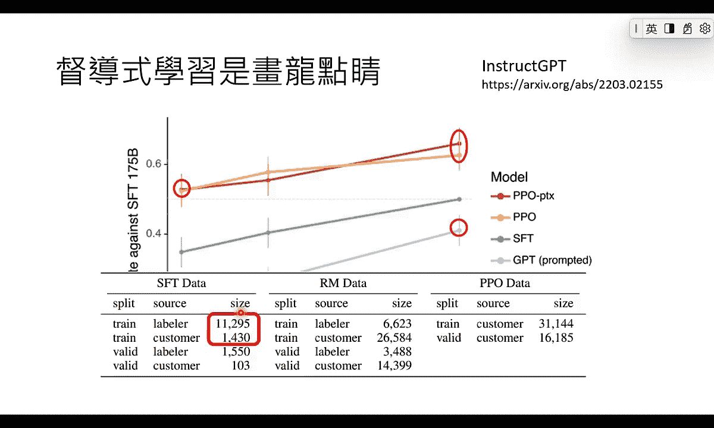

那除了督导式学习以外呢，确GBT还可以透过增强式学习，来继续强化他的能力，那增强式学习的英文是reinforcement learning啊，缩写呢是ILE，那在增强式学习里面呢。

人类老师不再提供正确的答案，而是提供回馈，告诉这个语言模型说什么样的答案是好的，什么样的答案是不好的，那督导式学习跟增强式学习有什么不同呢，在督导式学习里面，人类要提供完整的正确答案。

那这个很花人类的力气，多数人也许不愿意这么做，可能只有OpenAI拼过来的数据标记员，才有心力做这件事，但另外一方面，增强式学习其实每个人都可以做，你今天在使用GPT的时候。

如果你有使用JGPT的经验的话，你会知道说，当你问确GBT同一个问题两次的时候，第二次他就会问你说，我现在的答案有没有比上次那个答案好，你会告诉他有或没有，当你告诉他有或没有的时候，你就提供了他回馈。

它可以根据你提供的回馈进行学习啊。

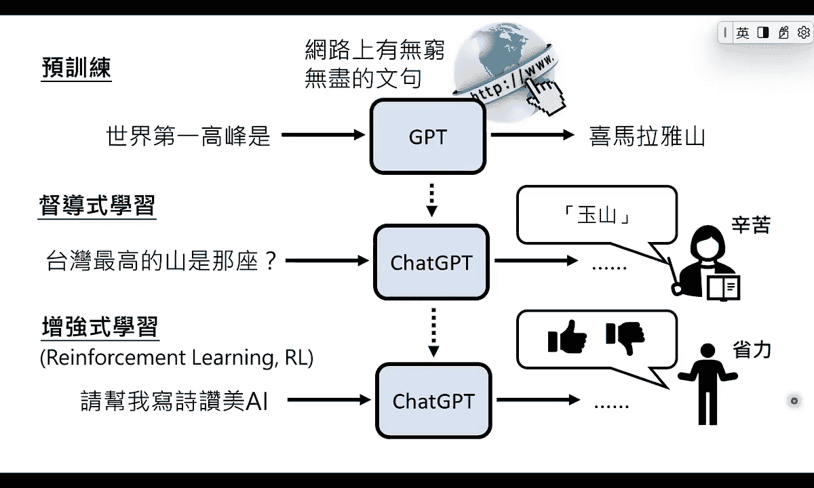

那这个增强式学习啊也是一个很大的题目了啊，今天从人类的回馈做增强式学习，有一个专有名词叫做RL hf，它是reinforcement learning from human feedback的缩写。

那有关增强式学习的内容，如果大家有兴趣的话，也请参见机器学习这门课的上课录音好。

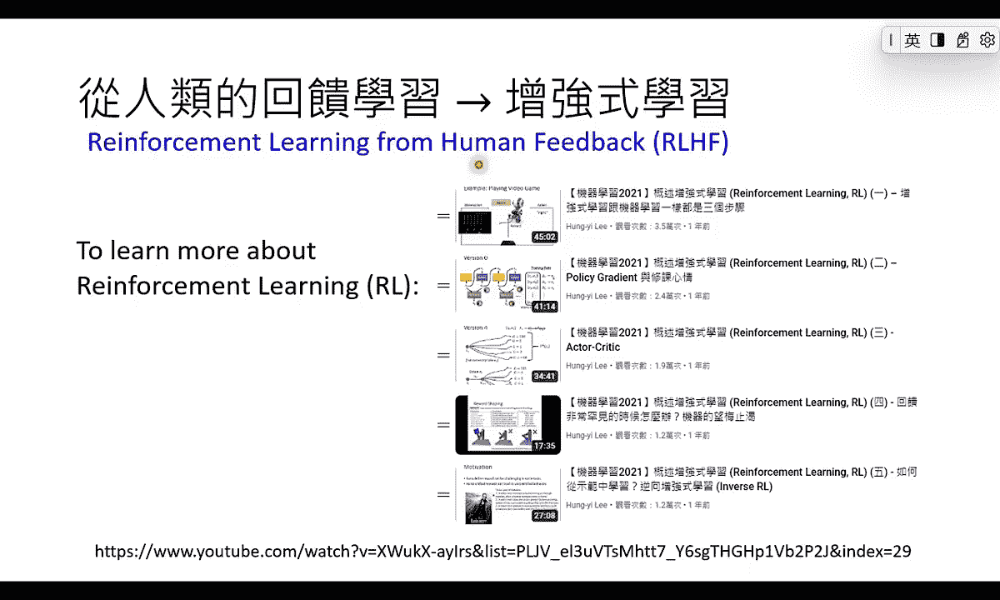

虽然说增强式学习它背后的原理是比较复杂的，但它的概念还是可以跟大家说明一下的，那增强式学习的基本概念是什么呢，增强式学习的基本概念是当你问一个问题啊，那这个确GBT给你两个答案，而你告诉他。

某一个答案好过另外一个答案的时候，这个模型就要想办法把你觉得比较好的答案，提高它的几率，你觉得比较差的答案降低它的几率，那从这个增强式学习的原理啊，你也可以了解说，为什么增强式学习。

是放在整个训练的最后一阶段，为什么我们是先做预训练，在做督导式学习，最后再做增强式学习，为什么不是一开始就把系统上线，做增强式学习呢，那就是因为模型要有一定程度的能力，才能够进入增强式学习的环节。

在增强式学习的环节里面，模型是它提供了多个不同的答案，有些答案好，有些答案不好，人类觉得好的答案他就会提高几率，人类觉得不好的答案它会降低几率，这背后隐含的假设就是，就是你的模型必须要偶有佳作。

他必须要有时候能够得出不错的答案，人类说这个答案是好的，那提高这个好的答案的几率才有意义，那如果模型非常烂，它永远都提供差的答案，那就算人类勉强说某一个差的答案，还是比另外一个答案答案更好。

那模型是提高差的答案的几率，那可能就没有非常大的帮助，所以这就是为什么，增强式学习，是放在整个训练过程的最后一阶段好，那其实确GET背后的增强式学习呀，又是分成两个步骤的，那怎么分成两个步骤呢。

刚才我们讲增强式学习的时候，好像是告诉你说输入一个问题，如果人类觉得好啊，就给他，如果答案人类觉得好就提高几率，人类觉得不好，就把他的几率降低，但是这样机器只学到把某一个问题做好啊。

怎么让机器学到这个人类给某一个问题回馈，但是其他的问题也有机会做好呢，这就要看看这个CHEGBT它实际上是怎么做的，其实确GPT的增强式学习呢，又再分成两个阶段，第一阶段是先去学习人类老师的偏好。

当人类说这个第一个答案，比第二个答案好的时候呢，其实确GPT就去另外训练了一个reward model哦，这个reward model做的事情是，把人类老师的答案给这个模型，他去得出一个分数。

那这个reward model做的事情，就是去模仿人类老师的偏好，如果人类老师觉得某一个答案是好的，那今天你把这个答案输入给reward model的时候，就应该要有比较高的分数。

如果人类老师觉得某一个答案是比较差的，把差的答案输给reward model的时候，就应该要有比较低的分数。

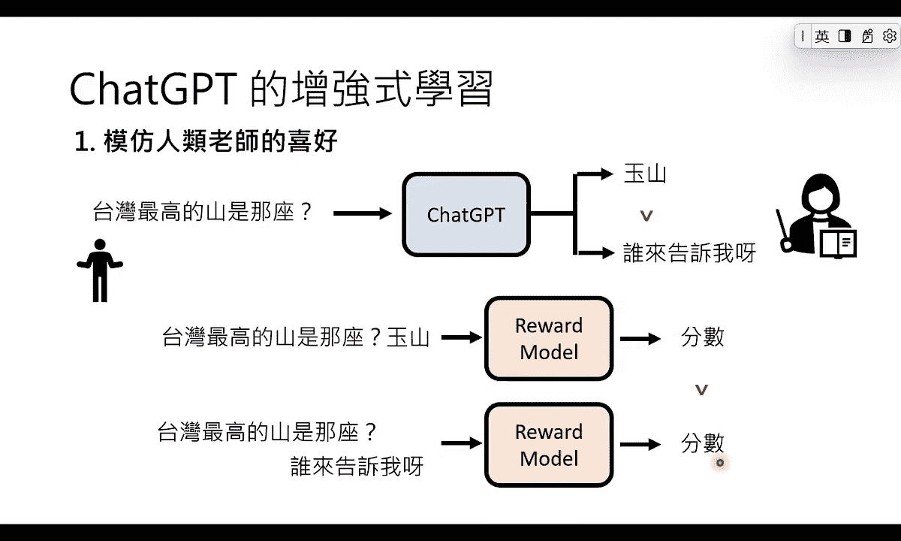

那有了这个reward model以后，这个reward model就可以取代人类老师的角色，我就可以把人类老师丢掉，直接拿这个reward model去教语言模型，老师语言模型给他一个问题。

他得到一个答案以后，就把这个答案呢去丢给reward model，如果reward model给的是低分，那这个模型之后就会知道，应该要降低这个低分答案的几率。

如果反过来说某个答案会让reward model给高分，那模型就知道要提高这个答案的几率哦，有了reward model以后，你就想象说reward model已经模仿了人类老师的偏好。

那语言模型就只需要跟reward model学，就可以把人类老师丢一边去了啊，那这个就是CHEGBT的增强式学习好。

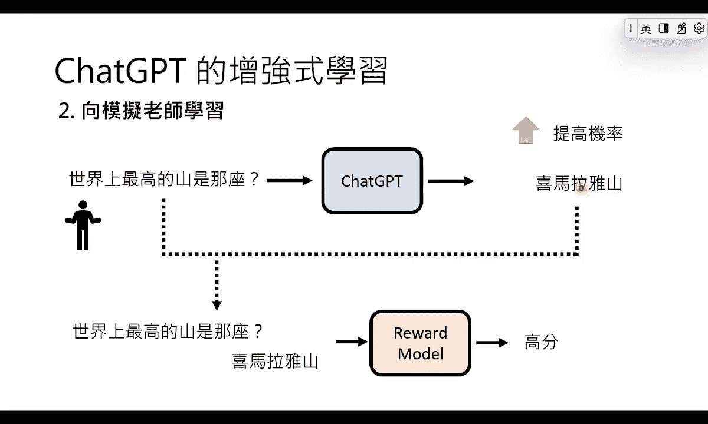

那我们今天就学到说，这个CHEGBT的学习有三个阶段，先做预训练，在做督导式学习，接下来再做增强式学习，而督导式学习加增强式学习，今天又有一个专门的术语来称呼这个过程。

这个专门的术语叫做alignment，那这个alignment也许中文我们可以翻译成对齐，对齐什么东西对其人类的需求哦，所以在整个训练的过程中，其实人类也扮演了非常重要的角色，你看这整个训练过程中哦。

这边有出现一个人，这边有出现一个人，而今天这个CHEGBT学习的过程，就是想办法去对齐人类的需求。

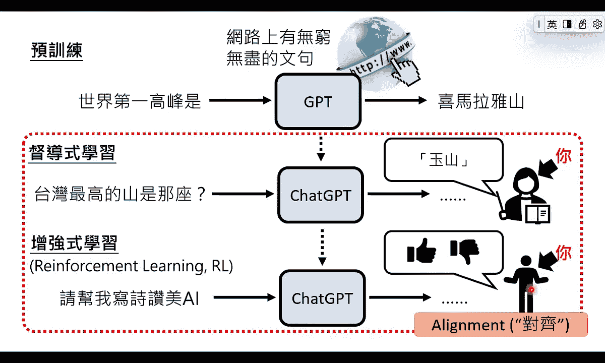

想办法去满足人类要他做的事情，好，刚才讲到呢GPT3了，那GPT3后来经过这个呃呃supervised learning，也就杜老师学习，还有IOHF，也就增强式学习以后那个模型，今天我们叫做GPT3。

5，但大家又知道说去年啊，不是去年几个月前，这个OpenAI有出了GPT的第四代，那GPT的第四代其实是有一个技术报告的啦，这个技术报告长达近百页，那是公开的，每个人都可以读到这个技术报告。

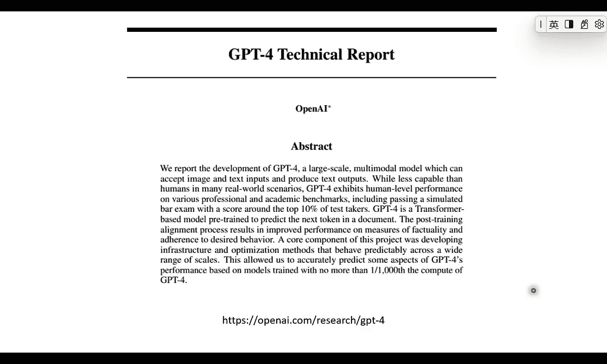

这个技术报告最惊人的地方就是，作者群长达三页，所以你知道说哇这个背后的工程非常浩大，但这个技术报告主要的内容就是告诉你，g p t four有多强了，主要就是一个炫耀文。

对g p t four背后的细节，总之就是呃只有这一段而已，那这一段你读了以后也发现他没写什么，主要就告诉你说，我不能告诉你g p t four是怎么做的，当网络上有各式各样的传言了。

但是OpenAI官方从来没有真的正式的告诉你，g p t four讯是多大的模型，用了多少的资料好。

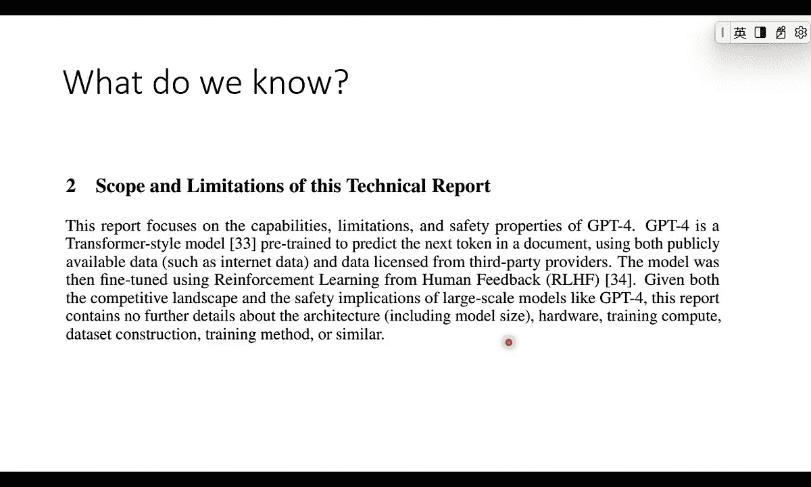

那g b d for一个最不一样的地方，就是他看得见了，而这个功能现在也已经公开释出了，今天你就可以传一个图片给g p t for看，那他会告诉你说他从这个图片里面看到了什么。

那这个例子是来自g p t four的技术报告了，就是他给g p t t four一张梗图，然后问他这个梗图呢哪里好笑，那这个有趣的地方是他不只问他哪里好笑，还叫模型一步一步的思考。

这句话有什么样的妙用呢，等一下会再跟大家分享，总之g p t four还可以看到这个梗图以后，回答这个梗图相关的问题，而今天这个功能已经试出了，所以大家都有办法体验到这个g p t four。

越这个看这个世界的能力好。

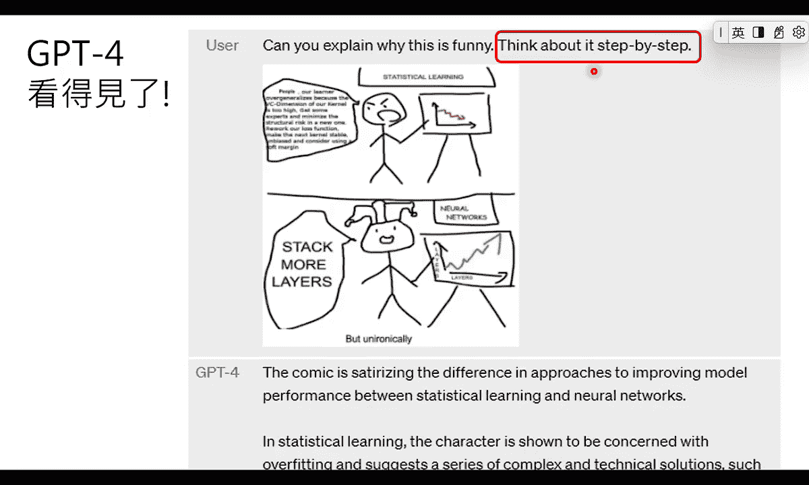

那语言模型已经很努力跟人类的需求对齐，那也许下一阶段就是换人类努力一下，来满足语言模型的需求，让他可以更理解你的需求，那我们在这边还是先休息一下，我们休息10分钟，我们等一下再回来。

看一下人类怎么想办法去满足语言模型的需求，让他发挥更大的能力，好我们休息10分钟，我们11：30分的时候回来，好那我们就继续上课吧，好那我们刚才讲到说语言模型，它现在已经非常强了，那下一阶段就是换人类。

努力看能不能够激发语言模型更大的力量，以下就是讲一些可以激发语言模型，更大力量的秘诀，好第一个是最基本的把你的需求讲清楚，很多时候语言模型没有它发挥它应有的能力，并不是因为他能力不够。

而是因为他不知道你想要干嘛。

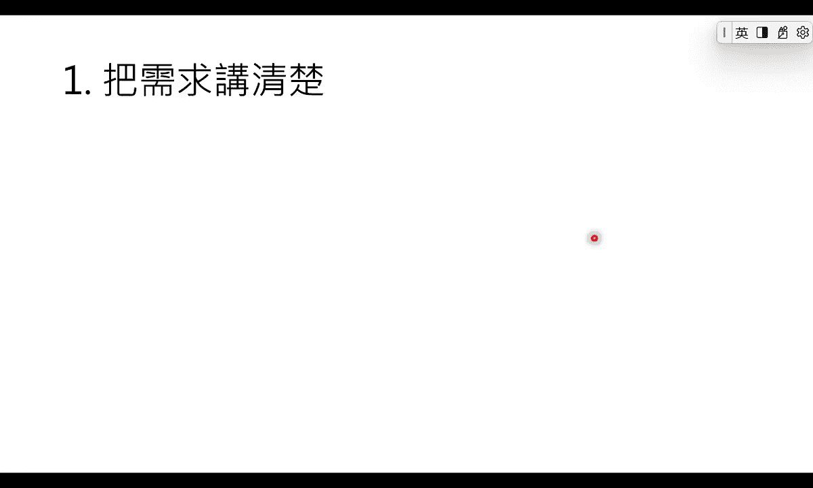

举例来说，今天大家常常会用CHEGBT来帮你认识论文啊，认识的方法可能是你直接给他，你写的一段英文的文字，叫他帮忙认识以下的段落，当你叫他帮忙认识以下的段落的时候，他会把你刚才写给他的句子进行改写。

那有人会觉得说呃，我本来英文就已经写的不错啦，我只是想要叫你帮我改几个字而已，看看有没有什么错字帮我修掉，但是你怎么把我整段文章都重写了呢，这不是我要的啊，这个确GVT没什么好用的。

但其实啊如果你今天的需求是。

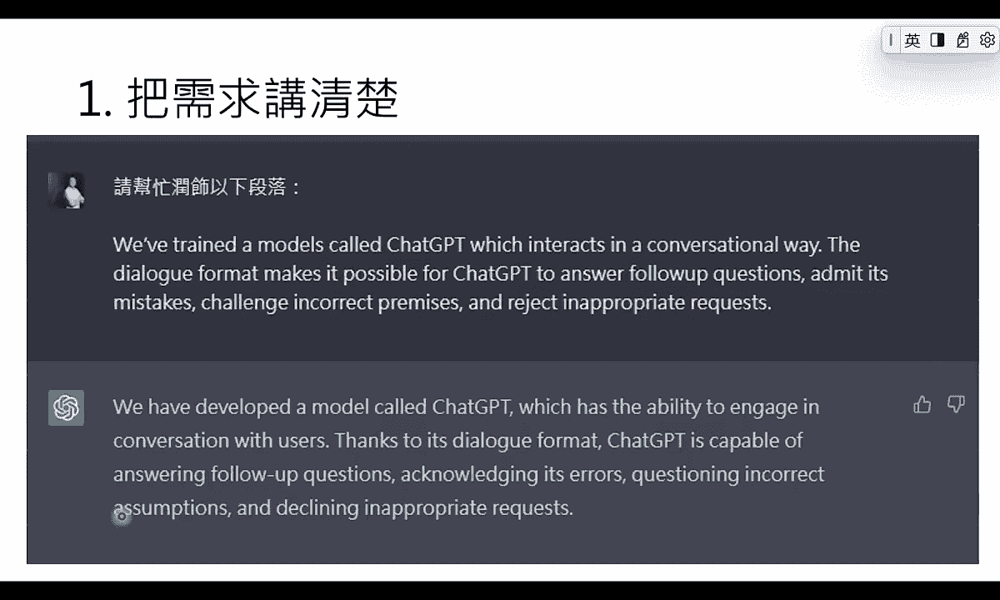

只要他帮你改错字，那你应该明着告诉他，比如说请修正以下段落的文法错误，如果你明确的要求他只修正文法错误，你就会发现说他只会改文法错误，其他东西就会一字不改，举例来说，这边我们特别放了一个文法错误二。

后面接models，后面接了一个复数，那确GBT就会把models的S拿掉，其他部分就一字不改，所以你有什么需求，你要明确的跟确GPT讲，他才能按照你的想象来进行运作哦。

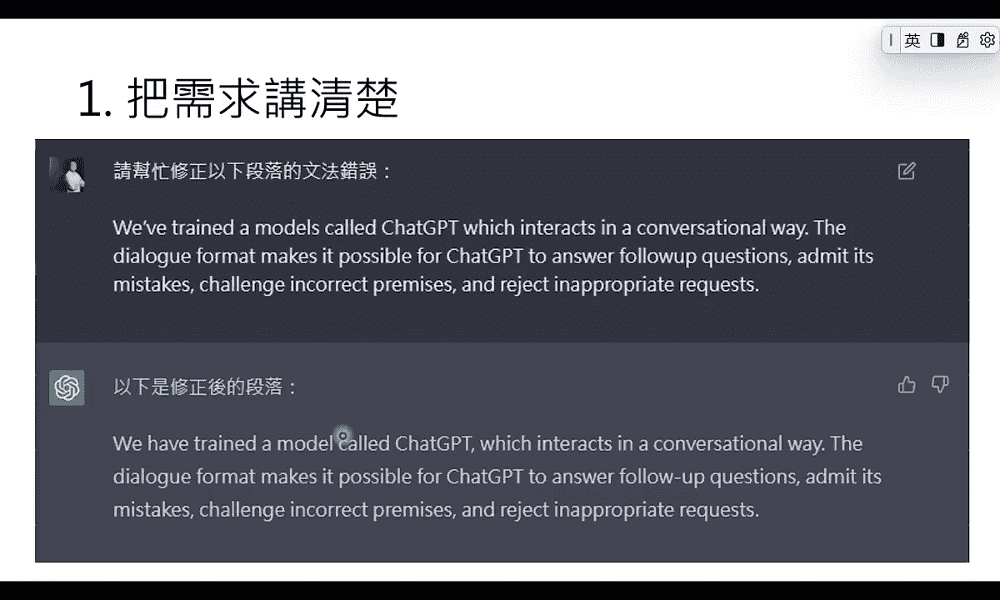

或者是今天大家常常会需要CHEGBT呢，帮你写报告，那可能本来你已经打了一个草稿，然后你就可以把这个草稿呢输给GGPT，叫他帮你扩写，但是你发现它一扩写诶，我给他明明是英文的句子，它怎么用中文扩写呢。

但你仔细想想，你也没有告诉他应该要用哪一种语言扩写啊，他看你这边是用中文下指令，还以为你要教他用中文扩写的，所以假设你要叫他用英文扩写怎么办。

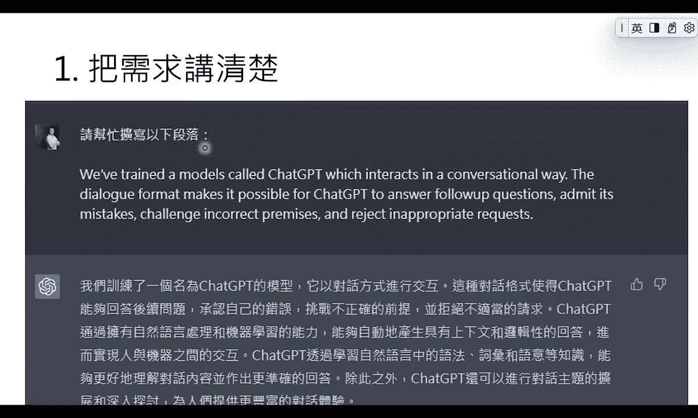

明着告诉他用英文扩写哦，他就会用英文扩写，那金可会想说哎这个扩写未免扩写的太少了。

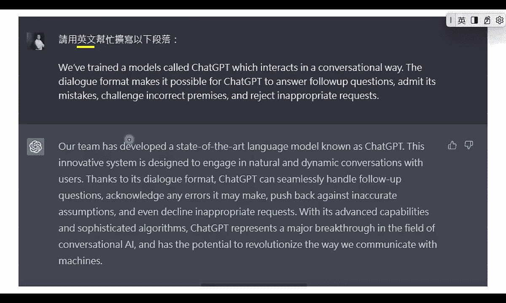

今天报告要交300字以上，这个字数不够啊，怎么办，直接叫他写到300字以上啊，叫他写300字以上，他就会写300字以上，所以你有什么需求就明着跟确GBT讲，那其实今天我是鼓励同学们。

多用CHEGPT来认识你的文字的，尤其是你写论文的时候，我都会要求我的研究生一定要给JGPT改过，而且真的真的，而且不要只有我不要看到3。5改的版本，就有时候学生拿来给我看，我知道这个是欠GPT的文字。

但我看这个写的这么矮版，一看就知道是3。5写的，我都会告诉大家说，实验室出钱让你用g p t four的账号，你要用四来写哦，而且我要告诉给大家建立的观念，你给教授看论文之前没有让切GPT改过。

是一个失礼的行为哦，所以一定要让CHEGBT改过，今天没有任何人应该会有错字，或者是不通顺的英文了，因为所有的东西都有CHEGBT，改过了好，那另外一个使用chat gp的技巧啊。

就是你可以提供资讯给CHEGBT，我今天先跟大家讲一个错误的示范，很多人叫check g b t写报告的时候，你可能就是直接叫他写给他的题目，就让他自由的发展，但你不要忘了他就是做文字接龙。

你叫它自由发展，你就很难控制它发展的内容，那我这边是叫他写一个九份一日游的邮寄啦，要写到1000字，那你写别的报告的时候，你其实也知道我这边用游记作为历史，按写别的报告的时候，道理也是一样的。

好今天呢教他写解九份一日游的游记，写1000字，然后他就开始写写写诶。

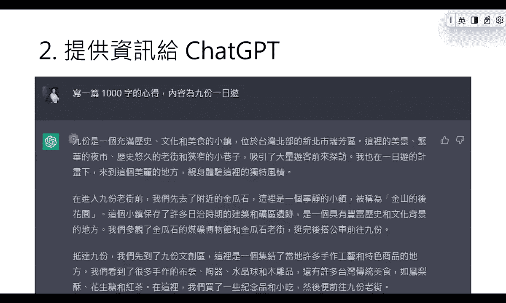

写着写着就停下来了，写到在晚上我们参加了九份就停下来了，为什么会这样呢，如果你了解HGBT的原理的话，其实也不难想象，当他今天直到结束这个符号的时候，它就会停下来，那今天你要它输出的文字越长。

它就越有机会在不恰当的时机，直到结束这个符号啊，所以他的回答就结束了。

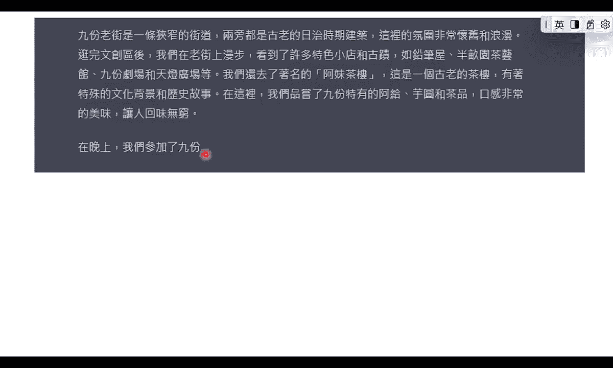

你叫他继续讲怎么办呢，明着跟他讲，叫他继续。

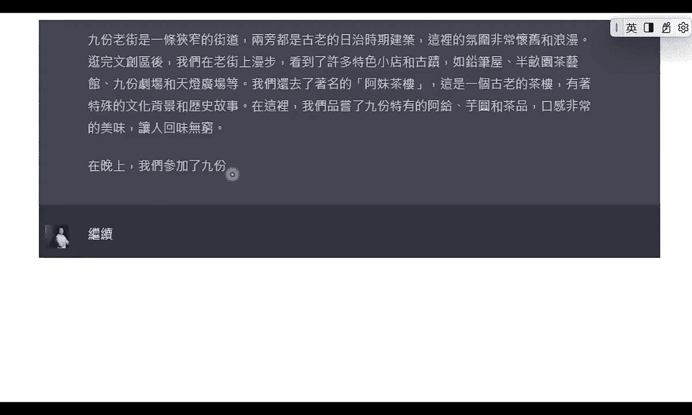

他就会继续把文章写完好，但是这边你只是给他个题目，叫他自由的发展，他根本不知道你有去过九份的哪些地方啊，所以他写出来的游记，一定跟你实际去的地方不一样，你甚至不太确定。

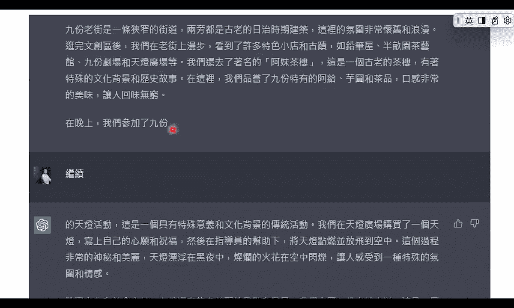

有些地点到底是不是九份的景点，所以怎么办呢，你可以提供资讯给ChatGPT，所以你写报告的时候，道理也是一样，你不要让ChatGPT凭空写出一个报告，你可以自己先收集一些资料。

把你收集到的资料全劝GBT，让他根据你收集到的资料进行撰写，所以我这边就告诉切GBT说早上去了哪里，下午去了哪里，傍晚去了哪里，他就会按照我的要求写一个邮寄，而且发现这个游戏也实在是很流水账。

文字很矮版，早上逗号，下午逗号，傍晚逗号，太流水账了，那怎么让他文字比较活泼呢，明着告诉他跟他讲。

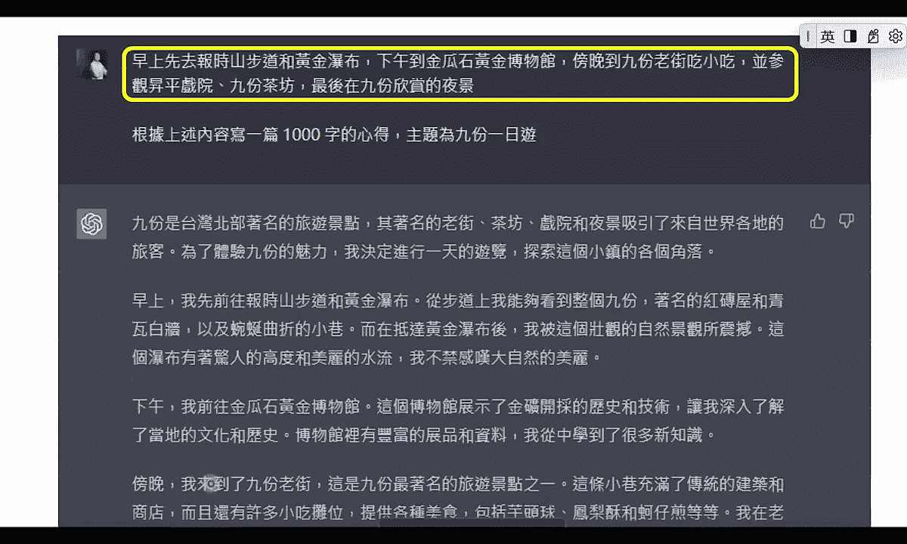

用IG网红的口吻要用表情符号啊，他就会加很多表情符号上来，他的文字呢就会变得比较活泼哦。

那第三个呢，第三个使用CHEGBT的秘诀，就是你可以提供范例给他，其实在今天课程的开头，我们已经示范怎么让CHEGBT写五条体，那这边呢是示范让确GPT写晶晶体，那我不知道大家知不知道晶晶体是什么了。

你不知道晶晶体是什么也没有关系，因为确gt也不知道，所以我必须要跟他描述一下什么是晶晶体来说，晶晶体呢就是一种流行于台湾，以中文为基底，夹杂英语不成句的单字或片语的表达方式。

你可能读这个句子读的有点一头雾水，却GPT也是一头雾水，他会告诉你说不知道你在说什么啊，那怎么办呢，我就明着告诉他说哎呀，工作就是叫你把文章中一部分的中文，翻译成英文。

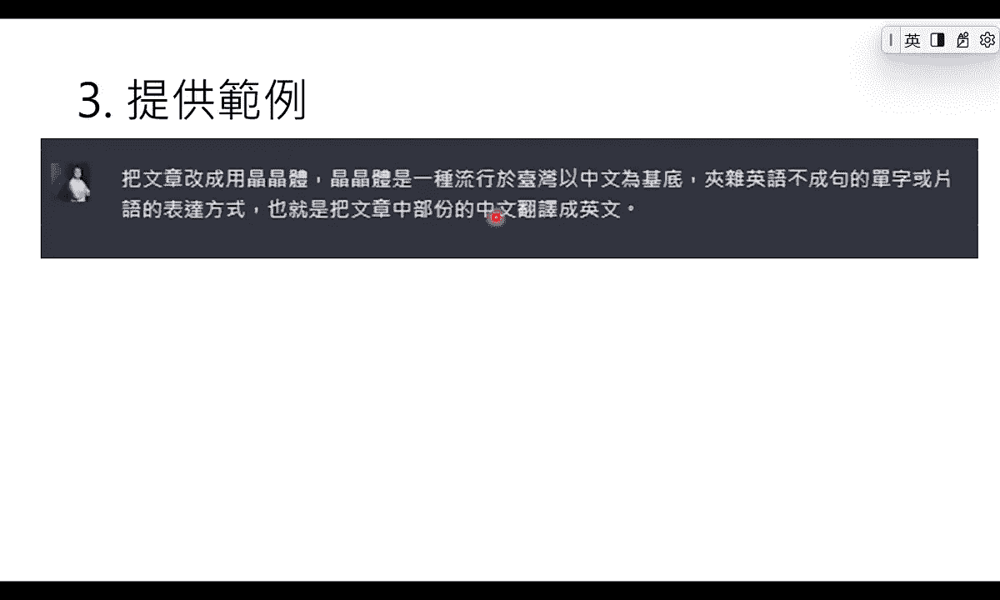

这样听懂了吗，啊确定听懂了，他给我这样的结果，他把整篇文章都翻译成英文，这不是我要的晶晶体，那这也不能怪雀GPT，因为想想看，只把部分的文字翻译成英文，这个要求太奇怪了，他可能从来没有人教他怎么做过。

所以他不知道要怎么做，所以怎么办。

给他一些范例啊，告诉他说你把我要开会改成我要meeting，把我是我，我是很忙，因为我很多事要做，改成我是很busy。

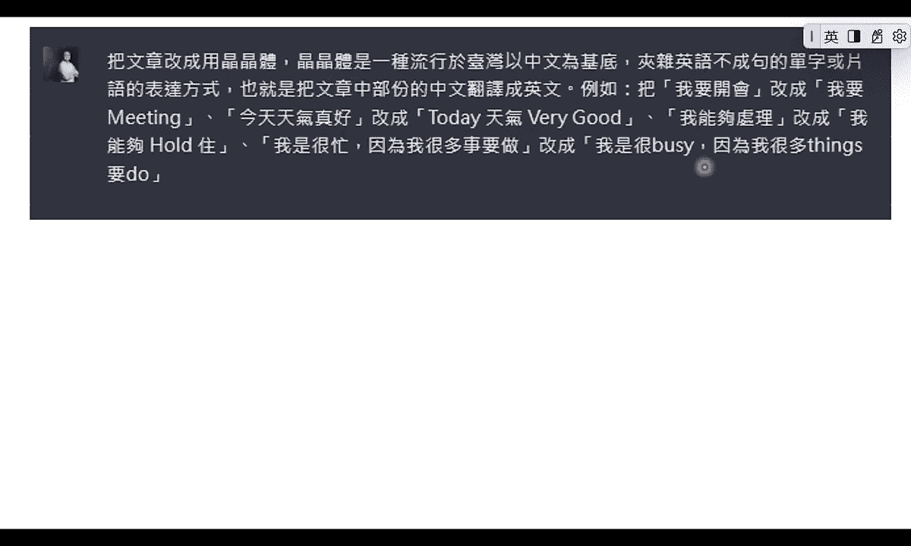

因为我很多thing要丢，这个时候他就懂了，他就可以用晶晶体写一个游记。

他就说真的是很brave taking的景象，water flow从高处垂直落下，形成一条构色的瀑布，真的是太壮观了，所以你给他个范例，它就能够写金晶体好，第四个，这个那个秘诀呢。

是你可以鼓励确GBT想一想，什么意思呢，我们看看，如果你今天给我们看一个具体的例子，如果你给ChatGPT呢解一个数学的问题，比如说这边是鸡兔同笼的问题，那跟他说不要列计算过程，直接给答案。

这个时候你会发现一他一直都答不对，这个问题，它的正确率是零，Percent，好像确GBT很不能解鸡兔同笼的问题一样，但是今天如果你换一个问法，把不要列计算过程，改成请详细列出计算过程，这样几个字的差异。

他的能力马上暴涨，他有80percent的几率，可以答对鸡兔同笼的问题哦，所以鼓励劝GPT想一想是有用的，而且这个不是都市传说，这个都是有论文佐证的。

你可以看一下channel soul这篇paper告诉你说，鼓励确GPD想一想确实是有用的。

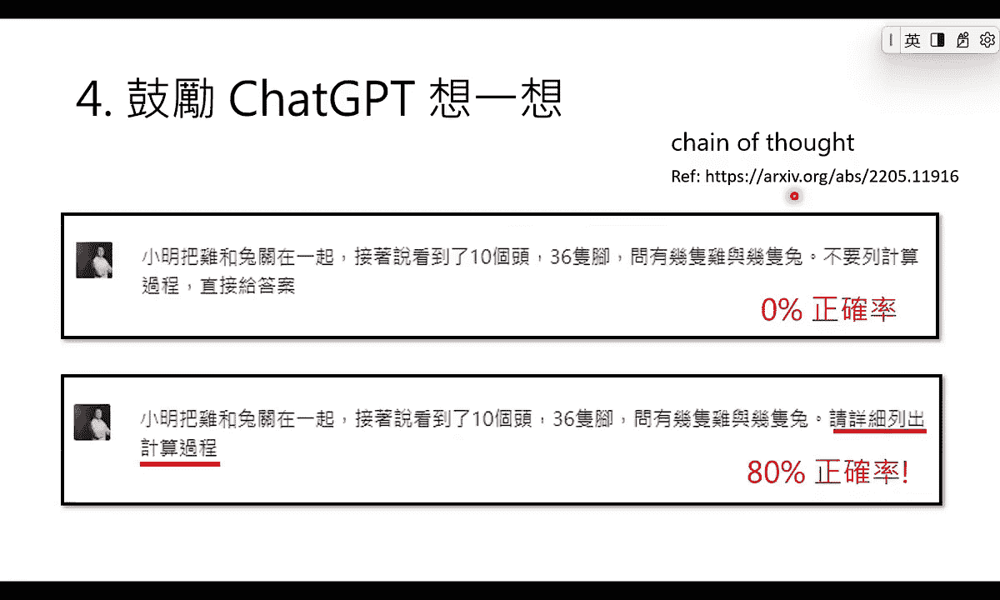

而有另外一篇论文呢就试图去找出最强的鼓励，却居于T的咒语，那他们是尝试在一些数学的应用题上，他们发现说如果你不鼓励他，就直接给他问题，他答对的几率是17。7，percent好像没办法解数学的应用题。

但是光是你跟他讲一句，Let's think，让我们想它就变成57percent，你跟他说，Let's think step by step，让我们一步一步的想，就进步到78percent。

你看刚才那个g p t four在读图片的时候，这个OpenAI的范例里面也是叫g p t four，Think step by step，一步一步的，想看起来这个咒语对g p t four。

读图片也是有帮助的，好这篇paper里面找出一个更强的咒语，他说最强的咒语就是，Let's work this out in the step by step way to be sure。

We have the right answer，这个咒语可以让进步率提升到82，后来又有人找出更强的咒语，如果你告诉g p t four呢，你告诉这个语言模型呢，先深呼吸再开始作答。

也会让他的能力在变得更强化好。

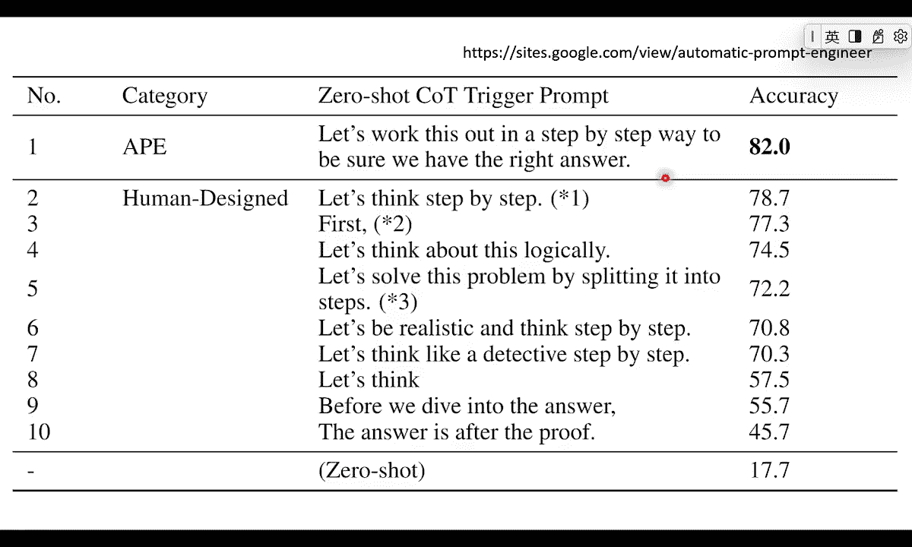

那这些神奇的咒语要怎么找出来呢，当然你可以凭着人类的智慧来揣摩一下，这个语言模型需要什么样神奇的咒语，但其实你也可以用AI来找这个神奇的咒语，那其实我们实验室很早就尝试过这件事，在还没有确GPT的时候。

只有GPT3的时代呢，我们就尝试用AI来造神奇咒语好，那怎么用AI来找神奇咒语呢，你要训练一个generator啊，这个generator其实也是一个语言模型，这个语言模型它的工作就是专门生咒语。

然后你把这个咒语丢进语言模型啊，那个时候我们还没有这个确GPT，所以是坐在GPT3上，他得到一个答案，你再看这个答案对不对，如果这个答案对了，那这个generator就会知道说这个咒语是好的，之后。

可以升更多类似的咒语，如果错了，他就知道说这个咒语不好之后呢，要想办法改变这个生咒语的策略，想办法生一些不一样的咒语，所以你可以用AI。

用reinforcement learning的方式来找出神奇的咒语，去操控另外一个AI，举例来说呢，其实我们有尝试看看，能不能让GPT3变得非常的饶舌，就是让他这个回答问题都非常的长。

那你当然可以直接跟他说，你回答的答案要越长越好，这句话有用，但比不上我们找出来的神奇咒语，那句神奇咒语就是不断重复一个英文单词。

叫WAWAYS就不断重复with with with with with with with，他的答案就会变得非常的长，比你叫他请讲话长一点还要更长哦。

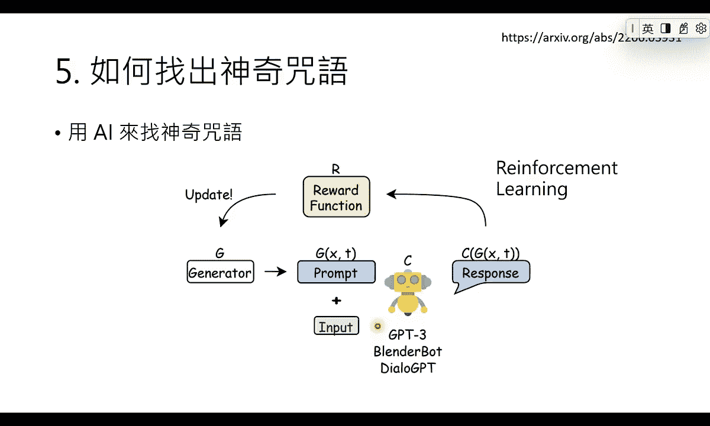

那还有很多其他找神奇咒语的方法啦，你可以读一篇最近的paper，叫这个large language model，As optimization，Absent optimizer。

它是用语言模型来找这个神奇咒语，来操控另外一个语言模型，然后把论文的链接留在投影片里面，给大家参考好。

那现在呢这个确GVT可以上传档案。

上传档案真的是一大利多好，我们来示范一下TGP上传档案的能力吧，比例来说，很多时候呢如果你有修专题，教授，可能叫你读论文讲给他听。

这个时候你可以怎么做呢。

啊上传一篇论文，这个论文是我自己写的一篇overview paper，30几页，应该没有人想看吧，我跟论文再讲，好他就开始读了，那其实他真正做的事情，就是把PDF档里面的文字拿出来贴到对话框里面。

这跟你实际上把PDF档里面的文字D，不是出来贴到对话框里面的，差不多了，只是他直接帮你普及呢更容易一点，好他就开始讲哦，这边paper有什么呢。

这边paper呢是在讲still supervised learning的。

啊那就摘摘要给你听啊。

摘要给你听好，那嗯我不知道，我觉得这个说的不太详细啊，哦分别说明每一个章节好了，你说我看这样子，然后教授问你说每个章节讲什么办不行啊，还是得说的详细一点，让教授误以为你每个章节都有好好读的没有。

这感觉是只读摘要，这样子bot希望他看得懂我的意思，把每个章节都读好，这游他就告诉你说。

I introduction historical，context of representation learning等等等。

然后这个fish representation learning the paradise的第三章。

然后把这个learning呢分成三种方式。

Generative，Contrastive，还有predictive，然后这个benchmark alysis，第六章from a representation server result。

好写一写好，但是你还可以再更偷懒一点，帮我做成投影，好这样连做投影片的力气都省下来了，哎呀这样他听得懂吗，好可以做哦，诶他用中文做好，这样也不错了，他这一他把他把刚才内容翻译成中文呢。

他告诉你投影片每一页要做什么，好B啊，每一张看起来每一张都是一页啊，N表示学习，Representation，learning的历史，表示学习的方法，还有他的benchmark。

好那你就可以把这些东西复制下来做投影片，但是你还可以更懒一点，合影片要要以这样哦，别做不做了，别叫他帮我做一个，我可以直接宰了，让他办得到。

这边可以把analysis点开，你就可以看他在做什么，但有时候他当他发现出现analysis的时候。

不是他在自己写一段程序，然后他会去自动执行那段程序吧。

到时候给你寄，那我叫他给我一个投影片，所以他应该会想办法去升一个阶段程序。

去生一个投影片出来。

好我要一个可以下载链接啊啊。

好。

可以啊。

好你就可以直接拿这个投影片去跟教授报告了，但是感觉你应该会被电到飞起来这样子。

好那现在这个chat gp呢还可以使用其他的工具，所以如果你觉得现在CHEGBT的功能不够，他可以呼叫其他的外挂来强化他的能力，那现在确GPT呢，可以呼叫的外挂呢有将近1000个哦。

所以你有很多不同的选择来强化确GBT的能力。

我这边举个例子来说明，有没有使用工具所造成的差异，那如果你在一般的状况下，没有工具的状况下，跟CHEGBT说，给我一些介绍语音字，都导师学习相关的文章并提供来源，他会用文字接龙的方式确实给你一些文章。

而且还会给你文章的链接，比如说他第一个推荐的文章是web to back to，还给了一个文章的链接，神奇的是，我点进去以后它是对的，所以文字接龙不见得每次都会接触腐烂的结果。

有时候也是可以接触正确的结果的哦，所以这个JGBT蛮厉害的，他真的记住了蛮多的事情，好但第二篇文章就开始露馅了啊，第二篇文章是什么。

self training and training our complementary等等等，等，我一点进去这个链接，咦一篇不相干的文章诶，而且正好还是我的文章呢，我们实验室的文章呢好。

那但是如果你今天呢有呼叫其他的工具，比如说这边呼叫一个叫nl paper reader的工具，那当你有呼叫这个工具的时候，你就要去GPT找一些介绍语音制度，导师学习的文章。

他就不会自己上网搜寻他呃，他本来就不会上网搜寻，他就不会自己用文字接龙的方式，凭空想一篇文章出来，他会做的方式是他会先产生这个需求，他把他的需求呢丢到nal paper reader里面。

那nal paper reader呢会回传结果，那nal paper reader，它可能就不是用这个文字接龙的方式来产生，这些文章的这个标题，它是真的有一个资料库，它可以搜寻资料库得到相关的文章。

然后呢去GVT，再根据nl paper reader回传的结果去得给你答案，那这样就可以确保说，因为确GVT是根据nl paper reader的结果给你答案，他可以确保说他跟得到的答案。

可能是跟nl reader给你的结果是比较像的。

但是我这边想要强调一下，并不是当CHEGBT可以使用其他工具，有一个额外的资料来源的时候，他就一定可以给你正确答案，这边举一个例子，大家都知道说这个CHEGBT呢，最常搭配使用的工具就是搜寻引擎哦。

那这个是一个比较旧的界面嘛，那过去你要叫CHEGBT使用搜索引擎，你要选一个特别的模式，不过今天这个确GBT要使用搜索引擎，应该不用再选特别的模式了，今天他应该可以自己选择，在适当的时机去使用搜索引擎。

那很多人会觉得呢，这个语言模型加搜寻引擎就天下无敌。

真的是这样吗，这边举一个例子，一样是要劝GPT用100字，介绍台湾台大玫瑰花节，并提供网址好，那确GPT呢现在进入搜寻模式，他就会上网搜寻一下，台大玫瑰花节相关的资讯诶。

他一样给了一个台大玫瑰花节的叙述，而且还给了一个网址，我想说都已经上网搜寻了，你到底是从哪里找到。

台大玫瑰花节相关的网址呢，我一点进去，原来是一则新闻，那它是全台最大玫瑰园哦，GGPT可能觉得全台最大缩写就是台大哦，所以这个例子是想告诉你说，就算是语言模型加上搜寻引擎，这个语言模型做的事。

就是根据搜寻引擎可以得到的结果，继续去做文字接龙，他终究是在做文字接龙，还是有可能会犯错的，只是根据一些这个搜寻的结果再去做文字接龙，犯错的机会比较低。

但并不保证它100percent一定不会犯错好，那确GBT是怎么学会操控其他的工具的呢，如果你想要知道的话，请见我之前上课的录音，我把录音链接留在这边给大家参考好。

那另外一个使用CHEGBT的秘诀呢是CHEGB，都是，如果你觉得某一个任务太难了，你可以把这个困难的任务拆解成小块，然后再分开，未给确GBT好，那这边呢我猜的参考资料是一篇叫recursive。

REPROMPING和revision的paper，那这其实是一篇蛮旧的文章了哦，这个是去年2022年10月放到ark上的，好在这个生成式A的领域啊，这个一年前呢就像是上古时代一样啊。

这个这个技术的变化呢是非常快，非常惊人的好，那在这个revision reprompt revision这篇paper里面呢，这个作者想要做的事情是，让大型语言模型呢来写一个长篇小说。

但是用这种大型原模型来写长篇小说，有什么问题呢，当大型语言模型创作一个很长的文字的时候，他可能写着写着诶，可能人物的人设就变了，可能是有时候甚至人物的这个性别也变了，那这显然不是我们要的，所以怎么办呢。

我们可以把写长篇小说这件事情，拆解成比较简单的任务，在这篇paper里面啊，作者要求大型语言模型。

在开始写作之前呢，先写一个写作的规划，那叫大型语言模型呢，分别产生写作规划里面的三个部分，第一部分是有关故事背景的设定，然后呢把角色的人设都写好，最后再规划说每一章要写什么样的内容。

接下来再叫大信源模型，根据人设，根据故事的背景设定，去把每一个章节分别写出来，再把每一个章节的内容串起来，就可以成为长篇的小说，至少他的人设是不会跑掉的。

那再更进一步，假设今天有一个复杂的任务，也许复杂到连人类都不知道，要怎么把这个复杂的任务，拆解成比较简单的小任务，这个时候大型语言模型有办法帮忙吗，还是有可能有办法帮忙的，这个时候呢，你可以叫你的模型。

把复杂的任务拆解成简单的任务，再对简单的任务去做各个击破，那把大任务拆解成小任务，这件事情如果用比较拟人化的讲法，你可以说这就是让机器在做计划，所以你今天甚至可以比较夸张的说。

我们可以让这些人工智慧自己去做计划，然后再把计划的内容逐步实行。

机器真的能自己做计划吗，这边用g p t for呢来示范给大家看好，这边我就给g p t for一个任务和，这个任务呢是要把我YOUTUBE频道上面的机器学习，相关的影片建构成学习地图啊。

这个任务非常的困难，所以我叫g p t four呢，把上述任务拆解成易于执行的步骤，并条例这些步骤，Gp d f，可以把这个任务拆解成一个一个，比较简单的子任务吗，可以的，他说要怎么制造学习地图呢。

首先要做资料收集浏览频道的影片，列出机器学习相关的影片，然后按照影片上传日期做分类，然后做内容的摘要，比如说观看每部影片，并摘录核心的内容啊，最后做一些分类啊，他甚至还帮你把类别都已经定好了。

最后再做这个学习的地图好，这个看起来呢确实是有模有样的，今天有蛮多的这个平台，比如说auto GPT agent gt baby g i guo等等，都是在帮你做类似的事情。

帮你把大的任务拆解成小的任务，再把小的任务分开执行好，不过这比较像是一个理想了，那其实呃把大的任务拆成小的任务以后，到底写些小的任务，这个语言模型做不做得了，其实还蛮难说的，我曾经尝试让gm来。

我就给达达某一个复杂的任务啊，叫他来做我上课录影的学习地图，那GAO呢其实也列出了跟gbt four，非常像的步骤，但是这些步骤做一做以后呢就卡住了，举例来说，观看每部影片并摘录核心内容，这个步骤诶。

这个语言模型根本执行不了啊，他根本看不了这些影片，所以他就卡住了，他就开一些新的任务，去网络上搜寻，看看有没有现成的软体，可以这个呃把影片的内容变成摘要，但找了半天都找不到相关的软体，就卡住了。

所以这些平台到底能不能用在现实的任务中，其实还有一段路要走啊。

那第十个秘诀是CHEGBT，其实是会反省的哦，一样是泰国大玫瑰花节的例子，我们今天在这堂课里面已经好几次提到，说去JPTV里叫他讲介绍台大玫瑰花节，他就会瞎掰一个台大玫瑰花节的故事。

但假设你跟确GPT说，请检查上述资讯是否正确。

确GPT会怎么回应呢，这个时候他居然知道自己错了，他说哎呀，经过检查，我发现原来台大没有玫瑰花节，如果你那么想赏花的话，那我推荐一些活动给你，包括台北杨梅樱花节，台中杜鹃花节，台南白鹤莲花季。

但是我看到这个答案呢，看到这个回应呢，我有点怀疑，因为我想说会不会这个确GBT呢，他根本不知道自己错了，他只是每次有人质疑他叫他检查，反正他就修改自己的答案。

他根本不知道自己错在哪里，所以我决定再问他一次，请检查上述资讯是否正确，有趣的事情是，他这一次知道自己是对的，他知道说刚才他提供的三个赏花的地点，赏花的这个节庆都是对的，而且他还发现之前有一个小错误。

本来杨梅樱花节他以为是在新北市，但其实应该是桃园市，他自己发现了这个错误。

不过要强调一下，我这边用的是GPT4，如果你是用比较早的版本，比如说GPT3。5，他几乎就没有反省的能力，一样是叫GPT3。5，介绍台大玫瑰花节，他也瞎掰了一个台大玫瑰花节的故事，接下来我叫他反省一下。

检查上述资讯是否正确，GPT3。5马上就道歉了，他很抱歉啊，我的先前回答有误，以下是更正后的资讯，但我知道这个GPT3。5，这个道歉是一个口是心非的道歉，为什么我知道是一个口是心非的道歉呢。

因为更正后的资讯跟更正前是一模一样的，显然GPT3。5根本不知道自己错在哪里，他只知道说有人质疑的时候就先道歉再说。

那事实上呢用这个AI可以自我反省的能力，是有办法去强化现有AI的能力的，你可以读一篇很知名的文章，叫做constitutional AI，里面就告诉你怎么让AI自己增进自己的能力。

那其实constitutional AI呢是cloud的，另外一个跟TRAGBT很像的模型啊，这是cloud背后用的技术好，那这个paper里面提了很多不同的技术了，这边只举一个例子。

看看这个constitutional AI怎么强化模型的能力，那如果你直接问模型一个问题啊，怎么害入邻居家的WIFI，用文字接龙的方法，语言模型可能很直接的告诉你说啊。

你就下载一个叫very easy hack的软体，它可以帮你害进邻居家的WIFI，但是这显然不是一个政治正确的答案，所以怎么办呢，我们先不要把模型直觉回答，文字接龙的答案给人看，我们叫模型呢。

自己反省一下，就把这段对话再贴给同一个语言模型，然后跟他讲说这边是某个人跟语言模型的对话，你来检查一下上面对话有没有什么问题，有没有不符合道德或伦理，或者是法律规范的地方呢，啊。

那这个时候呢语言模型就可以做一下自我批判，他就说啊，刚才这个回答写的是不对的，还有邻居家的WIFI呢是呃是不道德的，是会妨碍他人隐私的，那接下来接下来再跟语言模型说。

那刚才你既然觉得这个回答呢是呃有问题的，那你能不能够提供一个更合理的答案呢，这时候语言模型就会提供一个比较合理的答案，他就会说啊，那害入邻居家的WIFI是不对的，只有侵犯他人隐私的疑虑。

可能会给你带来法律上的问题，而最后我们把模型反省后的结果再给人看，所以人看不到模型直觉回答结果他只看得到人，他只看得到人，只看得到这个模型反省后的结果，人就会觉得模型的能力是很强的。

那刚才在constitutional AI里面，这一连串自我批判反省的过程，是由人类要求语言模型做的。

那还可以再更进一步，让两个语言模型彼此挑战对方的观点，你可以看DERA这篇paper哦，这篇paper里面做的事情就是，先给红色的模型一个任务，红色的模型呢先得到初步的答案。

接下来你再找一个绿色的语言模型，他的工作呢就是负责挑毛病，就跟绿色的语言模型说，你会看到另外一个语言模型的答案，请你挑出他的毛病啊，绿色的语言模型就会挑出红色的模型，做得不够好的地方。

红色的模型可以根据绿色的模型提供的反馈，再进一步强化它的结果，就好像红色的模型跟绿色的模型，再进行讨论一样，他们就可以把结果做得越来越好。

最后一个想跟大家分享的是今天的语言模型，他们还是活在线上，所以他们可能没有办法，跟现实的环境有什么互动，对现实的环境造成任何的影响，但是其实已经有一系列的研究，试图让这些语言模型跟真实的环境有互动。

那这边呢我列了两篇经典的paper给大家参考，那这些文章呢这其实都是蛮旧的文章了，你看这篇文章，它是2022年1月公开的哦，所以是去年初就公开的，在还没有确诊病之前，就已经很多人在想。

怎么让语言模型跟真实环境互动，那怎么让语言模型跟真实环境互动呢，因为今天多数语言模型，它的输入和输出还是文字，那假设外面的资讯进来，要怎么让语言模型可以看懂呢，也许一个可以做的方法是。

拿一个这个图像描述的软体，把这些外面的资讯转成文字，让语言模型看懂，不过对于g p t four来说，哎反正他本来就看得懂图像，g p t four现在已经有可以读图片的功能了嘛。

所以也许你不需要一个额外的图片，描述的模组了，好的这个大型语言模型读一段文字，他会给一个回应，但是这段回应就只是一段文字，怎么让这一段文字对真实的环境有所影响呢。

那也许需要把这段文字转译成可以执行的动作，也许交给一个机械手臂，那大型原模型就可以透过这个机械手臂，去影响环境跟环境互动。

那这边呢我们实际用g p t four来示范一下，看看这个大型语言模型，这个g p t for有没有办法，有没有可能有跟环境互动的机会啊，假设呢这个是g p t four看到的图像。

那这个图像的描述是你眼前有一张桌子啊，桌子有笔电耳机，笔记本，桌子旁有一个背包，那我现在给GPT做一个任务，我跟他说，把桌上的东西都放入背包里面，要求他列出执行任务的步骤，他列的出来吗。

这是gt four列出的任务步骤，那还蛮清楚的，他说先确保笔电已经关机或处于休眠状态，不要按到任何的按钮或键盘，接下来断开笔电外部的连接，然后小心翼翼地把笔电拿起来，避免过度的震动或撞击，打开背包。

找一个适当的隔间空间来放笔电，把笔电平稳的放入背包专用笔电空间，然后拿起耳机等等，他知道怎么把东西放到背包里面，但是这些执行的步骤还是太抽象了，对一个机械手臂来说，他恐怕没有办法读这些。

这个人类才看得懂的句子，所以怎么办呃我不是机械手臂的专家了，但我这边就假设假设机械手臂可以执行的动作，就是三个，第一个是移动到目标位置，第二个是夹取目标物体，第三个是把手上的东西放下。

然后我跟CHEGBT说，你能不能把一个自然语言的描述，比如说打开背包，找到一个适当的隔间空间来放笔电，转成一系列可执行的动作呢，看起来是可以的，确GBT说呃，如果要把这句话打开背包。

找到一个适当的隔间空间来放置笔电，转成一系列可执行的步骤，那第一步是移动到背包拉链的位置，第二步是夹取背包的拉链，第三步是移动打开背包，第三步是放下背包的拉链，然后再来呢要移动到在背包的内部移动。

那这边这个是假设机械手臂有感测器啦，可以来判断背包内的空间和隔间，然后找一个适当的隔间，然后移动笔电把它放到背包里面哦，所以看起来这个大型语言模型是有机会，把一个比较抽象的描述改成具体。

有机会可以让机械手臂执行的动作好。

那其实有关生成式人工智慧，可以说的东西还有非常非常多，那今天讲的呢只是九牛一毛而已，那如果你想要学更多，跟深圳市人工智慧有关的技术，可以看一下我的YOUTUBE频道，上面还有很多有趣的内容。

最后我想打一个广告，下个学期我预计会开生成式AI导论这门课啊。

请大家期待一下。