# 李宏毅2024春《生成式人工智能导论》 - P40：（延申）Diffusion Method - 啥都会一点的研究生 - BV1BJ4m1e7g8

好，那今天这堂课呢是要跟大家简略的介绍，diffusion model的基本概念，那其实diffusion model有很多不同的变形，那以下的说明主要来自最知名的DENOISING。

Diffusion，Probaballistic model，大家常常提到的DDPM好，那今天其实比较成功的那一些，用diffusion model做的影像生成的系统。

比如说搭理呀或者google的image啊，或stable diffusion啊，基本上都是用差不多的方法来作为。

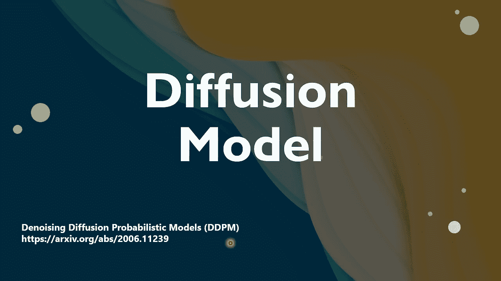

他们的diffusion的model好，那这个diffusion model是怎么运作的呢，它运作的方法是这样子的，好我们来看他是怎么生成一张图片的，在生成图片的第一步是。

你要去simple一个都是杂讯的图片，就是你simple出一个从高悬distribution里面面simple出一个vector，这个factor里面有的数字，这个factor的dimension。

跟你要生成的图片大小是一模一样的，假设你今天要升一张256×256的图片，从normal distribution sample出来的那个vector，他的dimension就要是256256那么多。

那就把你simple到的那个256256的vector，排成一张图片的样子好，然后接下来呢你就有一个DNOISE的module，the noise的network。

那等下会讲说这个DNOISE的network，内部长什么样子啊，这个DNOISE的network从他的名字里面就可以知道，说输入一张都是杂讯的图，那输出它就会把杂讯滤掉一点，那就可能看到有一个猫的形状。

然后呢再做DNOISE，那猫的形状呢就逐渐出来，那就DNOISE越做越多，越做越多，期待最终你就看到一张清晰的图片，那这个DNOISE的次数是事先定好的，那我们通常会给每一个DNOISE的步骤。

给他一个编号，那产生最终图片的那个编号比较小了，那一开始从完全都是杂讯的输入，开始做DNOISE的编号比较大啊，所以我们这边就从1000 9991直排到二，排到一，那这个从杂讯到图片的步骤啊。

它叫做reverse的process。

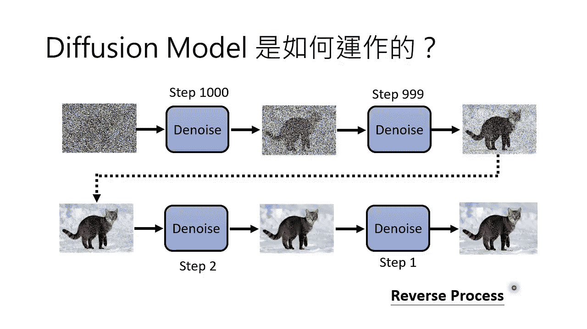

那在概念上，这件事情呢其实就像是米开朗基罗说的呃，这个雕像呢其实本来就已经在大理石里面，他只是把不要的部分拿掉，diffusion model做的事情都是一样的，本来图片就已经在杂讯里面。

他只是把视作杂讯的部分把它滤掉，就产生一张图片好，那以下呢我本来是想要me journey，把这句话的意境呈现出来了，后来发现其实有点困难哦，直接把这句话呢丢到me journey里面。

他就画了一些半雕像的半成品出来，就TRAGBT，有一个专门把这个pump改成me journey，可以吃的pump的咒语，然后升一下，看起来是这个样子，看起来是不太行，然后后来我决定自己手动输入。

然后我输入的句子是类似呃，呃这个有一个大卫像在石头里面，但是看起来MIJOURNEY还是没有很懂这个意境，他没有办法画一个大卫像在石头里面的感觉，这样就我想说他可以画一个有点透明的石头。

然后里面有一个大卫像，那看起来我胖子的功力非常的弱啊，没有办法让他画这件事情，你如果看那个me journey的那个disco哦，里面的人都画出来的图，都都让我叹为观止。

这样说非常羡慕这每个人都是咏唱大师，这好所以我涌上的技巧还非常的不成熟，我没有办法把我心中想要表达的意境画出来，好那接下来呢就要讲这个DNOISE的model了，好那从这个图上看来啊。

你可能会想说这个DNOISE的model是不是同一个呢，是不是同一个DNOISE的model反复用很多次呢，是我们这边是把同一个DNOISE的model，反复进行使用，但是因为在这边每一个状况。

你输入的图片差异非常大，在这个状况你输入的东西就是一个纯杂讯，在这个状况你输入的东西它杂讯非常小，它已经非常接近完整的图，所以如果是同一个模型，它可能不一定能够真的做得很好。

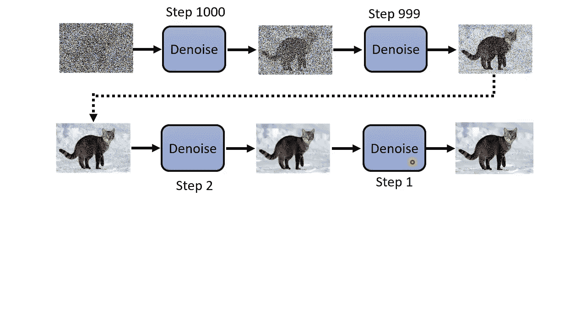

所以怎么办呢，你这个DNOISE的model啊，他除了吃药被DNOISE的那一张图片以外，他还会多吃一个输入，这个输入代表现在noise严重的程度，然后1000代表刚开始DNOISE的时候。

这个时候noise的严重程度很大，然后一代表说现在DNOISE的步骤快结束了，这个是最后一步DNOISE的步骤，那显然杂讯很小，那这个DNOISE的module，希望它可以根据我们现在输入。

在第几个step的资讯做出不同的回应啊，所以这个是DNOIMODEL，所以我们确实只有用一个DNOIMODULE，但是这个DNOIMODULE会吃一个额外的数字。

告诉他说现在是在DNOISE的哪一个step好。

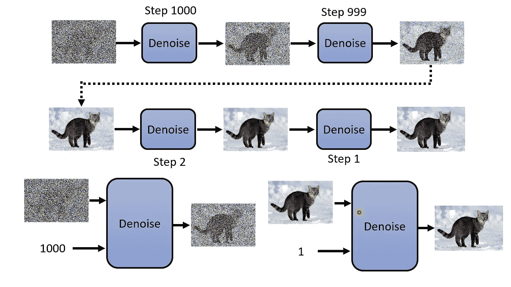

那DNOISE的module里面，实际内部做的事情是什么呢，在DNOISE的模组里面呢，它实际上有一个noise predictor啊，这个noise predictor做的事情。

就是去预测说在这张图片里面的杂讯，长什么样子，这个noise predictor就吃这个要被DNOISE的图片，跟11个noise现在严重的程度，也就是我们现在进行到底noise的第几个步骤的。

这个步骤的代号，然后呢就输出一张杂讯的图好，他就是预测说在这张图片里面，杂讯应该长什么样子，再把它输出的杂讯去剪掉，这个要被DNOISE的图片，然后呢就产生DNOISE以后的结果哦。

所以这边DNOIMODEL，并不是输入一张有noise的图片输出，就直接是抵noise后的图片，它其实是产生一个这个输入输入的图片的杂讯，再把杂讯扣掉，输入的图片来达到底noise的效果。

那你可能会想说，那为什么要这么麻烦呢，为什么不直接扔一个n tn的model，输入是要被DNOISE的图片输出，就直接是DNOISE的结果呢，你可以这么做，你可以这么做，那我在文献上也看过有人这么做。

不过现在多数的论文还是选，选择了一个noise的predictor，你可以想想看，产生一张图片跟产生noise它的难度是不一样，如果你今天你的DNOIMUSCLE，可以产生一只带杂讯的猫。

那它几乎就可以说它已经会画一只猫了，那所以要产生一个带杂讯的猫，跟产生一张图片里面的杂讯，这个难度是不一样的，所以直接扔一个noise predictor可能是比较简单的，任一个ENTUN的model。

要直接产生DNOISE的结果是比较困难的。

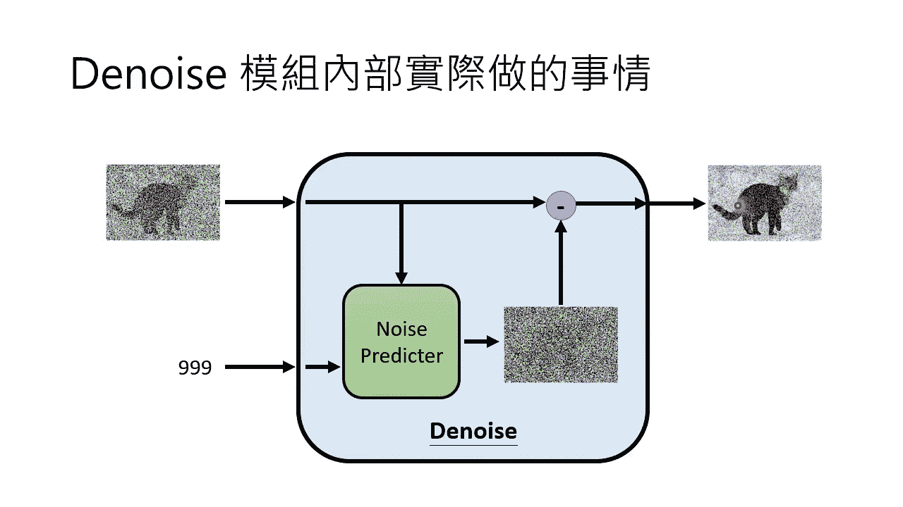

我好，那接下来的问题就是，怎么训练这个noise predictor呢，我们已经知道我们一个DNOISE的model，是一个noisy的image，然后吃一个现在在DNOISE的step的数目。

the step的id，然后产生DNOISE的结果，没有告诉你说，其实dnoise module里面是一个noise的predictor，他是要吃这张图片，吃一个id，然后产生一个预测出来的杂讯。

但是你要产生出一个预测出来的杂讯，你得要有光触发啊，我们在训练network的时候，你就是要有pair data才能够训练呢，你需要告诉noise predictor，这张图片里面的杂讯长什么样子。

他才能够学习怎么把杂讯输出出来呀，那这件事情怎么做呢，怎么制造出这样子的资料呢，好这个noise predictor啊，他的训练资料是我们人去创造出来的。

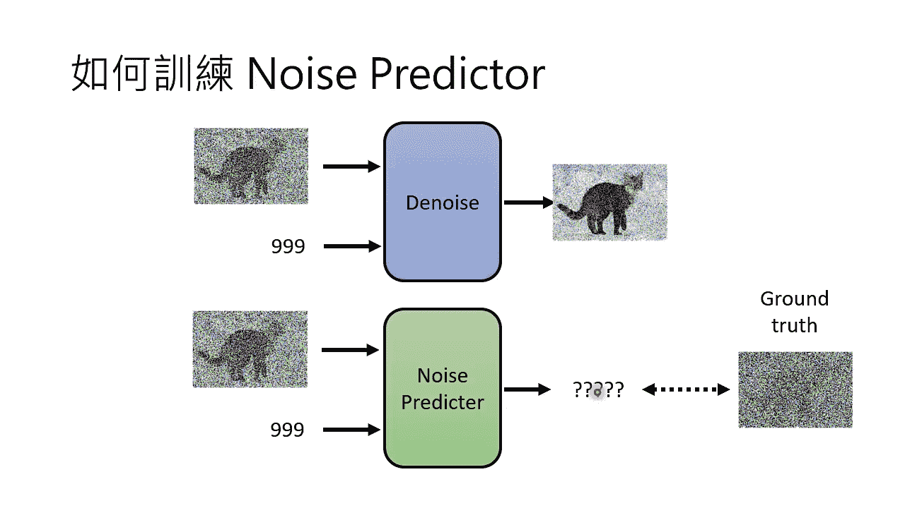

怎么创造呢，它的创造方法是这样，你从你的database里面拿一张图片出来，你自己加噪音进去啊，就random，从高选distribution里面simple1组杂讯出来加上去。

但产生有点noise的image，那你可能再sample一次，在得到更noisy的image，以此类推，最后呢整张图片就看不出来原来是什么东西啊。

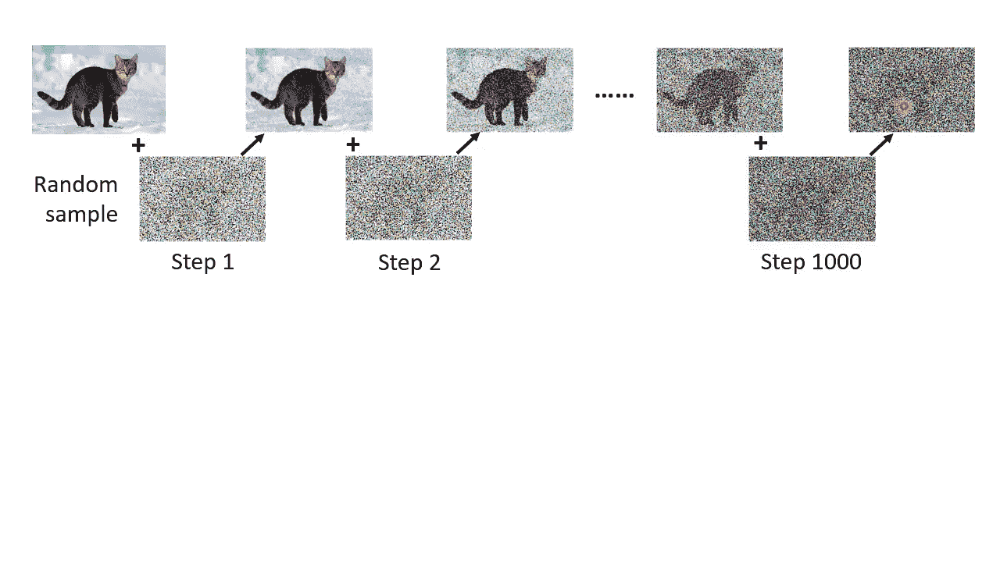

你把你的手上的所有的照片呢，都做这样子的事情。

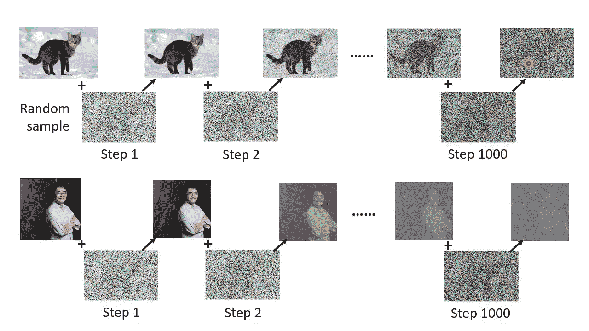

这个加噪音的过程呢叫做forward的process，又叫做diffusion的process，那做完这个diffusion process以后。

你就有noise noise predictor的训练资料了，怎么说呢，对noise predictor来说，他的训练资料就是这一张加完杂讯的图片，跟现在是第几次，加杂讯是network的输入。

而加入的这个杂讯就是network，应该要predict的输出，就是network输出的光束，所以你在做完这个diffusion的process以后，你手上就有训练资料了。

你就告诉noise predictor说看到这张图，看到第二个step，输入二这个数字你要输出是什么，你的光truth就是一个长这个样子的noise，就接下来就跟训练一般的network一样。

TRA下去就结束了。

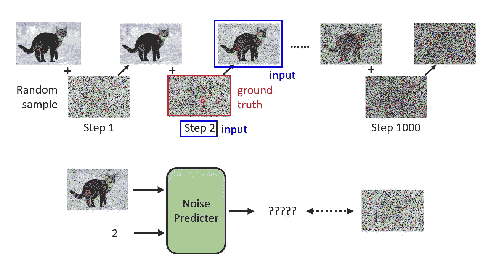

好那但是我们要的不只是生图而已，刚才讲的好像是只是从一个杂讯里面伸出图，还没有把文字考虑进来，那要怎么把文字考虑进来呢，那在下一页后，影片就会讲怎么把文字考虑进来，但是在讲怎么把文字考虑进来之前。

需要先让大家知道的事情是，如果你今天要训练一个影像生成的模型，它是吃文字产生图片，你其实还是需要成对的资料，你还是需要图片跟文字成对的资料，需要多少成对的资料呢，在我们的作业六里面。

我们其实没有叫大家从文字生图片啊，只有直接升图片而已，那我们的资料是7万张图，那7万张图当然非常的少，Image name，它是每一张图片有一个呃类别的标记，还不是那个图片的描述哦。

不是像CPIN的snow这样图片的描述，它只是每一张图有一个标记，然后他有100万张图片，我们先用这个圆圈的大小来代表图片的数量，我告诉你，今天这些你在网络上看到的非常厉害的什么。

me journey啊，stable diffusion啊，或者是DARI啊。

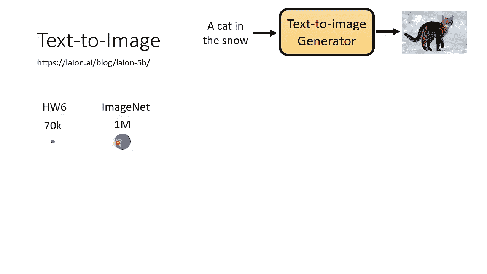

他们的资料往往来自于lion，Lion，lion有多少image呢，5。85B脸的图片，有58。51张的图片的，所以如果你把图片的数量，换算成这个有颜色的圈圈的话，image ne你可能以为已经很大了。

有这么大，有这么多图片，所以难怪今天这一些模型，可以产生这么好的结果，那lion其实有一个搜寻的demo的这个平台，你可以去里面看看它里面有什么样的图片。

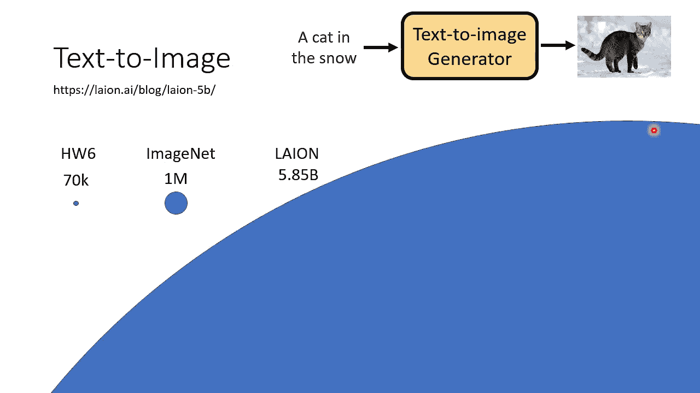

那里面真的是啥都有，啥都有，比如说猫的图片呢，它不是只有猫的图片跟英文文字的对应，他还有跟中文的对应，还有跟日文的对应，所以就知道说为什么今天那一些影像生成模，不是只看得懂英文，你给他中文。

他八成都也看得懂，那是因为他的训练资料里面也有中文，跟其他的语言，你可以试试看，在里面你找都找得到自己的照片啦，我是私底下我是找不到自己的照片啦，蛮多名人的照片，比如说川普那个二一随便一找就一大堆。

所以你也不用意外说，为什么那个MAJOURNEY都画的出川普，因为他就是知道川普长什么样子，所以这个是你需要准备的训练资料。

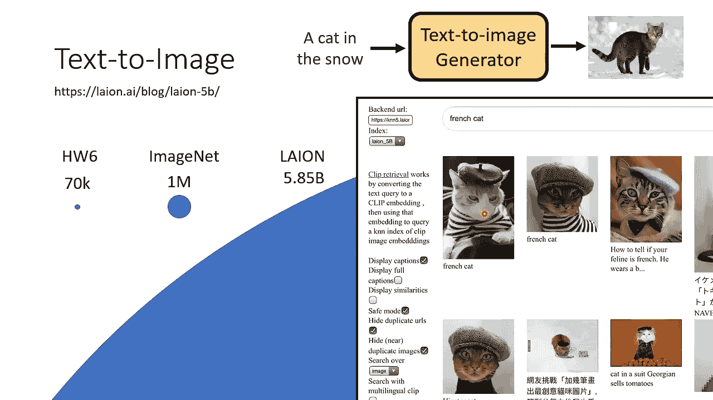

哎好那有了这个文字跟影像成对的资料以后，我们先来看一下DNOISE的时候你是怎么做的，DNOISE时候你的做DNOISE的时候，你的做法非常的简单，把文字加到底，noise的模组就结束了。

所以现在DENOISE的模组不是只看输入的图片，做DNOISE，它是根据输入的图片加上一段文字的叙述，去把noise拿掉，所以在每一个step的DNOISE的模组，都会有一个额外的输入，这个额外的输入。

就是你要它根据这段文字的叙述，生什么样的图片好。

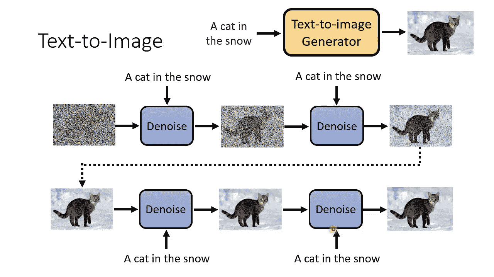

那这个dnoise module里面的noise predictor，要怎么改呢，你就是直接把这段文字给noise predictor就结束了，要让noise predictor多一个额外的输入。

也就这段文字就结束了。

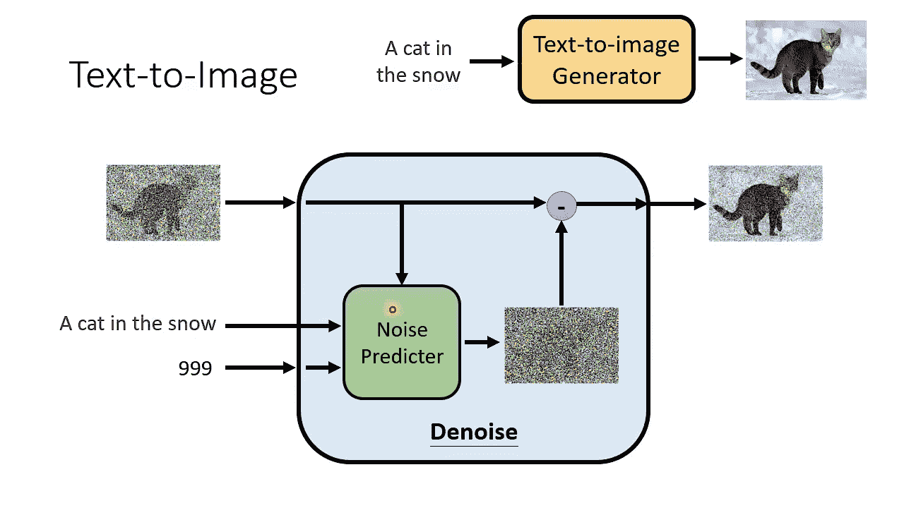

好那训练的部分要怎么改呢，你现在每一张图片都有一段文字，所以今天你先把这张图片做完，diffusion的process以后，你在训练的时候不止要给你的noise predictor呃，加入杂讯后的图片。

还有现在step的id多给一个就是文字的输入，然后noise predictor会根据这三样东西产生，适当的noise，就这样产生要去消掉的noise。

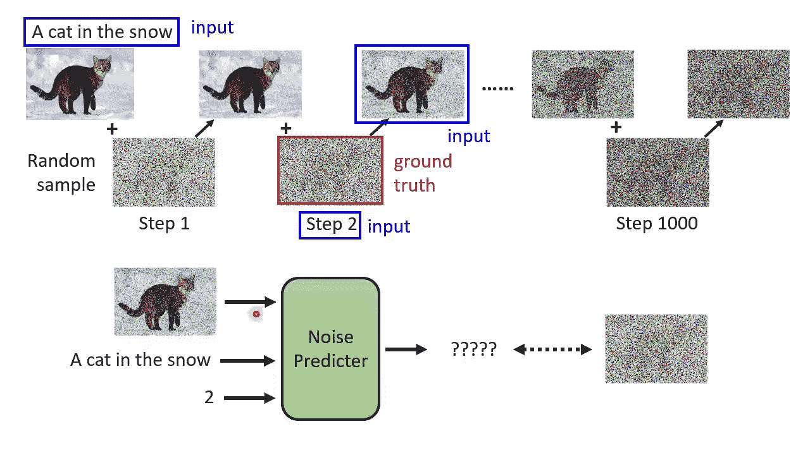

产生这个光tr，这个就是DDPM完整演算法的algorithm，从他论文原始论文里面直接截出来的，就这样，没有更多东西了，就这样，然后但是这两个algorithm里面。

其实还是暗藏一些玄机啊啊这个我们就留着。

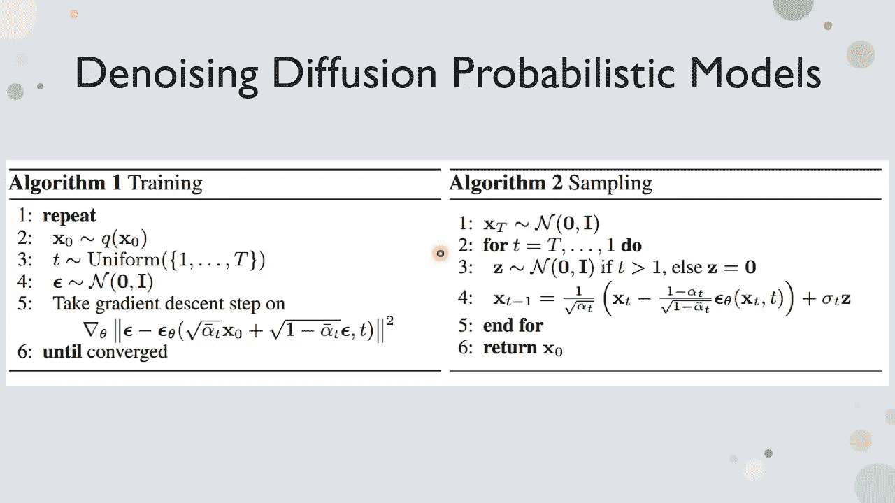