# 李宏毅2024春《生成式人工智能导论》 - P42：额外课程：GPT-4o - 啥都会一点的研究生 - BV1BJ4m1e7g8

有很多同学问我对于gbt for all有什么看法，那所以我今天来讲一下g p t for all，背后可能的语音技术，呃，呃这个影影片的目标听众是VOL，语音技术背景的听众。

那如果你已经是语音领域的专家的话，这部影片讲的内容对你来说可能就太科普了，好那额先说明一下，我假设呢听这个影片的同学，是有修过深层次人工智慧导论的，如果你还没有看过这堂课的影片的话。

你可以在这个链接找到这堂课的影片，那如果你看过这堂课的影片的话，可以让你更了解我现在这部影片里面，所要讲的内容，那g p t four o其中一项特别令人瞩目的技术，就是语音互动的功能。

google也试出了project extra的结果，那在project extra里面也打造了语音互动的技术，那这个代表说，现在语音互动的技术，是各个大厂都非常重视的一块。

那g p t four o的语音模式，voice mode有什么样特别的地方呢，第一个是它有很丰富的语音风格对吧，讲到这个语音合成，大家往往想到的啊就是google小姐，那google小姐就是一种语调。

但是g p t for o，你可以用文字的指令，要求他用不同的语调来说话，比如说叫他讲快一点，叫他轻声细语，或甚至叫他用唱的把他想要讲的事情表达出来，另外g p t four o呢。

好像可以理解语音内容以外的资讯啊，用比较白话的讲法，就是他能够察言观色，举例来说，他可能可以听得到一个人的喘气声，知道一个人气喘如牛，那他可以发出非语音性的声音，例如笑声。

那如果你有看g p t for all the demo的话，你会发现这是一个非常爱笑的模型，它动不动呢就会笑，那另外g p t four o呢有自然而及时的互动，在其中的demo里面。

有一个人说我们来做一个有趣的尝试，话还没有说完，g tt four o居然说了一声哇哦，然后那个人在说，我要你去做某一件事情，如果还没有看过OpenAI的demo，你可以先看一下OpenAI的demo。

再来继续这部影片哦。

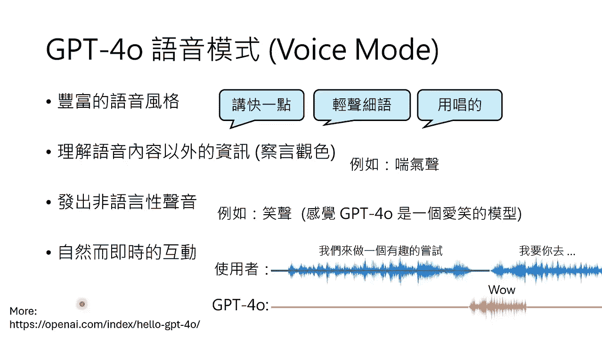

那首先我想要澄清一个，很多人对g b t four o语音模式的误解，那我这部影片呢是在5月19号的晚上录制的，其实到5月19号的晚上为止，多数人应该都是没有，g p t four o的语音模式的。

那很多人会想说我有啊，我可以用语音跟我的TRAGEVITY互动，那个语音互动是CHEGBT手机版本来就有的，语音界面，CHEGBT他的手机版本来就可以用语音互动，它的互动方式是说。

这个是你的cheat gbt的页面，那jb t four o已经试出了，你可以在右下角呢点这个语音的这个鸟。

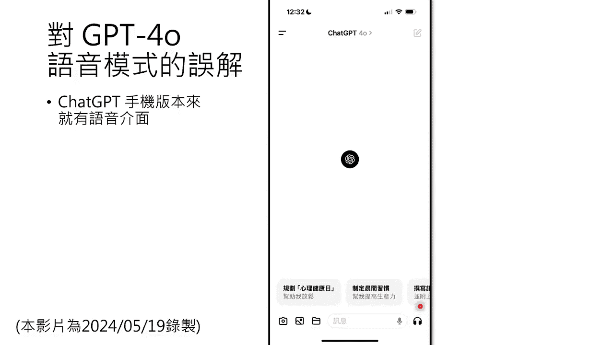

然后你就会看到一个这样子的画面，那你确实可以透过这个界面跟chat gbt，用语音沟通，但是如果你有实际尝试的话，你会发现这一个语音的界面并没有，你在g p t four o。

语音模式的演示里面看到的种种神奇功能，比如说用不同的语气讲话，比如说你可以打断他说话等等。

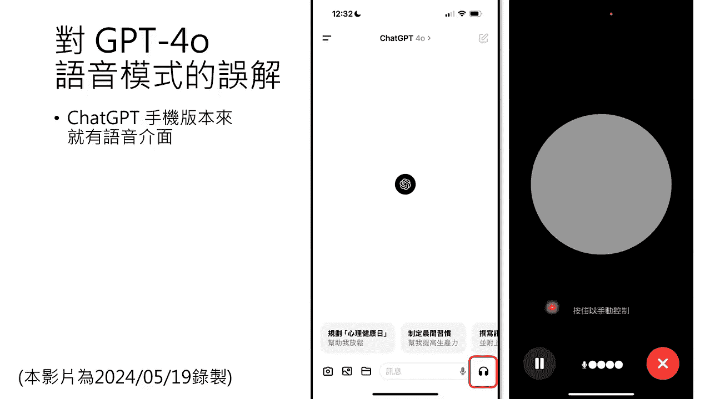

那事实上呢，呃事实上大家可能都有收到一则OpenAI给的讯息，就是呃其实voice mod还没有真的释出，他只是COMIN，so他这会在接下来的数周慢慢的被试出来，所以呃大家所使用的额手机版的语音界面。

其实可能还不是g p t four o的语音模式好。

那旧版的语音界面是怎么做的呢，旧版的语音界面是先把语音讯号，透过语音辨识变成文字，再把文字呢丢给语言模型，比如说CHEGBT啊，然后呢语言模型会给一个回应，这个回应透过语音合成产生语音讯号。

那其实如果语音辨识跟语音合成跑得够快的话，其实这个界面也可以达到蛮自然，及时的互动功能的，但是跟这个OpenAI g p t for语音模式的demo比起来，还是有一段差距。

比如说呢这个如果是透过语音辨识，把声音讯号转成文字，那O语言模型可能会不知道愚者的情绪，语音合成，如果只是把语言模型的输出转成声音讯号，那语音合成就只有某一种说话的风格而已。

那我在看这个g p t four o的语音界面的，demo的时候，我其实在想，他会不会只是把原来的系统加上了，一些额外的模组，比如说在语音辨识之外，我们可以加一些语音事件侦测，或情绪辨认的模组哦。

所以我们也有机会透过情绪辨认的模组，也有机会把声音讯号的情绪把它侦测出来，那你可以把侦测出的情绪呢，放在语音辨识的结果后面与再去丢给语言模型，那将语言模型也有机会知道这句话的情绪。

那我这边呢引用一些论文啊，这个这些论文是说你可以加一些额外的模组，来帮助语言模型了解现在输入语音的情绪，那另外你也可以让语言模型除了文字之外，多输出一些符号，比如说语言模型。

在他的输出的文件后面加一个括号，笑再丢给语音合成系统，搞不好语音合成系统就可以产生笑声，你可能会问，说这个语音合成系统可以看到这个括号笑，就产生笑声吗，有一些语音合成系统是真的可以的。

比如说SOOAI所开发的bug，你在你的文具里面打一个笑，这个语音合成模型，这个语音合成的结果是真的可以产生笑声的，另外一方面呢，CHEGBT可能也可以产生一段指令，告诉语音合成系统。

说现在应该要用什么样的语气来进行合成，语音合成系统可以看得懂这些文字的指令吗，其实很多语音合成系统是可以看得懂，文字指令的，举例来说，一个具代表性的例子就是meta开发的audio bus。

所以用很多现有的技术串接起来，其实也不是没有可能，打造gbt four o的语音界面啊，只是说把很多系统串接起来，那可能及时性不是非常的好，需要透过大量工程的手段，来加快模型运作的速度。

来达到真正及时的回应。

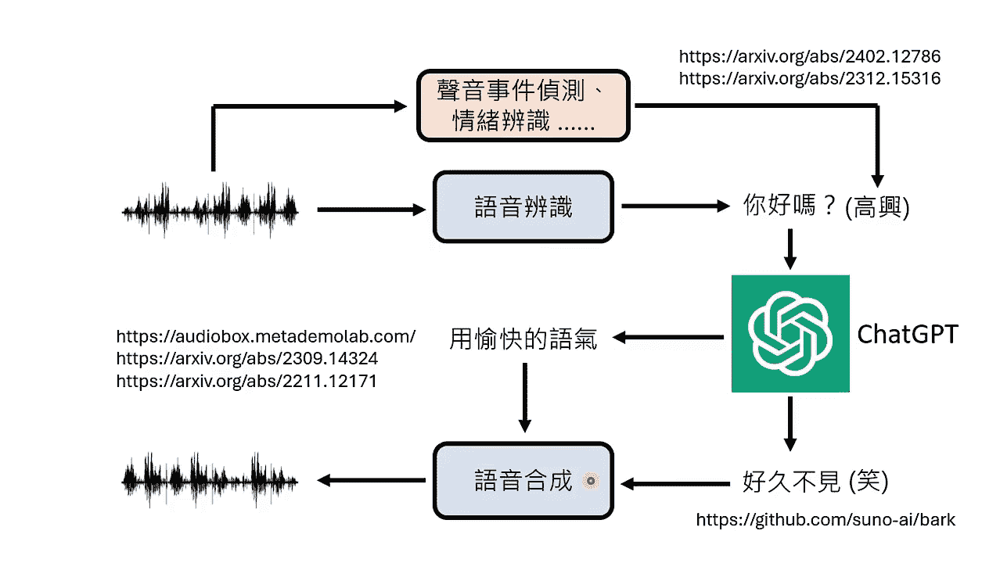

不过g p t for all的blog已经告诉我们，他的语音模式是一个n to n的模型，也就是它只有用一个模型来处理所有的事情，也就是说他用的不是像上一页投影片一样，一个非常复杂的架构。

而是只有一个单一的模型，这个单一的模型听语音讯号作为输入，然后产生对应的输出，那这个模型其实是一个多模态的模型，也就是它是可以呃看图片，看影像的，但以下的讨论我们只集中在声音的部分啊。

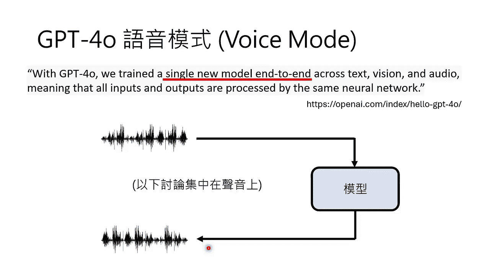

这边先说一个免责声明，本影片主要的目的是讨论技术，那没有要对任何群体或个人造成伤害的意图，那我目前还没有GB t four o的voice mode，所以我对g p t four o的理解。

是完全来自OpenAI的展示，那至于实际上真的voice mode试出以后，有没有展示那么厉害，我们就拭目以待，那OpenAI到目前为止都没有发表，跟GPT for o相关的论文或者是技术报告。

以下的内容完全是根据我知道的技术进行预测，所以以下我对于g p t four o背后技术的猜想，是完全没有根据的，只是并没有任何的论文可以佐证我的猜测，那我只是想要跟大家讨论一下。

根据今天语音技术的发展，有什么样可能的技术，可以达到gt four o这样的效果，额如果日后发现实际技术跟我的预测有差异，还请大家见谅好。

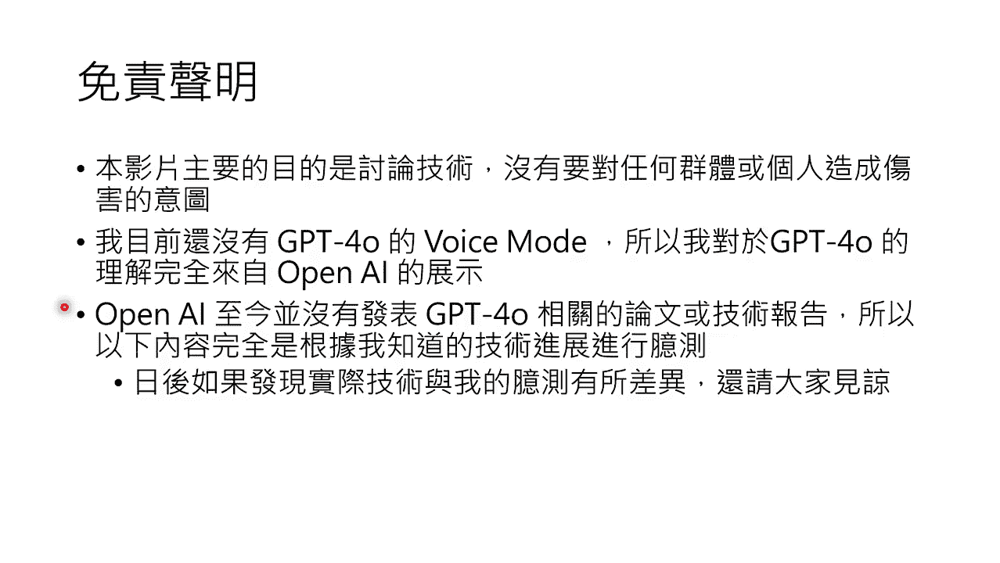

那在开始讲这个until n的语音模型之前，我们先来复习一下这个文字的语言模型，是怎么被训练出来的，那我们知道文字的语言模型，它的训练呢有三个步骤，第一个步骤是PRETRAIN。

用大量没有标注的资料进行训练，然后接下来做fine tun，用少量有标注的资料微调，然后做LHF用使用者回馈的资料进行微调，那FU跟ILHF也合起来，又叫做alignment。

那如果你对于这三个步骤还不熟悉的话。

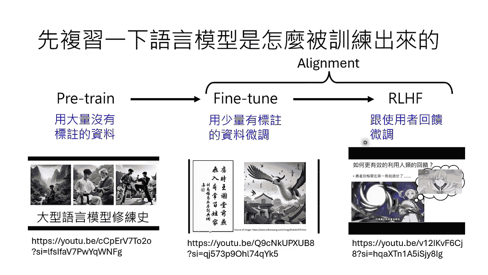

你可以看一下过去我上课的录音，你也可以看一下哦，我最近试出的影片，讲这个生成式人工智慧的生存策略，了解生成式人工智慧的基本原理。

再进行以下的课程好，那语音版的语言模型，它可能的运作原理是什么样子的呢，我们知道语言模型就是做文字接龙，给他一个未完成的句子，他猜接下来应该输出哪一个文字的token。

语音版的语言模型可以听一句话给你一个回应，它背后运作的逻辑可能也非常的类似，他做的事情可能就是听一段声音，然后去猜接下来应该产生什么样的声音，也就是他做的事情是声音接龙，虽然从表面上看起来。

语言模型跟语音版的语言模型，它们的运作可能非常的类似，但是语音版的语言模型有它独特的挑战，第一个挑战就是这个语音呐相较于文字，它更为复杂，那对一段声音讯号而言。

如果他的sampling rate是16K赫兹的话，意思就是一秒钟的声音讯号，里面有1万6000个取样点所构成，也就是一秒钟的声音讯号，是由1万6000个数值所构成的，那所以声音讯号非常的复杂。

如果我们今天在做这个声音接龙的时候，是让声音讯号一个一个取样点跑出来，那你要产生一那你要产生一秒钟的声音讯号，那你就要跑1万6000次的声音讯号接龙，这显然会非常的花时间哦。

所以现在在做这一种语音的接龙呢，通常不是直接在语音的讯号上面做接龙。

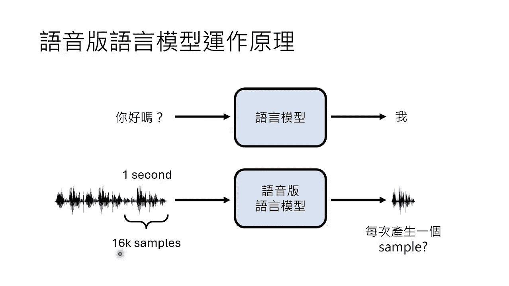

比较常见的做法是，先把与声音的讯号呢进行压缩哦，你会有一个编码器好，它的英文呢是encoder，那这个编码器里面呢可能会有一个cookbook，这个COBOOK里面是一大堆的扣的。

每一个扣的代表某种类型的声音，可能某个code代表人类发的B这个声音，那有个code代表人类的笑声啊，有的code甚至代表不是人类的声音，比如说狗叫声等等好，所以一段声音讯号哦，输入给编码器。

编码器呢会用它里面的COBOOK，来表示这一段声音讯号，所以一段声音讯号会被表示成一个扣的sequence，会表示成一个扣的序列，那这些code呢又被叫做speech unit哦。

他们是可以看作是声音的单位，那你还会训练一个decoder，训练一个解码器啊，这个解码器呢可以读这一些speech的unit，把这些speech的unit转回声音讯号。

一般这些编码器跟解码器呢也是类神经网络，也是需要透过训练资料来进行训练的哦，如果你想要知道更多，有关这种把声音讯号变成speech unit好，再把speech unit解回来相关的技术的话哦。

可以阅读以下这两篇文章。

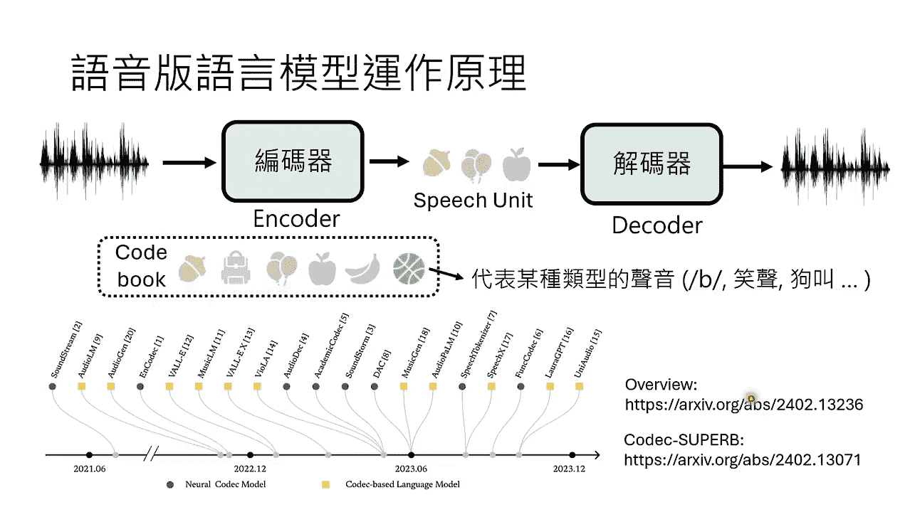

好，那语音版的语言模型呢，是运作在这一些speech unit上面的，也就是说当一段声音讯号进来的时候，语音版的语言模型并不是，直接对这段声音讯号去做语音接龙。

这些声音讯号会先通过encoder变成一串unit，然后呢这一些unit会变成语音版语言模型的输入，语，音版语言模型要做的事情是，预测下一个unit会是什么。

然后下一个unit会再通过decoder产生声音讯号，所以语版语言模型没有必要，产生复杂的声音讯号，它只需要产生unit，然后由decoder呢把unit转回复杂的声音讯号哦。

所以语音版的语言模型是运作在speech unit，这种压缩过的东西上面，针对语音讯号压缩过的这些东西上面哦，那有很多具代表性的语音版的语言模型哦，比如说meta的GSLN。

还有google的audio ln，那这其实不是非常新的技术，GSLN是在21年的年初的时候就已经有的。

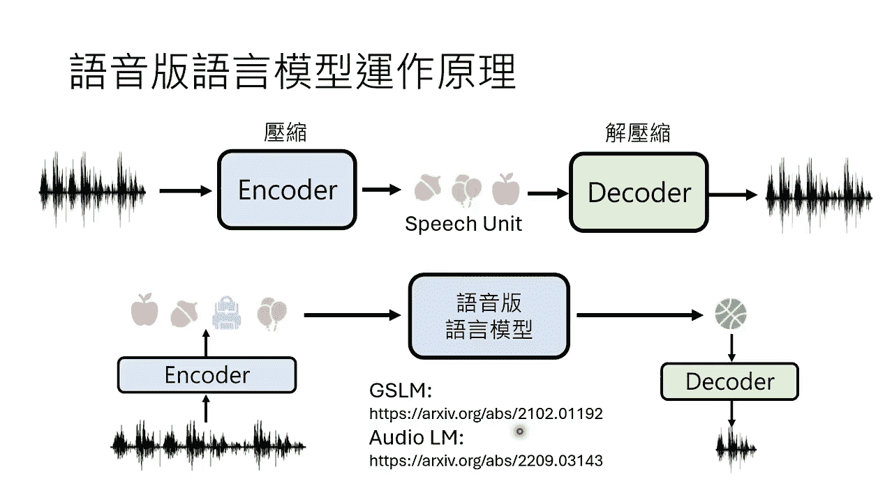

其实我们也可以把解码器呢，看作是一种非常特殊的语音辨识，只是它的输出不是文字，而是speech的unit，我们也可以把解码器呢，看成是一种特殊的语音合成，只是它的输入不是文字。

而是speech的unit，它不是把文字变成语音，而是把speech的unit变成语音，那你可会想说，那为什么我们不直接套用语音辨识跟语音合成，当做编码器跟解码器呢，其实我们确实可以把语音辨识。

想成是一种非常特别的压缩方式，当我们把声音讯号变成文字的时候，其实也是在做某种压缩，文字本来就可以看作是语音的浓缩版，但是这边的问题是，文字只代表了语音里面某个面向的咨询。

文字只代表了语音里面内容的咨询，假设今天输的声音讯号是有一个人说好好笑，然后接下来哈哈哈了几声，那语音辨识系统可能只能够把代表文字的，好好笑辨识出来，那笑声就不见了，接下来你用语音合成。

把好好笑还原回声音的时候，你其实笑声的资讯就丢掉了，那用speech unit的好处是，它可能可以保留文字所无法表达的资讯，但是另外一方面，用这种speech unit也有一个坏处。

就speech unit里面可能很多unit，它本来就是对应到某个文字的token，那你等于是要呃这个编码器呢去重造轮子，本来就已经有文字可以表示，语音里面的某些讯号。

编码器需要再用另外新的符号来表示这些，我们本来就有文字符号可以描述的语音资讯，那这样感觉是重造了轮子，所以另外一个可能的做法是，把编码器跟语音辨识结合，那我们这边把它叫做混合编码器。

好把解码器跟语音合成结合，这边叫做混合的解码器，也就是对一段声音讯号而言，能够做语音辨识的部分，能够辨识成文字的部分，把它用文字来表示，那无法用文字来表示的部分。

就用speech unit来表示我这一段声音讯号，好好笑，后面接了哈哈哈，那好好笑的部分可能可以用文字来表示，那笑声的部分就拿一个特殊的符号来表示，那混合解码器可以看文字跟特殊的符号，把它转回声音讯号。

我不知道g p t four o，会不会采取这样混合的策略啦，也许g p t four o也是使用编码器而已，并没有用语音辨识，那我只是觉得用混合的编码器有它额外的好处。

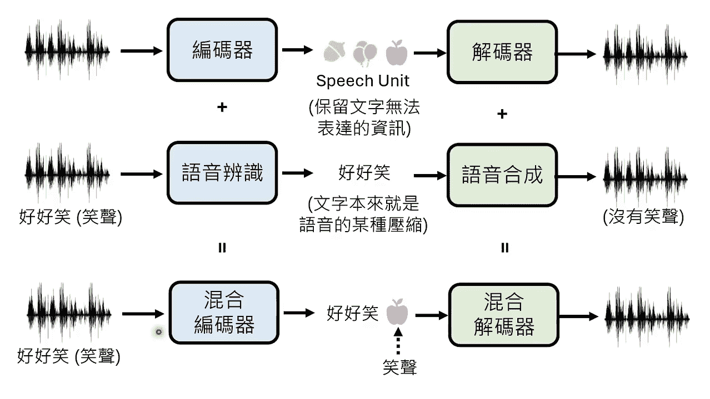

那这个部分我们等一下会再提到，那另外呢，我们这边还需要一个愚者自动分段标记的技术，那这样的技术呢叫做speaker的DIORIZATION，如果你看g b t four o的demo的话。

当有两个以上的人跟他说话的时候，其实他是知道的，他可以知道谁是谁哦，所以他应该需要用到speaker diarization的技术，speaker diarization的系统，愚者自动分段标记的系统。

就给他一段声音讯号，他可以知道啊，哪些段落是某一个同一个愚者讲的，他可以知道说，这一段跟这一段都是愚者A讲的啊，这一段是愚者B讲的。

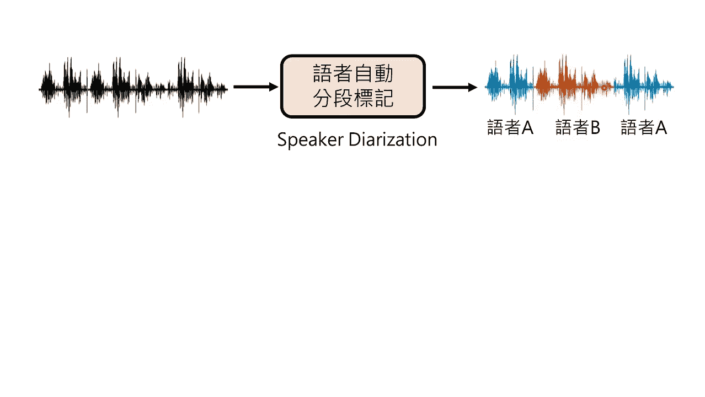

所以我猜测一段声音讯号，对于一个语音版的语言模型来说，他的表达方式应该是这个样子的，就可能同时使用了混合的编码器，跟愚者自动分段的标记，那有一段声音讯号进来，会标出说哪一个段落是愚者A说的。

他可能会用A冒号一个特殊的符号来代表，这是A说的话，然后可以用文字表示方地方，可能用文字表示，那呃不能用文字表示的地方，可能就拿特殊的符号用speech unit来表示。

这个是对于这个呃呃语音版的语言模型，看到一段声音讯号的时候，他实际上输入的猜想好。

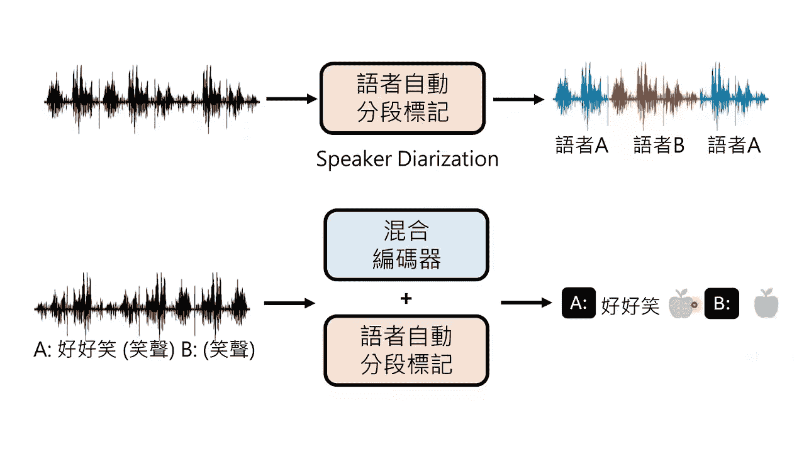

那接下来怎么训练这种语音版的语言模型呢，我们已经知道，这个语言模型是用大量文字资料所训练出来的，那语音版的语言模型用同样的道理，也可以用大量声音的资料来进行训练，我们完全可以用大量的声音资料来训练。

一个语音版的语言模型来做speech unit的接龙嘶，那哪里去找大量的声音资料呢，那这个想起来非常的直觉，网络上有这么多的影音平台，从这些语音平台上，就可以收集到大量的声音资料。

那OpenAI显然在做这件事情，因为在4月的时候，纽约时报才说了，OpenAI用了超过100万小时的YOUTUBE影片，来训练他们的语言模型，那时候我刚看这个报道的时候，我就很困惑。

为什么要用YOUTUBE的影片来训练语言模型呢，难道现在文字的资料已经全部都用完了，真的没有文字的资料可以用了吗，但是如果OpenAI是在训练语音版的语言模型，那用YOUTUBE影片完全就说得通了。

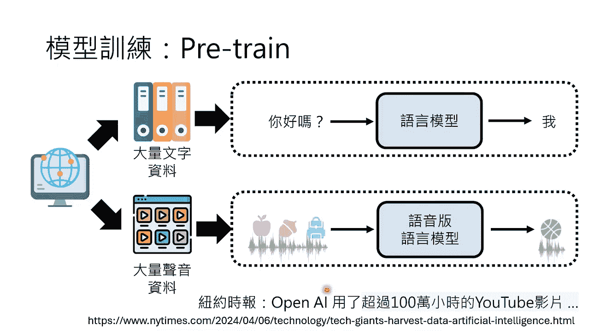

好那你可能想说，可是网络上的影片五花八门，又不是全部都是干净的语音，那些语音很多背后有是有音效，有背景音乐的，那我们拿这些声音讯号来训练，我们的语音版语言模型，这个语音版语言模型会不会把音效。

背景音乐通通都学进去了呢，非常有可能。

我们来仔细听一下，在g p t four o demo里面，g p t for o的声音。

大家仔细听一下gbt four o的声音哦。

Can you help me come my nerves a little bit，Oh you're doing a live demo，Right now。

That's awesome just take a deep breath，And remember you're the expert，你有没有发现g p t for all。

他讲话的时候背景是有一个钢琴声的，但我们不能排除，现场正好有人在弹钢琴的可能啦，但是如果你告诉我，G p t for all，讲话的时候，就是有可能会产生一些音效或者是背景音乐，这我完全也不意外。

那不过我觉得可以，如果今天一个语音模型啊，他在讲话的时候就是会自带音效或自带BGM，其实也是一个很酷的事情，他以后讲话都自带BGM，所以我们可以说这不是一个bug，这是一个feature好。

那在demo里面我们也可以看到说啊，G p t for all，它可以产生非常多样化，非常戏剧性的声音，这是怎么办到的呢，呃有一些论文已经指出啊，哦这个这边呢是引用了一个amazon。

在今年2月所释出的论文，他们用了超过10万个小时的语音讯号来训练，他们的语音合成模型，应用的是一个参数有B脸10亿等级的模型，当然这样大小的模型啊，在文字领域并不是很大。

但对于语音合成模型来说已经非常大了，他们发现是说过去语音合成系统，因为他用的资料不够多，所以往往合出来的声音非常的平淡啊，这个如果你有看动漫的话，你知道这就叫做棒读，我觉得讲话呢不带情绪，非常的平淡。

但是现在如果有大量训练资料的时候，这些语音合成的模型就可以理解要读的内容，而且根据要读的内容给予适当的变化，举例来说，我们来看这个句子，那注意一下，这个句子里面有提到whisper轻声细语。

亲生这一个词汇好，我们来看看语言模型是怎么合这个句子的，要来听一下这个声音，A profound sense of realization，Washed over maddie。

As he whispered，You've been there for me，All along，Haven't you，I never truly appreciated you。

Until now，根据这篇论文的讲法，他们并没有对输入的文字做任何特殊的处理，模型，就是直接读输入的文字，但他在读到whisper轻声这个字的时候，他自动知道他要用比较轻的声音来念这个句子。

这是他自动根据资料学到的，当然这边可能合出来的声音没有非常的戏剧化，我们今天看这个g p t four的demo，他的声音的合成是可以更戏剧化的，你要叫他讲轻声的时候，他是可以讲的更轻松的。

但也许把资料从10万小时，扩展到100万小时的时候，就是会有这种效果，当然因为我从来没有训练过这么多，从来没用过这么多资料训练语音合成的系统，所以这只是个猜测。

而另外一方面呢单单使用语音的资料来训练，非常显然是会不够的，必须要利用文字的资讯，为什么用语音资料训练是不够的呢，我们来想想看，100万小时的语音背后可能有多少的文字好，我们来算算有多少分钟。

100万小时是6000万分钟，一般人一分钟可以大概讲100多个文字的token，那6000万分钟就可以讲60亿个文字的token，你可能想说60亿听起来是一个蛮大的数字了。

从60一个token应该可以学会很多姿势吧，但是不要忘了，拉玛三可是用了15兆个文字的token来训练哦，所以100万小时的语音持有拉玛山预训练资料，PRETRAIN资料的1250而已。

所以假设一个模型，他只听了100万小时的语音进行学习，也许他可以学到一些语音的资讯，但是他的知识可能会非常的不足，所以模型不能单单只用语音，声音的资料训练，还得利用文字的资讯，那怎么利用文字的资讯呢。

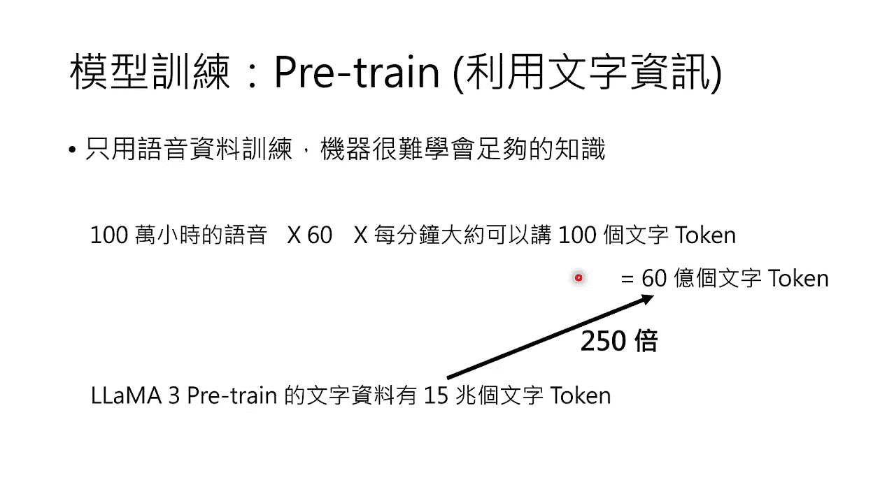

一个可能是语音版的语言模型，是以原来的语言模型作为初始化的，那OpenAI早就打造了很多很厉害的语言模型，他们可能不会浪费这些语言模型，已经学到的知识，所以他们可以用原来已有的语言模型。

作为初始化去打造语音版的语言模型，或者是用通俗的讲法，就是我们可以去教原有的语言模型，让他听懂语音，那我们刚才有说语音其实会被表示成一堆unit，而这些unit对于语言模型来说，就是一个全新的语言。

它有一套自己独特的符号系统，所以当我们要教一个原来的语言模型，听懂语音的时候，其实对语言模型来说，他就是在学一个全新的语言呃，当然另外有一个可能是呃，把语音的符号跟文字全部倒在一起训练。

总之单凭语音自信来训练一定是不行的，一定要想些办法利用文字的资讯，那我觉得这个地方可能就可以，展现混合模式的好处，因为假设我们今天表示一段声音不是只用unit，而是有用到文字的话，那对于语言模型来说。

他学习起来可能会更为容易啊，因为这些文字符号的意思他早就知道了，他只需要花力气去了解这些新的符号，是什么意思就好，当然这只是一个猜测，例如何利用语音资讯，其实并不是只有固定一种方法而已。

还有很多其他让语音版语言模型，利用文字咨询的方法，到这边就列举几篇论文给大家参考好。

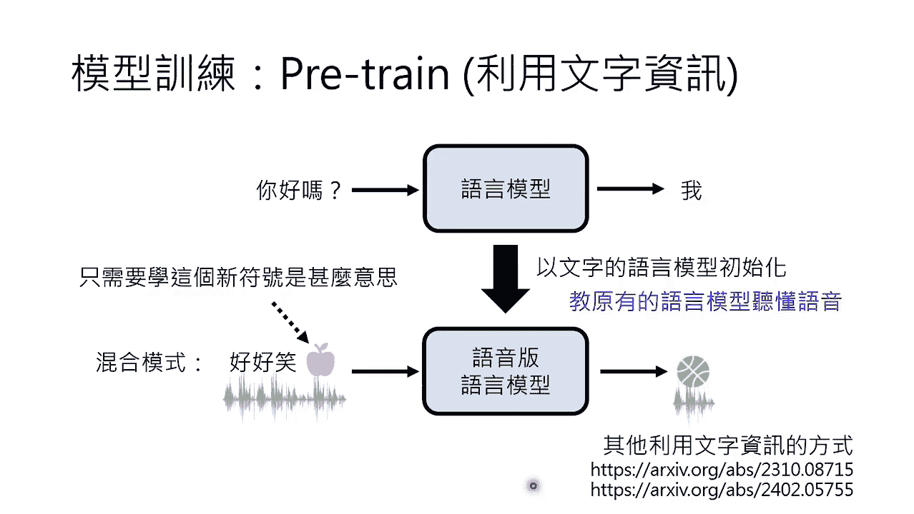

那刚才讲的是PRETRAIN，那我们都知道说光是有PRETRAIN是不够的，文字的语言模型，如果只有做PRETRAIN，只有做预训练的话，他根本没办法好好的回答问题，所以需要做alignment。

需要根据有标注的资料进行微调，那在文字模型上，你需要收集一些这样对话的资料哦，人说你是谁，模型教回答我是人工智慧，只能说教我害入邻居家的WIFI模型，就要回答我不能教你等等。

你需要收集这样的资料来微调你的模型，让他能够好好跟人说话，与那对于语音的模型，我们可能就需要收集语音的对话来训练它，所以要收集语音的对话，然后在这个对话里面，你让某一个人去当做使用者。

某一个人就说他是扮演AI的角色，然后你就可以微调语音版的语言模型，让他听这个人说话，然后要产生这个人的回应，但光是这样可能还不够啊。

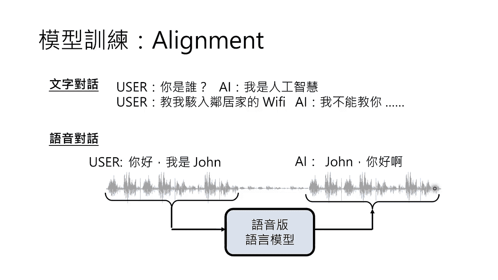

大家如果听那个demo啊，那个demo是固定某一个愚者的声音，所以假设要让我们的语言模型讲出话来，都是某一个人的声音，比如说现在CHEGT的语音页面里面，你也是可以选愚者的，那比如说你选sky这个人啊。

所以他就只能用sky这个人的声音来讲话，那所以说可能在做alignment的时候，假设你想要让模型学会都用sky的声音来讲话，那你可能需要收集大量sky跟其他人的对话，那可能有某一个声优。

他就代表了sky，收集很多这个声优跟其他人的对话，你需要这样子的语音对话来训练模型，那有人可能会想说，那是不是需要录很多sky跟其他人的对话呢，也许不一定需要，因为记不记得我们在讲文字模型的时候。

我们有说其实fight to往往不需要太多资料，模型在PRETRAIN的时候已经拥有非常丰富的知识，翻译to只是画龙点睛，那今天会不会做完语音的PRETRAIN以后，模型已经很会模仿各种不同的人说话。

他只要听过几句sky的话，就可以很好的学会sky说话的方式了，所以也许一个有大量资料普圈的模型，他是他在fighting的时候，在做alignment的时候，只需要少量的资料，那另外一个可能就是。

就算没有很多sky对话的录音，也许可以用语音转换的技术，语音转换的技术，就是把某一个人的声音转成另外一个人的声音，也许可以用语音转换的技术，把对话中各种不同人的声音都转成sky的声音。

那你就大量sky跟其他人对话的录音档。

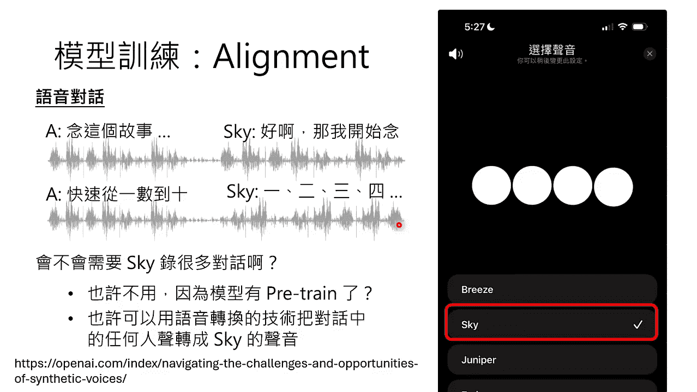

可以拿来训练你的模型，那但讲到目前为止啊，看起来这个语音的语言模型，跟原来文字的语言模型非常的类似，但是其实语音跟文字还是有很多本质上的区别，举例来说，我们今天用文字来跟AI互动的时候。

你有很明确的开始跟结束，而今天你跟CHEGBT互动的时候，你打一句话，你打完以后你会按enter去GBT，就知道该轮到他讲话了，他不用猜什么时候他该开始讲话，结束也是一样呃。

你今天不想让CHEGBT讲话了，右下角有一个停止的钮，你按下去，他就很明确的知道他不会再生成更多的文字。

但是语音界面不一样，当有一个人对AI说，我们来做一件有趣的事，那稍微停顿一下，这个时候AI必须要猜他到底应该接话，说什么事，还是这个人还没有讲完，我们应该要等他继续讲完再进行答复，所以跟文字不一样。

在文字的界面上，但是如果是一个语音的界面，那AI就必须要猜他什么时候可以开始讲话，另外一方面，也许今天有人叫语言模型讲一个故事，他开始讲一个无聊的故事啊，山上有座庙，庙里有个老和尚。

这个故事会不断的循环下去，是一个无限循环的故事，那人听了就很厌烦，跟他说停停停，这不是我要听的那语音版的语言模型，他知不知道要停下来呢，那也许你说这是什么问题，反正只要人说话，我们就停下来。

那这个不是最好的解决问题的方法，因为也许这个人讲话，并不是要语言模型停下来啊，也许现在人正好在跟这个AI合唱，所以并不是只要听到人的声音就必须停下来啊。

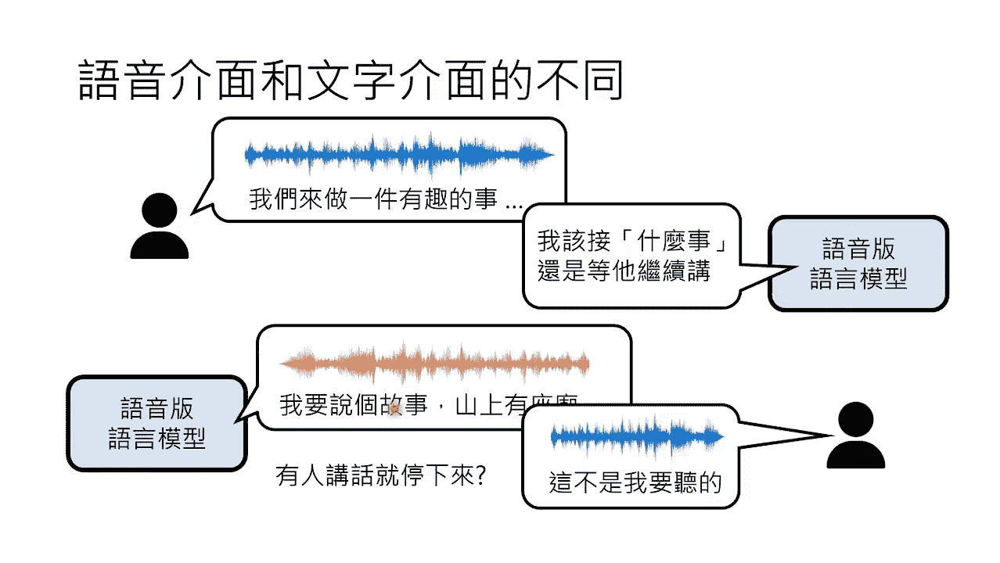

所以呢假假设今天要让一个语音版的语言模型，跟人有自然的互动，要让模型可以同时听跟说，但原来的文字接龙的方式，听跟说是切开的，模型在说的时候，他就很难继续进行听这件事情，那一个可能的解决方法是。

把听跟说这两件事情分开来，那这个技术呢过去也是有过的，有一个模型叫做dialog s l n哦，这个是22年就已经有的模型，那所以等下讲的东西，如果你听不太懂的话，你可以参考这篇论文好。

怎么让模型同时听跟说呢，就是要把听跟说分成两个不同的频道哦，所以今天有一个听的频道，那这个是模型的麦克风，它会在听人在说什么，外界发生了什么声音，那另外呢模型会记录自己发出过什么样的声音。

但这两个频道应该要是分开的，而不是直接被混在一起的，我们来看一下模型在这个状况要怎么运作好，语音版的语言模型，就是同时听这两个频道的内容，包括现在人在说什么，他之前讲过什么啊，现在人说了个我。

那感觉这句话还没有说完，所以语音版语言模型就输出silence，输出安静安静，可能有也是有某一些特殊的speech unit，代表安静啊，就不说话啊，然后接下来呢人就会继续说，也许人说到某一个段落。

那语音版的语言模型根据人现在说的话，觉得那他说完了，轮到我说了，人说我们来做个有趣的尝试，那语言模型也许就输出一个wow代表说他很兴奋，可以做这个尝试啊，那接下来呢假设人仍然是没有声音的。

而人是安静的语言模型就知道说，那他可以继续说，也许他就会说我好期待，但如果人仍然有发出声音，就我要你做某件事情，那语音版语言模型知道说人还没有说完，也许他就会输出代表安静的符号，继续保持安静。

但这并不是唯一，让语言模型可以同时听跟说的方法了，感觉可能还有其他的解法，我这边只是讲了某一个可能的解法而已。

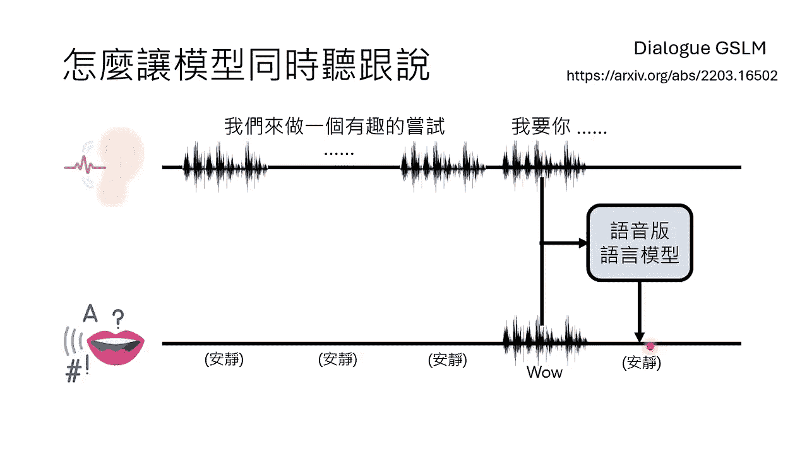

另外一方面，也许语言不止要同时听跟说，还要同时听加说加看，因为你看这个啊，g p t for all the demo模型是可以一边看着东西，一边说话的，所以可能有不止有听跟说两个频道。

还有一个视觉的频道，专门读取外界的影像输入哦，举例来说，在这个OpenAI的demo里面有一个demo，就是这个语言模型呢正在描述房间中的灯光，讲的非常的起劲，这时候有一个人跳出来比了一个耶的动作。

五原模型无视这个影像，继续谈他的灯光，不知道他有没有看到这个比耶的人，这时候人就打断语言模型说，等一下你有没有看到什么奇怪的东西，那语言模型显然是有看到比耶的这个人的，只是在讲灯光的时候。

他讲的太爽了啊，所以就没有觉得需要对这个人发表，毕业的人发表任何的评论，但是当有人问他说，你有看到什么怪怪的东西的时候，这个时候语言模型会做的事情是，他会对每一个channel。

不只是他现在生成的channel，还有他听的channel，还有他看的channel通通去做attention，所以他会收集所有的资讯，然后得到一个答案，那可能就会知道说有人比了一个耶。

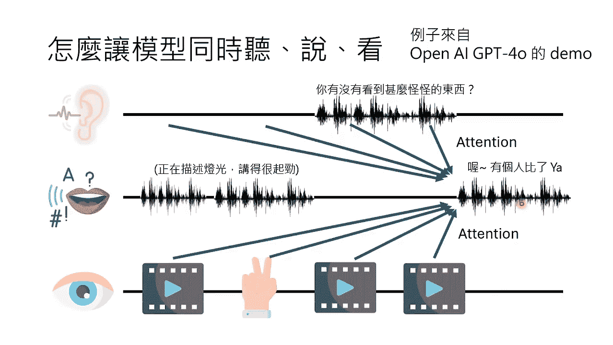

那其实在google project extra里面的demo，也有一个非常类似的例子，看起来大家都觉得需要有这种例子，来展现模型的能力，他们的例子是有一个人拿着手机随便走随便拍。

然后中间拍摄的过程中呢，有看到了一个眼镜，但是那个时候，语言模型并没有对眼镜做出任何评论，人也没有提到跟眼镜有关的事情，然后呢人就跟语言模型聊了一下啊，我们现在在哪里呀，语言模型说在王室自车站附近呢。

然后接下来人问说有没有看到我的眼镜呢，这个时候眼镜已经不在画面里面了，但是语言模型会对过去的资讯去做attention，从过去看到的影像，从过去听到的声音收集一下资讯，他知道他有看到眼镜。

眼镜呢是在桌上，这是一个蛮自然的互动的模式啊。

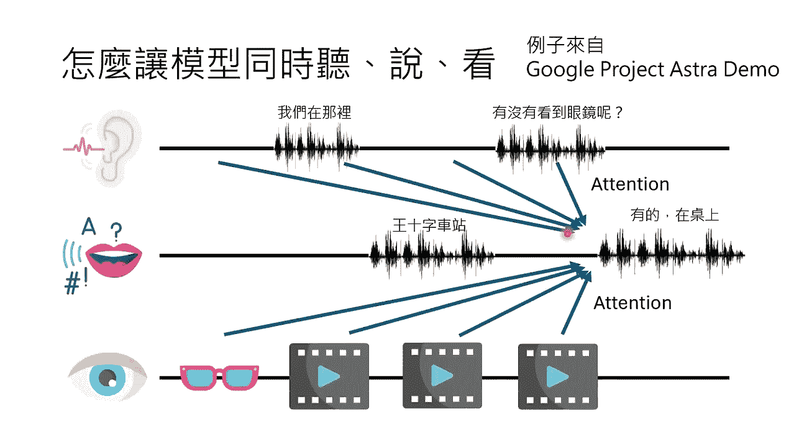

其实技术的部分呢就讲到这边，如果大家想知道更多有关语音版，语言模型的论文，我这边附了一个链接，里面收集了很多语音版语言模型相关的论文，给大家参考。

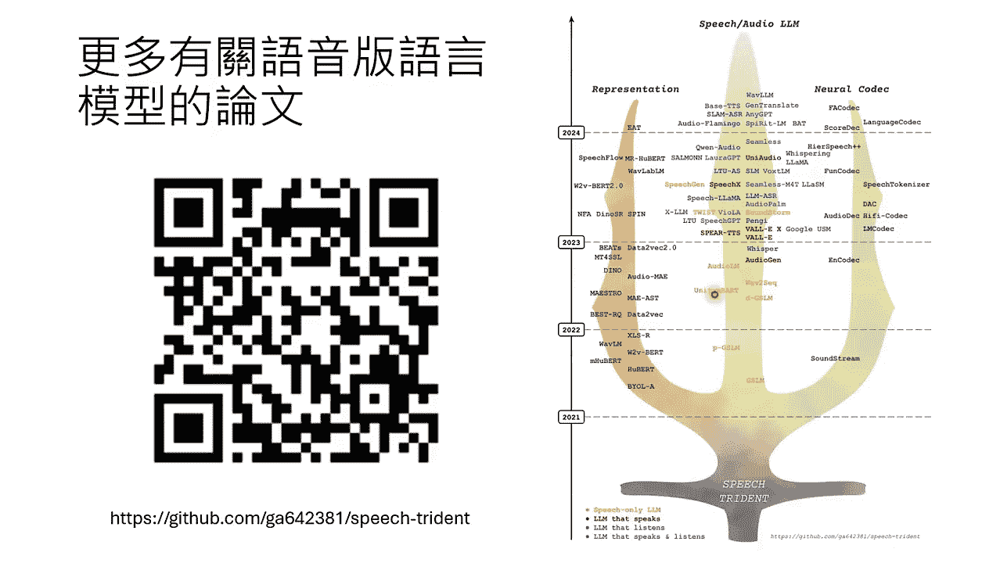

好谢谢大家。