# 李宏毅2024春《生成式人工智能导论》 - P4：作业 1：真假难辨的世界 - 啥都会一点的研究生 - BV1BJ4m1e7g8

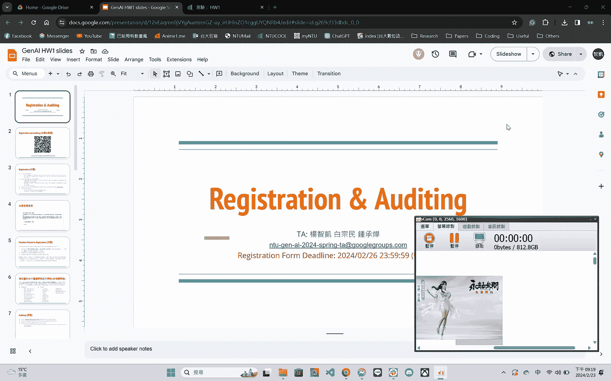

好各位同学大家好，我是负责这课这门课程加签，还有红魔one的助教，我叫杨志凯，那这边就来跟大家讲解一下，我们本学期深圳四人公司会导论的加钱。

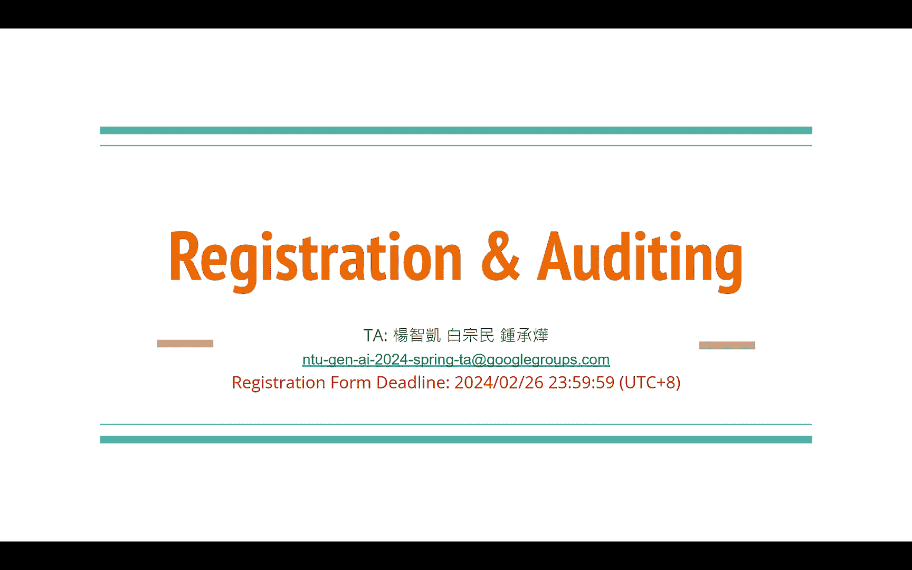

还有旁听的规则好，那避免有同学没有看到我们之前发在NT加油版，还有迪卡跟我们课程网页上面的价签表单，那这边我们就提供qr扣给同学扫一下，那同时看这部影片的时候。

如果要扫表单的话，就暂停扫一下就好了，那我就继续了，好首先我们要怎么加签呢，加钱很简单，就是去填写我们前一页的那个表单，那任何想要修这堂课的人，都必须要填那份表单，而我们就只会从有准时填写这份表单。

而且正确提供你的资讯的人，然后来修这堂课，那之后就会再抽签，如果我们今天抽签抽完之后记授权码给你，结果发现你的信箱是不存在的，可能你写错信箱了，那这种情况我也我们也不会特别处理，所以同学要务必确保。

自己是有正确提供你的资讯的，那谁可以拿到这门课的授权码呢，主要我们优先顺位就让同学知道的，首先是不需要抽签，可以直接拿到授权码的，那这部分同学就是现在的系所，包含你双主修辅系或者是学成。

他们隶属于台大电子学院和文学院的同学，那就可以不需要抽签，直接收到授权码，而什么人需要抽签呢，那抽签的话基本上是你现在的系数，包含双主修辅系学生，他不隶属于台大电子学院以及文学院，但你是台大同学。

那这样的同学就需要抽签，而我们抽签的人数目前战力是50，不过有可能会再更动，我们团队还在评估我们最多可以收多少人，但保底就是50，不会比这个更少，如果这个数字更重了，那就只会比呃原本的数字更多。

所以大家不用太担心好，那再来是非海大学生的话，很抱歉，譬如说师大科大的学生，很多学生都在记性来询问说，可不可以加钱这堂课，但目前这堂课没有开放给三校系统，所以其他学校的学生可能就无法加签。

那这边就跟大家说个抱歉，这样好，那我刚才一直强调什么叫做现在的系数，那我这边就来解释一下什么是现在系数，现在系数就是我们不会去考虑任何，你未来会申请或者是会就读的系数，换言之。

譬如说同学如果计划要辅修电子学院和文学院，像是很多同学会寄信来说呃，我这学期修完之后，我就可以辅导三叉叉系了，我这学期修完之后，我就可以事后补什么什么系，那他算不算是什么什么学院。

那基本上这样的问题我们是不会考虑的，我们都会考虑同学目前现阶段的系数是什么，那或者是你，即使你未来会加入电子学院和文学院，譬如说你可能上学期推针的时候推向了电机所，职工所之类的所，那很多同学就会来询问。

说这样子的话，我可不可以优先拿到授权吗，我可不可以算是电子学院或者学院的学生，那很抱歉，这个问题也是不行的，所以我们只考虑同学现在的技术好，那基本上同学因为我们为了维护牙签的公平性。

所以我们会对于一些违反公平性的同学做惩罚，那规则是什么呢，规则就是以下三点，那首先你的身份如果不属于电子或文学院，可是你却在表单上面勾选了属于电子学院，文学院，或者是现在属于电子学院文学院的同学。

那你就会被当做是违反公平性，然后我们就会在学习mos game的成绩，就会是直接是F，那为什么会有两个选项呢，两两种选项属于跟现在属于其实没有差别，就是我们只是发现，同时好像原本的叙述没办法让同学理解。

什么是现在的系数，所以我们后来补上了一些这方面的叙述，然后强化叙述只有更改了一些选项，所以如果你是在我们更改叙述之前就填写的，同学，只要你填写的是属于的话，你不需要特地再去修改。

成现在属于我们在抽抽签的时候会考虑这两个，就不会漏掉任何人好，那第二点是你把你的收收到授权码，转让或者出售给其他人，而你又刚又还在这堂课上的话，那基本上被我们发现学习成绩也一样，是F那第三点也很类似。

就是你使用不属于自己的授权码，不论对方是否同意的，意思就是不管对方是不是主动同意转让给你，你都不能使用，因为对助教来说，我们要去检查呃，我们寄的授权码给什么人，那什么人。

后来选的课基本上都是非常简单的事情，所以同学不要一时呃贪小便宜，然后鬼迷心窍，只有以身试法，那如果你违反了这些规则的话，我们开学第三周后开始人工检查之后发现了，不管你是不是蓄意的。

期末成绩一律都是给F没有任何例外，而同时也不能用任何理由要求授课，教师跟助教特别通融，你，所以这边就先跟同学约法三章，这样子好，那一些重要的日期要请同学注意，首先是加钱。

表单登记截止日期是2024年2月26号，然后UTC加八时区，23：59：59，那在这之后，我们就不会接受任何补牙签登记的动作，那再来授权码什么时候会寄出呢，我们最晚最晚会在2024年零呃，3月1日23：

59：59，然后一样是UTC加80区，把所有神马寄出去，那有同学问到说，有同学问到说，如果我没有加签到的话，我会收到一封通知信，通知说呃没有加签到吗，那这个可能是不会的，所以同学。

如果在3月1号都还没有收到授权码的话，那基本上就是没有加签到的意思好，那我们就继续好，那我们这边就列了一些台大，电子学院和文学院的系数跟学成，那同学可以参考一下这张表，不过我们必须强调一件事情。

就是基本上同学，如果你的学生没有在这张表上面的话，也不代表你不被我们认同，是电子学院和文学院，你还是可以即兴过来询问，那我们就有授课老师认定，那老师基本上，只要你的学生里面有电子学院和文学院的教师。

就是有相关学院的教授的话，基本上都会认定是电子学院获文学院的学成，所以如果有相关问题的同学的话，你不确定自己应该要填属于电子学院，文学院还是不属于，那你可以寄信过来，然后我们再请老师认定。

好那旁听的话基本上是填跟刚才一样的表单，而如果有些同学很热心，在我们试出表单之前，就即兴来跟我们要旁听，那如果你是这类的同学的话，你不需要再重新去填这份表单，你只要有记性，我们之后会统一把你加进来。

那这边要注意的是，我会晚一点才会把旁听的加进来，我们就统一一次操作，这样就不用一个学生带了，然后我们就要加一次，一个学生来我们就要加一次，所以你有可能寄信的时候，过了几天才被加进来，这都是有可能的。

那就请同学耐心等候，但如果你在被加进n t u cool之前，你就发现你需要使用一些课程的素材，譬如说简报或者是影片的话，那你还是可以去我们的课程网站找好，那最后就是很多同学询问度非常高的问题是。

如果我加签没有签上，我可以直接转成旁听这门课吗，那答案是可以的，我们今天下午加钱表单新增了一题，来考虑这个情况，那这个题目就如下，就是如果没有加强到的话，需要加入party吗，要或不要。

那同学只需要用你当初填表单的google账号，登录之后，多回答这一题就好，你不需要去修改到任何其他的答案，那我们就会就会考虑到你，然后如果你没有加钱的话，我就把你算进航天名单，然后到时候一并加进去好。

那这边就是夹签跟旁听的部分，然后我们接下来就来讲homo one，homo one的主题是真假难辨的世界，那我首先会先讲讲看这个作业，希望带给大家什么，我们为什么要这样设计，以及同学的任务是什么。

这份作业你要做什么事情，还有我们的评分角角daylight，还有我们最后呃作业成绩试出了日期好，那就像老师讲的这门课，其实是教大家了解魔术之间魔术背后的原理，那我们认为你要了解魔术背后原理。

想要让你学习这些原理之前，你首先要先知道这个魔术有多惊奇多厉害，而这就是做问作业的含义，我们想要让同学看一些例子，然后去体验目前生成式AI模型的力量，那同时也可能可以在做这份作业的过程中。

去找到这些模型在某些地方可能生成的不好，那也就找到所有这些模型的限制在哪，那这边举了几个例子，像是底下的GEMINI或VT，可能大家是比较常听到，也比较常使用的，那他们就是语言模型。

或者是你可以把它想成是聊天机器人，那右边的话是MAJOURNEY跟达理，那基本上他们就是AI生图，就是同学应该都蛮熟悉的，不过同学比较常在网络上接触到的，可能也就只有文字和影像这两种形态的data。

但事实上生成式AI模型，它能够深的东西不只有文字和影像，还有可能是语音啊，歌声啊，或者是影片之类的，而这些没有列在投影片上面的MODITY，我们也会纳入让同学体验好，那具体来说同学要做什么呢。

其实很简单，就是同学如果收到一段呃，收到一段音档啊，或者是文字之类的，那同学就去去就去听或看，然后观察之后选择，你觉得这个音响是不是AI生成的，还是是AI生成的，那我们会cover到的MODP。

主要是刚才讲的就是speech seeing voice，然后text image跟video，而这份作业总共会有40题好，那这边就是一个例子好各位同学大家好好，那像刚才这段音档的话。

同学可能听完之后觉得有点耳熟，那也是很正常的，因为它其实就是弘毅老师的声音，所以同学这时候就是选择不是AI生成的，那这边也有一个例子，譬如说我们听这段歌声，anyway好，那同学听了这段歌声之后。

可能觉得他很像或者是很不像是人发出来的，那你就选择你想要选的答案，譬如说可能你觉得这个听起来很真，那你就选择不是I生成的，虽然说实际上它其实是AI生成的，那选错会怎么样呢。

我们在grading policy的时候会再跟大家讲，而下面两个例子是我用TRAVT让它去分析，那你可能可以透过分析格律啊，评测啊之类的，然后去看它到底是不是AI生成的，然后选择你相信的答案。

那下面的话是我从一篇paper里面截出来的图，那他基本上是要model去伸出I，然后爱心，然后generative model这样子，那同学如果可以仔细看的话，可以看到下面的字其实是非常糊的。

那这张图的破绽就蛮大的，它其实就是AI生成的，那你就选择是AI生成的好，那所有的作业的题目，基本上都已经放到nt cool quiz上面了，所以同时只要上去nt l cool quiz。

应该就可以看到这些素材，可是有时候可能呃我们放上去的素材，3号他就是挂掉了，然后或者是影片播不出来，没有声音之类的，那你依然可以在我这边这个链接找到这些素材，那我这边点一次给大家看。

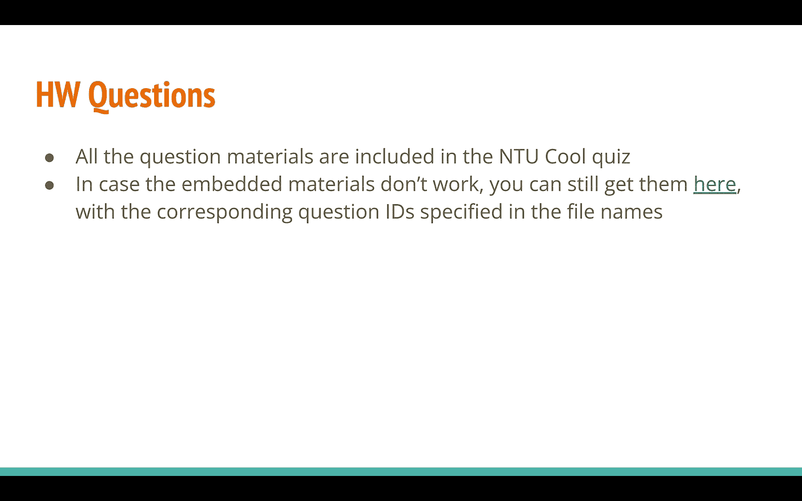

基本上你这边就可以看到所有40题的素材。

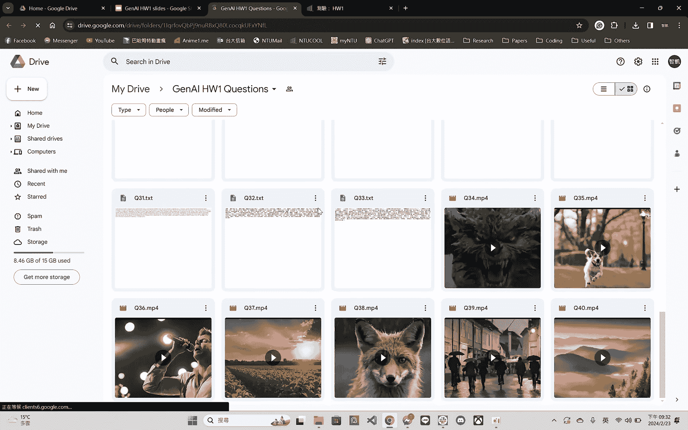

那譬如说Q2点mp3，就是第一题的音档这样子，那以此类推，党名就对应到了我们的题号好。

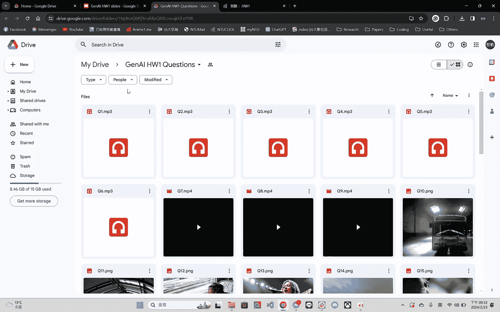

那再来是评分的部分，评分的话我们基本上有40题嘛，所以我们就是每题2。5分，那总共是100分，而这100分会算是你学习成绩的18，那就像刚才讲了，这份作业，只是要让你体验呃生成式AI模型的力量。

或者是去寻找它的限制，然后找寻找它哪边做不好，那用一些很厉害煞有其事的东西来骗导各位，不是我们的目的，那当然扣分就更不是了，所以这份作业的评分标准比较特别一点，就是你一个问题，你要怎么拿到那题的分数呢。

就是只要你有作答，那你就有分，那所谓叫做你有作答呢，就是那两个选项是AI生成的，或不是AI生成的，你选了任何一个，那就叫做这题有作答，那你这题就会拿到分数，所以我们要再次跟同学强调，就是你有作答就有分。

即使你选的是错的，譬如说你选择不是I生成，但实际上其实是或者是反过来，那基本上都没有关系，你只要有作答就有分了，所以如果你这份作业想要拿满分的话，就请同学务必注意你的缴交之后，你是有作答完所有题目的。

那按照我们的评分规定，你就会拿满分，不过话说是呃，有些有写就有分，可是我们还是希望因为助教都已经设计题目了，同时还是可以用心的去写这份作业，那或许你会有一些收获，也说不定好，那最后角交的部分的话。

我们就是完全透过NTQUE，n t l cool的quit来角交，那基本上每天角角的次数是无限的，但是我们只会采集最后一次角角，所以如果你想要拿满分的话，你就要注意你最后一次脚，脚有没有全部都作答完。

那我们等一下我可以让同学看一下，怎么判别自己到底有没有作答完，就避免同学不小心漏掉，而deadline的话就是2024年的3月7号，23：59：59这样子，然后是UTC加80区，那过了这个DNA之后。

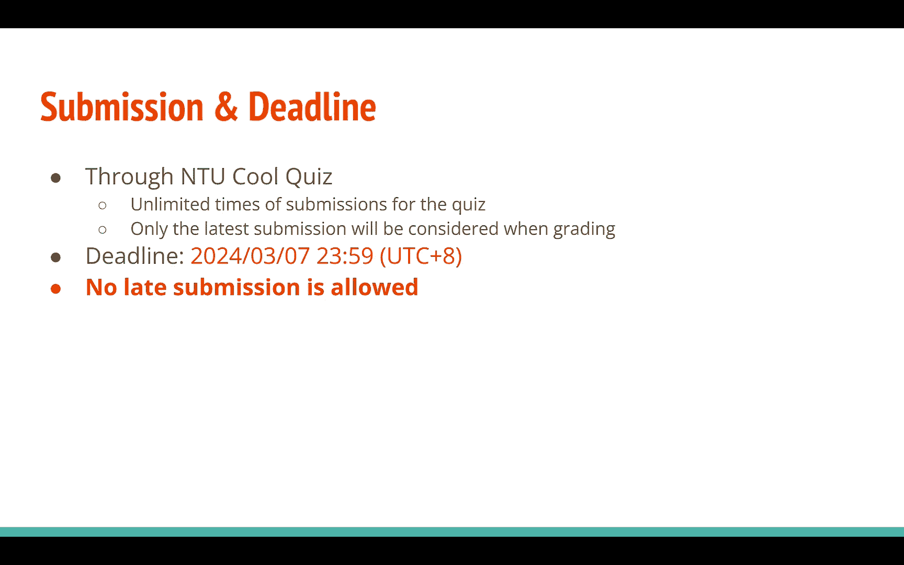

我就不接受任何形式的补交了，好，那这边我们就让同学看一下作业。

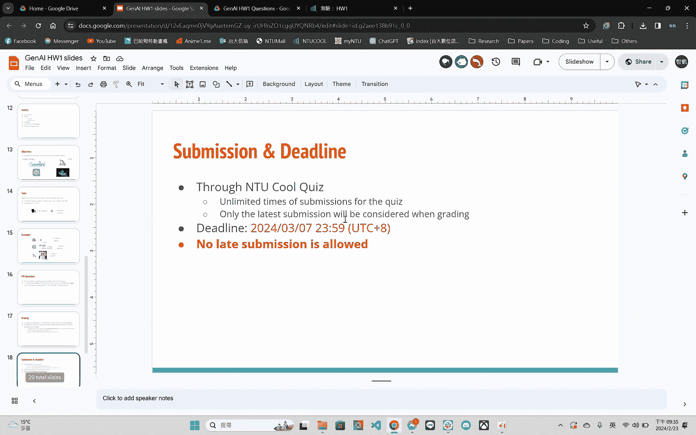

大概形式是什么好，那这就是学生视角的话，我们可以看到上面就是作业说明，那总共40题，每题2。5分，然后合计100分，作答期限是3月7号，跟刚才投影片上面一样，然后自达期限前脚交次数不限。

可是期限后不接受任何时交，如果题目的内容无法显示，你可以通知助教处理，看是要即兴还是到讨论区上面留言，但你可还是可以，先用这个云端连接的档案来作答，那作业最晚成绩会在3月14号公布好。

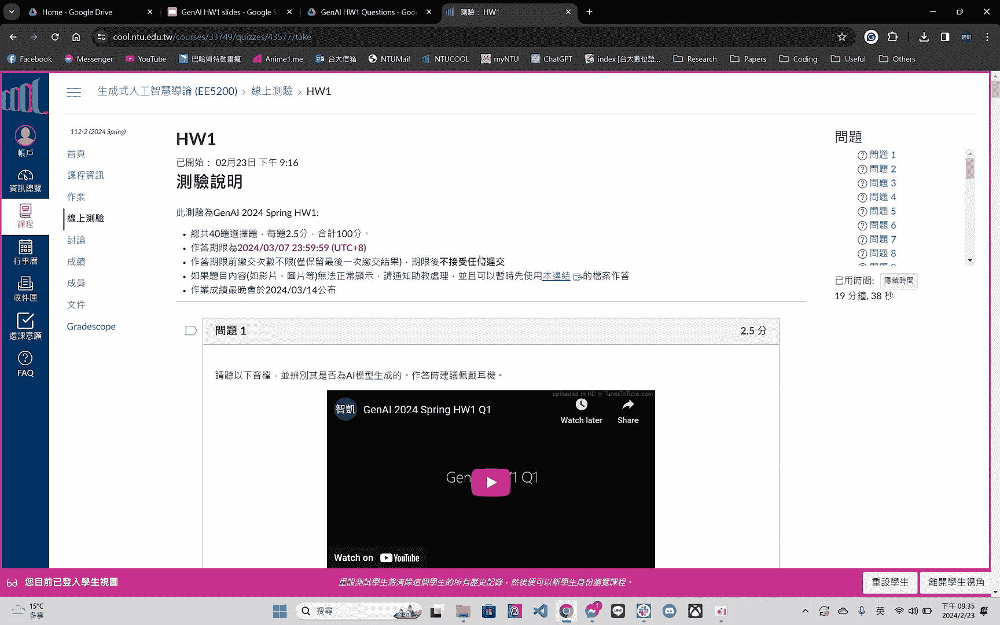

那这边的话问题一就比如说你可能听完之后。

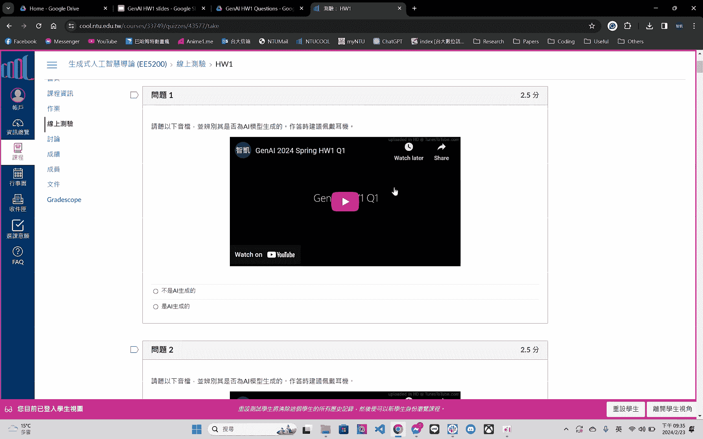

那你就选择不是AI生成，然后问题要听完，你选择是AI生成。

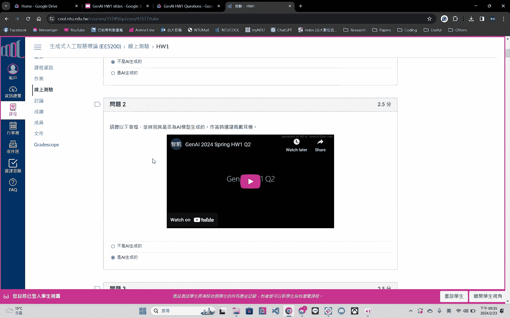

那这样子我们就一路做完40题之后，你要怎么知道自己有没有漏掉呢，其实很简单，就是你就直接按提交测验，那如果你有没作答题目的话，nt CORE就会跳出这个通知，告诉你你有几个没有回答的问题。

那就叫你注意看你是要捕捉的，还是你其实不在乎成绩，你也可以大方的直接送出去也没关系，那这边就是提供同学一个很简单的方法，去辨别自己到底有没有做答完，那同学可能交作业之后就不会那么操心。

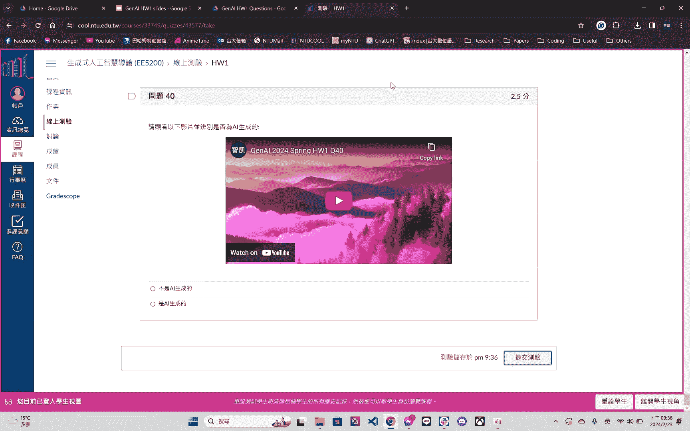

这样子好，那最后的话就是我们成绩试出的日子。

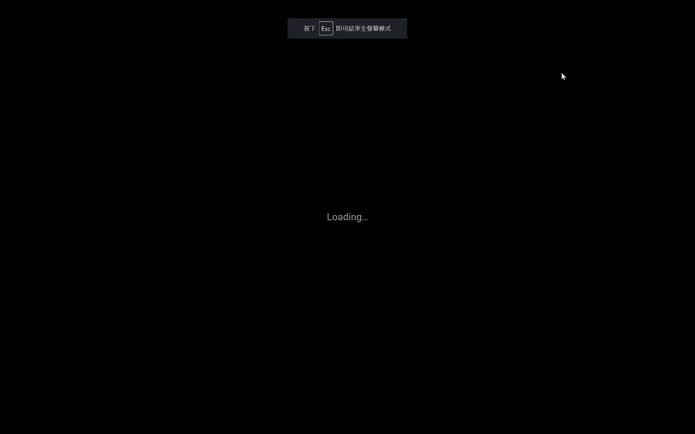

那成绩是出的日子，我们基本上定在作业，恋爱之后的一个礼拜，就是2024年3月14号，23：59：59，等于就提示加87，那同时我们也会公布问题到底是呃是AI生成的，是不是I生成的，还有同学可能会好奇。

我们用什么model或是用什么API，或者是在哪里生出了这些data，那那个时候我们也会试出这些资讯，但同学可能很抱歉，是因为nt a cool没办法设定多重正解，所以我们没办法让同学在缴交的同时。

可以拿满分，然后又看到自己哪题正确，答题错误，所以我们只能在gradient release date的时候，才试出我们的光truth，那基本上我们做完之后，可以的话。

当然也会去统计一下每一题的答对率多少，让同学知道说这题有多少同学是呃辨别正确的，有多少同学是辨别错误的，这样子好，那如果你有任何跟红魔馆有关的问题的话，我们这边有三个管道让你询问。

那第一个就是n t u cool上面的讨论区，那基本上如果你的问题不是太私人的话，我们建议同学基本上考虑使用这个讨论区优先，而讨论区上面的问题，也会是ta最高优先层级去回答的问题。

所以如果你的问题真的不是非常非常私人的话，我们就建议你用讨论区留言，那我们可能就会比在比较快速解决你的问题，那再来的话就是如果你有一些私人的问题，你不方便在讨论去询问，那你也可以寄信到我们的信箱。

但你的title就必须是建中括号，Jai2024，Spring homo one，中括号你必须是这个格式，我们才会回你的信，不然的话你的信有可能就是被自动移到垃圾桶，而我们没事也不会去翻垃圾桶。

那你的信可能就这样石沉大海了，所以就请同学注意，你一定要遵守标题的格式，那再来你也可以透过ta lol来询问ta，Lol，基本上都是2月23号跟3月1号的，04：30到5。20。

第一点就是在上课之后的综合大讲堂，那课后ta就会留在那边，然后回答同学的问题，其实也不一定要是红魔馆，没有任何课程方面的问题，然后老师可能有很多人在问，然后你也可以询问ta，ta都会呃想办法帮助你好。

那这边主要就是homo one的规则，还有内容，那如果同学有问题的话。

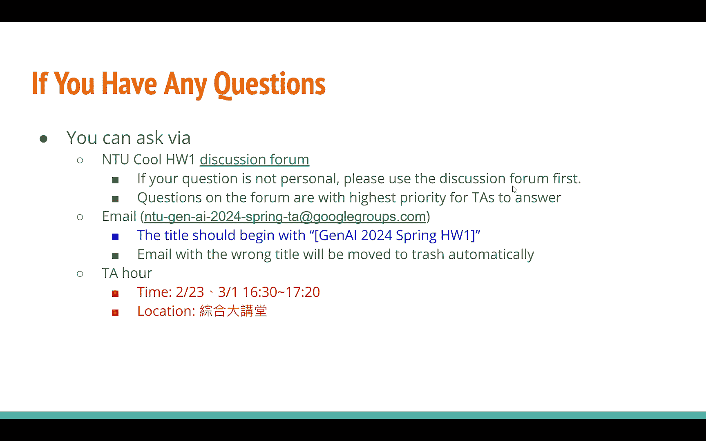

就请考虑这边的三个方式来询问。

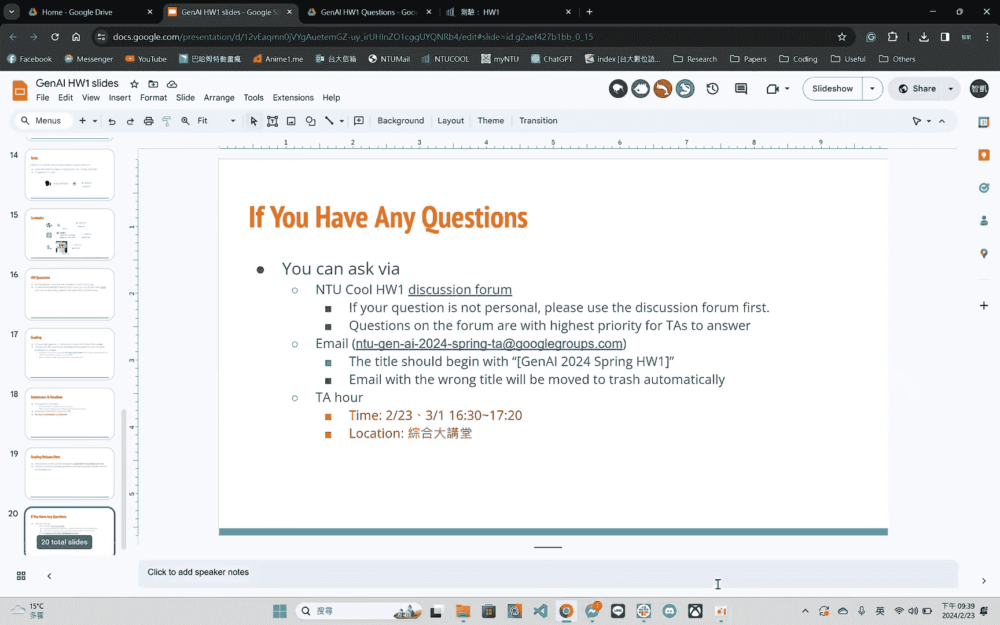