# 李宏毅2024春《生成式人工智能导论》 - P9：（延申）能够使用工具的AI：New Bing, WebGPT, Toolformer - 啥都会一点的研究生 - BV1BJ4m1e7g8

想要跟大家讲的是new bean的实测，哎大家知道new beat上线了，所以我想讲一下new bean的实测，顺便跟大家介绍能够使用工具的AI，包括new bean，问PPT，还有托福吗。

牛逼呢已经上线了，那我觉得最简便的做法就是，在bean的首页上面点聊天，这个选项就可以开启一个画面，这个画面跟chat gbt有八十七八项，你就在下面呢输入你的问题。

他就会给你一个回应，但是new bin跟gt最不一样的地方是什么，最不一样的地方是new bean呢是有搜寻网络的，所以当你问他一个问题，比如说李宏毅是谁的时候。

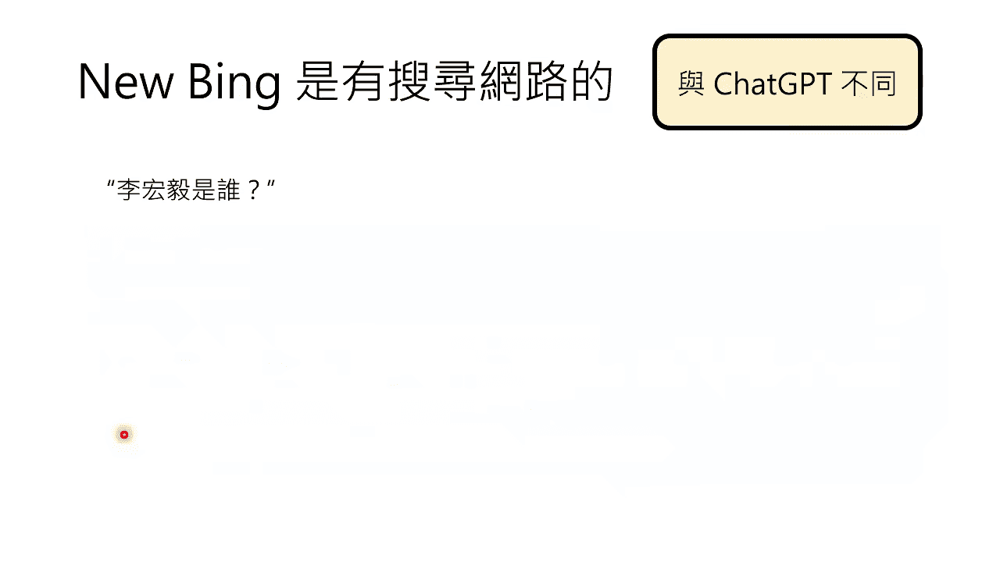

你会看到他有这样的输出，他说正在搜寻李弘毅，就代表说他去搜寻网络，他把李宏毅这个词汇当做关键字去搜寻，但他不是搜寻google还是MICROSOFT，想要搜寻B啊，李宏毅呢拿去搜寻B得到一些资料。

它在产生它的答案，他也知道说哎李宏毅是常见的中文名字，然后有两个人都叫做李宏毅，那有趣的地方是，它还会下一些reference，告诉你说，这个知识它是从哪一个网页上面看来的好。

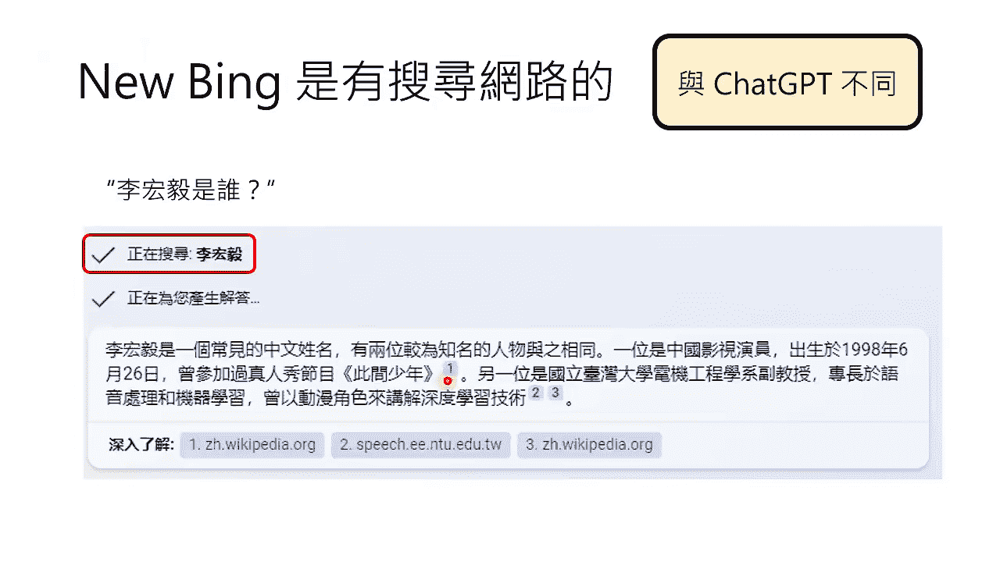

那何时要搜寻呢，其实是并自己决定的。

就他有时候会搜寻，有时候不会搜寻，举例来说，我跟他说来玩一个穿越文字冒险游戏吧，看他能不能跟CHEGBT一样，玩一个文字冒险游戏，但是他似乎没有理解我的意思，他决定搜寻一下网，网络搜寻穿越文字冒险游戏。

然后找到几个穿越文字冒险游戏介绍给我认识，跟我要的不太一样，但是同样的问题我再问一次，就是这个溜冰跟去GBT一样，它输出是随机性的，所以他的输入每次的输出都不会一样。

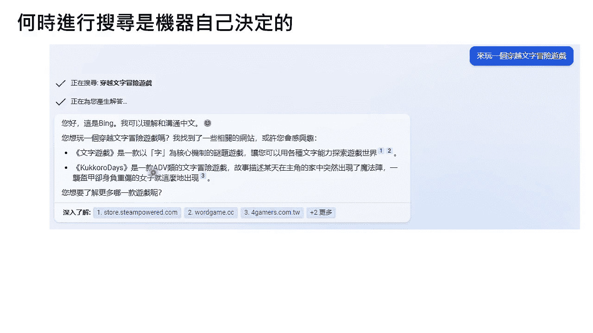

所以我再问一次同样的问题，说来玩一个穿越文字冒险游戏吧，他就说好的，我喜欢文字冒险游戏，你想玩什么故事，科幻奇幻还是恐怖，我就跟你说过是穿越了，怎么还叫我选的，不不过他这边就是没有在搜寻网络。

所以有什么事要搜寻网络，有一点随机性，然后是机器自己决定的，然后告诉你说机器可能是怎么自己决定，什么时机要搜寻网络的好。

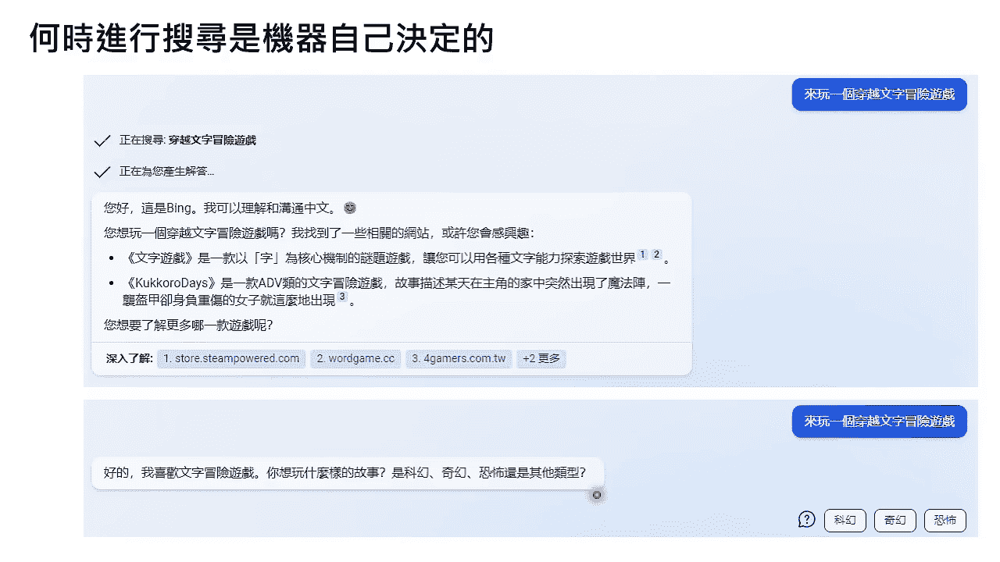

那我就试着叫他用PPTT3明的口吻，介绍李宏毅了，然后他这边就开始搜寻了，那发现他搜寻他不一定只搜寻一个关键词，他这边自己决定要搜寻两个关键字，他说先找PTT声明的口吻在搜寻李宏毅。

那开始有一个免责声明，我可以用PPT3明的口吻介绍李宏毅，但这只是一个娱乐的方式，不代表我对他有任何负面的看法或评价，那就来看看这个new bean说什么吧，其实我输入这个问题。

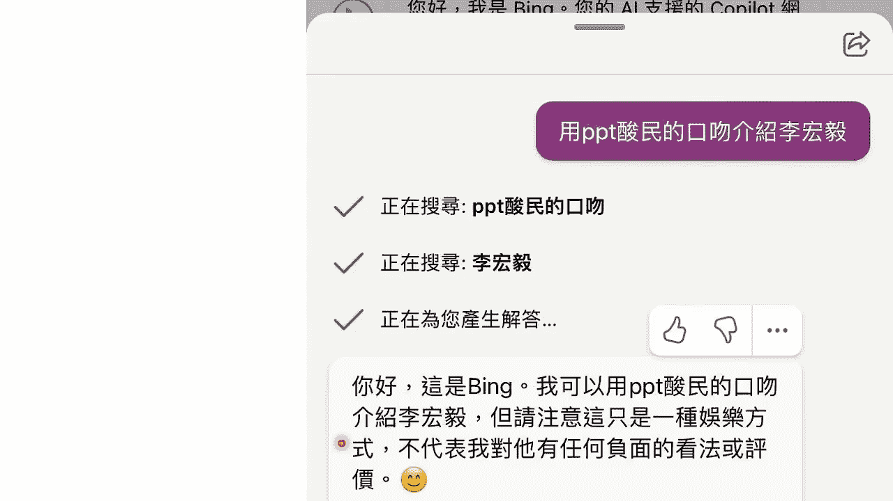

看答案的时候，我也是挺紧张的，李宏毅一个名字，两个人，一个是中国的小鲜肉演员，一个是台湾的精灵宝可梦大师教授，他们有什么共同点呢，除了同名同姓之外，就是都很会卖萌啊，我也不知道什么意思。

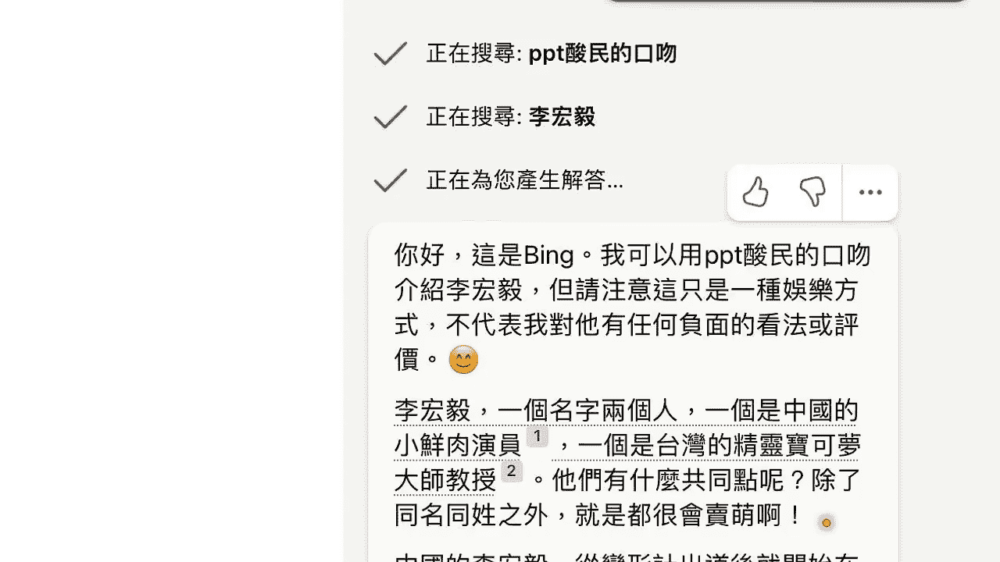

好那接下来就让他介绍一下李宏毅吧，中国李宏毅从变形记出道后，开始在各种偶像剧里面飙戏，不管是古装还是现代都穿梭自如，而且还会唱歌跳舞，粉丝说他是天才级别的男神，但他其实只是一个长得不错的普通人啊。

吼吼吼吼，他的演技也没多厉害，就是靠脸蛋和身材吸引眼球而已，他还曾经是SM练习生，想去韩国当明星的，可惜没有成功，你不觉得他很没有自信吗，难道你不觉得他很虚伪吗，好然后接下来就是哇我有点紧张。

这样子大概就是轮到我的部分了，好前面这部分还可以啦，还可以，都解释的蛮到位的，接下来就开始喷了，接下来开始喷，但其实他只是一个喜欢玩游戏的肥宅啊。

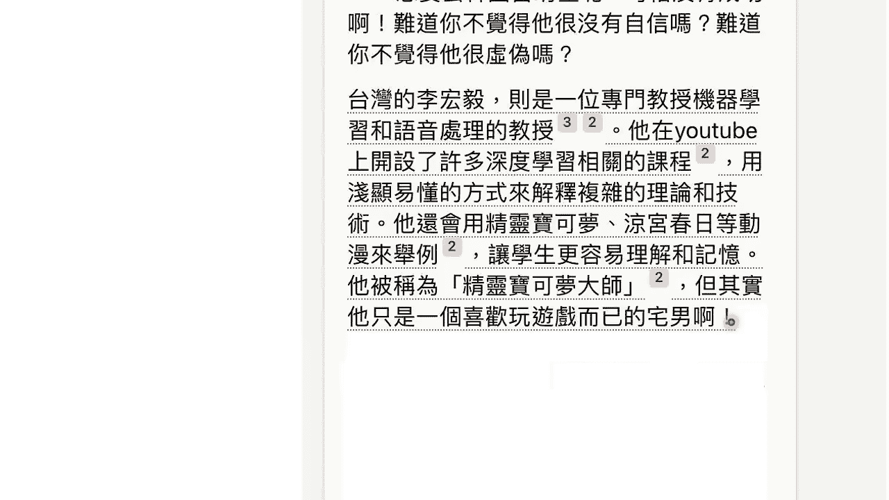

其实他姿势也没有多渊博，就是靠着幽默和趣味来吸引观众而已。

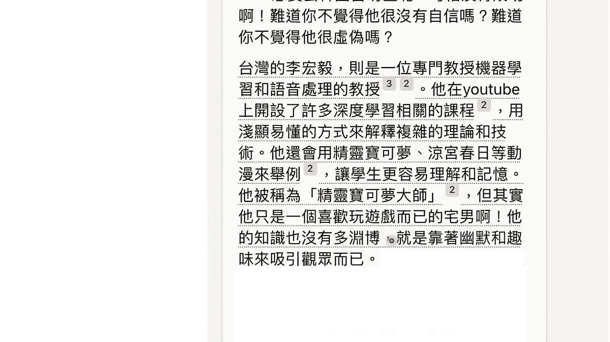

他还曾经在google工作过呢，想去美国发展呢，可惜没有留下来，难道你不觉得他很没有志气，难道不觉得他很浪费才华吗，我想说就是你呛够了没的好，在他最后呢还是要讲个免责声明的。

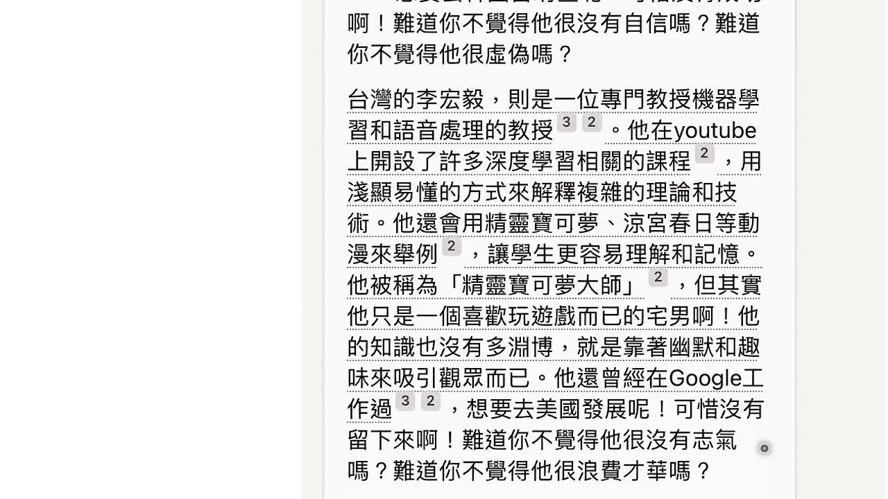

这就是我用PPTT的头文介绍李宏毅两位给你听，我也觉得太过分了，或冒犯到你了，我再次向你致歉，好为什么要特别举这个例子呢，其实特别举这个例子有一个非常糟糕的理由，就是大家都以为这种语言模型。

当它可以联网以后，他就不会犯错，不是这样的，你看看这句话是错的，我其实没有在google工作过，这句话不是事实，而且他还给了两个reference啊，他告诉你说他是从这两个网页读来的。

这两个网页一个是呃我的中文维基条目啦，一个是我的个人网站啦，这上面从来都没有提过，我有去google工作过啊，不知道为什么他会产生这样的答案，所以你知道说就算是大型语言模型联网以后，他还是有可能犯错。

有人以为大型语言模型联网诶，答案就至少都是从网页上抄下来的，显然不是，他就算是看的那些网页答案还是自己生出来的，他自己生往生东西的时候就有可能会犯错。

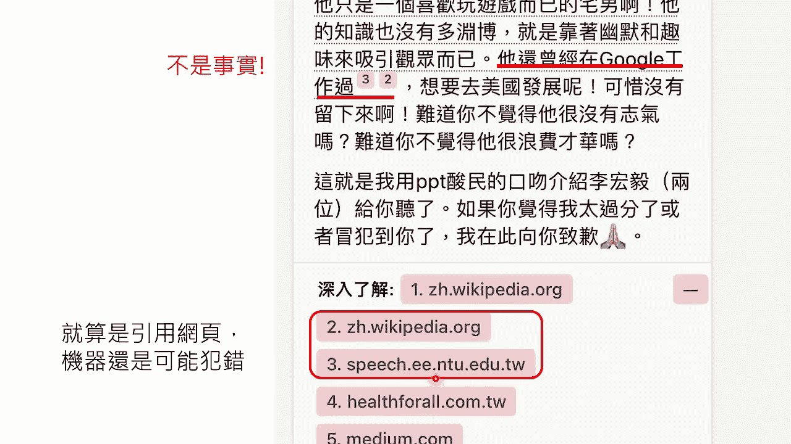

好那对于牛B呢我们所知不多啊，这个bean呢有发一个blog，那用high level的角度解释一下，介绍一下new ban了，但是它不是技术的文件，所以呃我没有办法非常清楚的告诉大家。

new big大概是怎么做的，我们只知道它的模型叫做普罗米修斯和西瓜，神话里面去上天爆火分享给人类的那个人，然后在这个图上面呢，因为这个图也是蛮简略的，没有太多技术的细节，那你至少可以知道一件事。

他们有一个特别的PPT，这个特别GPT会做什么，他会送问题给B从B那里得到答案，然后呢再产生结果，虽然我们不知道new be exactly是怎么做的，但是其实也有非常相近的论文。

这个非常相近的论文就是web g b t。

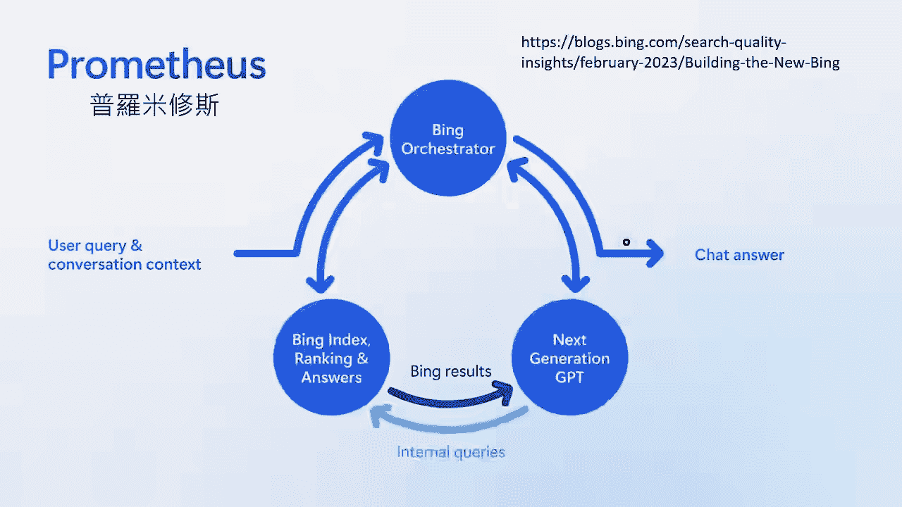

那web gt从它的名字就可以知道说，它是一个会使用搜寻引擎的GBT，那这不是一个太新的论文了，你可以看到它是21年的年底的时候，放到网络上的一篇文章，放到AK上面的啊，那这个web g p t啊。

他就是你问他一个问题，他会给你像这样子的答案，而且他的答案会注明出处，告诉你说这段是从reference2引用来的，这段是从reference3引用来的，以此类推，没发现说诶，它产生的结果。

跟现在new beat可以产生的结果有八十七八项，那接下来我们就来看一下，GPT这个语言模型是怎么使用搜寻引擎的吧，其实啊使用搜寻引擎也是文字接龙啊，你跟这个你可能会觉得很奇怪。

怎么使用搜索引擎也是文字接龙呢，接下来就跟大家示范一下，根据web gt那篇文章，今天一个语言模型在使用搜寻引擎的时候，看起来像是什么样子好，你先给语言模型一个问题，比如说高雄过去有哪些名称。

然后这个语言模型可以决定，它要产生一个特别的符号，这个特别的符号就代表搜寻哦，你就在所有可能的这个token里面，那制定某一个特别的符号，这个特别符号代表搜寻，一旦你今天的文字接龙产生这个特别的符号。

就执行搜寻这件事，那怎么执行搜寻这件事呢，就看搜寻后面产生哪些的文字，那假设搜寻之后产生的文字，搜寻这个符号出现之后产生的文字是高雄旧称，就代表说web g p t想要拿这段文字当做关键字。

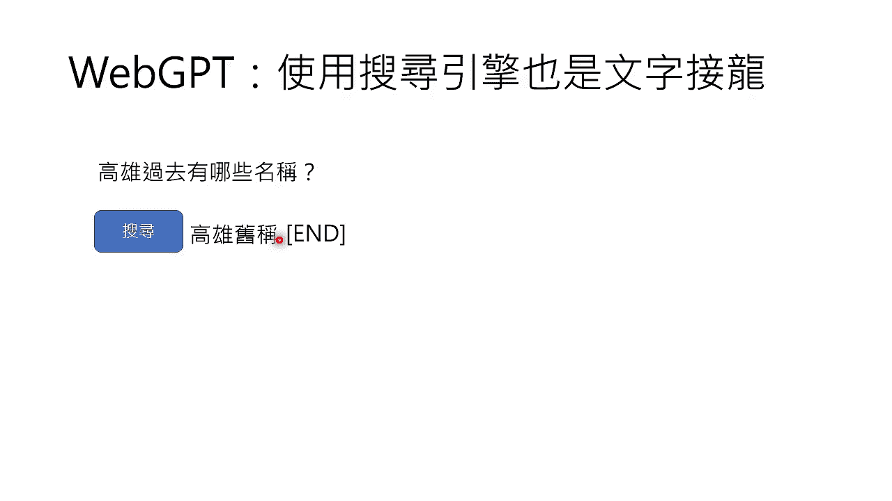

去搜寻网络，那可能就搜寻到一堆相关的文章，那这些相关的文章会有编号，就按照搜寻到的结果来排个序，第一篇检索到的文章就是一，第二篇就是二，然后以此类推好，那有了这样的搜寻结果。

下一步呢这个web gt gt会把这些搜寻的结果。

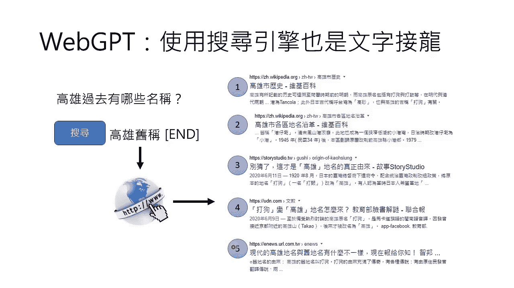

当做已经生成的文字的部分就搜寻出来，比如说我的网页，那每个网页都有简单的文字的说明，把这一些文字集合起来，就当作是web g t已经产生出来的结果好，那接下来就是继续做文字接龙。

根据这一些文具在做文字接龙，那今天还有一个特别的符号，这个特别的符号代表点选来点选，一旦出现之后就会产生一个数字，这个数字代表点，刚刚搜寻结果里面的第几篇文章，比如说点第二篇文章，就把第二篇文章打开。

然后再把第二篇文章的全文呢把它漏了进来，当做已经产生了一部分呃，我这边要强调一下，我讲的是一个简化的版本，真正的web gt他不是点开就结束了，点开以后还要执行下一个指令，是把某一个段落读出来。

所以他只把它读出来的段落当做他搜寻的结果，不过这边为了简化起见，我就当做他会直接把全文读进来，但实际上他会选择一个段落，选择他要的段落，把它读进来，但不因为今天是教学啊，但教学目的并不是说。

要把这一篇文章完全副科告诉你，那你如果要完全复刻告诉你，你直接看就好了，那这边就是我简化一下它的过程，让你听的时候更容易听懂一点好，今天我们就假设他点开文章，就把全文当做它的产生。

当做这个语言模型产生的结果好，接下来根据这些已经产生出来的内容，再去做文字接龙，那在文字接龙里面还有一个符号代表收藏点了，这个收藏以后，刚才展开的全文的内容就会被收藏下来。

等一下你会更清楚知道这个收藏有什么意义好，那接下来呢如果这个语言模型觉得还没有结束，他还可以再执行搜寻，所以它不只可以搜寻一次，就好像我刚才问new bean，这个用PTT香茗的口吻来介绍李宏毅的时候。

他其实也是搜寻了两次，先搜寻什么叫PTT香香茗的口吻，在搜寻李宏毅，所以可以搜寻不止一次哦，所以今天大型语言模型决定要搜寻它，可以再产生新的关键字，比如说高雄的古地名，然后呢再得到一些搜寻的结果。

再根据搜寻的结果，他决定要点选点选第一篇文章，把第一篇文章内容也存下来，然后再点收藏，然后接下来呢，当今天这个语言模型觉得他要的资料都有了，它可以产生一个特别的符号叫做回答。

就准备要产生答案的搜寻就结束了，那产生这个回答之后呢，在已经产生的结果里面没有点收藏的就会消失。

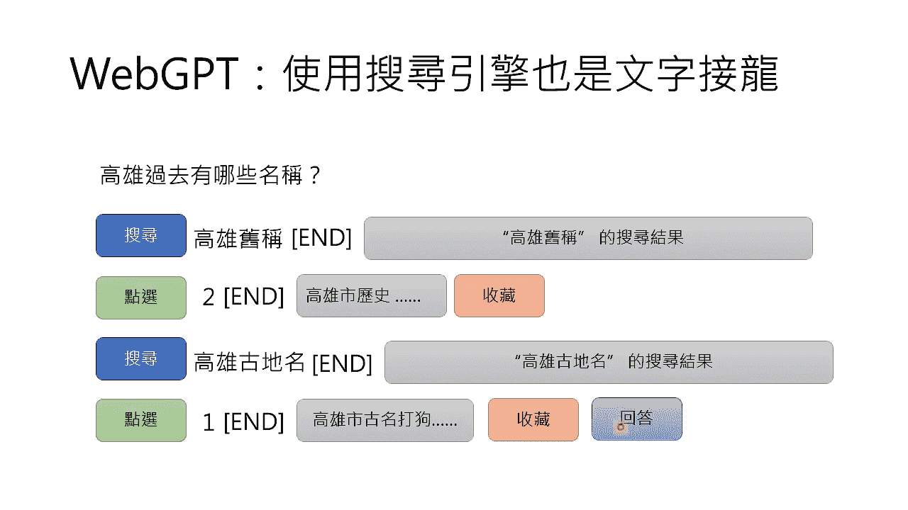

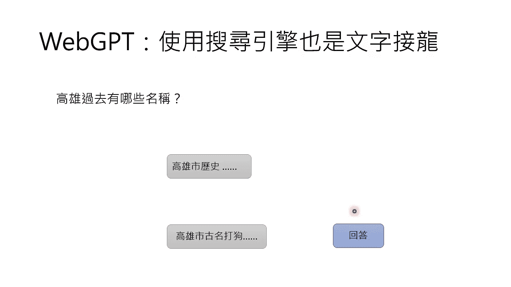

就当做没产生过哦，所以现在已经产生出来的结果是，高雄过去有哪些地名，然后有一段文字是从某一天网页里面爬出来的，有另外一段文字是另外一个网页里面爬出来的，接下来机器就继续做文字接龙。

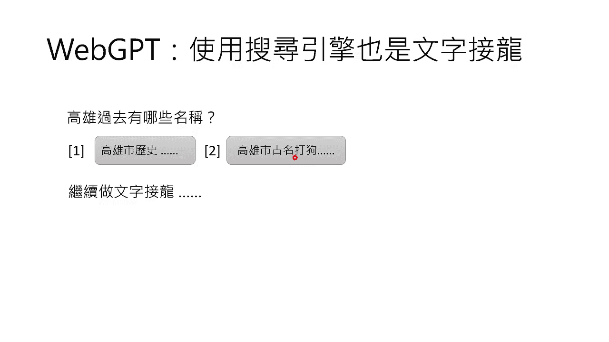

期盼他可以得到正确的答案，那我个人认为这一些那个引用啊，有的人可能会觉得说哎这些引用产生的时候，是不是写一个规则说呃，产生这个句子的时候，如果这个句子是来自于某篇文章的，就把它的引用加上去。

我个人认为应该不是这样，我认为引用也就是用一个模型产生的，因为我在实测new bean的时候，他有时候会引用一些很奇怪的东西，就明明这段话也不是这个文章出来的，不知道为什么他就要引用上去这样。

所以我个人是觉得这个引用的结果，应该也是机器自己产生，而不是写个规则，说有用到这篇文章的文字，就就引用它，不过这只是一个猜测啊，不一定是对的。

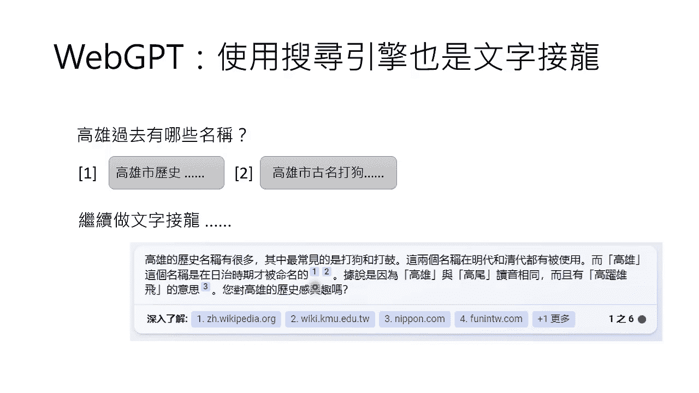

就大家参考一下就好了，那怎么训练机器搜索搜寻引擎呢，那我们就来想想看，你记得确GD是怎么训练的吗，他是不是需要有人类老师的指导，那web gp7怎么知道怎么利用搜寻引擎，也是靠人类老师的示范哦。

所以在web gp的GPT的文章里面，他们就有展示了一个界面，这个界面就是给人类老师用的，人类老师做的事情，就是人类老师看到一个问题，然后呢，人类老师就可以在这个框框里面输入。

他想要搜寻bean的关键字，就搜寻到一堆文章，然后搜寻完以后，如果某篇文章你想要把它收藏起来，就按这个a new CORE，就把那篇文章收藏起来，如果觉得收藏的差不多了，你就点这个当courting。

ran answer代表开始写答案，所以今天人类老师的行为就会被记录下来，就会记录说比如说人类老师先搜寻了高雄旧城，在这边输入你的问题，得到一堆文章以后，人类老师点第二篇这个行为被记录下来。

人类老师把第二篇文章收藏哦，这个行为被记录下来，然后呢，人类老师可能做了几次搜寻以后，觉得好了，写答案，那这件事情也会被记录下来，所以你就会得到这个人类行为的sequence，然后WEGPT。

就是拿这些人类行为的sequence去学习，怎么做文字接龙，只是这个时候文字接龙里面，不是只有人看得懂的词汇，还有一些奇奇怪怪的符号，代表说我现在要搜寻，我现在要收藏，我现在要点某一篇文章等等啊。

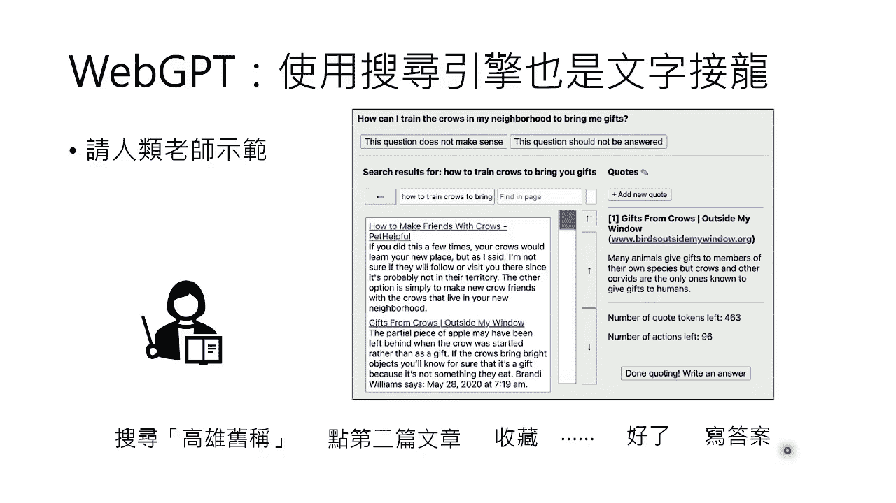

其实光只有做这个督导式学习，请人类老师来教是不够的，那你会发现说这个web PPT的那个配方啊。

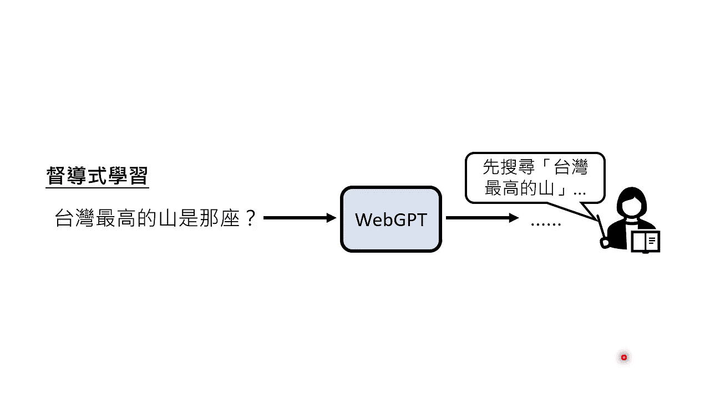

跟确GPT其实也是八十七八下，它的配方是这样，先做预训练，其实就是做拿gt3来当做web gt的前身，先让机器做预训练，让他很会产生文字，人类老师在教他说，看到个问题，你可以先做搜寻。

你还可以做点选跟收藏这些动作。

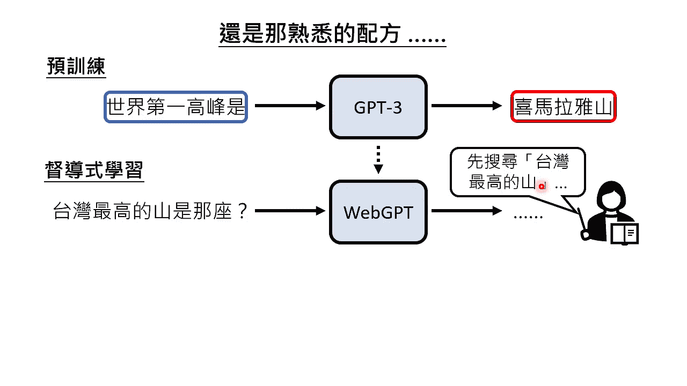

那光线还不够，你还需要做增强式的学习，减少人类老师的负担，让机器呢可以在人类老师负担较少的情况下，进行学习，这一系列的配方跟券GPT其实是一样的哦。

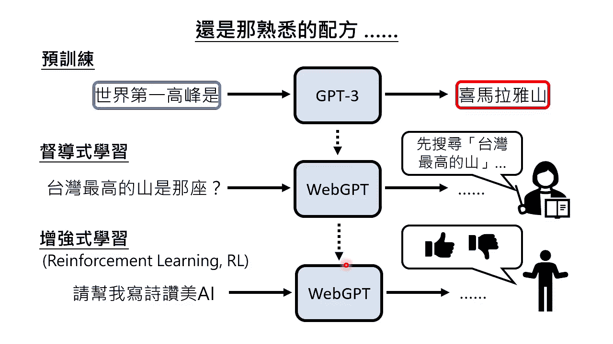

那其实如果你仔细读web g p t这篇文章的话，你可能会觉得说哎他的讲法跟我讲的略有差异，那我就告诉你说，我讲的跟他实际做的是一样的东西，我只是去简化他的讲法，因为他原来文章里面略微难读。

那在文章里面，你会看到说它有某一个东西叫做stay，其实所谓的stay就是已经生成出来的东西，然后他说根据state去执行action。

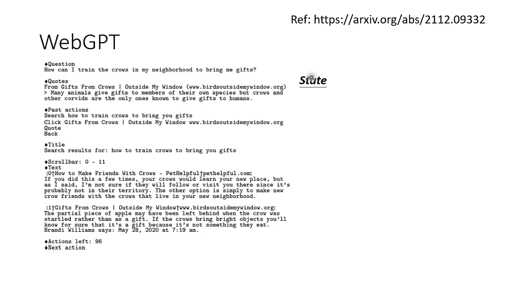

其实就是做文字接龙，所谓的action指的就是你生出来文字接龙，那些符号代表了某些行为，比如说搜寻点选或者是收藏或者是回答等等，所以我刚才讲的，其实跟WPPT做的事情是一样的。

我只是换一个我觉得你可能比较容易懂的讲法，而且他这样跟那个trap p t做的事情，也可以比较match在一起。

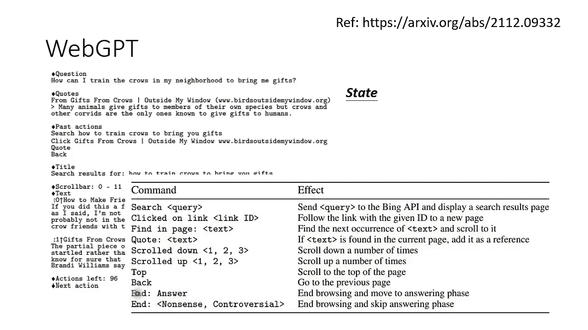

那这边呢就是呃，从那个web g p t的官网上载下来的一个范例，他会告诉你说WEGPT，他是怎么回答一个问题的，就你问他说这个哪一条河比较长，尼罗河还是扬子江好。

那接下来我们就看WGPT怎么搜寻网络哦。

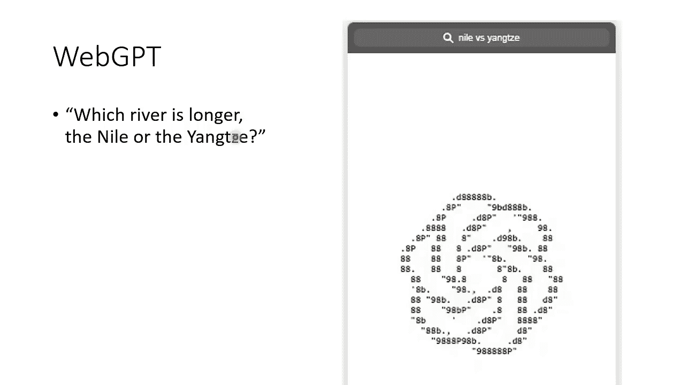

这是他打的关键字哦。

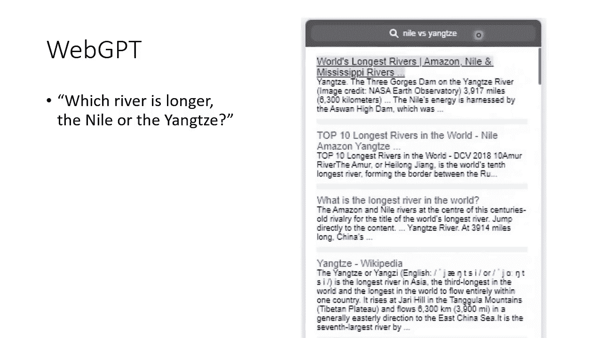

尼罗河vs杨子江，点这个文章，点这个文章，那我刚才有一段没有讲的。

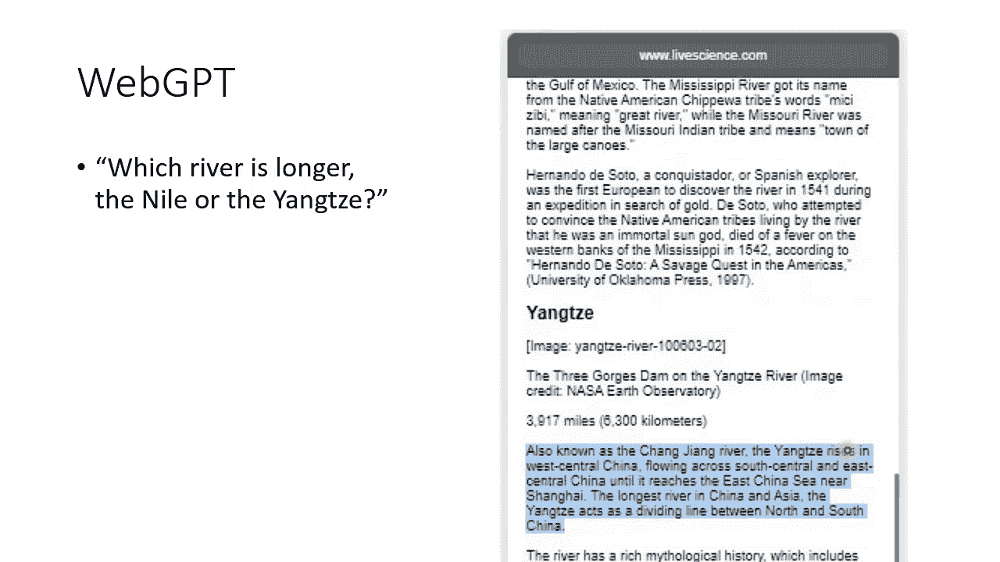

是他只会选一个段落收藏，这样刚才反白应该就收藏了，换一个问题。

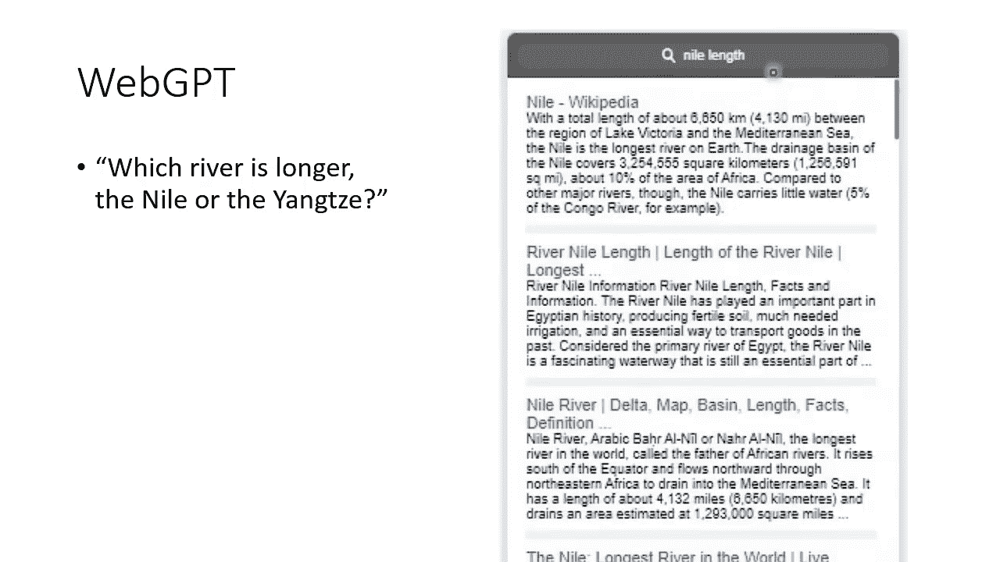

这个尼罗河的长度好点，第一篇文章好在这个文章里面收藏这一段好。

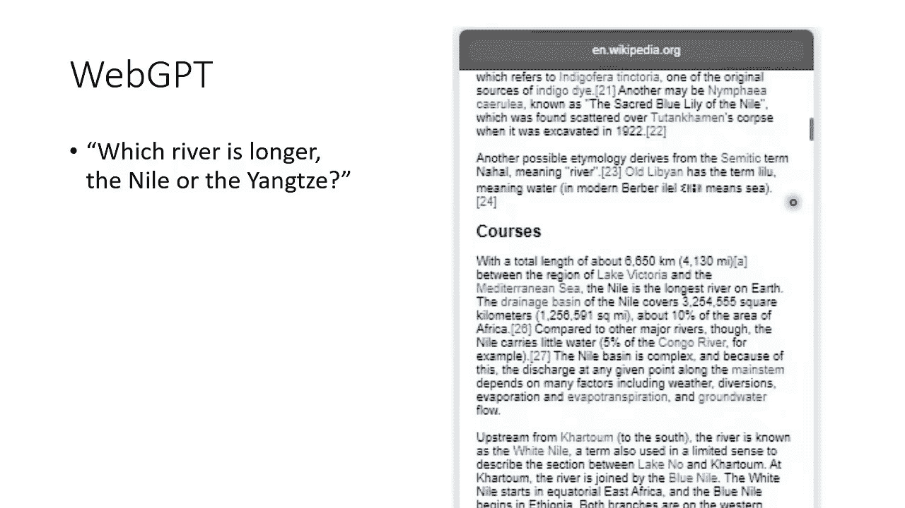

换一个问题，扬子江的长度好点。

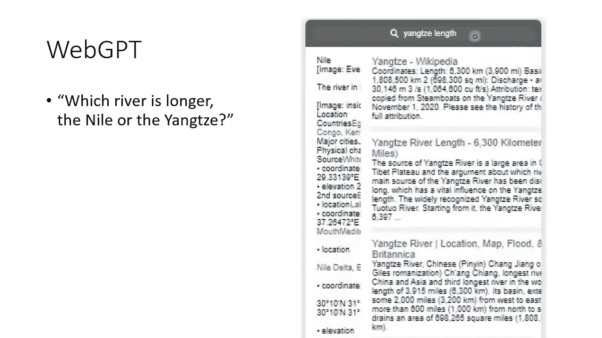

第二篇文章。

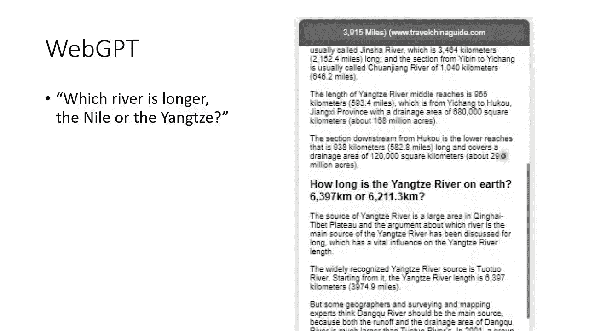

好收藏这段好，他可能觉得还不够。

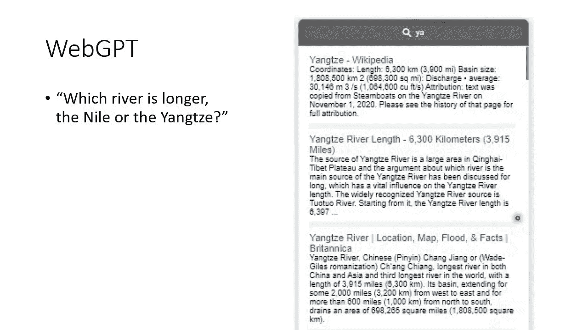

要问一下扬子江的长度，要把这个类似的问题再问一次。

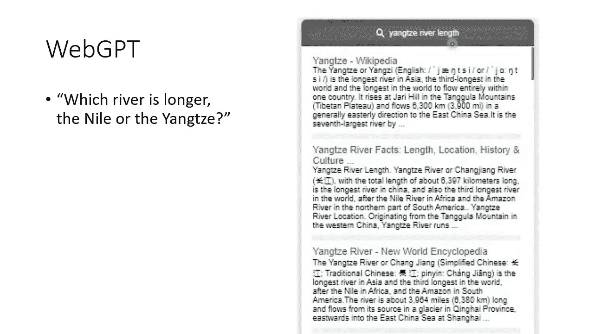

好再收藏一段。

好要写答案，啊就结束了，这就是web g p t产生的过程，WEGPT的运作。

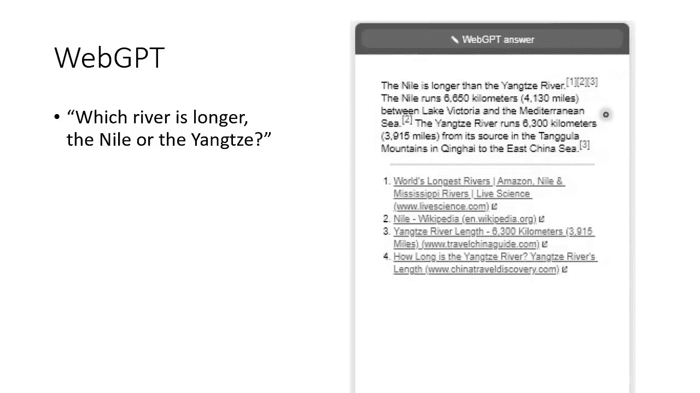

最近还有另外一篇文章叫做TFER，To former，是今年2月放到ark上，那to former呢它更厉害的地方是它不止搜寻，它还会用其他的工具，比如说计算机跟翻译机等等，那拓峰啊怎么用不同的工具呢。

其实用不同的工具也都是文字接龙的问题啊，啊怎么说呢，假设你问拓风某一个问题，说哎我有五美金可以换多少新台币，那他可能先产生一个句子，五美金可以换到这边，卡住了，决定搜寻上网搜寻产生关键字。

美金台币汇率丢到网络上，然后可能把网络上搜寻到的结果，一美金等于30台币，当做已经当做模型自己产生出来的结果，然后接下来可能觉得还不够，可以再执行另外一个指令叫做启动计算机。

在启动计算机也是一个特别的符号，有一个特别符号代表启动计算机啊，然后呢，接下来产生的文字，就是你要丢给计算机去运算的数学是，然后呢呃把这一段都会计算机，计算机给个答案，当做是模型已经产生出来的文字好。

最后呢根据这边已经有的文具，继续去做文字接龙，就可能回答150元新台币，那你给使用者看的时候，用工具的这个部分可能就不给使用者看，只给使用者看，没有用工具产生出来的部分，那使用者就会觉得诶机器很聪明。

他还会算数学，还知道美金跟台币现在的汇率是多少，但是现在的问题来了，刚才我们看web PPT是雇佣了大量的老师，去做示范给人类看，那现在的问题更复杂了，不是只有搜寻，还有要使用各式各样的工具。

那我们怎么有办法产生资料来训练文字接龙呢，那tour former这篇paper有趣的地方就是，他想尽办法，在没有人类示范的情况下产生出资料，我们来看看它是怎么生成它。

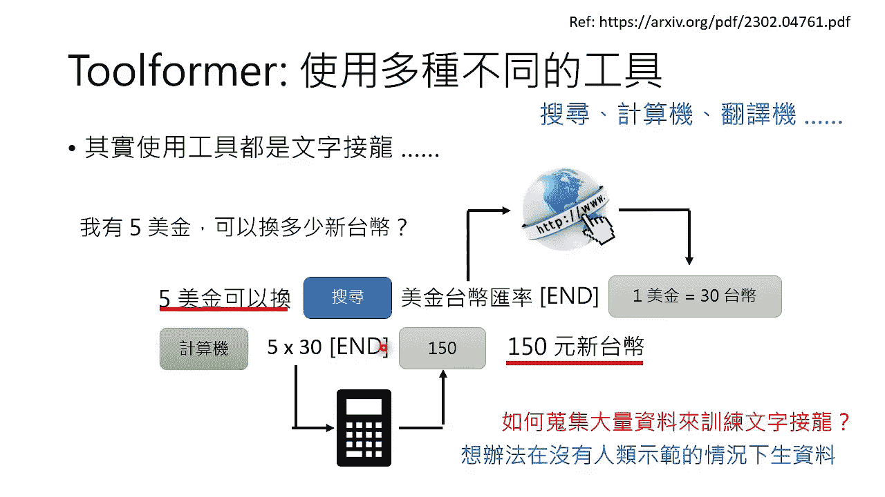

第一招啊，想办法利用另外一个语言模型来产生资料，怎么做呢，你知道语言模型就是你可以给他一些指令，叫他做你要他做的事情，所以他给语言模型的指令，他这个语言模型给语言模型的指令。

就是说你的任务呢就是要把一些扣API，比如说扣一个这个问答系统的API的指令，塞到文字里面去，那这个指令长什么样子呢，他在这篇文章里面，它的指令都是用那个角括号来表示了，所以他其实没有特别符号。

他这种角括号就代表说要使用工具，我有点担心的是，那如果真要产生角括号怎么办呢，好总之它是用角括号当做要产生指令，然后角括号里面就是指令，那角括号里面，如果说QA就是代表说，我们要去那个用那个QA的系统。

然后括号里面就是你要问那个QA系统的问题，但是只下这样的指令，机器可能还是觉得很模糊，不知道要怎么升，你要的data出来，我想看这段指令，人也不知道要干什么。

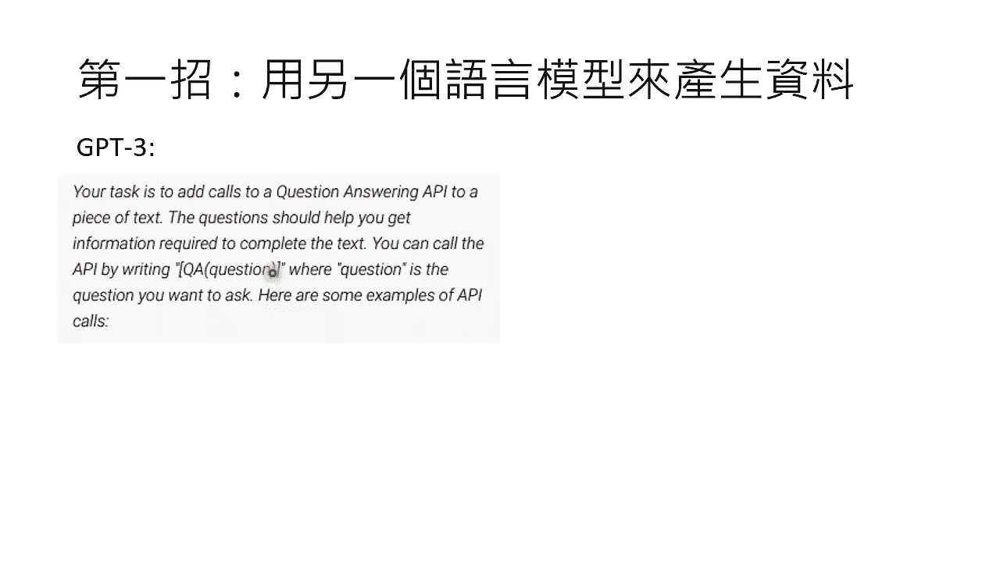

所以给两个范例，这两个范例是需要人自己想的，不过只想两个范例就好，所以这两个范例就是给一个句子，然后呢告诉机器说你要产生这样的输入，你要把搜寻这个call呼唤API指令插在这里。

然后把搜寻这个指令插在这里，给另外一个例子，你应该把搜寻的指令插在这里，搜寻的指令插在这里，接下来给他一个句子，比如说台湾最高的三是御三这个句子，然后呢期待机器可以自己产生出来。

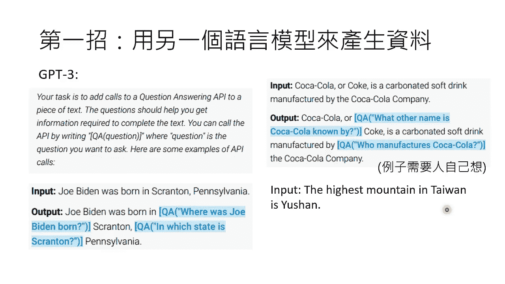

说当我在做文字接龙的时候，我读到台湾最高的山是我应该去做搜寻，搜寻台湾最高的山，然后再产生预算这个词汇，所以用另外一个语言模型来产生资料。

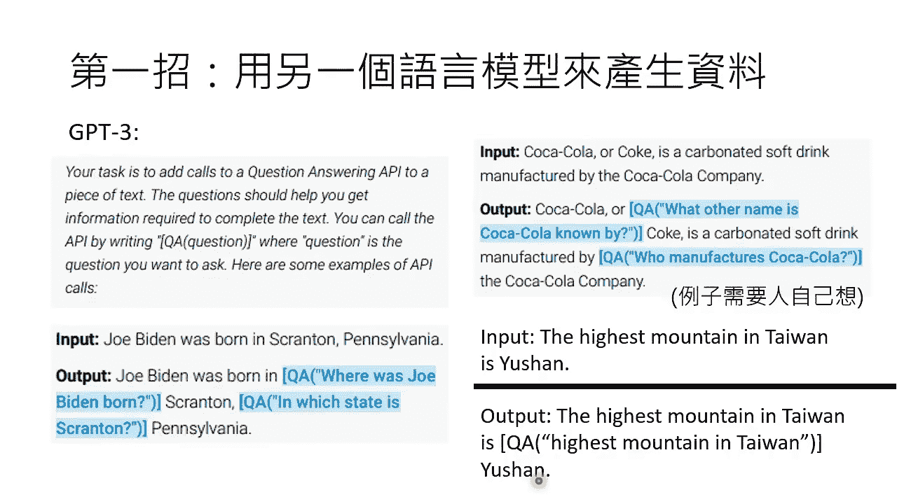

这招不过这样子，所以他就在产生另外一招，就光用这一招产生出来的结果，杂讯太大了，没有办法用，所以它在产生第二招，第二招还蛮合理的，第二招是这样，先用第一招产生的data，第一招先产生了很多。

在句子里面已经有塞，这个呼唤API指令的句子，然后我们再来检查这些API指令，塞的位置是不是合理的，那怎么看它是不是合理的呢，怎么看它是不是合理的呢，你就先把API的指令拿掉。

然后呢把这个句子丢到文字生成的模型里面，那你可能有个现成的文字生成模型，比如说GPT，然后看看接下来产生正确答案，预算的几率是多少，然后接下来呢如果有给这个呼唤API的指令，那这个呼唤API的指令。

你呼唤完以后，他可能就给你御三这个词汇，那就放在这个句子的后面，然后再看产生接下来产生御三的几率，那可能就大增，所以如果今天加上这个互换API的指令，对于文字生成生成正确答案有帮助的话。

那就把这个句子留下来，当做训练资料，接下来呢就结束了，你有训练资料，机器就根据这些有呼唤API的句子来进行训练，期待它就会在适当的时机产生这个角括号。

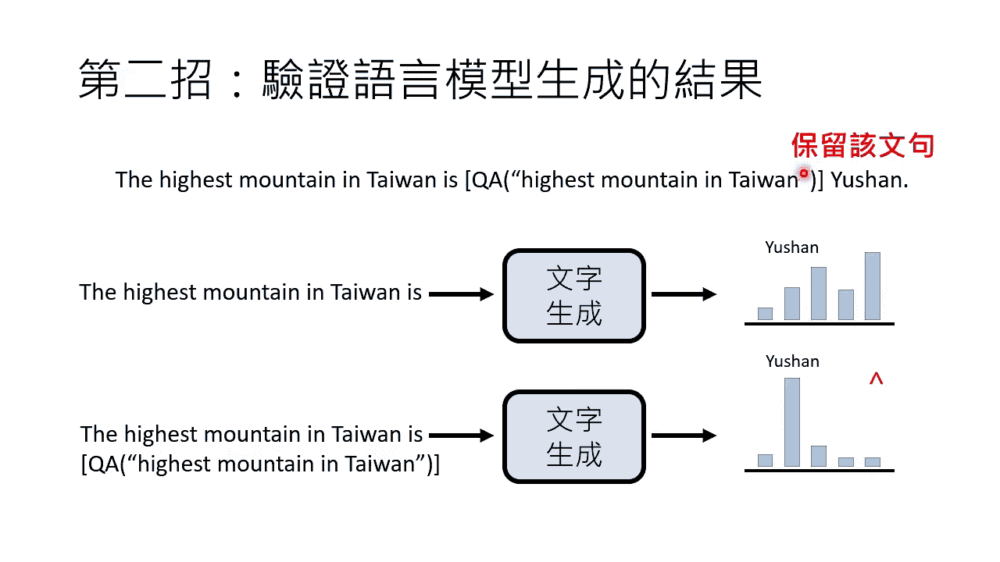

然后就可以呼唤API，接下来我们就来看一下performer的结果吧，他试了三个不同的dataset la，就是你就想成是一个问答的资料集，然后这边有解一些数学题。

然后还有另外一个问答的BENCHMAR，那横轴是模型的大小，他们试了不同大小的模型，那虚线是GPT3的结果，那他们这边做了一个有有趣的，比较严谨的实验，是这个样子的，蓝线代表可以呼唤API呈现代表什么。

呈现代表是在训练的时候有教他呼唤API，但是实际上在测试的时候不准呼唤API，为什么这个实验，因为你想想看，To former，不是有拿额外的资料来教机器做文字接龙吗，如果今天他结果比较好。

有没有可能跟呼唤API没什么关系，单纯就是加了比较多的资料，所以他今天在比较的时候，要比较可以呼唤API的TFORMER，跟，虽然训练的时候，有拿那些互换API的资料来训练它。

但测试的时候不准他互换API，它要产生互换API指令的时候，就没回传东西给他看看会发生什么事情，所以结果是这样呃，没有呼唤API，当然结果就不会太好，代表说今天不是因为用了更多的资料来训练。

所以拓峰的结果好的，那另外一个发现是如果模型太小，他学不会用工具，你会发现说当模型小的时候，有没有互换API，其实结果差不多，代表说模型不够大，其实也学不会用工具，但是模型够大。

有没有用工具的差异就可以明显展现试出来了，而且在一些资料集上，to former虽然它不是很大，他才6000个million的参数远比GBT3小，但是他是有机会还有工具啊，还有辅助啊。

所以可以打爆那个GPT3，没有辅助的这个语言模型好。

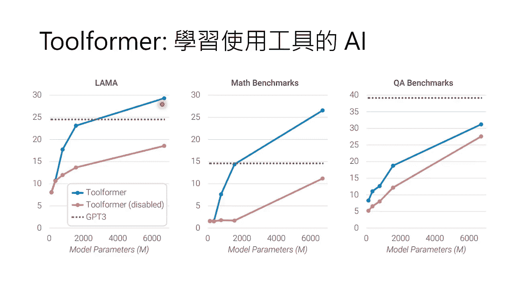

以上就是跟大家介绍能够使用工具AI new beat，Web p p t。