# 【官授搬运】2026年全新优化版李宏毅机器学习系统课程，这才是真正的初学者体系课程！—人工智能／深度学习／神经网络 - P100：10-Meta Learning – MAML (7-9) - AI算法工程师Future - BV1ruqABeEFX

来看一下，那接下来就会用到一些数学，那不想听的人就可以休息一下，但其实这一段呢，那我其实是今天早上刚抵达台湾啦，这样子刚从美国回来啊，这段是在飞机上面在乱流中坐的啦，所以一定是会有很多的错误啊。

所以你可以找找看看能不能找到错误的符号。

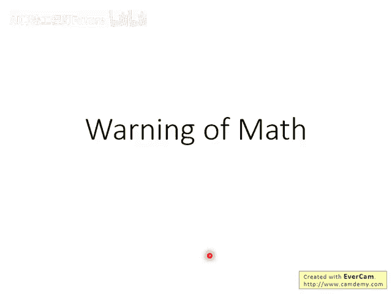

好，这个是我们的training的过程，就是我们的ending inal，怎么train呢，我们说啊你就是用gradient descent train，你要用你的by去对大L呢算它的归点啊。

大L长什么样子，大L呢就是所有你手上的task，小L所有你手上的task，他们用SAH算出来的loss function，sa head是什么。

sa head是我们把这个翻做一次update以后得到的model，参数叫做最大配，那我们现在就实际上来算一下。

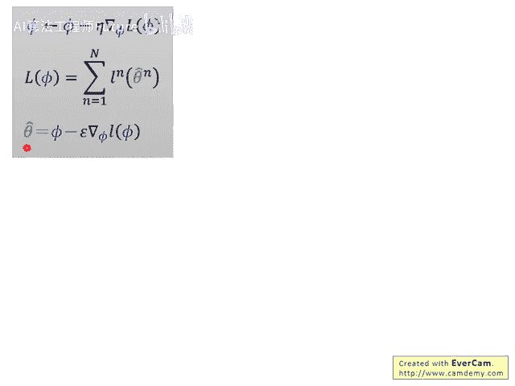

这一项规点应该长什么样子，长什么样子好。

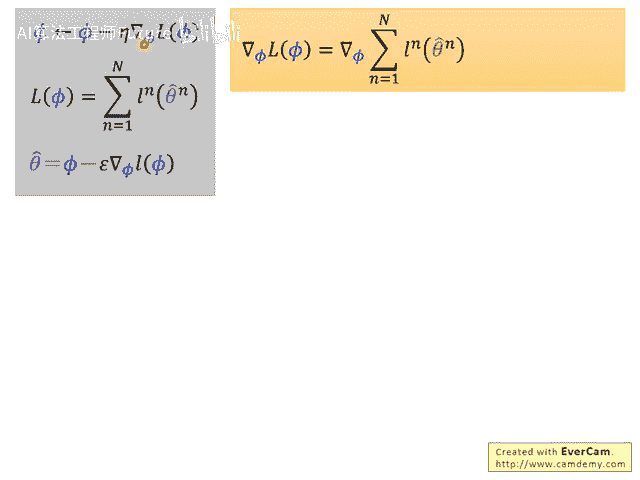

那这条规定长什么样子呢，我们先把大L用这个some mention over，所有小L这项替代好吧，大L用submation over小L替代。

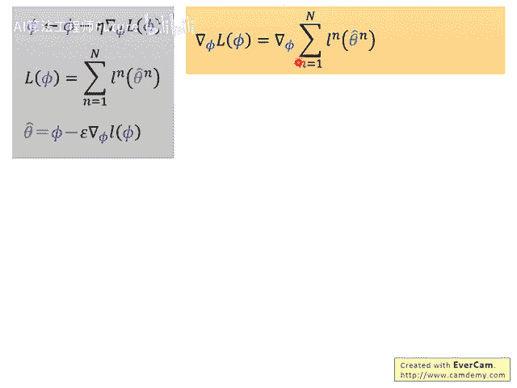

然后这个gradient这一项啊，本来是放在SUBMENTION外面，但是你其实可以把它拿到some mention里面，所以接下来我们就只要计算额这个发这个参数，loss小小写的loss。

某一个test的loss function算出来的gradient的值，然后这个loss function，它它现在是用什么样的参数算出来，这个loss function的值呢。

是用sa head算出这个lost方程好，那这个gradient是什么意思呢。

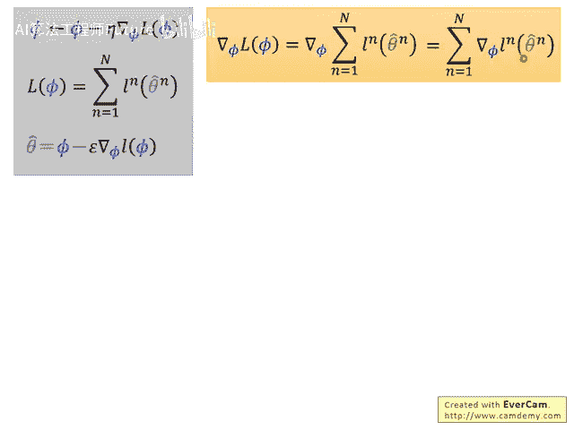

大家都知道说所谓的gradient，就是它的每一个dimension呢，代表了某一个参数，对你的loss function的偏微分的结果好。

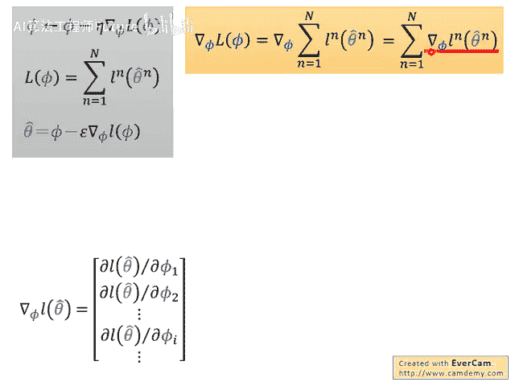

所以今天呢这个把five对小L做gradient。

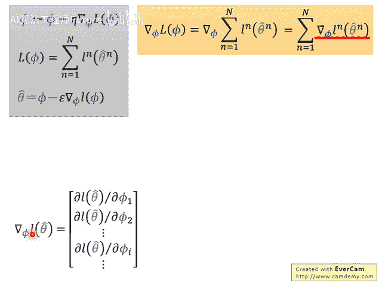

得到的是一个vector，这个vector的第一位就是拿by one。

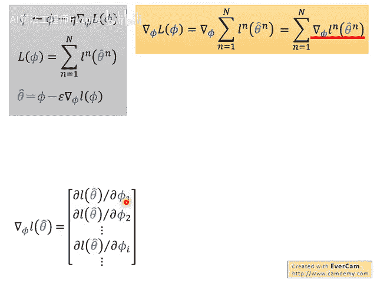

by one就是翻这个model，它的第一个参数就翻译，其实是一个network初始的参数的值嘛。

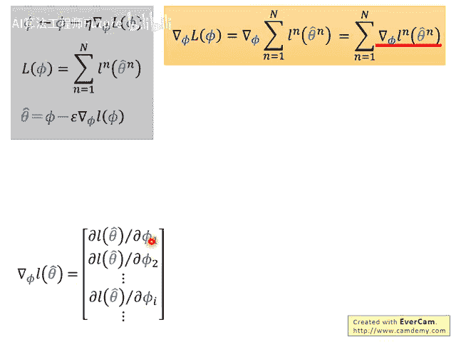

那network的初始参数的值就是一大堆的weight，跟BIOS的值嘛，所以把它们统统拿出来拼成一个vector，然后的第一个参数的值对lost的偏微分，第二个参数值对lost的偏微分。

然后到挨个参数的值对lost的片尾分。

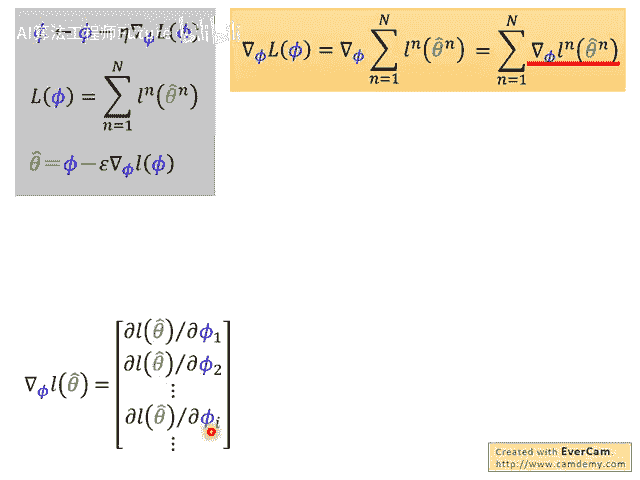

那我就拿其中一项来算算，看说他应该长什么样。

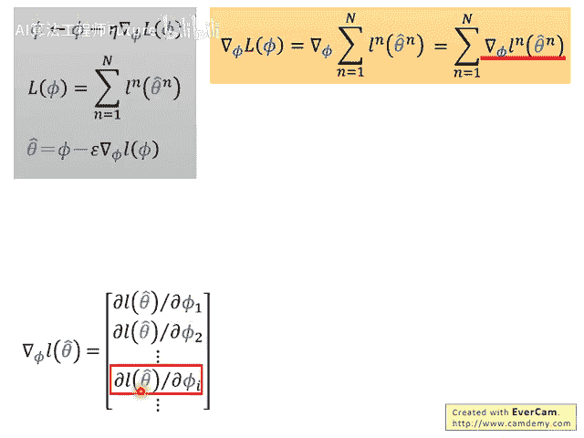

那你会算项，那也就会算其他项好。

那我们来算一下，拿FI对l of sea head做偏微分的结果。

那我们来看一下，这个FI对LOCAH的关系是什么。

那么知道所谓偏微分的意思，就是如果翻I做一下小小的变化。

到底LOCAH会产生什么样的变化。

那FI呢它是初始参数，它是训练的时候的初始的参数。

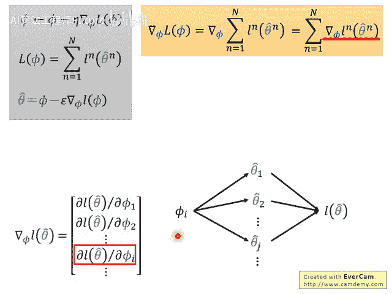

那这个初始的参数，会影响你最终训练出来的结果。

也就是set up a，那最终训练出来的这个model，会影响你最终算出来的loss。

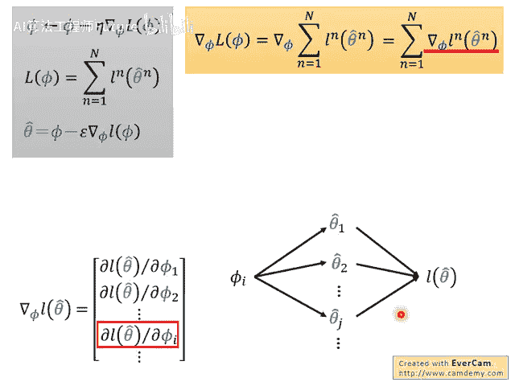

也就是l doc，所以FI呢是透过了set a head里面的每一个参数。

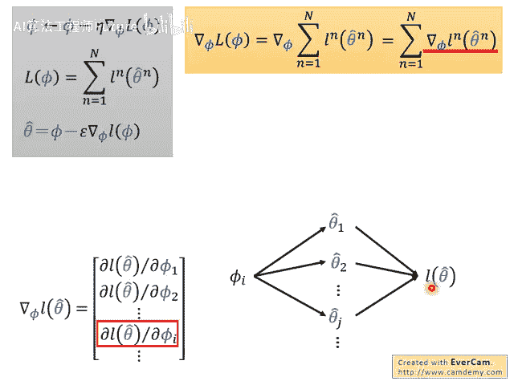

去影响了最终的loss function的值。

那根据圈弱，你就可以把bi对L的塞拉黑的偏微分呢。

也成这样子，就每一条CP上面每一条pf的微偏微分的。

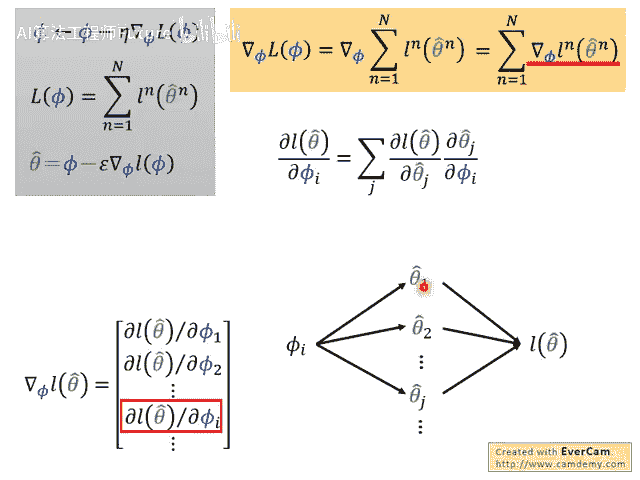

统统把它加起来，所以YI对l o c a head的偏微分呢。

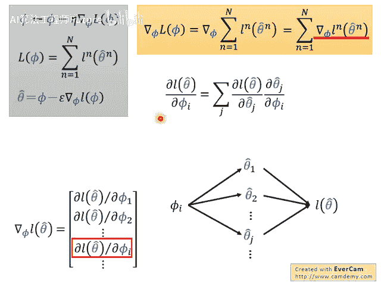

就是submention over sea head里面所有的参数。

然后把赛达黑里面的第J个参数拿来对l of。

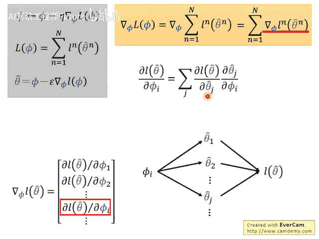

赛达黑做偏微分，然后再把by i拿来做对say。

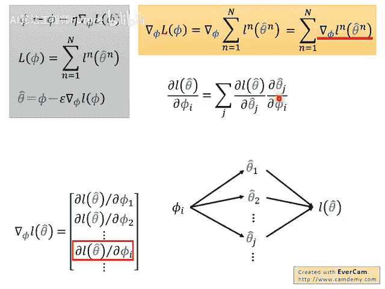

大j head就是把D翻的第I个参数，对set a head的第J个参数拿来做偏微分，把它们乘起来，然后some mention over theta里面所有的参数就得到了。

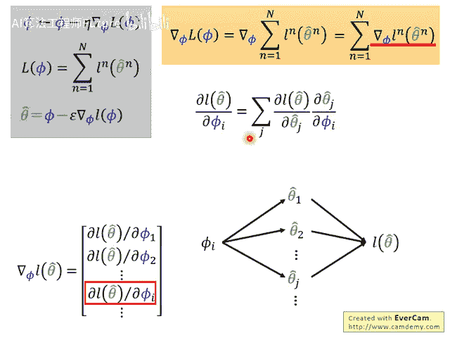

by i对L的theta，黑的偏微分是根据圈落导出来的。

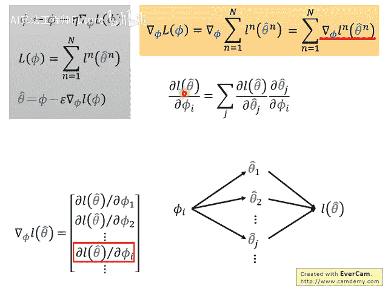

就是这个样子好，接下来呢就真的去算一下，这一项应该是长什么样子好。

这一项应该长什么样子呢，前面这一项没有问题。

赛达黑对LOC达黑的偏微分，赛达黑的里面的某一个参数，对LOCAH的偏微分没有问题，这个就得配上你的L长什么样子吗，你怎么比如他是cos entropy还是呃regression。

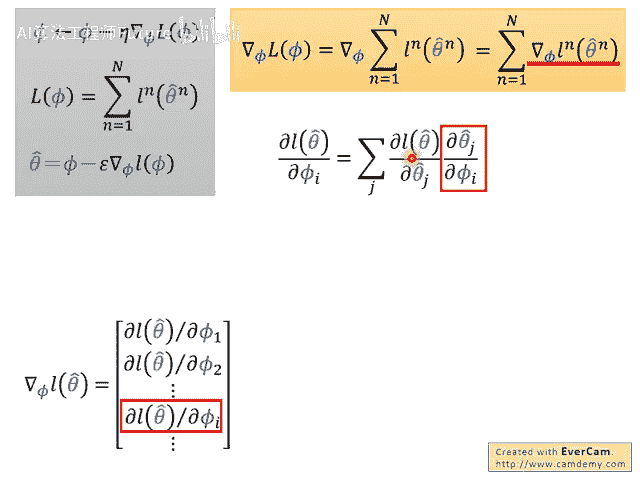

就DEPON你的L长什么样子，第一其实也depend on，你的去testing的资料长什么样子，对不对好，根据你的需测试资料，就你可可以算出呃。

这个sa head的DJ的参数对l of sea head的片尾分好。

那我们真的需要算一下的是，这个发一个第I个参数，对set来head dj的参数做偏微分以后的结果。

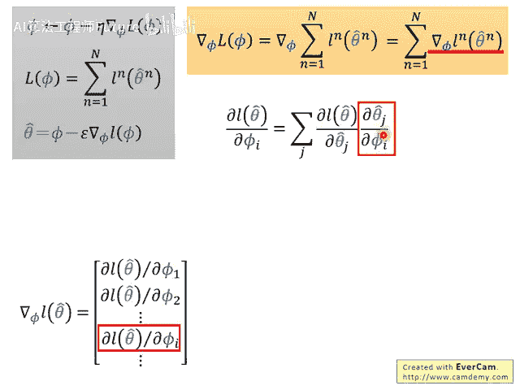

那这个就可以分成两个case来考虑，我们先把这个式子呢先只考虑其中一维就好。

就这个SAH是一个向量。

B是一个向量，这个归点是一个向量，先是把向量减向量会得到向量。

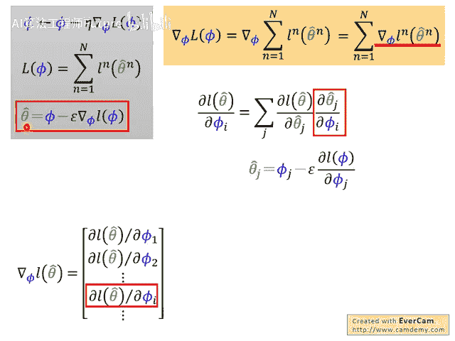

我们这边取那个向量的DJ围出来看，如果取那个向量DJ为出来看。

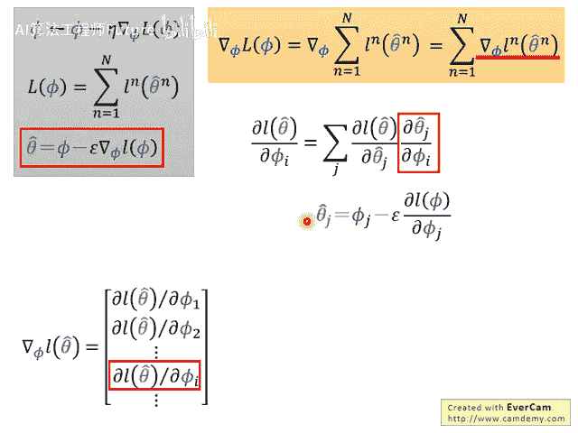

就是set a head dj为等于发音，就以初始化参数发音的DJ为减掉S系统。

S系统其实也是一个learning ray啊，其实在这个beta learning里面你会有两个learning rate。

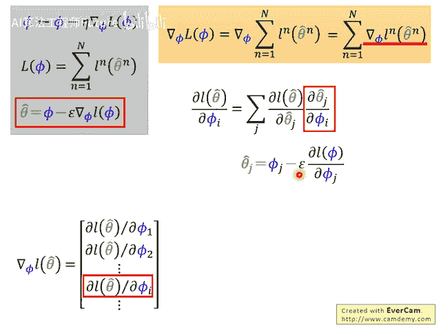

一个是每一个参数在训练的时候自己的learning rate。

另外一个是你在训练初始化参数的learning rate。

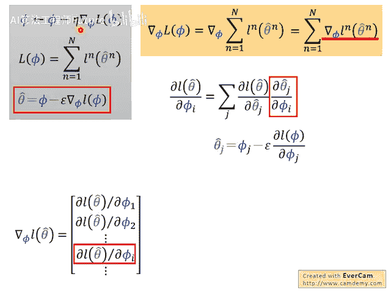

这两个learning rate当然不需要是一样的，没有什么理由是一样的。

然后也其实也是需要调的，这样子好好，这个社达sa head dj的参数等于find的DJ个参数减掉。

learning rate乘上这个SAZ1对L轴呃。

这不是C啊，ZYZ对L和Y的偏微分的结果好。

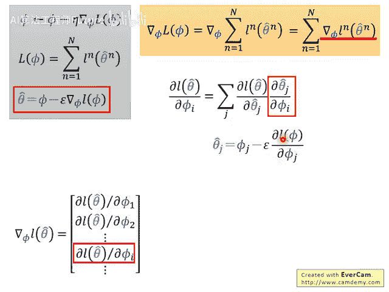

如果今天I不等于Z的时候。

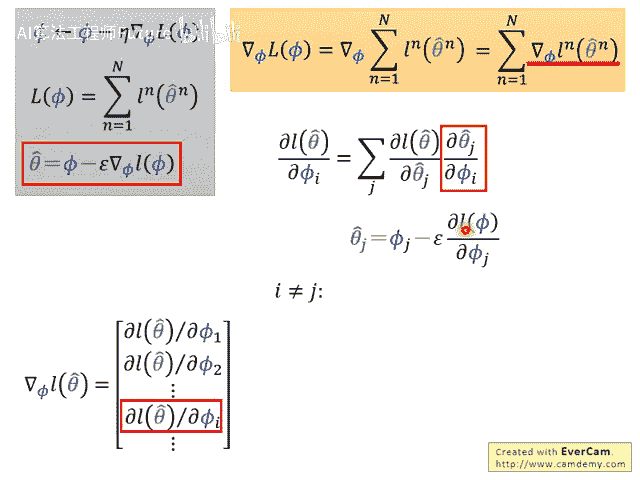

会发生什么事呢，如果I不等于J，那你拿bi去对这个式子做偏微分。

会发生什么事呢，第一项就直接消失掉了。

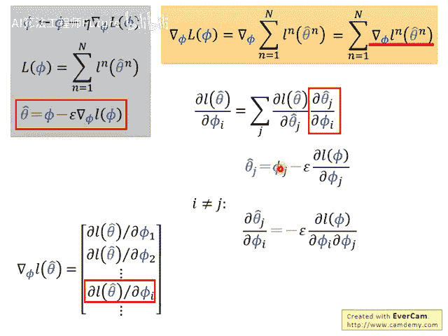

对不对，然后by i对FJ做偏微分，那翻译Z跟FY没有什么关系。

所以它就消失掉了，只剩下后面这一项，后面这一项变成你把本来的这个by这一对。

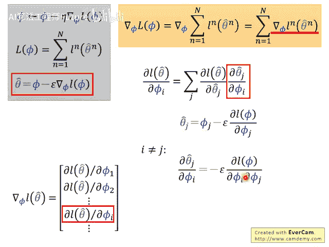

l to find的偏微分，再加上FI的偏微分好。

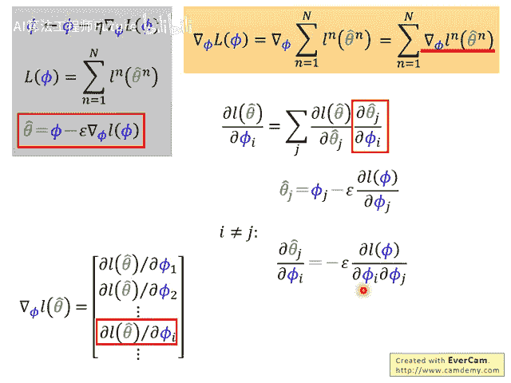

那如果是I等于J呢，如果是I等于J的话。

那前面呢就多了一项一啊，因为如果发的如果I等于J的话。

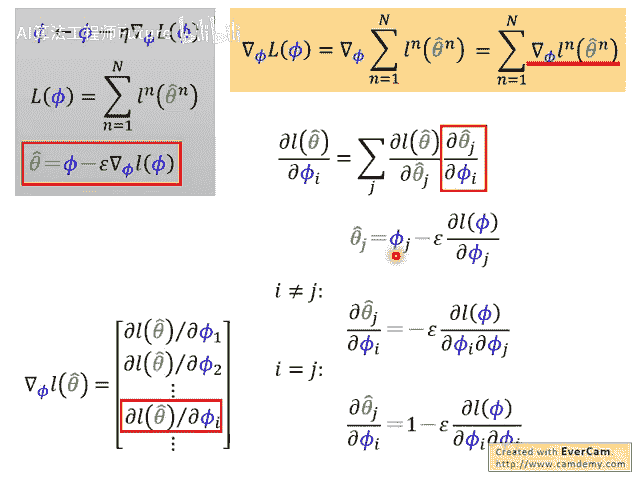

by j对方Z做偏微分等于一哦，所以前面的又多了一项好。

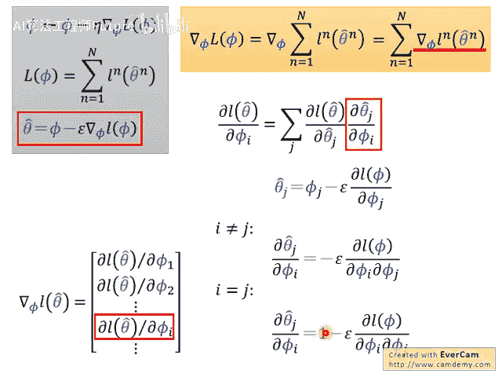

那你就把这些东西通通都带进去，你就可以把这个微分的值算出来。

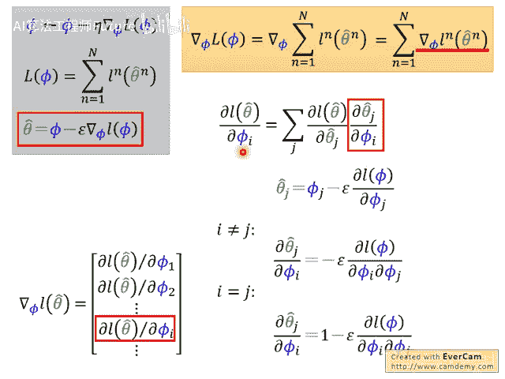

你就可以做NNMM但在MN。

但是这样显然是你还要做做二次回本，显然是很花时间的，所以在MML的原始paper里面。

他提出来一个想法，就是可不可以不要算二次微分。

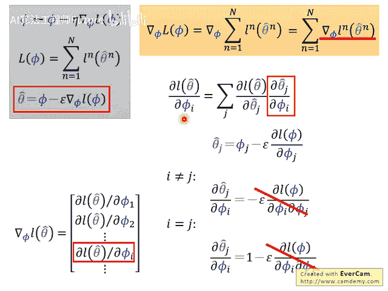

就假装没看到那个二次微分的像像，如果没有看到那二次微分项。

你就会发现说这个式子变得非常的简单，当I不等于J的时候。

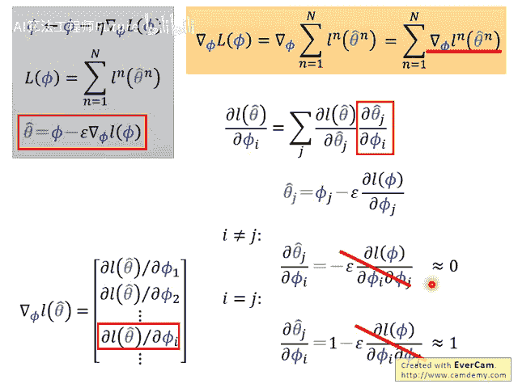

这一项就是零，I等于Z的时候，这一项就是一，那这样会得到什么结果。

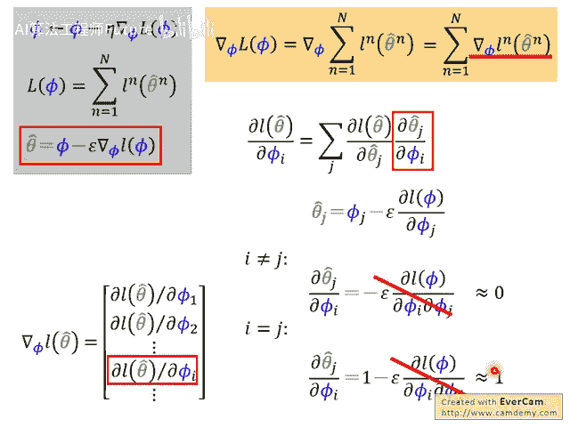

这样就会得到说我们在做SUMMENSION的时候，我们不需要对所有的J做some mention。

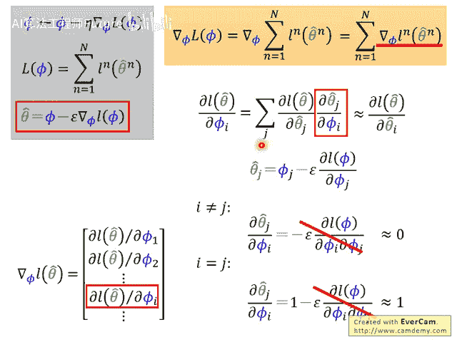

我们只需要考虑I等于J1带项就好，因为当I不等于J的时候，红框框里面那一项一定会是零。

I不等于Z的时候，红框框里面那一项假装是零，所以我们只需要考虑I等于J的K。

所以算出来，我们就可以得到这一个approximation的式子，我们就可以说VI对L到SAH的偏微分。

可以用say a h对l to say a h的偏微分来解释。

所以在paper里面呢他是微言大义。

他就提了一句，说他用了first order的APACIATION。

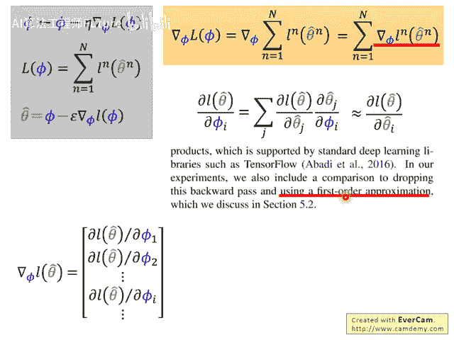

刚开始有解释说这句话是什么意思，但是根据后人的推测。

其实就是这个意思啦，哎好。

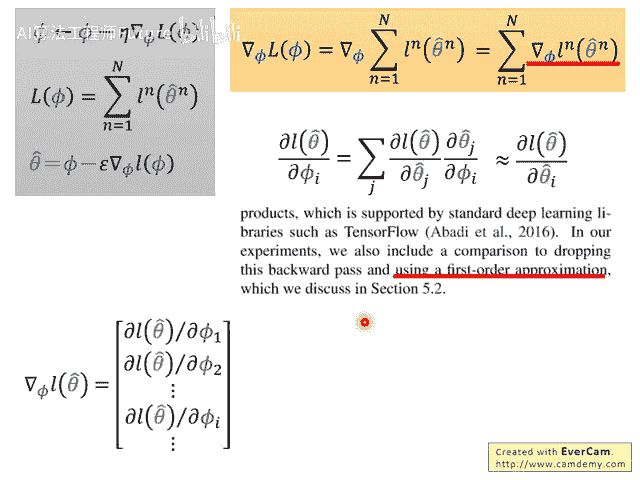

那我们现在已经知道说，这边的每一项都可以做APPROSSI。

本来我们是算five对L的塞拉黑的偏微分，现在可以改成SAH对l of sea head的偏微分。

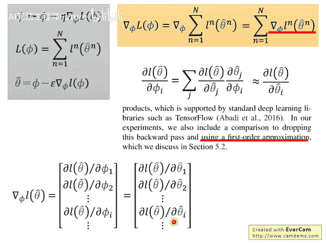

所以在上面这个式子里面的方呀。

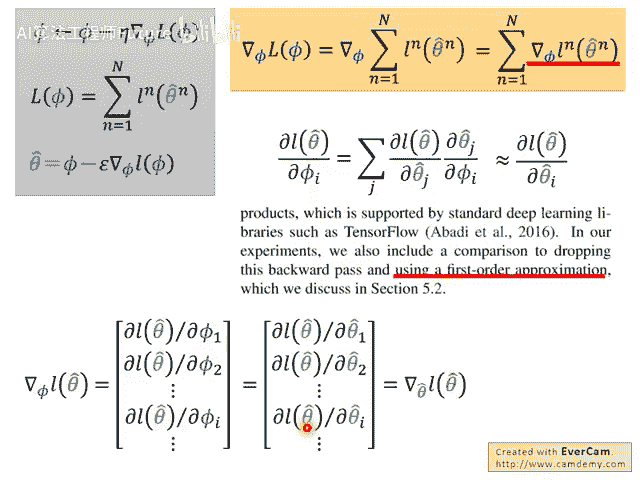

我们就可以把它用SAK取代表。

我就会把用C把A取代掉，那么实际上在运算的时候。

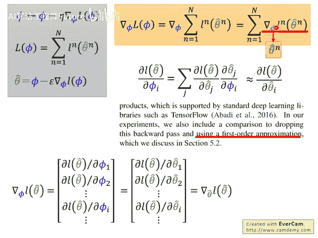

你就不是拿by对LOC来可以做偏微分，这项运算起来有点麻烦，你其实是拿set a head去对L的set a head，直接做偏微分，那这个运算起来就简单很多，那如果这边讲的你都没有听懂的话。

