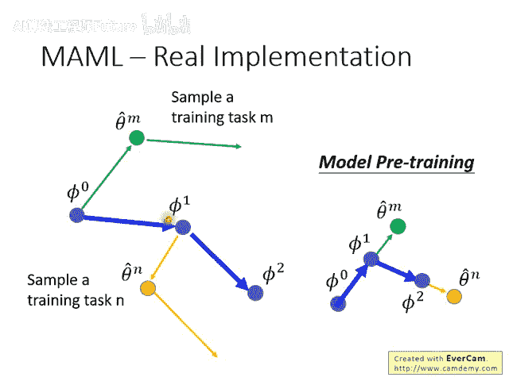
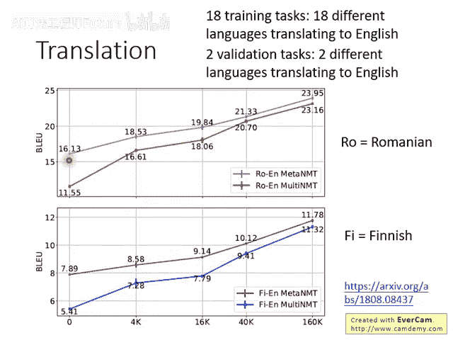

# 【官授搬运】2026年全新优化版李宏毅机器学习系统课程，这才是真正的初学者体系课程！—人工智能／深度学习／神经网络 - P101：11-Meta Learning – MAML (8-9) - AI算法工程师Future - BV1ruqABeEFX

算了，那我来告诉你MMML实际上是怎么implement的，就很简单，实际上是怎么implement呢，它Impact方法就是这样，你的five还是有一个初始值的，你的初始参数FI。

有一个初始值的初始值叫做Y0好，那这个发音在作为劝在你啊，那接下来你要劝认这个by音零嘛，那现在每一个任务就是一笔训练资料，那么说我们一般在做训练的时候，你还是会选mini batch嘛，对不对。

那所以你在做NNNL的时候，你也可以simple一个batch的训练task出来，当时你有一个呃task batch，然后来update你的参数，不过我们这边就假设你做的是stochastic。

Gradient descense，所以你一次只sample一个training task出来，做考虑啊，你simple一个task出来，我们现在sample出来的是test and好。

那用这个test n呢去做训练，那在NANLL里面，我们只update一次参数，对现在初始参数是by10，update一次以后变成sa had an好，那现在啊我们再计算一下。

C达HM对它的loss function的偏微分，也就是说我们虽然只要update一次参数，就可以得到最终最好的model，但我们现在故意update两次参数，那Upset出来的第二次参数拿来做什么呢。

这个第二次参数拿来更新finding，所以810怎么变成by one，它的移动的方向就跟第二步的这个gradient，算出来的方向是一样的，那可能大小不一样，因为你learning rap不太一样嘛。

但是他们的方向是一样的，来在simple出task n，然后task n呢update一次参数以后会得到SAHN，在这边呢我们要update第二次参数，然后把第二次参数，第二次参数算出来的。

这个叫你update参数的方向拿去update phone，然后变成fine two，那实际上变成L你可以这样implement就好好在，从这边呢我们还可以再比较一下。

它跟model pretraining有什么样不一样的地方，那刚才我们就精神上讲一下，MMM跟model pretrading不一样的地方，接下来这边讲一下实作上有什么不同啊，那时作上的不同。

就是如果你用model pretraining的方法，来update你的初始的参数，那你是这样，你那个翻零，然后呢你计算一下，把test n拿出来计算一下，关于零对task n的偏微分。

看起来是走这个方向，你就往这个方向走一下，然后呢接下来再sample另外一个task，然后呢，你就循着这个by one，对另外一个task的这个的gradient的值呢，呃再走一下就是这个样子。

所以你会发现说NAM有跟model pretraining，有不一样的地方，Model pretraining，是看看我现在翻译算出来的规定是怎样，我现在翻译在每一个test上算出来规定是怎样。

就往那个方向移动，而NML它是先走两步gradient，他拿第二步的GRADI来update你的初始化的参数好，那奖励大家有问题要问吗。

好没有话，我们就就继续啊，刚才讲在讲这个MANL的时候呢，都把它用在一些好像没有很实际的task上面，那NANL能不能用在实践test上面呢，我在文献上也是有找到一些例子的，虽然说没有很多。

那这边有一个例子，就是把NML用在machine translation上面，用在机器自动翻译上面好，那他的训练资料呢有18个训练的任务，对英文的翻译，比如说啊中文对英文的翻译是一个任务。

德文对英文翻译是一个任务，霸文对英文的翻译是一个任务，而收集了18种不同语言对英文的翻译，这有18种不同的任务，他也准备了两个validation的任务啊，就有两个不同的语言转成翻译成英文。

当当做两个不同的RELIDATION任务，但也要准备一些测试的任务好，那以下就是一些实验的结果了，那其实ROMANIA呢其实是在那个validation test里面。

所以这个ROMANIA转英文的这个翻译的任务，算是validation的任务，那finish呢是在testing set里面，没有在训练，没有在这个validation资料里面啊。

所以说啊这个finish是测试任务上面的结果好，那在这个图上呢，这个横轴代表说现在每一个test用的训练资料量，当然很直觉的，每一个任务的训练资料量越多，结果当然会是越好的好，那上面的这个紫色的线呢。

上面这一条线，上面这条线，这个meta n n t就是用NAML跑出来的结果，那MORTNNT的下面这条线，下面这条线MORTNNT都是做model contraining的结果。

那你会发现说在所有的case上面，这个呃AML的performance，都是比model pretraining的performance还要好，的来发现说，尤其当资料少的时候。

这个时候meta learning特别能够显示出。

