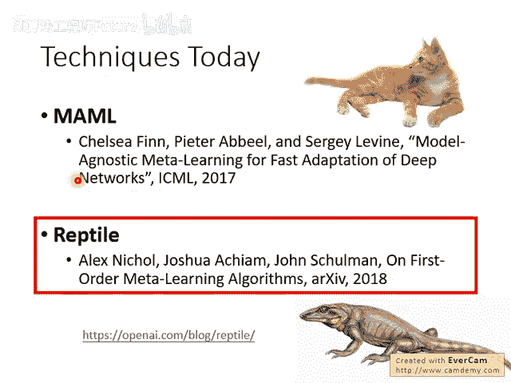
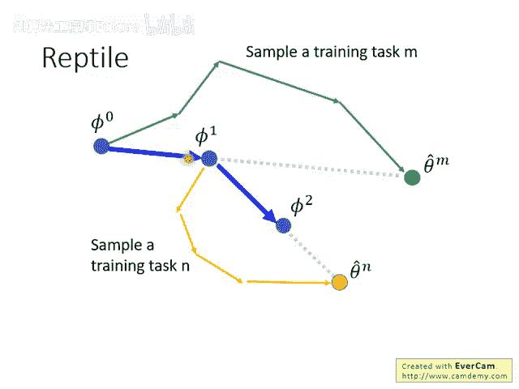
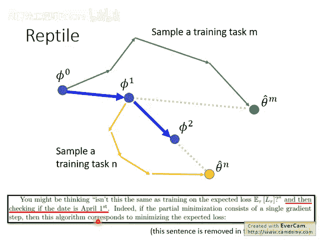
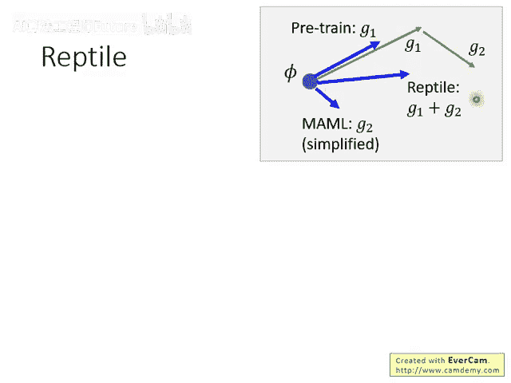
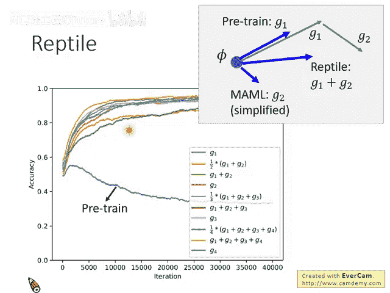
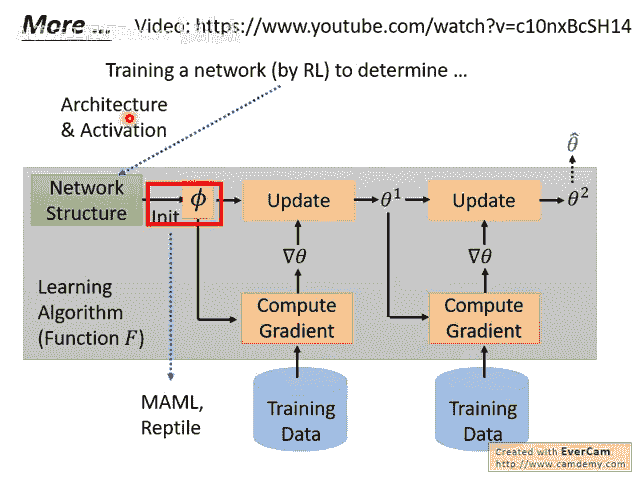
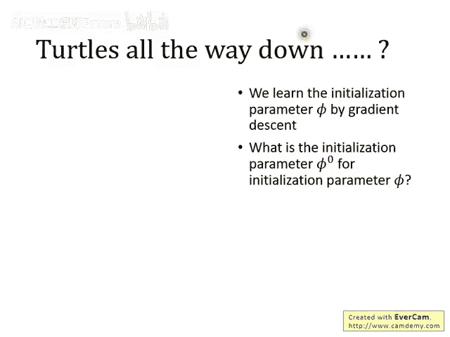
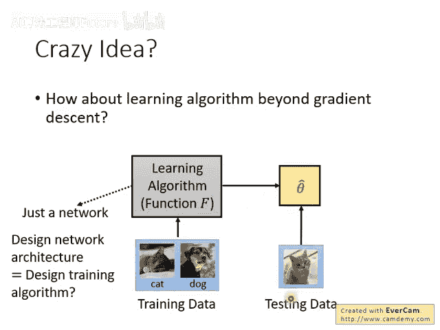
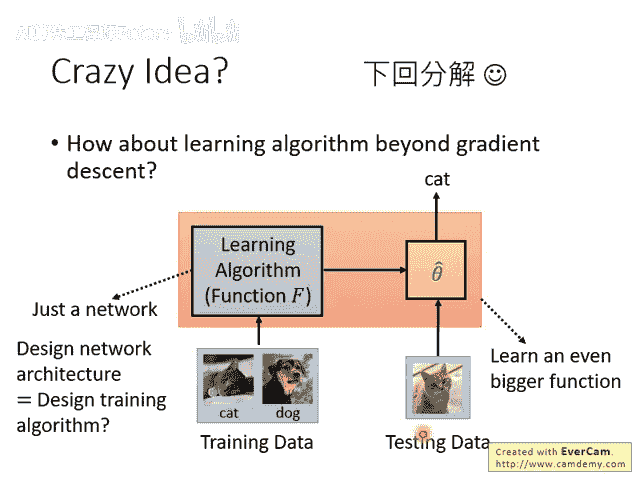

# 【官授搬运】2026年全新优化版李宏毅机器学习系统课程，这才是真正的初学者体系课程！—人工智能／深度学习／神经网络 - P102：12-Meta Learning – MAML (9-9) - AI算法工程师Future - BV1ruqABeEFX

好那接下来呢就讲第二个方法就是reptile，reptile呢非常简单。

它比NANL更简单，还有多简单呢，reptile想法是这样呃，这是你的初始参数的初始参数也就是finally好，那我们现在呢先simple一个task，第N个task。

然后用finding呢来训练第二个test retile没有限制，说你只能够update一次参数，你可以update很多次参数，了解多次参数好，最后找出了SAK好。

接下来呢你就看by0跟sa head中间的差距，有翻译，零要挪动到sa head的时候，要走哪一个方向，就往那个方向走过去，就是by one啊，得到by one以后，你再sample一个task出来。

现在simple是task n，然后再再把by one当做初始参数去train一下，test n训练一下，训练一下，训练一下哦，得到sa n head好。

接下来再看five one跟塞拉n head之间的差距，看final要怎么走到塞达恩hand，走这个方向就可以走到塞拉亨head对，就往这个方向走，得到by two，这个就是reptile。

感觉非常的简单，那假如同学你可能想说，这个跟model pretraining好像也蛮像的啊，如果说model pretraining，就是要找一个可以让每一个task都最好的的，的的初始化参数嘛。

他没有考虑到训练以后会不会好，他就是要让每一个test都最好，但reptile做的事情好像也跟model pretraining蛮像的。

那reptile作者自己也知道这件事，所以他在他paper里面呢加了这句话，他说you might be thinking is enlist the same。

as training on the expected loss啊，这句话意思就是说这不是跟PRETRAINING一样吗，那下面加一句还蛮有趣的话。

他说and then checking if the day is april first，他非本没真的，我写这句哎，然后但是有趣的就是说，他第一个放到IPAD的版本有这句，但后来的版本就把这句拿掉了。

这到底为什么呢，我在想说，会不会是因为第一个放RKB版本，是在3月的时候放上去的，可能是接近3月底的时候放上去的，他希望你看到这篇文章都正好是4月1号，读到这句话都会觉得非常的应景，这样子。

他真的是真的有这样哎好。

那到底reptile跟PRETRAINING，还有NAML有什么不同呢，我们就用这个图来展示他们的不同，好这个是你的初始化参数F，那现在假设这个初始化参数在某一个task上面，训练，情形是这样。

第一次update的时候走的是g one，第二次update的时候走的是几句，那如果是PRETRAINING的话，你的参数update的方向就是g one，如果是NANL的话。

就是有做first order approximation的那个ANN，and就是简化过的，ANNNAL话，他走的方向就是G2，如果是reptile的话。

他走的方向就是g one跟g g g one加G2，所以发现说reptile有点像是把PRETRAINING，跟NAN综合起来，但是reptile并没有限制说你只能够走两步，所以如果你走更多步的话。

那也许可以考虑到原来呃，PRETRAINING跟NN都没有办法考虑到的东西好。

那以下是这个reptile，在欧EQU上面的实验结果了，那纵轴的值越高，当然就代表说结果越好，那其实从这个图上，我们有点难看出NANL跟reptile的差别，但是我们可以很明显的看到什么呢。

我们可以很明显看到说蓝色这条线特别惨，蓝色这条线是什么，蓝色这条线就是用g one去update参数，然后g one去update参数，也就是model retraining。

一般说retraining跟meta learning比起来，他的performance确实是有一段差距的好。

那刚才呢我们讲NN或reptile，他们都只帮我们找出了network的初始的参数，那能不能找更多呢，其实是可以的，有一整个系列的方法试着去找。

比如说network架构或者是找network activation function，就你任意一个function这一个任任一个network。

这个network会输出另外一个network的architecture。

或者是另外一个network activation，或者是有人可以输出如何update参数的规则，怎么做，怎么调整learning rate的规则，比如说可以自动输出EDEN啊什么之类的，这样才对真的。

然后像因为这些如果你用network来生network，那显然没有办法微分嘛，所以这个时候你就必须要用RL，或者是基因点算法来劝那个深network network哦，那这边呃相关的东西。

其实我在过去的课堂上其实讲过了，那我就把录影留在这边呢，给给大家参考，那一些新的我们之前没有讲过的东西呢，我就下周上课的时候，我们再另外讲好，那这个meta learning的方法。

我觉得都有一个本质上的问题，就是举例来说，NANL帮我们训练了初始化的参数，但它本身也需要初始化的参数，所以我们会需要找一个初始化的参数，的初始化参数，这就感觉好像是有人问说世界从哪里来。

就是有人那有印度神话就说啊，世界呢是在乌龟的背上，那乌龟在什么东西的背上呢，在更大的乌龟的背上，更大乌龟什么东西的背上，在更大的乌龟的背上就穷就穷，穷无尽，永远没有止境一样。

所以我变成我们从learning变到learn to learn，那未来我们要learn to learn to learn，那其实最后呢就有一个亏Y的想法，我们刚才讲的NAL那些方法。

他们的演算法基本上都还是gradient desp，你能不能做比gradient design更厉害的做法呢，你能不能够说我的learning alism就是一个network，我也不管这个内。

我也不管他做的是不是gradient design，不重要，我就是把一笔训练资料，一堆训练资料丢到network里面，他熬不出来就直接给我，我们现在要训练的那个model的参数。

那是不是归间去design训练赛不重要，我抵在了一个network的架构，那network架构我怎么抵债，就决定了我的演算法长什么样，甚至还可以做更疯狂的，那反正你这个SA嘿之后。

你也是要拿它来测试一下你的测试资料。

看看结果怎么样，我们能不能够认一个更大的function，它把训练和测试这两件事情都包在里面，这个方程就是吃训练资料跟测试资料，然后直接output测试资料的结果。

你连你的model训练出来长什么样子统统都不知道，因为连测试都顺便帮你做好了，有没有可能做到这样的事情，那这个我们就留待下周讲啊，今天上课呢就上到这边，那我们就休息几分钟。

