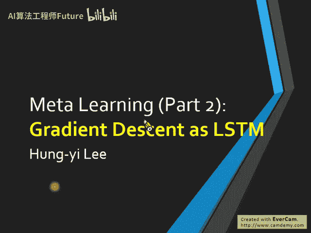
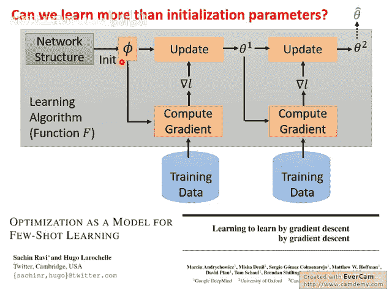
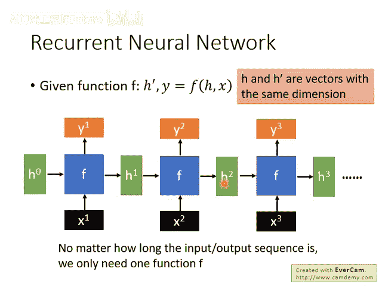
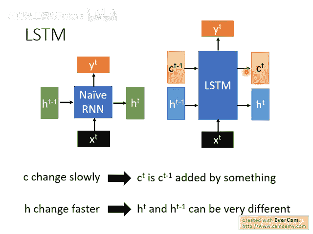
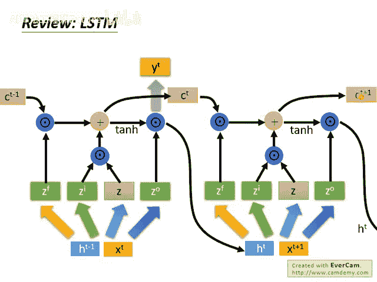

# 【官授搬运】2026年全新优化版李宏毅机器学习系统课程，这才是真正的初学者体系课程！—人工智能／深度学习／神经网络 - P103：13-Meta Learning - Gradient Descent as LSTM (1-3) - AI算法工程师Future - BV1ruqABeEFX

就像上一期的时期有数点四零，好好各位同学，大家早啊，我们开始上课吧，好那今天我们要继续讲那个meta learning，好，那上周呢我们讲了memo跟reptile，那今天呢我们要讲说怎么把。

就我们之前有讲说meta learning，就是要让machine自己认出一个大额，这个大F这个方向，自己认出一个learning algorithm，那今天我们要讲说怎么把我们熟悉的learning。

Algorithm，也就是gradient descent当做一个LSTN来看待，然后你直接把这个l s t n train下去，你就劝出了gradient descent这样的album好。

那我们上周讲说，这个是我们熟知的gradient descent，那个ALISM，那我们上周讲说这个algorithm里面，我们可以试有一些东西，我们可以试着让我们去用meta learning的方法。

把它认出来，举例来说，我们上周讲说我们可以认这个initial，以这个initialization的参数，我们可以用metal或者是reptile这个技术来learn。

这个initialization的参数，翻译好，那今天呢我们要更进一步讲说。

真实上面这个架构啊，你可以把它当做是一个RNN来看，怎么说呢，如果你现在就呃很快的看，你就这个图啊，你大概描绘一下，你会觉得其实它跟RNN有一些，非常类似的地方。

你看每一个这个parameter的update的step，就是RN里面的一个tie st，俺每个time step不是都会input个东西吗，啊大家在做作业五的时候，阿，N每次不是都会吃一个中文的字。

或者是中文的词进来吗，那其实这个灰色的方块也是一样的，它在每一个time set都会吃一个batch的data进来，算贵一点，然后我们说RN里面有memory，这个memory呢。

每每这资讯机器那个network，会把过去的失去存在memory里面，好让下一个PES在使用，而在这个灰色的方块里面，在这个灰色的aversion里面，你可以把你的参数就看作是RNN的memory。

你在前一个time sp计算出来的参数，会在下一个time set被拿来继续做运算，就跟RNN把资讯存在memory里面，再下一个time set，再把它拿出来继续做运算的道理是一样的好。

那今天呢等一下要讲的这方面的技术，就是把整个呃grade design，learning alison当做LSPN来看待的，技术呢主要是出自两篇paper。

一篇是optimization as a model和q shot learning，那另外一篇呢他这个题目很有趣，所以我们就特别把它的题目列出来。

另外一篇是learning to learn by gradient，Descent，By gradient descent，这样才他这个题目没有打错，他题目真的就是这个样子，这个题目是什么意思呢。

这个题目的意思是说，我们一般都是learn by gradient descent，那现在我们要learn to learn by gradient descent，这件事。

但我们怎么learning to learn by gradient descent，这件事呢就是by gradient descent，这样子哎可以看他题目真的是这个样子的好。

那这边先非常简短的为大家复习一下RN，那我那我们上课的录音里面，其实有RN的段落啦，所以假设你对RN其实也是也已经非常熟悉了，那这边非常非常快的再帮大家复习一下，那这边的讲法呢。

跟录音里面的讲法呢是有一点点差别的，但是讲的是同样一件事情，只是从略略为不同的观点来看待，同样一件事情而已好，那什么是RN呢，RN就是我们有一个function f。

这个function f呢它吃H跟X作为input，它会output h pine跟Y好，我们一个方向来，那每一个time style呢会有一个X当做input，那如果在我们的作业里面。

那个X呢就是比如说一个词汇，一个中文里面的字或一个中文里面的词好，那我们这个F呢把一个词汇呢吃进去以后，那我们还有一个引这个初始的memory的值，那我们这边呢写作HD。

那这个初始值有时候是人手直接设的，有时候可以直接把它当做network参数，直接把他认出来，而这个F呢是x1跟H0，然后呢就output h y跟YY好，接下来呢还会有同样一个F。

它会把h one跟下一个time set输入h two吃进去，然后呢他就会output h two和YU啊，当然今今天呢这个F输入的H0和H1，他们的dimension必须要是一样的，为什么。

因为我们是把同一个方向F反复的做使用，所以H0和h one dimension一定要是一样，这样同的F才能再把h one吃进去，吐出h two啊，那你就反复这个花式，反复这个花on，那RN厉害的地方。

就是因为他都只有用，不断的以一个F来处理所有各种不同的input，所以不管你input再怎么长，你都是用同一个F来处理你input再怎么长，你的参数量都不会增加啊，这个就是RN厉害的地方。

所以他特别擅长处理input，是一个sequence的状态好。

那我们都知道说今天啊你一般用的不是RN，而是RN的一个变形，或多数时候今天大家说我们在用RN的时候，其实指的就是用LSDN好，那一般的L那LYCN有什么特别的地方呢，我们刚才讲说。

RN就是会吃一个XC的H当做input，然后吐出一个H，吐出一个YLS特别LSTN特别的地方，就是他把这个HR拆解成两部分，你可以想象说他本来是input vector，Output a vector。

LSTN也是input vector，Output vector，只是我们把这个vector拆解成两部分，一部分我们仍然叫做H，另外一部分我们叫做C，那这跟那个录影的讲法略有不同。

但是我等一下就会告诉你说，额，虽然这个投影片看起来跟原录影里面讲的，L线有一点点不一样，但是在下一页就会告诉你说，其实是同一件事情哦，那这LSTN呢它有两个input c跟H。

它有两个output c跟H，那为什么要这样做这样的分别呢，因为这个C跟H啊，他们扮演了不同的角色，如果我们看CT减一跟CT的变化，l SPN input c跟output c的变化。

你会发现说这个input c跟output的C，他们的变化呢是非常小的，通常你就是把某一个向量加到c ct减一上面，就得到ct，那这边所谓的ct就是LSTM里面，那个memory cell所储存的值。

那你会发现HT减一跟HT，他们会有很大的差别，CONSTN相较于原来的RNT最简单昂，那个不同的地方，就是因为ct减一跟ct非常的像，它不会有太大的改变，所以LSTN它可以储存比较长时间的资讯。

因为个资讯在很久远的时候被放到C里面，被存在C里面可能过了很多个time step以后，因为C不会有太大的改变，所以那个资讯仍然是存在的，这就LS店特别的地方。

那接下来呢我们就来看一下LSTN的式子，我们刚才说呢LTN就是input x，Input h，Input c，我们这边呢在刚才图里面，是把C跟H放在一起了，那我们这边是把C跟H呢分开来放啊。

接下来就会出现我们在这个之前的上课录影，看过的图啊，我们先把H跟X呢接在一起，乘上一个transformation的math w，通过一些tivation function得到Z得到ZZ是一个向量。

Z是一个向量好，然后呢我们把S跟H还是一样接在一起，再乘上另外一个transformation的metric，再乘上另外一个metric，然后呢取个这个activation function。

比如说做SIGMOD啊，这个sigma代表SIGMOID得到一个vector呢叫做ZI，这个ZI呢就是input gate，就是你的这个LISTN里面的所有的cell的，Input gate。

靠control那个input gate值的的的集合，那么合起来呢是一个vector啊，这个呢就是ZI啊，就是ZI好，那同样的事情呢，你就把这个S跟H再乘上另外一个matrix。

然后你会得到forget gay的值，你control呃，这个cell的forget gate的讯号的集合，它也是一个向量啊，然后呢你还会有一个update的值啊，就是EO哦。

所以你根据X跟h concatenate起来，把X跟H接起来，会算出ZZI这是input gate，这个是ZF是否跟gay zo是OBLIGAY好，那接下来呢你把这个Z跟ZI呢把它乘起来啊，把它做点乘。

animal wise的相乘，也就是说Z跟ZI它们都是向量啊，你把它们同样维度的部分呢把它乘起来，而它们做点乘，然后呢你把cf跟ct减一做点乘，这个ZI的是input gain。

而这个input gain呢，要决定这个Z呢能不能够通过input gain，来做接下来的运算，决定说现在这个CT减一啊，这个来自于前一个ti set的ct减一，我们要继续使用它，还是把它遗忘好。

那我们把Z乘跟ZI做点乘，把ZF跟CT减一做点乘以后，接下来就是把它加起来，这个就得到了下一个时间点的ct，得到下一个时间点ct好，然后呢，呃这边呢你会把ct呢，再通过一个海豚巴黎tension。

然后呢跟output gate做点乘得到H，然后呢你还会把H呢乘上做一个transform，通过excavation function得到LSTN的输出Y好。

那这个呢就是一个LSTN在每某一个time set，它的运作的信息，但同样的operation是反复继续下去的啊，所以哦我们有一个H，然后呢有一个HT，有新的ST加一进来，有新的S进来。

然后就做反复的运算，用同样的参数去算出z input gay for gay，gay跟output gay的值，然后再做一模一样的运算，把Z跟input gay做点乘，把ct跟PGG做点成，把它加起来。

再突出ct加一，然后这个步骤呢就反复的进行下去，这个就是大家都熟悉的LSPN好，讲了这么多。

