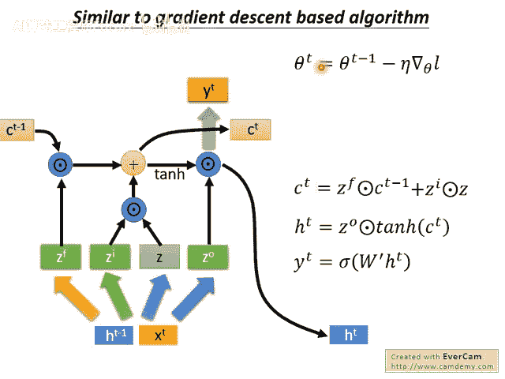
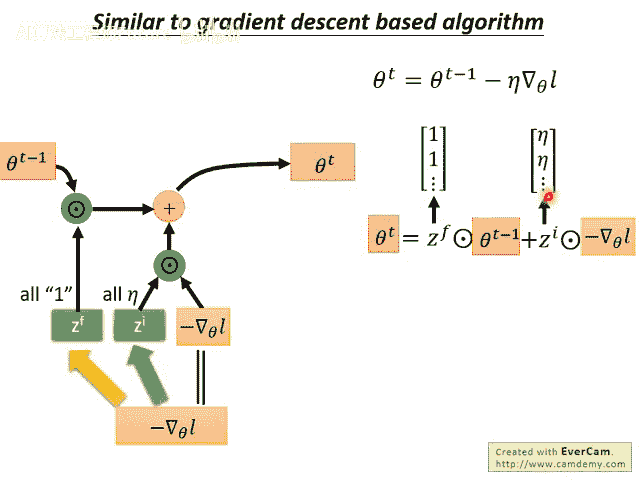
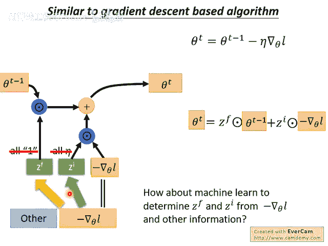
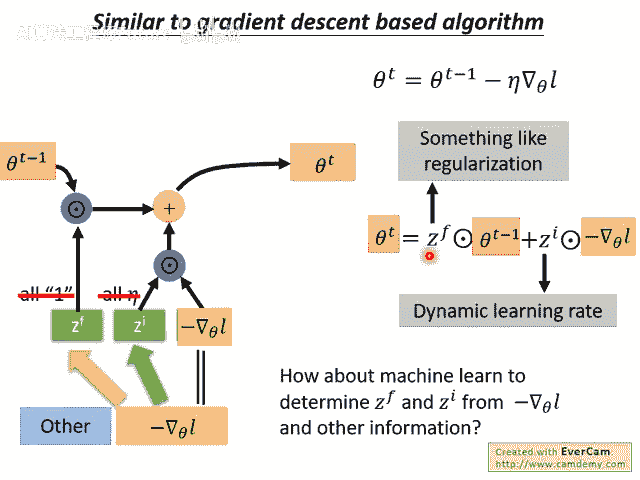
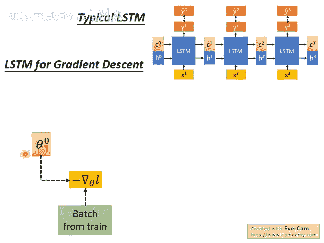
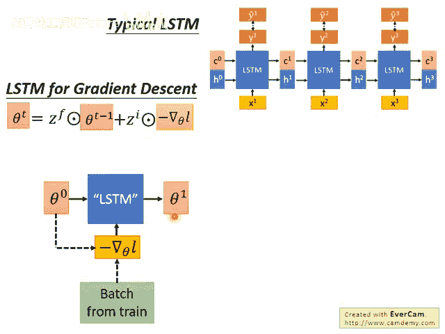
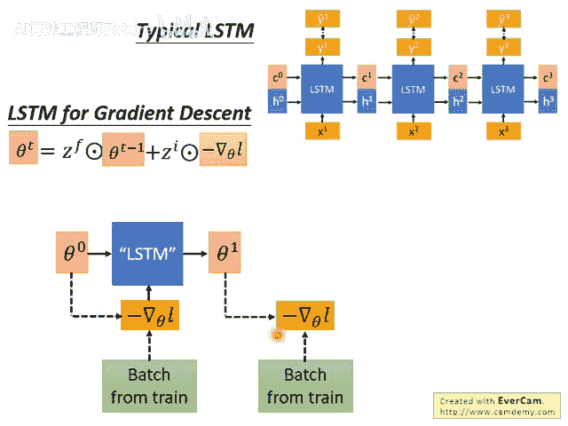
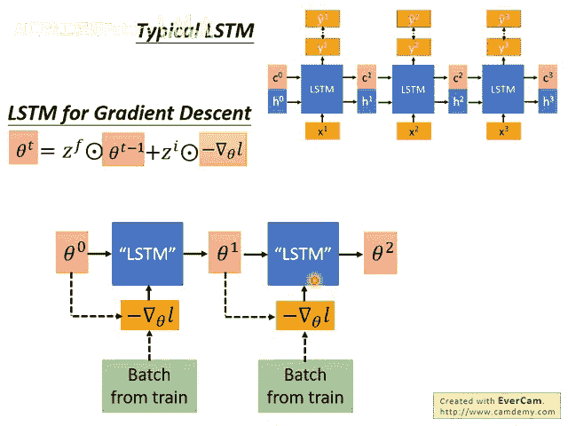
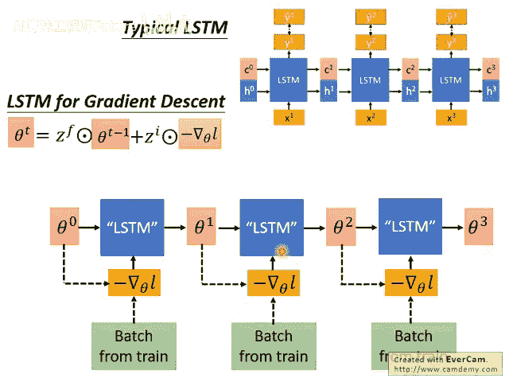

# 【官授搬运】2026年全新优化版李宏毅机器学习系统课程，这才是真正的初学者体系课程！—人工智能／深度学习／神经网络 - P104：14-Meta Learning - Gradient Descent as LSTM (2-3) - AI算法工程师Future - BV1ruqABeEFX

这边是ls s店的式子，我们把gradient descent的式子列出来，Gradient descent，我们知道在gradient descent里面，每一个time set。

你做的事情就是把你的原来的参数，theta t加T减一，减掉你的这个呃gradient乘上一个learning rate，然后得到新的参数C答题，那如果你比较这个式子跟这个式子的话。

你会发现说他们有一些相似的地方，什么样相似的地方呢，你看这个式子右边有ct减一，左边有ct，它的右边有c ta t减一，左边有CAT。

那我们何故就把CT减一当做sea来看呢，把c ct减一当做sea来看，所以我们现在把LSTM里面存在memory cell里面的值，那个C那些那个ct减1c ct。

我们就把它当做是一个network参数来看待，假设一个network参数里面有1万个，那你就是有1万个cell，他们里面存了1万个1万个valuable。

你有一个有1万个cell的LTN里面存了1万个value，好，我们现在把LSN的sc ct减一，ct跟T减一，换成CAT跟CAT减一，然后接下来呢，怎么让下面这个式子变得，跟上面这个式子一样呢。

你可以说那我现在的input，本来input有一个ST跟HT减一，hp减一是来自于它三个time st，STE是外界的input，比如说在我们的作业里面就是一个词汇。

那我们现在把ST跟HT点一换成gradient啊，换成呃gradient成三个符号，然后接下来我们说这个呃，假设从input到Z的这个transformation呢，它就是identity的magic。

它是identity的magic，所以Z呢我们就说它是negative的GRADI，好自己我们是法师，negative的GRADI好，它就永远都是一，然后ZI呢它通通都是西格玛哦。

Z i input gate，本来每一个input game都不一样，它是一个vector，每个vector值都不一样，那我现在说他的这个这个这个vector里面。

每一个值都是learning rate at，那你会发现说下面这个式子跟上面这个式子，其实就是一模一样的，其实就是一模一样，所以你可以说grand design这件事，其实就是LSTN的一个简化版。

好像是简化版，在这个gradient design里面，我们其实也有input gate，也有FOGGAY，只是input gate跟fork gay的值，跟一般的l s st不一样。

一般l s t i input盖fork gay的值并不是人设的，它是机器自己学出来的，但在gradient descent里面，你的input get和forget gate的值是人设的。

那人的设法就是说啊，forgay gay永远都不可以忘记那input gay呃，要input的东西永远都乘上at就结束了，那这个以前的gradient design。

那现在能不能够就让他用learn的呢，让他用学的硬是把它学出来，能不能够做到这件事呢，那input的部分呢，我们刚才说input就假设只有gradient descent。

那在假设就只有这个gradient的值，那在实作上呢，你其实可以呃做更多其他的事情，你可以拿更多其他资讯当做input，比如说常见的做法，会把在现在这个time set c a t减一算出来的loss。

也当做CAT点算出来，loss也是一个值嘛，也是一个value，他也会把它当做输入来，control这个L线的input gate和pk gate的值好。

那如果我们可以自动的让机器去学input game，那意味着什么，意味着机器可以dynamic的决定learning rate，每一个dimension在每一个ties day。

它的learning rate都会不一样，而不是一个固定的数值，可以自动认ZFF有什么用呢，呃这个ZF啊，他做的事情是会把原来的参数缩小，对不对，他会把前一个time set算出来的参数进行缩小。

那其实你仔细想想看，在做REGRIZATION的时候，我们在上课录影也有讲过这件事，l two的REGALIZATION又叫做WEDECAY，为什么它又叫WEDECAY，因为你把它的微分的式子拿出来看。

你把update参数的式子拿出来看，会发现说每一个time set，他都会把原来的参数稍微变小，乘上一个decay的位，像是WEDECADE一样的角色，呃但是我们今天不是直接设定。

告诉机器说要做多少的web配，而是让机器自动的学出来，他今天要做多少的VK好，那讲到这边，大家有没有问题要问呢，好那我们就如果大家没有问题要问的话呢。

我们就继续好，那上面这个是一般的LSTA，那一般LT大家都很熟悉呃，input x output c跟H每个time st会output一个Y，那你要看Y呢跟你的标准答案有多项。

你可能会算一个cos entropy，然后希望每个time set output都跟标准答案y hand，越接近越好，这是一般的LC，那gradient descent的LSPN长什么样子呢，它长这样。

你的你一开始的时候，你要个初始化的参数在哪里好，有初始化参数再打零以后，接下来你sample一个batch的data，然后根据那个batch的data，你会算出gradient。

你会算出negative的gradient。

把这个negative的gradient，丢到一个LSTN里面去进行运算，那这个LOT的参数过去是人设好的，现在我们让它在meta learning的架构下，自动的被硬学出来。

对那他的这个update参数update式值呢就长成这个样子，这个BGGAY跟input gay的值以前是人社死的，现在的这个LSPN可以自动把他认出来，然后你就output了新的参数SLY。

然后set up one在做一样的事情。

你再去sample个bch data哈，现在又有一个新的input，不过这个input要注意下，这个input跟这个input它们是不一样的，对不对，每个time set。

每一次你update参数前你都会算个gradient，但每次因为你sample到的data不一样，你现在的参数数值已经不一样，所以你算出来的这gradient都会不一样，所以我这边用同样的符号来表示。

但每个test day input的gradient都是不一样的啊，然后呢再放到LSST里面，再根据forget gay跟input gay update参数。

得到set up to，然后这个process就反复继续下去，得到下一个time set的参数。

那假设你今天预设好说我们只做三次参数的update，但实际上你在圈一个model的时候往往是更多次啊，现在假设说我们只做三次参数的update，那接下来呢你就把最后你得到的参数theta3。

拿去你的testing data上算一下loss，那你这个loss最终算出来loss，就是我们要mini mize的目标，然后你就会去调这个LSN参数。

用gradient descent去调这个LSN参数，去mini买最终的输出，Loss of sea3，就这样，那这边有几个要注意的地方，你会发现说这个present decent的LTN。

跟一般的LSTN还是有一个很大的差别，怎么样很大的差别呢，在一般的LSDN里面，X跟C是independent的，是完全没有关系的，对不对，C是外界的输入，那个不是你的LSTN可以control的。

所以你的sea里，你的这个C里面，你的memory cell里面存了什么值，不会影响你在下一个时间点看到的输入，但是今天这个gradient decent的LS线不太一样。

因为你的SETA的值会影响你接下来算出的，GRA点的值，对不对，GRA点值的计算是跟你现在的参数是有关系的，所以我这边才会特别画了一个箭头，特别画了一个箭头。

你现在的参数会影响你未来看到的gradient，所以它跟一般的LD不一样，那如果你今天在做BPAGATION的时候，理论上你的这个error signal啊，除了走这条路回来以外，他还会走这一条路。

它还可以走这一条路，它还可以通过这个GRADI这个block从这边update参数，但是这样做会很麻烦，跟一般的LNCN就不太一样了，对不对，一般LTN这个X跟C是没有关系的。

不过这边的input跟你存在memory的值是有关系的，为了让它跟一般L线更像，那你根本就希望你少改一点cod，所以就把这个连接假设它不存在，就这样在文献上，到目前为止为止都是，就是假设这个额。

这个sea跟input的关系是不存在的，然后就直接把它当做一般的L线劝下去，硬劝下去就结束了，那另外在input的地方啊，我们知道说LSTN的，它这个memory里面的初始值。

是可以透过训练直接被认出来的，所以在这个LSN的架构下，它也可以做到跟memo一样的事情，它可以把初始的参数就把它们，可以把CA0也当做是参数。

