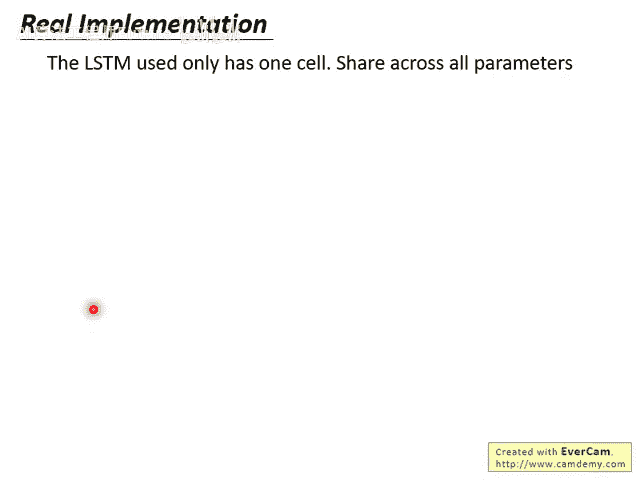
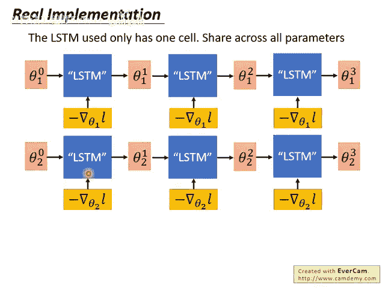
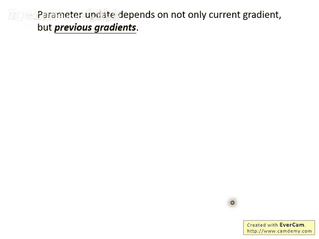
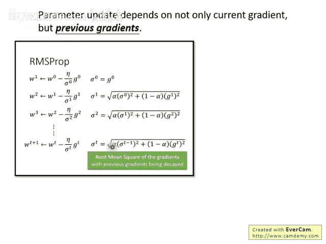
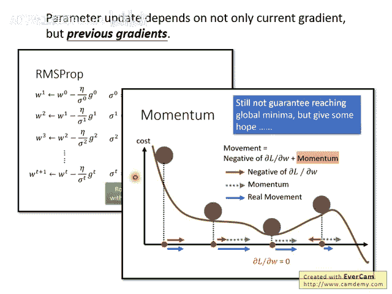
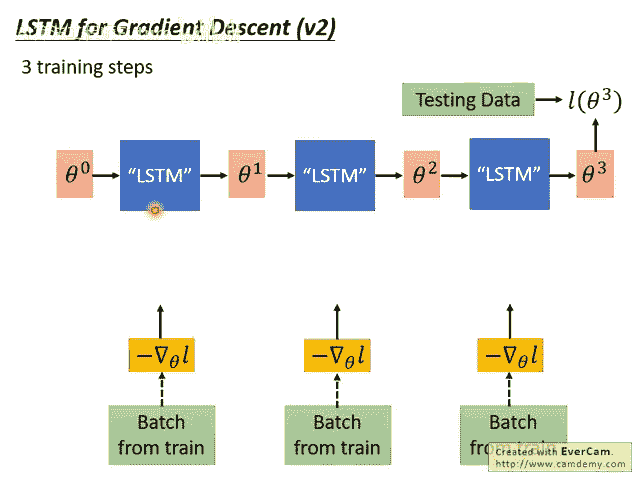
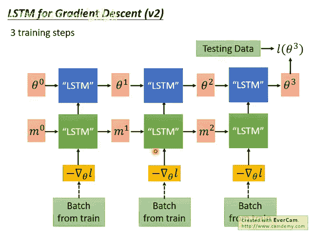
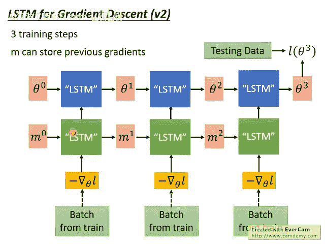

# 【官授搬运】2026年全新优化版李宏毅机器学习系统课程，这才是真正的初学者体系课程！—人工智能／深度学习／神经网络 - P105：15-Meta Learning - Gradient Descent as LSTM (3-3) - AI算法工程师Future - BV1ruqABeEFX

好那在实作上啊，假如这边有人可能会有个问题，我们说呃，LSDN里面的memory cell的值就是你的network参数，network的参数动辄10万百万。

你难道要开一个LST里面有10万百万个cell吗，你一般做LSN的时候，你有什么开个1024的sale，你就觉得很好，像劝很久了，有10万百万的sale，难道真的劝的起来吗，呃串不起来。

所以在实作上也不是这么做的，在实作上做了一个非常大的简化，这个非常大的简化是什么呢，这个非常大的简化是实际上在实做的时候，我们所认的LSPN其实都只有一个cl而已，它只处理一个参数。

然后所有的参数都共用同一个LTN，就算你有100万个参数。

也都用同一个LSTN来处理，也就是说现在你认好一个LSN以后。

他是直接被用在所有的参数下，虽然这个L线它一次只会处理一个参数，但是同样的L线被用在所有的参数上，那我这边用下标来代表，整个model里面的某一个参数，所以set tone用的参数。

它的处理方式跟set up to用的参数，它的处理方式是一样的，那总会说按照sa one跟sa two用的处理方式一样，会不会就算出一样的值呢，不会为什么，因为例如它们的初始的参数是不一样。

然后他们的这个gradient算出来也是不一样的，在初始参数跟规定不同的情况下，就算你LSDN的参数是一样的，也就是你update参数的规则是一样的，因而线参数是一样的，最终算出来也不会是一样哦。

所以这就是实作上，怎么真的使用这个l s e m gradient design。

真正的implementation的方法哦，那这么做有什么好处呢，第一个就像我刚才说的，你要吹一个NE，你要吹一个LCN里面有10万个CEL，这怎么可能当然是配excel，这是比较比较有可能的方法。

然后再来就是这样子的方法，其实也不会说非常的不合理，因为你仔细想想，一般我们人设计的灰dian descent的种种变形，比如说rms prop，比如说EDEN，你想想看那些方法哦。

那些方法其实也都是对，不同的参数apply同样的弱，对不对，我们并没有不同的参数，用不同的update弱，虽然说今天你在用rs pop或者是ADAM的时候，同样的参不同的参数在不同的时间点。

它的learning rate不一样，但是怎么决定那个learning rate的规则是一样的，你并不会不同的参数就给它不同的规则，所以你今天自己认的东西，你也是同样的参数给它同样的规则。

其实也是很合理的，跟原来一般人类的设计是一样的，然后再来就是这个这样子设计还有一个好处，就是我们之前讲memo的时候，我们说memo其实还是有限制。

就是你的training的test跟testing的test，它的model的architecture必须要是一样，你劝你不是说我劝是CNN，我test是RN，这样是行不通的，memo做不了这种事。

但是如果是这样子的，Implementation，所有的参数都用同一个l s t i update，其实你training跟testing的model就可以是不一样的，就可以是不一样的好哎。

假如问大家有问题要问吗，好没有的话，我们就继续，那这边就是文献上的一个实验结果了，好那这是坐在这个biu shot learning的test上，我上周就有讲过，说。

通常may哈learning都是往往都搭配biu shot learning，以及使用啊，那横轴是什么，横轴就是update的次数，那每次training的时候会update10次。

那左边呢左边是forget gay的值的变化，那这个是从第一层一直到第五层，这个LSTM的forget gate的值的变化，那你会发现说啊，不同的红色的线就是不同的task里面，FBGATE的值的变化。

那你会发现说现在fork gay的值啊，几乎都是固定的，几乎都保持在接近一的位置，所以我们讯自动有知道说啊一般的LSTN哦，不一般，不是一般LN一般的规ent descent。

就是sea t减一直接乘上一就不做任何的decay，或做只做一点点小小的decay，就得到CAT对LT有自动认到这件事，他知道说啊C答T减一没事，你就不要随便给他K那这是很重要的，不应该随便把它忘掉好。

那这个for诶这个是input gate，input get的变化呢，长成像是这个样子，那你会发现说这有点复杂，我们其实不太知道说，为什么LS店的input gate的变化是这个样子。

但我们至少可以知道说啊，它有学到一些特别的东西，它不是单纯说每一个test set的input，get的值都是一样，它不是一个固定的learning rate。

它的learning rate是dynamic的变化的，好那只有刚才的架构还不够，我们可以更进一步想说，你想想看，我们现在人们所设计的常用的那些gradient，descent的方法，我们在算。

我们在决定我们的learning rate的时候，不是只看现在这个time set的gradient，我们还会考虑过去的high ste的GRA点。

举例来说，这个都是之前的录音，有的投影片啦，我只把之前的图片截下来给大家复习一下，我就不细讲这个投影片内容，就可以整块复习一下，看rs pop，我们会需要把过去的GRA点乘上，取平方以后加走。

然后呃我们会需要记得过去的归点。

才能够算出现在的momentum，但在刚才的架构里面，我们好像没有让mach去记过去的GRADI。

所以我们可以再做更进一步的延伸，刚才我们只是直接把gradient，都入到LSTN里面，然后让我们去决定他要怎么算learning rate，怎么做。

With decay，我们现在再加上另外一个LSTN，我们先把gradient丢到这个LCA里面，再让这个LC吐出一个什么东西去update我们的参数，那中间这个下面这个绿色的L。

现在做的事情是什么呢，也许他做的事情就是把过去的规点累加起来，他就可以做到，有点像是momentum可以做到的事情，你可以想象说这个LCN，也许他会把过去input的GRADI统统都累加起来。

它就可以做类似这个momentum可以做到的事情啊，那这个方法这样子的方法，就这个图上的方法有点是我的幻想啦，就是说呃在那个gradient design by gradient design。

by gradient descent那篇，它是有下面这个LCN，但它上面这边不是用LEN的，它上面那边就是直接用一般的grain dece，就他没有上面这个LCN，他这边就是用一个简单的规则。

直接把这个output的东西跟SA0加起来而已，然后另外一篇它是有上面，但是没有下面这样，但是我相信说两个合体来说应该是还蛮合理的，所以我相信这个完全体应该是长这个样子，就是。

啊那这个是这个by gradient design，By gradient design，那篇paper里面的实验结果，那他们其实有，首先他的第一个实验呢，是做在一个toy example上面。

那在这个toy example上面，当然它可以制造一大堆训练的任务，他然后测试在测试的任务上，然后他发现说LSTN，我们用LSCN来当做gradient，那很强很强，比现在人设计的其他什么ADANN。

SPB都还要强，他的下降速度都还要更快，也都可以收敛到更低的loss好，接下来他就把这个技术用在ANNEST上面，不过用在ANNEST上面有点cheating。

因为它training跟testing都是enlist，我们说你都没哈learning，所以training test应该跟test in the test，都应该是不同的任务。

所以如果他在这上面的这个实验呢，他说他的training跟testing都是and mist，然后他的方法也就橙色这条线结果特别好，其实也没有特别让人意外。

那当然paper paper作者也注意到这件事，所以他说这个实验只是躯体，接下来我们来做真正的meta learning。

真正的meta learning training跟testing必须要是不一样的，所以他说他train和test一样，Data set and least，但它training跟testing的时候。

它的network架构是不一样，他training的时候，我记得他training network其实也没有很大，他network好像是呃一层，然后只有20个牛肉，现在券的时候一层20个牛肉。

testing的时候，一层40个牛肉，看看会怎样，没问题，还是做的起来，我们刚才有讲说这种gradient，这种用L线到gradient design的方法，有办法跨model。

你training跟testing model可是不一样，所以他test的时候，他apply在40个new room的呀的network上面，结果比其他人手设计出来的，这个规定底线的方法都还要好。

加他试一下CHE的时候是一层，test的时候是两层也行，也做了起来，那接下来他是说training的时候是SIGMOID，testing的时候是reload，就做不起来，整个坏掉，这样整个坏掉。

所以test training跟testing的那个excavation function，不一样的时候，现在这个LSN的方法没有办法跨model做apply，然后证大家有问题吗，好如果没有哎，请说。

黑暗对，所以看他们在训练的时候就会认真的去对，就是这样就是这样对，就是这样，就你就每次就就算是同一个task，你每次input的那个data的顺序，也是会不太一样的嘛，所以其实他在paper里面有讲说。

就算是他都用enlist来trap，在在上面这个实验里面，每次还training跟PC还是有不同的不同，在哪里，input data的顺序不一样嘛，我simple到BH是不一样，这还是有些不一样的。

