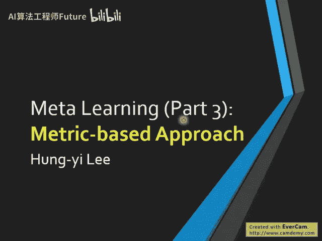
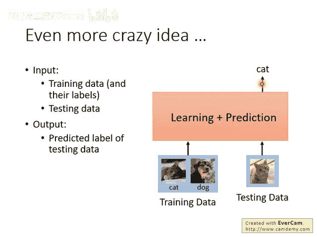
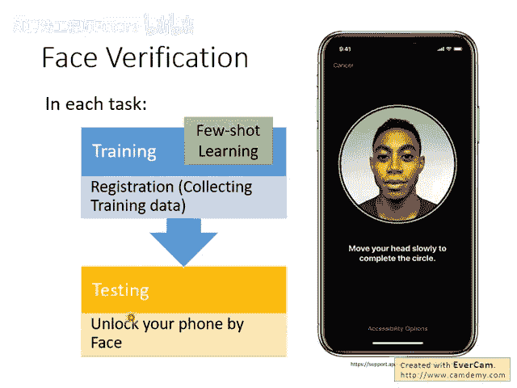
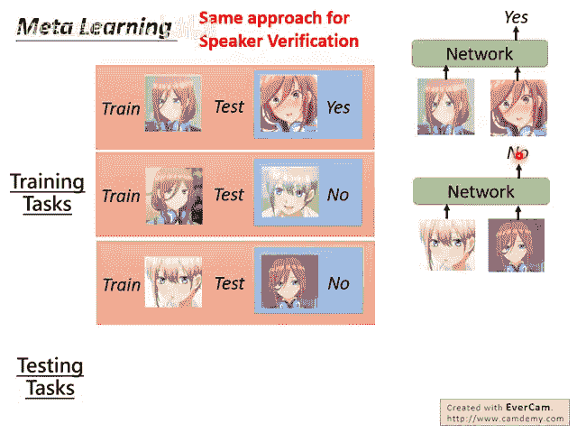
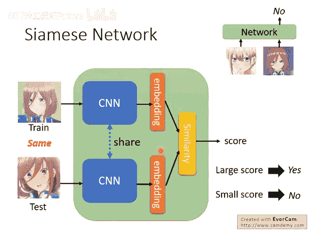

# 【官授搬运】2026年全新优化版李宏毅机器学习系统课程，这才是真正的初学者体系课程！—人工智能／深度学习／神经网络 - P106：16-Meta Learning – Metric-based (1-3) - AI算法工程师Future - BV1ruqABeEFX

啊下一个部分呢我们要讲matrix space的approach好。

那接下来我们要说什么呢，接下来我们就要实践上周讲过的疯狂的想法，就是能不能够直接认一个function，这个function他又做了learning，又做了testing。

你给他training data，先给他training data，然后在这个function里面不知道怎么回事，就认好了，然后呢你给他testing data。

他就告诉你testing data的答案，我们直接来认一个这样子的方式，这个想法听起来好像很crazy，但是在实际的application上是有用这样子的技术的。

什么样的application有用到这样的技术，base verification跟base identification听起来好像很像，但其实是不太一样的，task呃，我们来讲一下它们有什么不同。

所以verification的意思是说，今天给你一张图片，这给你一张人脸，你要判断的是这个人脸是不是某个人，所以verification是一个是非题，我们需要答的是是某个人吗，还是不是某个人。

比如说手机做的就是这件事情，你现在给你的手机是你叫你的手机对你做人脸，Face verification，那你要手机做的事情，就是判断说现在这个人脸是我的主人吗，还是不是我的主人。

那BAIDENTIFICATION是不同的，test baidentification是说给你一张人脸，判断说这张人脸是那一组人里面的哪一个，举例来说，假设你今天做一个门禁系统。

然后现在门禁系统他是在看脸，决定说你早上有没有来上班，很多公司现在都有这种东西嘛，那这个就是face identification，他是要决定说现在这张脸，他是我们公司员工的哪一个员工。

这个叫identification，那等一下我要讲的是verification，那现在很多手机都有verification的功能了。

那其实啊这个base verification它是一个view shot learning的FB本，怎么说呢，当你把手机买来的时候，一开始不是就会叫你对着手机转一下头，收集一些资料哇。

这个收集资料的过程，他要做的就是usha learning，他现场收集到那些的资料，就是他的训练资料，而在使用手机的时候，你注册的那几张脸就是你的训练资料，那你希望借由这些训练资料。

你在testing的时候，手机看到个脸，就可以帮你判断这个脸是不是手机的主人。

好那这个任务怎么做呢，它其实也是一个meta learning的任务，但我等一下都是用人脸的face verification来做呃，来做举例来做说明。

但是speaker the verification也是一模一样的，如果你今天不是说我要用人脸来解锁，而是用语音来解锁，那你用的技术其实是一样的，你只是需要换一下model的架构，换一下输入的资料。

把原来的影像改成语音，但是就这个framework而言，就架构就就大方向而言，做法其实都是一样的好，那首先呢你这些man，这个你要收集一些训练的任务，你有一张训练的人脸，比如说这个是三九这样。

而在测试的时候也会有另外一张人脸，那这个也是三九，那这题的答案就是对讲话，就这个测试的人脸是训练的时候，也就是注册的时候的那一张人脸，收集一个训练任务以后。

接下来我你就可以确认我们刚才说的那个network，那至于这个network里面长什么样，我们下一页后里面很快就会讲到这个network，他刚我们刚才讲过，说他就是吃一个训练资料，吃一个测试资料。

直接输出答案，现在答案是yes，所以他看到这两张三九的脸，一个是训练的脸，一个是测试的脸，他就应该输出yes，就这样哦，那你不能只收集一个task，所以你要收集更多的训练跟测试资料，比如说这个是三九啊。

测试的时候这个是一花，然后呢你要有标注说这张脸是三九的脸吗，还是不是的脸啊，他不是好，所以他的标注就是NO，风太郎会需要这种系统，没有人知道我在说什么啊，你们知道我在说什么，哈哈哈嗯好嗯啊哦啊对。

漫画发色都一样哦，对啊没错，在漫画里哎对，不过在动画里面发色是不发色是不一样的，还是不一样的，诶然后接下来呢你还要收集更多的资料啊，就是这边呢有训练资料是一花的脸，测试的资料是三九的脸，正确答案是NO。

那你就要告诉network说，现在看到一花的脸作为训练的资料，看到三九脸作为测试的资料输出呢必须要知道，那你在这个测试的时候，你的测试任务，当然要跟你的训练的任务有点不同，所以一般你的测试的那些脸。

要没有出现在训练的任务里面，所以假设我们测试的训练的时候。

都是用一发跟三九点来训练，那测试的时候你就要用别人的脸，比如这是四宫辉夜想还是四宫辉夜，而在训练的时候，你有一张四宫辉夜的脸，测试的时候给你另外一张脸，然后要判断说他是不是四宫辉夜。

那四宫辉夜其实很好认，因为他有火红眼，对不对，他有火红眼，所以就知道说这两张脸其实是同一个人，我其实怀疑他是骷髅塔族的人，我怀疑库拉皮卡从黑暗大陆回来以后，就创立了四宫集团，这样子哎好像也没有人听得懂。

对不起，我本来想说四宫辉夜会不会就是布罗肯王子，因为布罗肯是个14王子，因为14王子其实是女的，知道吗，所以她有可能就是呃小时候的四宫辉夜，但是其实仔细想想不对，因为布罗肯王子其实是灰锅肉国王生的。

所以他应该也是没有火红眼吧，所以所以现在他应该不是四宫辉夜，就这样啊，听不懂就听不懂就算了，不用理我，总之这两个都是四宫辉夜好，那你要这样network做的事情是什么呢，就是给他吃训练的脸跟测试的脸。

然后他就告诉你说现在是yes还是NO，就大方向而言就是这个样子，这么训练和network同时做训练，同时做测试，但实际上是怎么做的呢，实际上这个network的架构啊。

其中最常见的一种设计叫做赛尔miss network，等我讲完他的架构以后，你就会觉得这件事情其实没有那么神奇，在samiss network里面呢，通常我们就是有两个CNN好。

那你input训练的图跟测试的图，他们都通过CNN得到两个embedding，然后接下来呢我们把CNN，两个CNN吐出来的这个embedding呢。

不过通常这两个CNN呢你会share parameter，有这两个CNN通常参数你会让它是一样的，就假设你的训练跟testing都是image，那你的CNN用同样的参数也是很合理的。

那有时候有时候samiss network也可以，那两个CNN是不一样的参数，就假设你觉得说现在训练跟testing的，那input的资料其实形态有蛮大差别，你想要用不同的参数。

这两个CNN的参数不要太在一起也是可以的，好好那就是这边有一个CNN，然后呢看这两张图片，分别抽出两个embedding的vector，接下来把这两个embedding vector，计算它们的相似度。

比如说计算它们的cos similar similarity，或计算他们的uclean distance，那你得到一个数值，这个数值越大，就代表说现在network的输出是yes。

这个数值小就代表现在的network输出是NO，就这么就就就这么简单，那所以在训练的时候啊，你就是告诉机器说，现在如果input的训练资料跟测试资料，他们是同个人。

那你output的分数就要越大越好，反之，如果input跟如果训练跟测试的人是不同的人，那你output的分数就越小越好，然后就劝下去就结束了，那这个samiss network散miss是什么意思呢。

SAMISS其实是暹罗的意思，我以前一直不知道说为什么叫做samiss network，跟仙罗有什么关系，难道是因为这个东西看起来像是暹罗的庙宇吗，就比如说这个是屋顶，然后后来我查了下。

好像不是这样叫SAMISS的，意思是说呃SAMISE在英文有那个孪生的意思，为什么SAMISS有孪生的意思呢，因为有一对非常知名的连体音，他们是暹罗人，就这样就这样真的真的，这就就就就是这样就是这样。

所以叫samiss network，他中文常常翻译成孪生网络，哎是啊，samese network非常的常见，那他很多时候我们在讲sm miss network的时候。

我们不见得说他是种meta learning的方法，那很多时候文件就是直接介绍SAMISSNEWORK，不会告诉你说他跟meta learning的关系，那我本来是有想过说。

要不要把samiss network这样的方法独立为一个章节，当做fusha learning直接来讲，但是我后来想想说呃，用一不是把它放在meta learning框架里面的。

网络上的文章已经有一大堆了，所以我要换另外一个讲法，把samiss network放到meta learn的框架里面，因为很多人在介绍meta learning的时候。

他也会介绍samiss network，但有时候大家往往讲不清楚，说为什么samiss network算是meta learning的一部分，为什么他是meta learning的一种。

为什么他往往跟MEA类一起介绍，那么这边就从meta learning的角度来切入，告诉你说samiss network可以看作是一种meta learning的方法，它很神奇。

它直接是training data跟tening data就得到HOON，不过它内部的架构其实设计的非常简洁，你完全可以用其他的方法很直观的来解释，为什么这个network要这么做。

