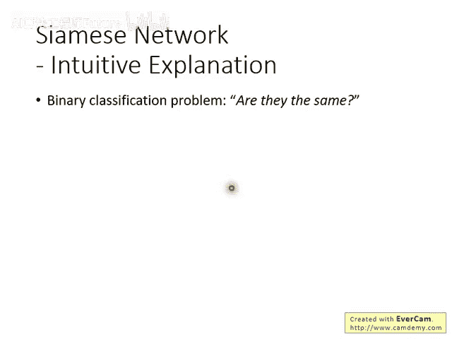
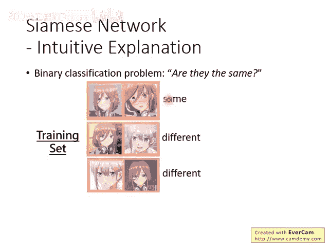
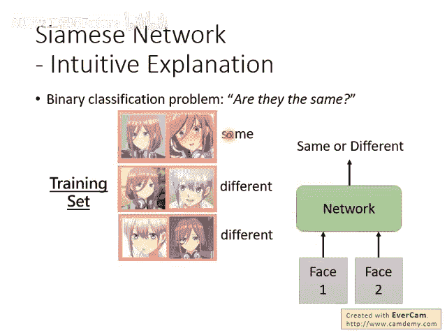
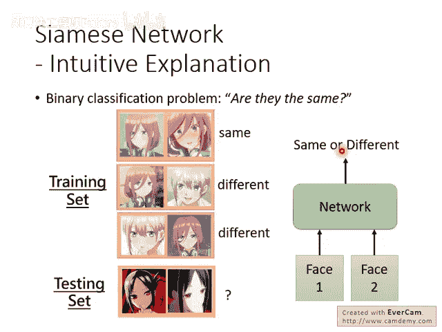
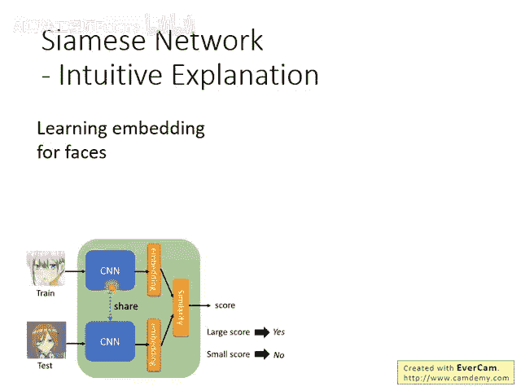
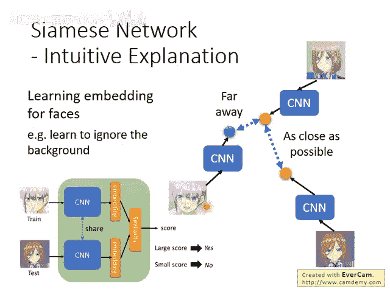
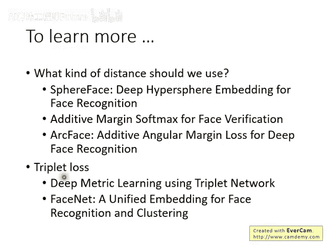

# 【官授搬运】2026年全新优化版李宏毅机器学习系统课程，这才是真正的初学者体系课程！—人工智能／深度学习／神经网络 - P107：17-Meta Learning – Metric-based (2-3) - AI算法工程师Future - BV1ruqABeEFX

直观的解释，怎么直观的解释SAMISSNEWORK做的事情呢，你可以说samese network其实就是一个单纯的binary classification，Barber。

你不需要把它当做meta learning来看待，你可以说它就是一个单纯的by the classification的problem，这个barry classification的PARTMENT。

它输入就是两张图片输出，要问的就是这两张图片一样吗，还是不一样。

也就是说你现在每一个training的task，其实就是training的时候的一笔资料，每一笔资料里面都有两张图片，都有两张图片，他们的标注就是这两张图片是一样的吗，还是不一样一样，就算是一类不一样。

就算是另类，所以它是二元分类的问题，直接train一个network吃两张人人脸。

output就是他们是一样还是不一样，apply在测试资料上就结束了，所以在miss network我们刚才要讲的这个base verification的问题。

其实可以把它看成是一个binary classification的问题，就不见得要从meta learning的框架来解释它，你可以从另外一个角度来解释它，这样其实是比从美哈learning来讲解。

是更容易理解一点了。

好那呃，samix network它内部的架设计有什么意义呢，它里面要做的事情，其实就是用这个CNN，把所有的人脸都投影到一个空间上，在这个空间上同一个人的脸就会比较接近，不同人的脸就会离比较远。

因为你知道说其实就算是同一个人的脸，他今天如果你两张脸，你在计算相似度的时候，你是在他们的pixel上面计算相似度，那同一个人的脸他朝左看，朝右看，对机器来说，pixel上的差异非常的大。

所以我们希望把所有的人脸，都投影到一个空间上，在这个空间上，只要是同一个人脸，不管他是朝左看，朝右看，实际上的pixel差异有多大，但在这个CNN的output上。

在CNN output这个空间上看起来是非常接近的好。

那我们在训练的时候，我们训练的目标就是，我们现在把每一张脸都透过这个CNN，投影到一个空间中，投影到一个空间中，投影到一个空间中，那如果是同一个人，我们就希望他在这个空间中，距离被拉的越近越好。

如果是不同人，我们就希望他被拉的越远越好，但有人可能会问，说认这种embedding的方法，把图片做降维的方法，我们在上课录音里面，不是也讲过很多其他的方法了吗，比如说p ca。

比如说auto encoder，那如果我们直接在这边apply auto encoder，跟用samiss network会有什么样的差别呢，但是你想想看哦，我们在圈auto encoder的时候。

我们并不知道我们要解的任务是什，对auto encoder来说，它就是要保留这张图片里面大多数的资讯，但他不知道什么样的资讯是重要的，什么样的资讯是不重要的，在这个例子里面。

如果你看这张三九的图跟这个一花的图诶，说错了，这个一花的图跟这个三九的图，他们的背景都是浅的灰色，而这张图的背景是深的灰色，所以如果你用auto encoder去encode。

用auto encoder是要保留所有的资讯，所有他所有的资讯，所以对auto encoder来说，这两张图搞不好还蛮像的，因为他们的背景是一样的，但是在samiss network里面。

network就会学到说这些CN就会学到说，因为你要求要我把这两张图片拉远，这两张图片拉近，所以我就要学到说也许头发的颜色很重要，但是背景的颜色就不重要，要忽视它，这个时间可能就可以学到说啊。

我们要呃影扣头发颜色，但是我们要忽略背景的颜色，这就是如果你用samiss network认出来的embedding，跟一般的是全面用auto，或者认出来embedding会有什么样的不同。

哎讲真大家有问题要问吗，哦没有的话，我们就继续，那怎么计算在这个空间中。

怎么计算两个点之间的距离呢，这个就有很多不同的方法，不同的方法之间也许会给你很不一样的结果，那我们这边呢就不细讲下去，我们就列一些reference给大家参考的，有各种不同的计算。

两张两个embedding的output有多相近的方法，那刚才在刚举刚才例子里面，我们做的都是弯下轮，你就说给你一张training的贝塔，那如果你在做这个pushare learning的时候啊。

你是给他一，就是你给他一张你要verify verify的目标的点，再给他一张不是verify目标的脸，再给他testing data，给他两张训练资料，往往performance会更好啊。

这个呢就叫做triple loss，就本来都有两个东西要做input，但是你可以input3个东西，你的training data里面可以有两张图片，一张是POSITIEXAMPLE。

就是我们现在identify那个对象，另外一张是随机一个路人。

