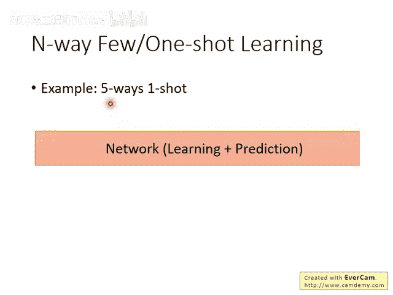
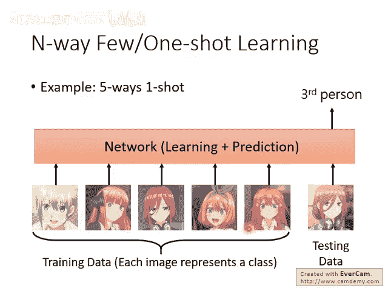
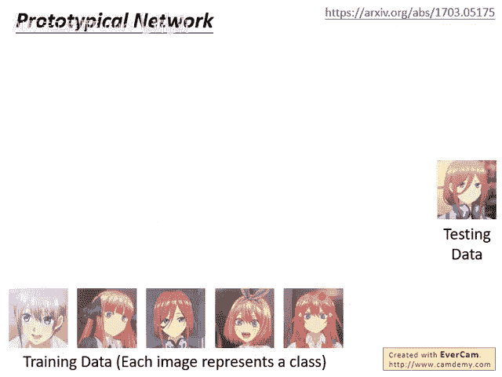
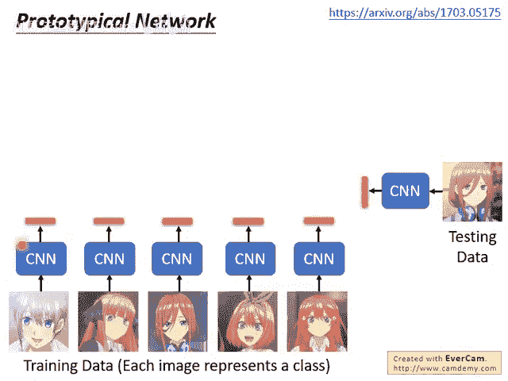
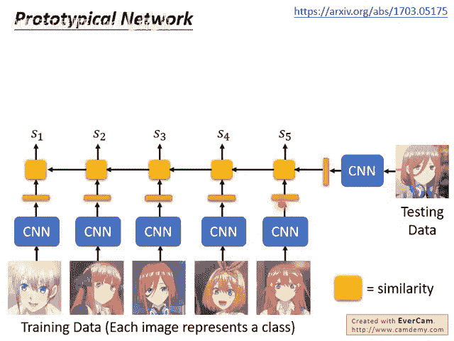
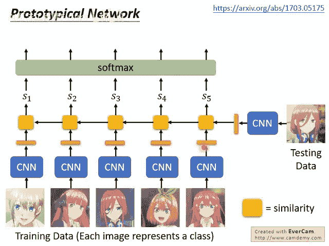
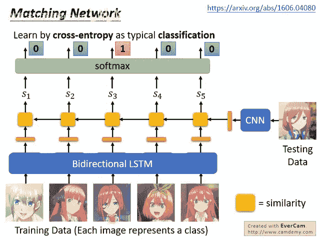
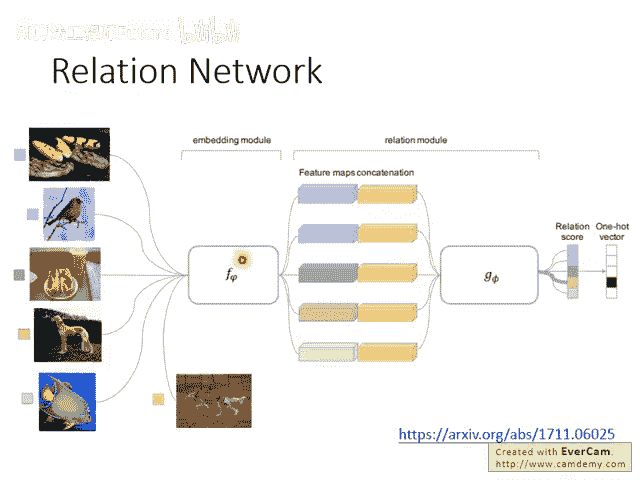
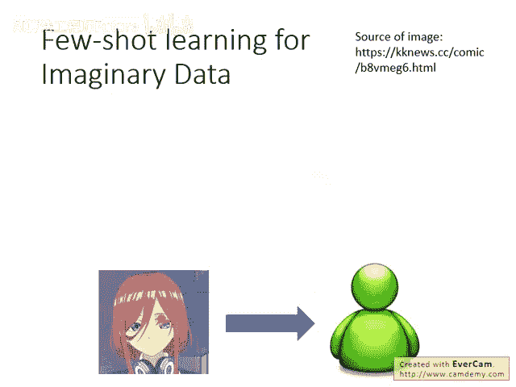
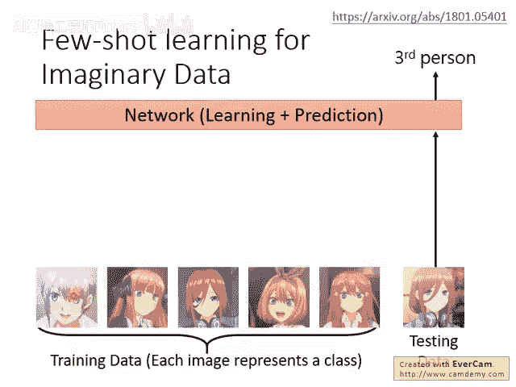

# 【官授搬运】2026年全新优化版李宏毅机器学习系统课程，这才是真正的初学者体系课程！—人工智能／深度学习／神经网络 - P108：18-Meta Learning – Metric-based (3-3) - AI算法工程师Future - BV1ruqABeEFX

哦那刚才举的例子里面呢，我们的训练资料都只有一张，我们要做的事情就是呃呃verification，即将要回答的就是yes或NO，那如果现在你要做的是identification。

也就是说它是一个分类的问题，它不是一个单纯回答yes或NO的问题，那怎么办呢，举例来说，假设我们现在要把同样的概念用在five ways，关下的network上。

然后five way关下的task3要怎么做呢，那么上周已经讲过by fway，弯下是什么意思，我们上周讲说by way，弯下的意思就是我们有五个class。

但是每一个class我们只有一个example，这叫by way one shot好，那现在呢如果要做WIFWAY，by way one shaft的话。

那你要用五个class，假设五个class就是那个五等分的五姐妹，每个人都是一个pass，她们分别是一花二乃394叶跟5月这样子，哎对哎这个是这个啊，这些人物是出自那个五等分的花嫁啦。

我不知道大家有没有看过这个啦，需要我解释一下这个是什么吗，这个这个好，我我我我简短的解释一下这个故事好了，这个故事是这样子的，就是呃中野家呢有五姐妹，她们是五胞胎，然后他们都喜欢他们的家教老师啊。

就是风太郎这样子，然后呢风太郎小时候呢，曾经她的初恋情人是五姐妹的其中一个，但是她不知道是哪一个，因为讲过说五姐妹长得是一模一样的，虽然只知道说说她的初恋情人，是五姐妹的其中一个人，但是那是小时候的事。

他长大以后已经不知道是哪一个了，所以这个故事就是找出那个那个那个那个，而且小说他没有真名，他说他的名字叫做林奈，这个就是找出林奈的故事，跟魏恋的剧情有点像啦，哎我这里面有五个人，所以就特别容易有党争。

就大家会各有其主，就好像说有很多人研究红楼梦和红学，很多人现在在研究五等分的花嫁，就是武学，这就他预测说谁会是最后的真命天女，因为网络上很多武学家，那写数10万字的论文来论证。

说他们觉得最后获胜的会是谁这样子，但是我其实想到一个方法可以解决最后的问题，因为其实不管最后风太郎跟谁在一起，最后都会有人生气嘛，所以最后一个大圆满的结局，就是并不是我全都要这种大姐，我不是这个意思。

我不是这个意思，我的意思是说我相信林奈其实是有轮回眼的，就跟六道佩恩一样，他其实操纵了五句词，最后风太郎就是要要发现，说这个本体不在其中啦，然后最后就找到林奈就结束了，可喜可贺，好就是这样好，我讲完了。

然后反正就是五等分的花甲，然后里面的五个角色好，那每个角色呢就是一个class，现在每个角色就只有一张图片，那network呢就把这五张图片都给他吃下去，然后测试的时候给他一张图片。

希望他就可以自动判断说，这张图片是刚才给的五个类别，但每个类别只给一张图片的哪一个，那实际上network的架构怎么设计呢。

在文献上就有很多做法，举例来说，一个经典的做法叫做pal typical的network，那poo typical的network做的事情，就是我们现在有一个CNN跟samiss network。

其实非常非常像，只是现在从input一张training data，extend到input好多张training data好，那我们呢用这个CNN把training的image。

每一个image都变成一个embedding的vector，然后testing image也变成embedding vector，接下来我们计算testing image的这个vector。

训练的图片的每个vector的相似度。

我们计算相似度，我们用黄色bug来代表计算相似度这件事，那这个图画的有点难画了，所以这个不是一个RN的意思，这个是说我们拿这个vector跟一花算的相似度，那这个vector跟二奶算的相似度。

跟三九算的相似度，跟四叶算个相数，跟5月算的相似度等等，这我们就得到五个相似度的值，SY到S。

接下来你可以比如说取个soup man，取个sop ma，然后然后你在train的时候，你的loss function就跟一般的分类的问题一样。

你想想看，一般你在做分类的问题的时候，假设是五个class，你就通过soft max要output5个value，接下来做cross entropy，Minimize，Cross entropy。

那这样做的事情是一模一样的，你现在也有五个value了，通过soft max你一样做POSENTRO，他的reference，他的target就是假设这张图片它是三九，所以它是属于第三个class。

那就是第三个class的目标是一，其他都是零，你就计算你soft max layer的open跟你的reference，这个target之间cross entropy，然后在train的时候。

你要去minimize它，这个就是PHOTOTYPICAL的network，那在我们这个举的例子里面有，那假设说他是one shop的啦，但如果是few shop，就是你的每一个cs不止一张图片。

那也没什么问题，在phototypical network里面，他做的事情就是假设你有三个class，每个class有五张图片，那你就把五张图片embedding平均起来就结束了。

这然后今天进来一个testing的资料，你就看说他跟哪一个图片的，代表哪一个图片的平均，哪一个class的这个EMBEDA平均最像，那就算是哪个class，那这个方法也非常直觉。

他道理就跟smiss network差不多，你就是希望说今天呢如果这一个testing data，他算是class two，那他就跟class two的那些image平均越接近越好。

然后跟其他class的平均跟其他class代表远离，那就可以了，所以他是很直觉的，这个叫做包括typical的这五，那如果我们把然后还有另外一个很类似的做法，叫做matching network。

那matching network跟phototypical network最不一样的地方是，之前我们是每training data里面的每一张图片，都分开处理。

他说也许training data里面的每一张图片，互相之间也是有关系的，所以我们就直接用一个by directional，LSDN来处理，我们把training data这些图片。

通过by directional的LSDN，每张图片仍然会得到一个embedding，接下来其他做法就跟prototypical network一样。

那事实上在历史的演进上是先有matching network，才有prototypical network，是先propose matching network。

后来才有人propose prototypical network，那prototypical network你可能想说哎，ptotypical network比较简单啊，他总是后提出来的。

但在ptotypical network里面有提到match network那边paper，首先prototypical network performance比mansion network还要好。

那prototypical network那篇paper里面有提到说，他觉得在这边用by directional l s t n，好像不是很有道理，这样子。

就是那如果你这边是用by directional l s t n，那是不是现在如果训input的训练资料，我们把这个是二乃跟三九的顺序对调。

那你那work output难道就不一样了吗，这样不会很奇怪吗，你这个matching network还有一个不一样的地方是，它在计算出这些分数以后。

其实有通过一个这个multiple help的process，然后才得到最终的open，那这个multiple half的process啊，其实在memory network里面有用到。

那这个matching network里面的这个process啊，跟memory network里面用process其实还蛮类似的，不过因为这门课呢我们没有讲memory network啊。

所以这个部分呢讲起来大家应该是很难懂的，所以我们就略过，你有兴趣的话，再自己去看论文就好了，还有别的，就比如说relation network。

relation network跟刚才的network的道理也都是一样的啦，就是input训练资料，input测试资料，然后接下来就当做一个分类的问题来做，看这一章测试资料是跟哪一个训练的资料。

是同一类，是属于哪第几个类别，比如这是一只狗，对它应该是属于第四类，那只是relation network，跟刚才的mating network等等，他们又有个不一样的地方，它不一样在哪里呢。

relation network是这样做的，他说我们先把训练资料里面的每一张图片，跟测试资料通通抽出他的embedding好，训练资料的每一张图片，五张图片有五个embedding测试资料。

这个图片把他的embedding呢，放在训练资料的图片的embedding的后面，那本来我们是直接算这个vector，跟这个vector相似的。

在math network和prototypical network里面，都是直接算相似度，relation network说我们的相似度不是人定的，我们的相似度是用另外一个network算出来的。

有另外一个network，他把这个vector吃进去，他用他自己的方法来算相似度，说这两个vector有多像，这个就是relation level，那不算相似度，怎么抽。

embedding是一起被学出来的。

好，那我们知道说在future are learning里面常常遇到的问题，就是训练资料很少，所以怎么办呢，我们也可以让机器自己去幻想出一些训练资料，你知道我们人都是有想象的能力。

所以虽然只给你看一张三九的脸。

他是面无表情的，但是也许你可以想象他害羞的样子，或者是他生气的样子，或者是他卖萌的样子等等，所以你看到一个人的人脸，你可以想象出他的其他的面相，那我们能不能让机器也做一样的事情呢。

好在文献上确实有这样的做法，原来我们弯下learning的时候，就是每一个class就是一张图片。

现在我们去认一个generator，这样子，我们现在还没有讲过怎么做generation这件事情，但是你想象说就是有一些技术，就是可以弄一个generator去升东西，去产生出东西来。

就你现在任一个generator，他就是吃一张图片进来，它就产生一大堆他觉得相关的图片，但是这个generator怎么认出来呢，这个generator就像是人的想象力一样。

但这个generator怎么认出来呢，他是跟后面这个network一起认的，也就是说generator我们可以先设定好，说这个generator就是你给他一张图片，还要另外生三张，就你给他一个人人脸。

他可能就会想象出那个人生气的样子，害羞的样子跟卖萌的样子，他就想象出那个人的三种不同的样子，然后呢把想象出来的脸丢到network里面，再做接下来的训练，那真正在做training的时候。

这个network跟这个generator是join特例一起train啊，这里这个就是future learning for imaginary data的意思好，那我们今天呢就讲到这边了。

因为等一下10。40，我们还有很多其他的活动，今天要讲一下那个final的project，所以我们就在这边呢休息大概5分钟。

