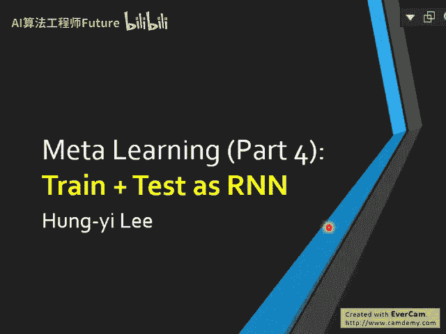
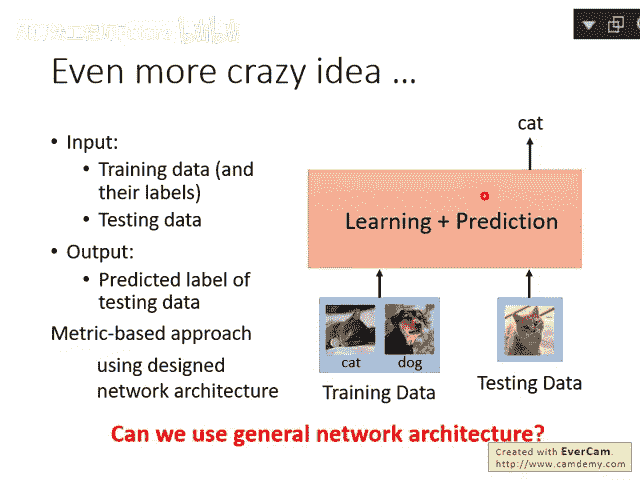
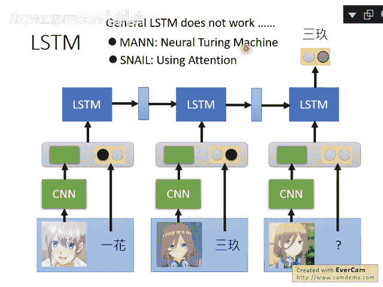

# 【官授搬运】2026年全新优化版李宏毅机器学习系统课程，这才是真正的初学者体系课程！—人工智能／深度学习／神经网络 - P109：19-Meta Learning - Train+Test as RNN - AI算法工程师Future - BV1ruqABeEFX

好那其实有关meta learning的部分呢，还有非常小一段是还没有讲到的是什么呢，我们之前有讲过了这个fire mese network。

那我们在讲smese network的时候，我们说呃，你可以把samiss network或其他metric base approach，想成是meta learning。

但是你其实有其他更容易的方法来理解，这些MATRIFIED的PO，那我之前在讲那个samiss network的时候呢，我们开场白有说啊，我们想要做的事情是一个疯狂的想法。

我们想要找一个function，这个function它可以同时做到learning跟testing这两件事，我们把train跟test放在同一个function里面，我们期待我们可以学出一个方向。

这个方向可以做到说把训练资料丢进去，把测试资料丢进去，它直接吐出来的就是测试资料的答案，然后之前我们有讲过，说这个听起来很疯狂，那实际上我们使用的方法是samiss network，跟他的种种变形。

比如说machine network，比如说prototypical network等等，而这些变形你可以想成，他们是特别设计了network的架构来做到，下面来做到这边我们要说的这件事。

因为这件事听起来很复杂，你直接用一个generalize的network恐怕是做不到的，所以必须要设计一下network的架构，才能够达成我们的目标，但是我们这边要说有没有人尝试过。

直接用一个general的network来完成这件事呢，直接弄个general network input，就是training data跟testing data output。

就是testing data的label呢是有的，希望机器可以学到说看到这张图片，他是哪一个动画的角色啊，然后呢你给他一个测试资料，希望他就可以直接output正确答案。

那这个东西你可以把它想成是一个RNN，可以解的问题，因为他input的东西就是一个sequence，先把训练资料的每一笔资料一个一个的喂进去，在未进去测试资料。

然后希望你的RN就可以output正确答案，所以你完全可以用到RN，举例来说LSTN来解这个问题，你希望这个LSPM把training data当做一个sequence，读进去，再读进去。

测试资料的时候，offer直接就是测试资料的答案，然后就结束了，好那额我们在input的部分呢，因为这是一个影像分类的问题，所以每一笔训练资料里面都包含了一张图片。

跟一个这张图片属于哪一个类别的label好，那我们需要把这张图片，这个la跟这个label呢做一下embedding，举例来说，你可能会有个CNN，然后把这张图片读进去，然后输出一个embedding。

然后你可能会把每一个类别用一个one，hard vector来表示，你可能把每一个类别用一个one hot vector来表示。

你把CNN的output跟类别的one hot vector做CONQUERY，变成一个feature vector丢到LSTN里面，那在测试的时候，因为测试资料它的类别我们不知道。

训练资料每张图片的类别，我们知道测试资料的类别，我们不知道，那训练资料类别，我们可以用一个one heart breaker来表示测试资料，因为它的类别我们不知道，我们就用zero vector来表示。

然后呢我们就把训练资料跟测试资料合起来，看作是一个sequence丢到LACN，然后训练它output，测试资料的LAO就结束了，那前任有试过这件事吗，前人有试过这件事，果然劝不起来。

这样子诶好那怎么办呢，用一般的LCN是圈不起来的，所以就有人尝试着去修改LSTN的架构，如果用general的，一般的呃，我们都用常用的那个LAT券下去嗯。

在meta learning上看起来做不起来的，就有就试了更改network的架构，其中比较知名的两个例子，一个是NANN，他用的是neural tun machine啊，这个我们上课没有讲过。

那如果你有兴趣再自己去查一下，neuroti machine是什么，那这还有另外一个东西叫做snail，它里面用的就是attention。

然后我们的network架构呢我们就不细讲，我们这边呢就把文件放在这边给大家参考，那snail这个东西呀，你如果看他的这个network的架构图，你可以呃很轻易的了解他在做什么。

那snail呢是simple neural attentive meta learner的缩写，然后我不知道为什么M不见了，总之它的缩写呢就是snail，就是瓜牛的意思。

那另外一个可能是它的形状长得像瓜牛，所以我们叫它瓜牛啊，他怎么做的呢，它就是我们跟刚才我们讲的东西是完全一样的，我们就是把训练资料跟他的label丢到network里面去，丢到这个RN里面去。

把车子掉再丢进去，但唯一不同的地方是，它不是一个单纯的RON，它里面有attention，就很像是我们之前讲transformer的时候，讲过的attention一样，当你把第二笔训练资料丢进去的时候。

他会去attend之前已经丢进来的东西，当你把第三笔资料丢进来的时候，他会去attend第一笔和第二笔，当你把测试资料丢进来的时候，他会去attend过去所有的训练资料，当我们把测试资料丢进去。

他会有成过去所有的训练资料的时候，这件事情你仔细想想看，做的他做的事情是不是跟什么prototypical network，或者是matching network非常像呢。

我们说matching network做的事情是呃，丢一张图片进来，然后你去计算这张图片跟你的训练资料的，每张图片的相似度，看谁最像，就拿那张最像的图片label出来当做正确答案。

今天我们用一般的l s t n train，刚才讲那个疯狂的想法，train跟test加在一起的想法做不起来，所以他们做了一下修改，说现在当我们把测试资料丢进来的时候。

我们要回头去对过去已经输入进来的训练资料，多少天，这个行为其实就很像是match network，说他把测试资料跟训练资料去计算，他们的event的相似度，他们的道理是非常类似的，可发现说殊途同归。

就本来呃本来是想要用一个最general的方法来解，meta learning的问题，但是做到最后你还是需要改一下，network架构。

会变成跟samiss network mechbase那一套的想法，其实是差不多的哦，不过在文献上看起来，刚才介绍这个snail的performance呢，看起来是蛮厉害的。

上面这篇实验是omega的实验，那这个是snail的performance，他做了five way跟团体way one shot跟five shot，那他的base line呢多数我们都在课堂上讲过了。

就这边总共有六个base line，那把这六个BASSLINE呢，它们是用什么方法就写在这边，而内NN是用neo tre machine的那个方法。

那我刚才在前几页后面片才刚刚看到samiss network，我们之前讲过了，Math network，我们之前讲过了，and naml就是memo，我们之前讲过了。

Phototypical network，我们之前讲过了，没有讲过的是meta network，没有讲过是meta network，总之呃这个snail跟六个方法比一比，它的结果都是最好的好。

那他也做了这个呃，mini image name啊，做five way one shot跟five shot，那这边比的base line呢是MATCHNEMEMO，然后把LSTN当做啊。

Gradient descent，这个我们也是之前讲过的，然后prototypical network跟meta network。

