# 【官授搬运】2026年全新优化版李宏毅机器学习系统课程，这才是真正的初学者体系课程！—人工智能／深度学习／神经网络 - P10：9-选修-神奇宝贝分类 - AI算法工程师Future - BV1ruqABeEFX

好后我们来上课哦。好啊。剩下时间我们要进入新的。主题我们要来讲分类这件事情。好，在分类这件事情呢，我们要找的是一个function，它的input是一个ject。

它的output是这个ject属于哪一个属于n的 class哪一个那这样子的t有很多其实性收面来一大堆。比如说在金融上他们可以用classification的model呢来决定说要不要贷款给某一个人。

也就是找一个方，他的input是某一个人的incom啊，saving啊，他的工作啊，他的年纪啊，还有他过去的finan的 record，他过去有没有欠债啊等等。

那output就是要借钱给他还是不借钱给他好这是个binary classificationification的或者refuse那或者是拿来做医疗诊断，比如说input就是某一个人的症状。

还有他的年纪啊性别啊，过去的就医的历史啊等等。那out就是他生的是哪一种病啊，就就自动来做。医疗的诊断啊，或者是呢做这个手写的数字呃手写的文字的辨识。比如说你就手写一个字呢给机器看啊。

机器看到就是这张土啊，这个是金这样子。嗯我知乡米都叫我大姐，就是金这样子。好，然后呢他就包括就是。这个字这个image它是属于哪一个class。哎，如果是做中文的手写辨试的话。

那中文有呃至少8000个charact，那它就是1个8000个class classificationification。

你的model要从这800个class里面选一个class当中off会或者是做人脸辨识，就是input一个人脸，然后告诉他说这个人脸是谁的啊。好，那我们要用的是什么样的exampification呢？

其实这个也是宝可梦的例子啊。你可能以为说其实我我只有前面那个predictCP值的例子，其实我还有很多其他的例子这样。好，我又做了一些有关宝可梦的研究。我这个研究是这样子的。

我们知道说宝可梦有不同的属性，有几种呢几种十8种属性，包括就如是水跟火啊、水啊、电啊，草啊草啊，还有冰啊等等，有总共有18种属性，到第六代为止，总共有18种属性。好，我们现在要做的是一个分类的问题。

这个分类问题就是要找一个方程，这个方程的 inputput就是某一只宝可梦，然后他over就是要告诉你说这一只宝可梦，它是属于哪一种态度。比如说音部给他一只皮卡丘，它凹就是雷音符给他一个那个杰尼龟。

它over就是水，in符给他一个尿啊、草，它的凹就是草的所以是一个 classificationification的问题。那要做怎么样做这个问题呢？

你现在第一个你的问题就是怎么把一个宝可梦当做function的input。你知道你要把一个东西当做function input，它得数字化，你要用数字来表示一只宝可梦。

你才把它放到一个function里面。那我们要怎么把一只宝可梦用数字来表示呢，一只宝可梦其实它有很多的呃特特性啊，这些特性是可以数值化的。比如说它整体的强度。我先说一下。

这个其实不是那个pokemon go的那个东西啊，这个是那个poke梦的那个电玩呃，你听不懂我讲这个就就算了，假当中没听到这句话。好，那一个一个宝可梦呢，它其实可以用一组数字来描述它的特性。

这组数字代表什么呢？比如说这个宝可梦它的。total的str就它有多多强然你可以用个数字来表示它它的生命值，你可以用数字来表示它它的攻击力，你可以用个数字来表示它它的防御力，你可以用个数字来表示它。

它的特殊攻击力。就当特殊攻击的时候的攻，这我不知道怎么解释哈，就是反正就是另外一个特殊攻击的攻击力，然后特殊攻击的防御力，还有它的速度速度的时候K可以决定说就是两殖宝可共相相遇的时候呢，谁可以先攻击。

好，比如说这皮卡丘，它的整体的强的程度是320，它的HPE是35，它攻击力是55，防御率是40，特殊攻击是50。然后它的呃呃特殊防御力是50，它的速度是90的。那所以一只皮卡丘。

我们就可以用一个vector来描述它。这个vector里有1234567总共有7个数字，所以一只宝可梦它就是一个7个数字所组成的一个 vectorctor或者一只皮卡丘可以用这7个数字来描述它。

我们现在要问的问题就是我们能不能够把7个数字输进一个方程，这个方程就告诉我们说它的output呢是哪一种种类的宝可梦。那你可能会问这样一个问题，这件事情的重要性到底在哪里？这件事情是非常重要。

因为当两只宝可梦相遇在决斗的时候，它们中间是有属性相克的关系的，这个是18乘以18的属性相克表。因为你知道说总共有18只宝可梦，只总有18种态的，所以这是18乘以18的属性相克表。

比如说今天这个格斗系遇到这左边这是风极方啊，啊上面这个是防御方，所以格斗系遇到一般的时候，它。乘2这样子，你看得懂这个图了。

所以这个是这个是很重要的那你可会问说这个可是宝可梦的属性不是宝可梦图鉴上面都有了吧，预测宝可梦的属性有什么意义的。这件事情是有很大的意义的。因为你有可能在决斗中的时候遇到说呃对方出的是图片上没有的。

你没有见过的宝可梦。如果你现在有这个预测的model的话，你就可以预测说他出的宝可梦是哪一种属性的，你就可以用正确的属性来对应它所以这个这个这个是有非常广泛的意用的而且我发现说宝可梦图鉴其实是影像变试的功能。

它影像变色功能很强。你照一张图它就可以告诉说你说它是哪一种宝可梦。我们该把这个prediction的el加到那个宝可梦的图里面，他就可以帮我们pre新的宝可梦。好，那。怎怎么完成这个任务啊。

怎么完成这个任务嗯。首先我们要先收集data这样子。比如说你就是说我把宝可梦这个编号400以下的当做圈ingda，编号400以上的就当做te data。就假设说因为在宝可梦其实是越来越多的。

我记得我小时候的时候150只。但后来发现越来越多宝可梦，现在都已经现在好像已经有800只了，所以宝可梦是不断增加了。所以在编号在比较前面的是比较早发现的那些宝可梦。

所以模拟说我们已经发现那些宝可梦的情况下，如果看到新的宝可梦的时候，我们能不能够预测说它是属于哪一种属性。好，但是以你要收集data。

比如说你的呃我们的data就是一些pe告诉我们说方的 inputput output是什么。比如说input皮卡丘叫op inputput杰尼 inputput妙蛙草叫out这样然后那怎么解ification的问题。

那有人会这么想，假设有人没有学过 classification但过re的他就说 classificationification就当做re的问题来应解怎么应解呢？

我们用binary的 classificationification来当做就假设我们现在只要op inputput的 x属于cast one或者 two那就把它当做一个regress的问题。

ca one就代表说它的这个tart也就是 hat是 two就代表说它的t呢是复。你就这样就当做re，然后下去。然后串完这个model以后呢，在testing的时候。

因为 regression output不会正好是零或是ER它是一个 number。OK它是一个它是个数值。那如果这个数值比较接近一的话，就说是class one。如果数值比较接近负一的话。

就说它是class。所以你可以想成说现在就是以零为分界。如果你的re model大于零的话，就比较接近一。所以你的model就会说是class one。如果小于零的话就比较接近负一。

所以model会说是class two。如果你这么做的话，会遇到什么样的问题呢？会遇到什么样的问题呢？你会遇到这样的问题。

假设说我们现在的model是一个呃它的我们现在的model的in和out克关系Y等于B加W one XY加W toSQ也就in这两个feature，也就是XY跟XQO那我们现在有两个class。

蓝色的是class one红色的是class two。那如果你用 regression来想的话，蓝色的那一些。upject蓝色的那些东西input到这个regression model。

我们都希望它越接近一越好。红色这些东西input到 regression的 model，我们都希望它越接近负一越好。我这件事可能是做到我说你把这些data真的丢下去了，真的找出这个BWY和W2的话。

那你会发现说呢B加WY XY加W。你写错了，这个down to s two就是这个式子等于零的第线是绿色这一条，也就是cases one和cast two的分界点是在绿色的这一条线上。

这看起来嗯听起来蛮好。但是你可能会遇到这样的问题。假设你今天k one的分布不是这样子。假设你class one的分布是这样子。你就麻烦了，为什么？因为如果你用绿色的这一条线所代表的model的话，呃。

所以它这个是二维的，这是这个是二维的。绿色这条线只是代表说这个model的值是。0呀，就是这个这个Y的值的是0啊，这个这个这个你的region的 outputput是0。

那左上角这边代表regression的 output是小于零的，右下角这边代表regression的 outputput是大于0。唉好，那绿色这条线会有什么问题呢？绿色这条线问题就是左下角呃小于零。

右右呃右呃左上角小于0，右下角大于0，越偏右下它的值就越大。但是在所以如果今天是考虑右下角这些点的话，它做用这个绿色的这个model，它做regation的时候，它的oppo可能会是远大于一的。

但是如果你用reggression的话，你会希望蓝色的点都越接近一越好。有时太大居然还不好，太大不行，然后越接近一越好，就太小不行，那太大也不行，所以变成说这期。远大于一的点。

它其实是对reggression来说，它是arrow，它是错的。这些点是不好的。所以你今天如果拿这些这样子两群蓝色的点跟这群红色的点去做regression的时候，你得到的线不会是绿色这一条。

所以绿色这一条。你用直觉看眼睛一看就会知道说它是一个比较好的方er。但是如果你用 regressiongression认下去的话，不会是绿色这一条，它会是紫色这一条，因为他会觉得说我把这条线往右偏一点。

啊，这样的好处就是这边这些蓝色的点，它的值就没有那么大啊，它的值就会压小，就让他们比较接近。结果这样子的functionction，反而对reation来说是一个比较好的方式。也就是说呃。

regression那个定义方向好坏的方式，对classification来说是不适用。今天这个faer对regression来说，紫色的是一个好的function。但是显然对开ification来说。

绿色的才是一个好的方式。但是如果你当做rereion的 problem来做，套用的regression一样的做法的时候，你得到结果会是不好。

因为regression对这个mod的好坏的定义是不适合用在这个地方。好，所以这个呃如果你要regression的话。

你的 regressiongression model它会惩罚那些太正确的它的output的值太大的那些点。啊，这样你反而得到的结果是不好。那还有另外一个问题。

其实像这种把classification应当成re来做，还看过是有人真的有人会会真的这么做的。就是你就劝你不要这么做这子。好，那你这个比如说如果你这有 class的话。

那可能说我把class one当做是class two当做t2class3当做t3这样做会是有问题的。因为当你这样做的时候，你就假设说class3和class2是比较近，他们有某种关系。

class2跟class one是比较近的。他们有某种关系。但是如果实际上这种关系不存在的话，就case one two class3他们中间并没有某种特殊的relation并没有谁应该跟谁比较有关系的话。

你这样子把当这个re问题来处理，你就没有办法得到一个好的结果。好，那我们今天应该要怎么做呢？呃，理想上的做法是这个样子。找一个function哦，这个function里面呢呃反正我们呃就在做re的时候。

它output real number，对不对？但是在呃classification的时候，它output是dire，它是某一个它dire。那我想办法让model做到这件事情，你可当然可以有不同的想法。

那一个可能的想法是假如是二元分类的问题是fin classificationification的话，我就说我们要找的方F里面内建另外一个function区啊。

希望它是自动但我们也是要根据 data被找出来的。如果G代进XX代进G的值大于零的话，那就说是快ash one，否则呢就说是quest2。那在training的时候，我们的lo应该怎么定义才好呢？

我们lo应该定义成呃，我们可以把lo定义成呢这个如果我选的某一个方F它在我们training data上面pre错误的次数。我们当然希望说我们如果找出来的这个方它在它在这个呃data上的错误次数越小。

代表呢它的lo越小。而且就可以把这个式子写成这样sub所的 training exampledelta xN不等于Y and head啊。

就是如果F x n的open跟正确答案y and head不一样的话，这个dta就是一，否则就是。如果你把它全部上起来的话，就是你用这个方在training data上面它会分类错误的次数。

那当然希望这个值越小越好。但是。嗯，如果叫你解这个方，你在发什不会。因为我们学过的是规点cent，你可能会用规点cent解，但是这个没办法为分啊，这个就没办法维分了，这个也没办法分，通过不同为分。

不知道怎么做。嗯，其实这个是有方法，比如说就是一个方法。SBN就是一个方法。但我们今天先。不讲这个方法，我们先来讲另外一个solution。然后呃这个solution，我们先用几率的观点来看待它。

然后之后我们会说这样的solution也是跟machine learning的三个t其实是一样。

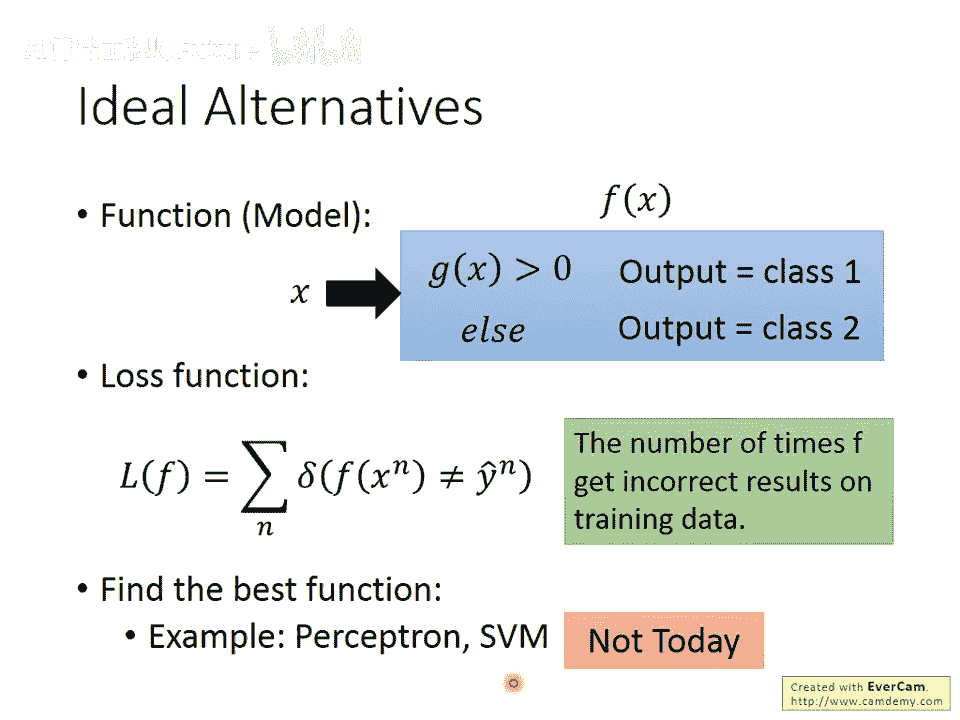

好，我们先这样看，就是有两个盒子啊，我们来回忆一下那个国装的社候会问的几率的问题。有两个盒子，盒子一里面有篮球跟绿球，盒子二里面也有篮球跟绿球。假设我不告诉你从我说我从哪一个盒子里面挑一个球出来。

但是我告诉你说，我从这两个盒子里某一个盒子里面。随机抽取一个球出来，它是蓝色。那这两这个蓝色的球，它从盒子one看从盒子Q抽出来几率分别是多少？我相信这个小学生就可以回答。

假如说你告诉我说你从盒子one里面抽一个球的几率是3分之2，你从盒子Q里面抽有球的几率3分之1。再告诉我说，在盒子 one里面篮球在5分之1，绿球占5分之1，盒子Q里面篮球占5分之2，绿球占5分之3。

那你就可以轻易计算说，如果我今天得到一个篮球，他从盒子one里面抽出来的几率，这个几率就是。这火小票就有交过了，不是。至少国中有交过啊，对不对？大家应该都会就是第了一个篮球。

他从B one里面申ble出来的机率，真是就是这个样子，这没什么好解释的。我相信大家都秒懂。好，那这个跟分类有什么关系呢？如果我们把盒子换成分类的话，把盒子罐和盒子Q换成类别一跟类别2啊。

换成类别一跟类别2。这个时候呢。给我一个X，就是我们要分类的那个啊对象。比如说今天我们的例子就是分类一只宝可梦，给我一只宝可梦，它从某一个class里面simple出来的几率是多少呢？

那我们需要知道哪些词，我们需要知道pas one。我从class one里面抽一个X出来的几率，我们要知道从classQ里面抽一个X出来的几率。我们要知道说从X one里面抽一个X出来。

从X one里面抽出我们现在在考虑的这个X的几率。我们要知道从XQ里中证中这个classQ里面抽出我们现在在考虑的这个X的几率。如果有这些刚给我们一个X的时候，有了这四个数值，我们就可以计算。

这个X是属于class one的几率，怎么算呢？X属于class one的几率，就是。case one本身的几率乘上cas onesimple一个after出来是S的几率再除掉。

one本身的几率乘上 one sample出来的话是X的几率，加上cast two本身的几率，乘上从cast two里面sple出一个出来是X的几率。所以我们现在的问题就是呃，如果我们知道这个几率的话。

问题就解决了。因为给我一个宝可梦X，我就可以看说它从哪个class里面来的几率最大那几率最大那个class这是正确的案。但现在的问题是我们如果要算这个值，那我们就要算这四个值。

假设我们是考虑一个二元分类的问题的话，我们就需要算这四。好，那这四个值怎么来呢？我就希望从我们的training data去把这些值呢。估测出来。好，那这个这一整套想法呢叫做genative的mod。

为什么它叫一个genative model呢？因为有这个model的话，你可以拿它来generate一个X什么意思呢？你可以计算某一个X出现的几率。如果你可以计算每一个X出现的几率。

你就知道X的ditribution，你就可以用这个ditribution来产生X，你就可以用这个ditribution来sX出来。这个几率是什么呢？这个几率很简单，它就是你从C万里面挑一个X出来的几率。

乘上C万挑出X的几率。加上你从Q里面挑一个X的几率，乘上 two产生X的几率。你有这些几率，你就可以算这个。你就可以算某一个X出现的机率，你就可以自己产生X。

所以这个东西呢叫做genative的 model。好，那我们先来看一下PLC one跟PLCQ。我们先来算一下PLC one跟PLCQ它出现的几率。那这个几率呢叫做qui。

那他们呢是比较好算的啊不是比较好算。

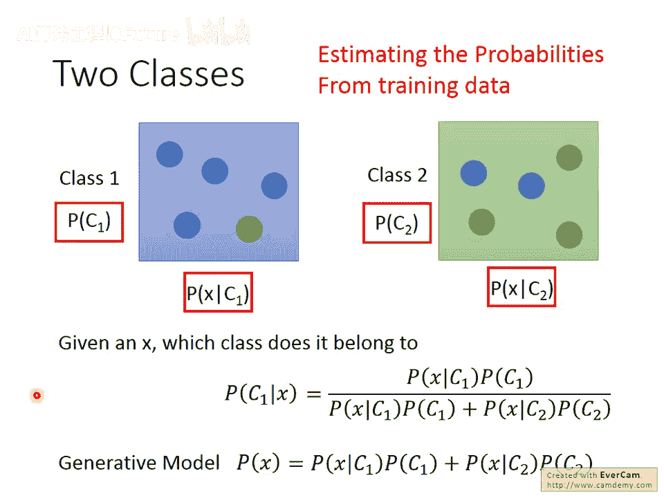

好，假设我们今天考虑的这两个pa呢，分别是水系的跟一般系的。class one就是指水系的神奇宝贝class two就是一般系的神奇宝贝。另外1016种宝可梦我们就不视它了。

我们只先考虑一个2元分类的问题。那我们现在呢把编号ID在图片编号里面小于400的水细的和一般细的就当做是training data，剩下的当做是SD data。如果你要做的更严谨一点的话。

你可以再把training data里面切那个valation的 data出来。好，在traingda里面呢，总共有79只水系的，总共有61只一般鸡。

你可能不是问说为什么选水系跟一般系的当中二元分类问题。因为我其实统计了一下18种宝本后的数，18种种类的数目，水系跟一般系是最多的啊。所以我就先选水系跟一般系。如我试一下，如果你要呃把18种都分类正确。

好像是做不开出来的。因为他们中间。做不态出来的，所以我们就只先考虑分两个class就好。好，那如果我们现在知道说tray data里面79只水系61是一般起。那从那从这个这个这个第一类里面。

从这个quest one里面simple出一只宝可梦几率是多少呢？是不是就是79除以79加61。那我算出来是0。56。那从cas two里面 sample出一只宝可梦的几率，就是61除以79加61。

就是0。44。这个是比较容易比较容易简单可以理解的啊。好，再来我们的问题是这样。怎么计算说如果给我某一个快。某一只宝可梦是从这个class sample出来的几率。比如说如果给你一个海龟。

我也不知道这个海龟应该叫什么名字，给一个海龟，它是从呃就是说从水系的神奇宝贝里面挑一只神奇宝贝出来，它是。海归的这个几率到底应该有多大呢？那我们现在的training data是长这个样子。

水水系的神奇宝贝有79只啊，所以有杰尼龟啊、柯达鸭，还有蚊香蝌蚪之类的啊，这些我是认识的啊，这我小时候在卡通有看到这个是编号后面的，我小时候卡通是没有看到，所以我不知道他叫什么名字。

他也不在这79只里面，那我们到底要怎么算说呃给水系的给就是这个这个从水系的神奇宝贝明天挑一只挑出来是海龟的几率呢？你可能会想说呃这个在这79只神奇宝贝又没海龟，所以挑一只出来是海龟的几率根本就是领的。

可是这个海龟是是水系的。因为我看他脸的时候说它是水系的。Yeah。他他反正他他这他就是水系的。所以呃你说呃他从水系里面挑出来几率是零这样也不对啊，所以所以怎么办？首先就是每一只神奇宝贝。

我们刚才讲每一只宝可梦呢，我们刚才讲过说它都用一个向量来描述O这个向量里面的值就是它的各种的特征值哦。所以这个 vectorctor呢我们又称之为一个feature。好对。

每一个宝可梦呢都是用一堆feature呢来描述它。然后呢，我们就真的把那些水系的神奇宝贝，他们的水系的宝可梦，他们的防御力和特殊防御力画出来。然其实总每一个神每一个是宝可梦，其实有7个不同的数值啊。

那不7个没办法画，这我就先画这个防御力和特殊防御力就好。那值得强调是这边是真正的data这样子。啊。如果你想要在那个完整的神奇完整的宝可梦的data的话，我在最后后面最后又要付个连接这样。

你是可以采到完整的完整的data的好。

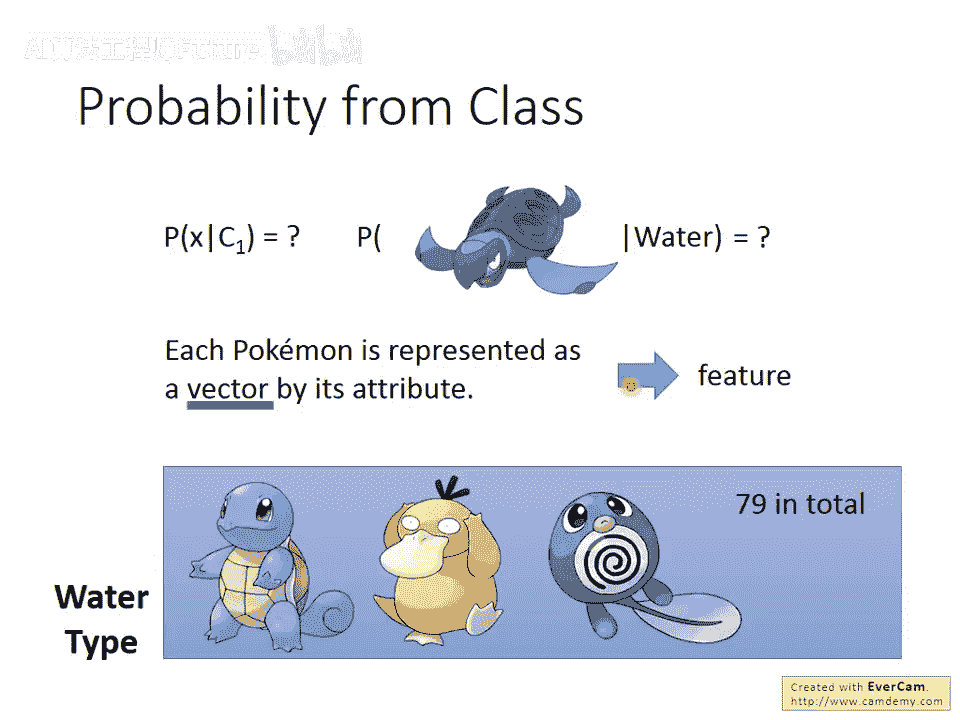

那我们就把79只宝可梦它的。这个呃防御力跟特殊防御力都画在这个图，二维的平面上。那所以这边这二维平面上，每一个点呢就代表了某一只宝可梦。比如说这个这个点是可达压，它的防御力是48，特殊防御力是50。

这个点是杰尼龟，它的防御力是60，它特特殊防御力是60，可是现在的问题就是如果给我们一个新的点，这个点是代表一只没有在我们的training data里面的宝可梦是我们没有看过的宝可梦。比如这个海龟。

它的这个防御力是103特殊防御力是45，它的位置大概在这个地方，它。从水系里面挑一只神奇宝贝，挑到这个海龟的几率。到底应该是多少？那你不可以说它是0。

你不能说呃这个这在圈 data里面从来没有出现这个海归，所以它的几率就是零这样显然是不对的。你要想个办法估测说，从这些我们已经有的神奇宝贝里面估测说，如果从水系的神奇宝贝里面跳一支出来。

它是这个海归的几率到底有多少。好，那呃呃怎么办呢怎么办呢？你可以想象说这个这79只神奇宝贝其实只是呃这个冰山的一角这，就是水系的神奇宝贝是从一个几率的分布里面。

就水系神奇宝贝它的防御率跟特殊防御率是从一个高选的dibution里面simle出来。我们只是simle了79个点以后，得到的分布涨这个样子。

但是从那个高选的dibution里面simle出这个点的几率，并不是你。我们假设说这79个点是一个从个高悬的dibution里面simle出来。但我们要做的事情就是如果找这呃。那给我这79个点。

我们怎么找到那一个高ian的ditribution？好，那高iandiion，我这边还做几个投片要说高选 distributionion，那我觉得这应该嗯不用讲吧。好。

就是假设你不知道高ian distributionion是什么的话，你就想成它是一个function啊，这个function的 inputput就是一个 vector X啊。

在这边呢代表某一只宝可梦的数字。

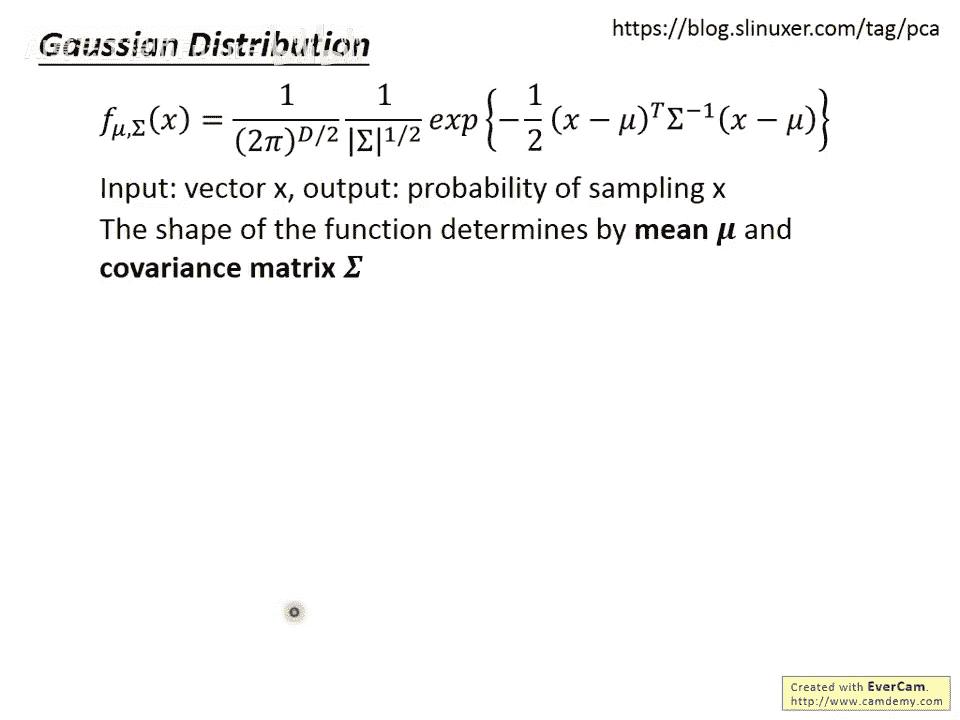

它的outer就是这一只宝可梦，从这一个ditribution里面，这个S从这个ditribution里面被simble出来的几率，其实严格说起来，这个东西并不是几率，它是proability的den。

它跟几率是成正比的，但它并不exactly就是几率。啊，但是这边为了不要让大家太太混乱时，我们就假设说它是一个几率。好，那这个几率的分布呢，它是由两个东西决定，一个东西呢叫做me啊，这边写成m啊。

另外东西呢叫做variance啊这个叫做写作sigma，它是一个mats啊，命是一个 vector啊，这个sigma呢是一个matches。哦，所以如果你把m。跟sigma代入这个看起来有点复杂的方。

那它就会有不同的形状。就同样的X。如果有不同的缪跟不同的sigma，那你带进他们的X，它的凹的几率分布呢就会是不一样的，下面呢就举几个例子啊，比如同样的sigma啊，不同的缪啊。

代表说它们几率分布最高点的地方是不一样啊，或者是呃同样的缪啊，不同的sigma代表说几率分布最高点是一样的。但是他们这个分布的这个散的程度啊是不一样。

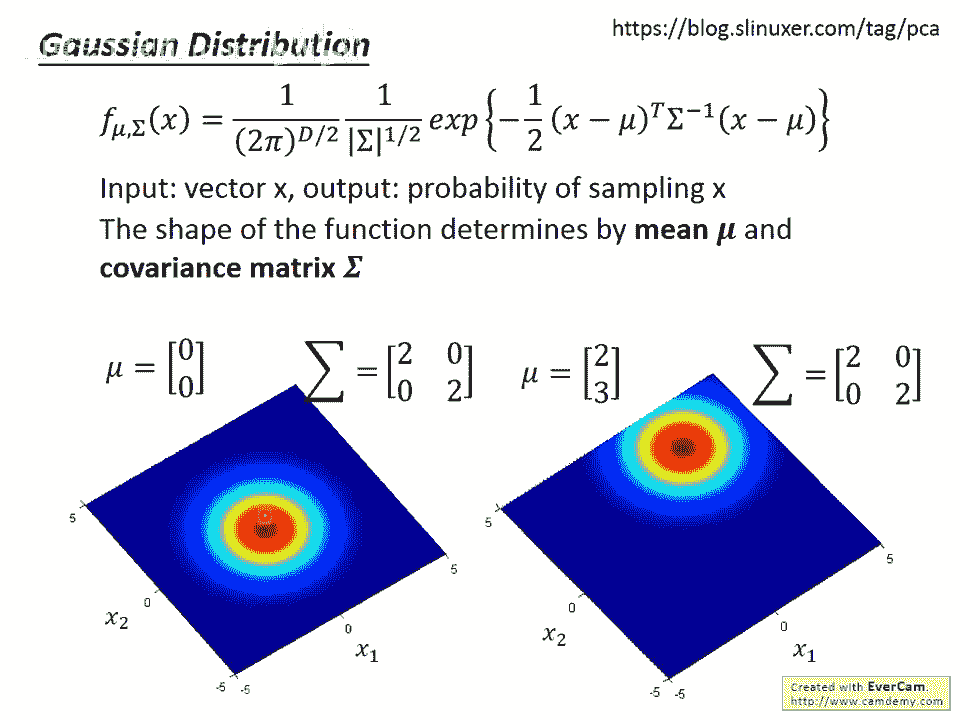

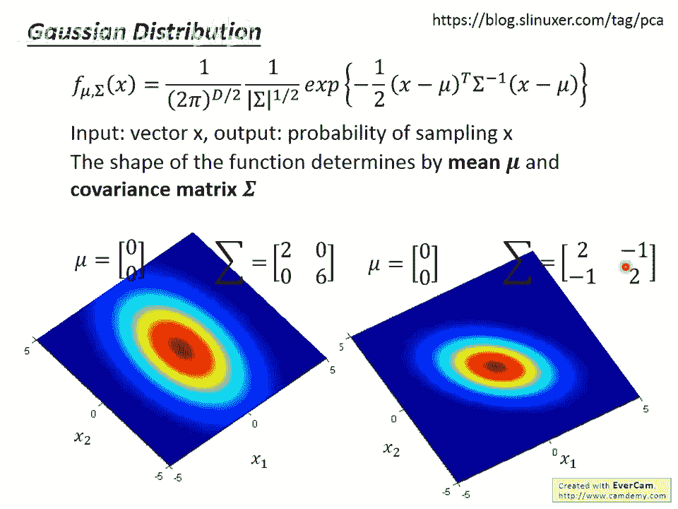

好，那接下来的问题就是。给我们这从我我们假设有有一个高选存在，从这个高选里面simle79次以后，simle出这79个点。那到底这个高选。长什么样子呢？到底这个高选长什么样子？

如果我们可以找到这个高选的话，假设我们可以根据这79个点估测出这个高选的缪啊，它的命应该在这个位位置啊是7571。3。他的igma应该是呃这样的分布啊。

它的这个S跟Y有呃这个跟SY是有一些有一些corre的，但是没有这个S平方跟Y平方这边这么大，而且他大概是长这个样子。那给我们一个新的点X。它是我们过去从来没有看过点，它不在这个sly里面。

他不在这79个sly里面。但是如果我们知道缪跟X的话，我们就可以把高选的这个ion的方写出来。知道缪跟X我们就可以把这个方写出来这个是depend onX就把它写成F下标缪跟你把这个X带进去经过一串复杂的运算以后。

那你就可以算出呢某一个X从这个高选里面，从这个命是new它的vari高里面被simple出来的几率。那你可以如果你对这个方没什么概念的话呢，就可以想象说如果X越接近这个中心点接近谬这个地方。

它当然是simple出来几率是比较大。那像X在这个这么远的地方simple出来几率呢就是比较小的。好，那这个问题就是怎么找这个m跟怎么找这个s嘛。

这边用的这个概念呢叫做maximement的likelihood。

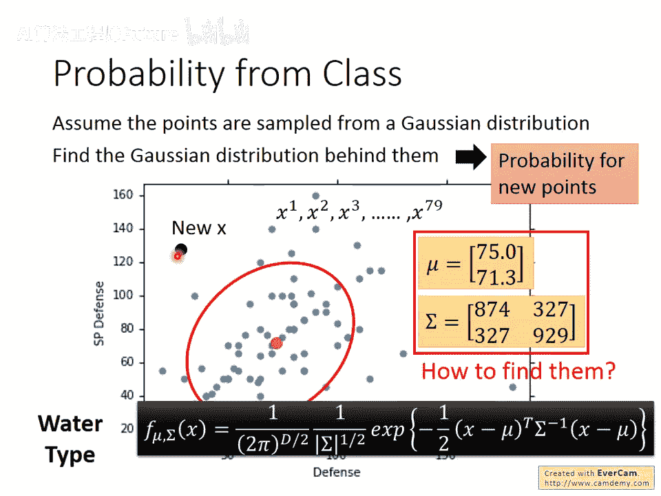

那你可以想象说这79个点其实可以从任何一个高选里面被simble出来，对不对？任何一个高选都有可能simble出这79个点。不管你是m在这个位置，然后它的covariance长这个样子。

还是m在这个位置，它的covariance长这个样子，它都有可能simle出这79个点，对不对？因为你从高选里面simle出一个 point，它可以是整个空间上的任何一个点，只是有些地方几率很低。

有些地方几率很高，但没有一个地方的几率是Z等于零的。所以虽然说右上角这个高选右上角这个高选后，它呃呃它sle出左下角这个点的几率很低。但是并不代表说这个几率呢，是你。那。

但是虽然但是虽然说每一个高选都有可能sample出这79个点，但是他们sle出这79个点的可能性是不一样啊，他们sle出这79个点的like hood是不一样。哦，显然说如果你的高选是这个的话。

它simle出这79个点的like会比较高。因为你高选是这个的话，它simle出这79个点的高选几率是比较低的。好，那所以说呢如果今天给我们某一个高选的m跟sigma。

我们就可以算这个高选的likelihood。也就是说给我一个高选的m跟sigma，我们就可以算这个高选simle出这79个点的这个几率。那这个 likelihoodli呢。

这个可能性呢我们可以把它写成这样一个式。这个可能性呢。这边呢我们也用了L，因为我想不到更好的notation，它可能会跟那个lo function有点混淆。

但是like我觉得用别的notation又很怪，但是我们还是用L。好，那这个L呢它的 input分就是高的密igma。然后做事就把这个migma带到这个mic的方里面。

那他要告诉我们说这一个m跟igma，它simple出这79个点的几率呢到底有多大。它的可能性到底有多大？那这个东西怎么算？这个点这个东西就是这样算？

你就算说因为所因为所有的这个79个点是这个这个这个独立被simle出来。所以今天这个高选，simle出这79个点的几率，就是这个高选simle出第一个点的几率，乘上simle出第二个点的几率。

乘上simle出第三个点的几率，一直到simle出第79个点的几率。好，那所以我们有79只水系的神奇宝贝。我们知道说它是从某一个高选被smble出来的。我们接下要做的事情就是找到那个高选。

那个高找找找一个高选那个找找一个高选，那个高选，它simle出这79个点的几率是最大的。或者它simple出这79个点的like who是最大的那这一个高选，我们就当做是呃simle出这79个点的高选。

好，那这个呃like you最大高选呢，我们写作new star跟sigma star。所以我们现在要做的事情是这样like的方向写作这样子。那这个每一个F如果你想知道的话，它很复杂，就写成这个样子。

OK你就把把这个X呢带进去，那就算出它XQ带进去，就算出它。然后呢，我们要找各种不同的穷举所有的m，穷举所有的sigma，看哪一个可以让上面这个likeho的式子最大。

它就是我们要找的那个mus star跟sigma star，它就是我们认为最有可能产生的79个点的mus star跟sigma star。我们又当中这79个点。

就从这个m star跟这个sigma star sample出来。这个东西。怎么做呢？嗯，其实是这样子啊，如果你爽的话，你就用微分解一下，就找那个极值的地方这样就描解描解这样，你也可以就是对个公式解。

这种描解，就是哪一个mus star可以让这个最大呢？这结果是很直觉的。来，这就是平均值可以让到这里的。OK所以你就把79的X。平均起来好，有办法，79的X，他们都是 vector了，加起来。除夕是9。

就得到new star平均就是mus star。如果你你不爽的话，你就把这个式子取个为分啊，对谬取个为分，然后找他唯分是零的点，解出来就是new starO。新马star是什么呢？

你先把me star算出来，OK先把那star算出来。然后呢，对所有的XN，你都算XN减mus star乘XN减mus star的这个trans pose，也就是算说这个。X3。

的这个这个这个假设SN的命是new star的话，它的covariance来算出来呢就是sigma star。如果不少的话，就就是呃呃把这些只在sigma star做为分。

然后在sigma做为分来解它这个那个唯分是的点你出来这个。好，那有了这些以后呃有了这些以后，我们就真的去算一下，这个是真正的结果。79只水系的神奇宝。

79只水系的宝可梦算出来的谬是这样子算出来的sigma是这样子。也就是说呢呃最有假设这个79只呃水系的神奇宝贝是从个高选simble出来的话，那最有可能smble出这79个点的高选，它的命是谬 one。

它的covariance是sigma one。那如果你看cast two的话。那c two是一般系的神奇宝贝，有几只呢？有61只。好，那我们一要算它的命跟算它barries。

那这61只一般系的神奇宝贝最有可能sple他们的高血，它的命是涨价，它的varis是涨价。有了这些以后。就结束了OK我们就可以做分类的问题了。怎么做呢？我们说要做分类的问题。

我们只要算得出P ofclass one givenX就给我一个X，它是从CY来的机率。那这整项可以写成这样。然后只要这如果最后我们算出来这一项大于0。5的话，那S就属于。开 oneO。那。

P of c one很容易算，就就这么回事。P of c two我们算过就这么回事P哦 x given one怎么算呢？我们已经找出这一个。

我们已经假设说这个东西它就是一个高这个高的跟variance分别就是new one跟igma one这我们刚才已经算出算出来过了。

我们为我们刚才已经根据class one的所有的那79只神奇这79只宝可梦分布，知道说他们是从个命是me one covariance是sigma one的这个ion里面sple出来的。

那如果是这一项呢p of x given c two。那我们也知道说它的这个高，它是从个me是m covariance是的里面s出来。有了这些以后就问题就解决了。好，那结果怎么样呢？我们我是真的有做的。

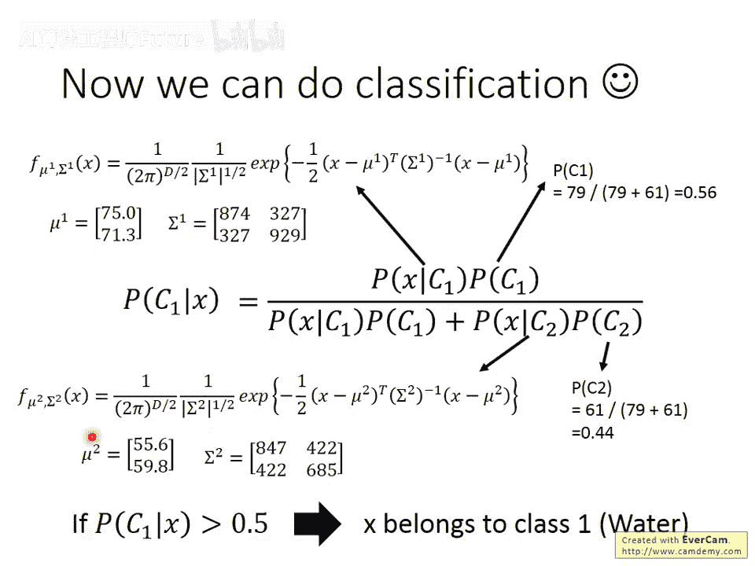

那蓝色的点呢是就这个横纵轴，横轴跟纵轴分别就是防御率跟特殊防御率。好，蓝色的点呢是看水系的神奇宝贝的分布，红色的点呢是这个呃一般系的神奇宝贝的分布。看到这个结果有点紧张，我觉得这好像分不分不出来啊。

我用人眼看就知道好像不太OK。好，那我们就真的计算一下，在这个平面上，在这个二维平面上，每一个点。每一个点我都当做一个X进去，我都可以算一个每它是这个C万的几率，对不对？

这这个图上的每一个点我都可以算它是C万的几率。那这个我把这个几率呢用这个颜色呢来表示红色就代表说呢在这个区域呢是plsY就是水系神奇宝贝的几率呢是比较大。在这个地方呢，水系神奇宝贝的几率是比较小。哎。

那这很合理嘛，因为水系神机宝贝的分布还是在这边比较多啊，还在这边比较多，所以这个地方几率是比较大。好，那我们现在因为我们处理的是分类的问题，我们不知要算这个机率，我们知道outpo说是哪一类。

那所以我们说几率大于0。5，就是类别一，也就是红色这个区间就是类别一，几率小于0。5，就是蓝色这个区间他们就是类别2，这不是类别一。好，你会发现说呃如果你看蓝色的点的话，是比较多的。

蓝色的点是在这个红色的区间。那红色的点是比较多在这个呃蓝色的区间，但有一些到红色的区间，那有点难搞，因为他们中间没有一个明确的boundunder。然后那把它apply到testing set上。

现在呢testing set就是编号大于400的那些宝可梦了，好，把它们这个class one和class two宝可梦也画在这个二维平面上。那boundary呢是一样啊，这个boundary是一样。

哎发现说嗯分的不甚不是太好，正确率是47per的。

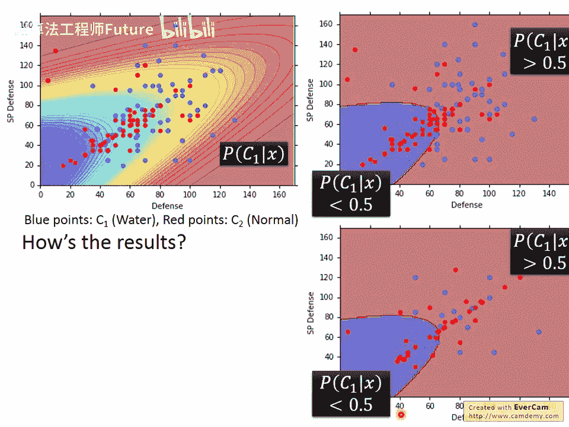

那我就有点担心，我看我我这这会不会是这有有可能是分不出来的，这也是有可能。但是我想说我们现在只看了二维的空间，对不对？呃，机器学习厉害的地方就是因为我们这道机器处理这个问题，所以高维的空间也可以处理的。

不是只处理二维的空间而已。所以我们看一下高维的空间。事实上每只神奇宝，每一只宝可梦呢，它是分布在一个七维的空间空间里面。如果只用二维的空间分不出来，可搞不好七维分得出来啊，就是这个红色跟蓝色搞不好。

在高维空间上看到是一个是这样的这样，而你是现在从上面往下看，就觉得叠在一起高维空间上搞不好是分开的好不在七维空间上是分开的。好对，所以每一个宝可梦呢，它都是用7个数值来表示。

所以每一个宝可梦都是存在七维空间中的一个点，我们一样可以算。class one和class two在七维空间中的那些点的simple出7维空间中那些点的m one跟m two ok所以谬 one和谬 two都是7文sigma one和sigma two都是7乘以7的mat。

然后我就做一发做一发这50很糟样子跟猜就大概也是差不多这个样子。然后就 set。然后呢下周再看看要怎么改进它谢谢。你次。什么意思。あ。好呃，各位同各位同学大家好，啊，我们就开始上课吧。

上次我们讲到哪里呢？我们讲到说。呃，如果我们想要做宝可梦的分这个这个呃属性的分类的话，我们可以假设一个几率模型，假设一个几率模型啊，我们把这个几率模型里面呢拆成有quire的。

跟每一个class自己的ditribution。那每一个 class自己的几率呢，就用高选来假设它好，那经过一番运算。

我们算出每一个class的quire跟每一个class的高选 distributionion以后呢，做一下做一下。

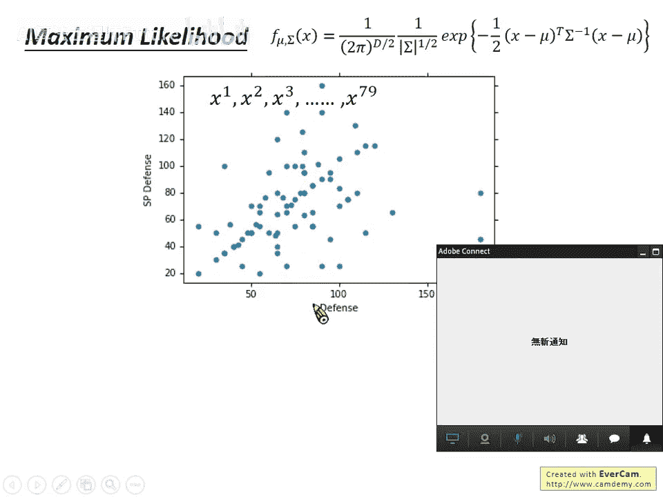

做一下。好，讲到这边好，做一下以后就发现了结果坏掉了。就算是我用了全部宝可梦的7个feature，还是坏掉还是坏掉。啊，那怎么办呢？都怕啊。好，结果坏掉了。啊，结果坏掉。

那其实呢当你用这样子的proabilitygenative的 model的时候，像我在上一堂课里面用的那一种模型是比较少见的。

其实你不常看到呃给每一个高选都有自己的命跟自己的varianceO给每一个高选都有自己的命，看自己的variance。class one有一个new one有一个sigma one class two。

有一个m two sigma two比较常见的做法是不同的class可以share同一个covariance的mat。

我就首先你想想看cocovariance matrix它其实是跟你 inputput的feature size是成这个平方程它的平方程正比的。

所以covariance matrix当你的feature size大的时候，它的增长呢其实可以是非常快。所以在这个情况下呢，如果你把两个不同的高选都给它不同的vari covariance。

那你model参数可会太多。model参数多，它就variance就大，也就是容易 overfi。呃，所以呢如果我们要有效减少参数的话，我们可以给这两个class。

就是属于水系的神奇宝贝还属于一般系的神奇宝贝。他们的这个呃描述他们这两个class的这些feature分布的高选故意给他们同样的covarianceme，强迫他们共用同一组covarianceme。

这样子呢你就只需要比较少的parameter，就可以来model这一个模型了。这是什么意思呢？呃，现也就是说现在我们有79只水系的宝可梦，我们假设它是从一个命是new外。

这个呃convariance batteries是sigma的高选所 generate出来。那另外有这个呃这边是多少只呢？这边应该是61只哦，编号从我们我们这边给他编号从80到140哦。

有另外61只是属于一般系的宝可梦。我们假设这些宝可梦，它们的属性。的这个分布呢是从另外一个高选所generate出来的。另外一个高选，它的me是m to。

但是它的covariance matches跟genary前一个跟geneary class one跟gen随属性的宝可梦，他们用的covariance matches呢是同个哦，这两个class。

他们是同一个covariance matches。好，如果这样子的话，你怎么计算like呢？啊，如果你现在要计算某一组new one new two和 sigmagene这总共两个ca合起来140比data的可能性的话。

你就像下面这样计算这个。呃，这个计算方法就是计算，如果你今天用m one跟sigma one产生X one的几率，乘上用谬 one跟sigma one产生S two的几率。

到用m one跟哦大家都一直念呃。sigma啊不好意，这边sigma one不好意，这个不是sigma one，这个是只有sigma而已。因为这两个class是共用同。啊。

现在呢用m one跟sigma产生XY到用m one跟sigma产生S79。那如果是第一个class的X呢，用这个方法来产生。如果是第二个class的S呢，你就用m two跟sigma来产生X80。

用m two跟igma来产生X81到用m two和sigma产生S140。好，那这这个式子里面呢m onem two呃，你要怎么算m onem two呢？

你要怎么找一个m onem two跟sigma让这个like two的方向最大呢那m onem two的算法跟我们之前没有把case one和 two的 covariance在一起的时候。

那个算式呢是一模一样的。O你就只要把case one里面的X平均起来就变m one two里面X平均起来就变m to。唯一不一样的呢是。我们要把它按接受这样。好。好。好看一下哦，好。

那唯一不一样的呢是sigma。好唯一不一样的是igO因为那我们现在sigma要同时考虑这两个哦，所以它当然是不一样。那这个sigma的市值应该长什么样子呢？这个sigma的市值呢？

这个这个结果非常的直观。那你可以呃如果你想要看它推讨的话，我这边引用的就是呃这个叫个数那以后仅以后如果需要引用的话，都尽量引用为什么呢？因为他在网路上呢有的版本。好。那个。

这个sigma应该长什么样子呢？这结果非常的直观，你就把原来我们根据这些data所算出来的covariance matrix跟根据这些data所算出来的covariance matrix sigma two weighted by他们的eleement的数目O你这个cast one有79个。

所以你就把sigma one乘以79class two有。61个你你就把61，然后再取平均。你就把原来这两个高选各自算的covariance message加权平均就会得到。

如果你要求他们用共同的高选的时候，所得到的covariance match。

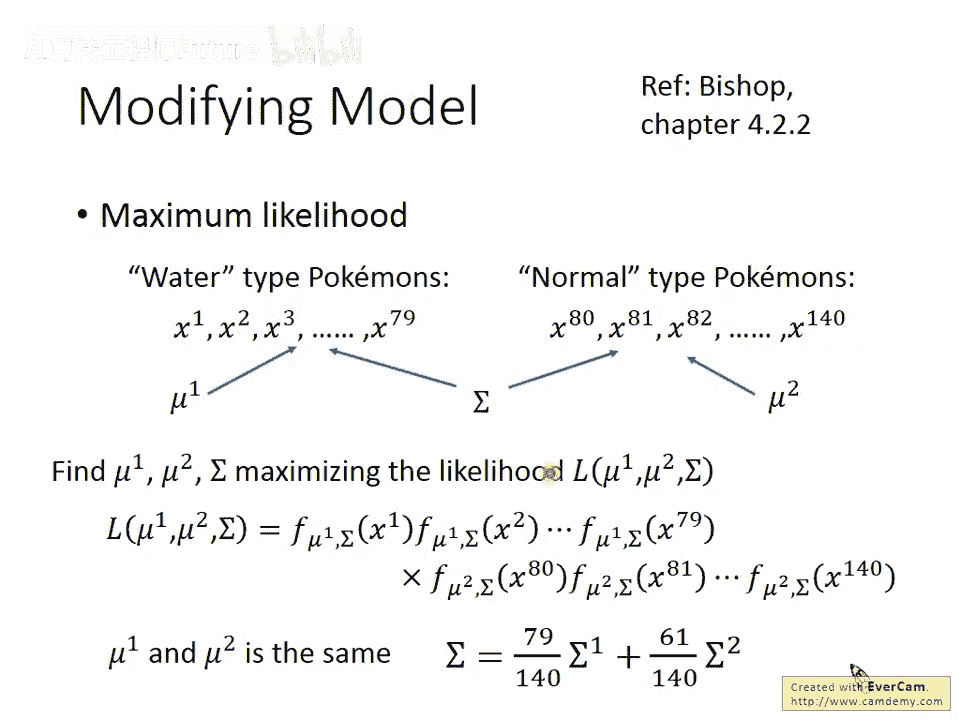

好，那我们来看一下结果，假设我们仍然是用两个feature，用defense跟呃special defense的话，后来我发现我这两个这个example选的不是很好。

因为如果你看defense跟special defense，你没有办法把它水系跟这个一般系的神奇法问论开。后来我研究一下，我觉得好像用这个攻攻一般攻击力和一般法问率合起来的。

就好像还可以分的蛮开的这样子。但是我怎么会事先知道这件事呢，我又不是大梦博式的。好，那如果我们今天用。同我们今天共用covariance matrix后会发生什么事呢？在没有共用之前。

ca one和c two的 boundaryary呢是这一条是个曲线啊，是个曲线。如果我们今天共用同样的covariance matrix的话，你会发现说他们的boundary变成是。一个直线哦。

就假设你把这两个不同的class强迫他们的covariance match必须要共用同格的话，那你今天在分类的时候，你的boundundary呢就会变成是一条直线。哦，所以像这样子的model。

我们也称之它为line的model。我们讲说高什么不是line的。但是它的分两个class的那个boundary是line哦，所以这样的model，我们也称它为line的model。好。

但是如果你今天两个class，你用不同的covariance matches的话呢，他们就不是liar的model。好，那如果我们考虑所有的feature会怎么样呢？

如果我们考虑所有的feature的话，原来我们只得到54per的正确率。但是神奇的是，当我们共用variance时就得到73per的正确率的。显然是有分对东西的。对那你说为什么会做到这样子呢？

其实就很难分析了。因为这个是在空间中发是发生的事情哦是在维空间中发生的事情，我们很难知道说呃这个bound呢是怎么切的但是这个就是 learningning分的地方。

就是我们没有办法人没有办法呃知道怎么做，但是呢可以帮我们做出来。如果人如果你feature很少二维feature人一看就知道怎么做，那其实你根本就用不上 learning对不对？好。

所以现在可以达到73per的正确率。

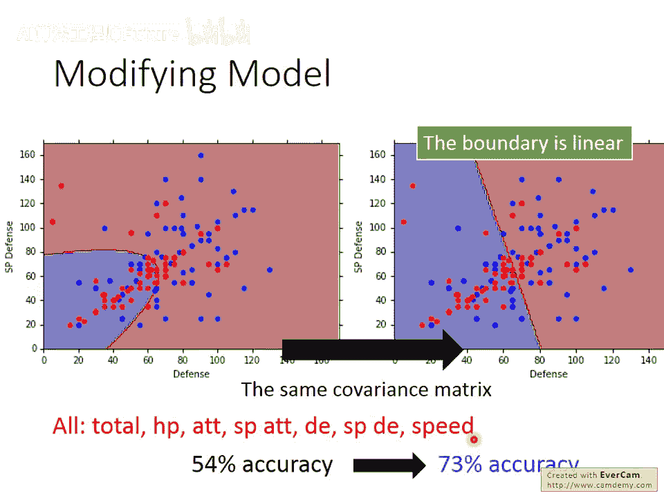

好，那。我们来回顾一下我们讲的这个呃几率的模型。那我们讲说machine learning呢就是三个t。那这个几率模型呢它其实也是三个t。首先你有一个model哦。

这个model就是你的function set这个function set里面的function都长什么样子呢？这个function set里面的方选都长下面这个样子，input一个X。我们有。

P呃这个P one的qui probabilityclass two的qui probabilityclass one产生X的 probability distributionclass two产生X的 probability distribution这些qui probability看这些pro distribution就是model的参数O你选择不同的pro distribution。

你就得到呢不同的function。那你把这些不同的 probability distribution，我就得高选。

你选不同的命跟不同的covariance matrix你就得到不同的 probability distribution。

你把这些 probability distribution集合起来就是一个model就是一个。好，那怎么决定是哪一个class呢？

如果P of c one given x这个poeror probability大于0。5的话呢，就po class one反之呢就outpo class two这个是function的样子。好。

接下来呢我们要找evaluate function在里面每一个function的好坏。那怎么evaluate呢？在这个几率的模型里面，我们假设我们今天使用高的话。

那我们evalu我们要evaluate的对象，其实就是高里面的参数，也就是命跟covariance。那今天呢我们就是说如果一个命跟一个covariance matches。

你用这些参数来定义你的proability distribution，而它可以它的这个产生我们的training data的 likelihoodlihood，就是这种参数的好坏哦。

所以我们要做的事情就是找一个proability distribution。它可以最大化呢产生这些data的呃 likelihoodhood。这个是定义方程的好坏啊，定义方选的好坏，定义组参数的好坏。

那最后怎么找出一组最好的参数呢？你就看看前面的创影片，它的结果呢是很tri的。啊，那有人就会问说。为什么要用高选，你为什么不选别的这样？简单的答案就是嗯如果我选了别的几率，你也机率模型。

你也会问我同样的问题。其实你永远可以选一个你自己喜欢的这个这个proability distributionion。OK这个是你自己决定的。OK这个就不是不是人工智慧。

是你凭人的智慧去决定说你要选择哪一个几率模型是比较适合的。那呃你选择几比较简单的几率模型参数比较少的那你的bias就大veance就小啊，你选择复杂的，你bias就小。

veance就大那你Q可能需要用来决定一下找怎么样的机率模型呢是比较好的。好，那呃我们有另外一种常有一种常见的假设是这样。假设我们的这个X，我们知道X，它是由一组feature的来描述它。

像刚才在宝可梦的例子里面，X可以有7个数字啊，7个参数。好，那我们假设呢每一个dimenion它的它产生的几率，它这几率模型产生出来的几率是 independentdependent哦。

所以这个X呢产生的几率可以拆解成呢X one产生的几率，乘上X two产生的几率乘上XK产生的几率，一直到乘上X。大K产生的几率。就如果我们假设这些几率分布他们是independent的话。

每个dmen几率分布是independent的话，我们可以做这样子的假设。好，那呃今天你可以说每一个几率呃就是X one产生的几率。XQ产生的几率XK产生的几率，它们分别都是。

一维的一维的大家知道意思吗？如果你这样假设的话，等于是说呃强迫我们之前讨论的都是mvariable的高选嘛，都是高多维度的。如果你假设说每一个di分开model他们都是一维的的话。

意思就是说原来那个高维度的高选，它的covariance变成是agonal哦在不是对角线的地方其都是零这对角线的地方有这样你就可以更减少你需要用的参数量，就可以得到一个更简单的模型。

那我试一下这个试一下这样结果是坏掉的。可以看来这个模型太简单了model这个这个不同的呃feature间的covariance，我看也是必要的。

比如说我觉得比如说战斗力跟防围率其实是有正相关他们这个model们之间ance看来是必要的。那你也不一定要用高选。有很多时候你凭直觉就知道不该用高选。比如说今天假如设你有某个feature。

它是binary的OK有某个feature，它代表的是是或不是或者它的output就是零跟一这样。比如说呃。有一只宝一只宝可梦，它是神兽还是不是神兽之类的，这个就是finary的feature。

如果是finary feature的话，你选你说它是用高选几率产你，有可能你说他用高选 distributiontribution产生的，就太自欺欺人的，所以他应该是用不太可能是用高选兽产生的。

这你就会假设别人的ditribution。比如说假设你的feature是finary的，他，要么就是你要么就是一这时候你可能就会选择他说它是一个banno利的ditribution。

而不是一个高选的ditribution。啊，如果我们今天呢假设所有的每feature，它都是。independent产生的我们不modelfe之间variance的关系。

那这种这种我们这种方法做分类的话，我们叫做用哪ive base的classify他他他前面有个ive因为他真的ive很简单那呃你可能会常听到有人说哪ive class那就其实他不强就depend你的你的这个这个假设是否是是精准的O如果你今天不同的你假设不同的dimen他们之间是independent这件事情是很切合实际的那哪ive classify它确实就可以提供给你很好的perform。

但如这个假设其实是破不成立的话，那其实ive classify他就的就太了，它就不是一个好的class。好，接下来呢我们要做的分析是我们要分析这一项posteror probability。

咱们做一些呃整理以后啊，我们会发现一个有趣的现象。然后我们这一项呢大家应该都没有什么问题。我们把它们上下同层分子。上下同除分子。

我们把它上下呢都同除P ofXD跟CY乘上P ofCYOK所以分子的地方就变一。分母的地方就变成一加POX givenCQ乘上POCQ除以POX givenCYPOCY。那我们假设这一项啊。

这个这一项取。那个log以后取ntural log以后呢，它等于Z，我们假设这一项呢取natural log以后它等于Z。

那我们就可以把这个posteror probability更进一步写成一除以一加exent的负Z次方。这个这个负这个这个Z呢是这一项O那你把这一项放进去乘负号就是上下颠倒再去exential。

把exential跟 naturaltural log抵消，也就得到这一项，然后就得到poster probability。哦，相信这个大家应该没有什么问题。这个function呢它的input是Z。

它这个这个 function呢叫做signma function。如果你把它这个这个output对Z的关系做图的话，你会发现是这个样子。也就是Z呢趋近于无穷大的时候，它的open呢趋近于一。

Z呢趋近于负穷大的时候呢，它的open呢趋近于0。好，那接下来我们要做的事情是我们要把这个Z呢算一下它到底应该长什么样子。我们来算一下这个Z呢，它应该长什么样子。接下来这边呢是数学比较多的。

如果你觉得这个无聊的话呢，你就算一下，等下听一下结论就好。

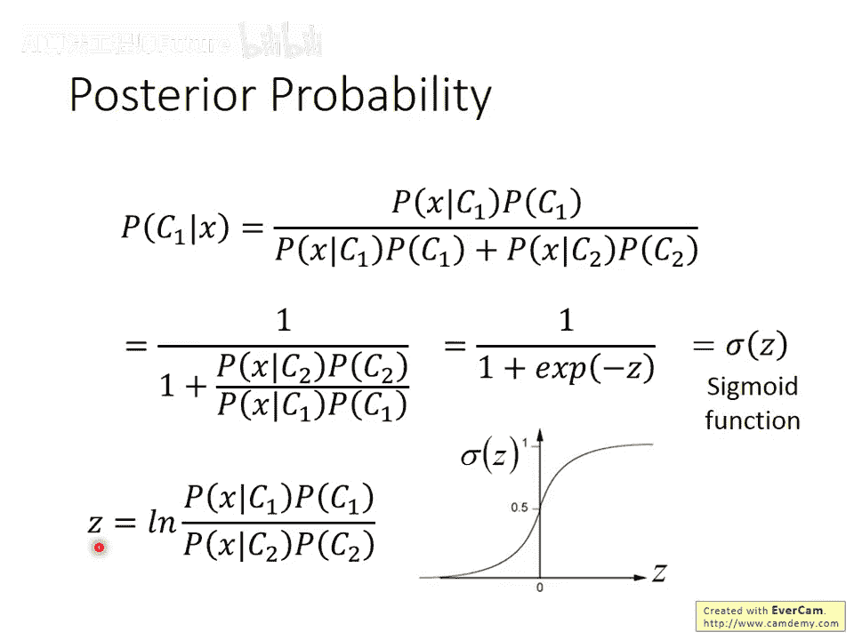

好，那这个Z应该长什么样子呢？我们已经知道说postseror probability，它是一个Z的s boy function。Z长这个样子。Z长什么样子？我们把这个相乘的部分取natro log。

所以就变成相加。那POC one出POCQ是什么呢？这个我们都知道说哦这边N one呢代表pl one它在确定 data里面出现的数目N two代表pl two它在确定 data里面出现的次数O所以POC one就是NY除于N one加NQPOCQ就是NQ除以NY加分母立方向量所以等到等到N one除以NQ这个是小学生的数学。

好，那P ofX一和CY是什么呢？我们说它是一个 probability distribution。这个高选的 probability distributionbution就XE跟CQ。

它是另一个高选的 probabilityability distributionion。如果我们把它相除，我们把这两个高线 probability相除，再取naural log会得到什么式值呢？

哇就得到这样，把这个方案上面把这一项呢放在下面，那这一项。跟ditribution是没关系的，把它消掉。把它消掉，然后这一项呢把它提出来啊提出来相乘变相加，这一项呢把它提出来。

然后这个exponential的部分呢呃相除啊等于exponential里面相减这个也没什么特别的啊，把它们分开啊，相乘变相加相乘变相加得到这样。

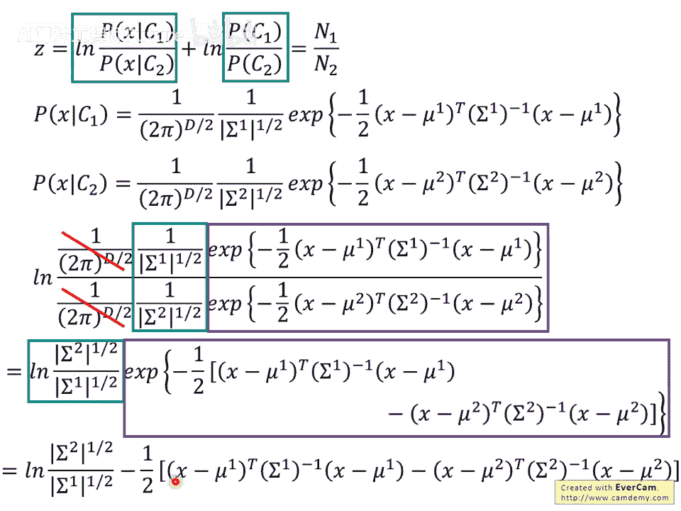

好。那接下来呢接下来你就。

做一些运算，把它展开这样子。我先想要知道说X减谬onetranspose乘上s one的inverse再乘上X减谬 one，它应该长什么样子，把它展开啊展开啊，所以这个乘这个乘这个啊就等到它这个呃。

这个乘这个乘这个就得到它啊，这个乘这个乘这个就得到它这个乘这个乘这个就得到它好，那中间这两项呢是可以合并的，是可以合并。他们其实是一样的，所以就得到这样子的事。おい。这一项展开就变成这样。

那这一项展开呢。这一项展开呢，因为这个跟这个只差了一个，就你是把一换成2嘛。好，所以你就把下面这个式子的一都换成2就行了。好，所以呢这个Z这一项呢，它写成这样。

前面呢是这个跟six one one和s one two有关，前面呢是six one one和s one two的determinant相处。后面呢。把-2分之1乘进去好把-2分之1乘这一项哦。

你得到这一项。把-2分之1乘进去好吧，-2分之1乘这一项，你得到这一项。然后最后呢再加上这个几率，最后再加上这个几率，你就知道Z呢是多少了。好，那如果你刚才没有听得很懂，没有关系的。

那其实没有特别重要啊，反正就是经过一番运算以后，我们知道Z哇长得很复杂，长这个样子。但是我们刚才有说过呢，一般我们会假设covariance matrix是共用的。

所以C管 one等于C one two等于C管。在这个情况下呢，我们就可以简化上面这个式子，我们就可以简化成这个sigma two的determinant。所以sigma onedeterminant。

如果sig one等于sigma two的话，它就可以消掉。这边有一项-2分之1XT西one inverseS这边有一项2分之1XT西2 inverseS。

那这个新码 one那新码 two如果是一样的话呢，他们也可以消掉。所以我们之后得到的结果呢，就只剩下1234。5项。然后呢，这个呃你会发现说只有这一项跟这一项是跟X有关的。

是跟X有关的这三项是跟X无关的这两项最后都有乘在X。所以先把这两项呢集合起来哦，这两项集合起来，把它的X提出来，把X提出来，把X提出来。O以这两项集合起来，就变成呢。就变成了。

因为sig马 one等于西马Q。那X呢。都乘上X对igma跟X可以提出来变成sigma inverse乘以X。然后这边有m one的transpose，这边有m here trans，这边是相减。

所以呢这一项跟这一项合起来就变成m one减m trans乘igma inverse乘上X剩下这三项呢就原封不动把它排在后面。接下来呢我们假设说。

这个东西m one减m two的transpose乘sigma的inverse，它合合起来就是一个 vector。我就假设你把m one算出来，把m two算出来，把sig one算出来。

那你再带到这个式子里面把sigma做inverse，把m one减m two乘到transpose，那你就得到一个 vectorctor啊，把那个 vectorctor呢叫做W的transse。

后面这一项你可能觉得看起来很可怕，但它其实很简单，因为我们从这边开始看，这是一个这是一个vectorO这是一个mats，这是一个ve，把它们三个乘起来以后。

你得到的其实就是一个scalar了解啊它其实不是什么复杂的东西，它就是个数字，你把这一项乘这一项乘这一项啊。你把这个 vectorctor的transpo。

乘上一个mat的这个inverse再乘上一个 vector，它也是一个sner，那这个log n one除以 n two，它也是scaar ok所以你只是把这三个数字加起来而已，它们就是个数字。

所以我们就拿B呢来代表这个看起来很复杂的数字。假设你知道呃me谬q跟sigma，那这一项其实就是个。这一项其实就是一个sscalener啊，它就是一个数字而已。好。

所以呢我们知道说我们可以把posteror probability这项几率呢写成sigma of zZ呢又可以写成这样子。

所以我们其实可以把这个posteror probability呢就简单写成sigma of这个W跟X的 inner再加上一个这个常数B我们可以把Z呢写成W跟X的inda再加上个常数B。

所以我们可以其实posteror probability，它根本就没有这么复杂。它写起来呢，就是这个样子。所以从这个式子你就可以看出来说为什么我们今天把sigma one跟sigma two共用的时候。

假设sigma one必须等于sigma two的时候，你的 boundary，你的class one和 two的 boundary会是 linear。你从这个式子呢就可以很明显的看出这件事情。

那在genative model里面，我们做的事情是我们用某些方法去找出上面这个式子里面的NYNQ new onemq嘛。找出这些以后，你就算出W就算出B，你把它带进这个式子，你就可以算几率。

但是如果你看到这个式子的话，你可能就可以有一个直觉的想法。为什么要这么麻烦呢？假设我们最终的目标都是要找一个vectorW都是要找一个constant B。我们何必先去搞个几率。

算出一些new啊sigma什么的，然后再把它。搞起来再得到W跟B呢，这不是舍近求远嘛。你家做一件你根本就不需要做的事。你最后你只需要做W跟B嘛，所以我们能不能够直接把W跟B找出来。

这个呢就是我们下一份投影片呢要讲的东西，这个就是。

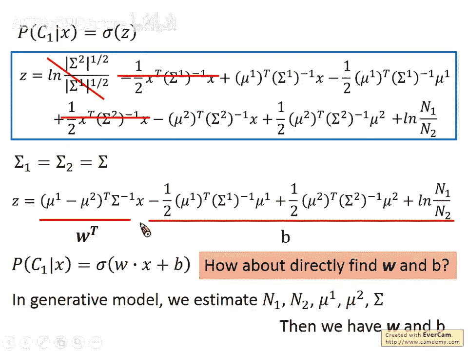