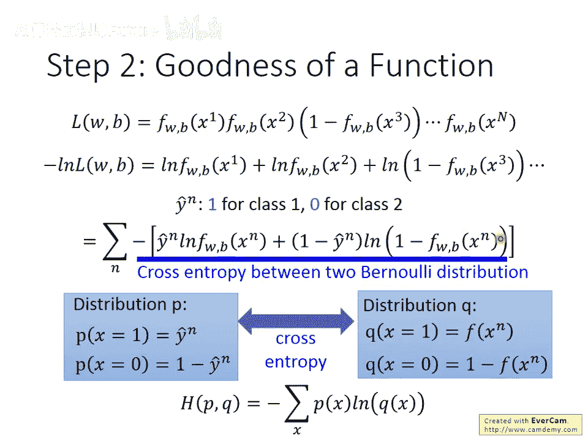
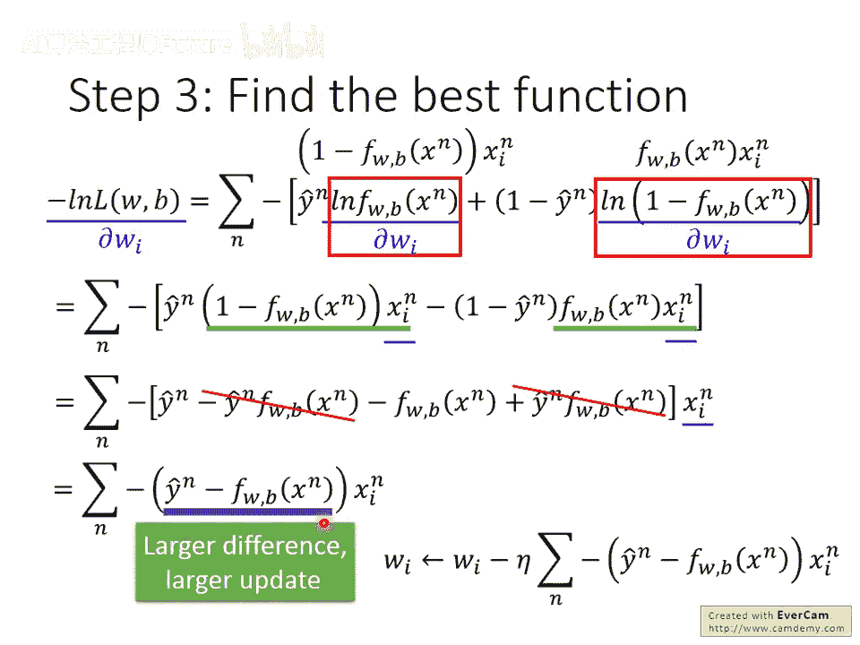
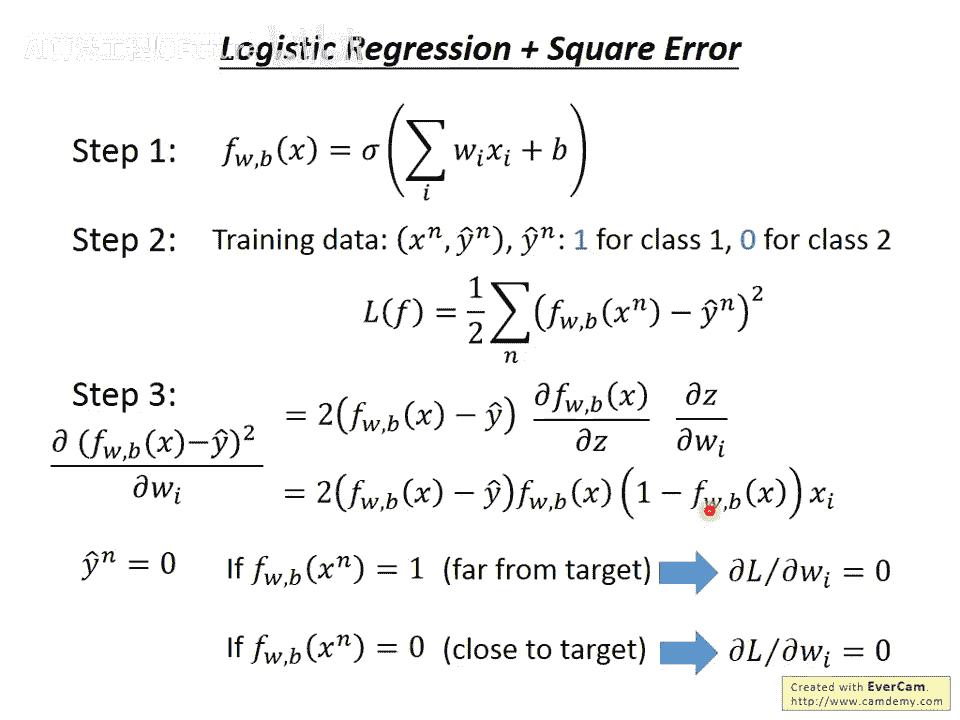
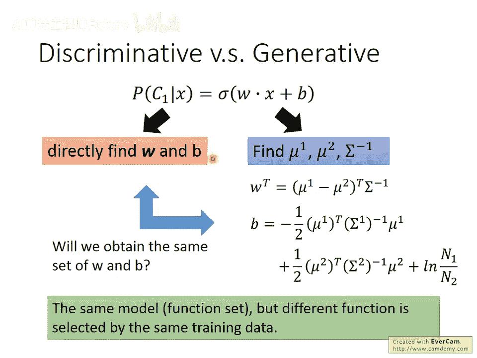
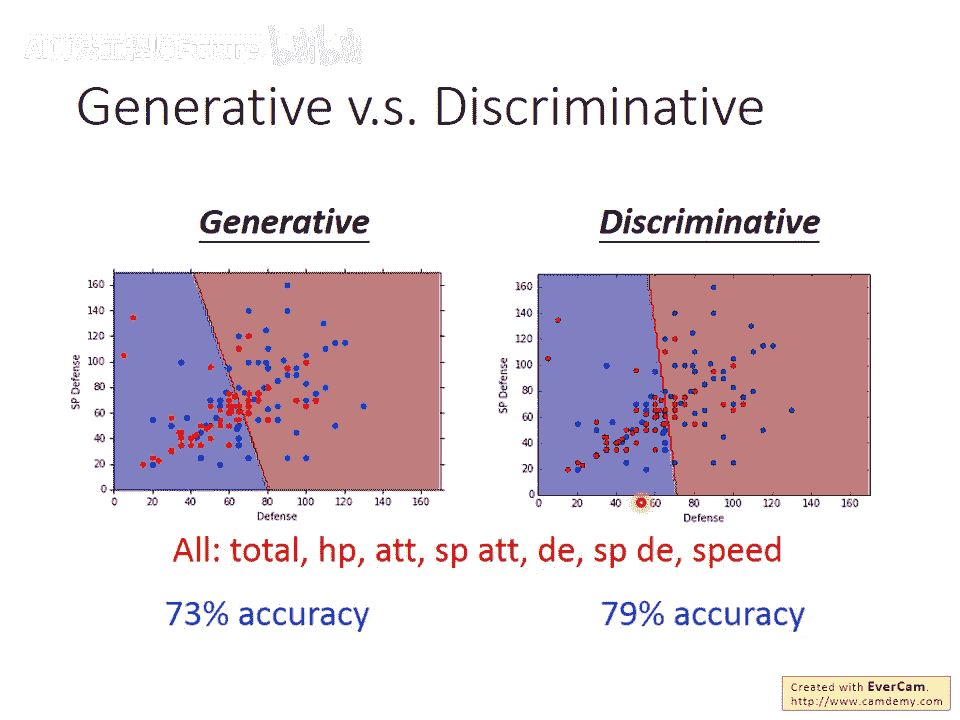
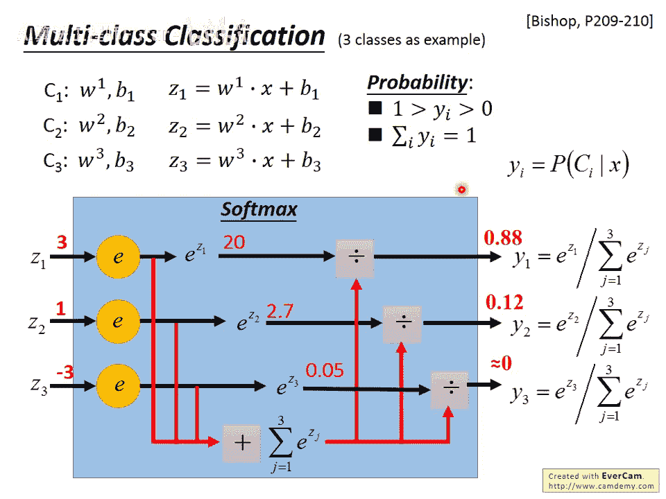
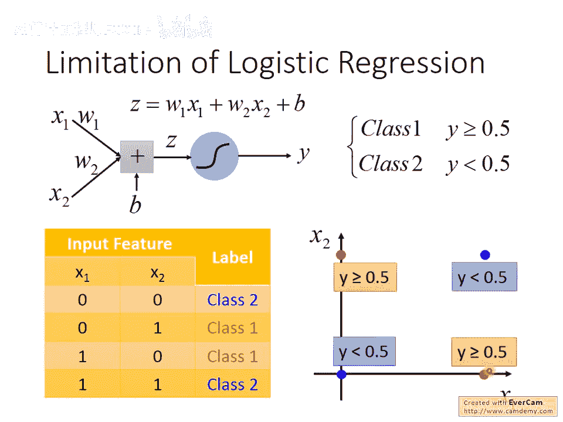
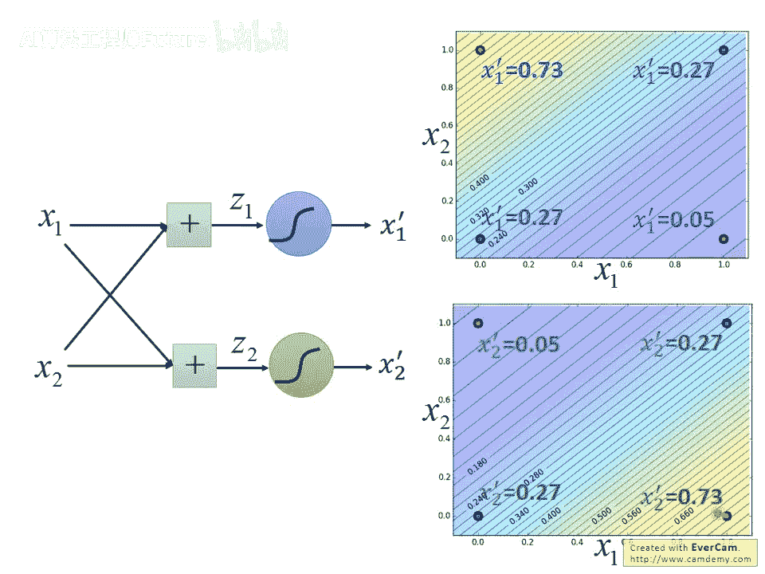
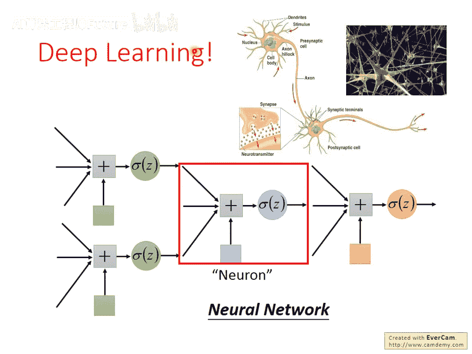

# 【官授搬运】2026年全新优化版李宏毅机器学习系统课程，这才是真正的初学者体系课程！—人工智能／深度学习／神经网络 - P11：10-选修-逻辑回归 - AI算法工程师Future - BV1ruqABeEFX

好了讲logistic regression。

好在logistic regression里面呢，我们在上一份投影片里面，我们都已经知道说，OK我们要找的东西呢是一个几率，而是一个posterior probability。

如果这个posterior possibility它大于0。5的话，那就opera class one，否则呢就opposite to，我们知道这个posteria possibility。

假设你觉得你想要用高选的话，其实很多其他的probability化简以后，也都可以得到同样的结果哦，假设你觉得你想要用高选的话，那你就说呃，你可以说这个呃呃这个prosper possibility。

就是sigma opy，它的这个function呢长的是右边这个样子，那这个Z呢是W跟X的inn pa加上B，那所谓W跟X的inn pa呢，是说这个W它是一个vector。

OK他的每一个dimension呢，我们就用下标I来表示，那这个W呢是一个vector，每一个X呢都有一个它对应的W下标I啊，你把所有的xi跟W下标I相乘，SUBMENSION起来。

再加上B就得到自己带进SIGMOID呃，带进这个SIMFUNCTION，那就得到几率好，所以我们的function set是长这样子，我们function set f下标WBXO也增加下标WB。

意思就是说，我们现在的这个function set是受WHB所控制的，就是你可以选不同的W跟B，你就得到不同的方程，所有W跟B可以产生的function集合起来，就是一个function c。

那这一项它的含义呢就是一个postal possibility，Even x，它是属于c one的几率啊，如果我们用图像化的方式来表示它的话呢，它长这样，我们的这个function呢它里面有两组参数。

一组是W啊，这个我们称之为with啊，with呢有一整排，然后有一个CONSOB，这个我们称之为bias，然后有一个sigmoid function，如果我们今天的input是XYX小I到X大I。

我们就把XYX小I跟X大I分别乘上WY，WI跟W大I，然后再加上B呢，你就得到Z这个Z，哦我发现我写错了地方，就后面这边呢应该是要加B的，应该要加B，你把w one呃。

XY乘w one加xi乘WI加上X2I乘上XI，再加上B那得到ZZ呢，通过我们刚才看到sigmoid function，它的output的值呢就是几率啊，就是posterior probability。

这个是整个模型长这个样子，这个这个这件事呢叫做logistic regression，那我们可以把logistic regression，跟我们在第一堂课就讲的linear regression呢。

做一下比较，Logistic regression，把每一个feature乘上一个w some mention起来，加上B再通过sigmoid function当做function的output。

那它的output因为有通过sigmoid function，所以一定是介于0~1之间的，那linear regression呢他就把feature乘上W。

再加上B它没有通过sigmoid function，所以它的output呢就可以是任何值啊，可以是正的，可以是负的，负无穷大到正无穷大好，那等一下呢我们我们说某新learning就是三个step对。

等一下我们会一个一个step呢，比较logistic regression跟linear regression，它的差别好，接下来呢我们要决定一个function的好坏。

OK那讲我们的training data呢，那我们现在要做的是呃classification好，所以我们的这个training data呢，就是假设有大N比training data。

那每笔training data你都要标，要说它是属于哪一个class啊，比如说x1属于class y x2属于class y x3，属于class two x大于属于class y等等。

那接下来呢我们假设这笔training data，是从我们的function所定义出来的，这个posterior probability所产生的，就这组training data。

是根据这个posterior probability呢所产生的，那给我们一个W跟B，我们就决定了这个posterior probability，那我们就可以去计算。

某一组W跟B产生这大N比training data的几率，某一个W跟B产生这大N比，training data几率怎么算呢，这个很容易就是假设XY是属于c one，那它根据某一个W跟B产生的几率。

就是f of x1，OK假设x2属于class one，那它被产生的几率就是FX two，假设X3属于class two，我们知道说X3如果属于c one的几率，就是FX3。

那我这边算的是c one的几率嘛，但是X3属于x2，所以他的几率就是一减掉F和X3，以此类推，那最有可能的参数W跟B，我们觉得最好的参数，W跟B就是那一个有最大的可能性。

最大的几率可以产生这这个training data的那一组，W跟B我们把它叫做w star跟b star，W3跟p star，就是那一个可以最大化这一个几率的，那个W跟BOK好。

那我们在这边呢做一个数学式上的转换，我们原来是要找一组W跟B最大化呢，LOWB最大化这个方程，但是这件事情等同于呢，我们找一个W跟b minimize负log这个方向。

我们知道取log它的这个order是不会变的，取加上一个负号，那你就从本来找最大的变成找最小的哦，所以我们就是要找一个W跟B最小化负log呃，l of w b这可以让计算呢变得容易一点。

左四跟右四是一样的，根据左四跟右心找出来的W跟B呢，W是star跟b star的，是同的w star的，同的b star好，那负log这一项怎么做呢，你就啊你知道取负log好处，就把它相乘嘛。

哎现在都变成相加，所以就可以把它展开，所以这一项就是负log FX y，负log FX two，flog1减FX3，以此类推好，那这件事情让你那这个写式子有点难写。

就你没有办法写一个some mention over哦，因为对不同的X说它属于不同class，我们将用不同的方法来来处理它，所以你没有办法some mention open x，那怎么办呢。

我们做一个这个符号上的转换，我们说如果某一个X它属于class y，我们就说它的target额是一，如果它属于class two，我们就说它的target是零。

对我们之前在做linear regression的时候，每一个X它都有一个呃对应的y hat，对不对，然后那个对应的y hat是一个real number，在这边呢每一个X也都有个对应的y head。

这个对应的y head，它的number呢就代表说现在这个X属于哪个class，如果属于class one，诶，我怎么会犯这么这么弱智的错，呼呼呼，这样大家发现在投影片上有一个错啊，对啊对应该是110。

然所以犯错了这么弱智的错误，这个呃属于class one就是一样啊，所以应该是110，这样好，没关系，你不要无视这边无视这边你就看这里就好好，属于class one，就是一属于class two。

就是零，如果你做这件事的话，呃如果你做这件事的话，那你就可以把这边的每一个式子都写成这样，OK这看起来有点复杂，但是你可以仔细算一下，就会发现说左边和右边呢是相等。

每一个负log FX你都可以写成负的中括号哦，负的括号等于这个括号，它的y one hand，它的y head乘上log FX加上一减，y hand乘上log1减FX呃，就实际上算一下。

比如说呃x1 x2都是属于c one，所以呢它对应的y has是一，所以这个y one head跟y two head是一一减，y one head跟一减y two head就是零，零的话呢。

它乘上后面那一项，你就不要管它把它拿掉，所以你会发现它等于它，它等于它这样啊，这边因为空间的关系，我就把W跟B省略掉了，有时候放W跟B只是为了强调说呢，这个F呢是W跟B的的function，这样啊。

那如果没有，因为这个放写不下，所以就把它省略掉好，那这个Y3呢，这个X3呢它属于quest to class two是零，所以Y3hand是零一减Y3hand就是一，那前面这个部分可以拿掉。

你会发现右边这个也是等于左边这个好了，有了这些以后，我们把这个function取打，这个net这个lily后的function取负的natural log。

然后呢再假设说class one就是1pass two就是零，以后我们就可以把我们要去minimize的对象，写成一个function，我们就会把我们调去minimize的对象。

写成SUBMENSIONOPOVER，N负的这个YNH乘上log FX n，加上一减YNH乘上log1减FXN，那其实这个呃这个summention over的这一项啊。

这个samansion over，这个这个这个这个sigma后面的这一整项啊，它其实是两个banoi distribution的cross entrop哦，OK这一项其实是一个cross entrop。

所以等一下呢我们就会说它是呃cross entropy，虽然他的这个来源跟information theory没有太直接的关系，我们刚看到他是从呃，我们刚才看过他的这个这个这个推导的过程。

但是呃如果你把你假设有两个distribution p跟PQ啊，这个P这个distribution它是说X等于一的几率是y n head，X等于零的几率是一减y n head。

那另外一个Q这个distribution，它等于一的几率呢是f of x n呃，这个这个X等于零的几率呢是一减FXN的话，那你把这两个distribution算cos entrop。

算cos entrob，如果你不知道什么是cos entropy，二没有关系，反正就是带个式子啊，带个式子想mention over，所有的x p of FX乘上log q of x前面有个负号。

这个呢就是cross entropy哦，所以如果你把这两个distribution算它们之间的cross entropy，这个cos entropy代表的含义是。

这两个distribution呢有多接近，如果今天这两个distribution1模一样的话，那他们算出来的cos entropy呢就是零好。

所以你把这两个distribution呢算一下cross entrop，那你把y n head乘上log FX n1减，y n head乘上log1减f max n，你得到的呢就是这一项。

所以他跟如果你有修过information theory的话呢，他这个这个式子写出来呢跟cross entropy呢是一样。

好那所以在logistic regression里面，我们怎么定义一个function它的好坏呢，我们定义的方式是这样，有一堆training data，我们有x n y n head的这样的pair。

那Y如果属于class one的话呢，y n head就等于说是class two的话呢，y n heat就等于零，那我们定义的这个loss function，我们要去minimize的对象是所有的呃。

example它的cross entropy的总和，也就是说假设你把FX当做一个本olio distribution，把y n head当做另外一个本oio distribution。

他们的cross entropy，你把它算出来，这个东西呢是我们要去minimize的对象，所以就直观来讲呢，我们要做的事情是我们希望function的output跟他的target。

如果我们都把它看作是banoia distribution的话，这两个banoia distribution呢他们越接近越好，呃如果我们比较一下linear regression的话。

linear regression呢这边这个你大概很困惑了，我猜如果你今天是第一次听到的话，你大概是听的一头雾水啊，这个哇这这么复杂到底是怎么来的，如果你是看linear regression的话。

这个很简单，我们把呃FXN减掉，它的target y y y n hand的平方，就是我们要去mini maze的对象，对这个比较单纯，这个不知道怎么来的，那你可能就会有一个想法说。

为什么在左边这个词在在login regression里面，我们也我们不跟那个linear regression一样，用square error就好了呢。

这这这这边其实也可以用square error啊，没有什么理由，你不能用square error，不是吗，对不对，因为呃你你完全可以算出这个f of x n跟YN，head的square error。

你就把这个这个这个这个这个式子，这个这个FXN和Y还带到右边去，你一样可以呃定一个loss function啊，这个loss function听起来也是否合理的，为什么不这么做呢，为什么不这么做啊。

这我们等一下呢会试着给大家一点解释啊，好那到目前为止呢，这个东西反正嗯就是很复杂，有些记者说必须要这么做好好，那接下来呢我们要做的事情就是呃，找一个最好的方式，就是要去minimize。

Minimize，我们现在要minimize的这个对象，那怎么做呢，你就用gradient descend就好了，我这个很简单，在下季，接下来呢都只是一些数学式的无聊的运算而已。

把它我们就算我们就算他对某一个呃，呃W的这个vector里面的某一个element的微分就好，我们就算这个式子对呃WI的微分就好，剩下部分呢其实就可以交给大家自己来做好，那我们要算这个东西对W的偏微分。

那我们只需要能够算log f max对W的偏微分，跟log1减f max对W的偏微分就行了，那LOLOGFX对W的偏微分怎么算呢，呃我们知道说我们把这个F呢写在下面，我们把F写在下面。

好F呢它受到呃Z这个variable的影响，然后Z这个variable呢是从这个呃W啊X啊，还有B所产生的哦，所以你就知道说呢，我们可以把这个偏微分呢拆开好吧。

partial w i partial log f max拆解成呢partial z分之，partial log FX乘下乘上呢，partial w i分之PARTIZ，样子好啊。

这个partial w i分之PARTIZ是什么呢，partial w i分之PARTIZ，这个Z的式子我们写在这边了，只有一项呢是跟WI有关的，只有WI乘以xi那一项是跟WI有关的。

所以partial w i分之partial z呢就是xi，那这一项是什么呢，这项这个太简单了，我们把f box换成sex l z啊，把这个换成SEQUELZ。

然后呢做一下微分这个log sea of z哦，作为分用就sea of z分之一，然后呢再算PARTIZ分之party signal z，那partial是一分，是partial sigma。

我自己是什么呢，这个sigma我自己是sigmoid function，sigmoid function的微分呢，其实你可以直接就就背起来，就是SEQUOZ乘上一减sea l z。

如果你要是看比较直观的结果的话，你就把它图画出来，西格西格玛Z这边颜色可能有点淡啊，这是绿色这一条线啊，西格玛Z是绿色这一条线，那如果你对它做对，对Z呢横轴是Z哦。

对Z做偏微分的话是在这个接近头跟尾的地方，它的斜率很小哦，所以对Z做微分的时候是接近于零的，在中间的C方斜率最大，而且这个地方斜率最大，所以把这一项对Z呢做偏微分的话，你得到的结果呢是长得像这样好长的。

像这样啊，这一项呢其实就是西格玛Z乘上E减SYCHAZ，那可以把SIG格玛Z消掉，OK好，那你就得到说这一项就是一减西格玛Z乘上SI，OK来sigma z其实就是FFX。

所以这一项就是一减F负X乘上XI好，右边这一项呢这个也是除view啊，这个也是TRIVIEW，你把log1减FX对WI做偏微分，那就可以拆成先对Z做偏微分，然后WI再对Z做偏微分。

那右边这一项partial w i分之PARTIZ1，我们知道它就是xi左边这一项呢，左边这一项你就呃把log里面的值放到分母，然后呢这边是呃呃这边前这边是负西格玛Z，所以前面有个负号。

然后这边呢要算西格玛Z的片尾分，那西格玛Z做偏微分以后得到结果是这样好吧，一减西格玛Z消掉就得剩下西格玛Z哦，所以呢这一项就是SI乘上西格玛Z把它放上来，就是这哎好，那那我们就把这一项放进来。

把这一项放进来整理一下以后，你得到的结果呢就是这样，OK然后接下来呢你整理一下吧，X呢XXI呢它呃提到右边去好吧，一直再提到右边去，把括号的部分展开好，把括号部分展开，那里面有一样的把它拿掉。

最后你得到一个很直观的结果，这个式子看起来有点复杂，有点崩溃，但是你对他做偏微分以后，得到子结果呢却是net的，却是却是容易理解的，你得到的结果呢这个每一项呢都是负的，wire head减掉FXN。

再乘上呢这个XN的第I个component，如果你用gradient design update它的话，那你的事实就很单纯，就是这样哦，WI呢是原来WI减掉learning rate。

乘上some mention over so的training sample，Y n hand，减掉FXN乘上XN在iv的feature，这件事情它代表了什么意思呢，它代表什么含义呢。

如果你看这个括号内的这个式子的话，括号内的这个式子的话，现在呢你的W的update呢取决于三件事，一个是learning rate，这个是你自己挑的，OK一个是xi，这个是来自于data。

第三项呢就是这个y n head减FXXN，y n head减FVN是什么意思呢，y n head减FVXN，代表说你现在这个F的output，跟理想的的这个这个这个呃目标，他的差距有多大。

就why the hand是目标，这个FXN呢是现在你的model的output，这两项之间的差距，这两个之间的这这个相减，它的差呢就代表了说他们的这个差距有多大啊，他们差距有多大。

那如果今天你离目标越远，那你的update量呢就应该要越大，所以这个结果呢看起来是颇为合理的。

好，那接下来呢我们就看来比较一下linear regression，跟logic logistic呃，呃logist regression跟linear regression。

他们在做gradient descend的时候，他们参数update的方式，我们已经看到logic regression，它的update的式子是长这个样子。

那神奇的是linear regression，大家应该都做完视力，做完作业一了啊，所以linear regression的是这这个这个呃，gradient design update的式子你应该是很熟。

他们其实是一模一样的，而且一模一样的，对你看哦，就是呃他们都算y n hand减掉apple backson，他们都算y n hand减掉apple backson。

唯一不一样的地方是logistic regression，你的target一定是零或一哦，你的target一定是零或一，你的这个F呢一定是介于0~1之间，但是如果是linear reaction的话。

你的target y head它可以是任何real number，它可以任何real number，而你这个output呢也可以是任何value，但是他们update这个这个方式呢是一样的。

那作业二我们需要做logistic regression，你甚至八成都不用改扣的，秒做就可以把它做出来，这样子这大家作业一做的还顺利吗，我相信你在你应该是遇到了种种特别的问题了。

比如说如果你在做gradient descent的话，你会发现说，虽然教科书上跟你讲gradient descent的时候，你是对他是不屑一顾的，然后你觉得说一个contest。

这这个这个surface我应该是用PANDESIGN，应该是可以轻易的找到它的最佳解，但是会发现说实际上做起来是没有那么容易的，对不对，我其实可以出一个那种教科书上的问题。

让你来做linear regression，但是呃我们用真实的example，就会让你知道所在真实的世界，你会碰到什么样的问题，事实上，因为今天我们做的是linear regression。

我看你八成可以用这个呃，解解那个lisquare error的方式，去偷偷找一下它的最佳解，然后再从那个那个最佳解，当引力选人选开始找对吧，大家听得懂我在说什么吗，呵呵还有人这么做的人举手一下。

没有人这么做，唉还是不敢举手的哈哈，要是我就这么做这样子诶，嘿但是嗯大大家知道我的意思吗，好但是如果你在做deep lear，等我们做deep learning的时候，你就不能这么做了。

因为deep learning你没有任何方法可以去找他的最佳解，到时候你才会真正的卡翻，这样，好那在下课之前，我想要讲一下我们今天的计划是这样子啦，我们就讲完logistic regression后。

我们就会进入deep learning，然后等下第三堂呢，助教会来讲一下作业二好，那我们现在要的问的问题是这样，为什么logistic regression不能加square error。

我为什么会用square error，当然可以用square error啊，我们如果用square error的话会怎样，我们做logic regression的时候，我试子长这样。

我我当然可以做square error啊，我把我的function的output减掉y n head的平方，SUBMENSION起来，当做我的loss function。

我一样用gradient descension minimize，它有什么不可以呢，当然没有什么不可以，这样子好，如果我们算一下它的这个微分的话，你会发现说如果我们把括号里面SUBMENSION。

后面这个式子对WI做偏微分的话，它得到的结果呢是这样，然后这个这个这个二呢提到前面去哦，所以到F8X减y head，然后呢把f max对Z做偏微分，把W呢对Z做偏微分，它们都乘起来，然后呃这一项。

诶这个额这个地方呃没有写错好，就是这一项就是这一项，OK把Z对FX做偏微分，因为FX是sigmoid function，做偏微分以后就是FX乘上一减FX par，求W分之partial z就是xi。

那当然你可以就用vian design去update你的参数，OK但是你现在的你会发现你遇到一个问题，假设y n hand等于一，OK假设第N比data是class one。

当我的FFX已经等于一的时候，我当我是第一笔，当我的DN比data是class one，而我FX已经等于一的时候，我已经达到perfect的状态，这个时候呃没有什么问题，因为你f max等于一。

YN等于一的时候，你把这个式子，你把这两个数值呢带进这个方程里面，你会发现说至少这一项FXX减y head是零，OK所以你的微分会变成零，这件事情是很合理的，但是如果今天是另外一个状况，FXXN等于零。

意味着说你现在离你的目标仍然非常的远，因为你的目标是希望f max3的output是一，但你现在output是零，你的目离目标还很远，但是如果你把这个式子带到这里面的话，你会发现说这边要乘一个FXN和。

FXN等于零，这时候你会变成你微分的结果，算出来的也是零对，所以如果你离目标很近，微分算出来是零没有问题，但是离目标很远，微分算出来的也是零，这个是class one的例子。

如果我们举class two的例子，看起来结果也是一样，假设y n had等于零，假设现在距离目标很远，假设距离目标很远的时候，呃，FMXN等于一，你带进去，至少最后这个式子是零，就你微分算出来也是零。

距离目标很近的时候，微分算出来也是零。

这会造成什么问题呢，如果我们把呃参数的变化对total loss作图的话。

你会发现说如果你选择cos entropy，跟你选择square error，参数的变化跟loss的变化看起来是这个样子，黑色的是cross entropy，红色的是square error。

我们刚才讲说cross entropy，在距离目标很近的地方啊，假设现在这个中心最低的这个点呢，就是这个呃距离目标很近的地方啊，你的这个微分值是很小的，但是距离目标很远的地方，你的微分值也是很小的哦。

所以在距离目标很远的地方呢，你会非常的平坦哦，会非常的平坦，这会造成什么问题呢，如果是cross entrop的话，你距离目标越远，你的微分值就越大，那没有问题，所以你距离目标越远。

你update的时候，你参数update的时候就越快啊，你的参数的这个更新的速度呢就越快，你参数的这个update时候的变化量就越大，这个没有问题，就你距离距离你的目标越远，你当然步伐应该要差越大一点。

但是如果你选square error的话，你就会很卡，因为当你距离目标远的时候，你的这个微分呢是非常非常小的，就变成说你离目标远的时候，你移动的速度是非常慢，所以当你如果你用随机你。

你RANDO你你random找一个初始值，那你通常离目标的距离呢是非常远的，那你通常你如果你今天用square error，你其实可以自己在座位里面试试看哦，如果你用square error。

你选一个起始值，你算出来尾巴很小，你一开始就卡住了，他都参数都不up，对你就永远卡在那边，永远都总之他参数update速度很慢，你等好好几个小时了，他都跑不出来，这样子你可能会想说呃。

呃那我们可以说看到这个呃呃，微分子很小的时候，就把它的呃呃那个learning rate设大一点呢，可是问题是微分值很小的时候，你也有可能其实距离你的目标很近了，如果距离目标很近的时候。

这个时候你应该把它为分子设小一点，但是你现在搞不清楚，说到底规定小的时候到微分值算出来，小的时候你是距离目标很近，还是距离目标很远，因为做graent design的时候，你是在玩世纪帝国这个游戏。

你不知道你距离目标到底是很近还是很远，所以你就会卡翻了，不知道你的learning ray应该设大还是设小，所以你选square error，在石桌上，你当然可以这么做，但你可以在作业里面试试看。

你是不容易得到好的结果，用cos entropy可以让你的training呢顺很多好，我们在这边呢呃休息10分钟，我猜自己是，我就立刻都说对，你别说这两个吧都，好哦，我们来上课吧。

那我们接下来要讲的是这个logistic，regression的方法，我们称它为DISCRIMINATIVE的方法，而刚才呢我们用高选来描述这个posterior，probability这件事呢。

我们称之为generative的方法，实际上他们的function，他们的这个model呢function set呢是一模一样，不管你是用我们在这份投影片讲的，Logistic regression。

还是前一份投影片讲的几率模型，只要你在做机率模型的时候，你把COVERANCEMETRIES设成是share，那它们的mode其实是一模一样的，都是sigma of w乘上X加B。

那你可以找不同的W跟不同的B，就得到不同的方式，那我们，咳咳我们可以直接呢去把W跟B找出来，如果你今天是用logistic ior regression的话，你可以直接把W跟B找出来。

就用gradient descend的方法，如果今天是generative model的话，那首先呢我们会去算new one new tube跟sigma的inverse。

然后呢我们就去把我们可以把W算出来，把B算出来，你算出new one new two跟converance matrix，接下来呢你就把这些项呢带到这里面哦，带到这里面。

我这边这个sigma one跟sigma two呢，应该都是等于sigma，我这边刚把它都改成sigma，我就把它算出来，就可以得到W呢跟B好，现在的问题来了，如果我们比较左边跟右边求W跟求B的方法。

我们找出来的W跟B会是同一组吗，会是同一组吗，好你觉得他是同一组的同学举手一下啊，你觉得他是不同的同学举手一下好，谢谢手放下，好多数同学觉得他是不同的，没错你找出来的结果不会是一样哦。

所以今天当我们用logistic regression，还是用刚才的probably listing的generative model，我们用的其实是同一个model。

其实同一个function set，也就我们那个function的那个破啊，我们可以挑的那个function candidate啊，其实同一个set，但是因为我们做了不同的假设，所以我们最后找出来的。

从根据同一组training data，找出来的参数会是不一样，我在在这个logistic regression里面，其实我们就没有没有做任何假设。

我们没有对这个probability distribution有任何的描述，我们就是单纯的去找一个W跟B，那在generative model里面。

我们对probability distribution是有假设的，比如说假设他是高选，假设它是本努力，假设它有没有呃，假设他是不是拿一辈子等等，我们做了种种的假设，根据这些假设。

我们可以找到另外一组W的B，左右两边找出来的W跟B呢不会是同一组，OK那问题就是，哪一个找出来的W跟B是比较好的呢。

如果我们比较呃，generative model跟discriminative model的话，那我们先看一下我们之前讲的呃，defense跟special defense的例子。

如果用generative model的话，我们的这两个class就蓝色是水系的神奇宝贝，红色的是这个一般系的宝可梦，它们之间的boundary呢是这一条。

如果你用logistic regression的话呢，你找出来的boundary是这一条，其实从这个你结果上，你很难看出来说谁比较好啊，但是如果我们比较说，我们都用七个feature的这个case。

我们会发现说如果用generative model的话，我们刚才说我们得到正确率呢是73percent，如果是用discriminative model的话，在同样的DATASET上面。

我们只是用不同的假设，所以找了不同的W跟B，但是我们找出来结果是比较好的啊，那正确率呢有79个S，那我相信你在文献上呢会常常听到有人说。

discriminative model会比generative model，常常会performance还要更好。

为什么会这样呢，我们来举一个toy的example。

我现在假设呢你有一笔training data呃，你有两个class，那你这笔training data里面呢总共有这个呃，呃每一笔data呢有两个feature，然后呢你总共有1+4加4+4。

总共有13比data，第一比data是两个feature的value呢都是一，接下来呢有四笔data是第一个feature是一，第2feature是零，接小四，比data塔是第一个feature是零。

第二个feature是一，也想四比data塔是两个feature都是零，然后呢这个我们给第一笔data label是一，我们给剩下剩下十，剩下12笔data label呢是都是class to。

那假设你现在用呃，你不做机器学习，做人类的学习呃，给你一个testing data，他的两个feature都是一，你觉得他是class one还是class two呢，好我们来问一下大家意见吧。

如果你觉得他是class y的同学，举手一下，好手放下，你觉得他是class two的同学举手一下好，没有人觉得是class two，大家都觉得是class one。

那如果那如果我们来问一下哪1place，他觉得是class one还是class two，他会怎么说呢，而所谓的哪一类就是我们假设呃，所有的feature它产生的几率是independent哦。

所以p of x given，某一个看2PPOX，从某一个class产生出来的几率，等于从某一个class产生x1的几率乘乘上，从某个class产生x2的几率可以好，那我们用哪一辈子来算一下。

首先算一下higher的probability，Class one，它出现黄标题是多少，总共13笔data是sample，到一次是class one，所以是三分之1class two的几率是多少呢。

总共是三笔data，总共有12笔是class two哦，所以他是12/13啊，它比较多，那接下来呢我们算说在class one里面，x1等于一的几率，在class one里面。

x1等于一的几率就是1OK在class two里面，要在class one里面，x2等于一的几率也是一，因为class y就这比data嘛，那x1是一，x2是一，所以如果你用几率来统计的话。

呃在class one里面x1等于一的几率是一，在class one里面x2等于一的几率也是一好，接下来我们看啊，我发现我犯了一个错误，就这边应该是c two啊，不好意思，这边应该c two。

这边应该是c two好，那在如果我们看class two的话，如果我们看右边的这个，这是二比class two的data，在class two里面XY等于一的几率是多少呢，是1/3，对不对。

只有13的贝塔是class two等于一的，而是K而是XY等于一的，那再来我们看x2 x2等于一的几率，在class two里面有多少呢，在class two里面只有13的data，x2等于一。

所以它的几率呢是1/3，而如果我们把这些几率通通算出来以后，给你一个testing data，你就可以去估测它是来自class one的几率，也可以估测它是来自class two的几率。

我们就算这笔training data x呢，它来自class one的几率是多少，那你就把他带到这个这个贝贝，贝贝选的这个这个这个function里面。

算一下c one的pa possibility是13，p of x given c y的几率呢是11，什么意思呢，这比data塔X从CY里面GENER出来的几率，等于这个几率乘上这个几率就是1×1。

下面这一项你算过这是1/13，这个是1×1，那这一项呢p m c two是1213，P m x given c two，从c two里面sample出。

根据c two的distribution sample出这笔data塔几率是多少呢，是三分之1×3分之一哦，因为x1等于一的几率，在c one里面13，x2等于一的几率，在x2等于一的几率。

在c two里面13，x2等于E的一，在c two里面13，所以这一项是三分之1×3分之一，如果你实际去做一下运算，实际算算一发，你就知道说这个是小于0。5的，所以对拿if fbase来说。

给他这样子的training data，他认为这一笔testing data应该是属于class two，而不是class one哦，所以这跟我们大家的这个直觉比起来是相反的，是相反的。

但其实我们很呃呃其实我们很难知道说，总之不知道说这笔data到底是产生来自于class one，还是class two，就比较合理的，假设你会觉得说，因为class one里面通通都是XY和x2。

都是等于一的，所以这比data应该是要来自cs one才对吧，可是对哪一辈子来说，他不考虑不同dimension之间的correlation，所以对哪1base来说。

这两个dimension是independent所产生的，在class one里面，在class two里面，之所以没有simple到这样的data，之所以没有观察到这样的data。

是因为你sample的够多，如果你sample的够多，搞不好就有都是一的data，就都是一的data，也是有几率被产生出来的，只是因为我们data不够多，所以没有观察到这一件事而已。

所以今天这个generative model跟DISCRIMINATIVE的model，差别就在于呃，这个generative model他有做了某些假设，它假设你的data来自于一个机率模型。

他做了某些假设，也就是说他其实做了脑补这一件事情，脑补是什么，大家知道吗，就是呃如果你看了一部动漫，那里面没有发生某些事情，比如说呃呃两个两个男女主角其实没有在一起，但是你心里想象他们是在一起的。

这个就是脑补这样子对，所以这个generative model他做的事情就是脑补，如果我们在data里面明明没有观察到，在class two里面有都是一的这样的example出现。

但是对拿1base来说，他想象他看到的这件事情啊，所以他就会做出一个跟我们人类直觉的想法，不一样的判断的结果，这那到底脑补是不是一件好的事情呢，通常脑补可能不是一件好的事情。

因为你的DA没有告诉你这件事情，你却脑补出这样的结果，但是如果今天在data很少的情况下，脑补有时候也是有用的，但如果你得到情报很少，脑补可以给你更多的情报。

所以其实discriminative model，并不是在所有的情况下都可以赢过generated model，有些时候generative model也是有优势的，什么时候会有优势呢。

如果你今天的training data很少，你你你可以比较说在同一个PAREN下，你给discriminative model汉generative model，不同量的training data哦。

你会发现说呢这个discriminative model，因为他完全没有做任何假设，他是看着data说话哦，所以他的performance变化量呢，会受你的data量影响很大哦。

假设呃现在由左到右是data a越来越多，然后纵轴是这个error rate，Discriminate，discriminative model呢，它受到data影响很大，所以它会呃data越来越多。

它就error就越来越小，如果你是看generative model的话，它受DA的，他受DA的影响是比较小的，因为他有一个他自己的假设，他有时候会无视那个data，而遵从他自己内心的假设。

这内心脑补的结果，所以如果你看data量跟呃，你看data量的影响的话，在data少的时候，generative model其实有时候是可以赢过，Discriminative model。

只有在data慢慢增加的时候，generative model呢才会输给discriminative model，但这个其实是呃case by case，但是你可以在不同的呃，你可以在作业里面观看。

做做实验，看看你能不能观察到这样子的现象，那有时候generative model是有用的，是额的，可能是你今天的data是noisy的，你的label本身就有问题，那因为你的label本身就有问题。

你自己做一些脑补，做一些假设，反而可以把有问data里面有问题的部分呢忽视掉，那我们在做discriminative model的时候，我们是直接假设了一个posterior probability。

然后去找posterior probability里面的参数，但是我们在做generative model的时候，我们把整个formulation里面拆成PRE跟class dependent。

possibility这两项，对不对，呃这样做有时候是有好处的哦，如果你把你的整个function拆成呃，这个这个这prior跟呃，class dependent probability这两项的话。

有时候会有帮助，因为这个POR跟class dependent probability，他们可以是来自于不同的来源，举例来说，以语音辨识为例，但大家可能都知道说呢。

这个呃语音辨识现在都是用neural network，它是一个DISCRIMINATIVE的方法，但事实上，整个语音辨识系统是一个generative的system，DNN只是其中的一块而已。

所以说呃该怎么说呢，就是呃呃所以说这全部都是用DNN这件事情的，并不是那么的精确，它整个model其实是discriminated，为什么会这样呢。

因为他还是要去算一个prior的probability，因为prior probability是某一句话被说出来的几率，而你要estimate某一句话被说出来的几率，你并不需要有声音的data。

你只要去网络上查很多很多很多的文字，你就可以计算出某一段文字出现的几率，你不需要sin的data，这个就是language model，所以在语音辨识里面，我们整个model反而是generative。

因为你可以把class dependent的部分和pride的部分，拆开来考虑，而QU的部分你就用文字的data来处理，class dependent的部分，才需要有声音和文字的配合。

这样子你可以把quire呢estimate的更精确，而这一件事情呢在语音辨识里面是很关键的，现在还几乎没有办法呃，呃摆脱这个架构好，那接下来我们要讲的我们刚才举的例子呢。

通通都是只有两个class的例子，例子接下来我们要讲的是，如果是由两个以上的class，那我们等下举的例子是三个class的，那应该要怎么做呢，那等一下我就只讲过程，不讲原理啊。

如果呃你想要知道原理的话，你可以看一下bishop的教科书，那这个原理跟我们刚才从呃呃这个这个这个讲，这个只有两个class的情况呢几乎是一模一样的，我相信你自己也可以推导出来。

所以我就不想要重复一个呃，你觉得很trivial的东西，那么就直接看他的操作是怎么做，假设我有三个class啊，c one cq跟C3，现在呢每一个class都有一组自己的weight。

看自己的bias，这边w one w two w3分别代表三个vector，b one b two b3呢代表三个SCALA，诶好那接下来呢input一个，这个是你要分类的对象啊。

你把X呢跟w one做inner poa加上BY，你把X跟w two做inn pua加上b two，你把X跟W3做一的发达加上V3，你得到z one z q跟Z3。

而这个z one的Z6Z3呢它可以是任何值，OK它可以是负无穷大到正无穷大的任何值，接下来呢我们把z one跟ZQZ3，丢进一个soft max的function。

这个soft max的function他做的事情是这样，把z one z two z3都取exponential，得到exponential z one exponential z two。

Exponential z3，接下来呢把extra natiz y snatiz q，extra natiz3SUBMENTION起来，你得到呢他们的这个偷偷上。

然后你再把这个total su呢分别除掉这三项，把total sun分别除掉这三项，得到soft max function的output y one y two跟Y3，如果你觉得这个有点复杂的话。

我们举一个数字例子，假设z one等于三，z two等于一，Z3等于三，做完exponential以后，exponential3呢是很大的，是20，Exponential，一是2。7。

exponential-3很小，是0。05，接下来呢你把这三项合起来再分别去除掉，也就是做normalization，那你得到的结果呢20就变成0。88，2。7是0。12，0。05就会变得趋近于零。

那当你做完soft max以后，原来input z one z two z3它可以是任何值，但是做完soft max以后，你的output呢会被限制住，第一个你的output的值一定是介于0~1之间。

首先你output值一定是正的，不管你z one z two z3是正的还是负的，transform nature以后都变成是正啊，那额今天他的total上呢一定是一啊，你的output和一定是一。

因为在这个地方呢做了一个normalization，所以total上呢一定是一，为什么这个东西叫soft max呢，因为如果你做如果是max的话，你就取最大的值嘛，但是你做soft max的意思呢是说。

你会对最大的值呢做强化呃，因为你今天呢有取了exponential呃，你取了EXPANCIAL以后呢，大的值和小的值，它们之间的差距呢会被拉的更开，就强化大的词，所以这件事情呢叫做soft max好。

那你就可以把这边的这个Z呢，这个这个这个每一个Y呢YI呢当做呃input x，Input，这个X是第I个class posterial的哦，所以今天假如人品y one是0。88。

就意思是说你input x，你input x属于C，属于class one的几率是88percent，所以class q有几率是12percent，属于class3的几率呢是趋近于零的。

这个soft max的output就是拿来估计posterior probability，那可能会问说为什么会这样呢，为什么会这样呢，呃事实上这件事情是有办法推导。

如果在外面有人演讲问我说为什么是EXPDENTIAL，我就会回答说呃你也可以用别的，因为我用你，我用别的，你也会问同样的问题，这样子哈哈哈哈哈，但是这个事情是有有办法讲的。

这样你可以去翻一下bishop的教科书，这件事情是可以解释的，就如果你今天有三个class来假设，那三个class通通都是高选的distribution。

他们又共用同一个covariance matri，在这个情况下，你做一番推导以后，你得到的就会是这个soft max的function，OK那这个就留给大家自己做，如果你想要知道更多。

你还可以google一个叫做maximum entropy的东西，magiment entropy是也是一种classify，而它其实跟logic regression是一模一样的东西。

只是换个名字而已，那他是从另外一个观点呢来切入，为什么我们的classifier呢涨这个样子啊，那我们刚才是说我们可以从几率的观点假设高，假设我们用的是高学distribution观点来。

经过一番推导以后，你可以得到soft max这个方程，那你可以从另外一个角度，从这个information theory的角度去推广，也会得到soft max这个function，那这个就留给大家呃。

呃自己研究叫google maximum entropy就可以找到答案。

好那所以我们复习一下刚才做的事情，你就有一个X当做input，分别乘上三组不同的weight，加上三组不同的X得呃三组不同的bias，得到三组不同，得到三个不同的Z。

通过soft max function你就得到呃y one y two y3哦，分别是这三个cast posterior probability，可以把它合起来呢。

当做是Y那你这个训练呢你要有一个target，他的target是什么呢，他的target呢是y head，就每一维你output假你有三个class name output，就是三维。

那三维分别就对应到y one hand，One two hand，Hy side hand，我们要去minimize的对象，是Y所形成的这个probability distribution。

它是一个probability distribution嘛，对不对，当你做完soft max的时候，它就变成了，你就可以把它当做一个probability distribution来看待。

你可以去计算这个Y跟y hand，他们之间的cross entropy，他的这个cross entropy的式子呢，我就发现我写错了，这样子这边前面应该要有一个负号，这样真是不好意思。

这前面应该要有一个负号，好对，所以这两个方ability的cos atomy，它们的式子就是yy ha乘上log y y y two，H乘上log y two加上Y3，X乘上log y3。

在前面再加个负号，就是它们之间的cross entrop，如果我们要计算Y跟y hat cross entropy的话，y head显然也必须要是一个probability的distribution。

我们才能够算cross entrop怎么算呢，假设X是属于class one的话，在training data里面，我们已经知道X是属于class one的话，他的target就是100。

如果是属于past two的话，它的target就是010，如果属于class3的话，它的target就是001样，我们之前有讲过说，如果你设class one的target是1class two的。

ti是二class三target3，这样会有问题，所以等于是假设说一跟二比较近，二跟三比较近，一跟三比较远，这样做会有问题，但是如果你今天是换一个换一个。

假设你今天是假设如果X是属于class one的话，他的目标就是100，所以class two就是010，属于class3，就是001，那也就没有假设这cs和CSS之间谁跟谁比较近。

谁跟谁比较远的问题啊，那至于这个式子哪来的呢，其实这个式子也是去maximum likelihood，我们刚才在讲这个呃binary的case的时候，我们讲说我们的这个cross entrob。

这个function minimize cross entropy，这件事情其实是来自于maximize likelihood，那在有多个class的情况下也是一模一样的，OK它是一模一模一样的。

你就把max likely to那个方式列出来啊，经过一番整理，你也会得到minimize cross entropy，那这件事呢就交给大家自己做好。

接下来我要讲的是这个logistic regression呢，其实它是有非常强的限制，什么样的限制呢，我们假设今天假设这样一个class，假假设这样一个case，现在有四笔data。

他们每一笔data都有两个feature，那它们都是binary的feature，那class two呢有两笔data分别是0011，class y有两笔data，这是0110，如果我们把它画出来的话。

class one的两笔data是在这里跟这里，class two的两笔data呢是在这里跟这里，如果我们想要用loglogistic regression，对它做分类的话，我们能做到这件事情吗。

我们能做到这件事情吗，你会发现说这件事情我们是办不到哦，如果我们今天要做logistic regression的话，我们会希望说对logistic regression的output而言。

这两个属于plus one的data，它的几率要大于0。5，另外两个属于class to的data，它的几率要小于0。5，但这件事情对logist regression来说呢。

他卡翻了，他没有办法做到这件事。

因为logistic regression，两个class之间的boundary就是一条直线，OK它boundary就是一条直线，所以你要分两个pass的时候。

你只能在你的这个这个feature的这个平面上呢，画一条直线，你要么画这边，要么画这边，但不管你怎么画，你都没有办法把红色的放一边，蓝色的放一边，不管你怎么画，你都没有办法把红色放一边，蓝色放一边。

这个直线可以随便乱画，你可以调整W跟B，你可以调整你的wake跟bias，使得你的logist regression的两个class间的boundary呢，是任何一样，它可以是这样，可以是这样。

可以是这样，可以怎么画都可以怎样，这直线整个boundary是一条直线，怎么画都可以，但你永远没有办法，把今天这个example的红色的点和蓝色的点，分成两边，怎么办呢，怎么办呢。

假设你还是坚持要用logistic regression的话，有一招叫做feature transformation，你原来的feature定的不好哦，原来x1 x2那个feature定的不好。

我们可以做一些转化以后，找一个比较好的feature space，这个比较好的feature space，是让logistic regression是可以处理。

我们把x1跟x2呢转到另外一个space上面，转到x1派跟x2派上面，x y pl是这个这个这个这个怎么做，feature权formation，就是很curissia hard的东西。

就想一个你你喜欢的方式，举例来说，我这边定XY快，就是某一个点到零点的距离，SU派就是某一个点到一一的距离好，那如果我们把它画出来的话，把它画出来的话，如果我们把这个点画出来，我们先看这个这个这个呃。

先看左下角这个点好，如果我们看左下角零零这个点，它的x1 pine应该是零，因为它跟零零的距离跟自己的距离就是零，它跟一一的距离，零零跟一一的距离是根号二，所以x2派就是根号二。

所以经过这个transformation，零零这个点跑到这边啊，经过这个transformation11这个点跑到右下角，因为它跟零零的距离呢是根号二，根一的距离是零。

经过这个transformation01焊，这个又写错了，这个应该是一零，不好意思，这个零一和一零，它们跟零零和一一之间的距离都是一样的，就零一跟零零之间的距离是一，零一和一一之间的距离是一。

所以经过这个transform以后，这和两个红色的点会map会会重叠在一起，都变成是一，这个时候对logistic regression来说，他可以处理这个问题了，因为他可以找一个boundary。

比如说可能在这个地方，把蓝色的点跟红色的点分开，但是麻烦的问题是这样子，麻烦的问题是，我们不知道要怎么做feature transformation。

如果你花太多力气在做feature transformation，那就就不是机器学习了，就不是人工智慧了，这都是人的智慧了，所以有时候我们不知道要怎么找一个好的，Transformation。

所以我们会希望说，这个transformation是由机器自己产生的，怎么让机器自己产生这样的transformation呢，我们就把很多个logistic regression呢，CSK起来。

把很多log regression接起来，我们就可以做到这样的事情，假设input是x1 x2哦，我们有一个logistic regression model，我们这边就把bias省略掉。

让图看起来比较简单一点哦，这边有一个logic regression model，他对x1乘一个weight，对x2乘一个weight，加起来得到自己。

通过sigmoid function它的output，我们就说它是新的transform的第一为x1 p，我们有另外一个logic regression model，他的XY乘上个weight。

对x2乘上另外一组weight得到ZQ，再通过sigmoid function得到x2派，我们说它是transform后的另外一维，如果我们把XY和x2。

经过这两个logistic regression model的transform，得到x1 pine跟x1 two x2 pine，而在这个新的TRFORM上面。

class one和class two是可以用一条直线分开的，那么最后只要再接另外一个logic regression model，他的input就是x1 pine和x2派，对他来说。

x1 pl和x2 point就是每一个example的feature，而不是x1跟x2是x1 y跟x2换，他根据x1派和这x2派这个新的feature。

它就可以呃把class one和class two分开，所以前面这两个这个logistic regression，他做的事情就是做feature transform这件事情。

他先把feature transform好以后，再由后面的红色的这个logistic regression，model呢来做分类，如果举比较实际的例子的话，我们看刚才那一个例子。

我们在XY和x2平面上呢有四个点，我们可以调整蓝色的这个logistic regression，它的weight的参数，让他的这个posterior probability的output呢。

长得像是这个图上的颜色这样哎，因为这个这个这个boundary一定是一条直线嘛，所以那个posterior probability的output呢，一定是长这样子的，它这个等高线呢一定是直的。

在左上角的地方，output的值比较大，在右下角的地方output的值比较小，你可以调整参数，让这个蓝色的这个这个这个logistic regression，他input x1 x2的时候。

对这四个点它的output是0。730。27，0。270。05，这件事情呢是他做得到的，对绿色这个点来说，你也可以调整它的参数，让它呢对右下角这个红色点的output是0。73，对，蓝色点是0。27。

0。27，对左边这个点，左上角这个点它是0。05，Login regression，它可以他的这个boundary呢一定是一条直线，那这个直线可以有任何的画法，你可以是左边高，右边低。

也可以是你可以是左上高，右下低，也可以是右下高，左上低，这个都是做得到你的调整参数，就做得到这些事情好。

所以现在呢有了前面这两个logistic，regression以后，我们就可以把input的每一笔data做feature transform，得到另外一组feature，也就是说呢原来左上角这个点。

原来左上角这个点，他本来在XYXQ的平面上是零一，但是在x1 pine和x2 pl的这个平面上，它变成是0。730。05，如果我们看右下角这个红色的点，在x y pls two pl的平面上，它就是0。

05，0。73，OK呃这边x1跟x2是不是画反了呢，我看一下对画反了，真不好意思，这个XY那x2呢应该是画，应该是画反，因为你看这个是0。05，然后呢这个纵轴呢才是比较小的，才是0。05。

所以这个x1跟x2呢，这边label应该要是反过来，应该是反过来好好，然后呢我们现在把红色的点个红色的点呢，变到0。730。05的位置，红色的点变到0。05，0。73的位置，把这两个蓝色的点变到0。

27，0。27的位置，我们做了这样的转换以后呢，我们就可以用红色的这个logistic regression，画一条boundary，把蓝色的点和红色的点分开呀。

所以如果我们只有一个logic regression，我们没有办法把这个example处理好，但是如果我们有三个logistic regression，它们被接在一起的话。

那我们就可以把这件事情处理好哦，所以呢把这些logic regression model叠在一起，它还蛮有用的，我们可以有某一个logistic regression，它的model。

它的input是来自于其他logistic regression的open，而某一个logistic regression的output。

它也可以是其他logistic regression的input，我们可以把它前后相连起来，就变得呢感觉很powerful，那我们呢可以给它一个新的名字。

我们把每一个logistic gration叫做一个new ro，把这些login regression串起来，所成的network就叫做neural network，就叫做类神经网络。

换了一个名字以后，他整个人就吵起来了，呵呵你就可以骗麻瓜，你就可以每次骗麻，我就可以跟麻瓜讲说，我们是在模拟人类大脑的运作，然后麻花就会觉得你做的东西实在是太棒了，这个东西就是deep本领啊。

好啊，所以我们呢就进入deep learning。