# 【官授搬运】2026年全新优化版李宏毅机器学习系统课程，这才是真正的初学者体系课程！—人工智能／深度学习／神经网络 - P13：【第2讲】1-机器学习任务攻略 - AI算法工程师Future - BV1ruqABeEFX

这样看这样看就OK好，那我们就继续来上课吧，好那接下来的课程要讲什么样的内容呢，接下来啊要告诉你每一个作业通关的大战略，通关的攻略长什么样子好，那我们已经看了作业一了，那其实之后好几个作业。

它看起来的样子基本上都是大同小异，就是你会有一堆训练的资料啊，那这些训练资料里面呢会包含了X跟Y的片，你会有x1跟它对应的y one，x2跟它对应的y two，一直到XN，还有它对应的YN。

然后测试资料呢测试资料就是你只有X没有Y，那刚才大家已经看了作业一了，其实在之后，每几个作业看起来都是非常类似的格式，比如说作业二实际是是做语音辨识，那我们的X呢就是非常小的一段声音讯号。

那其实这个不是真正的完整的语音辨识系统啊，而是语音辨识系统的一个阉割版哦，那个X是一小段讯号，那Y呢是要去预测，需要去判断说这一小段声音讯号呢，它对应到哪一个风铃，那你不知道风铃是什么，没有关系。

你就把它想成是KK音标就可以了，那作业三呢是要做影像辨识，那这个时候我们的X呢是一张图片，那Y呢是机器，要判断说这张图片里面有什么样的东西啊，作业四呢是愚者便，是那愚者便士是要做什么事情呢。

愚者辩是要做的事情是呃，这个X呢也是一段声音讯号，那Y呢现在不是PHYY呢，是现在是哪一个人在说话，你可以想象说这样的系统，现在现在其实非常的有用，如果你打电话去银行的客服。

那现在都有自动的愚者辨认系统，那会听说现在打电话进来的人是不是客户本人，那就少了，这个客服人员呢问你啊，身份验证的时间啊，那作业五呢是做那个machine translation啊，是做机器翻译啊。

X呢就是某一个语言，比如说啊这是我唯一会的一句日文啦，哎看米洛西等这样的啊，那他的Y呢就是另外一句话，这样。

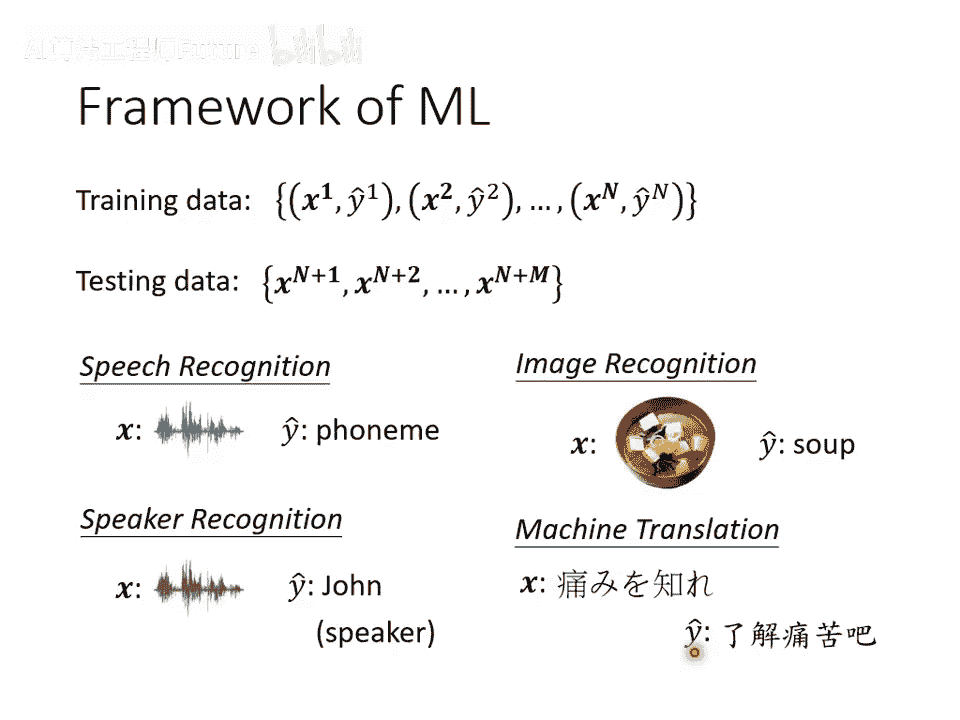

好，当然，现在你在留言区里面，就可以洗一些诸葛村夫之类的哎，好那训练资料呢拿来做什么呢。

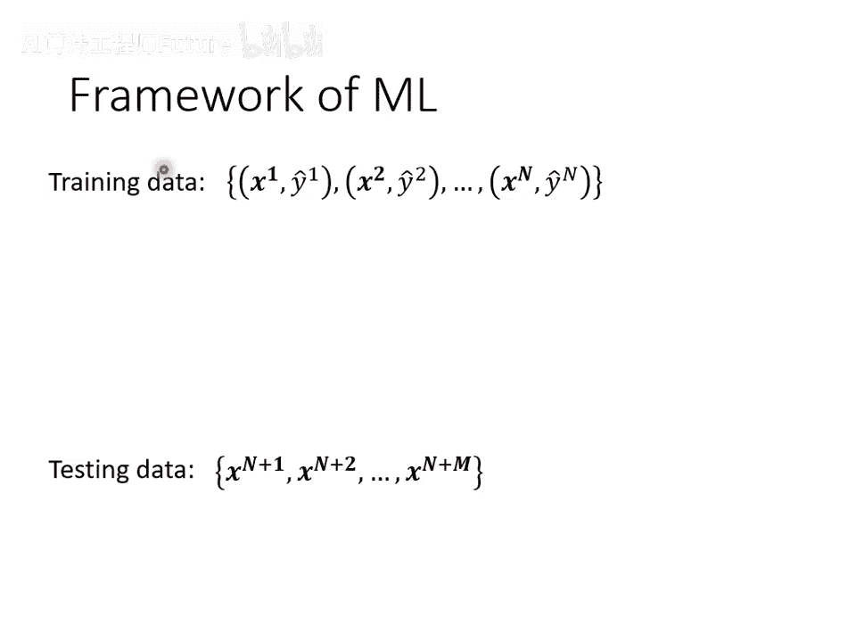

训练资料就是要拿来训练我们的model，那训练model的过程，那啊上周已经讲过了啊，训练的过程就是三个步骤啊，第一个步骤你要先写出一个有未知数的function，那这个未知数呢。

以后我们都用SETA来代表一个model里面，所有的未知参数哦，所以f sea中X的意思就是说，我现在有一个function叫FBX，但它里面有一些未知的参数，这些未知的参数表示成setup。

那它的input呢叫做X啊，这个input呢叫做feature，好，那接下来呢你要定一个东西叫做loft啊，loss是一个function，这个loss的输入呢就是一组参数。

而去判断说这组参数是好还是不好，那接下来你要解一个optimization的problem，你要去找一个setup，那这个sea呢可以让lost的值越小越好，那可以让lost的值最小的那个setup。

我们就写作set a stop，那有了theta star以后，那就把它拿来用在测试资料上，也就是你把sea star带入这些未知的参数，本来f theta到X里面有一些未知的参数。

现在这个theta呢用sea star来取代，而用sa star来取代，那它的输入呢就是你现在的测试资料，那输出的结果你就把它存起来，然后上传到卡狗就结束了，但接下来你就会遇到一个问题。

那直接执行注掉的simple code，往往只能够给你过simple baseline的结果而已，如果你想要做得更好，那应该要怎么办，以下就是如何让你做得更好的攻略。

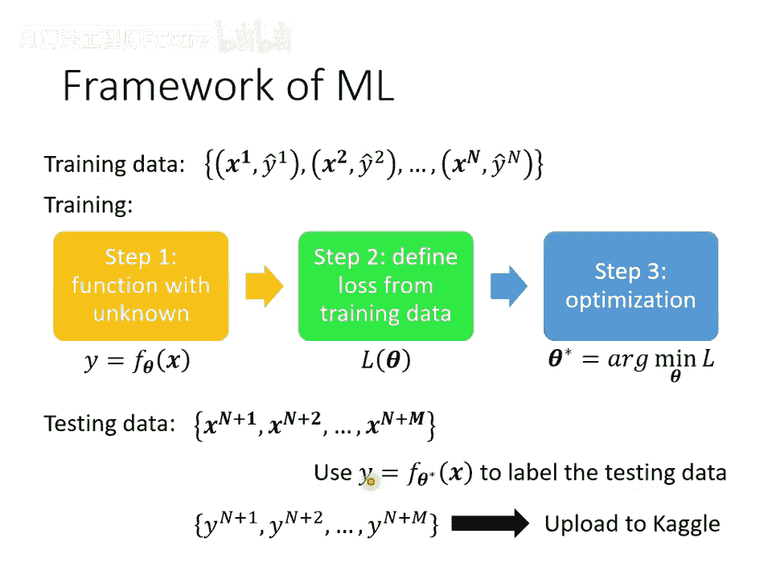

它适用于前期所有的作业，这个就跟魔关羽一样，你知道吗，开局就送，可以帮助你打赢前期所有的副本，哎好那这个攻略是怎么走的呢，从最上面开始走起，第一个是你今天，如果你觉得你在CARDLE上的结果不满意的话。

第一件事情你要做的事情是什么，检查你的training data的loss好，就有的人说哎，我在意的不是应该是testing data的loss吗。

因为cargo上面结果呈现的是testing data的结果啊，但是你要先检查你的training data，看看你的model在training data上面有没有学起来。

再去看testing的结果哦，所以你要先检查一下training data的loss，如果你发现你的training data的loss很大，显然他在训练资料上面也没有学好，那接下来就要分析一下。

在训练资料上面没有学好，是什么样的原因，那这边有两个可能，第一个可能是model的bias。

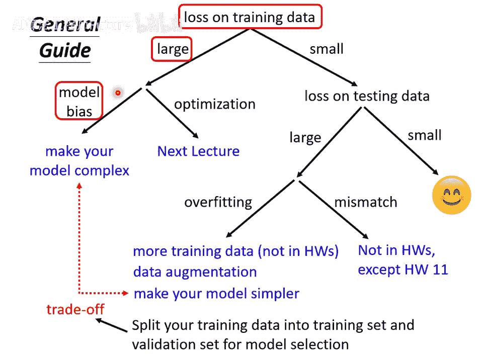

那model的bias这件事情呢，我们在上周已经跟大家讲过了，所谓model bias的意思是说，假设你的model太过简单啊，举例来说，我们现在写了一个有未知呃parameter的function啊。

这个未知的parameter我们可以带各种不同的数值，你在set up one得到一个方式，我们把那个function呢用这个一个点来表示，i set up to得到另外一个方式。

你把所有的方式集合起来，好得到一个方CTION的set，但是这个function的set它太小了，这个function的set里面没有包含任何一个function，可以让我们的loss变低。

可以让loss变低的function，不在你的model可以描述的范围内哦，你的model里面有未知的参数，未知参数可以带任何的数值，把这些数值带进去以后，你得到了一个function的set。

代入不同的数值，得到不同的function，把所有方式集合起来，你得到一个function的set，那这个set里面没有任何一个function，可以让你的loss变低，那在这个情况下。

就算你找出了一个set a star，它是这些蓝色的function里面最好的那一个，还是那个蓝色的function里面，可以让loss最低的那一个也无惧无济于事啊，这些都是鲁蛇，他只是鲁蛇里面的霸主。

就还是一个鲁蛇，那个loss还是不够低，那这个状况就是哇这个你想要在大海里面捞针，这个针指的是一个LOSD的function，结果真的根本就不在海里，所以白忙一场，你怎么捞都捞不出针。

因为针根本就不在你的这个function set里面，不在你的这个大海里面，所以怎么办，这个时候重新设计你的model，怎么重新设计给你的model更大的弹性啊，我们上周已经示范过，举例来说。

你可以增加你输入的feature，我们上周说，本来我们输入的feature只有前一天的资讯，假设我们要预测接下来的这个观看人数的话啊，那我们用前一天的资讯不够多，那用56天前的资讯。

那model的这个弹性就比较大了，那你也可以用deep learning增加更多的弹性，所以如果你觉得你的model的弹性不够大，那你可以增加更多feature，可以设一个更大的model。

可以用deep learning来增加model的弹性，这是第一个合影的解法。

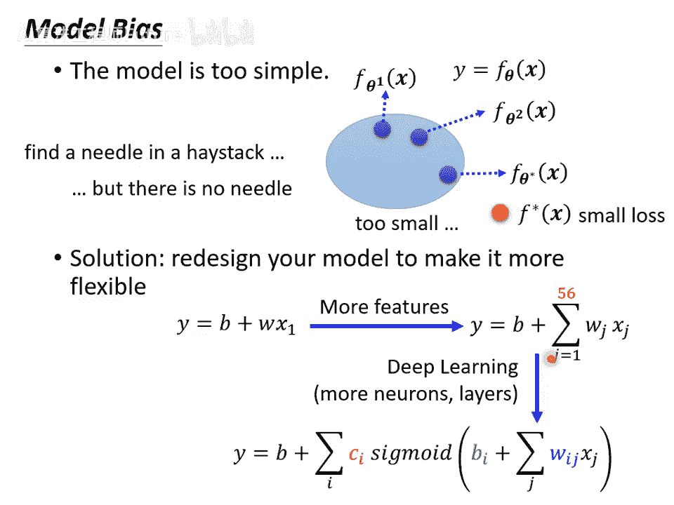

但是并不是training的时候，lost st就代表一定是model bias，你可能会遇到另外一个问题，这个问题是什么，这个问题是optimization做的不好。

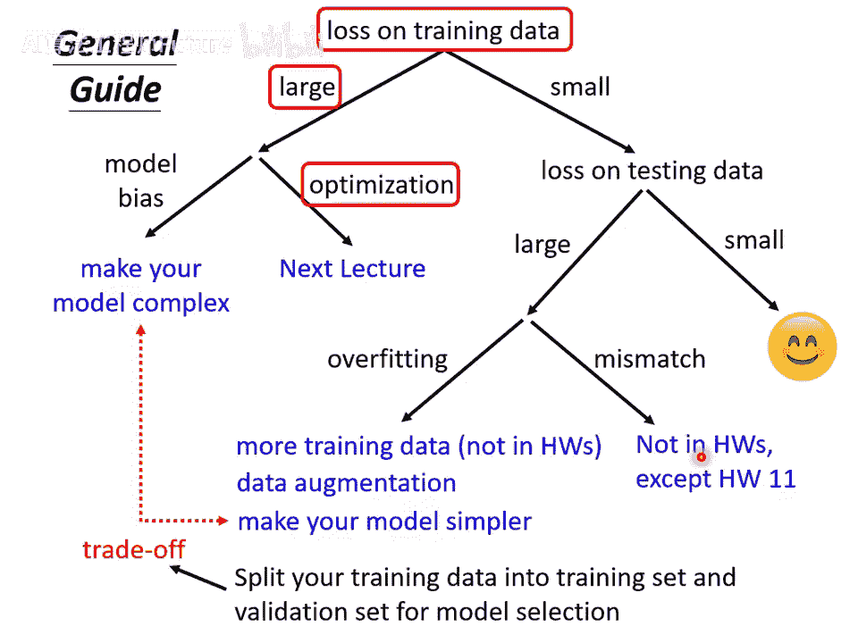

什么意思呢，哦我们知道说我们今天用的optimization，在这门课里面，我们其实都只会用到gradient，descent这种optimization的方法。

那这种optimization的方法有很多的问题，举例来说，我们上周也讲过说啊，你可能会卡在local minimu的地方，你没有办法找到一个，真的可以让loss很低的参数。

那如果用图具象化的方式来表示的话。

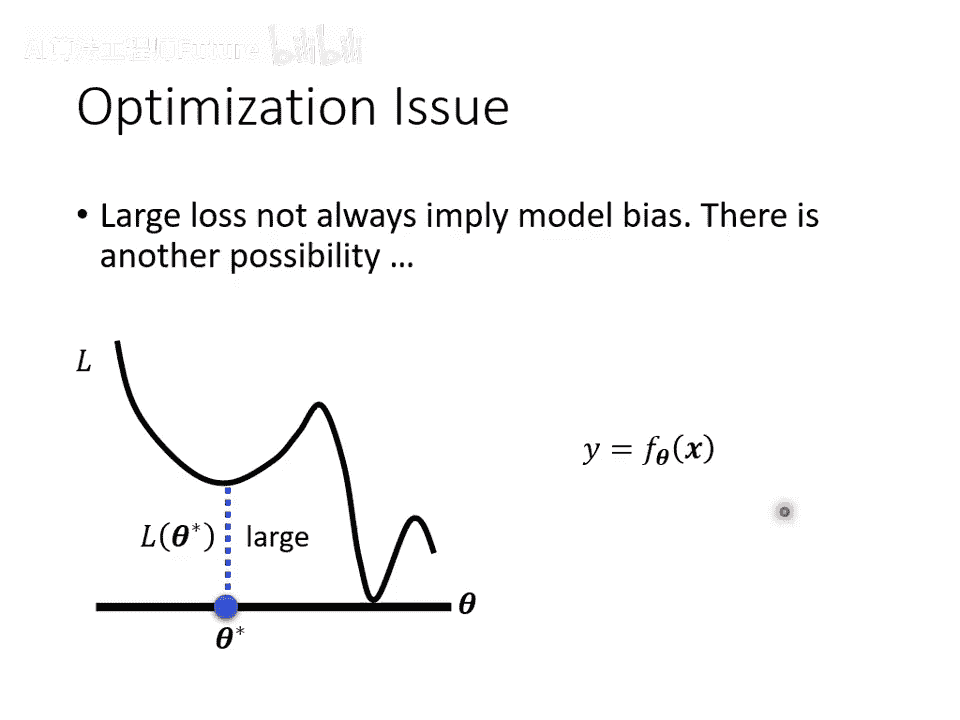

就像是这个样子，这个是你的model，它可以表示的函式所形成的集合呃，你可以把sea代入不同的数值，形成不同的function，把所有的function通通集合在一起，得到这个蓝色的set。

这个蓝色的set里面确实包含了一些function，这些function它的loss是低的，但问题是gradient descent，这一个演算法，没办法帮我们找出这个lost d的方式。

gradient descent说，你要我帮你解optimization的problem，我给你这个set up star，然后就结束了，但这个set ta star他给我们loss不够低。

这个model里面存在着某一个方向，它的loss是够低的，但gradient descent没有给我们这一个方式好，那这就好像是说啊，我们想大海捞针，针确实在海里，但是我们却没有办法把针捞起来。

但这边问题就来了，我们今天看到training data的loss不够低的时候。

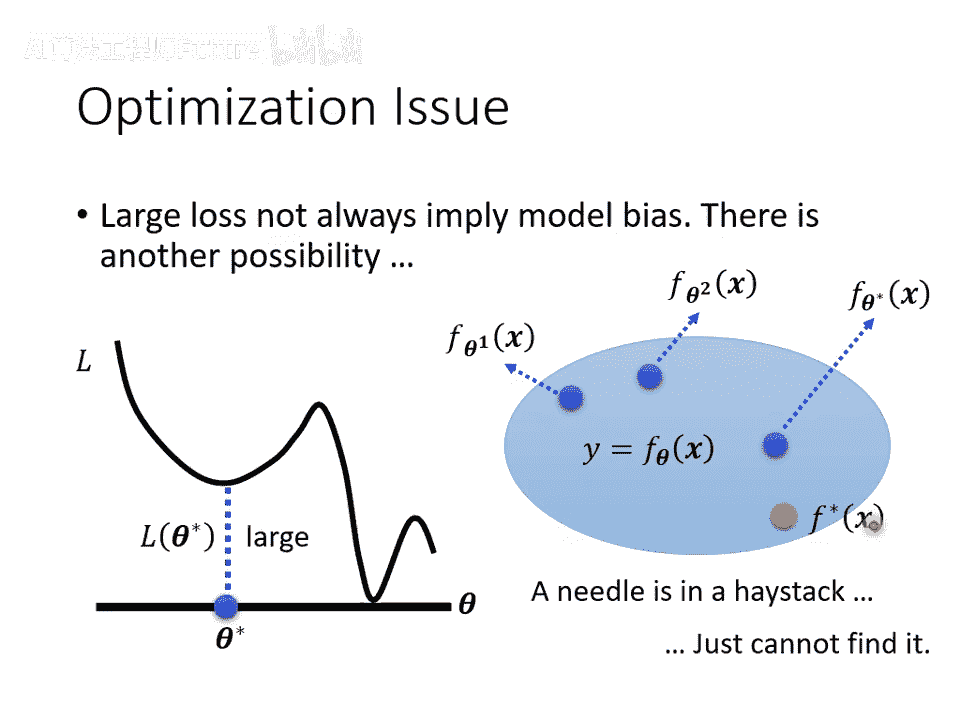

到底是model bias还是optimization的问题呢，今天我们发现说我们找不到一个lost d的function，到底是因为我们的model的弹性不够，我们的海里面没有针。

还是说我们的model弹性已经够了，只是optimization gradient descent不给力，他没办法把针捞出来，到底是哪一个呢，到底我们的model已经够大了，还是它不够大的。

怎么判断这件事呢。

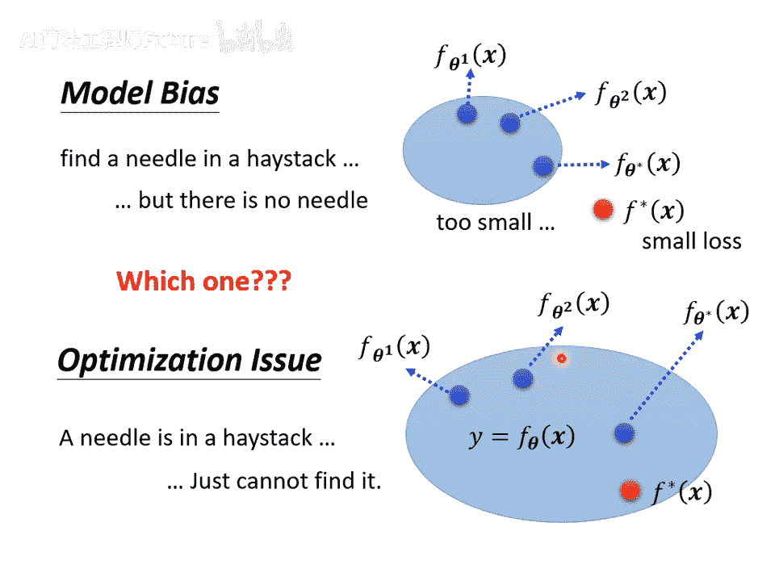

好那这边的建议的判断的方法就是，你可以透过比较不同的模型来得知，说你的model现在到底够不够大，怎么说呢，我们这边举一个例子，那这个实验是从recedual network。

那一篇paper里面揭露出来的，我们那paper连接呢放在右上角，这边paper呢一开头啊就跟你讲了一个故事，他说呃我想去两个network，一个network呢有20层，一个network呢有56层。

那我们把他们测试在测试资料上，那这个横轴呢是指的是training的过程啦，就是你参数update的过程啊，那随着参数的update，当然你的loss呢会越来越低，但是结果20层的loss比较低。

56层的loss还比较高，那这个recedual network是比较早期的paper，2015年的paper啦，如果你现在大学生的话，那个时候你都还是高中生而已啊。

所以呃那个时候大家对deep learning，我觉得了解呢还没有那么透彻，那大家对deep learning有各种奇怪的误解，所以很多人看到这张图就会说啊，这个代表什么。

这个代表OVERBEATING，就告诉你deep learning不work，知道吗，56层太深了，不work根本就不需要那么深，但那个时候大家也不是，每个人都觉得deep learning是好的。

那时候还有很多对deep learning的质疑，所以看到这个实验，有人就会说，所以生没有比较好，这个叫做OVERFTING，但是这个是OVERFITTING吗，这个不是OVERFITTING。

等会告诉你OVERFITTING是什么，并不是所有的结果不好都叫做OVERF，你要检查一下训练资料上的结果，你检查训练资料，结果发现说现在20层的network，跟56层的network比起来。

在训练资料上，20层的network的loss其实是比较低的，50层的network的loss是比较高的，这代表什么，这代表56层的network，他的optimization没有做好。

他的optimization不给力，你想问说诶，你怎么知道是56层的optimization不给力，搞不好是ml bias啊，搞不好是56层的network，他的model的弹性还不够大。

要156层才好啊，56层也许弹性还不够大，但是你比较56层跟20层，20层的loss都已经可以做到这样了，56层的弹性一定比20层更大，对不对，如果今天56层的network要做到。

20层的network可以做到的事情，对他来说是轻而易举的，他只要前20层的参数跟这个20层的network一样，剩下36层就什么事都不做，identity卡比前一层的输出就好。

那56层的network一定可以做到，20层的network可以做到的事情，所以20层的network都已经可以走到这么低的loss，56层的network，它比20层的network的弹性还要更大啊。

最没有道理，20层的network可以做到的事情，56层的network做不到啊，所以56层的network，如果你optimization成功的话。

他应该要比20层network可以得到更低的loss，但结果在训练资料上面没有，这个不是OVERFITTING，这个也不是model bias，因为56层network弹性是够的。

这个问题是你的这个optimization不给力。

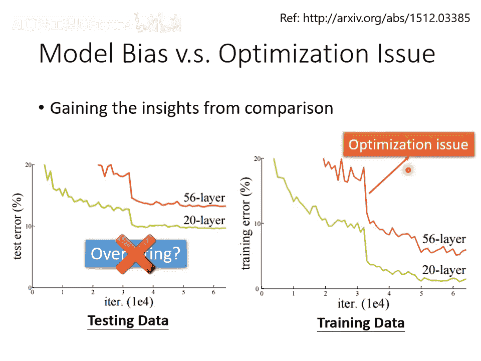

optimization做的不够好好，所以刚才那个例子就告诉我们说，你怎么知道你的optimization有没有做好呢，这边给大家加的建议是，看到一个你没有从来没有做过的问题。

也许你可以先跑一些比较小的，比较浅的network，或甚至用一些不是deep learning的方法，比如说linear的model，比如说support accommission，有一些方法。

比如说support Mac vector machine，那不知道是什么也没有关系啦，那呃他们可能是比较容易做optimized的，他们比较不会有optimization失败的问题。

也就是这些model，他会竭尽全力的在他们的能力范围之内，找出一组最好的参数，他比较不会有失败的问题，所以你可以先TRA1些比较浅的model，或者是一些比较简单的model，先知道现有个概念。

说这些简单的model到底可以得到什么样的note好，接下来才缺一个深的model，如果你发现你深的model跟浅的model比起来，深的model明明弹性比较大。

但loss却没有办法比浅的model压得更低啊，那就代表说呢你的optimization有问题，你的gradient descent不给力，那你要有一些其他的方法。

来把optimization这件事情做得更好。

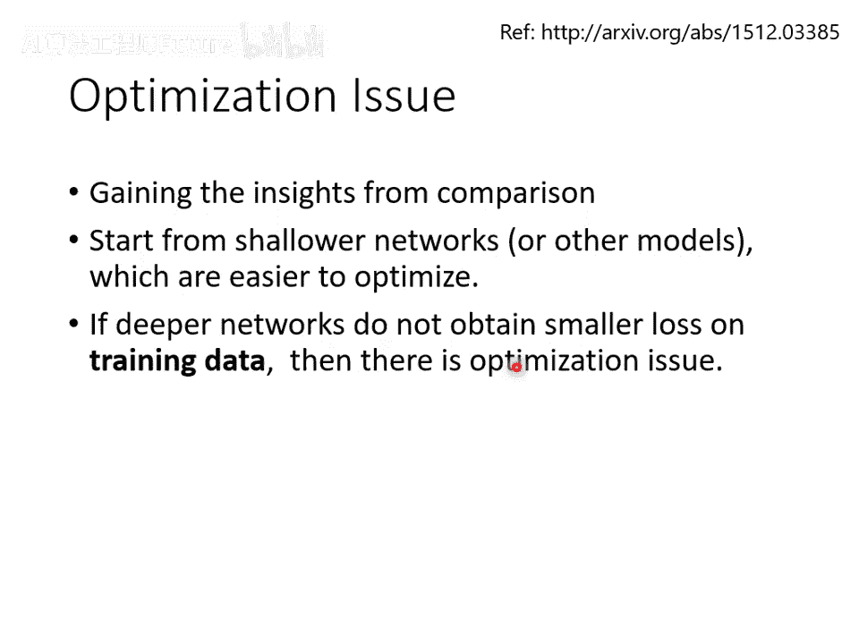

举例来说啊，我们上次看到的这个啊观看人数预测的例子，我们说在训练资料上面，2017年到2020年的资料，是训练资料一层的network，它的loss是0。28K，两层就降到0。18K，三层就降到0。

14K，四层就降到0。10K，但是我测五层的时候，结果变成0。34K，这是什么问题，我们现在loss很大，这个是什么问题，这是model bias的问题吗，显然不是，因为四层都可以做到0。10K了。

五层应该可以做的更低，这个是optimization的problem，这个是optimization的时候做的不好，才造成这样子的问题好，那如果optimization做的不好的话，怎么办呢。

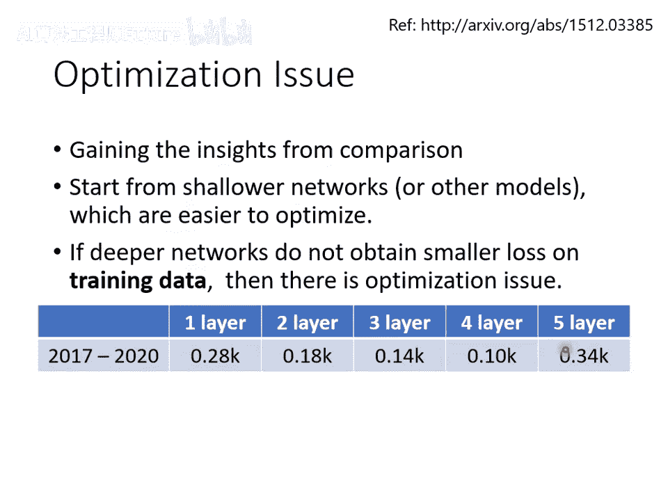

这个我们下一节课就会告诉大家要怎么办，现在就知道说有这个问题，知道怎么判断，说现在如果你的training的lost star，到底是model bias还是optimization。

如果model bias，那就把model变大，如果是optimization失败了。

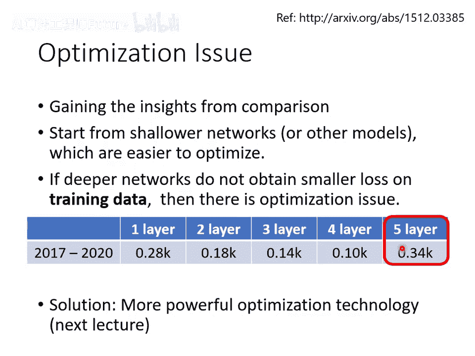

那就看下下等一下的课程怎么解决这个问题好，那假设你现在经过一番的努力，你已经可以让你的training data的loss变小了，那接下来你就可以来看testing data的loss。

看testing data loss做的怎么样，那如果testing data loss也小，有比这个啊，strong face line还要小，那就结束了，没什么好做的，就结束了好吗，结束了好。

那但是如果你觉得还不够小呢，如果training data上面的loss小，testing data上的loss大，那你可能就是真的遇到OVERFITTING的问题。

但你要注意是training的loss小，testing的loss大才叫做OVERFITTING哦，很多同学每次一看到结果不好，在testing上的结果不好，就说这个是over fety。

不一定是open feeling，你拿一个结果来问我说老师这个结果要怎么变，做的更好的时候，我第一个问题都要问，你说你在training data上的loss到底做的怎么样，那我发现十个同学有八个都说。

要看training data的loss嘛，我没有把ching data loss记下来，哎你要把train data loss记下来，先确定说你的optimization没有问题。

你的mother够大了，然后接下来才看看是不是testing的问题好，那如果是那个training的loss小testing的loss大啊，这个有可能是OVERFITTING啊。

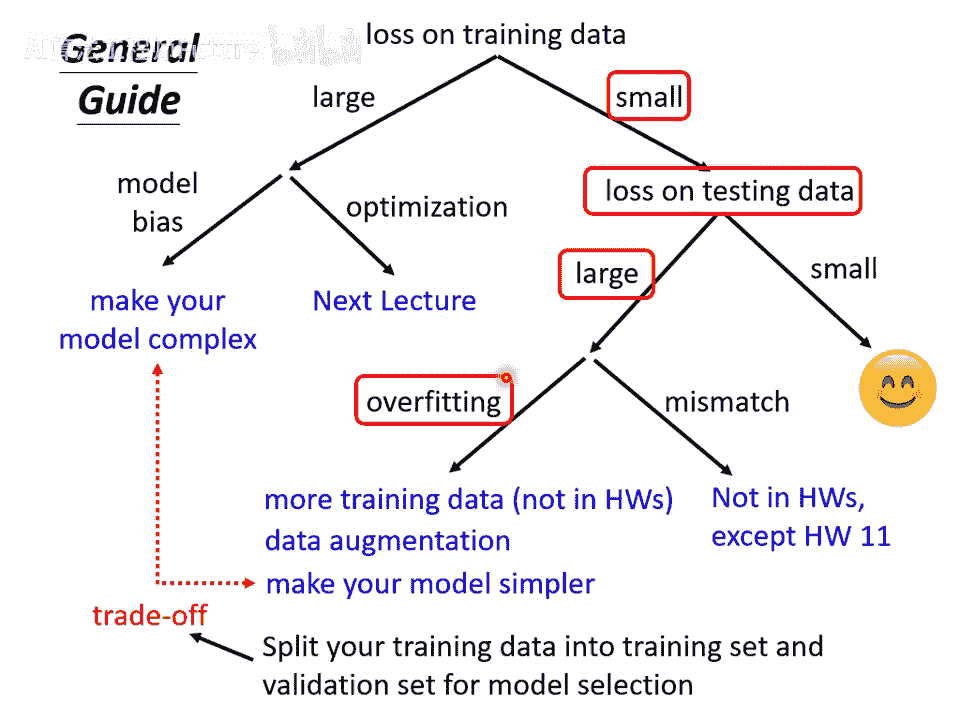

那over为什么会有OVERFITTING这样的状况呢，为什么有可能training的loss，stock testing的啊，为什么有可能training的loss小testing的loss大呢。

那这边呢就举一个极端的例子来告诉你说，为什么会发生这样子的状况好，那这是我们的训练资料，而假设根据这些训练资料，某一个很废的呃，machine learning的方法呢。

他找出了一个一无是处的function，这个一无是处的function是什么样的方式呢，这个一无是处的function，说如果今天呐X当做输入的时候，我们就去比对这个X啊，有没有出现在训练资料里面。

如果X有出现在训练资料里面，就把它对应的Y当做输出，如果X没有出现在训练资料里面，那怎么办，就输出一个随机的值，那你可以想象说这个function啥事也没有干，他是一个一无是处的方选。

但虽然它是一个一无是处的function，它在training的data上，它的loss可是零的，你把training的data通通丢进这个function里面，它的输出跟你的训练资料的label。

是一模一样的哦，所以在training data上面，这个一无是处的function，它的loss可是零呢，只是在testing data上面，它的loss会变得很大，因为他其实什么都没有学好。

这是一个比较极端的例子，那在一般的状况下也有可能发生类似的事情。

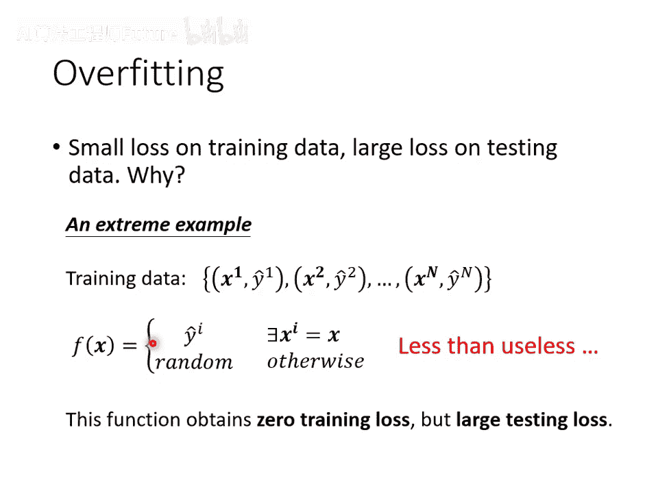

举例来说，假设我们的输入的feature叫做X，我们输出的label呢叫做Y，那X跟Y呢都是一维的，X跟Y之间的关系呢是这一个二次的曲线，那这个曲线我们可以用虚线来表示。

因为我们通常没有办法直接观察到这条曲线，我们真正可以观察到的是什么，我们真正可以观察到的是我们的训练资料，那训练资料你可以想象成，就是从这条曲线上面随机sample出来的几个点。

你今天的模型呢它的能力非常的强，他的flexibility很大，它的弹性很大的话，你只给他这三个点，他会知道说在这三个点上面，我们要让nos d，所以你今天你的model，它的这个曲线呢会通过这三个点。

但是其他没有训练资料作为限制的地方，它就会有freestyle，因为他他的这个自由，他的粉ability很大嘛，它的弹性很大嘛，所以你的model可以变成各式各样的function。

你没有给他资料作为训练，它就有freestyle，可以产生各式各样奇怪的结果，那这个时候如果你再丢进你的testing data，那testing data和training data当然不会一模一样。

他们可能是从同一个这个distribution sample出来的啊，testing data是橙色的这些点，训练data是蓝色的，这些点用蓝色这些点找出一个function以后。

你测试在橘色的这些点上不一定会好，如果你的如果你的model它的自由度很大的话，它可以产生非常奇怪的曲线，导致训练资料上的结果好，但是测试资料上的loss很大好，那至于呃更详细的背后的数学原理啊。

为什么啊，这个比较有弹性的model，它就比较会OVERFITTING背后的数学原理，我们留待下，下周吴佩元老师呢会跟大家更详细的说明好，那我今天呢就是讲一下他的概念就好好。

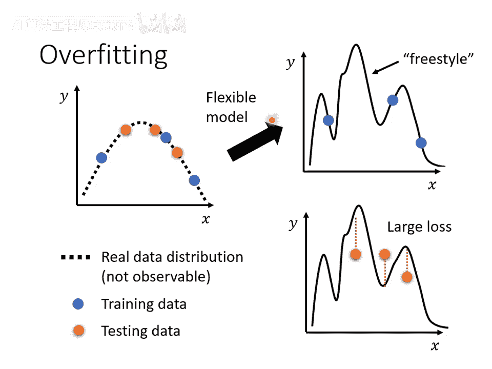

那怎么解决刚才那个open fitting的问题呢，有两个可能的方向，第一个方向是呃，也许这个方向往往是最有效的方向，是增加你的训练资料哦，所以今天假设你自己要想要做一个application。

你发现有OVERFTING的问题，其实我觉得最简单解决OVERFITTING的方法，就是增加你的训练资料哦，所以今天如果训练资料蓝色点的点变多了，蓝色的点变多了，那虽然你的model它的啊弹性可能很大。

但是因为这边的点非常非常的多，他就会被限制住，它看起来的形状还是会很像，在产生这些资料背后的二次曲线，但是你在作业里面，你是不能够使用这一招的，因为我们并不希望大家浪费时间来，就收集资料啊等等。

那这个不是机器学习技术最核心的部分，而不是花太多力气去网络上搜集资料，看看怎么把作业做好，所以这个不是我们要大家做的，在作业里面不能够自己收集资料，那你可以做什么呢。

呃你可以做data implementation，这个方法并不算是使用了额外的资料，data implementation是什么意思呢，Data opentation，就是你用一些你对于这个问题的理解。

自己创造出新的资料，举例来说，在做影像辨识的时候，非常常做的一个招式是。

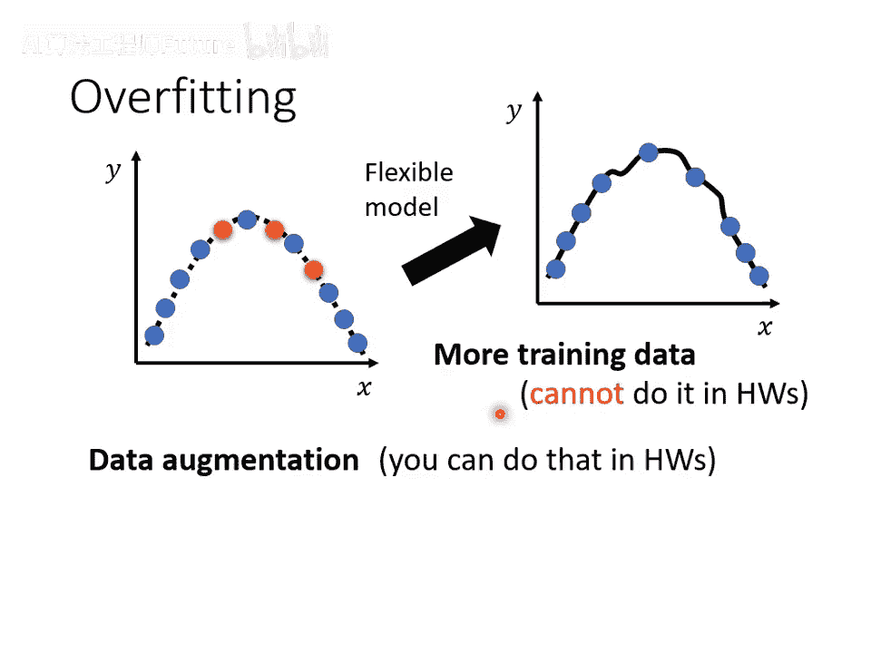

假设你的训练资料里面有某一张图片，把它左右翻转。

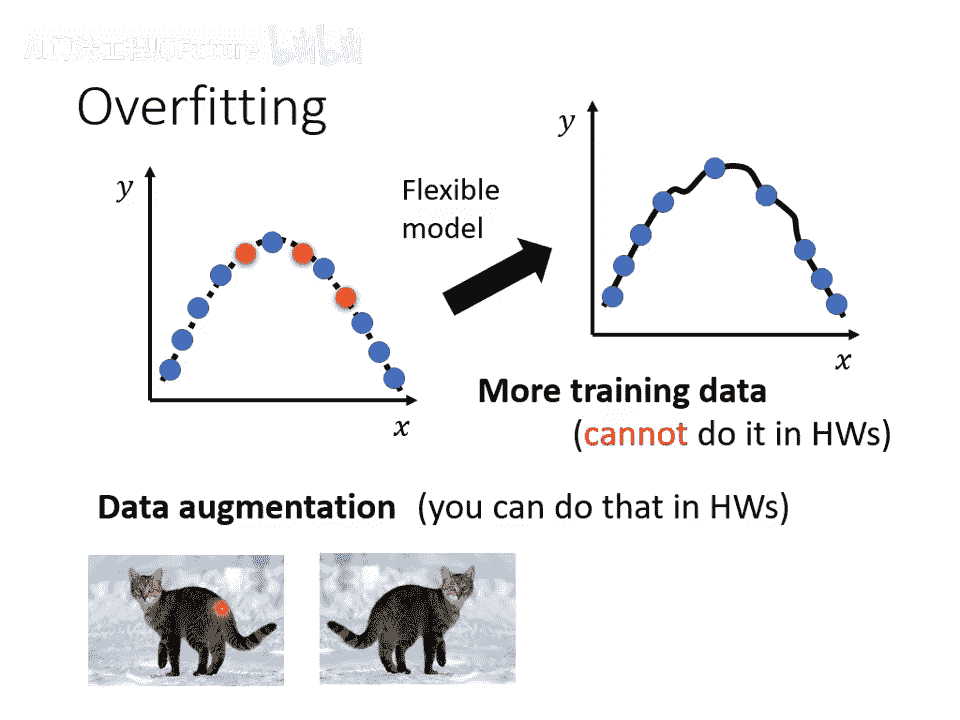

或者是把它其中一块截出来放大等等啊，你做左右翻转，你的资料就变成两倍，那这个就是data augentation，但是你要注意一下，data augmentation呢。

不能够随便乱做这个data orgentation，这个augment啊，要augment的，有道理。

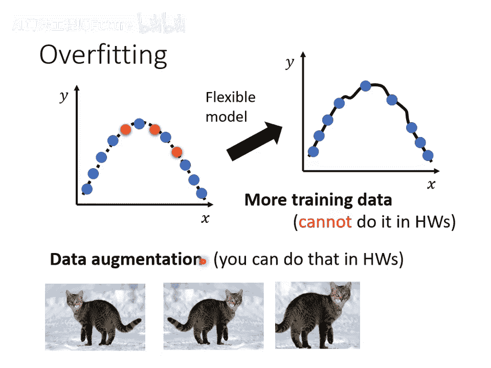

举例来说，在影像辨识里面，你就很少看到有人把把影像上下颠倒，当做某GUMITATION，为什么，因为这些图片都是合理的图片，你把一张照片左右翻转，并不会影响到里面是什么样的东西，那你把它颠倒。

那就很奇怪了，这可能不是一个训练资料里面，可能不是真实事件会出现的影响，那如果你给机器看这种奇怪的影像的话，他可能就会学到奇怪的东西哦，所以data computation要呃，根据你对资料的特性。

对你现在要处理的问题的理解，来选择合适的贝塔OPENTATION的方式好，那这边是增加资料的部分，那还有什么解法呢，另外一个解法就是。

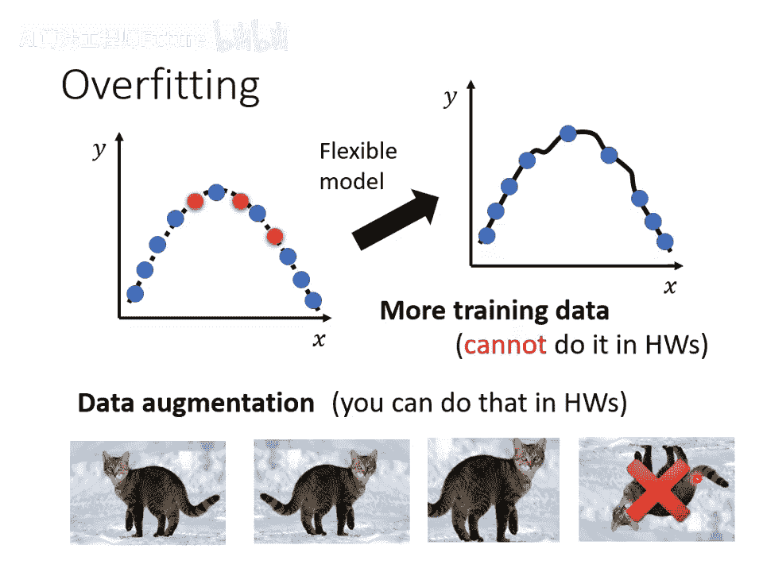

不要让你的模型有那么大的弹性，给它一些限制，举例来说，假设我们直接限制说，现在我们的model一定是一条二次曲线，我们3号通灵出，知道说X跟Y背后的关系呀，其实就是一条二次曲线。

只是我们不明确的知道这二次曲线里面的，每一个参数长什么样，那时你怎么会通灵出这样子的结果，你怎么会知道说要用多CTRL的model彩排好呢，那这就取决于你对这个问题的理解。

因为这种model是你自己设计的，到底model要多CTRL多flexible，结果才会好，那这个要问你自己，那要看这个设计出不同的模型，你就会得出不同的结果好。

那现在假设我们已经知道说模型就是二次曲线，那你就会给你，你就会在选择方选的时候有很大的限制，因为二次曲线要么就是这样子，要么就是这样子，来来去去就是那几个形状而已，所以当我们的训练资料有限的时候。

因为我们来来去去只能够选那几个方式，所以你可能虽然说只给了三个点，但是因为我们能选择的方选有限，你可能就会正好选到跟真正的distribution比较接近的function。

然后在测试资料上得到比较好的结果啊，这所以这是第二个方法解决OVERBEATING的问题，你要给你的model1些限制，最好你的model正好跟背后产生资料的过程的process，是一样的啊。

那你可能就会那你就有机会得到好的结果，但是如果你给你的呃。

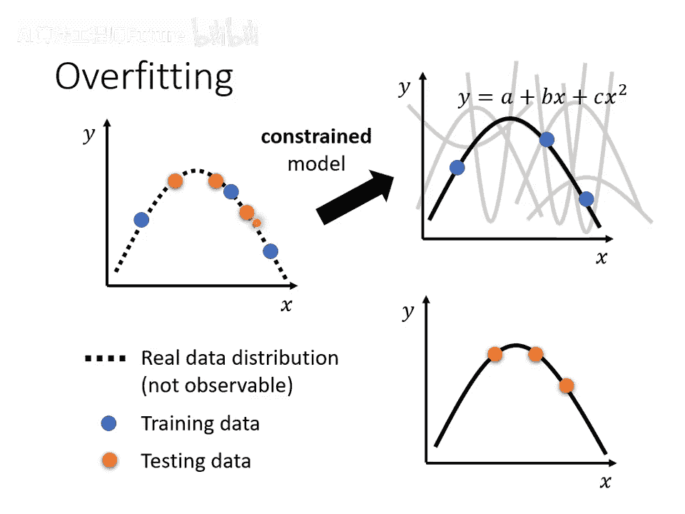

有哪些方法可以给model制造限制呢，举例来说呃，给它比较少的参数，如果是deep learning的话，就给它比较少的神经元的数目，本来每层1000个神经元改成100个神经元之类。

或者是你可以让model共用参数啊，你可以让一些参数有一样的数值。

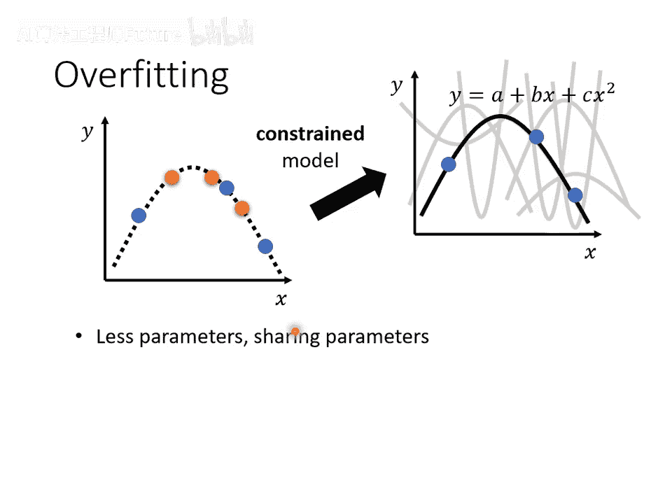

那这个部分如果你没有很清楚的话，也没有关系，我们之后再讲CNN的时候啊，会讲到这个部分，所以这边先前情先这个预告一下。

就是我们之前讲的network的架构叫做fully connected or network，那fully connected the network其实是一个比较有弹性的架构。

而CNN是一个比较有限制的架构，就说你们会说CNN不是比较厉害吗，大家都说做影像就像CNN那比较厉害的model，难道他比较没有弹性吗，没错它是一个比较没有弹性的model，它厉害的地方就是。

它是针对影像的特性来限制模型的弹性哦，所以你今天fully connected的network可以找出来的function，所形成的集合其实是比较大的。

CNNCNN这个model所找出来的function，它形成的集合其实比较小的，其实包含在fully connected的network里面的，但是就是因为CNN给了比较大的限制。

所以CNN在影像上反而会做的比较好，那这个之后都还会再提到，还有哪些其他的方法呢，一个就是用比较少的feature啦，那刚才助教已经示范过，本来给三天的资料改成用给两天的资料，其实结果诶就好好了一些。

那这个是一个超速，还有一个招数呢叫做early stopping，Early stopping，Regalization，跟抓爆都是之后课程还会讲到的东西，那这三件事情呢在作业一的城市里面。

这个啊early stopping其实是有的啊，助教有写在他的code里面，所以不知道这是什么也没有关系，反正你直接执行simple code里面就有了REGALIZATION。

助教留下了一个空格给大家填，那你不知道什么是REGZATION，没有关系，反正你可以过得了middle的base line，那如果想做的更好，也许你可以先自己survey一下REGZATIONCIL。

看看有没有办法自己写，那抓爆，这是另外一个在deep learning里面，常用来限制模型的方法，那这个之后还会再提到。

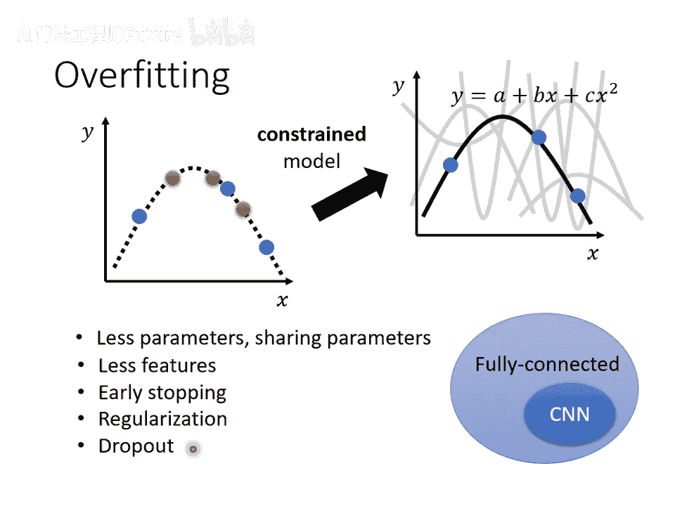

好但是啊我们也不要给太多的限制，为什么不能给模型太多的限制呢，假设我们现在给模型更大的限制，说我们假设我们的模型一定是linear的model，一定是写成Y等于A加BX。

那你的model呢它能够产生的function就一定是一条直线，今天给三个点，没有任何一条直线可以同时通过这三个点，但是你只能找到一条直线，这条直线跟这些点比起来，它们的距离是比较近的。

但是你没有办法找到任何一条直线，同时通过这三个点啊，这个时候你的呃模型的限制就太大了，你在测试资料上就不会得到好的结果，但是这个是OVERFITTING吗，这个不是OVERFITTING。

因为你又回到了model bias的问题，所以你现在这样在这个情况下，在这个投影片的case上面，你结果不好，并不是因为over fitting了，而是因为你给你模型太大的限制。

达到你有了model bias的问题。

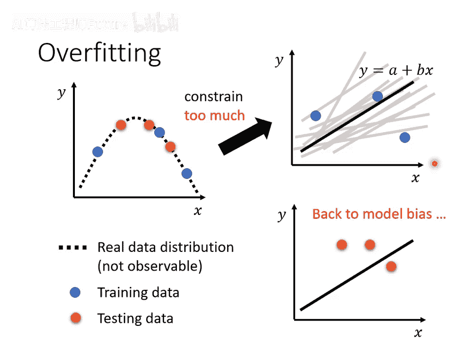

所以你会发现说这边产生了一个有点矛盾，这边产生了一个矛盾的状况，当今天你让你的模型的复杂的程度，或将让你的模型的弹性越来越大，但什么叫做复杂的程度，什么叫做弹性，在今天这堂课里面。

我们其实都没有给明确的定义，只给你一个概念上的叙述，那在下下周的课程里面，你会真的认识到什么叫做一个模型很复杂，什么叫做一个模型有弹性，怎么真的衡量一个模型的弹性，复杂的程度有多大。

那今天我们先用直观的来了解，所谓比较复杂，就是啊啊它可以包含的方式比较多啊，它的参数比较多啊，这个就是一个比较复杂的model，好那个比较复杂的model，如果你看他的training的loft。

你会发现说随着model越来越复杂，村里的loss可以越来越低，但是testing的时候呢，当model复杂越来越复杂的时候，刚开始啊你的testing loss会跟着下降。

但是当复杂的程度超过某一个程度以后，testing的loss就会突然暴增了，好那那这就是因为说啊，当你的model越来越复杂的时候，复杂到某个程度，OVERFITTING的状况就会出现。

所以所以你在training的loss上面，可以得到比较好的结果，还在test的lost上面，你会得到比较大的loss，那我们当然期待说我们可以选一个呃，呃中庸的模型不是太复杂的，也不是太简单的。

刚刚好可以在训练资料上给我们最好的结果，给我们最低的loss，给我们最低的testing loss，怎么选出这样的model呢。

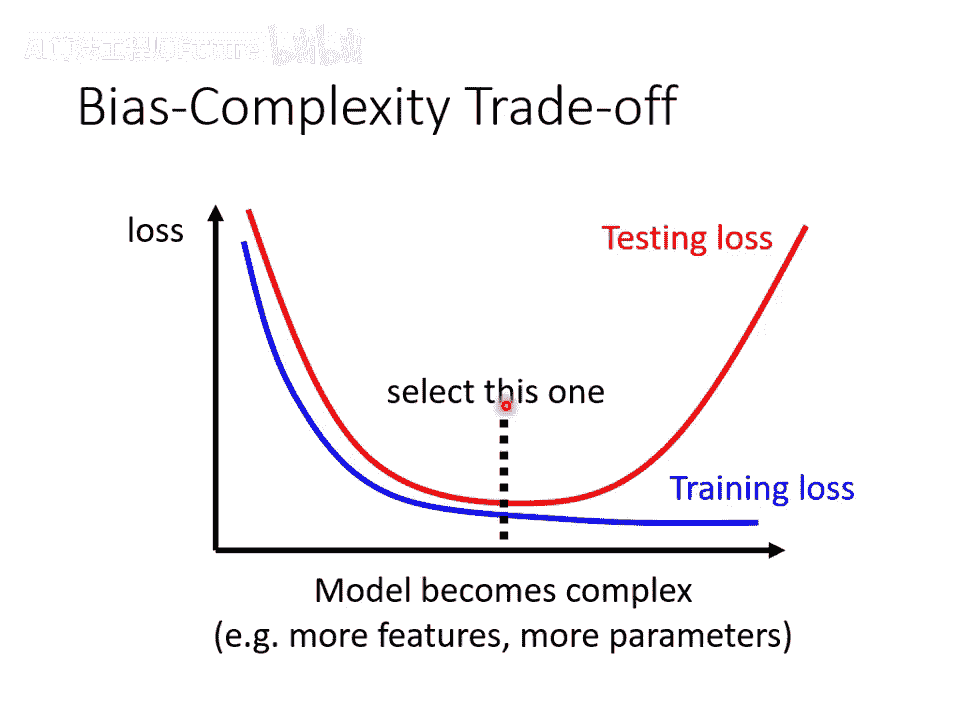

啊一个很直觉的，你很有可能没有人告诉你要怎么做的话，你可能很直觉就会这么做，做法是说诶，这个cargo不是立刻上传就可以知道答案了吗，所以假设我们有三个模型，它们的复杂的程度不太一样。

我不知道选哪一个模型，才会刚刚好在测试资料上得到最好的结果，因为你选太复杂的，就over fit，太简单的，有model bias的问题，那怎么选一个不偏不倚的，不知道，那怎么办。

把这三个模型的结果都跑出来，然后上传到cargo上面，你及时的知道了你的分数，看看哪个分数最低啊，哪个模型显然就是最好的模型，但是并不建议你这么做，为什么不建议你这么做呢。

我们举一个再举一个极端的例子好，我们再把刚才那个极端的例子拿出来，假设现在有一群model，这一群model不知道为什么都非常废，他们每一个model产生出来的都是一无是处的function。

我们有一到这个零有多少个，我不知道，随便把当做一兆好了，我们有1~1兆个model，这一这1~1兆的model，不知道为什么认出来的function都是一无是处的function。

他们会做的事情就是训练资料里面，有的资料就把它记下来，训练资料没看过的就直接open随机的结果好，那你现在有一兆个模型，那你再把这一兆个模型的结果，通通上传到CARDLE上面，你就得到一兆的分数。

然后看这一兆的分数里面哪一个结果最好，你就觉得那个模型是最好的，那很有，虽然说每一个模型他们在这个testing data上面，testing data它都没有看过啊，所以他输出的结果都是随机的。

但虽然在testing data上面输出的结果都是随机的，但是你随随你不断的随机，你总是会找到一个好的结果，对不对，所以也许编号56789的那一个模型啊。

它找出来的function正好在testing data ta上面，就给你一个好的结果，那就会很高兴，觉得说这个model编号56789是个好model，这个好model得到一个好方向。

但它其实是随机的，但你不知道它是个好方式，这个好方式在这个testing data上面给我们好的结果，所以你就觉得说嗯这个结果不错，就这样。

我就选这个model这个function当做我们最后上传的结果，当做我最后要用在ping testing set上的结果，但是如果你这样做，往往就会得到非常糟的结果，因为这个model毕竟是随机的。

它恰好在te public的testing data data上面，它tby testing data上得到个好结果，但是他在prime的testing set上可能仍然是随机的哦。

所以假设你今天在选model的时候，你都用habit的，就我们这个testing set分成popping的set跟private的same嘛，你在看分数的时候，你只看得到POKET的分数。

private的分数要DADA以后才解知道，但假设你在挑模型的时候，你完全看你在public set上面的。

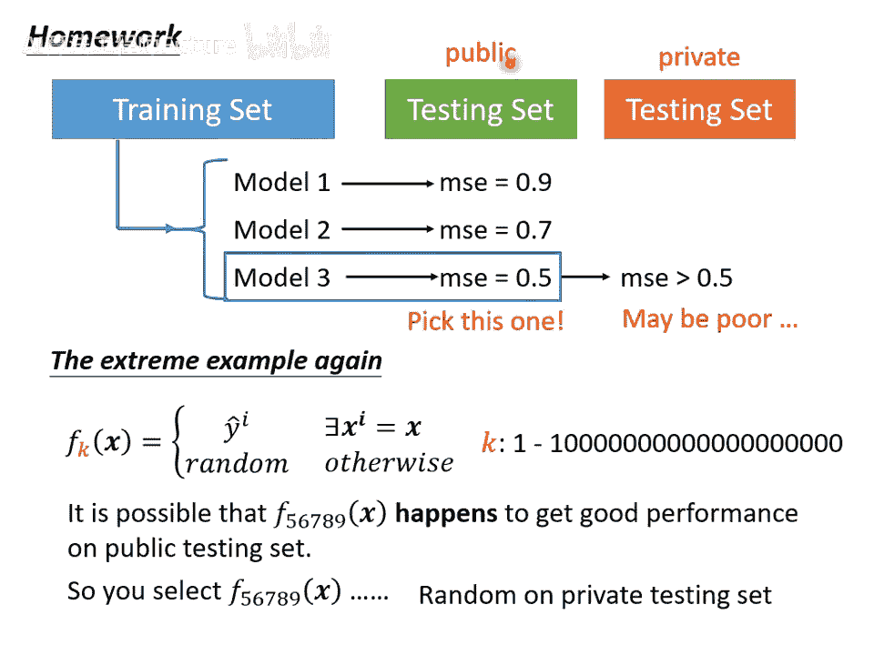

也就leader for上的分数来选择你的模型的话，你可能就会这个样子哎，就你在public的leader board上面排前十，但是DAYLINE1结束，你就心态就崩了，这样掉到300名之外。

而且我们这休克人这么多，你好怕会掉到1000名之外也说不定哦，而且这件事情呃并不是传说，并没有夸视，每年都会有这样子的状况发生，因为今年我们会看ping，就说我们在算分数的时候，你在PC上面的结果好。

还是会给你一点分数，我们不是只看private的分数而已，是PC跟private的分数看的，那过去有些学习是只看Python的分数的时候，发生这种状况，你心态就会整个崩掉了，这样唉你就会非常非常的郁闷。

好那那呃呃呃那这个时候有同学就会说，那为什么我们要把testing的S分成puppy，跟PTHON呢，为什么我们不能就通通都分party就好了，为什么要为难大家呢，为什么要让大家疑神疑鬼。

不知道自己PRIATE上的结果是什么，你仔细想想看，假设所有的data都是PC，那我刚才说就算是一个一无是处的MAMODEL，得到的一无是处的function。

它也有可能在public的data上面得到好的结果，如果我们今天只有public testing set，没有quit的testing set，那你就回去啊，写一个城市，不断random产生输出就好。

然后不断把random的输出上传到cargo，然后看你什么时候可以render出一个好的结果，那这个作业就结束了，那这个显然没有意义，显然不是我们要的，而且啊因为如果今天你想他。

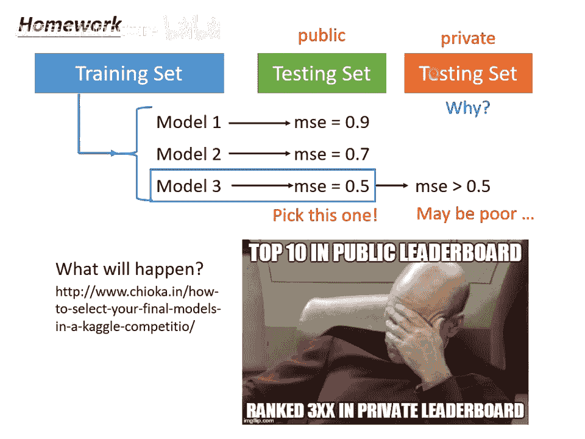

然后这边有另外一个有趣的事情，就是你知道，因为如果今天PC的testing data是公开的，你可以知道public的testing data的结果，那你就就就算是一个很废的模型，产生了很废的方式。

也可能得到非常好的结果，那这这就印证了说诶，为什么在机器学习领域，在那些benchmark的COOPUS上面，往往机器可以得到异于异乎寻常的好的结果，往往都超越人类，所谓benchmark opera。

意思就是诶有一些data set是公开的，然后举例来说，这个livery speech是一个公开的，用来训练语音辨识的资料集，那如果你想要测试自己的语音辨识的模型，好不好的话。

那就训练在live respeech上面，那live ris speech有teing set，所有人都共用一模一样的testing set，那我们就可以叫不同模型的好坏。

但是问题是这些testing set的结果都是public的，所以就算是一个很废的模型，它只能产生很废的function，你只要做的够多，你还是可以在ping the same上得到结果，得到好的结果。

那这就解释为什么说这些benchmark office，最终往往机器可以得到超乎人类的结果，那这个最有名的例子啊，就是这个大姐，16年的时候，MICROSOFT跟那个IPM都不约而同的说，哎。

他们的machine啊，在语音电视上面得到超越人类的结果，专业的听打员做的这个语音辨识的，错误率还要低，那这个是怎么来的，那个其实就是坐在benchmark的COOPENS上面啦。

啊那个其实是坐在一个叫做switchboard的，benchmark的COPENS上面，那你说那在benchmark cover上面得到一个非常好的，超越人类的结果，在现实生活中他真的有超越人类吗。

我想你不会相信，对不对，就算你不是做语音辨识的研究人员，你光是有用过，今今天语音辨识系统无所不在嘛，每个手机拿出来都会语音辨识，其实不会相信说诶，机器在语音辨识的能力已经超越人类啊。

所以这个就是在那些benchmark poppers上，benchmark poppers的testing set就是ping的test inset，但是你真的训练出个语音变系统，上线给人用的时候。

那这个是ping的test ins，你有可能在ping的tension set上面，得到什么超越人类的结果，但并不代表它在private的testing set上一定是好的。

但那些benchmark com上面，监视器都说超越人类的语音辨识正确率了，并不代表在日常生活中，它的语音辨识正确率超越了人类哦，所以你知道说啊，那些说在BENCHMAROO上得到什么超越人类的结果。

那个都比较像是呃骗骗麻瓜的商业的实力，不过我觉得说呃，bench用benchmark popo手做出结果来还算是呃，已经是很有品的了，我听过更没有品的是怎样的，就是有一个有一个嗯不知道哪来的新创啊。

去接了一个政府的计划啦，然后说要做语音辨识啊，然后就拿那个data set好，那KPI就定说嗯，我们这个要做到90percent以上的正确率啊，做完哇没有得到90percent。

怎么做都做不到90percent，人家要来验收怎么办呢，啊他们就说跟验收的人说，你这个testing set不好，你这等看这个testing set里面杂讯很多，我帮你把它清干净。

这样我把用有杂讯的那个句子拿掉，这样嘿嘿，然后KPI就达到了正确率就走，12岁以上就起飞了，就过了那个KPI了啊，其实还有更更没品的啦，就是有人会有有怪怪的新创，会拿出他拿出一个东西。

拿出他自己的app，能看我自己做了一个语音辨识系统，你知道吗，跟google辨识出来的结果都一样好哦，为什么呢，而且因为他偷偷了google的API这样子好，所以有各种各样奇奇怪怪的东西啊。

所以网络上的东，网络上奇奇怪怪的吹捧，大家有时候看看就好好，所以讲了这么多，只是想要告诉大家说诶，我们为什么要切ping的testing set，我们为什么要切Python的testing set。

然后你其实不要花，不要用你topic的testing set去调你的模型，因为你可能会在private testing set上面得到很差的结果，那不过因为今年呢你在public set上面的好的结果。

也有算分数诶，所以怎么办呢，为了避免你为了就你可能会说好，那我放弃py set的结果，就只拿py set的结果，然后不断的产生随机的结果去上传到cargo，然后看看说能不能够正好随机出一个好的结果。

为了避免浪费时间做这件事情，所有每日上传的限制，让你不会说我拿很废的模型值产生随机的结果，不断的测试public的testing the store好，那到底要怎么做才选择model才是比较合理的呢。

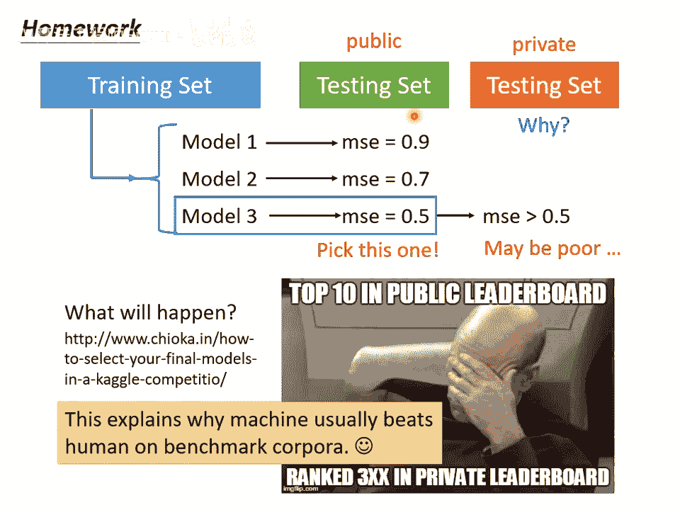

那建议的方法是这个样子的。

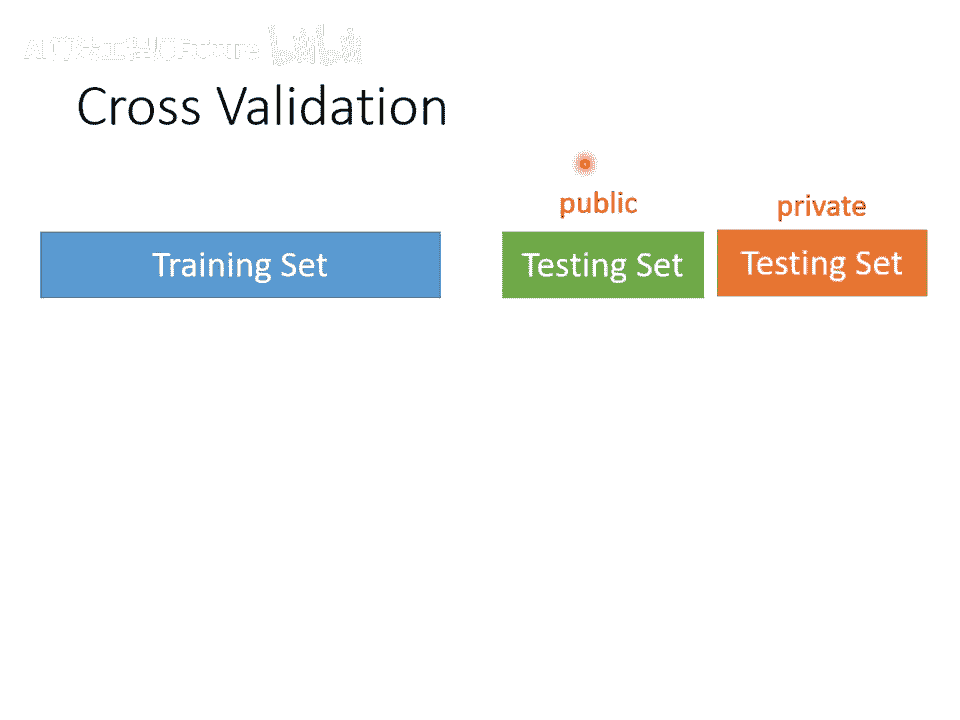

那其助教程式里面也都帮大家做好了，你要把training的资料分成两半，一部分叫做training set，一部分是falidation set，刚才助教的城市里面已经看到说有呃。

90percent的资料放在training set里面，有10percent的资料会被拿来做validation set哦，那你那你在training set上训练出来的模型。

你在validation set上面去衡量他们的分数，根据validation set上面的分数去挑选结果，再把这个结果上传到cargo上面去，看看你得到的ping的分数，那因为你在挑分数的时候。

是用validation set来挑你的model，所以你的public testing set的分数就可以反映，你的Python test and set的分数就比较不会得到，说在PY上面结果很好。

但是在PY上面结果很差，这样子的状况，当我知道说呃其实啊呃你看到ping的结果以后，你就会去想要挑它了，就你看到你现在弄了一堆模型，然后用validation set检查一下。

找了一个模型放到puppy set以上以后，发现结果不好，你其实不太可能，不根据这一个结果去调整你的模型，但是假设这一个loop啊做太多次。

你根据你的puppetesting set上结果去调整你的model，太多次，你就又有可能fit在你的ping testing set上面，然后在private testing set上面得到差的结果。

不过还好，反正我们有限制上传的次数，所以这个loop呢你也没有办法走太多次，可以避免你太过fit在ping的test in set上面的结果好，那呃。

我知道说今天因为puppy的testing set上面的结果啊，是大家都可以看到的，然后很多人都会，然后名字你又可以随便乱取，所以假设有一个人洗到第一名的话，他就会非常的得意。

他的他就会把自己的名字改成一些什么，我第一次是就第一名了，我是我其实只是个旁听，但其实他不是旁听的，但他改成说我其实只是个旁听的，随便做就第一名了，那这个时候你就会觉得很紧张啊，尤其他如果是更认识人。

隔壁小毛得到第一名，到时候耀武扬威的时候，你就会开始有点紧张，你就说等一下你不要得意，我等一下就去把你刷下来，这样那这个时候你要不要理他呢，你不要理他，根据过去的经验。

就是在party leader board上排前几名的，往往private是有很容易铲掉这样子的，所以在puppy的testing上面得到太好的结果，也不用高兴的太早，件事告诉各位小直接调诶。

其实最好的做法就是用validation loss，最小的直接调就好了，就是你不要去管你的public testing set的结果，但我知道说在实作上你不太可能这么做。

因为puppy set的结果你有看到，所以你会对他，对他对你的模型的选择可能还是有些影响的，但是你要额越少去看那个，puppetesting set的结果越好，这样回答到你的问题吗，好啊，如有其他问题。

我等下再回答好，那那个这个是呃，这个是啊，刚才忘了那个呃复数那个同学的问题了，好线上直播的同学，我复述一下刚才那个同学问题，他问题是说，所以我们不能去看puppetesting set的结果嘛。

理想上是就理想上你就用validation set挑就好，然后上传以后怎样就是怎样有过那个strong base，赛后就不要再去呃动它了，那这样子你比较不会。

那这样子呢可以避免你误会pk在testing在上面好，那但是这边会有一个问题，就是怎么分training set跟foundation set呢，那如果在重要城市里面就是随机分的。

但是你可能会说搞不好我这个分分的不好啊，搞不好我分到很奇怪的validation set啦，会导致我的结果很差，如果你有这个担心的话。

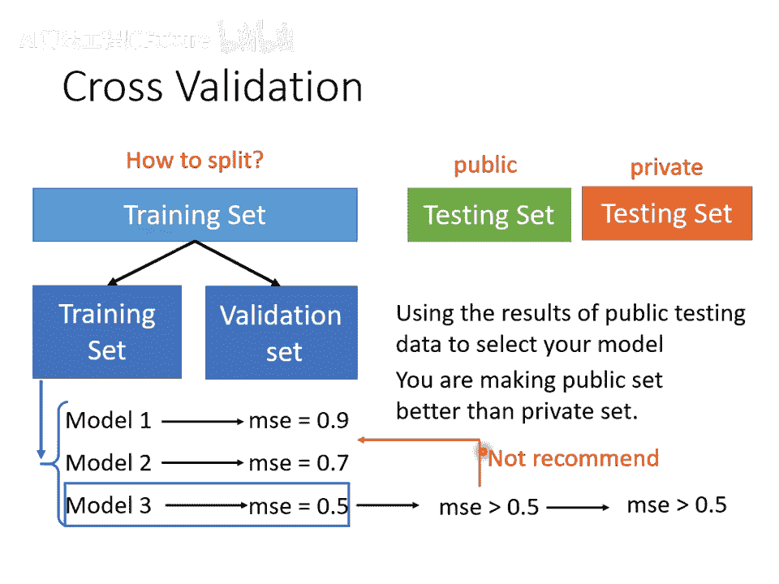

那你可以用n four的PROPERSTATION，那n for the profanation是怎么做的呢。

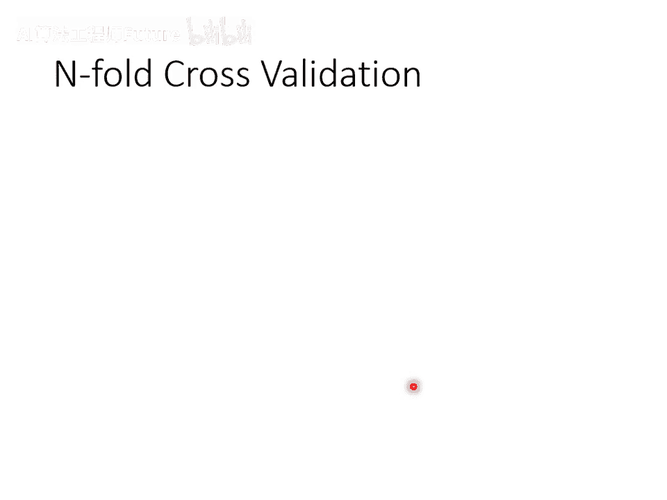

哦就是你先把你的训练资料切成N等份，那在这个例子里面呢，我们切成三等份，切完以后你拿其中一份当做validation set，另外两份当training set，然后这件事情你要重复三次。

也就是说呃你先第一份，第二份当trap，第三份当百ALIDATION，然后第一份第三份当train，第二份当百ALIDATION，第一份当validation，第二份，第三份当TRA。

然后接下来你有三个模型，你不知道哪一个是好的，你就把这三个模型在这三个setting下，这三个training跟validation的啊，data a set上面通通跑过一次。

然后把这三种模型在这三种状况的结果，都平均起来，把每一个模型在这三种状况的结果都平均起来，再看看谁的结果最好。

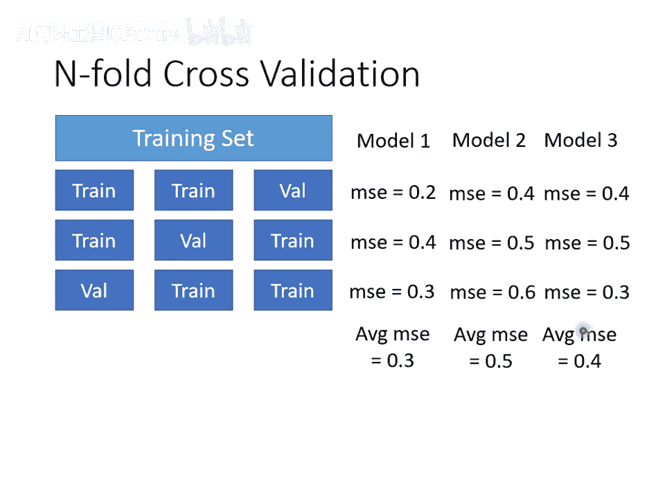

再看看谁的结果最好，那假设现在model one的结果最好，你用这三个for的得出来的结果是这个model one最好，然后你再把model one用在全部的training set上。

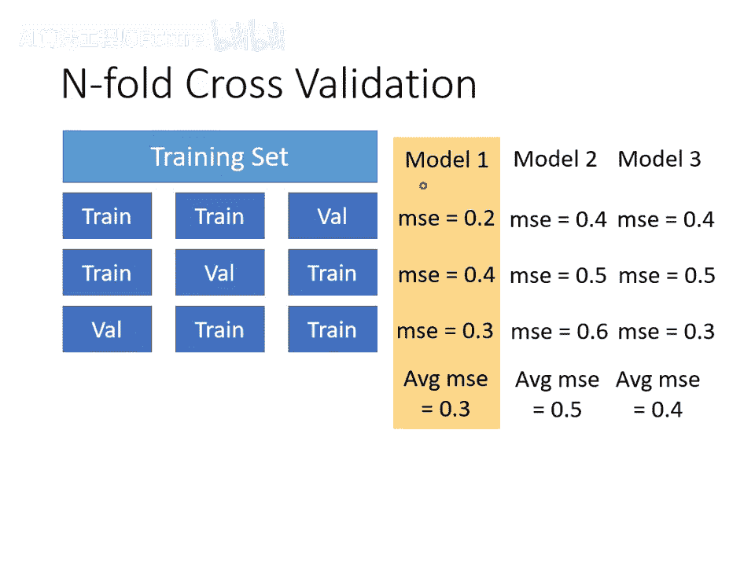

然后训练出来的模型在用在test testing在上面好，那这个是n for的cross fentation好。

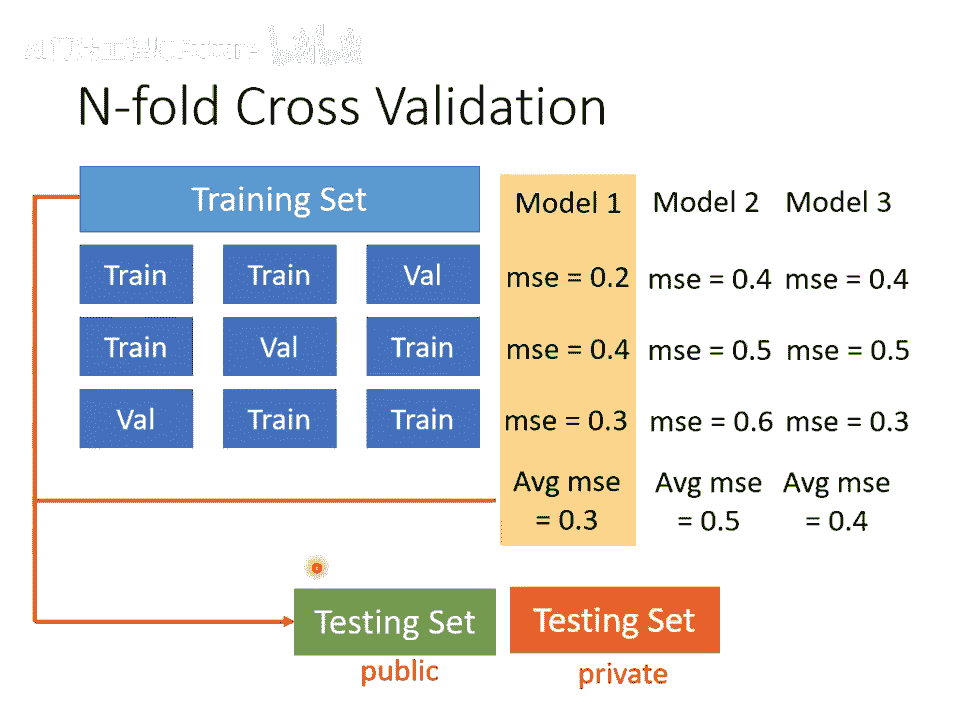

那这个就是这门课前期的攻略，他可以带你打赢前期所有的副本，那接下来也许你要问的一个问题是。

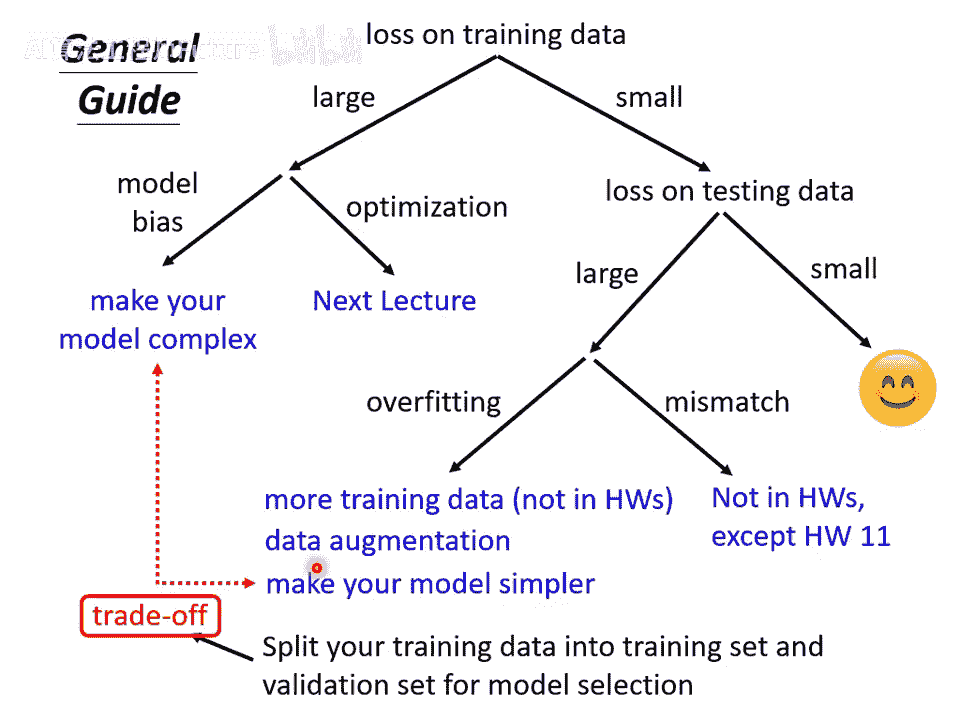

上周结束的时候，不是讲到预测2月26号，也就是上周的观看人数吗，到底结果做的怎么样好，那这个就是我们要做的结果啦，上周比较多人选了三层的network好，所以我们就把三层的network拿来测试一下。

以下是测试的结果，我们就没有再调参数了，大家决定用三层的就是下好零售了。

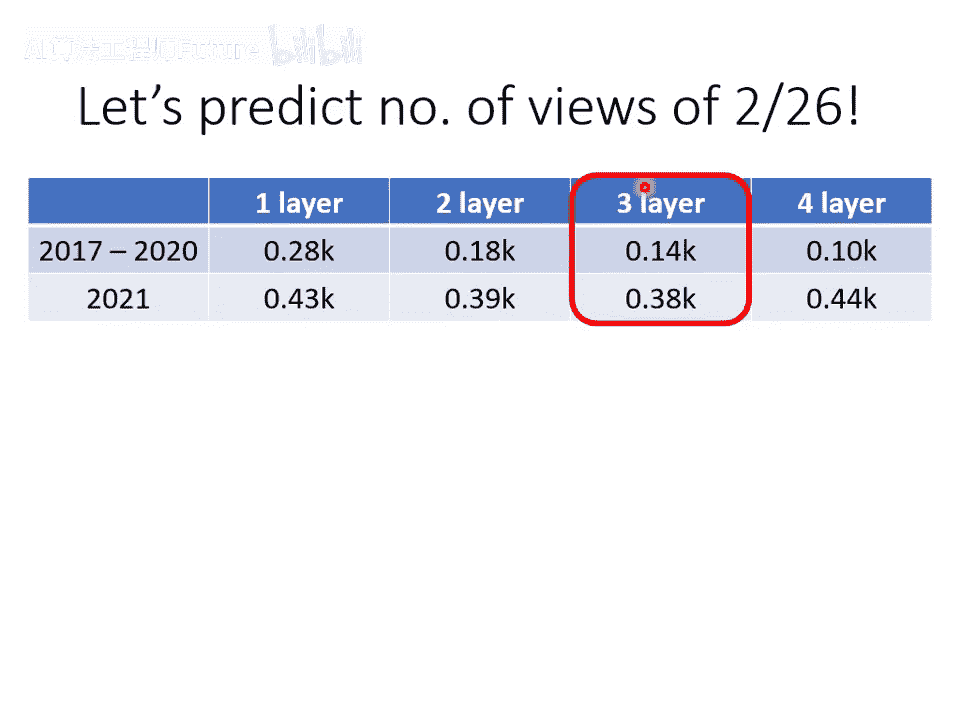

就直接用上去了，好得到的结果呢是这个样子了啊，这个图上呢这个横轴啊，就是从2021年的1月1号开始一直往下，然后红色的线是真实的数字，蓝色的线是预测的，结果2月26号在这边呐，啊。

这个是今年2021年观看人数最高的一天啦，那而机器机器的预测怎样呢，哇非常的惨，差距非常的大，差距有2。58K这么多，好感谢大家感，为了让这个模型不准啊，这个上周五花了很多力气去点了这个video啊。

所以今这一天是今年观看人数最多的一天，那你可能看想说诶，那别的模型怎么样呢，其实我也跑了一层，二层跟四层的看看啦，所有的模型都会铲掉哎，两层跟三层的错误率都是二点多K，其实四层跟一层比较好，都是呃1。

8K左右好，但是这四个模型不约而同的觉得，2月26号应该是个低点，但实际上2月26号是一个峰值，那模型其实会觉得他是个低点，也不能怪他，因为过去根据过去的资料，礼拜五就是没有人要学机器学习。

礼拜五晚上大家出去玩了，对不对，礼拜五的观看的人数是最少的，但是2月26号出现了反常的状况，好那这个呢就不能怪模型了，那我觉得出现这种状况啊，应该算是另外一种错误的形式。

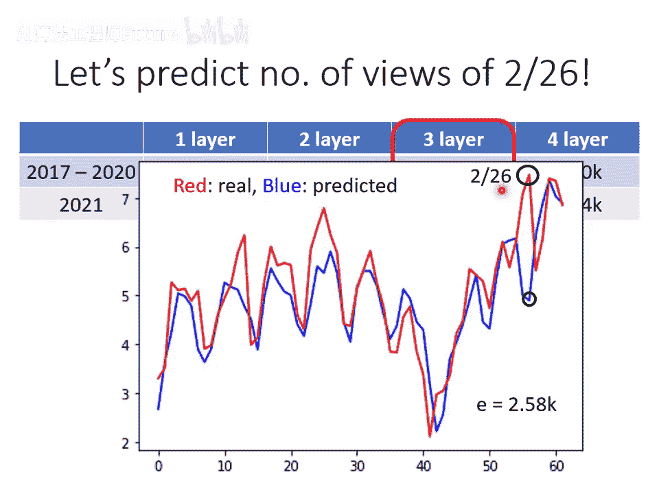

这种错误的形式呢我们这边叫做mismatch，那也有人会说mismatch也算是一种OVERFITTING，这样也可以啦，这都只是名词定义的问题，那我这边要想要表达的事情是mismatch啊。

他的原因跟OVERFITTING其实不一样，一般的OVERFITTING你可以用收集更多的资料来克服。

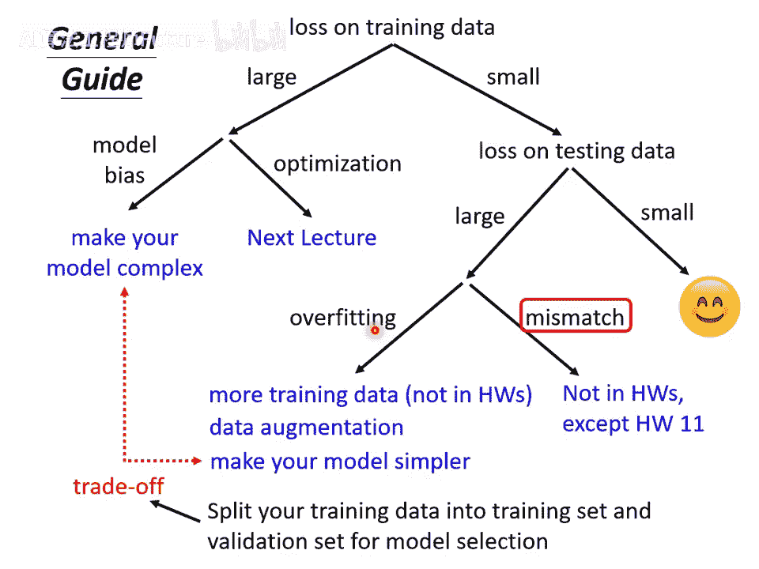

但是mismatch意思是说，你今天的训练资料跟测试资料，它们的分布是不一样的，在训练资料跟测试资料分布是不一样的时候，你训练资料再增加其实也没有帮助了，那其实在多数的作业里面呢。

我们不会遇到这种mismatch的问题啊，我们都有把这个题目设计好了，水资料跟测试资料它的分布差很多，举例来说，刚才作业一的PYNT为例的话，假设我们今天资料在分，这个训练资料跟测试资料的时候。

我们说2020年的资料是训练资料，2021年的资料是测试资料，那mismatch的问题可能就很严重了，这个我们只有试过了，试了一下，如果今天用2020年当训练资料，2020年当测试资料。

你就怎么做都是惨啊，就做不起来，你怎么训练什么模型都会铲掉，因为2020年的资料跟2021年的资料，他们的背后的分布其实就是一样，所以拿2020年资料来训练，在2021年的作为你的资料上。

你根本就预测不准哦，所以后来助教师用了别的方式来分割，训练资料跟测试资料好，但所以我们多数的作业，都不会有这种mismatch的问题，那除了作业11，因为作业11就是针对mismatch的问题。

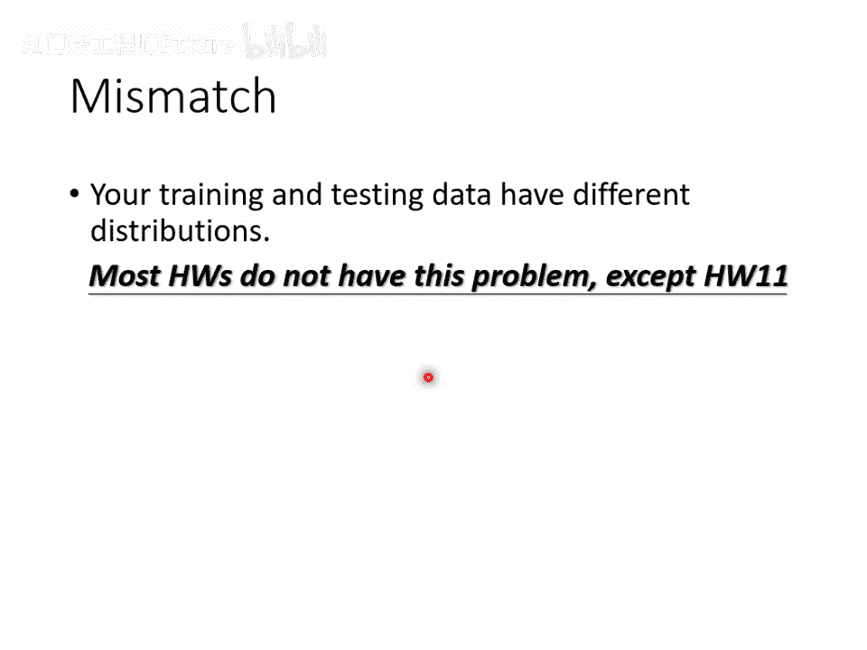

而设计的，作业11也是一个影像分类的问题。

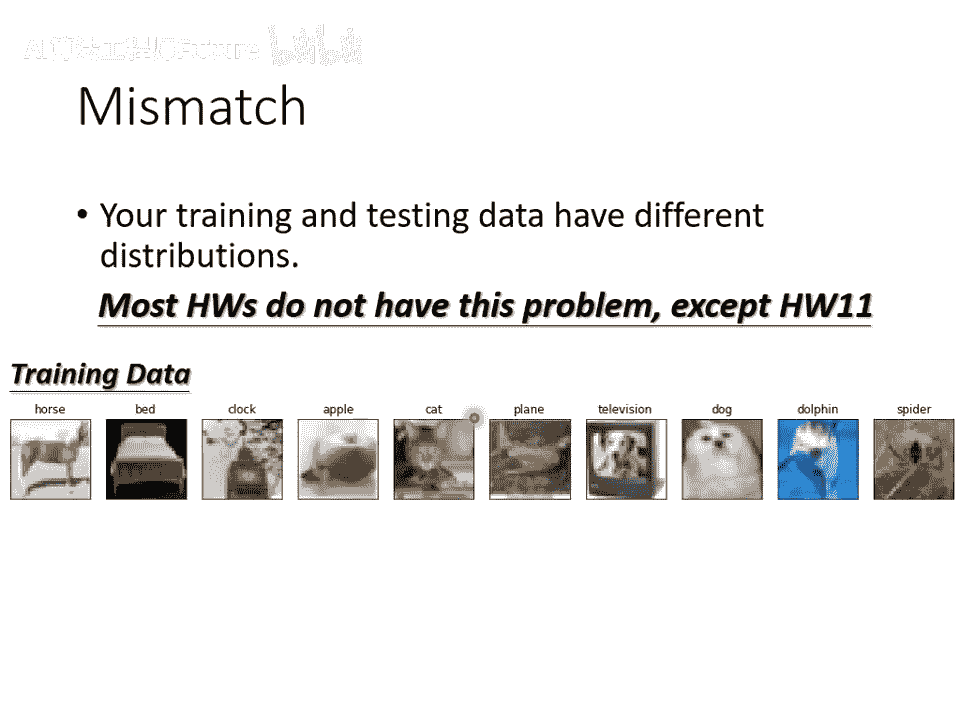

这是他的训练资料啊，看起来蛮正常的，但他测试资料就是长这样子啊。

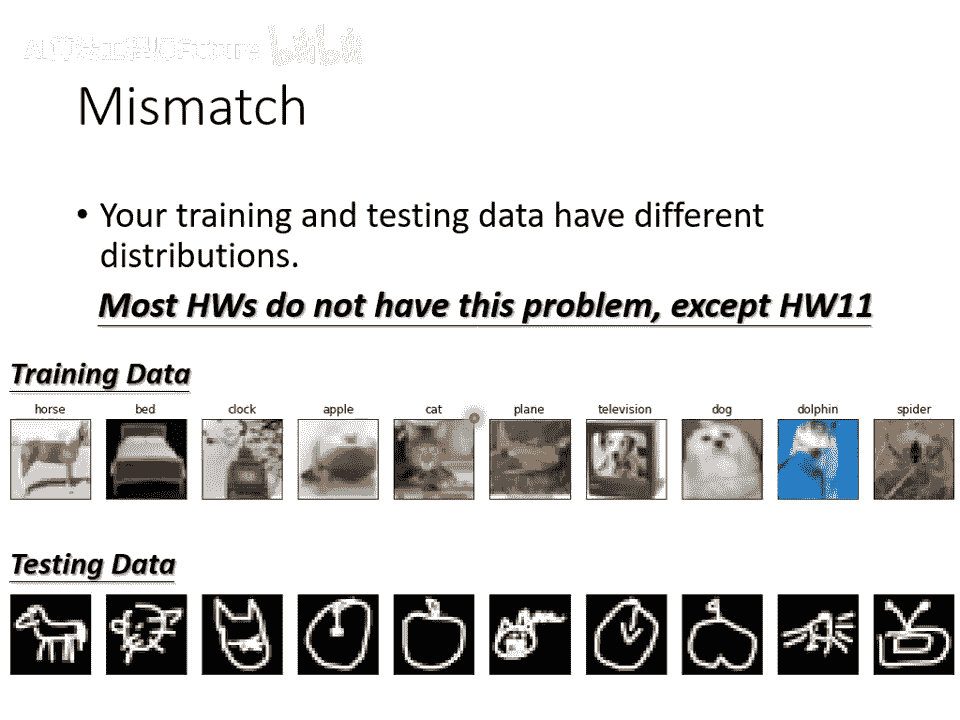

嘿嘿嘿啊，所以你到这个时候，这个这个时候增加资料哪有什么用呢，增加资料你也没有办法让你的模型做得更好。

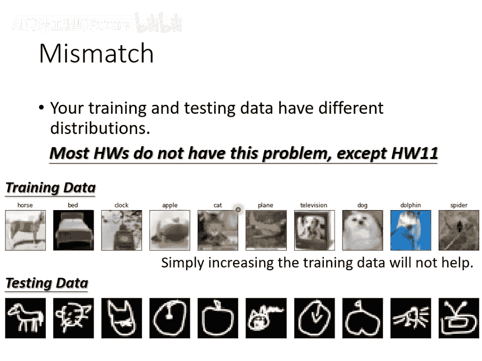

所以这种问题要怎么解决。

那留待作业时一的时候再讲好。

那你可能会问说，我怎么知道现在到底是不是mismatch呢，那我觉得要不要知不知道是MIMISMATCH。

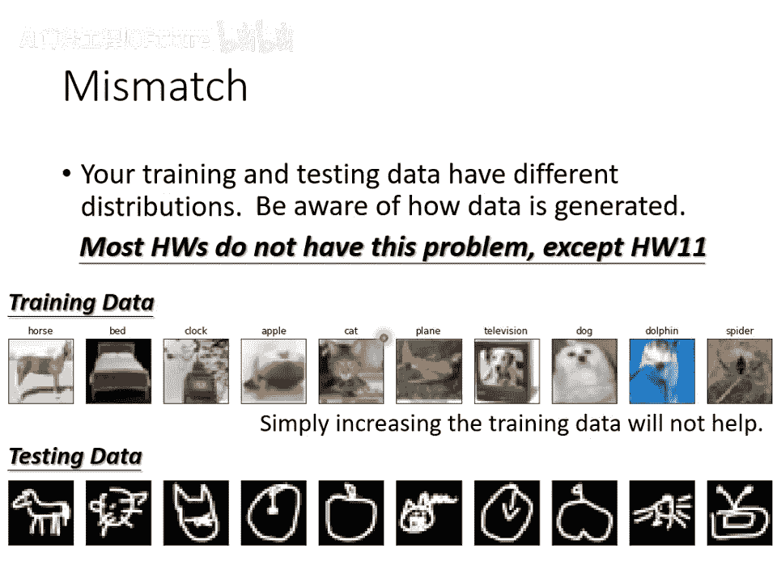

那就要看你对这个资料本身的理解。

你可能要对你的训练资料跟测试资料的产生方，式有一些理解。

来判断说他是不是遇到了mismatch的状况好，那这个就是我们作业的功率。

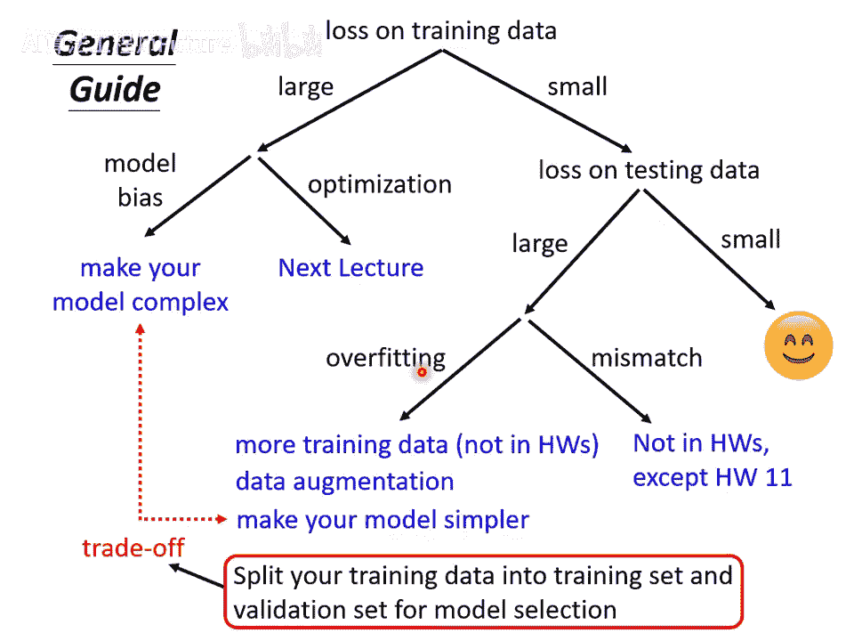