# 【官授搬运】2026年全新优化版李宏毅机器学习系统课程，这才是真正的初学者体系课程！—人工智能／深度学习／神经网络 - P14：2-局部最小值与鞍点 - AI算法工程师Future - BV1ruqABeEFX

好好，那我们来上课吧，那接下来我们要讲什么呢，接下来呢我们要讲如果optimization失败的时候，怎么排好，所以看一下我们刚才的攻略，现在我们要讲的是optimization的部分。

所以等一下我们要讲的东西啊，基本上跟啊，比如说OVERFITTING没有什么太大的关联，我们只是讨论TIMIZATION的时候，怎么把gradient descent做得更好好。

那为什么optimization会失败呢，那你常常在做optimization的时候，你会发现说哎随着你的参数不断的update，你的training的loss不会再下降。

但是你对这个loss仍然不满意，就像我刚才说的，你可以把deep的network跟linear的model或比较，shallow network比较，发现说他没有做的更好。

所以你觉得deep network没有发挥它完整的力量，所以optimization显然是有问题的，但有时候你会甚至发现说，一开始你的model就串不起来，一开始你不管怎么update你的参数。

你的loss统统都掉不下去，那这个时候到底发生了什么事情呢，那过去常呃常见的一个猜想是，因为我们现在呢走到了一个地方，这个地方参数对loss的微分为零，当你的参数在lost微分为零的时候。

gradient descent就没有办法再update参数了，就没有办法再update参数了，这个时候training就停下来了，你的参数不再update了，loss当然就不会再下降。

那讲到gradient为零的时候，大家通常最想最先想到的。

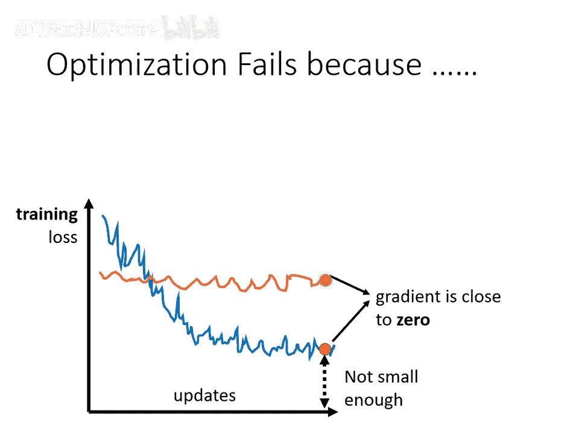

脑海中最先浮现的可能就是local mini嘛，经常有人说这个做做deep learning呢，你用gradient descend呐，你会卡在local mini嘛。

那然后所以gradient descent不work啊，所以deep learning不过啊，但是如果你有一天，你要写跟deep learning相关的paper的时候。

你千万不要讲什么卡在local mini嘛这种事情，但如果别人会觉得你非常没有水准，为什么，因为不是只有local minima的gradient是零。

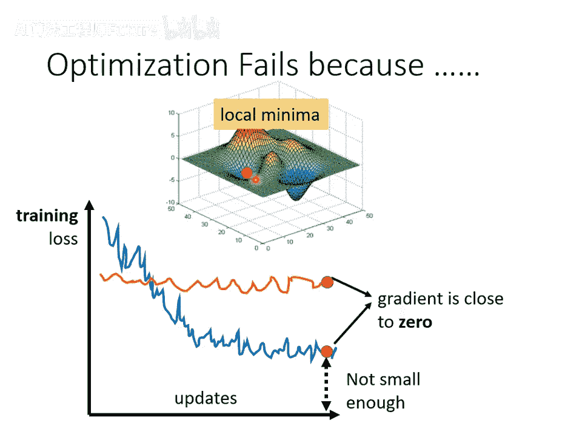

还有其他可能会让gradient是零，比如说settle point，所谓的settle point其实就是gradient是零，但是不是local minimum。

也不是local maximum的地方，像在这个例子里面，红色的这个点它在左右这个方向是比较高的，前后这个方向是比较低的，它就像是一个马鞍的形状啊，所以叫做SETPOINT，那中文呢就翻成安点。

那像settle point这种地方，它也是gradient为零，但它不是local mini，那像这种gradient为零的点呐，统称为critical point。

所以你可以说你的loss没有办法再下降，也许是因为卡在了critical point，但你不能说是卡在local mini嘛，因为settle point也是微分为零的点好。

但是如果我们今天你发现你的gradient，真的很靠近零，卡在了某个critical point，我们有没有办法知道，到底是local mini m还是settle point呢，其实是有办法的。

不是完全没有办法，那为什么我会想要知道到底是卡在local mini嘛，还是卡在settle point呢，因为如果是卡在local mini嘛，那可能就没有路可以走了，因为四周呢都比较高。

你现在所在的位置已经是最低的点，loss最低的点了，往四周走，lost都比较高，你们不知道怎么走到其他地方去，但settle point就比较没有这个问题，如果你今天是卡在settle point的话。

你今天是走到一个settle point的话，SETPOINT旁边还是有路可以走的，还是有路可以让你的loss更低的，你只要逃离settle point，你就有可能让你的loss更低。

所以鉴别今天我们走到critical point的时候，到底是local mini嘛还是SETPOINT，是一个值得去探讨的问题，好，那怎么知道今天一个critical point。

到底是属于local minimum还是settle point呢。

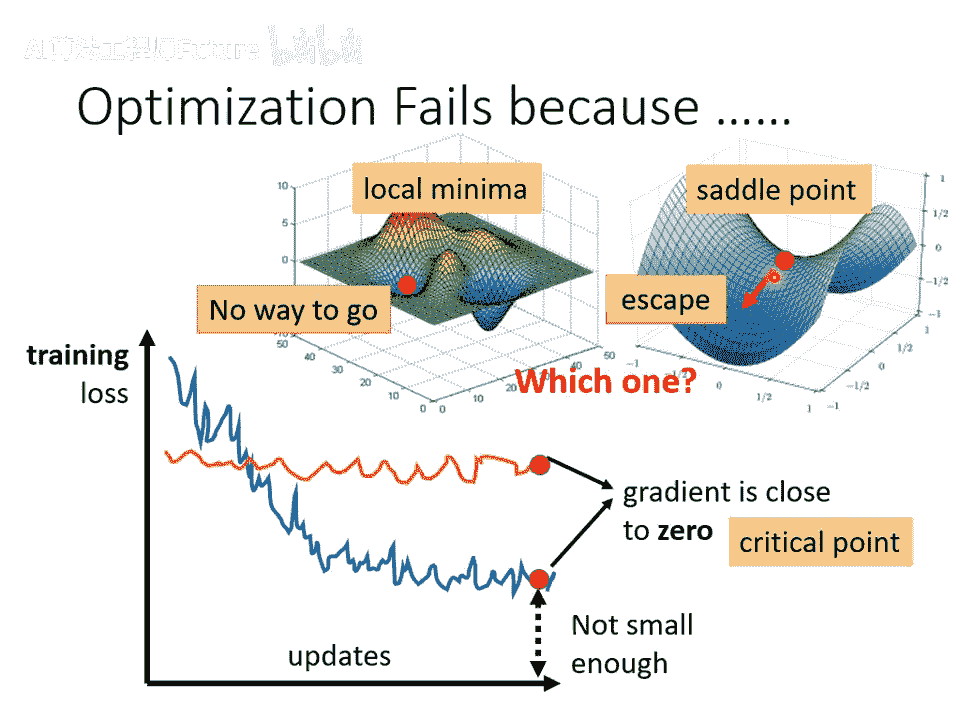

这边需要用到一点数学，以下这一段如果其实没有很难的数学啦，就只是微积分跟呃线性代数，但如果你没有听懂的话，以下这一段呃skip掉是没有关系的。

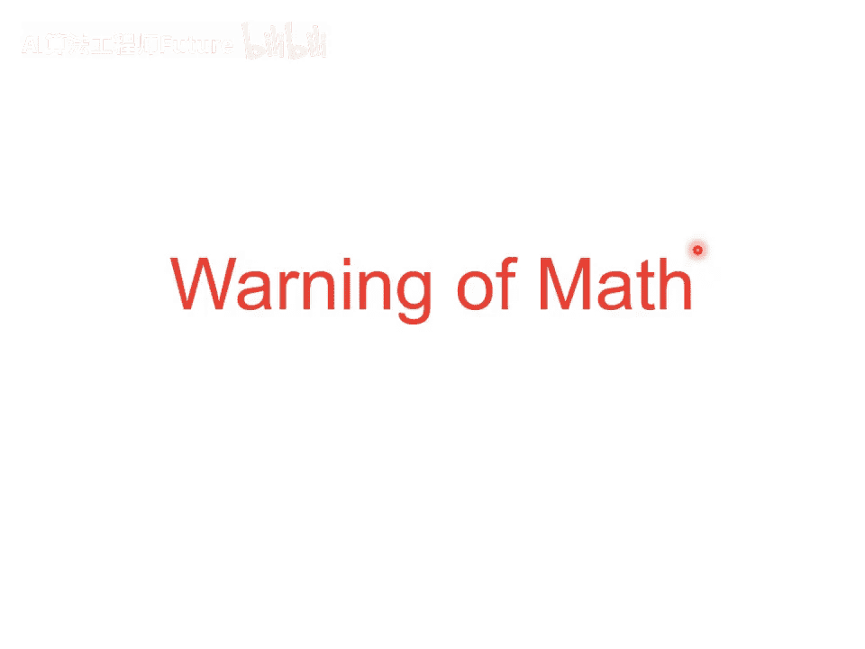

好，那怎么知道说一个点到底是local minim，还是seal point呢，那你要知道我们loss function的形状，可是我们怎么知道loss function的形状呢。

network本身很复杂又复杂，network算出来loss function显然也很复杂，我们怎么知道loss function长什么样子呢。

虽然我们没有办法完整知道整个loss function的样子，但是如果给定某一组参数，比如说蓝色的这个这两块，在sea派附近的loss function是有办法被写出来的，他写出来就像是这个样子好。

所以这个and all of setup完整的样子写不出来，但是它在setup派附近，你可以用这个式子来表示它，你会说哇这个是什么，这个还有好多种颜色啊，这个东西到底是什么呃。

呃这个东西是por serious approximation，那就这个假设你在微积分的时候，其实已经学过了，所以我就不会细讲说这一串是怎么来的，但我们就只讲一下它的概念，这一串里面包含什么东西呢。

第一项是l of theta派，就告诉我们说啊，当theta跟CA派很近的时候，l of theta应该跟l of theta派还蛮靠近的好，那第二项是什么呢。

第二项是theta减theta派的transpose，乘上G车是什么，车是一个向量，这个G呢就是我们的gradient，我们在上周已经讲过gradient这个东西了。

我们用绿色的这个G呢来代表gradient，它是一个向量，那这个gradient告诉我们什么呢，这个gradient会来弥补，theta派跟theta之间的差距。

我们虽然刚才说SA跟SA派他们应该很接近，但是呢还中间还是有些差距的，那这个差距呢，第一项我们用这个gradient，来表示它们之间的差距好，那这个G呢就是有时候规定会写成倒三角形的。

L还是由SA派这个地方的G，然后G的DG是一个向量，它的第I个component，就是CA的第I个component对L的微分好，光是看车还是没有办法完整的描述a lot of sea，你还要看第三项。

第三项是什么，第三项跟hash有关，这边有一个H这个H叫做HESION，它是一个矩阵，这个第三项啊是theta减theta派的，乘后乘上H再乘上theta减theta派，所以这个第三项呢会在补足这个呃。

再加上gradient以后，跟真正的l of seta之间的差距，那这个H里面放的是什么东西呢，这个H里面放的是L的二次微分，这个X它的第I个row，第J个color的值是什么呢，它第I个roll。

第J个color的值，就是把sea的第I个component对L作微分，再把最大的第几，把SA的第J个component对L作微分，再把SA的第I个component对L作微分。

做两次微分后的结果就是这个HIJ好，如果这边你觉得有点听不太懂的话，也没有关系，反正你就记得说这个l of set up这个loss function啊，这个error surface啊。

在set up范围附近可以写成这个样，这个式子跟两个东西有关系，跟gradient有关系，跟ha选有关系，gradient就是一次微分，ha选就是二里面有二次微分的项好。

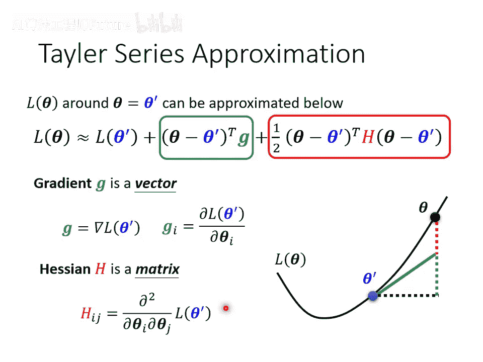

那如果我们今天走到了一个critical point，那意味着什么，意味着gradient为零，也就是绿色的这一项完全都不见了，GC一个zero vector，绿色的这一项完全都不见了。

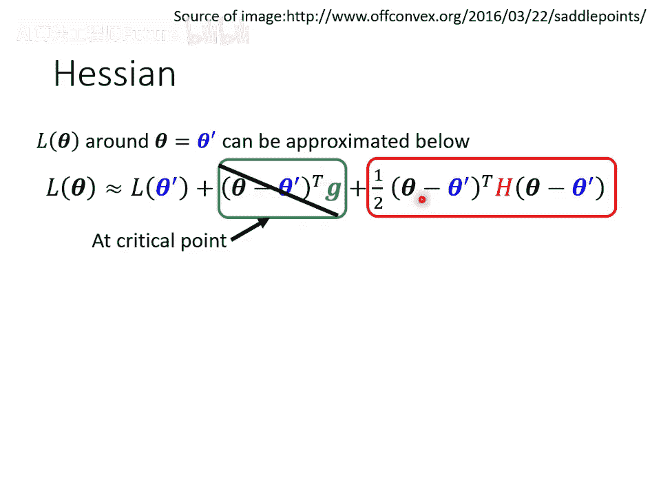

只剩下红色的这一项，所以当他critical point的时候，这个loss function呢它就是l of，它可以被近似为l of setup fine，加上红色的这一项。

我们可以根据红色的这一项来判断说，在set up point附近的error surface到底长什么样子，知道error surface长什么样子。

我们就可以判断说ZA派它是一个local minimum，是一个local maxim，还是一个zl point，我们可以靠这一项来了解这个error，surface的地貌大概长什么样子。

知道它地貌长什么样子，我们就可以知道说现在是在什么样的状态，这个是ASIAN好。

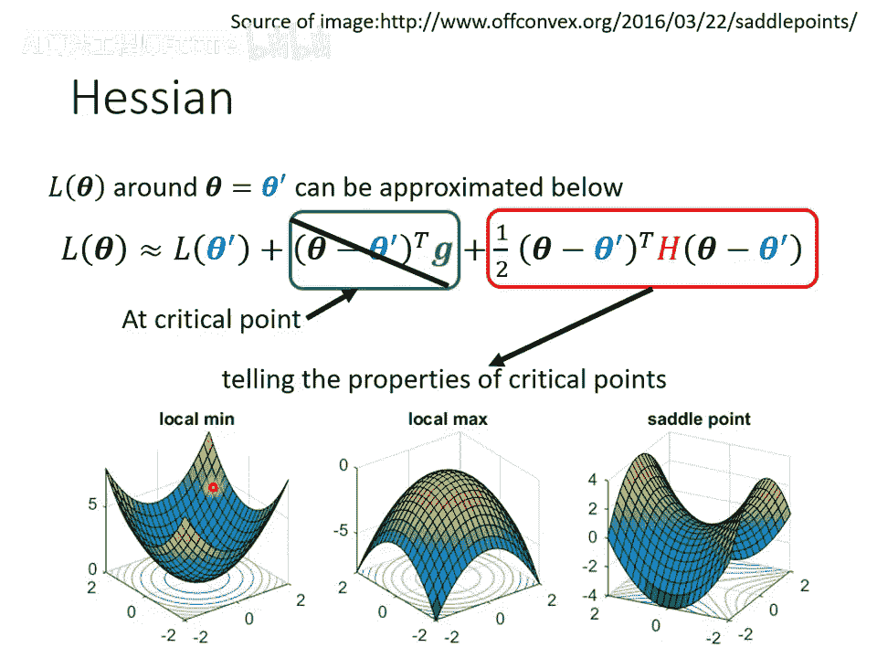

那我们就来看一下怎么根据黑选，怎么根据红色的这一项来判断C，哪怕派附近的地方，我们现在啊为了等一下呃，符号方便起见，我们把theta减theta派，用V这个向量来表示，theta是一个向向量嘛。

SA派也是一个向量，这两个向量相减，我们用V这个向量来表示它，如果今天对任何可能的VV的transpose，乘上H乘上V都大于零，也就是说现在theta不管带任何值，就V可以是任何的V。

就代表说theta减theta pl也可以是任何值，也就theta可以是任何值，不管set up带任何值，红色框框里面通通都大于零，那意味着什么，意味着说红色框框里面都大于零。

意味着说l l of seta大于l all of sea宽，比如theta不管带多少，只要在theta派附近，theta l能theta都大于l theta派，那代表什么。

代表LLSETA派是附近的一个最低点，所以它是local mini嘛，如果今天反过来说，对所有的V而言，v transpose h乘上V都小于零，也就是红色框框里面永远都小于零。

也就是sea不管带什么什么值，红色框框里面都小于零，那意味着什么，意味着红色框框里面都小于零，意味着说l of theta派都是大于l of theta。

l theta小于l of sin a f代表说l doset up快，是附近最高的一个点，所以它是local maximum，第三个可能是假设v transpose hb，有时候大于零，有时候小于零。

你带不同的V进去，也就带不同的SR进去，红色这个框框里面有时候大于零，有时候小于零，意味着说在set up派附近，有时候有些loss比L动，有时候L动theta大于L动theta派。

有时候l of theta小于l of theta by，在l of sea by附近，有些地方高，有些地方低，这意味着什么，这意味着这是一个saddle point，好，那这边你会有的。

接下来一个问题是哦，我们看这一项，看红色这一项我没有办法判断，我们现在可以判断它是local mini嘛，还是say NO point，还是local maximum。

但是你这边是说我们要带所有的V去看V，transpose hb是大于零还是小于零，我们怎么有可能把所有的V都拿来试试看呢，所以有一个更简便的方法去确认，说这一个条件或这一个条件会不会发生。

那这个就直接告诉你结论，线性代数的线性代数，理论上是有教过这件事情的，如果今天对所有的V而言呐，v transpose h b都大于零，那这种矩阵叫做positive definite。

正positive definite的矩阵有什么特性呢，它是我的icon value都是正，所以如果你今天算出一个黑选，你不需要把它跟所有的V都乘看看，你只要去直接看这个H的icon value。

如果你发现说啊所有I跟value都是正的，那就代表说这个条件成立，就V乘后乘上H乘上V会大于零，也就代表说是一个local mini，所以你从haitian metric。

可以看出他是不是local mini嘛，你要算出haitian metric，算完以后看他的I跟value发现都是正的，它就是local mini嘛就结束了，那反过来说也是一样，如果今天在这个状况。

对所有的V而言，v trans构成H乘以B小于零，那H呢是negative definite，那就代表所有的icon value都是负的，所有I跟value，所有的I跟value都是负的。

就保证它是local maxim，那如果I跟value有正有负，那就代表是sao point，那假设讲到这里没有听得很懂的话，你就可以记得结论，你只要算出一个东西，这个东西的名字叫做ASIAN。

它是一个矩阵，这个矩阵如果他所有的I跟value都是正的，那就代表我们现在在local mini嘛，如果他有正有负就代表3SCOO，所以我们是有办法判断说是local mini吗，还是CLOC。

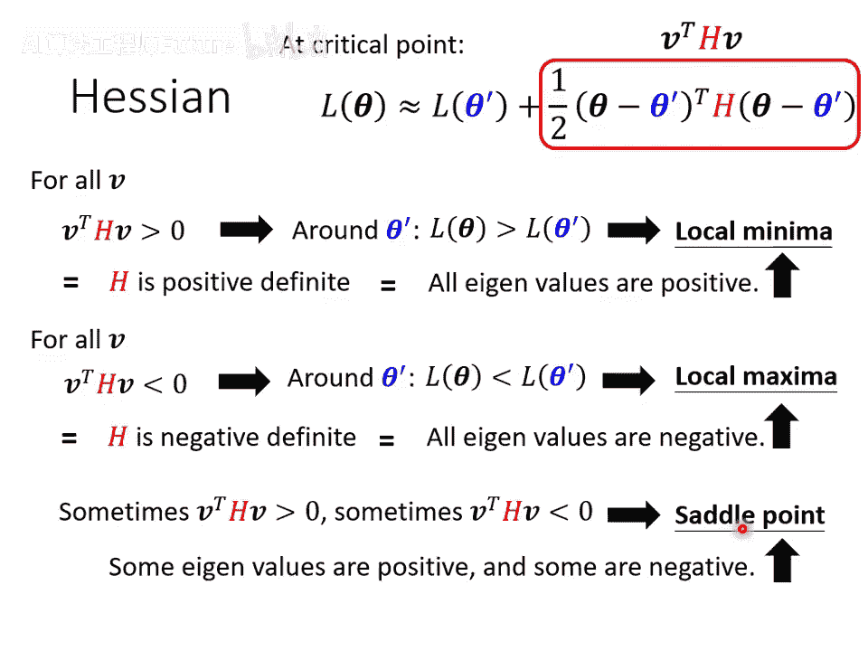

好那如果刚才讲的你觉得你没有听得很懂的话，我们这边举一个例子好，我们现在有一个史上最废的network，它废到什么程度呢，输入一个X它只有一个neural乘上w one。

而且这个neuron还没有activation function，所以X乘上WY以后之后就通输出，然后再乘上WQ，然后就再输出，就得到最终的输出就是Y，总之这个方式非常的简单。

单Y等于WY乘以WQ5乘以X，这是一个史上最废的neural network，那我们一个史上最废的training data set，这个data set说我们只有一笔data。

这笔data是X是一的时候呃，他的label是一，所以输入一进去，你希望最终的输出跟一越接近越好，这个史上最废的training。

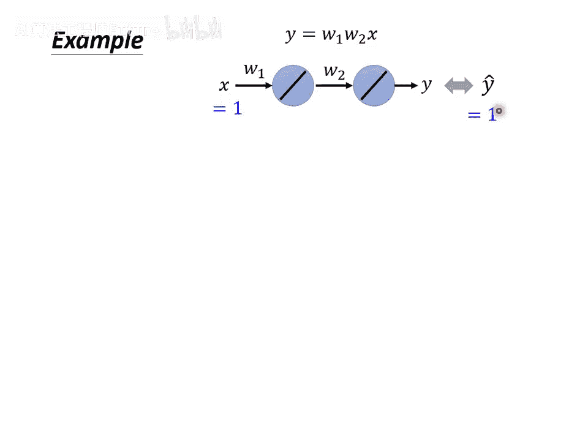

而这个史上最废的training，它的error surface啊，你是有办法直接画出来的，因为反正只有两个参数，w one w two嘛，连bias都没有，假设没有BS，只有w one跟W两个参数。

这个network只有两个参数，w one跟w two，那我们可以穷举所有w one跟WQ的数值，算出所有w one w two数值所带来的loss，然后就画出error surface这个样子。

所以这边是高的，这边lost是高的，这边loss高的，这边lost也是高的，四个角落lost是高的，好在这个图上，你可以看出来说有一些critical point。

哪些地方critical point呢，这个黑点点的地方这个零零呐，圆圆点的地方是critical point，然后事实上呢这一条线这边也是一排critical point。

也是一排critical point，如果你更进一步要分析他们是settle point，还是local minimum的话，那圆心这个地方原点这个地方它是SETPOINT。

为什么3settle point呢，你往这个方向走，LOS会变大，往这个方向走，loss会变大，往这个方向走，loss会变小，往这个方向走，loss会变小，它是一个settle point。

而这两这这两群critical point他们都是local mini嘛，所以在这个山沟里面有一排local mini嘛，这一排山沟里面有一排local mini嘛。

然后在原点的地方有一个settle point，这个是我们把error surface报收以后，报搜所有的参数得到的loss function，以后得到的loss的值以后画出error surface。

你可以得到这样的结论，那现在假设如果哭到收呃，所有可能的loss，那如果要直接算作一个点，是local mini吗，还是seal point的话，怎么算呢。

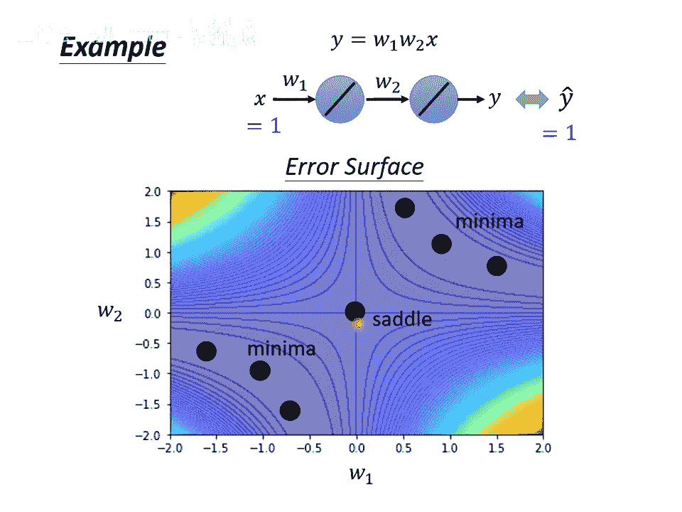

好我们可以把lost的function写出来啊，这个lost的function呢，这个L呢是正确答案，y hand减掉model的输出，也就w one w two乘以X那这边呢取这个啊。

square error这边只有一笔data，所以就不会sumention over所有train data，因反正只有一笔data，X带一，YH带一，我刚才说过，只有一笔训练资料。

最废的这一周一笔训练资料，所以north function就是一减w one w two的平方哦，那你可以把这个loss function呢，它的gradient求出来了，那这边细节我们就不讲了。

你可以啊啊你如果和微积分都还记得的话，算一下就会知道说这个是对的，反正w one对L的微分写出来是这个样子，w two对L的微分写出来是这个样子啊，那这种东西啊就是所谓的局，所谓的鬼点。

什么时候归零会零呢，什么时候会当个critical point呢，举例来说，如果w one等于零，w two等于零，就在圆心这个地方，如果你w one带于零，WQ大于零，这个GRA点算出来就都是零了。

如果w one带于零，WQ带于零，w one对L的微分，w two不对，L的微分算出来就都是零，就都是零，这个时候我们就知道说原点是一个critical point。

但是他是一个critical point，但它是local maxim，它是local maxim，local minimum还是settle point呢，那你就要看HAITIAN才能够知道。

要看黑神才能够知道，当然我们刚才已经报收缩可能w one w two了啦，所以你已经知道说他显然是一个settle point，但是现在假设还没有报收所有可能的loss，所以我们要看看能不能够用H啊。

用黑选哪，看出他是是不是是是什么样的critical point好，那怎么算出这个H呢，H呀它是一个矩阵，那这个矩阵里面呢就是收集了啊，L的二次微分哦，所以这个矩阵里面第一个roll，第二。

第一个colon的位置就是w one对L微分两次啊，第一个落第2color的位置，就是先用w two对L作微分，让w one对L作微分，然后这边就是w one对L作为分，w two对我作为分。

然后w two对L微分两次，把这四个词组合起来，就是我们的HAITIAN好，那这个黑选是什么的，值是多少呢，这个黑选的式子我都已经把它写出来了，你只要把w one等于零，WQ等于零带进去，带进去。

你就得到在原点的地方可选是零负二，二零这样子的一个矩阵好，那这个矩阵告诉我们这个黑选，告诉我们它是local minima还是settle point呢，那就要看这个矩阵的I跟value了，算一下。

发现这个矩阵有两个I跟value，二跟二，I跟value有正有负，代表zero point啊，对不对，我们刚才讲I跟value有正有负，就代表的是谁都碰好，那所以我们现在呢就是用一个例子，跟你操作一下。

告诉你说啊，你怎么从黑选看出一个点，它一个critical point，它是settle point还是local mini好。

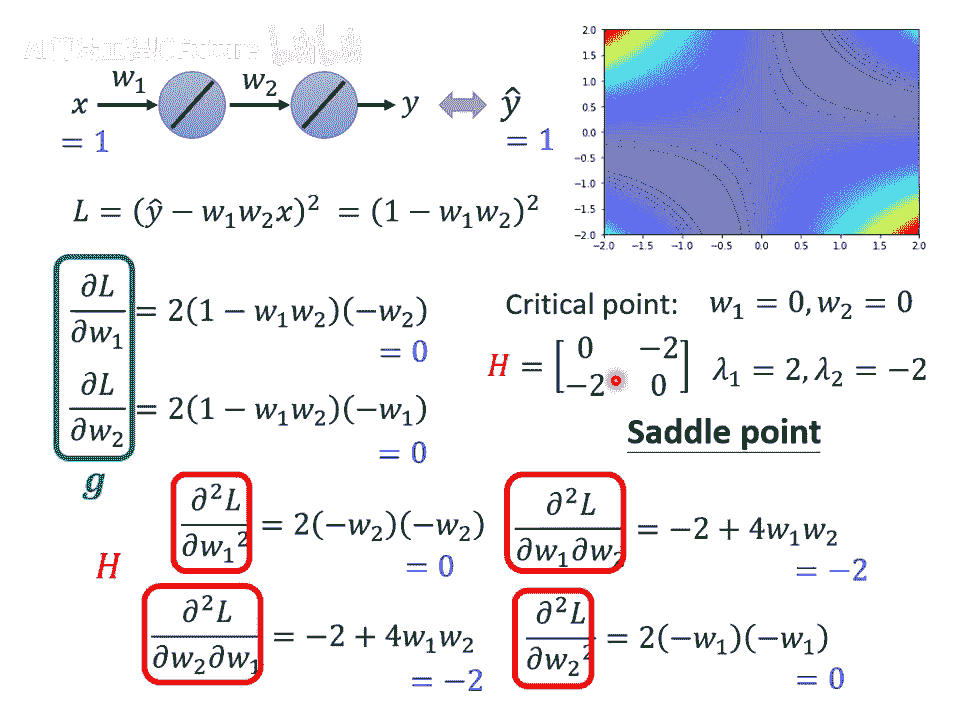

如果今天呐你卡的地方是sao point，也许你就不用那么害怕了，为什么，因为如果你今天你发现你停下来的时候，是因为settle point停下来的，那你可以放心的，你其实你其实就可以放心。

你其实就已有机会可以放心了，为什么，因为HR它不止可以帮助我们判断，现在是不是在一个settle point，他还指出了我们参数可以update的方向。

就之前我们参数update的时候都是看radio看G，但是我们走到某个地方后，发现G变成零了，不能再看G了，G不见啦，grain没有啦，但如果是一个settle boy的话，还可以再看H怎么再看H呢。

H怎么告诉我们怎么update参数呢，我们这边假设U啊是H的I跟vector，然后浪达是U的I跟value，好像H有一个I跟value叫浪打，它的对应的I跟vector呢叫做U。

如果我们把这边的V换成U的话，会发生什么事呢，如果我们把U乘在H的左边跟H的右边，也就U乘ANSPOSE乘上H乘以U会得到什么呢，H乘以U啊，会得到浪达U为什么，因为U是一个icon vector啊。

所以H乘上I跟vector会得到浪打，I跟value乘上icon vector，所以这边得到UT成语浪达优好，再整理一下，把UT跟U乘起来，得到U的N平方，所以得到浪打U的N平方，所以这一项啊。

这一项假设我们这边V带的是一个icon vector，我们这边theta减theta派，放的是一个I跟vector的话，会发现说我们这个红色的项里面，其实就是浪达乘上U的龙平方好，那今天如果浪打小于零。

还有个value小于零的话，会发生什么事呢，如果I跟value小于零的话，那la乘上U的弄平方就会小于零，因为U的NN平方一定是正的嘛，所以I跟value是负的，那这一整项就会是负的。

也就是user乘后乘上H乘上U它是负的，也就是红色这个框框里面是小于零的，是负的，所以这意思是说，假设theta减theta派等于U，那这一项就是负的。

也就是l o o theta会小于l o o setup pl，也就是说假设theta减theta pi等于U，也就theta等于theta派加U，你把theta派本来参数在SA派的位置加上U。

沿着U的方向做update，得到SETA，你就可以让loss变小，因为根据这个式子，你只要SA减theta派等于U，loss就会变小，所以你今天只要让theta等于theta y加U。

你就可以让loss变小，你只要沿着U，也就是I跟vector的方向去更新你的参数，去改变你的参数，你就可以让loss变小了哦，所以虽然在critical point没有gradient。

如果我们今天是在一个settle point，你也不一定要惊慌，你只要找出啊正你只要找出负的icon value，找出负的icon value，再找出它对应的icon vector。

用这个icon vector去加set up line，就可以找到一个新的点，这个点的loss比原来还要低，如果这样你听的不是很清楚的话。

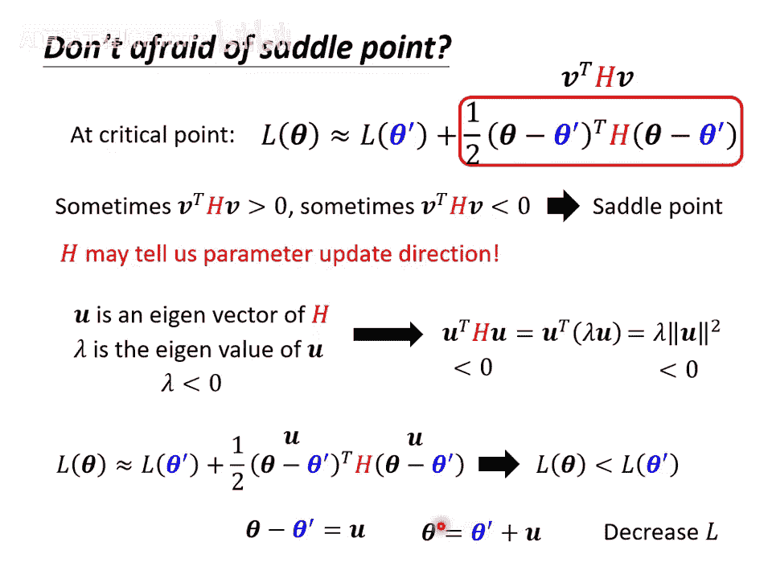

我就举具体的例子，刚才我们已经发现说原点是个critical point，他的黑选长这个样子好，那我们现在发现说呢，这个黑选有一个负的这个I跟value，这个I根value等于二。

这个I跟value等于二好，那这个item value等这个I跟value等于二，那它对应的I跟vector长什么样子呢，它有很多个其实是无穷多个对应的I跟vector，我们就取一个出来，我们取一一啊。

一一是它对应的一个I跟vector，那我们其实只要顺着这个U的方向，顺着E这个vector的方向去更新我们的参数，你就可以找到一个比SETPOINT的loss还要更loss。

更低的点好如果以今天这个例子来看的话呢，你的settle point在零零这个地方，那你在这个地方会没有gradient，所以gradient不会告诉你说你要怎么更新参数。

and patient告诉我们说，黑选的icon factor告诉我们说，只要往一一的方向更新，你就可以让loss变得更小，只要往U这个I跟vector的方向更新，E的方向更新。

你就可以在lost的方向，你就可以让你的loss变小，也就是说你可以逃离你的settle point，然后让你的loss变小，所以从这个角度来看，从这个角度来看。

似乎settle point并没有那么可怕，如果你今天在training的时候，你的gradient停，你的去训练，停下来，你的归点变成零，你的训练停下来是因为HH是因为settle point的话。

那似乎还有解，但是当然实际上啊，在实际的implementation里面，你几乎不会真的把黑选算出来，为什么这个要是二次微分哦，要计算这个矩阵的啊，computation需要的运算量非常非常的大。

更遑论你还要把他的icon value跟icon factor找出来，所以在实作上，你几乎没有看到有人用这一个方法来逃离，Say no point，然后我们会讲其他也有机会逃离SETPOINT的方法。

他们的运算量都比要算这个H还要小很多，但今天之所以我们把这个settle point跟icon vector，跟黑选的item vector拿出来讲，是想要告诉你说，如果是卡在settle point。

也许没有那么可怕，最糟的状况下，你还有这一招可以告诉你要往哪一个方向走好。

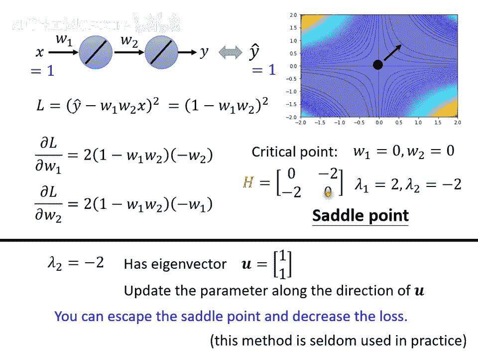

那大家讲到这边，你就会有一个问题了，这个问题是，那到底settle point跟local minimu谁比较常见呢，我们说settle point其实并没有很可怕。

那如果我们今天常遇到的是settle point，比较少遇到local mini嘛，啊那就太好了，那到底settle point跟local mini嘛哪一个比较常见呢。

那这边呢我们要讲一个不相干的故事，我先讲一个故事，这个故事是什么呢，这个故事发生在1543年，1543年发生了什么事呢，那一年这个君士坦丁堡沦陷啊，啊这个是君士坦丁堡沦陷图啊。

君士坦丁堡本来是东罗马帝国的领土，然后被鄂图曼土耳其帝国占领了，然后东罗马帝国就灭亡了，而当时那在鄂图曼，土耳其人进攻君士坦丁堡的时候啊，那时候东罗马帝国的国王是君士坦丁11世，他不知道要怎么对抗啊。

土耳其人啊，有人呢就献上了一册，找来了一个魔法师，叫做迪奥伦娜，那这个哎这个这是真实真实的故事，知道吗，出自三体的故事诶，这个迪奥和迪奥伦娜这样说啊，迪奥伦娜是谁呢，他有一个能力跟张飞一样。

张飞不是可以万军从中取上将首级，如探囊取物吗，迪奥伦娜也是一样，他可以直接取得那个苏丹的头，他可以从万军中取得苏丹的头，大家想说诶，迪奥伦娜怎么这么厉害，他真的有这么强大的魔法吗。

所以大家就要迪奥伦纳先展示一下他的力量啊。

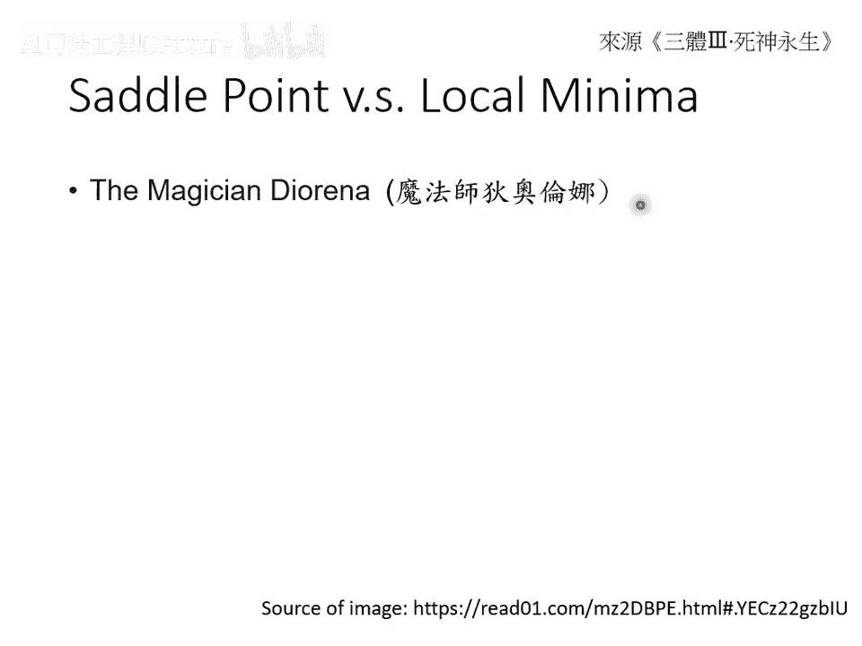

这时候迪奥伦纳就拿出了一个圣杯，大家看到这个圣杯就大吃一惊，为什么大家看到这个圣杯要大吃一惊呢，因为这个圣杯啊，本来是放在圣索菲亚大教堂的地下室。

而且他是被放在一个石棺里面，这个石棺是密封的，没有人可以打开它，但是迪奥伦娜他从里面取得了圣杯，而且还放了一串葡萄景区，那君士坦丁11世，为了验证迪奥伦纳是不是真的有这个能力，然后就带了一堆人。

真的去撬开了这个石棺，发现圣杯真的被拿走了，里面真的有一串新鲜的葡萄，然后就知道迪奥伦娜真的有这个万军，从中取上将首级的能力好，那为什么迪奥伦纳可以做到这件事呢，那是因为这个时关你觉得它是封闭的。

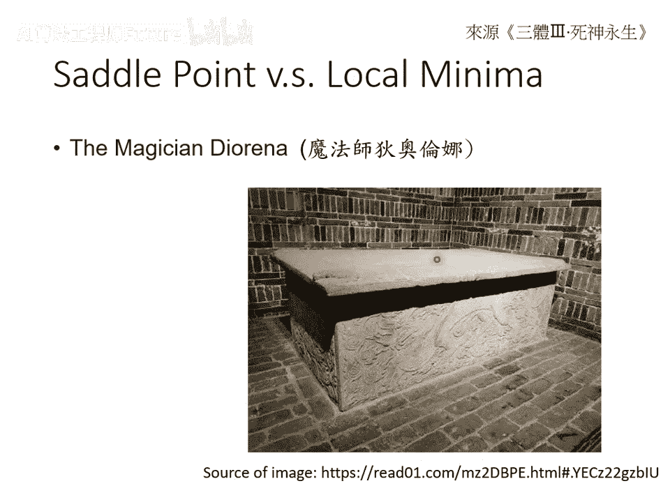

那是因为你是从三维的空间来看，从三维的空间来看，这个石棺是封闭的，没有任何路可以进去，但是迪奥伦纳可以进入四维的空间，从高维的空间中，这个石棺是有路可以进去的，它并不是封闭的好。

那至于迪奥伦纳有没有成功刺杀苏丹呢，你可以想象一定是没有嘛，所以君士坦丁堡才沦陷的这样，那至于为什么没有，大家请见三体，这样他就不雷大家了，好那总之这个从三维的空间来看，是没有路可以走的东西。

error surface会不会也一样呢，所以你在一维的空间中，一维的一个参数的error surface，你会觉得好像到处都是local mini嘛，但是会不会在二维的空间来看。

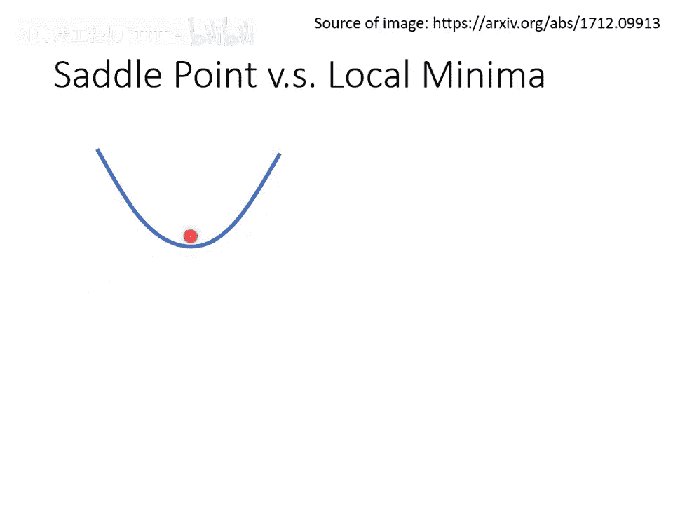

它就只是一个say NO point in呢。

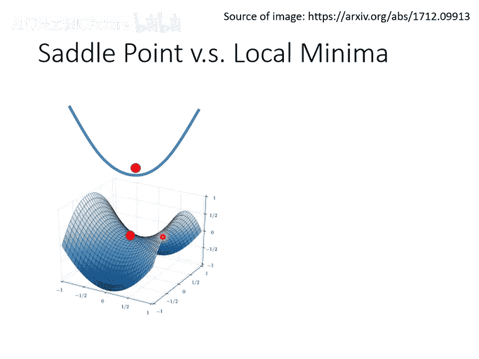

常常会有人画类似这样的图告诉你说，deep learning的训练是非常的复杂的，如果我们某移动某两个参数，error surface的变化非常的复杂，是这个样子的。

那它显然有非常多的local mini嘛，我在这边显然有一个local mini，但是会不会这个local mini嘛只是在二维的空间中，看起来是一个local mini嘛，在更高维的空间中。

它看起来就是zero point，在二维的空间中，我们没有路可以走，看会不会在更高的维度上，因为更高维度我们没有办法比，就ALIZE它，我们没办法真的拿出来看呢，会不会在更高维的空间中。

其实有路可以走的啊，如果维度越高，是不是可以走的路就越多了呢，所以而今天我们在训练一个network的时候，我们的参数往往动辄百万千万上亿。

所以我们的error surface其实是在一个非常高的维度中，对不对，我们参数有多少，就代表我们的error surface的维度有多少，参数是1000万。

就代表error error surface它的维度是1000万，降维度这么高，会不会其实根本就有非常多的路可以走呢，那既然有非常多的路可以走，会不会其实local mini嘛根本就很少了。

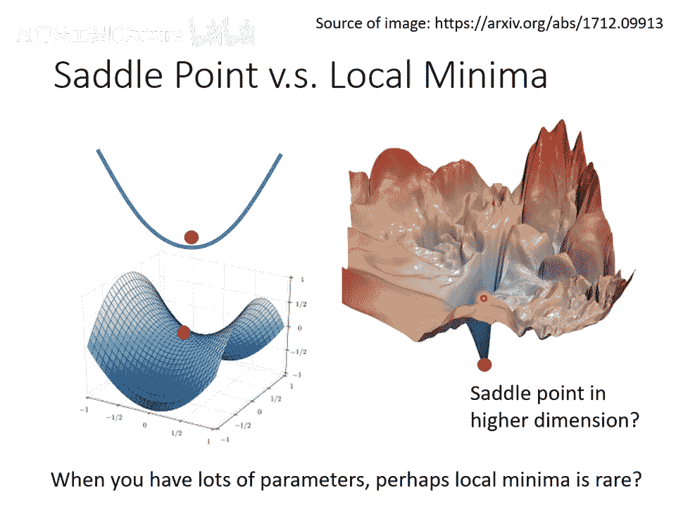

而呃经验上，如果你自己做一些实验的话，也支持支持这个假说，这边呢是训练某一个network的结果，每一个点代表训练那个network，训练完之后把他的黑选拿出来进行计算。

所以这边的每一个点都代表一个network，就我们训练某一个network，然后呢把它训练训练训练到卡规定很小，卡在critical point。

把那组参数拿出来分析看看他比较像是settle point，还是比较像是local minimu，那这边的纵轴和横轴是什么意思呢，纵轴代表training的时候的boss啊。

就是我们今天卡住了那个lost，没办法再下降了，那个loss是多少，那很多时候啊，你的loss在还很高的时候，训练就不动了，就卡在local，就卡在critical point，那很多时候啊。

rose可以降的很低，才卡在critical point，这是纵轴的部分，横轴的部分是什么呢，横轴的部分是MINIMUSIO，什么叫minimum ratio呢，minim ratio是呃。

icon value的数目分支正的I跟value的数目，就如果所有的icon value都是正的，代表我们今天在一个我们今天的critical point，是local minima，如果有胜有负。

代表say NO point，那在实作上你会发现说你几乎找不到，完全所有icon value都是正的，亏了个point，你看这边这个例子里面，这个minimum ratio代表I跟value的数目。

分支，正的，I跟value的数目，最大也不过0。5到0。6间而已，代表说有一只有一半的icon value是正的，还有一半的icon value是负的哦，所以今天虽然在这个图上。

越往右代表我们的critical point越像local mini嘛，但是他们都没有真的变成local mini嘛，就算是在最极端的状况，我们仍然有一半的重，一半的case。

我们的I跟value是负的，只有一半的case，I跟value是正的，代表说在所有的维度里面，有一半的路其实都还可以让loss，都还可以让loss下降，只有一半的路会让lows上升。

还有一半的路可以让loss下降，所以从经验上看起来，其实local minima并没有那么常见，多数的时候你觉得你劝到一个地方，你规定真的很小，然后所以你的参数不在update。

往往是因为你卡在了一个SAOP。

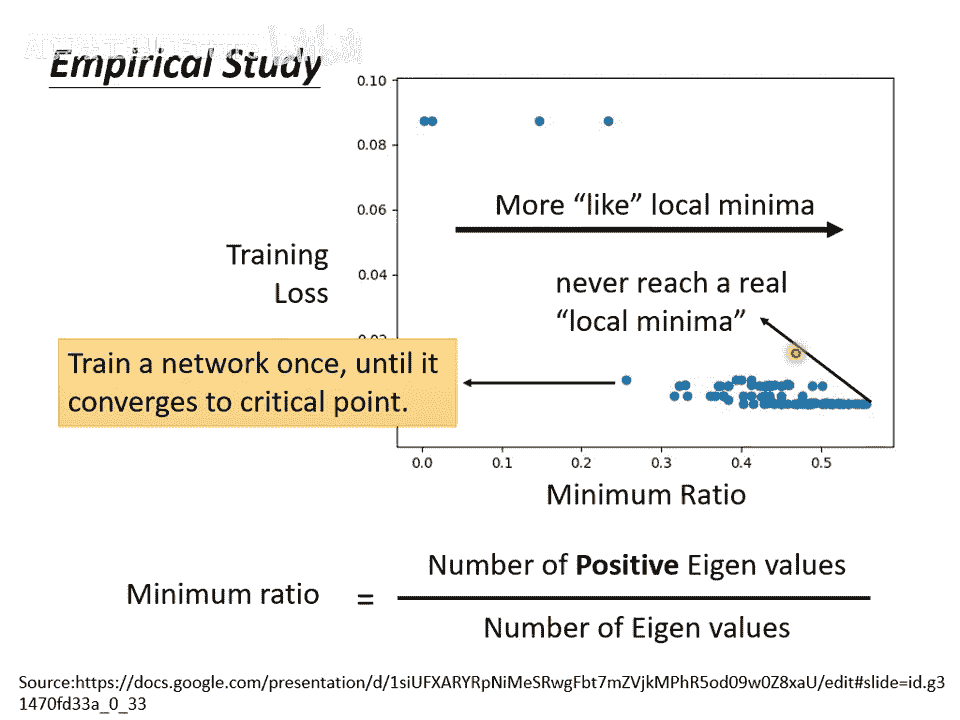

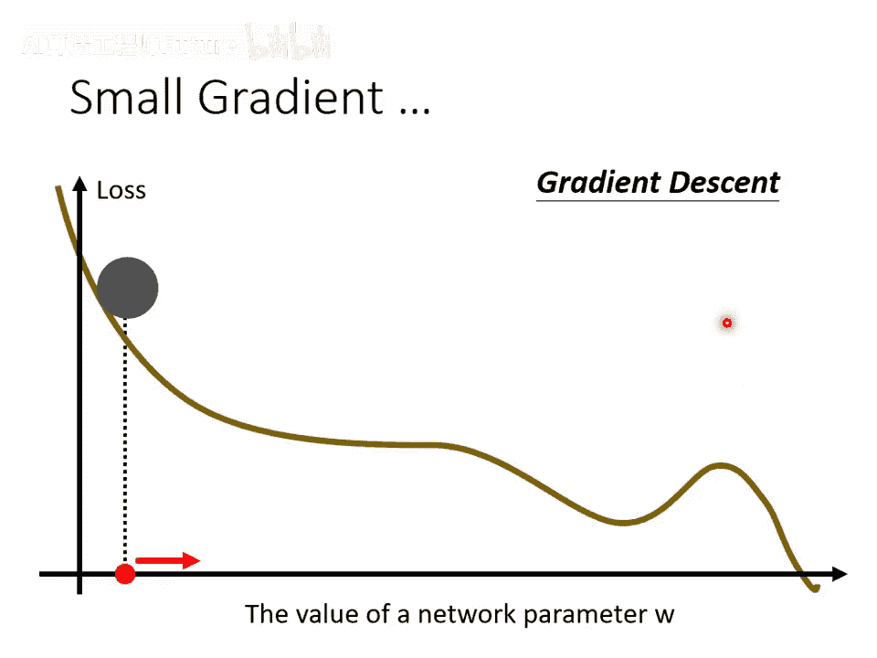

那接下来我们就是要讲说，假设你china china。

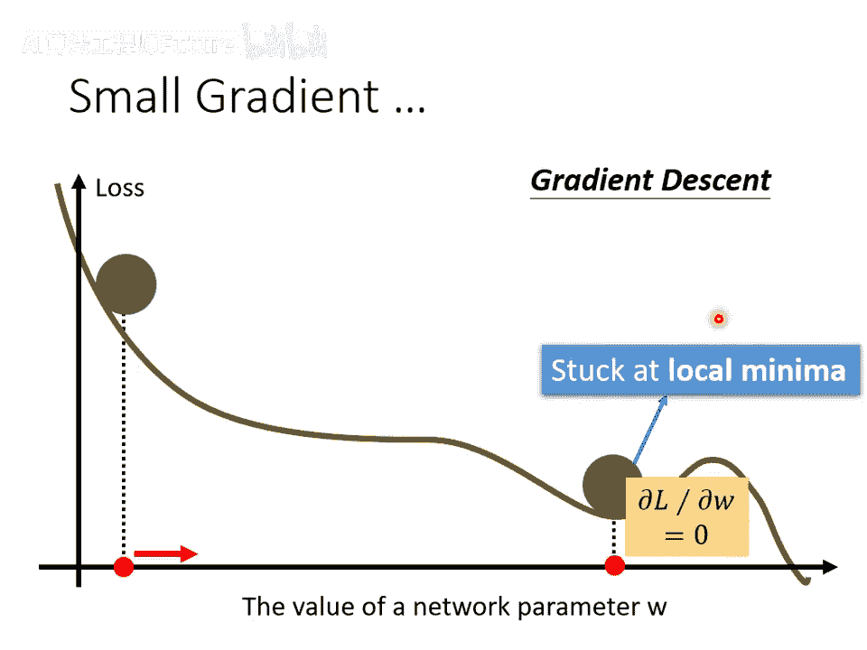

也许你卡在local mini嘛，像我刚才想说local mini嘛，出现的状况也许没有那么多。

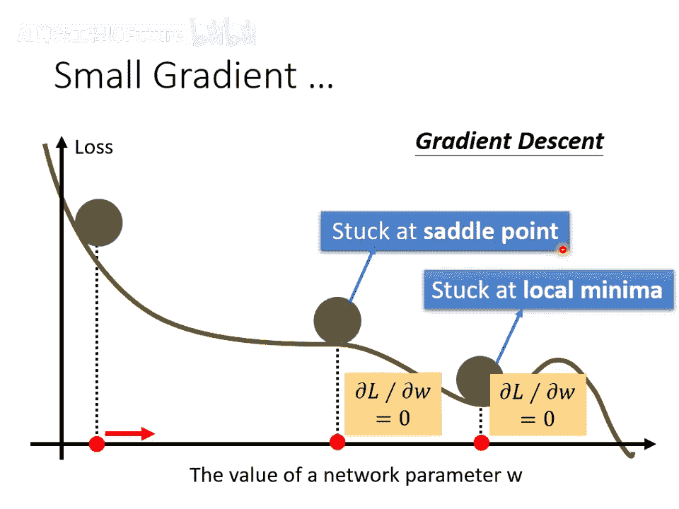

或卡在settle point或甚至是在settle point附近，也就是非常平坦的地方，那么有什么样可能的解决方法好，那在这边呢我们还是停一下。

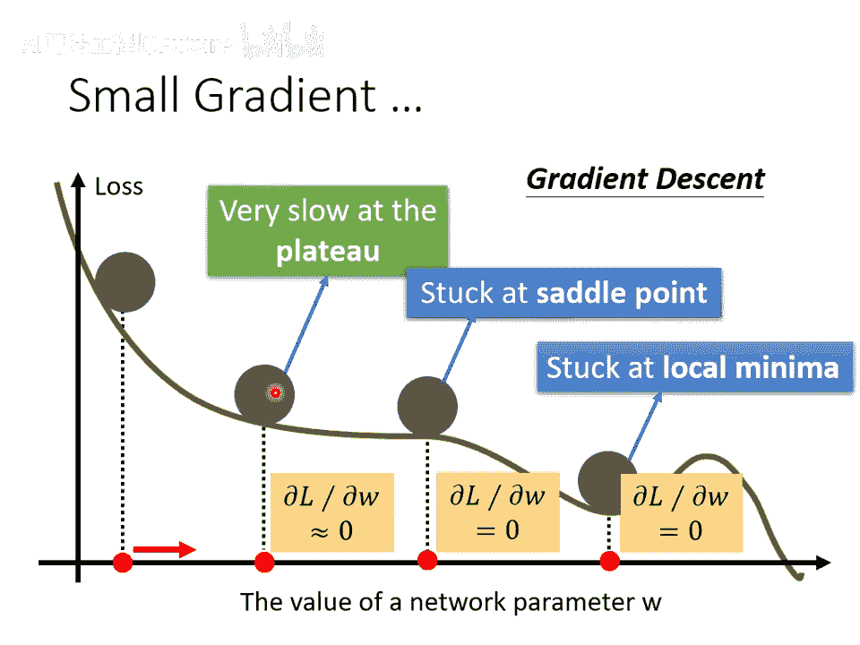