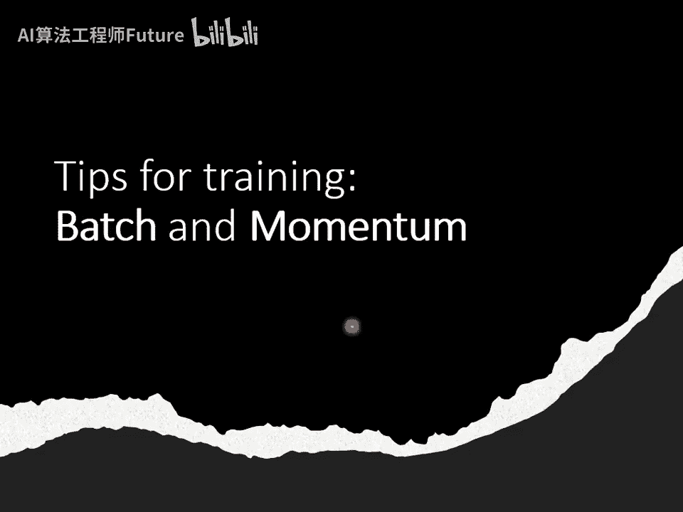
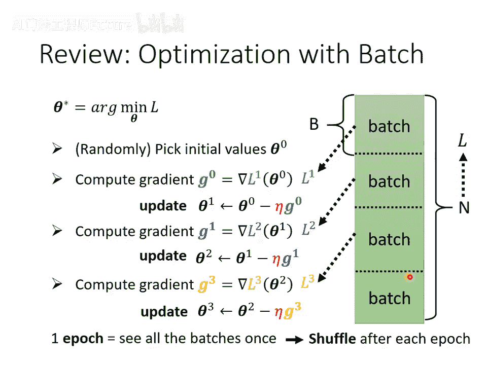
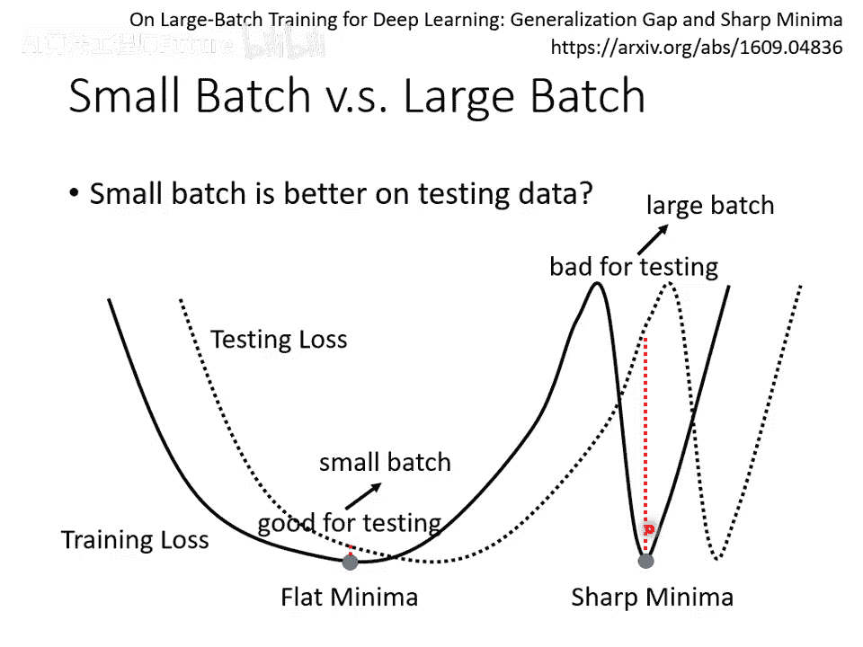
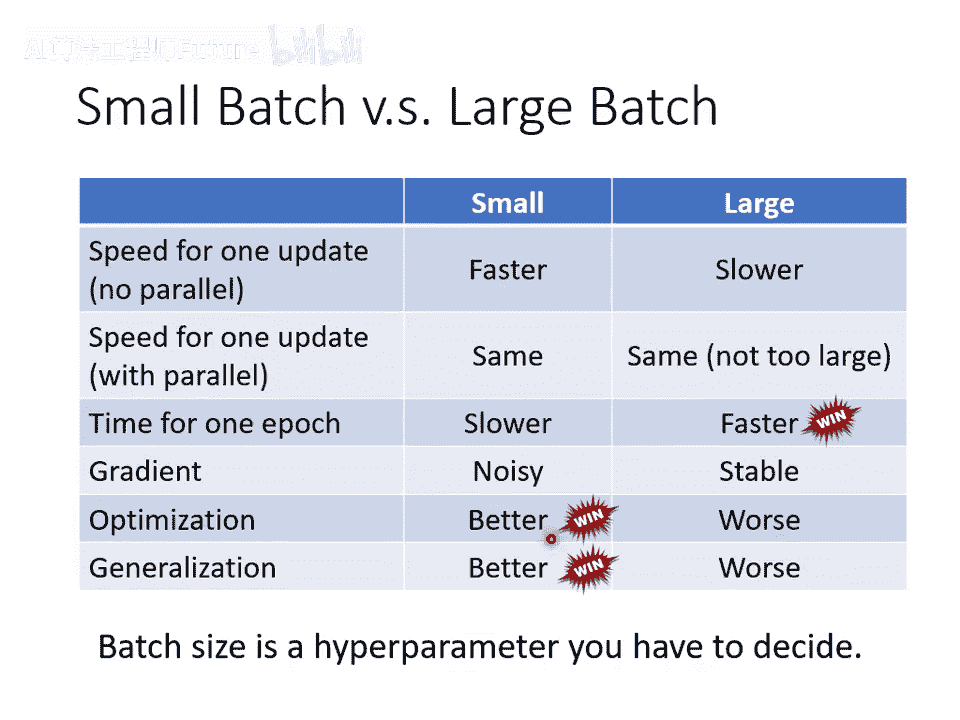
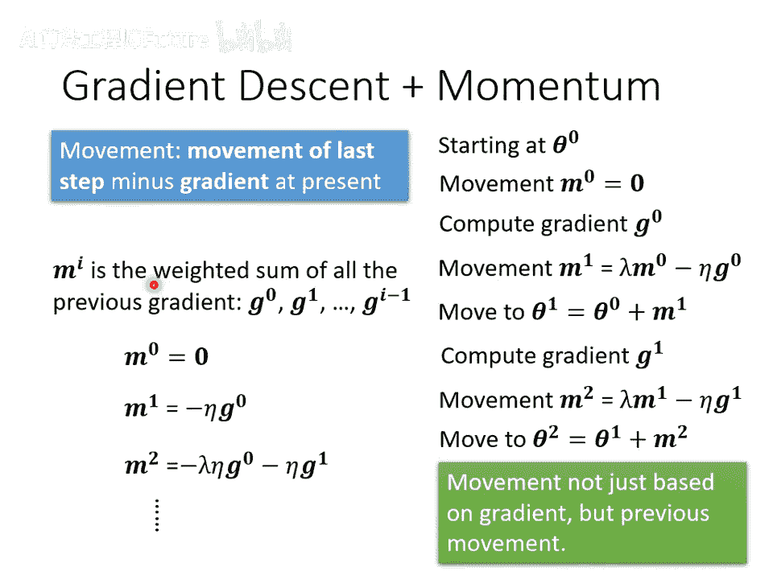
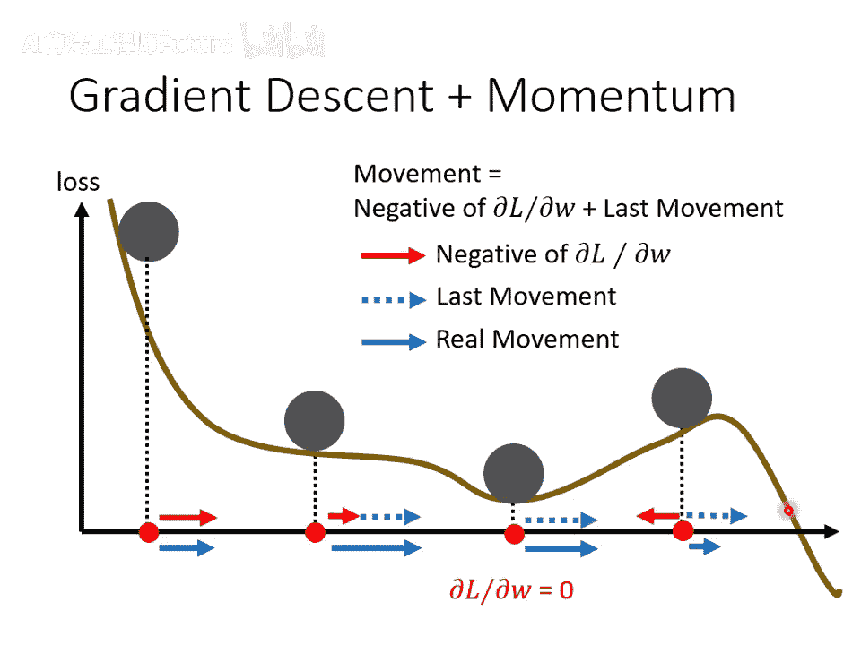
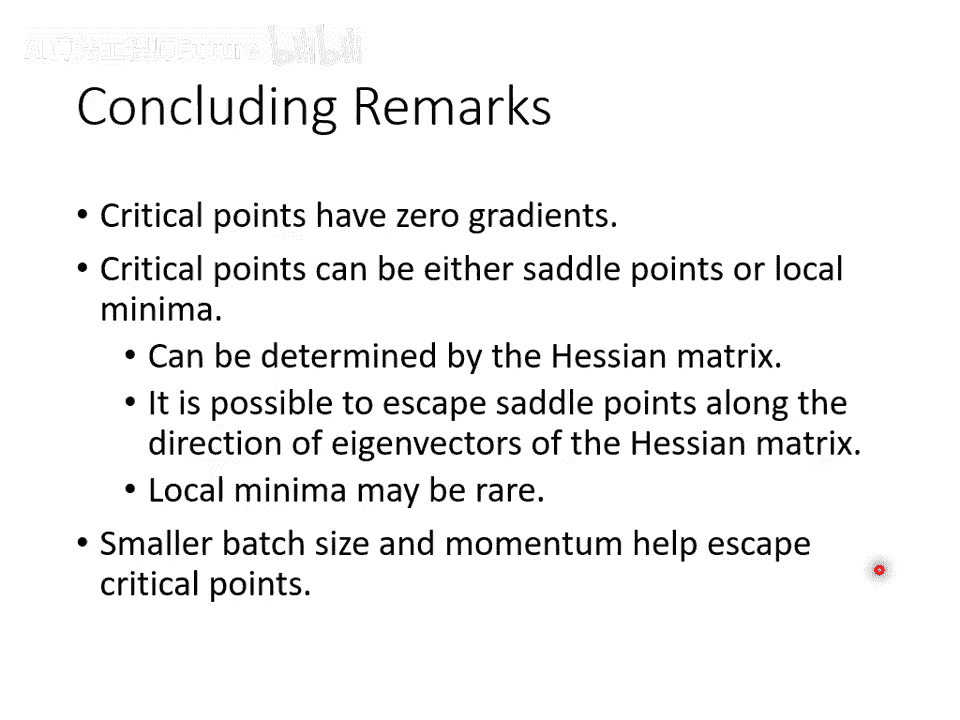

# 【官授搬运】2026年全新优化版李宏毅机器学习系统课程，这才是真正的初学者体系课程！—人工智能／深度学习／神经网络 - P15：3-批次 (batch) 与动量(momentum) - AI算法工程师Future - BV1ruqABeEFX

今天呢我们要讲batch跟momentum，这两个训练的技巧，希望我们在剩下的30分钟内可以讲完好。

第一个是batch啊，好多同学都问我说，为什么我要用match，为什么training的时候要B去啊，我本来第一周的时候是不打算讲这个东西的，因为我相信讲了以后，大家就会有好多好多的问题。

因为这好像不是一个一般常理，会想要采取的方式，但是为助教的城市里面有这一段，所以我决定先告诉大家有BH这个东西，那batch是怎么做的呢，上次我没有讲说，我们实际上在算微分的时候。

你还不是真的对所有data算出来的L作为分的，你是把所有的data分成一个一个的batch，那有的人是叫做mini batch啦，那我这边叫做batch，其实指的是一样的东西。

最后通片里面只写mini batch好，这边每一个batch的大小呢就是大BB资料，我们每次在update参数的时候，我们是拿大B笔资料出来算个loss，算个gradient update参数。

拿另外B笔资料再算个loss，再算个gradient，再update参数，以此类推，所以我们不会拿所有的资料一起去算出loss，我们只会拿一个batch的资料拿出来算咯，那我们说所有的BH看过一遍。

叫做一个EPOD，那事实上啊你今天在做这些batch的时候，再把你所有的资料分成一个一个batch的时候，你会做一件事情叫做shuffle，shuffle有很多不同的做法，但一个常见的做法就是。

我们呃每在每一个app开始之前会分一次batch，然后呢每一个EPOD的batch都不一样的，就是第一个EPOD我们分这样子的batch，第二个EPOD会重新再分一次batch。

所以哪些资料在同一个batch里面，每一个EPOD都不一样，那这件事情叫做shuffle，那刚才助教程式里面其实也有提到shuffle，这件事情好。

再一个问题就是为什么要用batch呢，我们先解释为什么要用batch，再说batch对training带来了什么样的帮助，他为什么要用batch呢，我们来比较左右两边这两个case值。

那假设现在我们有20笔训练资料，然后呢呃左边的case就是没有用batch，或者是说我的batch size，直接设的跟我训练资料一样多，这种状况啊叫做for batch。

就或者是就是没有用batch的意思啦，那右边的case就是batch size等于一，这是两个最极端的状况，我们先来看左边的case，在左边的case里面，因为没有用batch，我们有20笔训练资料。

我们的model必须我们的城市，必须把20笔训练资料都看完才能够计算loss，才能够计算gradient哦，所以我们必须要把所有的example，也就20笔example都看完以后。

我们ma参数才能够update一次，就假设开始的地方在这边，把所有资料都看完以后，update参数就从这里移动到这里好，那如果是一个batch的话，会怎么样呢，如果是一个batch。

如果batch size等于一的话，代表我们每次update参数的时候，我们只要看一笔资料就好，batch size等于一，代表我们只需要拿一笔资料出来算loss，我们就可以update我们的参数。

所以每次我们update参数的时候看一笔资料就好哦，所以我们开始的点在这边看一笔资料叫update参数，再看一笔资料叫update一次参数，再看一笔资料叫update参数，如果今天总共有20笔资料的话。

那在每在一个app里面，我们的参数会update20次啊，不过因为我们现在是只看一笔资料就被制参数，所以用一笔资料算出来的loss，显然是比较noisy的，所以我们今天update的方向。

你会发现它是曲曲折折的哦，所以如果我们比较左边跟右边哪一个比较好呢，它们有什么差别呢，你会发现左边这种方式啊，没有用batch的方式啊，它蓄力的时间比较长，对吧哈，技能冷却的时间比较长。

你要把所有的资料都看过一遍，才能够update此参数，而右边的这个方法，batch size等于一的时候蓄力的时间比较短，每次看到一笔参数，每次看到呃一笔资料，你就会更新一次你的参数。

所以今天假设二比十二十笔资料，看完所有资料看过一遍，你已经更新了20次的参数，但是左边这样子的方法有个优点，就是他这一步走的是稳的，那右边这个方法，它的缺点就是它每一步走的是不稳。

那左边跟右边到底哪边比较好呢，看起来左边的方法跟右边的方法，他们各自都有擅长跟不擅长的东西，左边是蓄力时间长，但是威力比较大，右边技能冷却时间短，但是它是比较不准的，他是乱枪打鸟型的，到底谁比较好呢。

看起来各自有各自的优缺点，但是呃你会觉得说左边的方法技能冷却时间长，右边的方法技能冷却时间短，那只是你没有考虑平行运算而已，实际上考虑平行运算的话，左边这个并不一定时间比较长，怎么说呢，怎么说呢。

这边呢是啊真正的实验结果了，事实上啊比较大的batch size，你要算loss，在进额算gradient所需要的时间，那以下呢是坐在一个叫做enlist的COOPUS上面啊。

enlist是手写数字辨识的COPEN啊，这机器要做的事情就是给他一张图片，他判断这张图片是0~9的哪一个数字啊，他要做数字的分类，那AMNEST呢是机器学习的果蝇，就是啊。

呃假设你今天啊从来没有做过机器学习的任务，一般大家第一个会尝试的机器学习任务，往往就是做enlist，做手写数字辨识啊，那边我们只不过这边我们就是做了一个实验，我们想要知道说呃，给机器一个batch。

它要计算出gradient进，能update参数到底需要花多少的时间，这边列出了batch size等于一等于十，等于100，等于1000，所需要耗费的时间，你会发现说batch size啊。

从1~1000需要耗费的时间几乎是一样的，为什么呢，你可能说诶直觉上有1000笔资料，那需要计算loss，然后计算gradient，花的时间不会是一笔资料的1000倍吗，那但是实际上并不是这样的。

因为在实际上做运算的时候，我们有GPU，你可以做平行运算，所以因为你可以做平行运算的算的关系，这1000笔资料是平行处理的，所以1000笔资料所花的时间，并不是一笔资料的1000倍好。

当然GPU平行运算的能力还是有它的极限，当你的batch size真的非常非常巨大的时候，呃，GPU在跑完一个batch，计算出gradient所花费的时间。

还是会随着batch size的增加而逐渐增长，所以今天如果batch size是batch size，是从1~1000所需要的时间几乎是一样的，但是当你的batch size增加到1万。

乃至增加到6万的时候，你就会发现GPU要算完一个batch，把这个batch里面的资料都拿出来算loss，在进能算gradient，主要耗费的时间，确实有随着batch size的增加而逐渐增长。

但你会发现这边用的是V100啊，哦所以他挺厉害的，给他6万笔资料，一个batch里面塞了6万笔资料，他在十秒钟之内也是把gradient就算出来了啊，那这个batch size的大小跟时间的关系啊。

其实每年都会做这个实验的，我特别把旧的投影片放在这边啦，如果你有兴趣的话，可以看一下，可以看到什么呢，可以看到这个时代的演进，这样嘿17年的时候用的是那个980啊，2015年的时候用的是那个760啊。

而980要跑什么6万个fish，那要跑好几分钟才跑得完啊，现在只要十秒钟就可以跑的完了，你可以看到这个时代的演进好，所以GPU虽然有平行运算的能力，但它平行运算能力终究是有极限的。

所以你bx size真的很大的时候，时间还是会增加的好，但是因为有平行运算的能力，因此实际上啊当你的batch size小的时候，你要跑完一个EPO，花的时间是大的。

batch size是比大的batch size还要多的，怎么说呢，如果今天假设我们的训练资料只有6万笔，那贝斯赛设一，那你要6万个update才能跑完一个AIRPODS。

如果今天是base size等于1000，你要60个update才能跑完一个EPO，假设今天一个best batch size等于一个bech size，等于1000，要算规定的时间根本差不多。

那6万次update跟60次update比起来，他的时间的差距量就非常可观了，所以左边这个图是update一次参数，拿一个batch出来计算一个gradient，update一次参数所需要的时间。

右边这个图是跑完一个完整的EPO，需要花的时间，你会发现左边的图跟右边的图，它的趋势正好是相反的，假设你被赛设一跑完一个EPO，你要update60000次参数，它的时间是非常可观的。

但是假设你的base size是1000，你只要跑60次，update60次参数就会跑完一个EPOD，所以你跑完一个EPOD，看完所有资料的时间，如果你的贝斯size设1000，其实是比较短的。

贝斯size设1000的时候，把所有资料看过一遍，其实是比贝斯赛设一还要更快的，所以如果我们看右边这个图的话，看完一个batch，把所有资料看过一次，这件事情大的batch size反而是比较有效率的。

是跟你直觉想的不太一样哦，在没有考虑平行运算的时候，你觉得大的batch比较慢，但实际上在有考虑平行运算的时候，一个hip pop大的batch花的时间反而是比较少的好。

所以这边我们如果要比较这个math size，大小的差异的话，看起来直接用技能时间冷却的长短，并不是一个精确的描述，看起来在技能时间上面，大的bench并没有比较吃亏，甚至还占到优势了哦。

所以事实上呢这边update测试时间，20笔资料，update测试时间跟这边看一笔资料，update测的时间，如果你用GPU的话，其实可能根本就是一样，所以大的batch他的技能时间。

它冷技能冷却的时间并没有比较长，那所以这时候你可能就会说，哎那个大的batch的劣势消失了，那难道他真的就真的这样，看起来大的batch应该比较好咯，你不是说大的batch呃。

这个update比较稳定啊，小的batch它的gradient的方向比较noisy吗，那这样看起来大的batch好像应该比较好哦，小的batch应该比较差哦，因为现在大的batch的劣势。

已经因为平均运算时被拿掉了，他好像只剩下优势优势而已，但神奇的地方是，noisy的gradient反而可以帮助全民，这个也是跟直觉正好相反的，如果你今天拿不同的batch来训练你的模型。

你可能会得到这样子的结果哦，左边是坐在enlist上，右边是坐在sa ten上，那N不管是end list还是sai ten，都是影像辨识的问题，好那横轴啊代表的是batch size。

从左到右越来越大，纵轴代表的是正确率，越上面正确率越高啊，当然正确率越高越好，而如果你今天看validation set上的结果啊，如果你今天看对，如果你今天看validation set上的结果。

会发现说dh size越大，validation set上的结果越差，但这个是OVERFITTING吗，这个不是OPOVERFITTING，因为如果你看你的training的话。

会发现说batch size越大，training的结果也是越差的，而我们现在用的是同一个模型哦，同一个模型，同一个network，照理说他们可以表示的方式就是一模一样的，但神奇的事情是大的。

batch size往往在training的时候，会给你带来比较差的结果哦，所以这个是什么样的问题，同样的model，所以这个不是model bias的问题，这个是optimization的问题。

代表当你用大的BASSIZE的时候，你的optimization可能会有问题，小的batch size，optimization的结果反而是比较好的好，为什么会这样子呢，为什么小的batch size。

在training set上会得到比较好的结果，为什么noisy的update，noisy的gradient，会在training的时候给我们比较好的结果呢，一个可能的解释是这样子的。

假设你是for bench，那你今天在update你的参数的时候，你就是沿着一个loss function来update参数，来进行update参数的时候，走到一个local mini a。

走到一个settle point，显然就停下来了，gradient是零，如果你不特别去看黑选的话，那你用gradient descent的方法，你就没有办法再更新你的参数了。

但是假如是small batch的话，假如你有用batch的话，会发生什么事呢，因为我们每次是挑一个batch出来算它的loss，所以等于等于你每一次update你的参数的时候。

你用的loss function都是略有差异的，你选到第一个batch的时候，你是用l one来算你的GRA点，你选到第二个batch的时候，你是用l two来算你的GRA点。

假设你用l one算gradient的时候，发现gradient是零卡住了，但l two他的function跟LY又不一样，所以l one卡住了，l two不一定会卡住啊，所以l one卡住了没关系。

换下一个batch来要用too，再算GRADI，你还是有办法劝你的model，你可能还是有办法让你的boss变小哦，所以今天这种noisy的update的方式，结果反而对training其实是有帮助的。

那这边还有另外一个更神奇的事情啊，那这个神奇的事情是什么呢，这个神奇的事情是呃，其实小的bench也对testing有帮助，就假设我们今天在training的时候。

都不管是大的batch还是小的batch，都劝到一样好，刚才K只是劝你的时候就已经劝不好了，那假设你有一些方法，你努力的调大的batch的learning rate。

然后想办法把大的batch跟小的batch圈的一样好，结果你会发现，小的batch居然在testing的时候会是比较好的，那以下这个实验结果啊。

是引用至on large batch training for deep learning，Generalization，game and sharp minimum这篇paper的实验结果。

而这篇paper里面呢呃作者train了六个network，里面有CNN的啊，有fully connective forward network，然后坐在不同cooper上来。

代表说这个实验是啊很泛用的啊，在很多不同的case都观察到一样的结果，那他有小的batch，一个batch里面有256名sample，大的batch就是那个data set乘0。1啊。

啊data set乘0。1，你data set有6万笔，那你就是一个batch里面有6000笔资料好，然后他想办法在大的batch跟小的batch。

都train到差不多的training的accuracy哦，所以刚才我们看到的结果是batch size大的时候，TRAINACCURACY就已经擦掉了，这不是想办法TRA到大的batch的时候。

training accuracy跟小的batch其实是差不多的，但是就算是在training的时候，结果差不多，testing的时候，你还是看到了小的batch居然比大的batch差。

training的时候都很好，testing的时候小的batch差，那代表什么，代表OVERFITTING，这个才是OVERFITTING，对不对好，那为什么会有这样子的现象呢。

啊在这篇文章里面也给出了一个解释，它是它解释是这个样子的，假设这个是我们的training loss，那在这个training loss上面呢，可能有很多个local mini嘛。

也有不止一个local mini嘛，那这些local mini嘛他们的loss都很低，他们loss可能都趋近于零，但是这个local mini嘛还是有好mini码跟坏mini码之分。

什么叫做好mini码跟坏mini码呢，呃我们会认为如果一个local minima，他在一个峡谷里面，它是坏的mini嘛，然后他在一个平原上它是好的mini嘛，为什么会有这样的差异呢。

因为假设现在training跟testing，中间有一个mismatch，training的loss跟testing的loss，他们那个方式不一样，为什么不一样呢。

有可能是本来你training跟testing的distribution就不一样，那也有可能是呃，因为training跟testing，你的字你都是从simple的data算出来的啊。

也许training跟testing simple到的data不一样啊，那所以他们算出来的loss当然是有一定差距，那我们就假设说他这个training跟testing它的差距。

就是把training的loss这个方向往右平移一点，这个时候你会发现对这个呃，对左边这个mini马来说啊，对这个在一个盆地里面的mini马来说啊。

它的呃在training跟testing上面的结果不会差太多，只差了一点点，但是对右边这个在峡谷里面mini马来说啊，一插就可以天差地远啊，他在这个呃training set上算出来loss很低。

但是因为training跟testing之间的不一样，所以testing的时候哇这个呃error surface1变，他算出来的loss就变得很大，而呃而很多人相信说呢。

这个大的BP size会让我们倾向于走到峡谷里面，而小的batch size倾向于让我们走到盆地里面，那他直觉上的想法是这样，就是小的batch，它有很多的noise。

他每次update的方向都不太一样，所以如果今天这个峡谷非常的窄，他可能一个不小心就跳出去了，因为每次update的方向都不太一样嘛，他的update的方向是随机性。

所以一个很小的峡谷没有办法困住小的batch呃，有如果峡谷很小，它能动一下就跳过去之后停下来呢，如果有一个非常宽的盆地，它才会停下来，那对于大的batch size。

反正他就是顺着gradient update，然后他就很有可能走到一个，比较小的峡谷里面哦，但这只是一个解释啦，那呃也不是每个人都额相信这个解释，那这个其实还是一个善待可以研究的问题。

好，那这边就是比较了一下大的batch跟小的batch好，左边这个是第一个color是小的batch，第二个color是大的batch，如果在没有平行运算的情况下，我们会觉得小的batch比较有效。

大的batch你一个batch的时间要算的比较长，但是在有平行运算的情况下，小的batch跟大的batch，其实运算的时间并没有太大的差距，除非你的大的batch那个大是真的非常大，才会显示出差距来。

但是一个IPAD需要的时间，小的batch比较长，大的batch反而是比较快的，所以从一个app需要的时间来看，大的batch其实是占到优势的，而小的batch你会update的方向比较noisy。

大的batch update的方向比较稳定，但是noisy的update方向，反而在optimization的时候会占到优势，而且在testing的时候也会占到优势，所以大的batch跟小的batch。

它们各自有他们擅长的地方，所以batch size变成另外一个hyper parameter，这个HYPERPARAMETER是你需要去调它的好，这个也是一个你需要去调整的HYPERPARAMETER。

那讲到这边有人就会想说，那我们能不能够呃鱼与熊掌兼得呢，我们能不能够截取大的batch的优点，跟小的batch的优点，有没用大的batch size来做训练，用平行运算的能力来增加训练的效率。

但是训练出来的结果同时又得到好的结果呢，又得到好的训练结果呢。

这是有可能的，有很多文章都在探讨这个问题啊，今天我们就不细讲，我们把这reference列在这边给大家参考，但发现这些paper往往他想要做的事情都是什么哇，76分钟train bird。

15分钟train resnet，一分钟train image net等等，这为什么他们可以装那么快，就是因为他们batch size是真的开很大，比如说在第一篇paper里面。

batch size里面有3万笔sample，这样的fit size开很大，BSIZE开大真的就可以算，很快你可以在很短的时间内看到大量的资料，那他们需要有一些特别的方法来解决。

fang size可能会带来的劣势，好那最后想要跟大家下课前，想要跟大家分享的另外一个技术啊，是momentum，这也是另外一个有可能可以对抗settle point或local mini，马的技术。

好，这个momentum是怎么运作的呢，momentum的运作是这个样子的，它的概念啊可以想象成在物理的世界里面呃，假设error surface就是真正的斜坡，而我们的参数是一个球。

你把球从斜坡上滚下来，如果今天是gradient descent，他走到local minimu就停住了，走到settle point就停住了，但是在物理的世界里面，一个球会这样子吗。

一个球如果从高处滚下来，从高处滚下来，就算滚到settle point，如果有惯性，他从左边滚下来，因为惯性的关系，他还是会继续往右走，甚至他走到一个local mini嘛，如果今天它的动量够大的话。

他还是会继续往右走，甚至翻过这个小坡，然后继续往右走，那所以今天在物理的世界里面，一个球从高处滚下来的时候，它并不会被settle point或local mini马卡住。

不一定会被sao point或local mini马卡住，我们有没有办法运用这样子的概念，到gradient descent里面呢，那这个就是我们等下要讲的momentum这个技术好。

那我们先很快的复习一下原来的gradient descent，长的是什么样子啊，这个是VINA的gradient descent，VINA意思就是一般的的意思，它直译是香草的，但这其实是一般的。

一般的gradient descent长什么样子呢，一般gradient descent是说哦，我们有一个初始的参数叫做sea0，我们计算一下gradient，然后计算完这个gradient以后呢。

我们跟我们往gradient的反方向去update参数，我们到了新的参数以后再计算一次gradient，再往gradient的反方向再update一次参数，到了新的位置以后再计算一次GRADI。

再往回点反方向去update参数，这个bus呢就一直这样子下去好，那如果加上momentum的话，会是什么样子呢，加上momentum以后，gradient descent变成这个样子。

每一次我们在移动我们的参数的时候，我们不是只往gradient descent反，我们不是只往gradient的反方向来移动参数，一般的gradient design里面。

我们都是往gradient的反方向去移动参数，但现在不止往gradient的反方向去移动参数，我们是gradient的反方向，加上先一步移动的方向，两者加起来的结果去调整去移动我们的参数。

那具体说起来是这个样子，一样找一个初始的参数，然后呢我们假设钱在一开始的时候，前一步的额变化量，前一步的呃参数的update量呢就设为零好，接下来呢在SA0的地方，你要计算距离，计算距离。

计算gradient的方向，然后接下来你要决定下一步要怎么走，那我们说下一步怎么走呢，它是gradient的方向，加上前一步的方向，不过因为前一步呢正好是零呐，现在是刚初始的时候，所以前一步呢是零哦。

所以data的方向呢跟原来的gradient descent，是一样的，这没有什么有趣的地方，但从第二步开始，有加上momentum以后就不太一样了，从第二步开始，我们计算GY。

然后接下来我们update方向不是g one的反方向，而是根据上一次update的方向，也就是n one减掉g one，当做我们新的update方向，这边写成n two。

如果你看数学式子觉得有点模糊的话，那我们就看左边这个图，g one告诉我们，gradient告诉我们要往这边走，但是我们不是只听gradient的话，加上momentum以后。

我们不是只根据gradient的反方向来调整，我们的参数，我们也会看前一次update的方向，如果前一次说要往这个方向走，gradient说要往这个方向走，就把两者相加起来走。

两者的折中也就是往这一个方向走，所以我们就呃移动了n two，走到theta q这个地方好，接下来就反复进行同样的过程，在这个位置我们计算出gradient，但我们不是只根据gradient反方向走。

我们看前一步怎么走，前一步走这个方向，走这个蓝色虚线的方向，我们把蓝色的虚线加红色的虚线，前一步指示的方向跟gradient指示的方向，当做我们下一步要移动的方向，以此类推，反复进行头的操作。

gradient在这个地方说要往这个方向走，然后前一步是要往这个方向走，两者综合起来就往左下走，所以这个一般gradient design不一样，我们不是只看gradient的方向来调整参数。

我们还会考虑之前的之前移动的方向，来调整参数，好那这边的每一步的移动啊，我们都用N来表示，我们都用N来表示，那这个an呐，其实可以写成之前所有算出来的，gradient的WADESIGN，怎么说呢。

从右边的这个式子其实就可以轻易的看出来，N0，我们把它设为零，NYNY是N0，减掉G0，N0为零，所以n one就是G0乘上负的A塔，NQ呢，and you是浪打乘上n one，浪打就是另外一个参数了。

就跟learning ray一样，是要调的，就好像艾塔是learning ray，我们要调啊，浪打也是另外一个参数，这也是需要调的啦，n two等于浪大乘上gone减掉ADA乘上GY。

然后n one在哪里呢，n one在这边啊，你把n one带进来，你就知道说n two等于负的浪达乘上A塔，乘以G0减掉啊，艾塔乘上g one，它是居里跟g one的规定上，以此类推。

所以你会发现说现这个加上momentum以后啊，一个解读是momentum是gradient的复反方向，加上前一次移动的方向，那但另外的解读方式是所谓的momentum，当加上momentum的时候。

我们update方向不是只考虑现在的gradient，而是考虑过去所有gradient的总和好，那假设呃你这边也没有听得很懂的话。

那这边有个更简单的例子，希望帮助你了解momentum是怎么回事好，那我们从这个地方开始update参数，根据gradient的方向告诉我们应该往右update参数，那现在没有前一次update的方向。

所以我们就完全按照规定呢给我们的指示，往右移动参数好，那我们的参数呢就往右移动了一点，到这个地方GRA点变得很小，告诉我们往右移动，但是只有往右移动一点点，但前一步是往右移动的。

我们把前一步的方向用虚线来表示，放在这个地方，我们把之前规定告诉我们要走的方向，跟前一步移动的方向加起来，得到往右走的方向，那再往右走，走到一个local mini a。

照理说走到local minima，一般gradient descent就无法向前走了，因为已经没有这个gradient的方向，那走到SETPOINT也一样，没有gradient的方向。

已经无法向前走了，但没有关系，如果有momentum的话，你还是有办法继续走下去，因为momentum不是只看gradient，gradient就算是零，你还有前一步的方向，前一步的方向告诉我们向右走。

我们就继续向右走，甚至你走到这种地方，gradient告诉你应该要往左走了，但是假设你前一步的影响力GRA点要大的话，你还是有可能继续往右走，甚至翻过一个小丘。

搞不好就可以走到更好的local mini嘛，这个就是momentum有可能带来的好处好。

那这个就是今天想要跟大家说的内容，那没想到就讲到6。20了，在这边就只好下课啦，谢谢大家。

