# 【官授搬运】2026年全新优化版李宏毅机器学习系统课程，这才是真正的初学者体系课程！—人工智能／深度学习／神经网络 - P16：4-自动调整学习速率 (Learning Rate)) - AI算法工程师Future - BV1ruqABeEFX

好那上周呢我们讲到了critical point的问题，那接下来呢我要告诉大家说，critical point其实不一定是你在训练一个network时候，会遇到的最大的障碍。

那今天呢这份投影片里面要告诉大家的是，一个叫做adaptive learning rate技术，也就是我们要给每一个参数不同的learning rate。

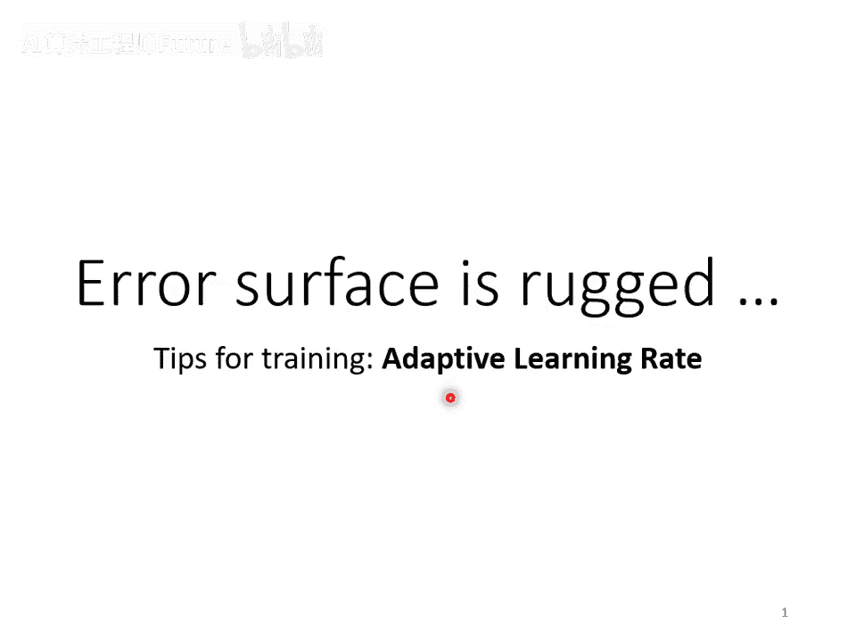

好，那为什么我说这个critical point，不一定是我们训练过程中最大的阻碍呢，这个往往啊同学们在训练一个network的时候，你会把他的loss记录下来，所以你会看到说你的loss呢原来很大。

那随着你参数不断的update，横轴呢代表参数update的次数，随着你参数不断的update，这个loss会越来越小，最后就卡住了，卡住了，意思就是你的loss呢不再下降了。

那多数时候这个时候大家就会猜说诶，那是不是走到了critical point，因为gradient等于零的关系，所以我们没有办法再更新参数，但是真的是这样吗。

当我们说走到critical point的时候，意味着gradient非常的小，但是你有确认过，当你的loss不再下降的时候，gradient真的很小吗，其实多数的同学可能都没有确认过这件事。

而事实上在这个例子里面呢，在今天我show的这个例子里面，当我们的loss不再下降的时候，硅点并没有真的变的横向，下面是gradient的nor，也就是gradient的这个向量。

gradient是一个向量嘛，gradient这个向量的长度，随着参数更新的时候的变化，那你会发现说虽然loss不再下降，但是这个gradient的NORGRADIENT的大小，并没有真的变得很小。

事实上在最后训练的最终结的时候，loss已经几乎没有在动了，loss几乎没有在减少了，但是GRA点却突然还上升了一下，这是怎么一回事呢，啊那这样子的结果其实也不难猜想，也许你遇到的是这样子的状况。

好这个是我们的error surface，然后你现在的gradient呢，在error surface3股的两个股壁间不断的来回的震荡，这个时候你的loss不会再下降，所以你会觉得看到这样子的状况。

你的loss不会再越来越小，但是实际上他真的卡到了critical point，卡到了settle point，卡到了local minimum吗，不是的，它的gradient仍然很大。

只是loss不见得再减小了哦，所以你要注意啊，当你今天你训练个network，劝到后来发现loss不再下降的时候，你不要随便说啊，我卡在local mini嘛，我卡在say NO point。

有时候根本两个都不是，你只是单纯的loss，没有办法在下降，就是为什么在作业2~2会有个作业，叫大家算一下GRADI的弄，然后算一下。

说你现在是卡在settle point还是critical point，因为多数的时候当你说你训练卡住了，很少有人会去分析卡住的原因，那为了强化你的印象，我们有一个作业，让你来分析一下卡住的原因是什么。

那讲到这边，有的同学就会有一个问题了，嗯如果我们在训练的时候，其实很少卡到saddle point或者是local minima。

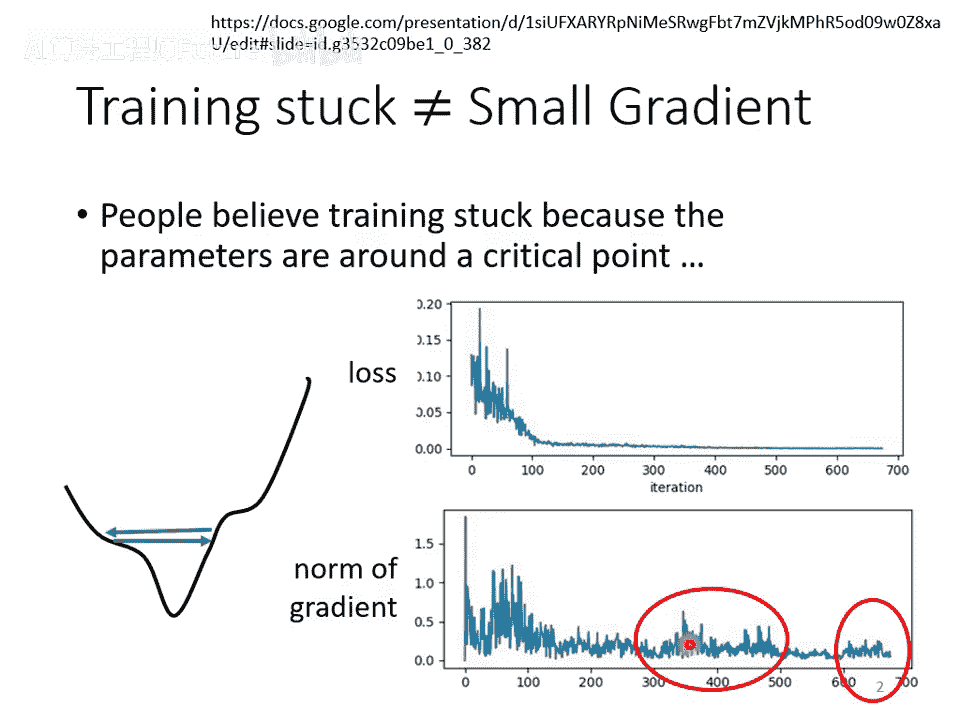

那这一个图是怎么做出来的呢，你还记得这个图吗，我们上周我画过这个图是说啊，我们现在训练一个network，训练到呃，现在参数呢在critical point附近。

然后我们再来根据I跟value的正负号来判断，说这个critical point它比较像是SAO表示local mini嘛，那如果实际上在训练的时候。

要走到settle point或者是local minimu，是一件困难的事情，那这个图到底是怎么画出来的呢，啊这边告诉大家一个秘密啦，这个图啊你要训练出这样子的结果。

你要训练到你的参数很接近critical point，用一般的gradient descent其实是做不到的，用一般degradient descent train。

你往往会得到的结果是你在loss还很，你在这个GRA点还很大的时候，你的loss就已经掉不下去了，这个是需要特别方法劝的，所以做完这个实验以后，我更感觉你要走到一个critical point。

其实是困难的一件事，多数时候training在还没有走到critical point的时候，就已经停止了，但这并不代表说critical point不是一个问题，我只想要告诉你说。

我们真正目前你要当你用gradient descent，来做optimization的时候，你真正的魔王，你真正应该怪罪的对象往往不是critical point，而是其他的原因好。

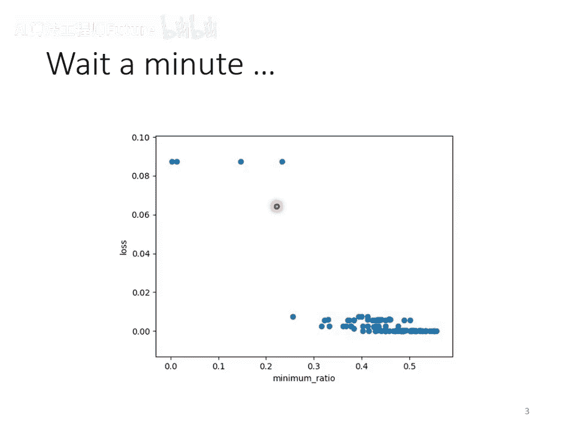

那为什么，就如果如果今天critical point不是问题的话，为什么我们的training会卡住呢，我这边举一个非常简单的例子，而我们这边有一个非常简单的error surface。

我们只有两个参数，这两个参数的值不一样的，是lost的值不一样，然后我们就画出了一个error surface，这个error surface的最低点呢在叉叉这个地方。

事实上呢这个error surface是convex的形状，那如果你不知道COMBX是什么也没有关系，呃总之呢它是一个它的这个等高线，那是椭圆形的，只是它在横轴的地方呢，它的gradient非常的小。

它的坡度的变化呢非常的小，它非常的平滑，所以这个椭圆的这个长轴非常的长啊，短轴呢相对之下比较短，好在纵轴的地方GRADI的变化很大，你的error surface的这个坡度呢非常的陡峭好。

那现在呢我们要从这个地方，这个地方当做初始的点，然后来做gradient descent，你可能觉得说啊这个是个convex的error surface啊。

做gradient descent有什么难的吗，不就是一路滑下来，然后可能再走过去吗，应该是非常容易吧，你实际上自己试一下，你会发现说就连这种convex的error surface，形状这么简单。

error surface你用gradient descent都不见得能把它做好。

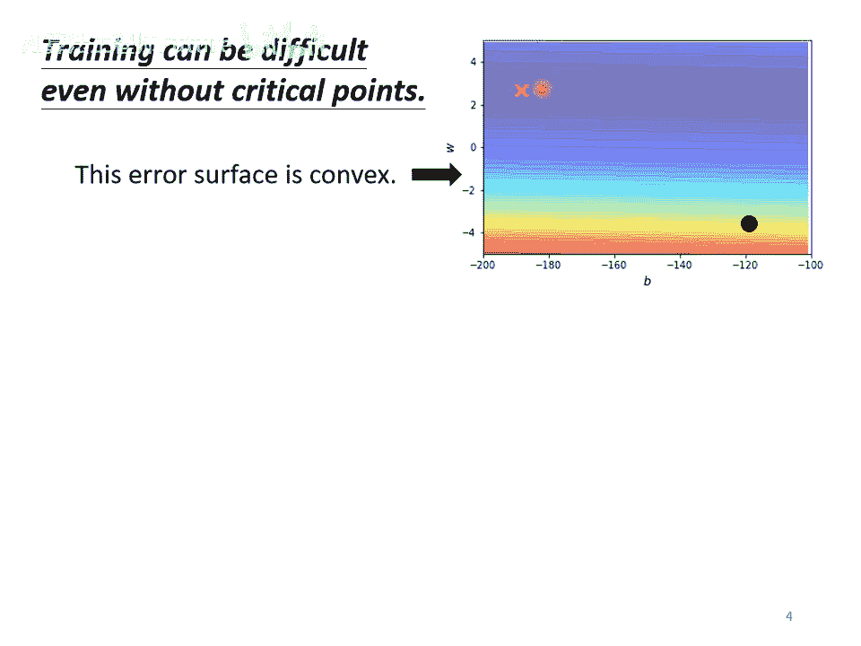

举例来说，这个是我实际上自己试了一下的结果啊，我learning rate设十的二次方的时候，那这个我的的我的这个参数呢在峡谷的两端，你可以想象说这边是一个山壁，然后另外一边在这个图片之外也是个山壁。

我的那个呃参数呢在3B的两端呢不断的震荡，我loft就掉不下去，但是GRA点其实仍然是很大的啊，你可能说那就是因为你learning rate设太大啦。

learning rate决定了我们update参数的时候步伐有多大，人力瑞士太大，显然步伐太大，那你没有办法慢慢的滑到山谷里面，那这个是呃咎由自取，只要把learning rate设小一点。

不就可以解决这个问题了吗，事实不然，因为我试着去调整了这个learning rate，你就会发现你要光是要train这种CONFEST的。

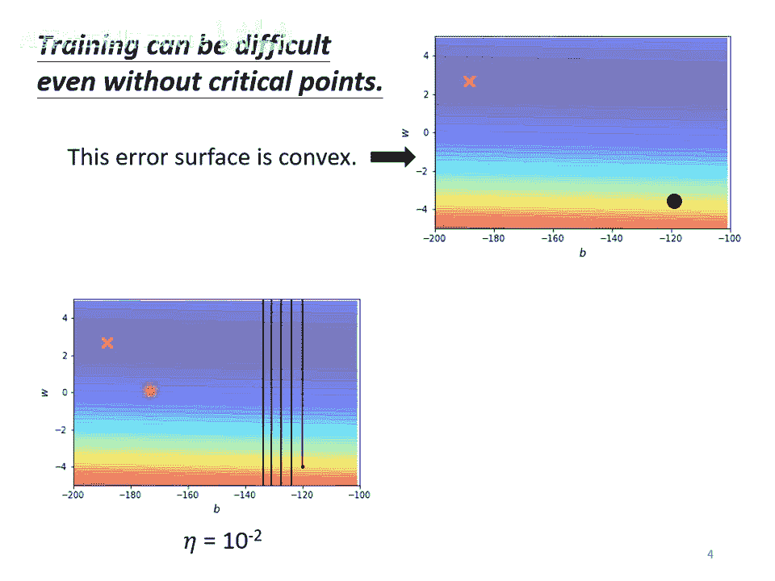

optimization的问题啊，你都觉得很痛苦懂吗，一趟命都积累，知道吗，这个觉得非常痛苦啊，就我就调这个learning rate，从十的二次方一直调到十的七次方，调到十的七次方以后。

终于不再震荡了哦，终于从这个地方滑滑滑滑滑滑到山谷底，然后终于左转了，但是你发现说这个训练永远走不到终点，为什么，因为我的learning rate已经太小了，在这个很斜的地方额，因为这个坡度很陡。

gradient的值很大，所以还能够前进一点，它这个地方坡度已经非常的平滑了，这么小的learning rate，根本没有办法再让我们的训练前进，事实上在这个地方啊，你看看到这边一大堆黑点，乌漆嘛。

黑的这边有多少个点呢，这边有10万个点诶，这个是这个张辽800冲10万的那个10万，知道吗，哎这个10万个点诶，但是我都没有办法靠近这个local mini码的地方哦。

所以显然就算是一个convex的error surface，你用gradient descent也很难穿好，但有的同学可能会想说，诶，这个convex optimization的问题。

应该有别的更好的方法可以解吧，你不一定要用gradient descent这么土的方法，你确实有别的方法可以解，但是你想想看，如果今天是更复杂的error surface。

你真的要TRA一个deep network的时候，gradient descent是你唯一可以仰赖的工具，但是gradient descent这个工具，连这么简单的error surface都做不好。

视之不治，何以天下国家为，对不对，这么简单的问题你都做不好，那如果难的问题，他又怎么有可能做好呢，所以我们需要更好的gradient descent的版本啊。

那怎么把gradient descent做得更好呢，在之前我们的gradient descent里面，所有的参数都是设同样的learning rate，这显然是不够的。

learning rate他应该要为每一个参数特制化，所以接下来我们就是要讲克制化的learning rate。

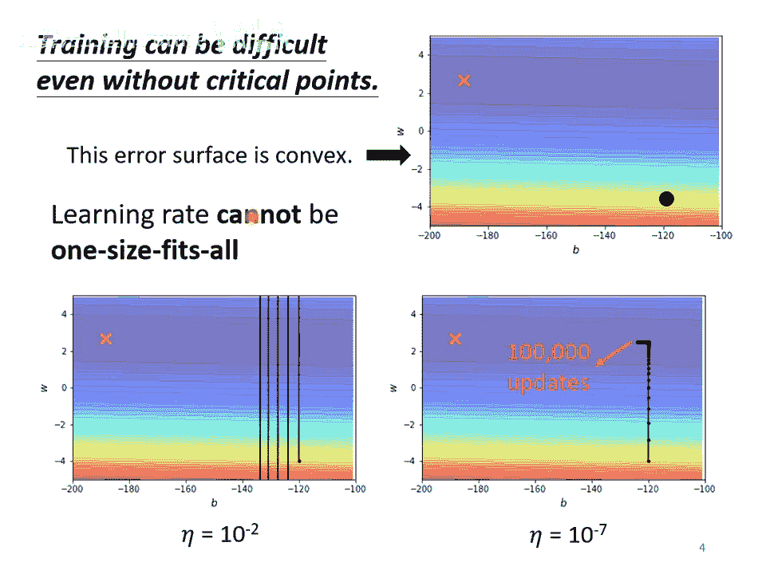

怎么做到这件事情好，那我们要怎么克制化这个learning rate呢，我们不同的参数到底需要什么样的learning rate呢，从刚才的例子里面呢，其实我们可以看到一个大原则。

这个大原则是如果在某一个方向上，我们的gradient的值很小，在某一个方向上非常的平坦，那我们会希望learning rate调大一点，如果在某一个方向上非常的陡峭，某一个方向上坡度很大。

那我其实期待learning rate可以设的小一点好，那这个learning rate要如何自动的根据，这个gradient的大小做调整呢，我们要改一下gradient descent，原来的是哦。

这边呢我们等一下在讲解的时候，我们只放某一个参数update的式子，就我们之前在讲gradient descent的时候，我们往往是讲所有参数update的式子，那这边呢为了等一下呃，简化这个问题。

我们只看一个参数，但是你完全可以把这个方法，推广到所有参数的状况，而我们只开一个参数，这个参数呢叫做SAI啊，那这个set ti呢在第七个iteration的值减掉，在第七个iteration。

这个参数I算出来的gradient哦，这个G上标T下标I呀，代表在第T个iteration，也就是theta等于theta t的时候，参数CAI对loss的微分好。

我们把这个SA上标题下标I呢减掉learning rate，乘上G上标题下标I会更新learning rate，到setup上标T加一下标I，这是我们原来的gradient descent。

我们的learning rate是固定，现在我们要有一个这个呃会克制化的learning rate。

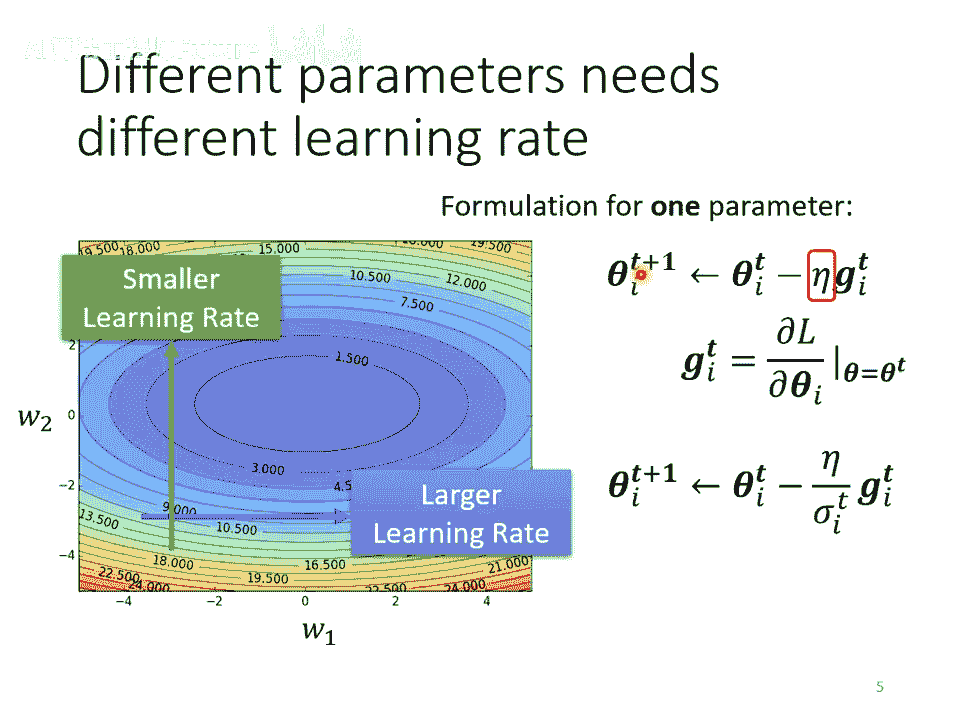

随着参数克制化的learning rate，这要怎么做呢，我们把原来learning rate a这一项呢，改写成AA除以sigma，上标题下标I这个西格玛上标题下标I呀，你发现它有一个上标题。

有一个下标I就代表说这个西格玛这个参数啊，首先它是depend on i的，它是参数dependent的，不同的参数我们要给它不同的sigma，同时他也是iteration dependent的。

不同的iteration我们也会有不同的sigma，所以当我们把我们的learning rate从ADA改成ADA，除以西格玛上标T下标I的时候。

我们就有一个parameter dependent的learning rate，那接下来我们就是要看说这个parameter dependent，learning rate有什么常见的额计算方式好。

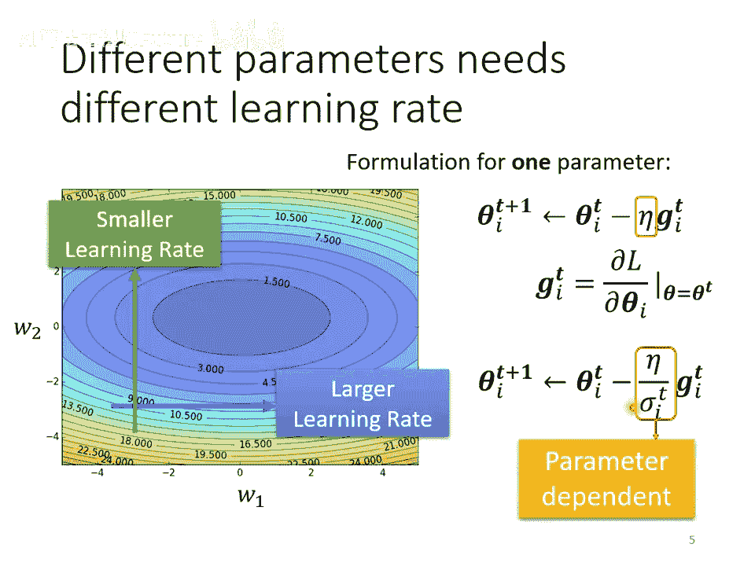

那这个sigma呃，有什么样的方式可以把它计算出来呢，一个常见的类型是算啊，gradient的roommin square，什么意思呢，啊这个是我们现在要啊参数要update的式子，我们从C大零。

我们等下就不把I念出来了，大家知道我意思这边是考虑某一个参数，所以个下标I啊，等等一下，为了方便讲课，所以我们就不把I念出来了，好sea上标零初始化参数减掉这个G0。

乘上learning rate除以西格玛零，就得到theta one，那这个西格玛零怎么算出来的呢，在第一次update参数的时候，这个西格玛零呐是G0的平方除以开根号。

这个G0就是我们的gradient和gradient的平，方除以开根号啊，那这一项呢其实就是G0的绝对值了，对不对，所以你把G0的绝对值带到带到这边，那这个G0跟这个G0它们的大小是一样的。

所以这边呢啊这一项啊只会有一个，它要么是正一，要么是一，就代表说我们第一次呢在update参数，从theta0update到theta1的时候，要么是加上艾塔。

要么是减掉艾塔跟learning rate，跟这个gradient的大小没有关系，只看你这个AA的值设多少，这个是第一步的状况，那这一个地方没有特别重要啊，所以第一步的地方。

如果你听得有点模模糊糊就算了，重点是接下来怎么处理好，那sa one呢，他要一样减掉gradig one，乘上AA除以西格玛Y，现在呢在第二次update参数的时候，是要除以西格玛one，不是西格玛零。

是西格玛one，而这个sigma one是怎么被算出来的呢，这个sigma one就是我们过去所有计算出来的，Gradient，它的平方的平均再开根号，我们到目前为止，在第一次update参数的时候。

我们算出了G0，在第二次update参数的时候，我们算出了g one，所以这个sigma one呐，就是G0平方加GY平方除以12，再开根号啊，这个就是lin square，好。

我们算出这个西格玛one以后，我们的learning rate就是AA除以西格玛one，然后把theta one减掉AA除以西格玛one乘以g one，得到theta two，同样的操作就反复继续下去。

在SETTO的地方，你要减掉A大除以sigma two乘以G2，那it这个西格玛是什么呢，这个西格玛two呢，就是过去所有算出来的gradient，它的平方和的平均再开根号哦，所以你把G0取平方。

GY取平方，G2取平方，对平均再开根号，得到西格玛Q放在这个地方，然后update参数哦，所以这个process呢这个过程呢就反复继续下去，到第七次update参数的时候啊，其实这个是DT加一次了啊。

gt加一次update参数的时候，你的这个sigma t要怎么设定呢，它就是过去所有的gradient gt从第一步，从从第一步到目前为止，所有所算出来的GT的平方和在平均再开根号，得到西格玛T。

然后把它呢除learning rate，然后用这项当做是新的learning ray来update的参数啊。

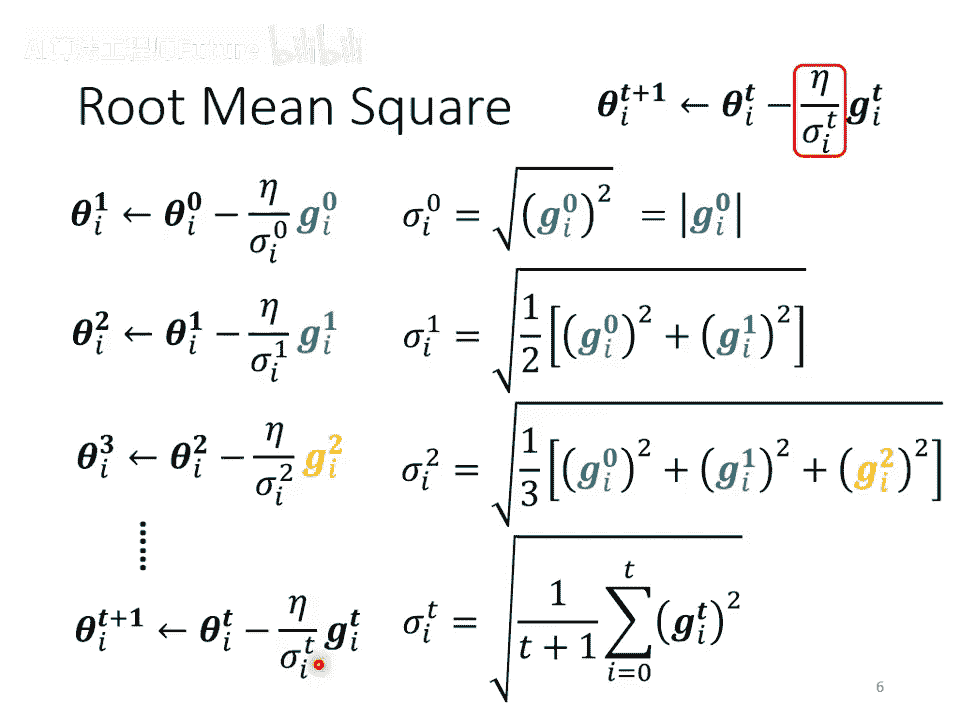

那这一招呢被用在一个叫做ADAGGRADE的，方法里面啊，那为什么这一招有用的呢，为什么这一招可以做到我们刚才讲的呃，坡度比较大的时候，learning rate就减小，坡度比较小的时候。

learning rate就放大呢，呃你可以想象说，现在我们有两个参数，一个叫sa one，一个叫c ta to c a one坡度小，sa two坡度大，sa one因为它坡度小的关系。

所以你在sa one这个参数上面，算出来的gradient呐值都比较小，因为gradient算出来的值比较小，然后呃这个sigma是gradient的ROOMMSQUARE。

gradient的平方和取平均再开根号哦，所以既然gradient小，算出来的西格玛就小，西格玛小人力锐就大哦，反过来说set up to呃，这个set up to呢是一个比较陡峭的呃。

这个呃参数在CRQ这个方向上呢，呃loss的变化比较大，所以你算出来的gradient都比较大，你算出来gradient比较大，你的sigma就比较大，你的sigma比较大，那你在update的时候呢。

你的这个step，你的这个呃参数update的时候的量啊就比较小哦，所以有了sigma这一项以后呢，你就可以随着gradient的不同，每个参数gradient的不同。

来自动的调整learning rate的大小。

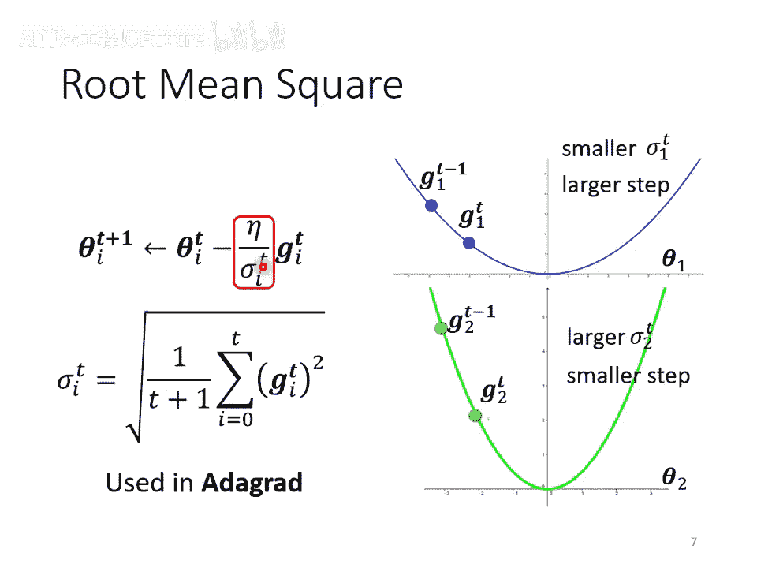

好那这个呢并不是你今天会用的最终极的版本，好，刚才那个版本还有什么样的问题呢，就算是同一个参数，它需要的learning rate也会随着时间而改变，我们刚才的假设是好像是同一个参数。

它的gradient的大小就会固定是差不多的值，但事实上并不一定是这个样子的，举例来说，我们来看这个新月型的error surface，如果我们考虑横轴的话，考虑左右横的这个呃水平线的方向的话。

你会发现说在这个地方坡度比较平滑，所以二你会发现在这个地方坡度比较陡峭，所以我们需要比较小的learning rate，但是走到了中间这一段的时候呢，坡度又变得平滑了起来，这边坡度比较陡峭啊。

这边坡度变得平滑了起来，所以我们在这个地方又需要比较大的能力对，所以就算是同个参数，同一个方向，我们也期待说learning rate是可以动态的调整的，所以怎么办呢。

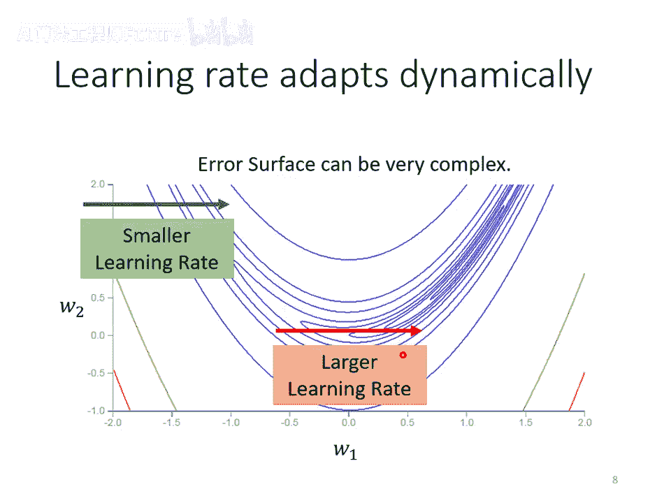

就有了一个新的招数，这个招数叫做i n s pro，Im max pop，这个方法有点传奇，它传奇的地方在于它找不到论文啊，唉还说找不到论文，这个方法出自于哪里呢，非常多年前，那应该是将近10年前。

HINTON在COSERA上开过deep learning的课程，那个时候他在他的课程里面讲了r n s prop，这个方法，然后这个方法没有论文，所以你要set的话，你要set那个啊那个影片的连接。

这样哎就是个传奇的方法，叫i n s pro，而在这个rs pm这个方法是怎么做的呢，它的第一步跟刚才讲的算ROOMMSQUARE，也就是那个ada gram的方法是一模一样的。

而这第一步我们就不要看了，我们看第二部，第二步有什么不同呢，一样要算出sigma one，只是我们现在算出西格玛one的方法，跟刚才算ROOMMSQUARE的时候不一样。

刚才在算roommes square的时候，每一个GRADI都有同等的重要性，但在i n s prop里面，它决定你可以自己调整现代的这个gradient，你觉得它有多重要哦。

所以在i n s s pop里面，我们的这个sigma one呢，它是之前的西格玛林啊，全部算出来西格西格玛林里面就是有居零嘛，所以这个西格玛林就代表了这个居零的大小好。

所以它是西格玛零的平方乘上阿尔法加上一减，阿尔法乘上，现在我们刚算出来的新鲜热腾腾的gradient，就是g one，那这个阿尔法另外一个参数就像learning ray一样，就你这个你要你要自己调它。

它意思一个hyper parameter，你要自己调它，那你可以想象说，如果我今天阿尔法设很小趋近于零，就代表说我觉得g one，相较于之前所算出来的规点而言比较重要，我阿尔法这很大趋近于一。

那就代表说我觉得现在算出来的g one，比较不重要啊，之前算出来的gradient比较重要好，所以同理，在第三次update参数的时候，我们要算sigma two，那怎么办呢。

我们就把save one拿出来取平方，再乘上阿尔法，那save one one里面有g one跟西格玛零，西格玛林里面又有G0，所以你知道西格玛one里面它有g one，有G0好。

然后这个g one跟G0呢，它们会被乘上阿尔法，然后再加上一减阿尔法，乘上这个G5two的平方啊，所以这个阿尔法就会决定说G2，它在整个sigma two里面占有多大的影响力。

那同样的过程就反复继续下去，西格玛T等于根号阿尔法，乘上西格玛T减一的平方，加上一减阿尔法gt的平方，你用阿尔法来决定，现在刚算出来的gt它有多重要。

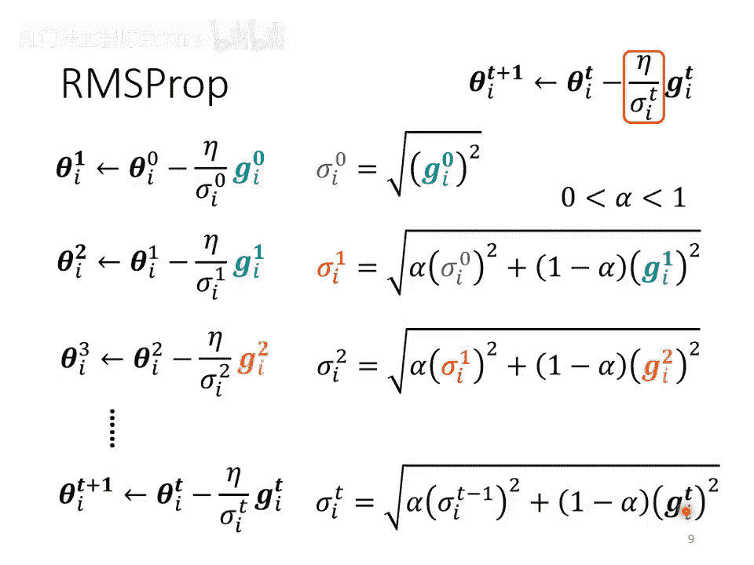

好那这个呢就是rs pub，那i n s pop我刚才讲过说透过阿尔法这一项，你可以决定说gt，相较于之前存在西格玛T减一里面的g one，到gt减一而言，它的重要性有多大，如果你用rs pop的话。

你就可以动态调整sigma这一项，就我们现在呢假设从这个地方开始，这个黑线呢是我们的error surface，从这个地方开始呢，你要update参数啊，你这个球呢就从这边走走走，走到这边。

待会一路上都很平坦，很平坦，就代表说G算出来很小，G算出来很小，就代表说这个西格玛算出来很小，西格玛算出来很小，就代表说现在update参数的时候，我们会走比较大的步伐好，接下来继续滚，滚到这边。

滚到这边以后，我们gradient变大了，如果是原来的不是r n s prop，原来的ADAGRAM的话，它反应比较慢，但如果你用rn s pop，然后你把阿尔法呢设小一点。

也就是让呃新的刚看到的GRA点，影响比较大的话，那你就可以很快的让sigma的值变大，还可以很快的让你的步伐呢变小，那就可以踩一个刹车哦，本来很平滑，走到这个地方突然变得很陡。

那安less pop呢可以很快的踩一个刹车，把learning rate变小，那如果你没有踩刹车的话，你走到这个地方，learning rate太大了，那龟点又很大，两个很大的东西乘起来。

你可能就啪的一下，你就飞出去了，就很快啊，就飞出去了，就飞到很远的地方好，那如果继续走走走，又走到平滑的地方了啊，因因为这个这个这个现在西格玛T啊，你可以调整阿尔法。

让他比较看重于最近算出来的gradient，所以你gradient1变小，西格玛可能就反应很快，它的这个值呢就变小了，然后呢你走的步伐呢就变大了，这个就是i m s part。

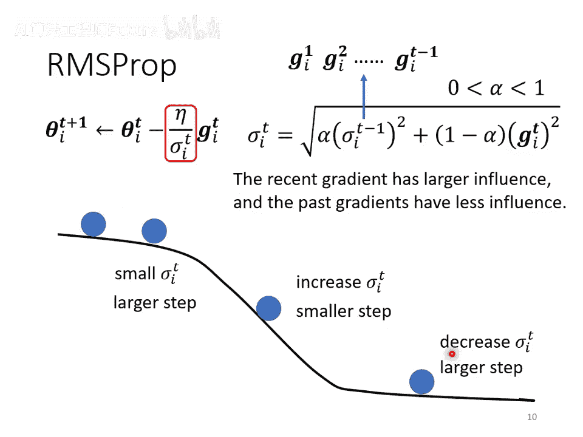

那今天你最常用的optimization的策略，optimization的策略有人又叫做optimizer啊，这个今天比较常用的这个optimization，最常用optimization的策略呢。

就是ADAMEDEN是什么呢，EDEN就是i n s pop，加上我们上周讲过的momentum，那ADA的演算法跟原始的论文，我们就列在投影片上，我们就不时间诶，可能说不细讲的话。

我怎么知道怎么做这个ADA呢，今天你不用担心，这个PYTORCH里面都帮你写的好好的了，或者是你打开助教程式来看，搜寻ADAM里面就有个地方是ADAM啊，所以这个你今天不用担心这种OPTIMIZ。

optimization的问题，optimizer呢，呃这个deep类的套件往往都帮你做好了，然后这个optimizer里面也有一些参数需要调，有一些hyper parameter需要人工决定。

但是你往往用预设的那一组参数就够好了，你自己调有时候反而会调到比较差的，往往你直接call这个呃，PYTORCH里面ADAM这个optimizer，然后那个预设的参数不要随便调。

你就可以得到不错的结果了，那关于艾伦的细节就留给大家自己研究好，那我们刚才讲说这个简单的error surface，我们都串不起来，现在我们来看一下，加上adaptive learning ray以后。

圈不圈的起来好，那这边是采用最原始的ADAGGREEN那个做法啦，就是把过去呢呃看过的这个learning rate通通都都过去，看过的这个gradient通通都啊，取平方再平均再开根号。

当做这个西格玛啊。

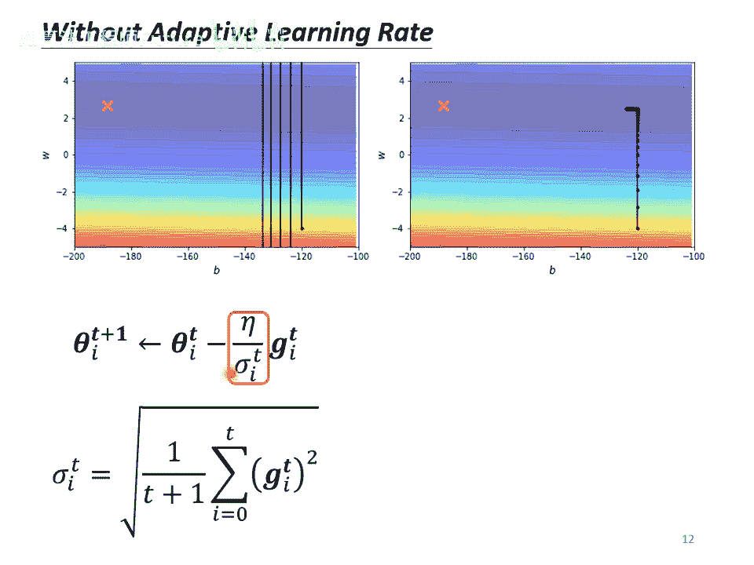

那做起来怎么样呢，做起来是这个样子的，是这个样子的，哎你先不要管这边，我知道你看到这个一定觉得大吃一惊呐，这个到底是怎么回事，这个黑压压的到底是什么东西，是不是打翻墨水了，先不要管这边先不要管这边啊。

你这个走下来诶，没有问题，然后接下来在左转的时候啊，在左转的时候，刚才我们update了10万次，这边也是update100000次了啊，刚才update100000次只卡在这个地方。

但现在阿拉伯人以后，你可以再继续走下去，走到非常接近终点的位置，为什么RW你可以继续走下去呢，因为当你走到这个地方的时候，你因为这个左右的方向的这个gradient很小。

所以learning rate会自动调整，左右这个方向的learning rate会自动变大，所以这个步伐呢就可以变大，就可以不断的前进，接下来的问题就是，为什么走到这边突然爆炸了呢。

为什么走到这边突然爆炸了呢，你想想看哦，我们在算这个sigma的时候，我们是把过去所有看到的gradient，都拿来做平均，所以这个纵轴的这个方向啊，这个纵轴的方向。

虽然在初始的这个地方感觉GRA点很大，但是这边走了很长一段路以后，这个纵轴的方向gradient算出来都很小啊，所以纵轴的这个方向啊，这个这个呃呃Y轴的这个方向啊，就累积了很小的西格玛。

因为我们在这个Y轴的方向，看到很多很小的gradient，所以我们就累积了很小的sigma，累积到一个地步以后，这个step就变很大，然后就暴走就喷出去了，这样就喷出去了，但喷出去以后没有关系。

有办法修正回来，为什么，因为喷出去以后就走到了这个gradient，比较大的地方，走到gradient比较大的地方以后，这个sigma呢又慢慢的变大啊，西格玛慢慢变大以后，这个参数update的距离。

update的这个步伐大小又慢慢的变小，你就发现说诶走着走着突然往左右喷了一下，但是这个喷这个喷了一下，不会永远就是震荡，不会做简谐运动，停不下来，他这个左这个这个力道会慢慢变小，有摩擦力啊。

让它慢慢的慢慢的又回到中间这个峡谷了，然后但是又累积一段时间以后又会喷，然后又慢慢的回来一下，怎么办呢，有一个方法也许可以解决这个问题。

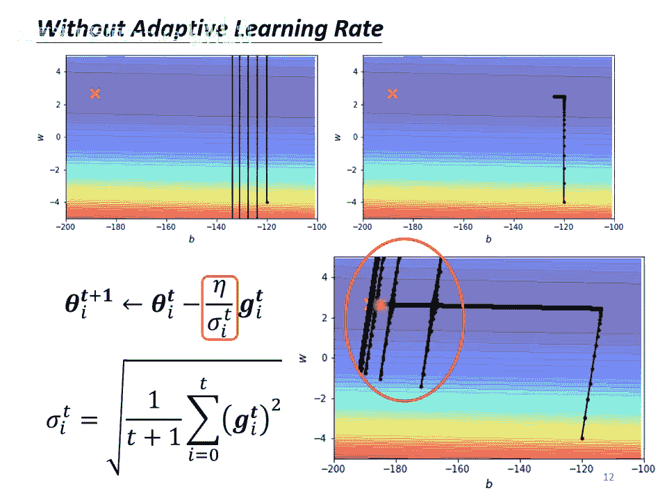

这个叫做learning rate schedule，我们刚才这边呢还有一项艾塔，这个ADA呢是一个固定的值，Learning race chedule，零的意思就是说这个AD达他要是跟时间有关的。

我们不要把它当成一个常数。

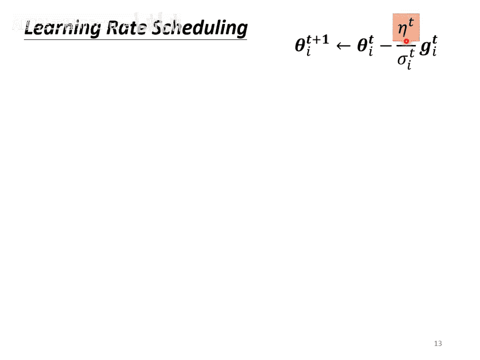

我们把它跟时间有关好，那learning rate怎么让它跟时间有关呢，最常见的策略啊叫做learning rate decay，也就是说呢随着时间不断的进行，随着参数不断的update。

我们这个艾塔让它越来越小，这个也是合理的，为什么会这样想呢，为什么要让这个learning rate越来越小呢，因为一开始我们距离终点很远，随着参数不断update，我们距离终点越来越近。

所以我们把learning rate减小，让我们的呃参数的更新，踩个刹车，让我们参数的更新能够慢慢的慢下来哦，所以刚才那个状况如果加上learning rate decay。

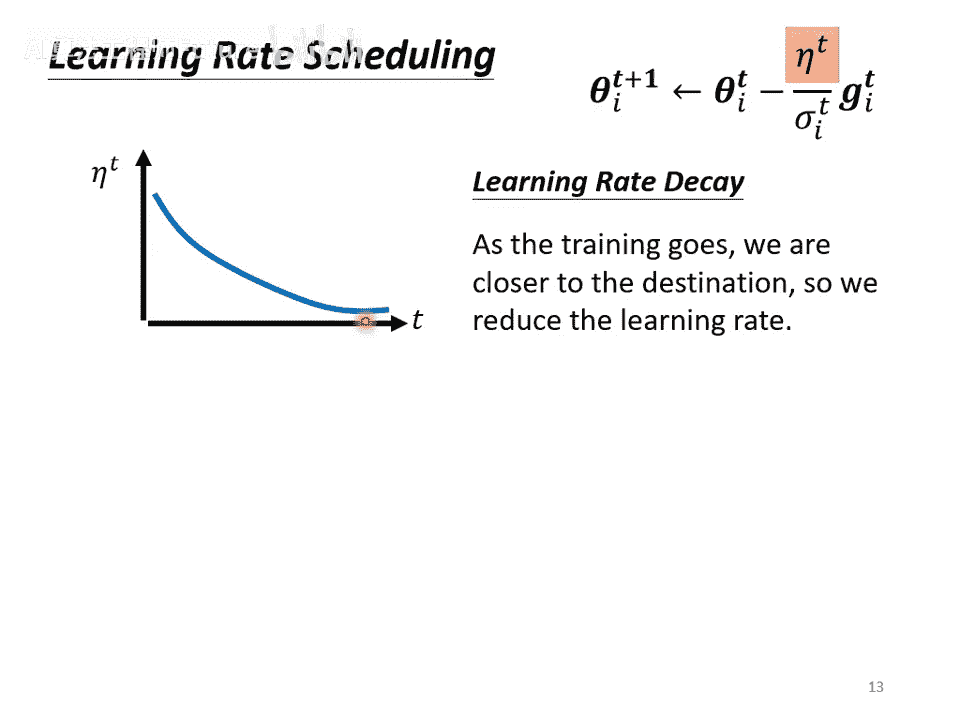

有办法解决诶，有办法解决刚才那个状况，如果加上learning rate decay的话，我们就可以很平顺的走到终点，因为在这个地方这个艾塔已经变得非常的小了，艾塔变得非常的小。

虽然说呃呃他本来想要左右乱喷，但是会乘上这个非常小的艾塔，那就停下来了，就可以慢慢的走到终点，好那除那除了learning rate decay以外。

还有另外一个经典非常常用的learning rate schedule。

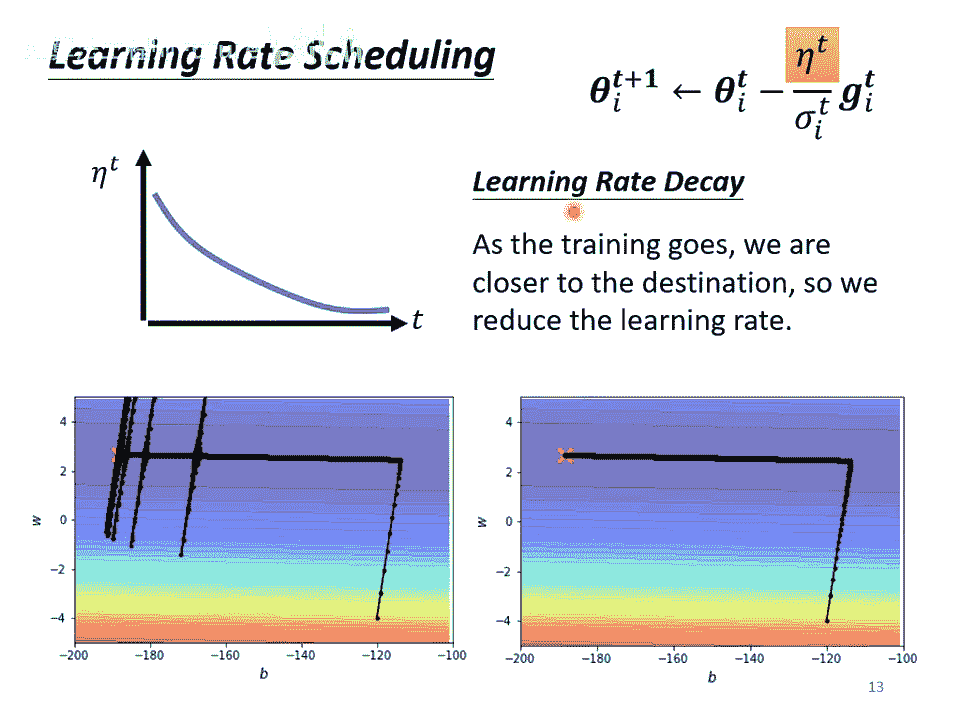

零的方式叫做warm up，那我本来很犹豫要不要讲WUP这件事啊，但是其实我们有一个跟BT有关的作业，你可能需要用到WUP才能够得到好的结果，所以我们还是把win up拿出来讲一下，One up。

这个方法听起来有点匪夷所思，这个WUP的方法是说我们这个learning ray啊，要先变大后变小，这样那你会问说那变大要变到到多大呢，变大速度多快呢，变小要变小速度要多快呢。

这个也是hyper parameter，你要自己用手调的，但是大方向的大策略就是learning rain要先变大后变小，那这个方法听起来很神奇，就是一个黑科技，这样这个黑科技啊。

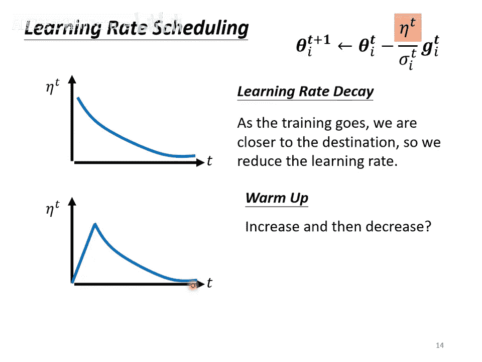

出现在很多远古时代的论文里面，这个one up最近因为在bird的那个呃，在训练BT的时候，往往会需要用到warn up，所以又被大家常常拿出来讲，但他并不是有BT以后才有warm up的。

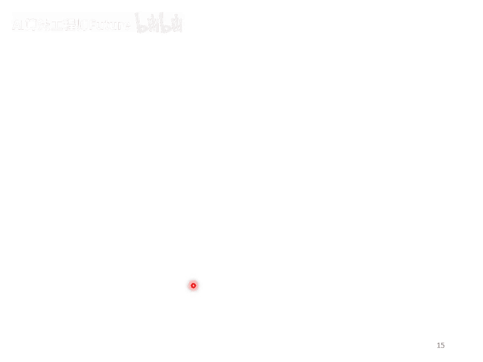

warm up这个东西远古时代就有了，举例来说，RECEDUNETWORK里面是有work up的，我这边是放了recedual network，放在ARCAVE上面的文章连接了。

就今天这种有关machine learning的文章，往往呃在投conference之前，投国际会议之前，就会先放到一个叫做阿凯的网站上，把它公开来，让全世界的人都可以看。

那你其实看这个archive的网址，你就可以知道这篇文章，是什么时候放到网络上的，怎么看呢，ARCAVE的这前四个数字，这一五啊代表年份，所以代表说receio network。

这篇文章是2015年放到ARCAVE上面的，或两个数字代表月份，所以它是15年的12月，15年的年底放在ark上好，所以56年前的文章，那在deep learning这个变化这么快速的领域里面。

56年前就是呃上古时代啊，上古时代，那在上古时代的这个recedual network里面，就已经记载了WUP的这件事情，他说我们用learning rate0。01取问号。

先用learning rate0。01，再把learning r改成0。1就过去，我们通常最常见的train learning reschedule，零的方法就是让人learning rate越来越小。

但是receiyour network这边特别注明它反其道而行，一开始要设0。01，接下来设0。1，还特别加个注解，说一开始就用0。1，反正就称不好，不知道为什么也没解释，反正就是却不好。

需要warm up这个黑科技啊，那这个在这个黑科技呢。

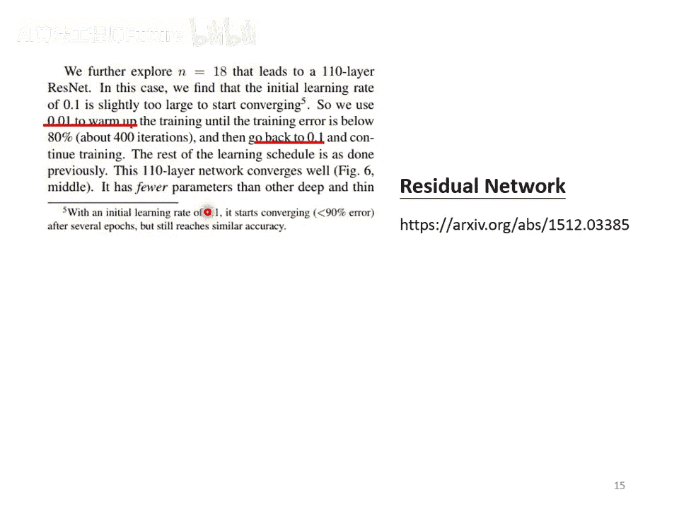

在知名的transformer里面，那我相信很多同学可能都听过，transformer这个技术，我们这门课也会讲到transformer这个东西，这个黑科技呀。

在transformer里面也用一个式子提了他好，他这边有一个式子说，他的learning rate呢遵守这一个神奇的function，来设定它的learning rate，一个神奇的方式。

你乍看之下会觉得哇在写什么，不知道在写些什么，但这个东西呀，你实际上把它的把这个方程画出来，你实际上把create3画出来的话，就会发现它就是我啊，learning rate会先增加，然后接下来再递减。

所以发现说one up这个技术，在很多知名的network里面都有被当做一个黑科技，就论文里面解释说为什么要用这个，但就偷偷在一个小地方，你没有注意到，小地方告诉你说这个network要用这种黑科技呢。

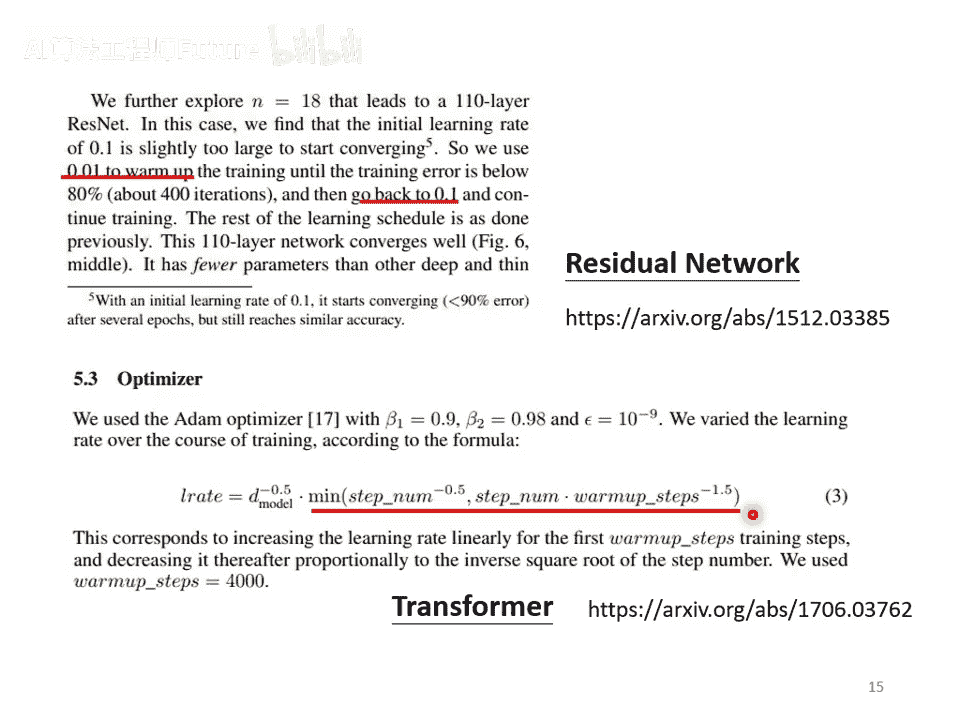

才能够把它训练起来好，那为什么需要warm up呢，这个仍然是今天一个可以研究的问题了，我并不认为为什么要用WUP这件事，已经获得了完全的解答，但是这边有一个可能的解释是说呃，你想看。

当我们在用eden rn s prop或R打鬼的时候，呃，我们会需要计算sigma这个西格玛是怎么来的，它是一个统计的结果，对不对，这sigma告诉我们说某一个方向，他到底有多懂或者是多平滑。

那这个统计的结果要看了够多笔数据以后，这个统计才精准，所以一开始我们的统计是不精准的，一开始我们的西格玛是不精准的，所以我们一开始呢，不要让我们的参数走离初始的地方太远，先让他在初始的地方呢做一些啊。

呃像是探索这样哈，所以一开始learning rate比较小呢，是让他探索搜集一些有关error surface的情报啊，先收集有关sigma的统计数据，等sigma统计比较精准以后。

再把让learning ray呢慢慢的爬升，所以这是一个呃解释，为什么我们需要warm up的可能性，那如果你想要学更多有关WUP的东西的话，你其实可以看一篇paper，他是EDEN的进阶版。

叫做redden啊，里面对one up这件事情呢有更多的好，那有关optimization的部分。

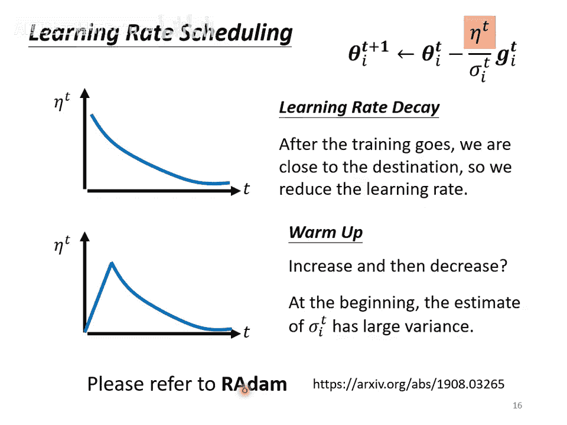

其实我们就讲到这边了，所以我们从最原始的gradient descent，进化到这个版本，这个版本里面有什么东西呢，第一个我们由momentum，也就是说，我们现在不是完全顺着gradient的方向。

不是现在不是完全顺着这一个时间点算出来的，gradient的方向来UPDATA参数，而是把过去所有算出来的规定的方向，做一个加总，当做update的方向，这个是momentum。

那接下来到底应该要update多大的步伐呢，我们要除掉gradient的ROME'SQUARE。

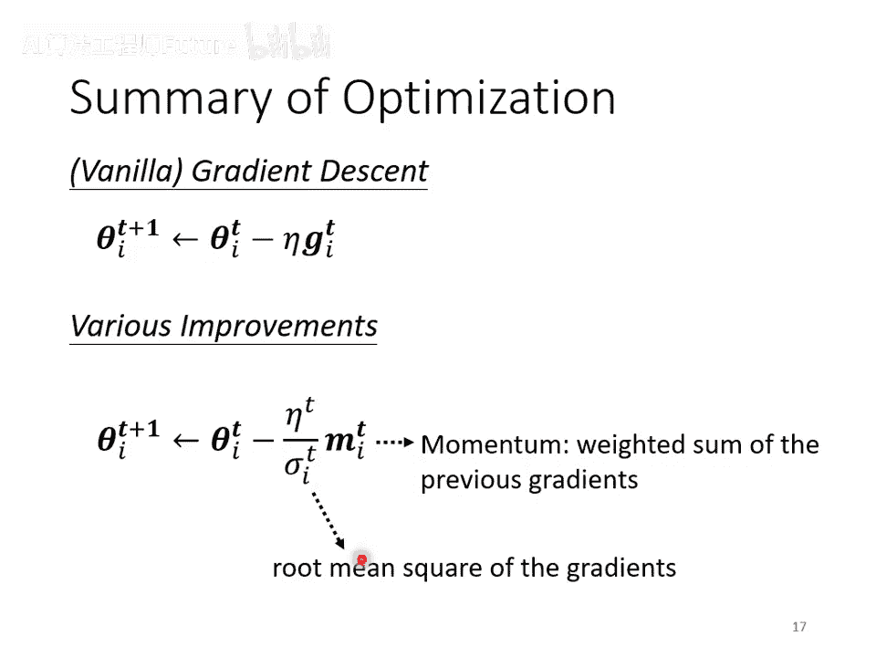

那讲到这边可能有同学会觉得很困惑，这个momentum是考虑过去所有的GRADI，这个西格玛也是考虑过去所有的GRADI，这个一个放在分子，一个放在分母，都考虑过去所有的规定不就是正好抵消了吗。

但是其实啊这个momentum跟这个sigma，他们在使用过去，所有gradient的方式是不一样的，momentum是直接把所有的gradient通通都加起来，所以他有考虑方向，他有考虑规点的正负号。

他要考虑GRA点是往左走还是往右走，但是这个ROOMMSQUARE啊，它就不考虑gradient的方向了，它只考虑gradient的大小，记不记得我们在算西格玛的时候，我们都要取平方向。

我们都要把gradient取一个平方向，我们是把平方的结果加起来，所以我们只考虑gradient的大小，不考虑它的方向，所以momentum跟这个西格玛算出来的结果，并不会互相抵消掉。

那最后我们还会加上一个learning rate schedule，这个是今天optimization完整的版本啊，这种optimizer除了ADEN以外，ADEN可能是今天最常用的。

但除了ADAM以外，还有各式各样的变形，但其实各式各样的变形都不脱，就是要么不同的方法算and，要么不同的方法算sigma，要么不同的learning race，也就你的方式哦。

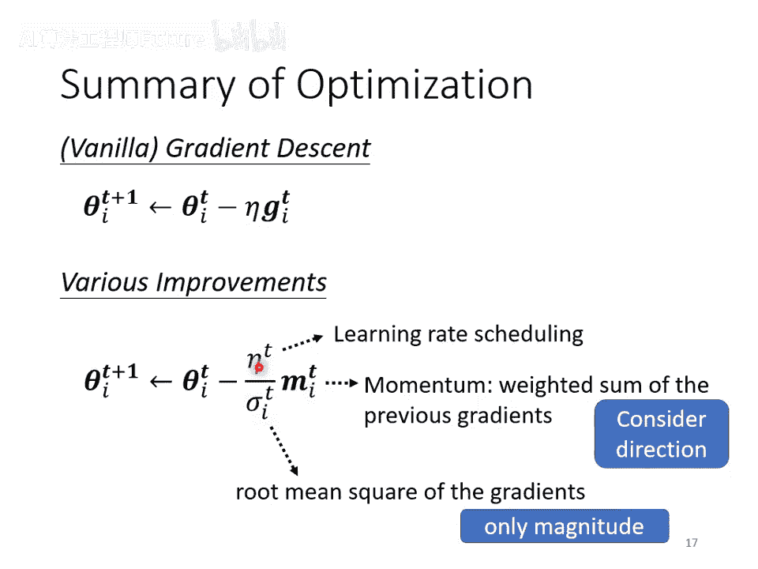

那如果你想要知道更多，跟optimization有关的事情的话，那有之前助教的录影给大家参考了。

这影片蛮长的，大概两个小时，所以可以想见说诶有关这个optimizer的东西。

其实是还有蛮多东西可以讲，但是因为时间关系。

我们就不讲下去好，那到目前为止呢我们讲的是什么，我们讲的是当我们的error surface非常的崎岖，而且像这个啊这个例子一样啊，非常的稀缺的时候。

我们需要一些比较好的方法来做optimization，前面有个山挡着，我们希望可以绕过那座山，就是山不转啊，漏转的意思是这样好，那你知道这个规点呢，就这个这奇怪的error surface啊。

就会让人觉得很痛苦，对不对，一达喵康吉罗，伊达喵康GIO，这样来到再来会怎么样呢，再就是要用神罗天征把这个地炸平。

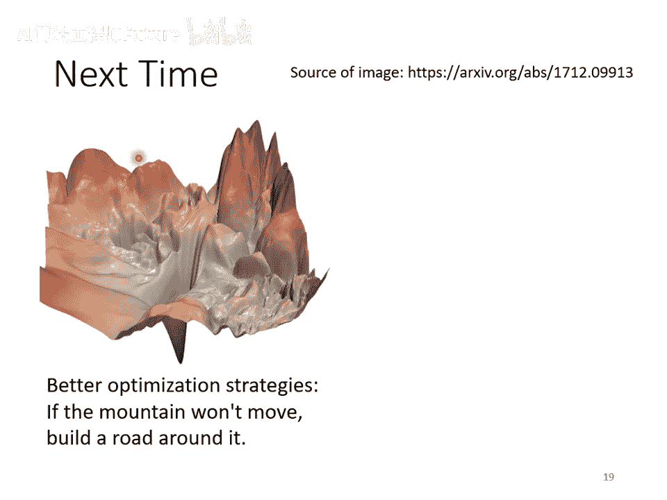

这所以用接下来我们会讲的技巧，就是有没有可能直接把这个error surface移平，我们改network里面的什么东西，改network的架构，activation function或者是其他的东西。

直接移平error surface，让它变得比较好，train也就三挡在前面。

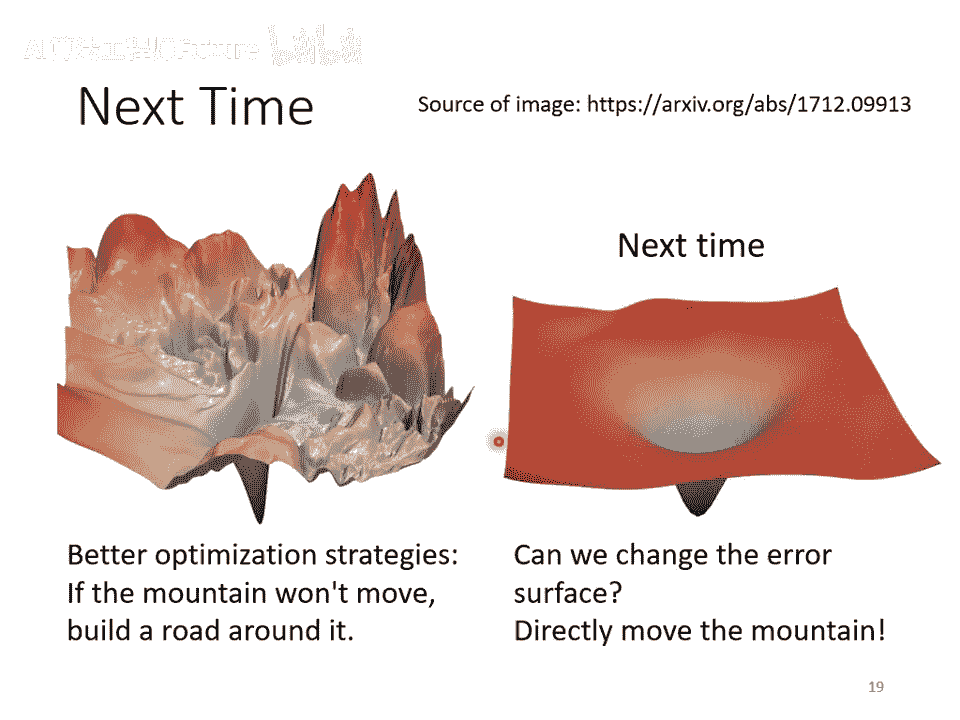