# 【官授搬运】2026年全新优化版李宏毅机器学习系统课程，这才是真正的初学者体系课程！—人工智能／深度学习／神经网络 - P17：5-损失函数(Loss) 可能影响网络训练失败 - AI算法工程师Future - BV1ruqABeEFX

好，那接下来呢我们要讲有关分类怎么做这件事情，好这边讲的呢是一个短的版本，因为时间有限的关系，所以我们就讲一个可以在20分钟内讲完的，短的版本，既然有短的版本，就是有长的版本，如果你想要看长的版本的话。

可以看一下过去上课的录影。

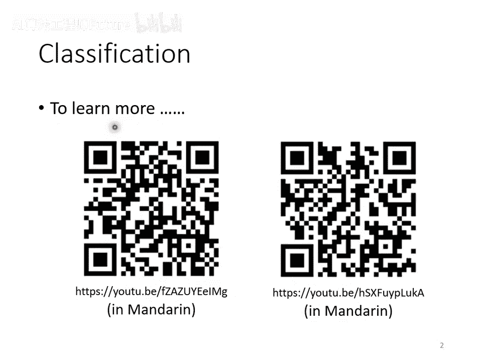

那过去可能是花两个小时，到三个小时的时间才讲完分类这件事情。

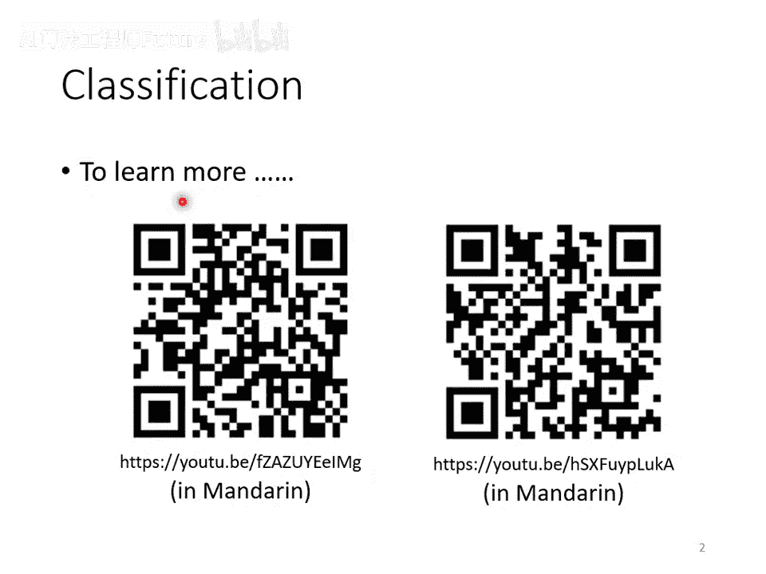

那我们这边呢用一个最快的方法，直接跟你讲分类是怎么做的。

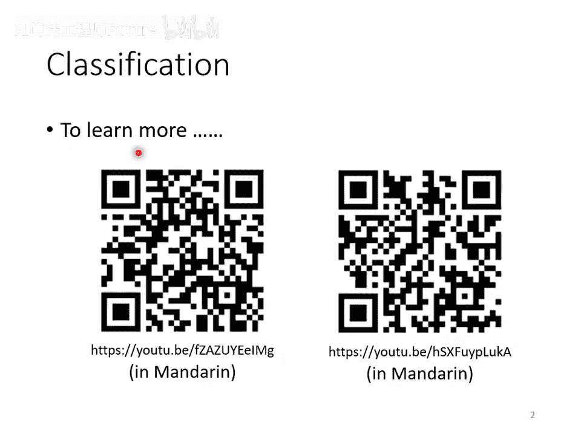

好分类是怎么做的呢，我们已经讲了regression，regression就是输入一个向量，然后输出一个数值，我们需要输出的数值跟啊某一个label，也就是我们要学习的目标呢越接近越好，还有同学问说哎。

为什么这个目标label有加hat，而不是输出有加hat的，你可能在别的地方有看过输出有加hat，那这边的notation呢，它的使用并没有一定的规定啊，如果你先上过我的机器学习的话。

你就就会去问别的老师说诶，为什么你的model的输出有加hat，然后你的label没有加hat好，所以我们这门课呢如果是正确的答案，就有加head，那model的输出没有加head好，那有一个可能啊。

假设你会用regression的话，我们其实可以把classification当做是regression来看，怎么说呢，但这个方法不一定是一个好方法，这是一个比较奇妙的方法。

你可以说一样输入一个东西以后，我们的输出仍然是一个SCALA，把它叫做Y，然后这个Y啊，我们要让它跟正确答案那个class越接近越好，但是Y是一个数字啊，我们怎么让它跟class越接近越好呢。

我们必须把press也变成数字，举例来说，也就是说class one就是编号一，class two就是编号二，class3就是编号三好，然后接下来呢我们要做的事情。

就是希望Y可以跟class的编号越接近越好，但是这会是一个好方法吗，如果你仔细想想的话，这个方法也许在某些状况下是会有瑕疵的，但是因为当，因为你如果你假设说class one就是编号一。

class two就是编号二，class3就是编号三，意味着说你觉得class1跟class2它是比较像的好，然后class1跟class3它是比较不像的，那像这样子的呃。

表示class的方式有时候可行，有时候不可行，假设你的class one two three真的有某种关系，举例来说啊，你想要根据一个人的身高跟体重，然后预测他是几年级的小学生，一年级。

2年级还是3年级，那可能一年级真的跟2年级比较接近，一年级真的跟3年级比较没有关系，但是假设你的三个class，本身并没有什么特定的关系的话，你说plus one是一，plus就是二。

plus two是三，那就很奇怪了，因为这样子预测说一二有比较近的关系，一三有比较远的关系哦，所以怎么办呢，当你在做分类的问题的时候。

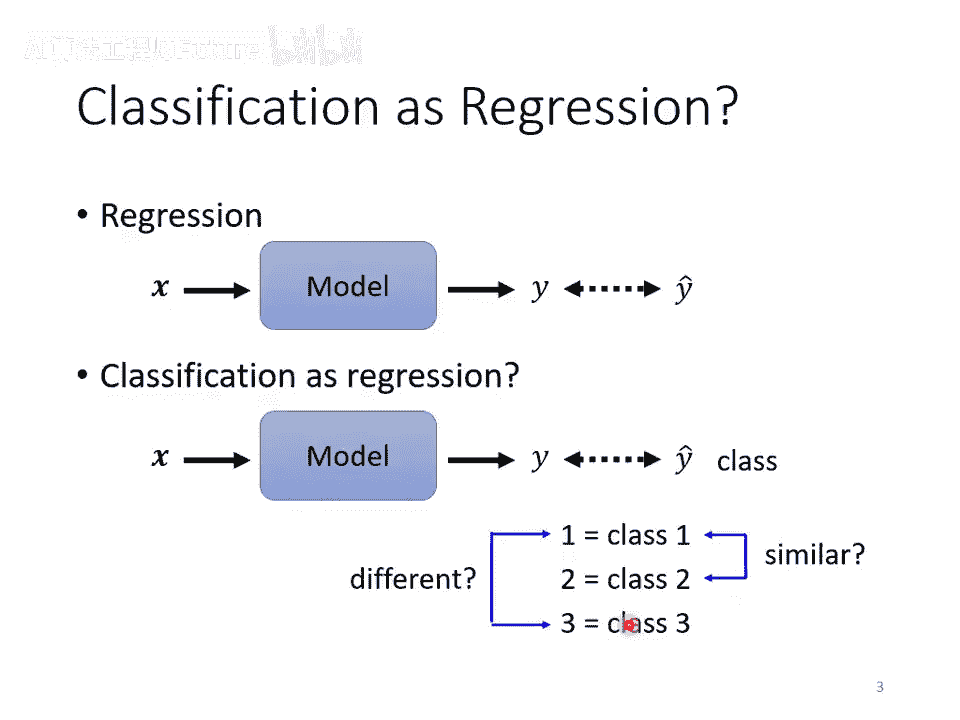

比较常见的做法，比较常见的做法是，把你的class用one half factor来表示，那one half factor我们在作业一的时候有看过，对不对，我们在作业一的时候说。

我们把美国的州用one hot vector来表示，那同样的道理，我们也可以把每一个class，用一个one harvector来表示，如果有三个class。

我们的label这个y hat啊就是一个三维的向量，然后呢如果是class one就是100，如果是class two就是010，如果是class3就是001好。

所以每个class你都用一个one hot vector来表示，而且如果你用one hot vector来表示的话，就没有说a class one跟class two比较接近。

plus one跟class3比较远，这样子的问题，如果你把这个one harvector拿来算距离的话，class之间两两它们的距离都是一样的好。

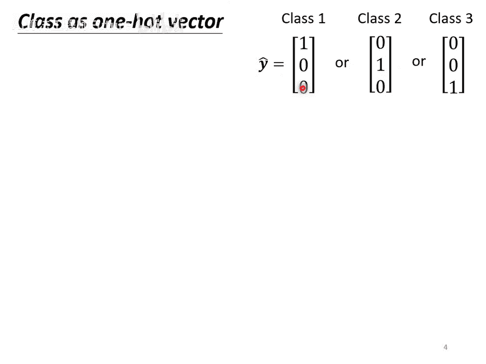

那接下来呢如果我们今天的目标，y head是一个向量，比如说这边把y hand是有三个element的向量，三个数值的向量，那我们的network也应该要output3个数值才行，那到目前为止。

我们讲的network其实都只output一个数值，因为我们过去做的都是regression的问题，所以只output一个数值，那怎么把它改成output3个数值呢，其实从一个数值改到三个数值。

它是没有什么不同的啦。

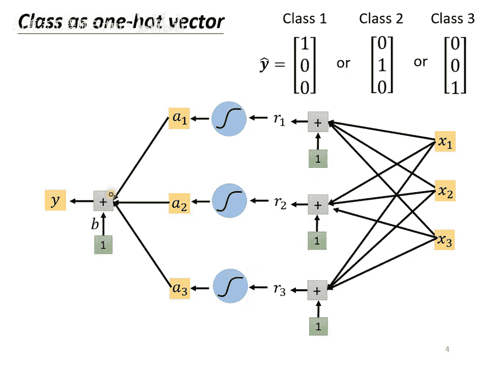

怎么说呢啊你可以output一个数值，你就可以output3个数值好，所以把本来output一个数值的方法重复三次，你把a one a two a33个不同的位。

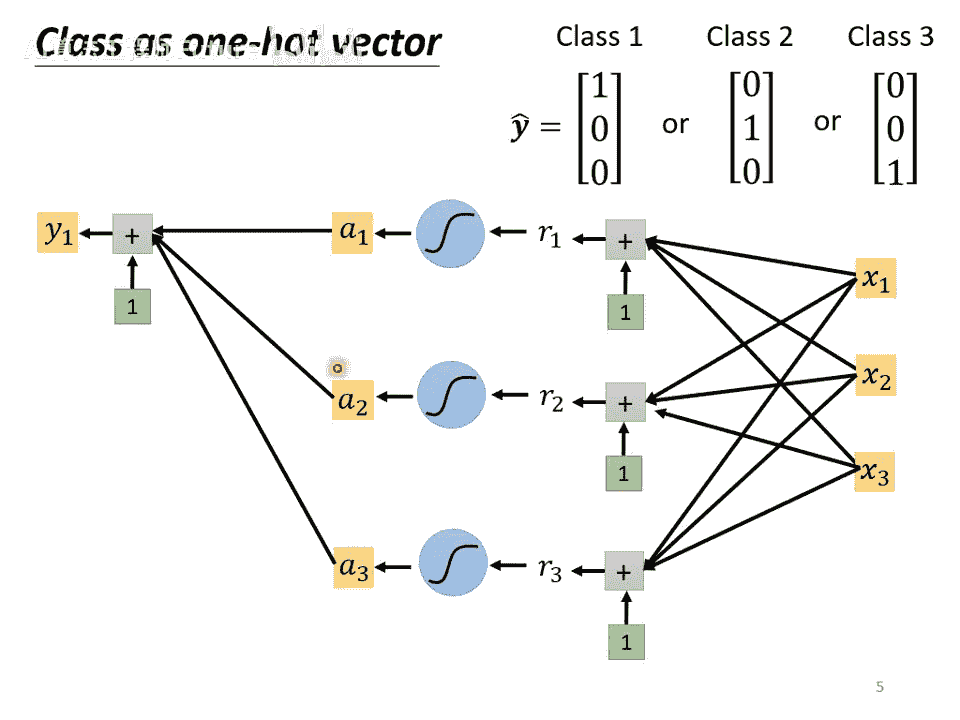

加上BIOS得到y one，再把a one a two a3乘上另外三个位。

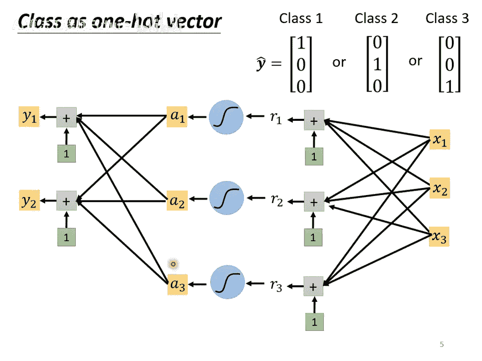

再加上另外一个BS得到y two，把a one a two a3，再乘上另外一组位。

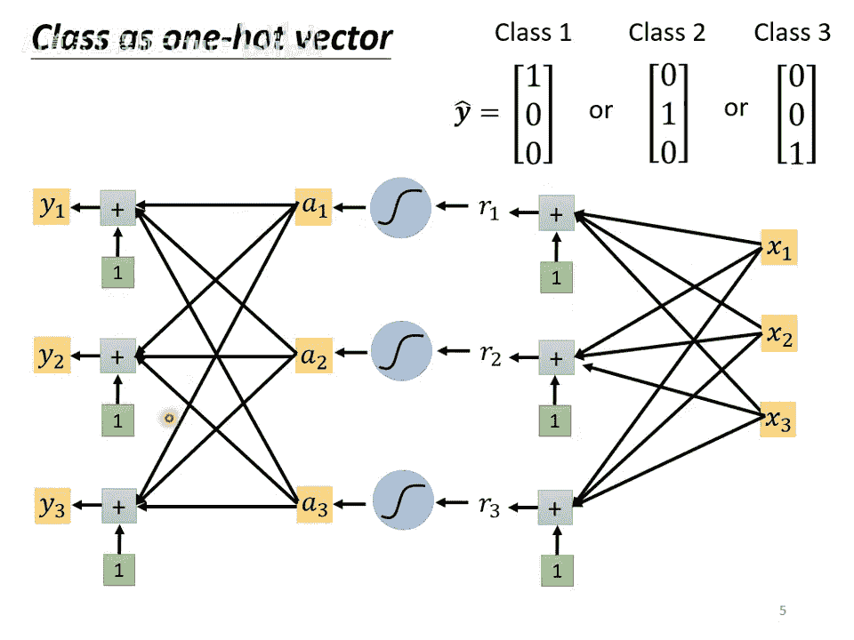

再加上另外一个BS得到Y3，你就可以产生三组数值。

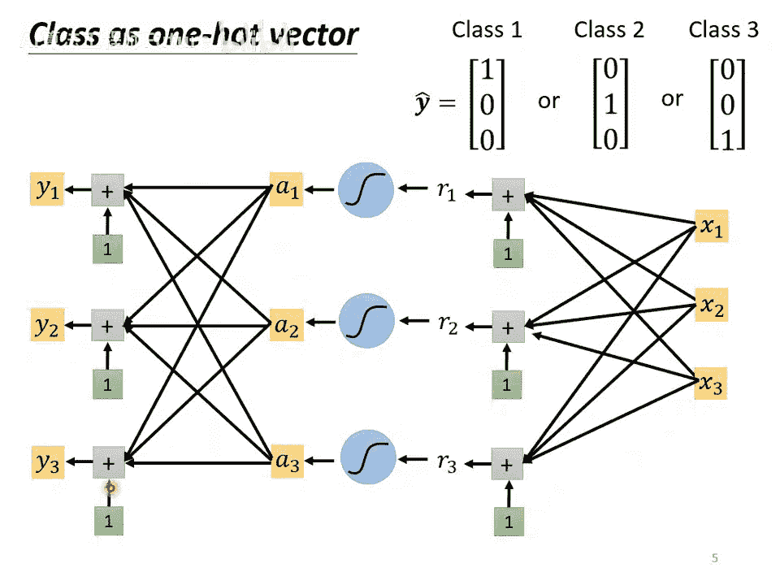

所以你就可以input一个feature的vector，然后产生y one y two y3。

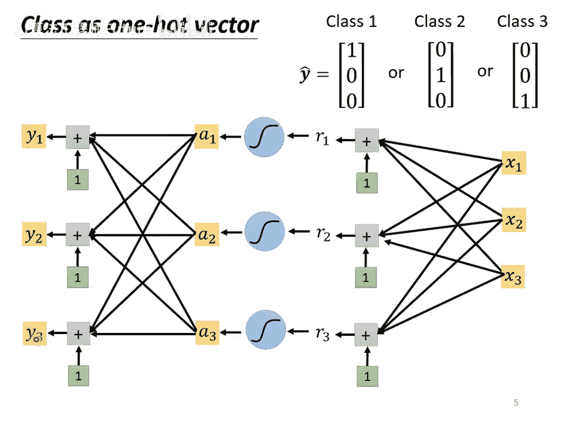

然后期待y one y two y3，跟我们的目标越接近越好好，那所以我们现在知道了regression是怎么做的，input x output y y要跟label y h越接近越好。

如果是classification呢，我们刚才说input xx呢可能乘上一个W，再加上B再通过activation function，再乘上w plan，再加上b pl得到Y。

那我们现在的Y呢它不是一个数值，它是一个项链，但是在做classification的时候，我们往往会把Y再通过一个叫做soft max的function，得到外快。

然后呢我们才去计算y pan跟y hand之间的距离，才去说我们要让y pan跟y hand越接近越好，为什么要加上soft max呢，一个比较简单的解释啊，啊这一段呢到底要怎么在数10分钟内讲完。

我其实想了很久，如果是在过去的课程里面，我们会花很长一段时间告诉你说，这里为什么要加soft max，它背后有什么样的假设，我们会先从generative model开始讲起。

然后一路讲到logist regression，你就会知道为什么这边放个soft max，它有什么样的历史渊源，那我们现在已经不是从那个角度切入，所以就有点不知道要怎么解释。

说为什么要放soft max，那这边有一个呃骗小孩的解释，就是哎这个y hat啊，它里面的值都是零跟一，对不对，它是one cut vector，所以里面的值只有零跟一啊，那Y呢Y里面有任何值。

哎Y也没有任何值，嗯既然我们的目标只有零跟一，但是Y有任何值，那呃我们能不能够就先把这个任何值啊，先把它normalize1到0~1之间，那这样才好跟label的计算相似度好啊。

这是一个比较简单的讲法了，如果你真的想要知道说为什么要用soft max的话，你可以参考过去的上课录音，那如果你不想知道的话，你就记得一件事，这个soft max要做的事情。

就是把本来Y里面可以放任何值，这件事情改成挪到0~1之间好。

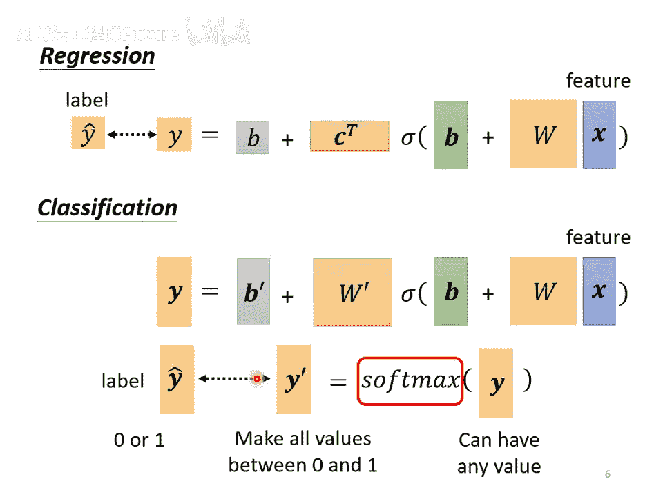

那soft max它里面是怎么做运作的呢，啊这是这个soft max的block，输入y one y two y3，它会产生y one py two py3pl啊，它里面运作的模式是这个样子的啊。

里面运作的模式是这个样子的，我们会先把所有的Y啊取一个exponential，所以本来不管Y呢是正的还是负的，反正取y x financial以后就都变成正的，对不对啊，居然是负数负小于零的值。

取1so nature以后也变成正的，然后你再对他做normalize，除掉所有Y的exponential值的和。

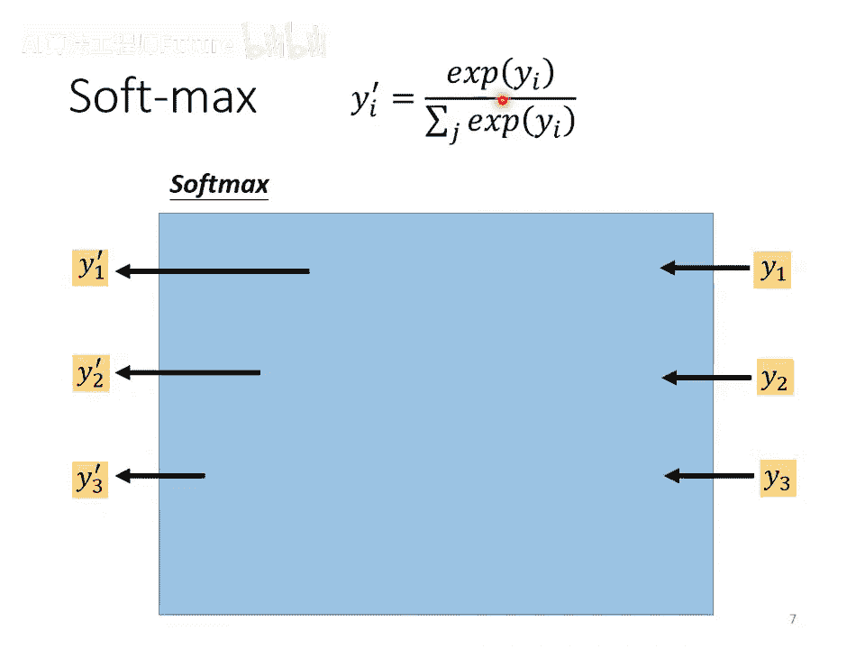

然后你就得到YP或者用图示化的方法，是这个样子好，Y one trick ponential，Y two trix，Ponential y3 chex panal，把它全部加起来。

得到一个SUMMENSION，好得到一个SUMMENSION，放在分母地方的SUMMENSION，接下来呢再把expential y one除调some mention。

expential y two除掉some mention，information y3除掉some mention，就得到y one py two py3pan就这样。

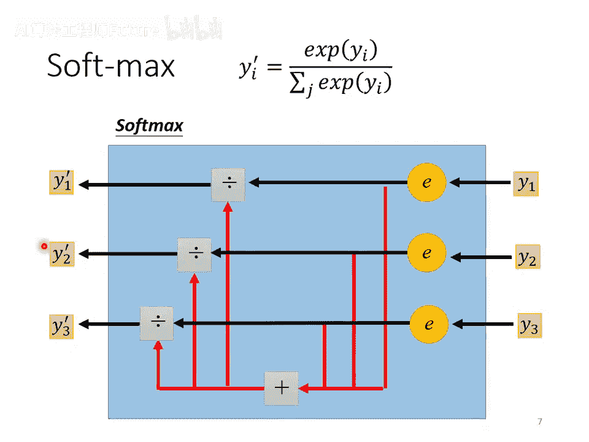

反正有了这个式子以后，你就会发现说这个y one pl啊，这个呃Y这个y i pan啊，y y y y py two py3P啊，它们都是介于0~1之间的。

然后呢这个y one py two py3pi，它们的和呢会是一啊，它们的和呢会是一好，那如果举一个例子的话呢，本来y one等于三。

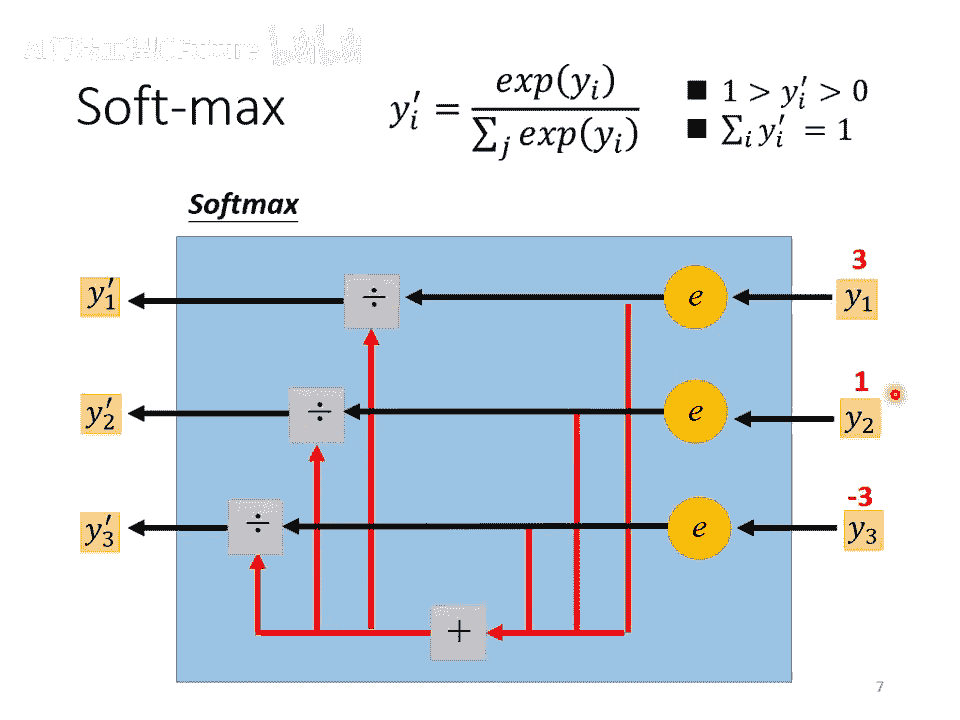

y two等于一，Y3等于三，取完exponential的时候呢，就变成啊exponential3啊，就是20，EXPANAL1就是2。7，EXPANAL-3就是0。05。

然后做完normalization以后啊，这边就变成0。88，0。12跟零哦，所以这个soft max啊，他要做的事情呃。

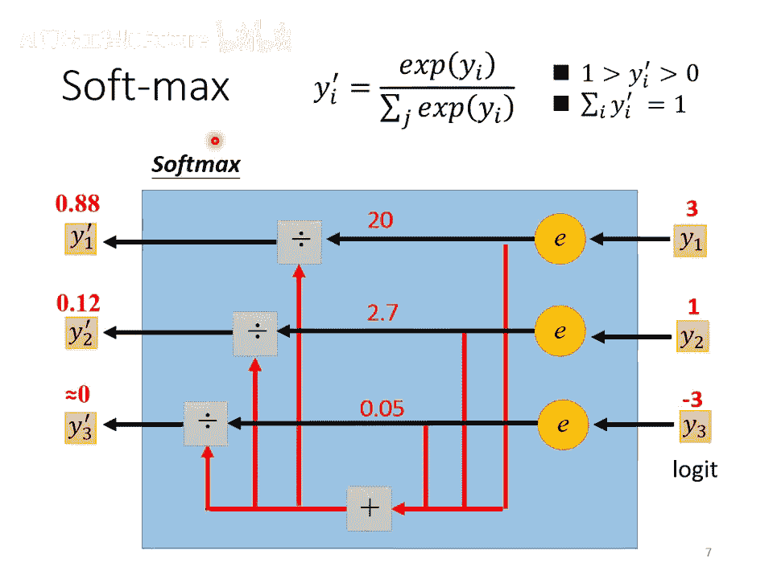

除了normalize以外，除了让y one plan y two plan y3P变成0~1之间，还有合为一以外，它还有一个附带的效果是，它会让这个大的值跟小的值啊，它们的差距更大，所以本来三。

然后通过这个explanation再做normalize以后，最后呢会变成趋近于零的值，然后这个soft bt的输入网额往往就叫它logic。

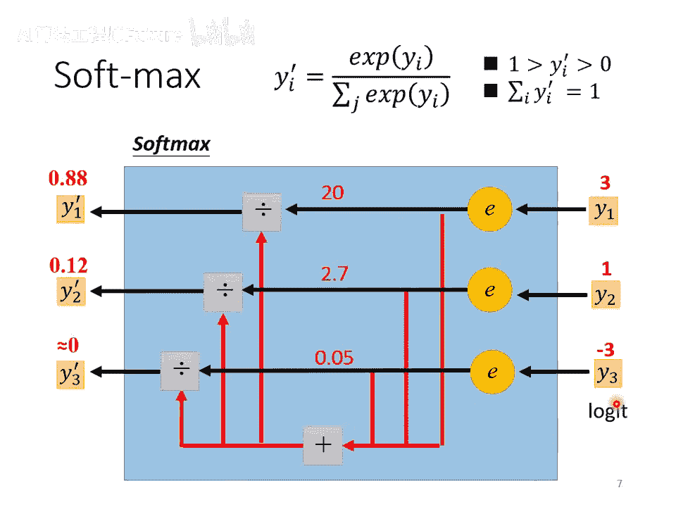

它是有名字的，有时候就叫它logic好。

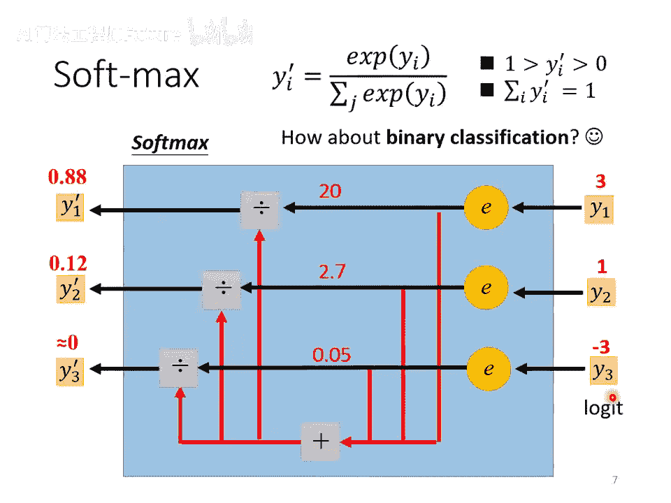

那这边呢是考虑了三个class的状况，那如果两个class会是什么样呢，如果是两个class，你当然可以直接套soft max这个function没有问题，但是也许你更常听到的是。

当有两个class的时候，我们就不套soft max了，我们直接取SIGMOID，那当两个class用SIGMOID跟soft max两个class，它们之间的关系是什么呢，你其实可以自己想一想。

你如果推一下的话，会发现说这两件事情是等价的。

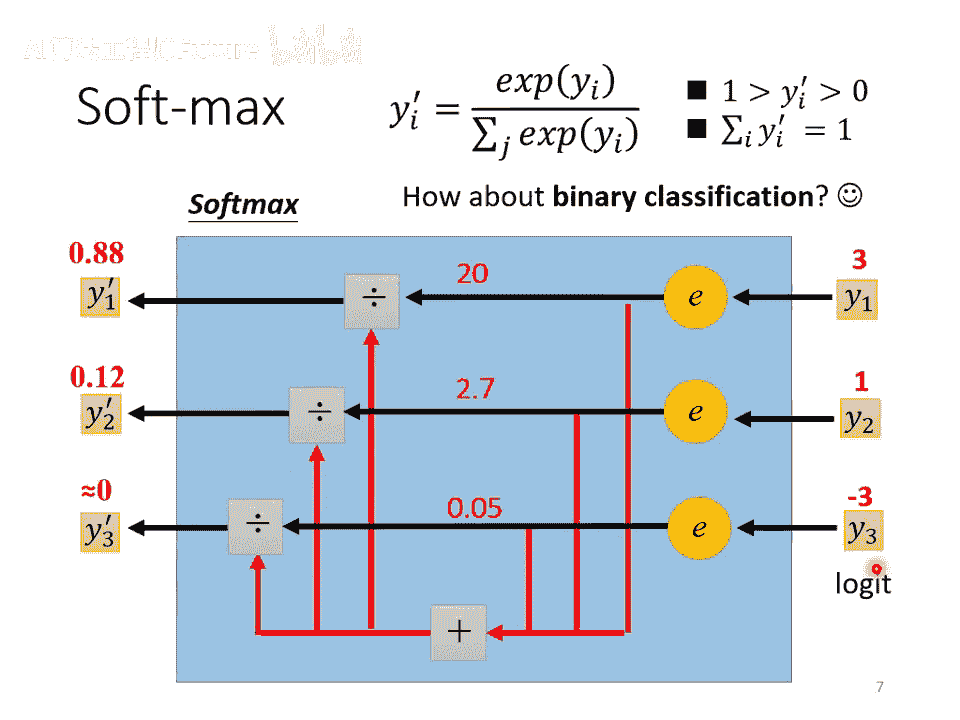

对就我我知道说我这边讲soft max。

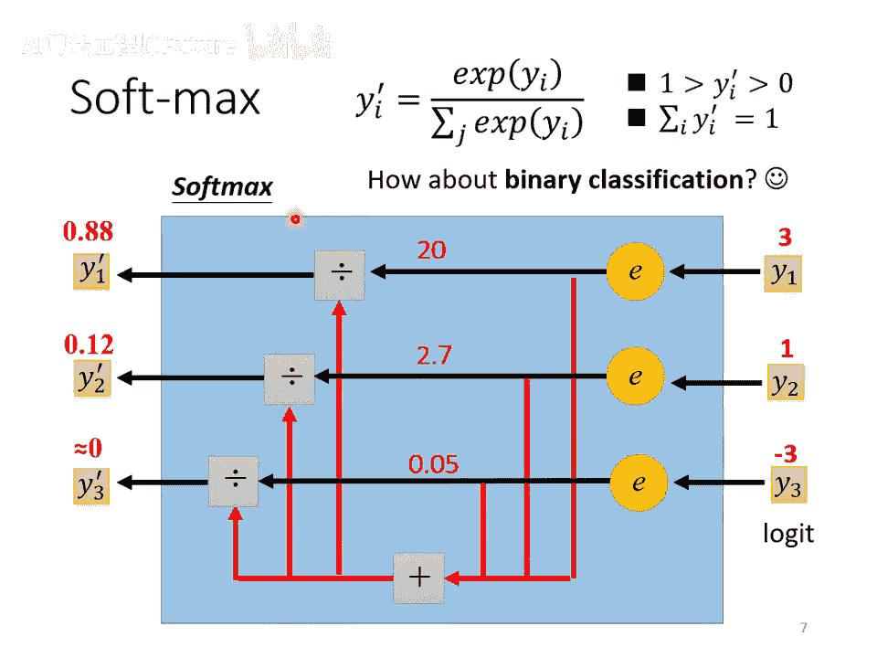

那soft max当然坐在两个class上一定是没有问题的，但你更常看到的是两个class的时候。

就用SIGMOID，你可能会问说哎这两者有什么不同，哪一个比较好呢，那我这边告诉你，他们是一模一样的，你自己回去推一下，会发现说这两件事情是同一件事情好。

那所以呢我们把X丢到一个network里面，产生Y以后啊，我们会通过soft max得到WIFI，再去计算WIFI跟y hand之间的距离，这个写作一那计算WIFI跟y hi之间的距离呀。

有不止一种做法，举例来说，你可以说啊，如果我喜欢的话，我要让这个距离是mean square error，跟作业一用的一模一样啊，就是把WIFI的就是去记。

就是把WIFI里面的每一个element拿出来，把y head里面每个m element拿出来，然后计算它们的平方和，然后当做我的error，这也是一个做法，这样也是计算两个向量之间的距离。

你也可以说你也可以做到说啊，当minimize mean square error的时候，我们可以让y hand等于IP哦，但是有另外一个更常用的做法叫做cross entrop。

那这个cos entropy它的市值啊，乍看之下会让你觉得有点匪夷所思，怎么是这个样子呢，啊，我们现在看看这个cos entropy的式子长什么样子，它是summer over所有的I。

然后把y head的DI维拿出来，乘上Y派的DI为取natural lag，然后再全部加起来，这个是cross entrob，那当YH跟WIF1模一样的时候。

你也可以minimize cross entropy的值，当WIFI跟YH1模一样的时候，NSE会是最小的，cos entropy也会是最小的，但是为什么会有cos entropy这么奇怪的事出现呢。

那如果要讲的长一点的话。

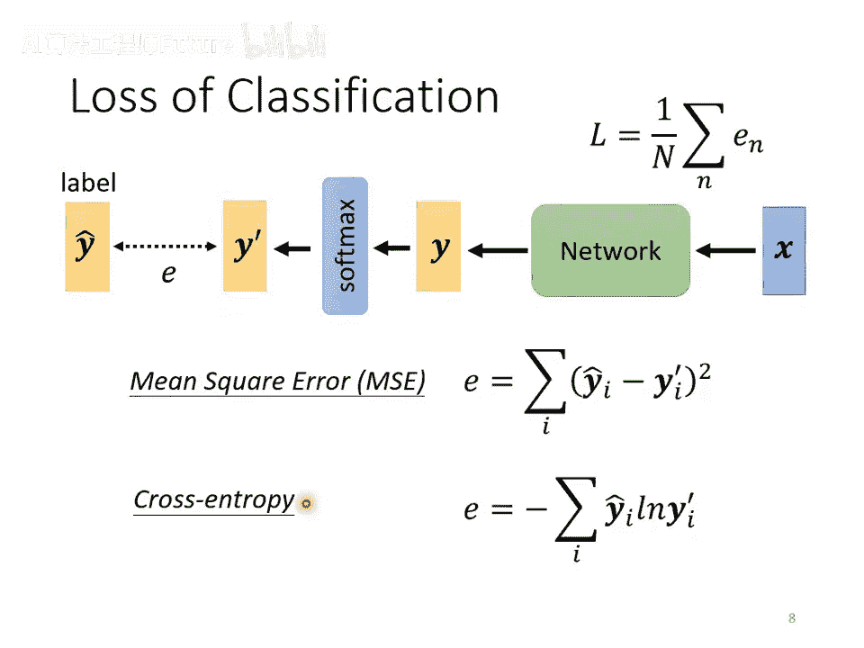

这整个故事我们可以把它讲成啊，Make minimize horse entropy，其实就是maximize，likely who这个东西，那你可能在很多地方都听过likely who这个词汇。

那是因为这堂课里面，我们even把likelihood拿掉了，所以我们现在根本就没有like lihood这个东西，这我就不能往这个方向解释，我们就不能说minimize for entropy。

为什么是maximize likelihood，因为你不知道LILIHOOD是什么，但是这两件事情其实是等价的啦，所以如果有一天有人问你说，如果我们今天在做分类问题的时候。

maximize likelihood跟minimize，cross entropy有什么关系的时候，不要回答说啊，他们其实很像，但是其实又有很微妙的不同，这样不是这样，他们两个就是一模一样的东西。

只是同一件事不同的讲法而已，所以假设你可以接受说，我们在训练一个classify的时候，应该要maximize likelihood，你就可以接受我们应该要minimize pose entropy。

但是我们没有讲这件事，所以我要怎么说服你。

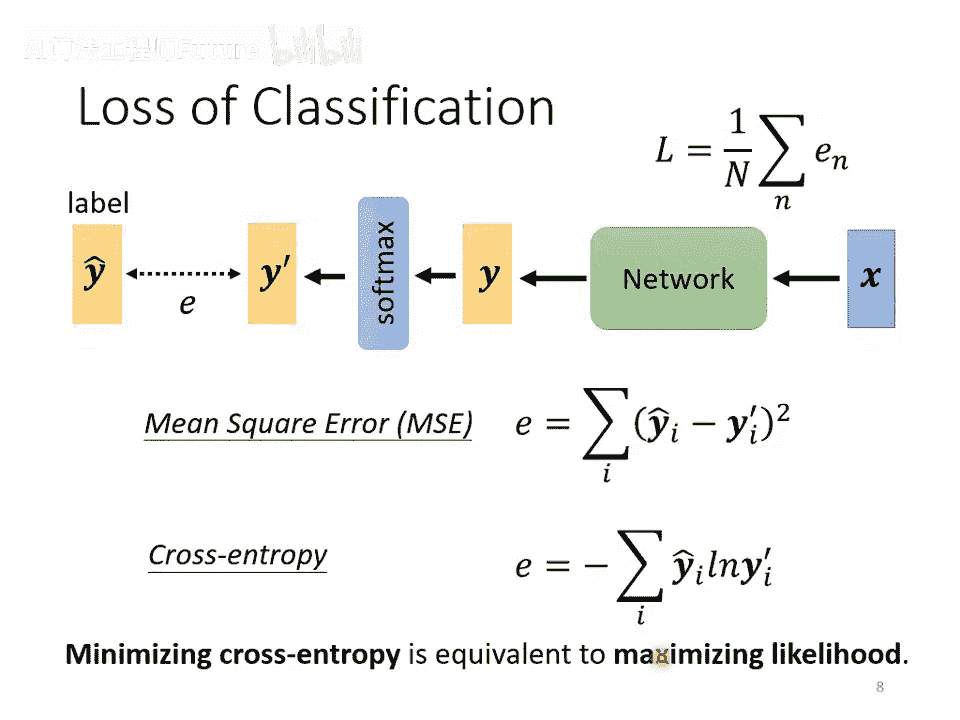

我们应该要用cross entropy呢，下一页投影片是从optimization的角度来告诉你，说cos entrop比mean square error更加适合用在分类上。

那cross entropy真的是相较于means spare error，是更常用在classification上面的，所以它常用到什么地步呢，它常用到在PYTORCH里面。

horse entropy跟soft max他们是被绑在一起的，他们是一个set，你只要call cross entrop里面就自动内建了soft max，所以如果你看助教作业二的城市的话。

你会找不到soft max在哪里，就本来soft max应该是network的一部分啊，照理说你在定义network的时候，你应该也定义了soft max这个function，但是你发现在住校城市里面。

你找不到soft max，为什么它放在cross entropy里面，当你使用cross entropy这个loss function的时候，PYTORCH自动帮你。

把soft max加到你的network的最后一层，所以如果你今天在用PYTORCH，你自己在network加soft max的时候，你用cos entropy就会变成加了两次soft max。

就这个一个PYTORCH，一个有趣的设计，所以这显示说哎soft max跟cross entropy，他们往往是被绑在一起的，他们是一个set啊，总是会被一起使用。

那接下来呢我从optimization的角度来告诉你说，为什么相较于呃means square error。

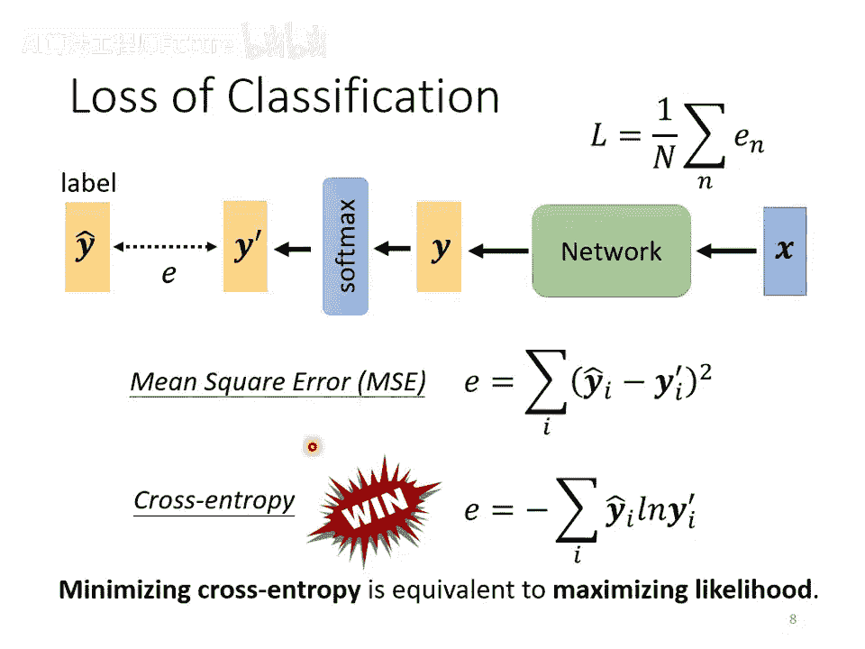

cos entropy是给更倍常用在分类上，那这个部分你完全可以在数学上面做证明。

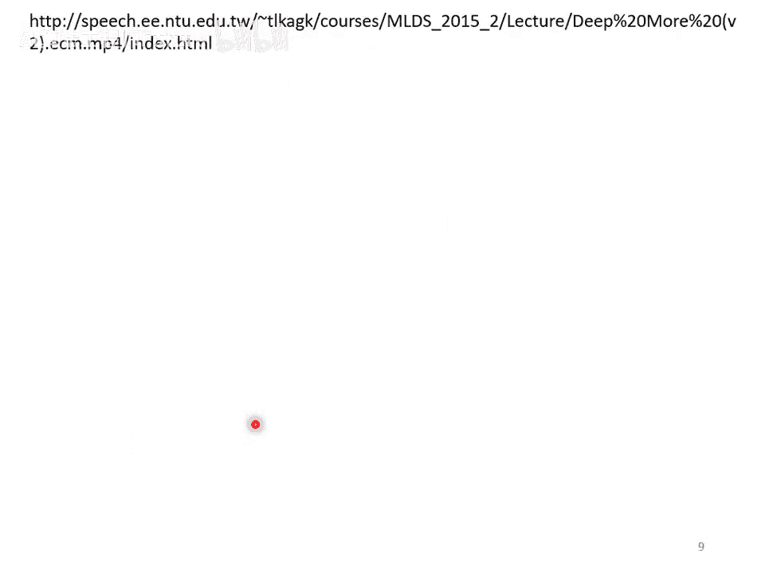

但是我这边是直接用举例的方式来跟你说明，如果你真的非常想看数学证明的话，我把连接放在这边，你可以看一下过去上课的录影，但如果你不想知道的话，那我们就是举一个例子来告诉你说。

为什么cross entrop比较好好，那现在我们要做一个三个class的分类，我们的network先输出y one y two y3，在通过soft max以后产生y one fine。

y two pine跟Y3P，而接下来假设我们的正确答案就是100，我们要去计算100，这个向量跟y one py two派跟Y3派，它们之间的距离，那这个距离我们用一来表示。

一可以是mean square error，也可以是cos entropy，好，那我们看一下，如果我们这个一设定为MESQUARE，error和cross entropy的时候。

算出来的error surface会有什么样不一样的地方。

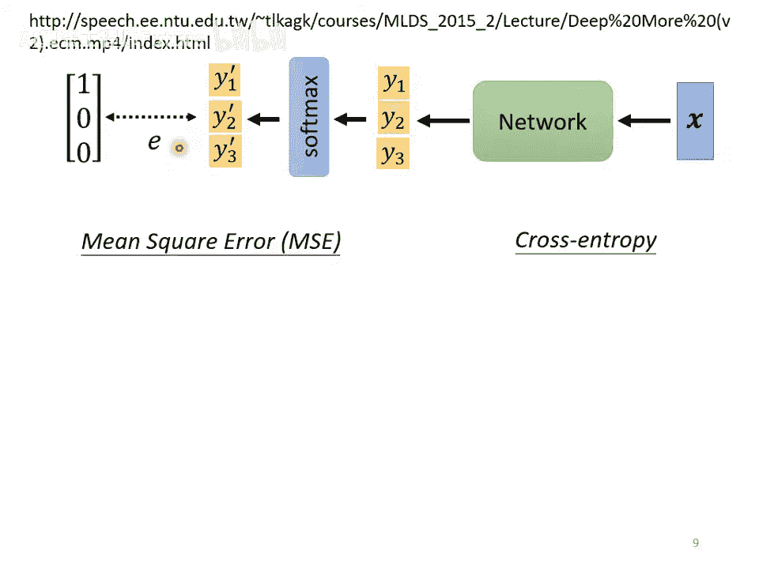

我们现在假设y one的变化是从-10~10。

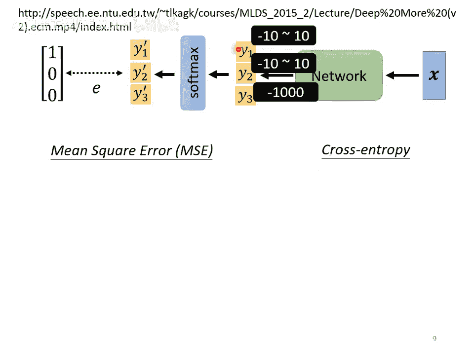

y two的变化也是从-10~10。

Y3我们就固定设成-1000，因为Y3设很很小啊。

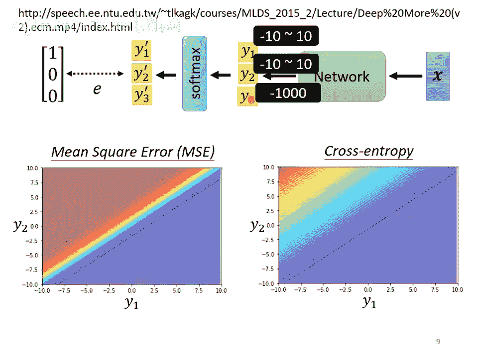

Y3设-1000，所以过soft max以后，Y3P就是非常趋近于零了。

那它跟正确答案非常接近，所以它对我们的结果影响很少，总之我们Y3设一个定值。

我们只看y one跟y two有变化的时候，对我们的一对我们的loss。

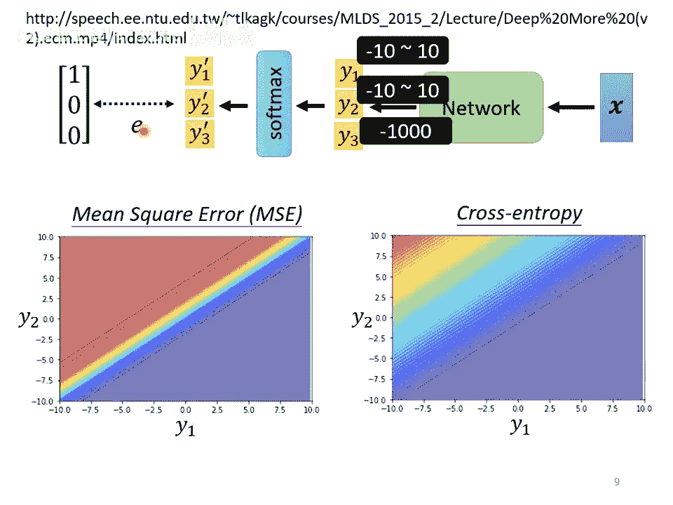

你知道把很多个一加起来就变成loss嘛，对我们的loss有什么样的影响。

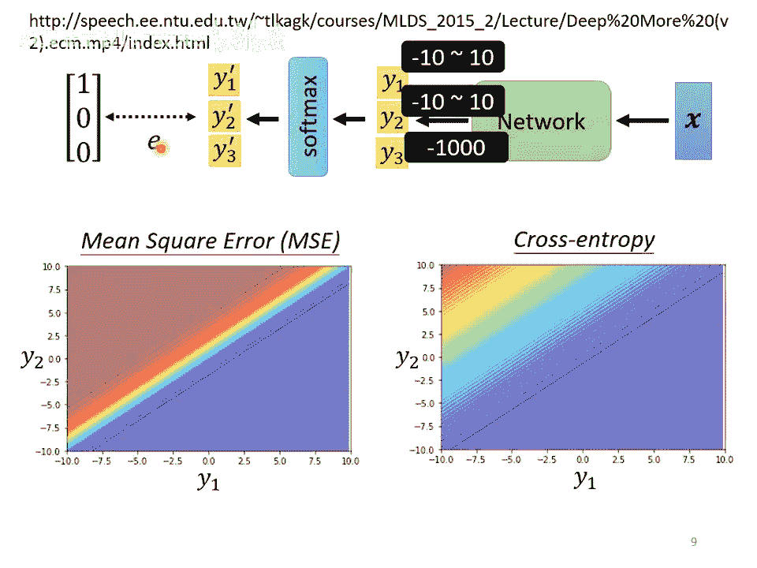

好底下这两个图啊，就分别在我们一是MSQUARE。

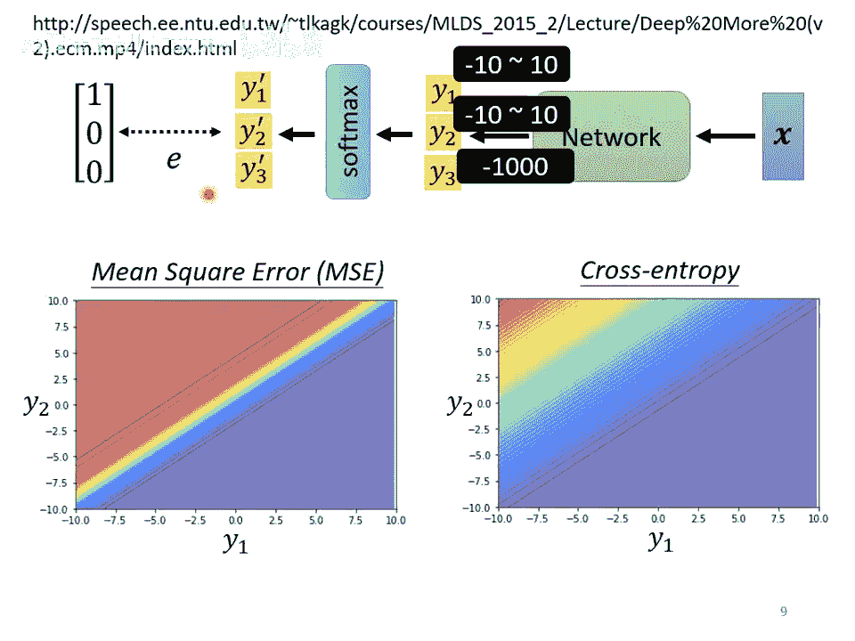

error跟cos entropy的时候，y one y two y one y two的变化对lows的影响。

对error surface的影响，那如果今天y one很大。

y two很小啊，y one很大，y two很小，那y one很大。

Y就很小，就代表y one plan会很接近一，y two pl会很接近零，所以不管是对minsquare error还是cos entropy而言。

y one大y two小的时候。

loss都是小的好，我们这边是用红色代表lost大，蓝色代表loss小。

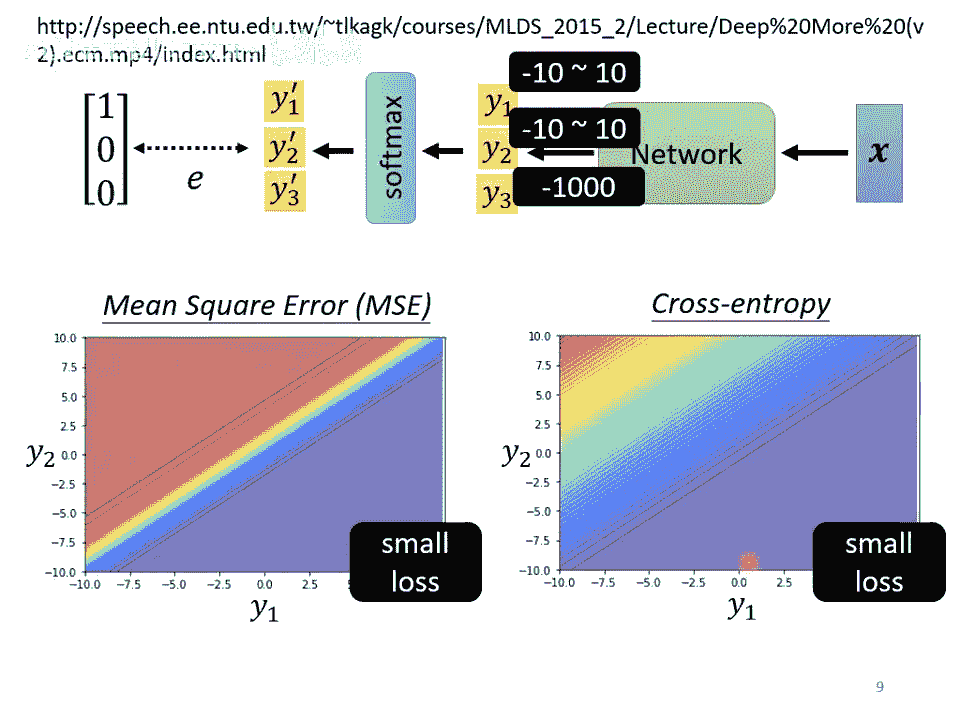

那左上角这边YY小y two大的时候，YY小y two大的时候。

如果YY小y two大的话，这边y one pine就是等于y two pine就是一，所以这个时候loss会比较大。

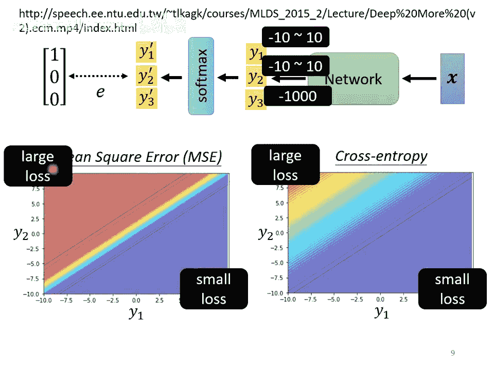

所以这两个图都是左上角loss大。

右下角loss小，所以我们就期待说我们最后在training的时候，我们的参数可以走到右下角的地方，那假设我们开始的地方都是左上角的地方。

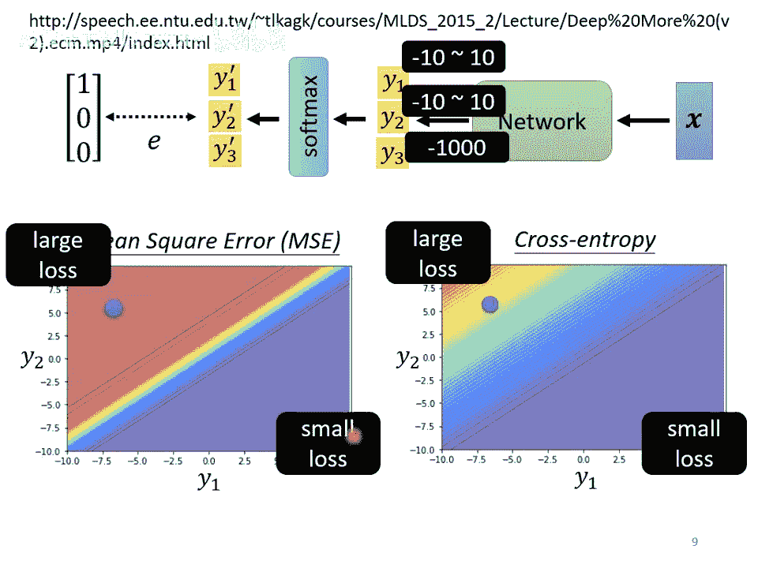

会有什么问题呢，你会发现说如果我们选择cross entrob。

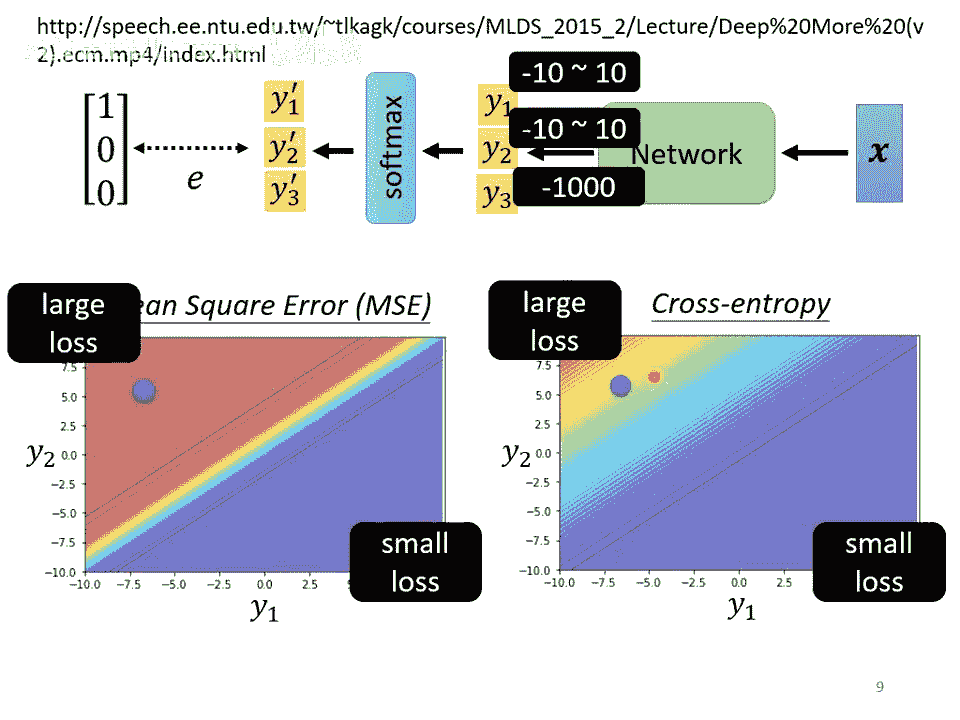

左上角这个地方它是有斜率的，所以你有办法透过gradient，一路往右下的地方走，但如果你选mesquare error的话。

你就卡住了，你知道吗，Msquare error，在这种loss很大的地方。

它是非常平坦的，它的gradient是非常小。

趋近于零的，如果你初始装在这个地方，离你的目标非常远。

但它规定很小，你就会没有办法用gradient design顺利的走。

他走到右下角的地方去哦，所以如果你今天自己在做classification。

你选minsquare error的时候，你有非常大的可能性会吹不起来，当然这个是在你没有好的，好的optimization的情况和。

和好的optimizer的情况下，今天如果你用EDEN啊，这个地方呃gradient很小，那gradient很小之后，它learning r会自动帮你调大，也许你还是有机会走到右下角。

不过这会让你的training比较困难一点，让你的training起步呢比较慢一点好。

所以这边有一个很好的例子是告诉我们说，就算是loss function的定义都可能影响啊，全民是不是容易这件事情，我们刚才说要用神罗天征直接把error surface炸平，这边就是一个好的例子。

告诉你说你可以改loss function。