# 【官授搬运】2026年全新优化版李宏毅机器学习系统课程，这才是真正的初学者体系课程！—人工智能／深度学习／神经网络 - P18：6-重温神奇宝贝和数码宝贝分类器—谈谈机器学习的原理 - AI算法工程师Future - BV1ruqABeEFX

好好那在现场还有线上的同学们，大家好好，那我们就开始上课，好，那今天这堂课啊，我们是要再探宝可梦跟数码宝贝的分类器了，你记得我们上周啊有讲说，我尝试做了宝可梦与数码宝贝的分类器。

结果发现呢因为JPEG还有JPG档的问题，所以其实分类器什么都没有学到，那今天呢，我们就是把把所有的图片都弄成JK的档，然后重新把同样的问题再做一次好，那为什么我们要讲这个，宝可梦与数码宝贝分类系呢。

那这边是想要顺便跟大家讲一下，机器学习的基本原理。

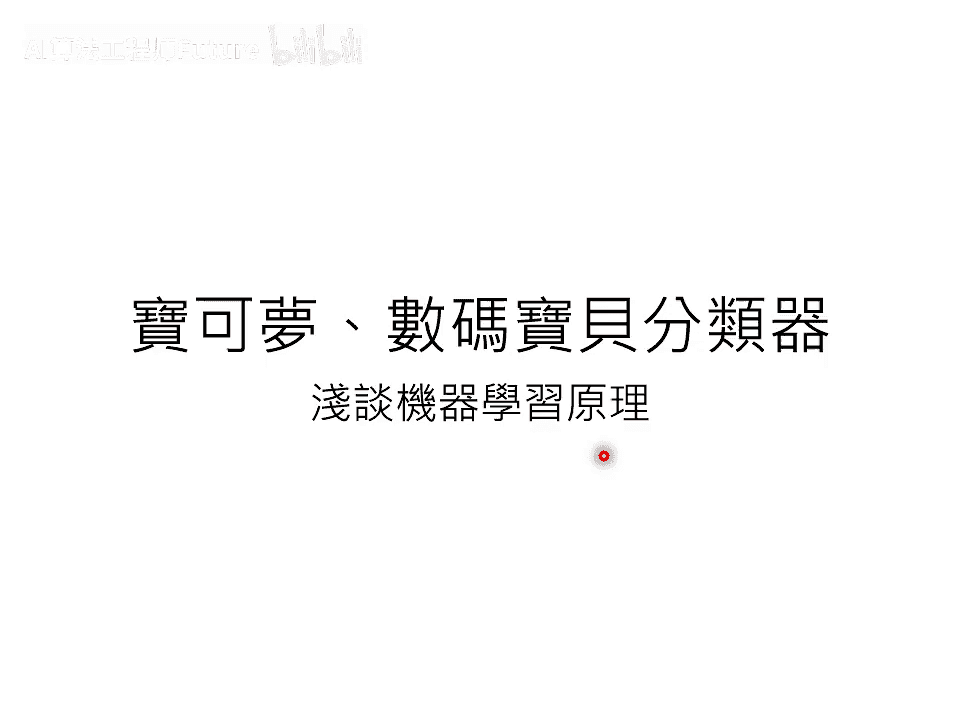

在讲这堂课之前呐，这边是预设呢。

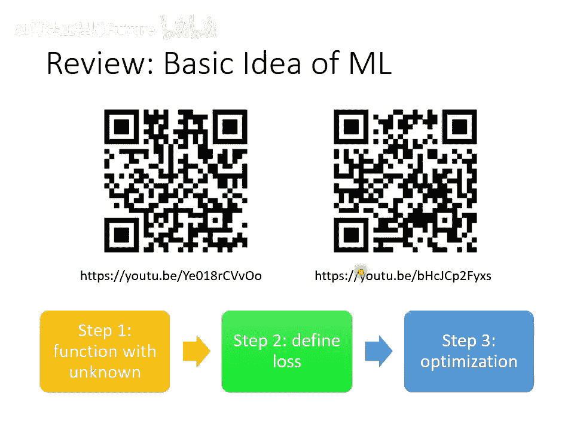

你对machine learning已经有基本的概念，那我之前有讲过，说这门课是有要求大家要预习的，那如果你有按照预习的进度的话，你已经看过一个预测频道订阅人数的例子，那你已经有了机器学习的基本概念。

你已经知道我们在做机器学习的时候，就是三个步骤。

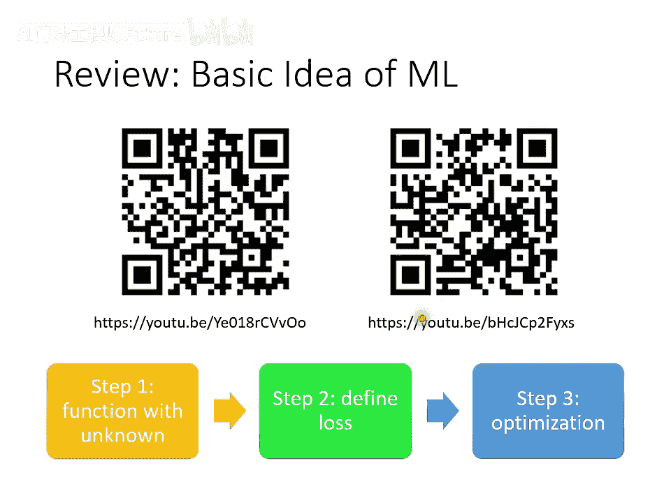

先找一个有未知数的function，然后呢我们要决定我们的loss长什么样子。

最后要做一个optimization好。

那如果你有按照预习的进度的话，其实你已经看到一个影片，这个影片是机器学习作业攻略，然后我有说这个攻略啊，就跟魔关羽一样，会带你打赢前期所有的副本，但是在讲这个攻略的时候。

有一件事情我其实是草草的带过什么事情呢，我说今天如果参数越多，就越容易OVERFITTING，也就是你在训练资料上面观察到的loss，跟实际测试的时候，观察到的loss会越有可能不一样。

那很多同学会问说，为什么会这样呢，为什么参数越多，你训练的时候观察到的loss，跟测试的时候观察到的loss会差距越大呢，那过去呢都只是很直观的，举一些例子告诉你说啊，直觉上想起来就是会这样。

那今天呢是要从理论上告诉你说，为什么参数越多就越有可能会over bet。

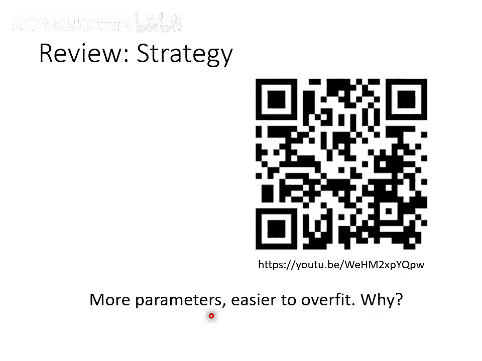

好，那我们回到我们现在想要探讨的问题啊，就是宝可梦跟数码宝贝的分类器啊，好那大家已经知道数码宝贝是什么了，那我想应该就不需要介绍，那你知道为什么我们要做，宝可梦跟数码宝贝的分类器吗。

因为这两群动物它们非常的类似，举例来说好了，就来问一下大家，这只是宝可梦还是数码宝贝，唉就是宝可梦的同学举手一下啊，你觉得是数码宝贝的同学举手一下，好诶，很厉害，为什么你们觉得是数码宝贝，这是甲虫兽。

这是甲虫兽啊，不他是虫虫兽，但是你发现了，宝可梦跟数码宝贝有很多类似的地方，基本上宝可梦里面有什么数码宝贝，里面就有一只类似的，这个是虫虫兽。

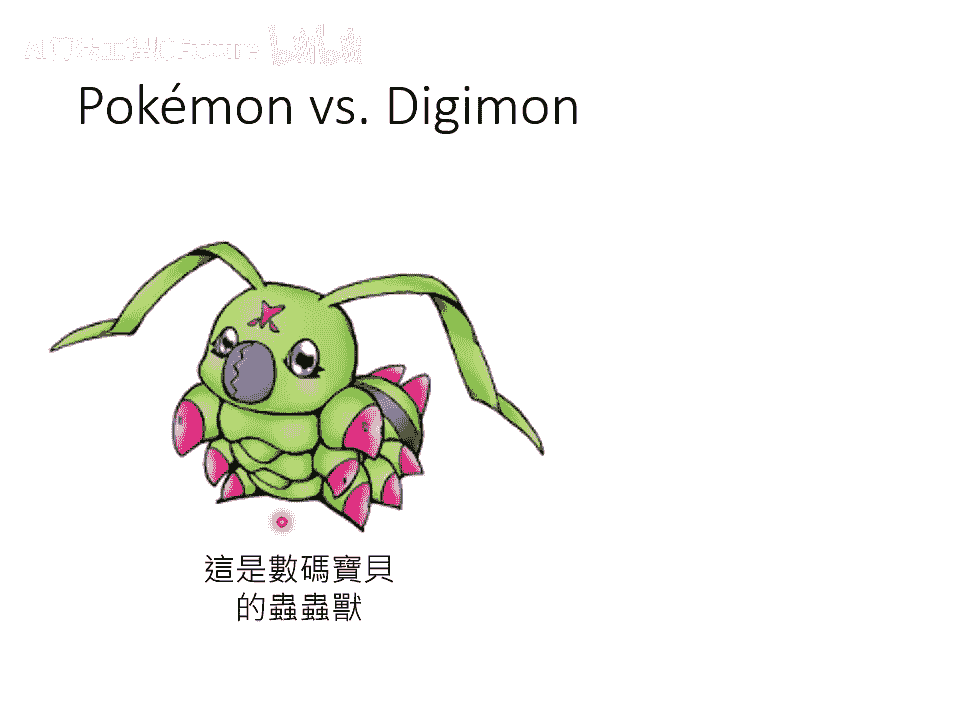

在宝可梦里面有一个绿毛虫，长得是很像的。

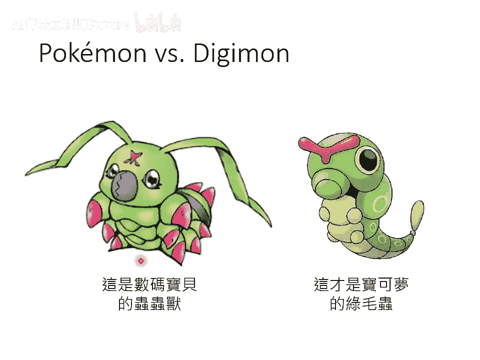

在宝可梦里面有小火龙，他是主角小智身边的一个动物。

一个宝可梦，而在数码宝贝里面有一个雅谷兽哦，他其实也是一个暴龙，这是一个暴龙，这也是一个暴龙，他们两个都是暴龙啊，但是这一只右边这只暴龙呢，是数码宝贝里面的暴龙，它就叫做亚古兽，它们叫做暴龙。

它也是主角太医身边的一只动物，所以总之宝可梦里面有什么数码宝贝，里面也有什么哦，所以宝可梦跟数码宝贝呢是长得很像的。

所以我们值得做一个分类器，来分辨这两种动物好，所以我们今天要做的事情就是这个样子的，我们要找一个函数，这个函数的输入呢，就是一支宝可梦或者是数码宝贝，就是一只动物，比如说这只是杰尼龟。

那他的输出呢就是这只动物，它是宝可梦还是数码宝贝好，那机器学习的起手式啊，是你要先定一个有未知数的function，对不对啊，大家知道说机器学姐起手式，是先定一个有未知数的方式。

但是怎么定这个有未知数的方式呢，那通常假设你没有什么想法的话，往往你需要先对你的资料做一些观察，想象一下，假设有一个function，可以成功的分类宝可梦跟数码宝贝。

那这个function它应该长什么样子哦，所以在开始进入机器学习之前。

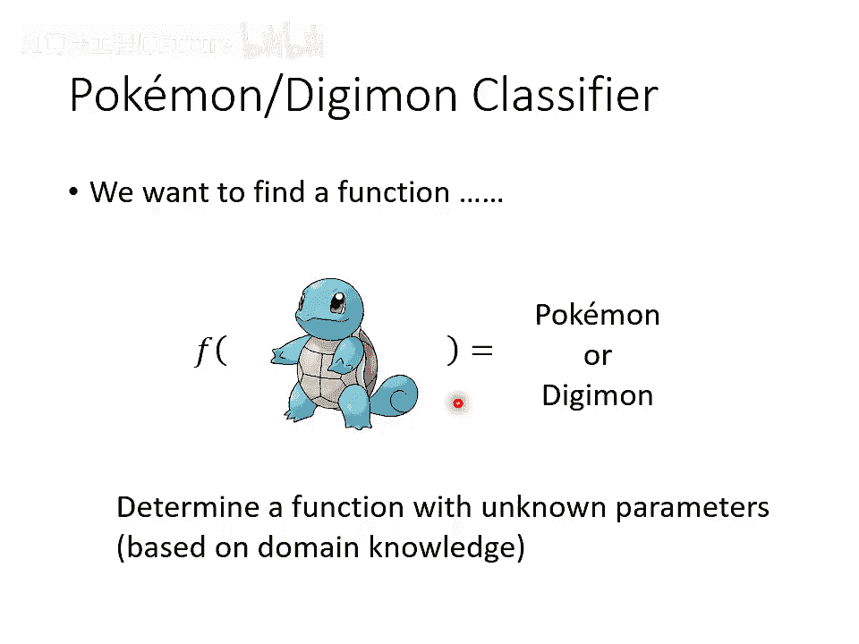

也许我们先对我们的资料做一些观察，好在经过一番观察以后啊，我发现宝可梦跟数码宝贝虽然长得很像，但其实他们还是有蛮显著的差异的，比如说上面这五只动物是我随机sample了，五只数码宝贝。

下面这五只动物是我随机sample了五只宝可梦，那你会很明显的发现，虽然说这个宝可梦跟数码宝贝里面都有，很类似的动物，但是它们光是画风啊就是不太一样的，这个数码宝贝里面比较多人形的东西。

然后往往数码宝贝的这些动物啊，这些生物啊，他都画的比较复杂，然后宝可梦呢就是走这个小朋友路线啊，他画的动物呢比较圆润，然后线条比较简单，所以这两者光是画风上都是有差异的好，那既然他们画风有差异。

我们能不能够设计一个function，根据他们的风格来分辨这两种动物呢，我们已经知道说数码宝贝的线条比较复杂，宝可梦的线条比较简单，也许我们可以根据它线条的复杂程度，来决定一只动物。

他是宝可梦还是数码宝贝好，那怎么办呢，怎么知道是怎么决定线条的复杂程度呢。

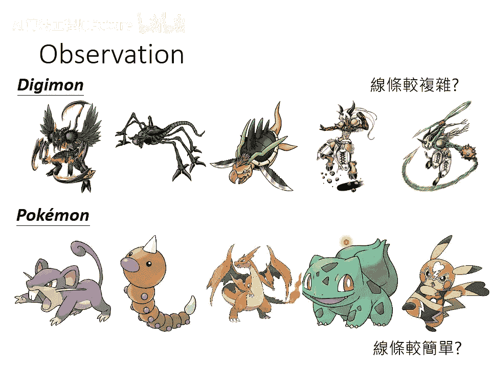

你知道这个有很多的这个呃package啊。

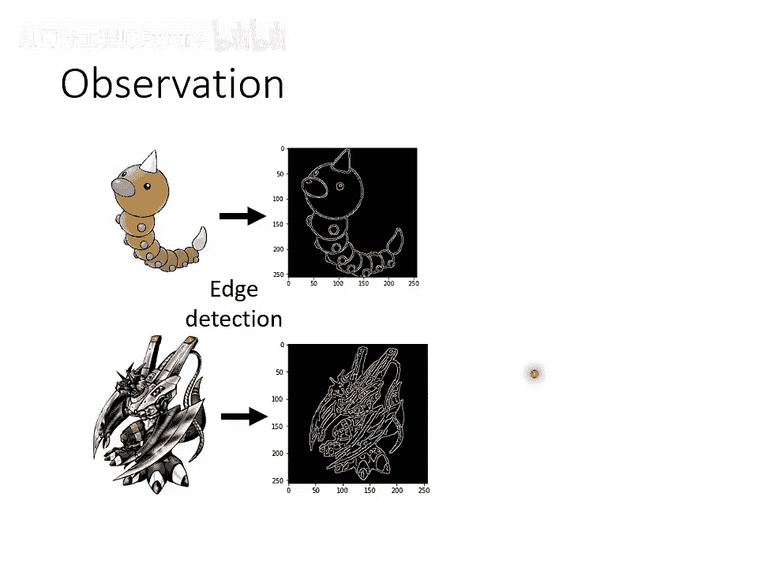

但这个细节我就不讲了，很多package呢可以帮你把一个图片里面的线呢，把它画出来，那这边我就对每一张图片，不管是宝可梦还是数码宝贝做了edge detection，把这一个图里面的边线呐把它画出来。

那11的细节不重要，其实我也不太清楚是怎么做的，总之后一个library自动会产生这种边线的图，那怎么知道一张图片的边线比较复杂，还是比较简单呢，那我就用了一个很简单的方法，就是有边线的地方就是白色的。

那我就算一下这个在这张图片里面，白色的pixel有多少啊，举例来说上面这一张，这只是，诶你知道这只是什么哦，这只名字可能跟哈哈哈，这只是独角虫，这应该是独角虫诶，它还有一只脚，它像独角虫。

然后我记得它进化以后会变成铁壳昆，然后铁壳昆进化后会变大针锋，嗯对好，那下面这只诶，如果你对神奇宝贝哎，你在数码宝贝比较研究的话，我可以问一下这只是什么吗，后面后期都很复杂，然后就没有没有一代好看哦。

这样子好我我我我其实也不知道这只是什么诶，嗯我们就叫它机械手刀龙好了，我也不知道他是什么，不好意思，这那上面这一只独角虫啊，你把它做h detection，然后算一下白色的点有几个，有3558个。

下面这个机械手刀龙啊，把它做h detection以后，你看这个线哦很复杂哦，那有几个点呢，有7389个白色的点哦，所以我发现说如果你把宝可梦做h detection，平均而言白色的点比较多。

如果是呃比较少，白色的点比较少，而如果是数码宝贝的话，白色点的点比较多好。

那我们就做了一个function啊，这做了一个函式，这个函式呢我用小一来表示，这个函式呢就是输入一张图片，他会告诉你说做完edge detection以后，白色的点有几个。

那这个数字就代表了线条的复杂程度啊，今天如果数字越大，那就代表说这个呃这只动物，不管它是宝可梦还是数码宝贝，它的线条呢是越复杂的好。

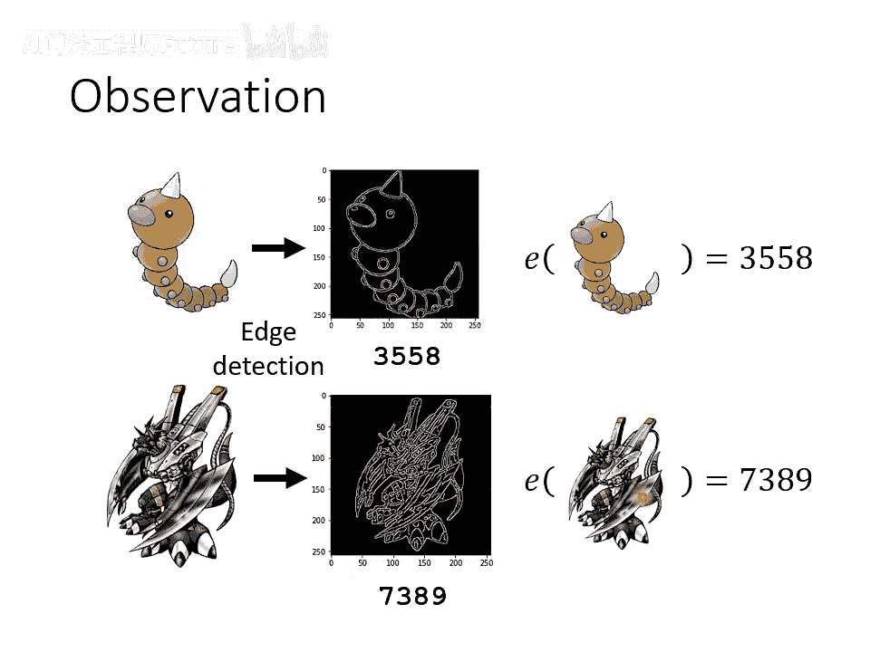

那有了这个观察以后呢，我们就可以有一个function啊，这个function呢它里面有一些未知的参数，那它可以用来分辨一张图片，是宝可梦还是数码宝贝好了，这个方形长什么样子呢，它长这个样子啊。

有一个函式输入是一只动物啊，这个是一个妙蛙种子，那如果输的这只动物丢到E这个，edge detection的function里面，这个E这个function会去计算线条的复杂程度。

如果线条的复杂程度超过某一个数值，这边用H来表示，那我就说这只动物，他是一个数码宝贝，反之，如果线条的复杂程度小于H，那我就说他是宝可梦，而现在未知的数值是什么呢，未知的参数是什么呢。

未知的参数就是这个H，我们不知道要把HD在哪里才能够准确的分割，宝可梦跟数码宝贝好，那我们用F呢下标小H来代表说，我们有一个方式叫做f function，里面未知的参数需要从贝塔里面学出来的参数。

我们叫做小H那这个小H只是一个数值，它只是一个fresh phone，用来分割说呃，如果今天复杂的程度超过H就是数码宝贝，小于H就是宝可梦好，虽然说这是一个很简单的function，但以下的讨论。

你完全可以把这个function一般化到更复杂的情境，你完全可以把这个H换成，我们在之前录音里面讲过的set up，你完全可以把这个H换成DISNETWORK，里面的参数好，不过我们今天呢为了举例方便。

我们就举一个最简单的例子，我们的function里面只有一个未知的参数，就是H那我们把所有未知参数，我们把这个未知参数所有的可能性集合起来，叫做大H，那这个未知参数H它有哪些可能性呢。

它的可能性其实是你自己决定的，那这边我们假设说复杂的程度啊，就是从一算到1万哦，就是做完edge detection以后，白色的点的数目最多不会超过1万，所以我们把这个H呢省一到1万。

那也不需要考虑小数点，要考虑小数点没有意义啊，那个呃，呃这个白色的点算出来的个数一定是整数啊，所以我们这个H呢不需要考虑小数点好，那所以现在我们的H的可能性有一到1万，全部集合起来，我们叫它大H。

那大H加一个绝对类似绝对值的符号，这个意思是说在大H里面，我们有多少可能的选择，而这个可能选择的数目啊，我们又叫做模型的复杂程度，所以常听到有人说我有一个很复杂的模型，我的模型复杂程度很高。

那是什么意思，代表说他现在定出来的这个含有未知数的function，里面，他的选择性很多，这个叫做模型的复杂程度很大好。

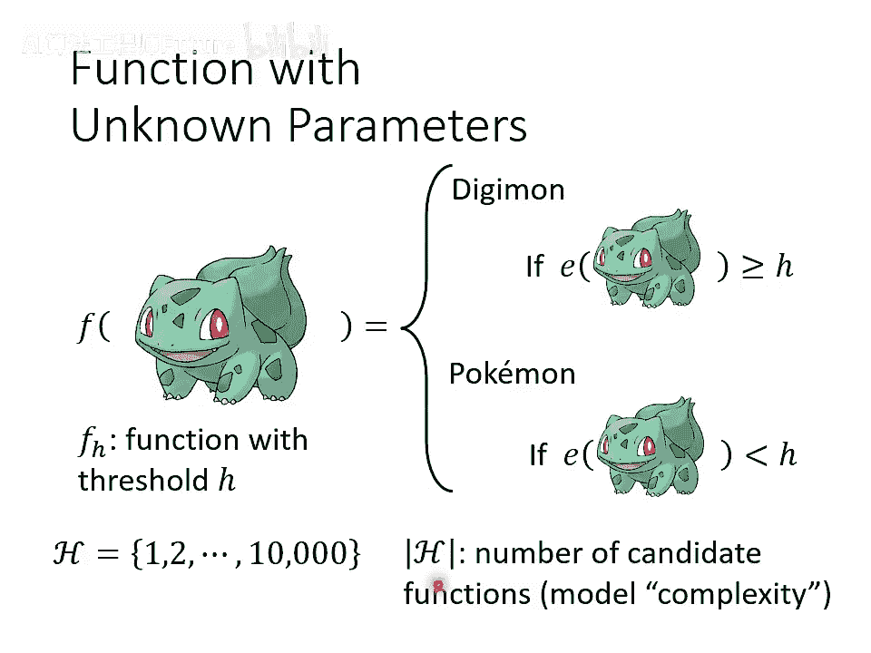

那接下来呢我们要顶loss，那记得说这个我们说机器学习三个步骤，第一个步骤，第一个有未知数的方程，第二步骤就是第一个loss，那今天在这个问题里面怎么定一个loss呢，在定loss之前。

首先你需要有资料，loss是根据资料计算出来的，那现在呢假设我们把一个data set用大D来表示，一个data set，大D里面有什么样的东西呢，一个data a set。

大D里面就是有一堆成对的X跟y hand，有一堆成对的X跟y hand，那这里的每一个S呢，就代表了一支宝可梦或者是数码宝贝，比如说这是一只小拉达，它不是普通的老鼠啊，它是小拉达，知道吗。

然后他是宝可梦还是数码宝贝呢，它是一只宝可梦，那y hand就代表说这个S呢，是宝可梦还是数码宝贝好，那接下来呢我们就可以定loss了哦，我们可以给一个fresh hold的数值，给一个H。

然后我们就可以根据个data set来计算，它的loss应该有多大或多小来计算这一个H，根据某一组训练资料，某一组data set，它的loss应该有多大啊，那这个loss定义起来长什么样子呢。

我们把某一个资料集，某一个资料集大D呀，里面的每一笔资料都拿出来，然后每一笔资料比如说这边是第N笔资料，第N笔资料跟这个fresh hoh啊合起来，我们会去计算一个loss。

代表这个H在这一笔资料上表现的好坏，loss越大表现越差，loss越小表现越好，那一个资料集里面呢有大N笔资料，我们就把大N笔资料每一笔都拿出来算，这个loss。

这边用小L来表示每一笔资料的loss都算出来，取它的平均值，就是我们最终的整个资料集的loss，这边用大L来表示它，那我们这个大L啊，他要吃两个输入，一个是H1个是D，那这个H的意思就代表说。

我们现在这个大L是在计算哪一个，fresh home的这个好坏，那大D代表说我们是用哪一个资料集来计算，好坏好，那这个小L啊给一笔资料，它的好坏要怎么计算呢，那你有很多不同的做法。

那这边采取的是一个最直觉的做法，如果说啊这个呃，你把这个H啊当做是你的function f的参数，然后呢你把SN当做是input，如果这时候输出的答案跟正解不一样，那你的loss就是一。

如果跟正确答案一模一样，那输出就是零，那这边呢用一个identity f呃，这个identity function呢来表示呢，这个蓝色框框里面呢所表示的事情，就是如果说呢今天给定这个H。

那你的function的输出跟正确答案不一样，那这个identity function就会输出一，反之呢他就会输出力，那我们把每一笔资料的算出来的这个小L，我统统平均起来以后，我们得到什么。

我们得到的其实就是error ray，对不对，就是错误率，因为现在只要答错一次就会loss就会加一，然后呢如果没有答错，loss就10，最后对所有的资料做平均，那这个不就是错误率吗。

那讲到这边有人可能会问一个问题，哎这个不对啊，我记得其实现在讲的不是一个binary classification，二元分类的问题吗，我记得在上课影片里面其实也提过分类的。

或者是你自己很有可能也实做过分类的问题，你可能会记得说诶，在做分类的问题的时候，一般不是这样定loss的，你会用什么，你会用或是entropy，对不对，这边你当然可以用cos entrob没有问题。

那如果用POS用，这现在这个err ray的坏处，就是诶这个loss是不能微分的，到时候你用gradient descent，你可没有办法那么容易的，optimize这一个loss function。

Ross cross entropy，它至少是可以为分的，你比较能够optimize这一个loss function，但是这边呢我们选择了一个，就是如果相较于这个错误率。

跟cross entroo比比起来呀，这个错误率是比cos entro比更加直观一点啦啊，所以我这边选择用error rain，用错误率来做说明，那等一下的讨论跟loss function是选的。

选择是没有关系的，所以我们这边可以选择一个最直观的loss function。

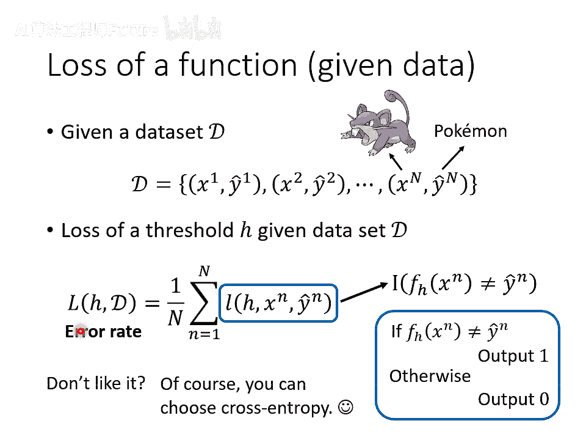

来做以下的说明，好，那接下来呢就进入训练的环节了，进入optimization的环节了，那这边呢我们先讲一个理想的状况，假设今天我们可以收集到全宇宙中，所有的宝可梦跟数码宝贝，要把它们集合起来。

我们把它叫做DO好吧，叫DO，那我们其实就可以找到一个最好的fresh ball，找到一个最好的参数，我们把这个最好的参数叫做HO，那这个HO呢，或是换句话说，这个HO就是所有可能的H里面，可以让DO。

所有的宝可梦跟数码宝贝的这个资料集上，loss最小的那个H就是HO，那当然有人会问说哎，这个optimization的问题是怎么解的啊，你怎么找到一个H可以让这个大L最小的，我们刚才有说过。

说我们定的大L呢其实是error ray，所以它是不能微分的，所以今天这个问题你不容易用gradient descent解，但是这边不是一个问题，因为H毕竟是有限的，总共才1万个而已，就每一个都试一下。

你其实就可以知道，可以让loss最小的那个H是什么了，所以这个optimization的问题并不难解，当然如果你今天面对的是deep learning的问题，有百万个参数，有千万个参数。

这个时候你可能就需要让你的loss function，是可以为分的，你才用grade descent，我这边我们没有这个限制，loss没办法，微分就算了。

到搜索的H1样可以解这个optimization的问题，好这个是理想的状况，这个是假设我们可以收集到，全宇宙的宝可梦跟数码宝贝的状况，但是事实上呢，我们并没有办法收集到，全宇宙的宝可梦跟数码宝贝。

有的人可能会说，诶不是有出那个宝可梦或数码宝贝图鉴吗，那照理说所有全宇宙的宝可梦跟数码宝贝，都在里面啦，不不不不是这样子的，你知道这个宝可梦跟数码宝贝，每年不是都会出新的品种吗，所以代表说。

我们人类对于宝可梦和数码宝贝的生态，我们了解仍然是非常有限的，所以宝可梦图鉴里面记载的，并不是所有的宝可梦，我们并不知道全宇宙的宝可梦和数码宝贝，有哪些，我们只知道部分的宝可梦和数码宝贝，长什么样子啊。

所以呢我们实际上手上，我们只有部分的宝可梦跟数码宝贝，这分这些部分的宝可梦跟数码宝贝，是从全宇宙的宝可梦跟数码宝贝，里面去sample出来的哦，就是啊全宇宙的宝可梦，数码宝贝分散在世界各地，然后呢。

有这个训练师呢，去户外抓到一个宝可梦跟圣母玛宝贝，他就把它输入到图鉴里面，图鉴里面呢就多一笔资料啊，就把它放到我们的这个训练资料集里面，那这个训练资料集呢，我们用d train呢来表示它好。

那现在我们假设训练资料集里面有大N笔资料，那训练资料集的产生过程呢，我们是有一个假设的，我们是假设说这个训练资料集里面的，每一笔资料，就是从一个更大的资料，也就是全宇宙的数码宝贝跟宝可梦的总和的。

这个资料sample出来的，那sample的过程呢有一个限制，叫做IID叫做independent跟identical the distribution，就是说今天这个sample媒体资料的时候。

彼此之间是independent的，而这个sample的时候，每次simple的时候，我们要sample的那个分布永远是固定的，那多数的情况，你都可以假设你的资料满足这个ID的限制啊。

来满足这个ID的特性好，那有了这个训练资料，有了这个d train以后啊，你就可以找出一个H，你可以找一个H它让d train的值，它让用d train所计算出来的loss，它的值越小越好。

那可以让这个D圈所定义的这个loss，它的值最小的那一个H我们叫它h train好，所以上面这第一个式子是理想的状态，第二个式子是现实中实际上会发生的情况，上面的状态是假设有全宇宙的宝可梦。

你可以找一个最好的H叫做HO，但是现实是你收集不到全宇宙的宝可梦，你只有手上你知道的那几只宝可梦，他们叫做d train，那我们在d train上面找一个最好的fresh ho，叫做h train。

那这个是理想，这个是现实，我们都知道俗话说的就是理想很丰满，但现实很骨感。

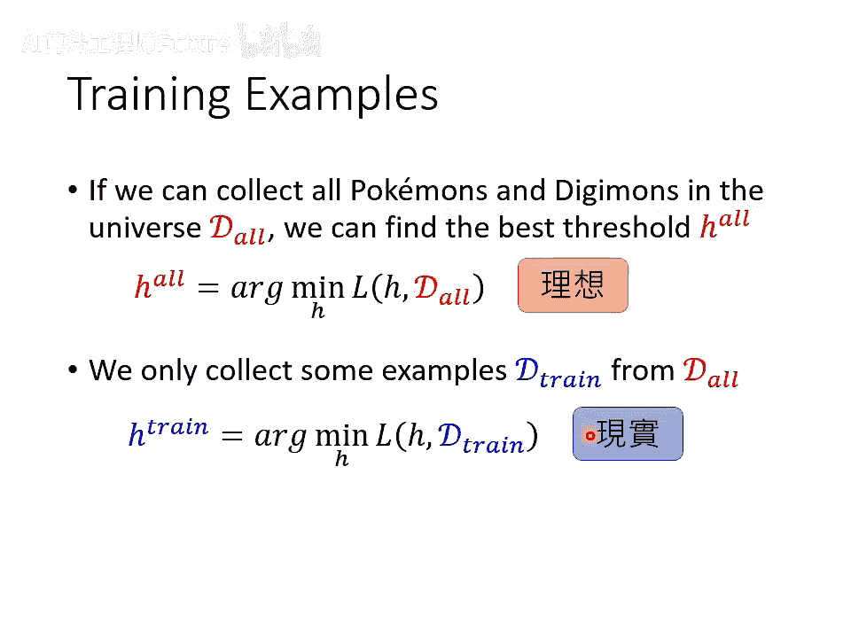

那么现在要问的就是，到底理想跟现实会有多大的差距呢，我们的期待是什么，我们当然期待理想跟现实越接近越好，什么叫理想跟现实越接近越好呢，我们的理想是我们找到了一个HO，我们把这个HO用在DIO上。

我们可以得到一个loss，这个是我们在理想的状态上可以得到最好的loft，可以得到最低的loss，但实际上因为我们手上并没有DIO，我们手上只有d train。

那我们从d train里面只能找到h train，h tin跟HO他们显然是不一样的，因为他们是从不同的资料里面找出来的，他们要minimize这个loss function是不一样的。

然后这个loss function它不只是跟H有关，它也跟define这个loss function的资料是有关的，那因为我们拿来这个define，这个lost的资料是不一样的。

所以我们找出来的H也是不一样，所以h tin跟HO是不一样的，那我们把这个h train，用在DO这一组data上的时候，他到底跟ho用在DAO这组data上的时候，差距有多少呢。

那块HO它是DO上面最好的H，所以我们不可能找到其他的H，比HO还要在DIO上的表现更好，我们只能找到d train，但是d train跟DO在同一个资料上的表现，到底有多大的差距呢。

这就是我们接下来要问的问题。

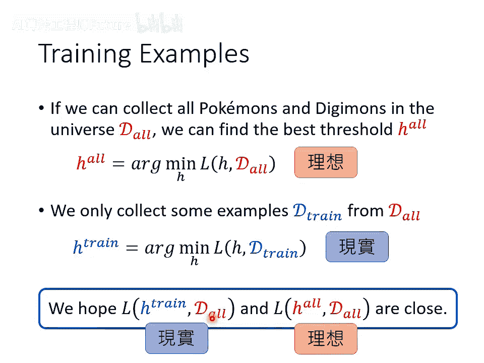

好你可能以为这只是随便举一个例子，不是这个是真的有实做的哦，我实做了一下啊，那这个是那个额数码宝贝资料的来源，然后这个是宝可梦的资料的来源，那刚才虽然说我们不可能真的收集到，所有的宝可梦跟数码宝贝。

但我们先假设假设呃，现在我们在图鉴里面收集到的，宝可梦跟数码宝贝，跟全宇宙的宝可梦，跟数码宝贝的分布已经很接近了，我们假设现在图鉴里面有的这个宝可梦呢，我有819只，数码宝贝，有971只。

它已经非常充足了，它跟DO其实是蛮接近的，那我们来看看它的分布长什么样子，那这边要提醒一下说，在多数的任务里面，我们其实是不知道DIO的，比如说你今天要做语音辨识，第二显然是你要收集到全世界所有人说的。

所有句子，那这件事显然是不切实际的，那一般在实际的应用里面，因为没有迪奥，所以多数的做冲，一般常见的做法就是你会准备一个testing set in。

那这个testing sin也是从d o sample出来的，那你期待这个testing s对DIO，对所有的data是有代表性的好，那回到宝可梦与数码宝贝的问题，我们从图鉴里面找出819只宝可梦。

971只数码宝贝。

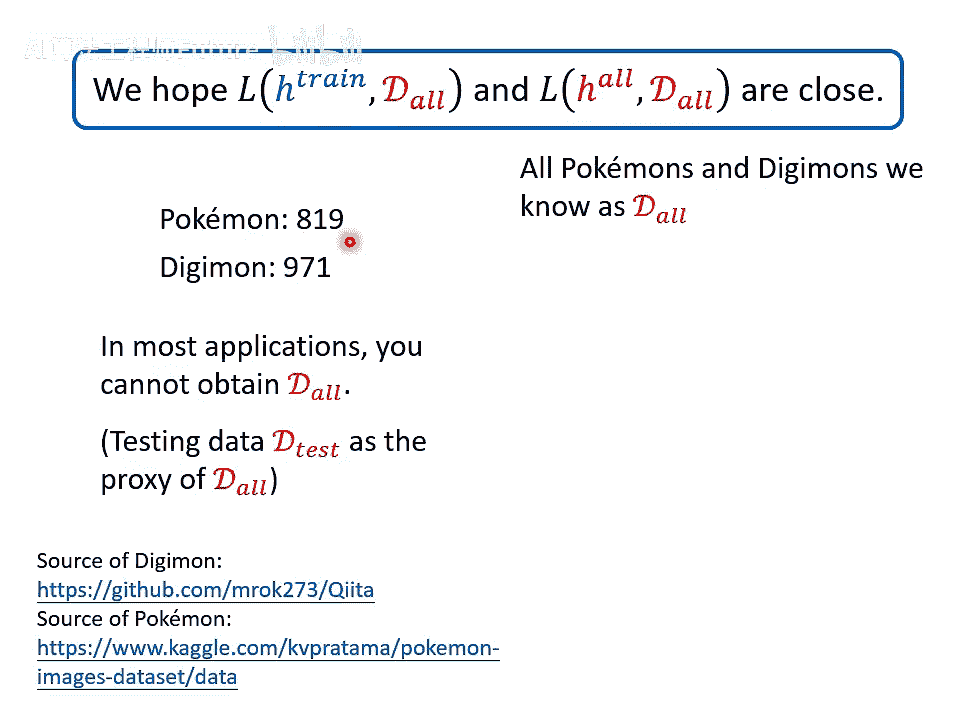

我们把它的这个复杂的程度画出来，你会发现它的分布呢是长得像这张图这个样子，这个橙色的是数码宝贝的分布，蓝色的是宝可梦的分布，那它们之间有一些重叠的地方，不过显然确实如同我们观察，我们所猜测的。

数码宝贝是比宝可梦它的线条更加复杂的啊，这个横轴越往右就代表线条越复杂，纵轴代表有这种复杂度的动物的宝可梦，或者是数码宝贝的个数有多少好，那根据这个这些资料啊，我们计算一下ho是4824啊。

然后我们还计算一下，如果你把HO用在DIO上，你的loss是什么呢，你的错误率是什么呢，你的错误率是0。28，你错误率是0。28，但我要提醒一下，这个DIO并不是真正的DIO。

因为还有很多的数码宝贝跟宝可梦，是还没有发现的，我们现在只是假设我们已经发现了。

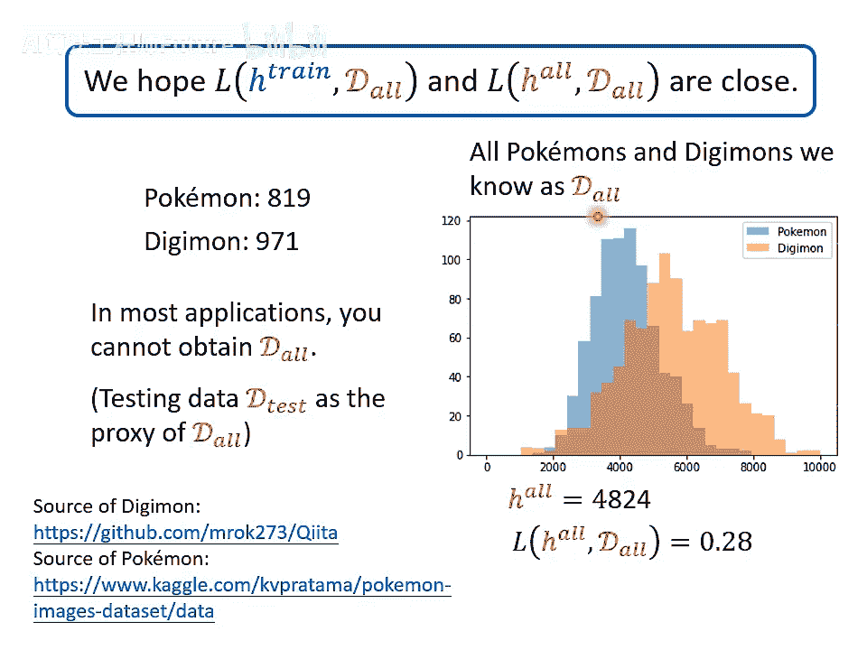

所有的宝可梦跟数码宝贝而已好，那接下来呢我们假设我们要准备一个training的，Dataset d train，那我们呢去野外抓了200只动物，那抓完以后呢都把它标上标记，说他是宝可梦还是数码宝贝。

抓了200只，那这个东西叫做d train，那么现在是假设我们手上没有图鉴了，没有完整的宝可梦和数码宝贝的资料，你去路上呢抓了200只来，然后呢把它叫做d ch，那抓完200次以后。

那我看一下它的分布呢，长得是这个样子啊，其实呢这个d train的分布呢，我们叫它第一个training set，叫d train one，好了啊，d train one的分布跟DO的分布。

其实是算是蛮类似的，它并没有差距很大好，那我在第一圈one呢上面找一个H，找一个可以把D劝one做的最好的H，我发现了这个h tone，H圈one代表在D圈one找出来最好的H，它是4727。

那它的loss是多少呢，把D圈外把这个H圈one在D圈one上面做一下，这个算一下loss哎，我们的loss是0。27，错误率是27，Percent，就是你用这个h tone当做你的fresh ho跑。

在这个D确换上，错误率是27分三，讲到这边有人可能会有突然有一个问题，咦怎么这个h tone d串one，它的loss还比这个LHODO的loft还要更低啊，刚才不是说HO就已经是最好的那个。

fresh hole了吗，照理说应该他就算出来的loss应该是最低的啊，应该没有办法算出更低的loss，但是你仔细想一想哦，这个HO它的貌似最低是说它在DO这组data上，它的loss最低。

并不代表它在所有任何可能的资料集上，它的loss是最低的哦，所以h tin one他是在d train one上，它在d train one这个资料上面，它的loss是最低的。

它甚至有可能比HO跑在DIO上面的，loss还要更低，那如果你这个你一下子想不明白的话，有一个很直观的解释啊，假设我们现在在做training的时候，我们只simple两只动物，正好找到一只就是宝可梦。

一只就是数码宝贝，那你显然可以找到一个H把两只动物分开，所以这个时候你的错误率是多少，你的错误率其实是零的，所以其实在训练资料上，你有可能做出非常低的错误率，甚至比HO在DIO上面的错误率还要更低哦。

所以如果你看到有某一个H在某一个资料上，它得到错误率，比HO在DIO上面的错误率还要更低，完全不需要压抑好，那但是这不是，但是我们真正关心的并不是h try，在DCHY上面的loss的错误率有多少。

我们真正关心的是，如果我们把H乘Y用在DIO上面的时候，到底错误率会是多少呢，我们发现一用上去诶，错误率28，Percent，我们发现理想跟现实很幸运的居然是差不多的，我们这边在这个例子里面。

理想跟现实是一样的，那这个就是我们最乐见的状况。

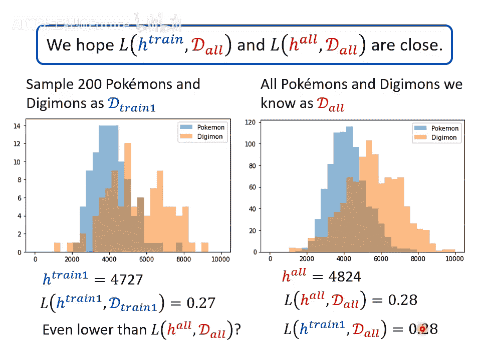

但是这只是运气好而已，在另外一个平行宇宙中。

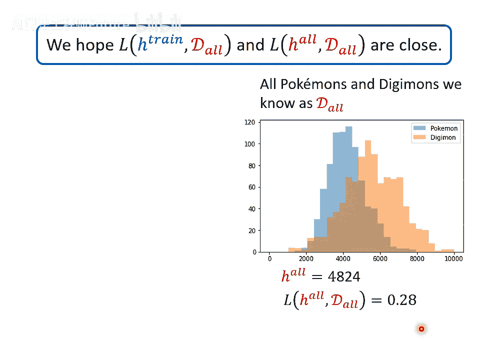

你可能也抓了200只的宝可梦跟数码宝贝，那因为我们抓200只宝可梦数码宝贝的时候，你是从整个数码宝贝宝可梦的整个集合里面去，随便simple200只出来，所以每次抓出来的200只，在不同的平行宇宙里面。

在做同一个实验的时候，抓出来的200只不一定是一样的好，那假设在另外一个平行宇宙里面，我们再做一次，抓200只宝可梦和数码宝贝的实验，我们抓出了另外一个资料集，另外一个训练的资料集叫做DETTO啊。

叫DETTO，那的确two的分布呢是长这个样子的，你发现它明显跟DO有明显的差别，那这一次呢我们不知道为什么，抓到了比较多的数码宝贝，抓到了比较少的宝可梦，所以看起来DETRTWO。

跟迪奥他们的长相不太一样，那你在这个D圈TM上找一个最好的fresh ho，它找出来是3642，其实跟HO还有蛮明显的差距的，如果把HTTL跑在DTRANSTWO上面，其实结果非常的好，你的错误率是0。

2，你的错误率是20percent，但是这只是h tin two在d train two上面的结果，我们刚才说你要在一个training set上，得到非常低的错误率，根本就是很容易的。

一只只渗透两笔资料，一个是宝可梦跟数码宝贝，你直接就可以得到0percent的错误率，所以在training的资料上得到低的错误率，没有什么好令人高兴的，你真正在意的是。

我们把这个extra q用在所有的资料上面的时候，那我们得到的错误率到底是多少呢，那在这个实验里面，因为HTTO跟HO其实差距非常的大，h train two只在DETTO上面表现的好。

他在DIO上面表现的并不好，当我们把h train two放在DIO上面的时候，我们的错误率是37percent，所以这边学到了什么，你知道说诶这个得到的结果好坏呀，取决于你simple到什么样的资料。

有时候你sample到好的资料，那你的这个呃理想跟现实就很接近，有时候你sample到不好的资料，理想跟现实就很遥远。

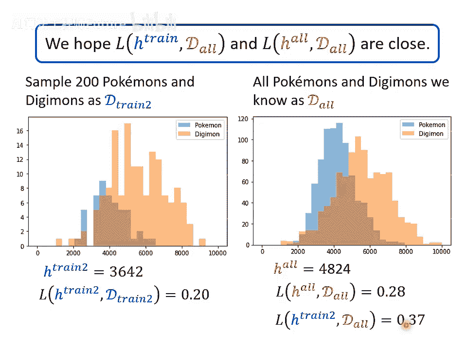

好我们把我们刚才讲的事情举个例子，用数学式来表示它好，那我们说理想跟现实很接近，我们要的是什么呢，我们如果用数学式子来表示它的话，我们写成这个样子，我们希望当h train在DIO上面算loss的时候。

减掉HO在DIO上面算loss的时候，他们的差距小于等于某一个很小的数值delta，那delta是一个你自己设的数值了，就看你容许这个看你希望理想跟现实有多接近，如果你觉得理想跟现实差一点也没有差。

那比海设大一点，0。1，如果你很要求理想跟现实很接近，那DA设小一点啊，0。00001，这个delta是你自己决定的，看你期待理想和现实可以有多接近，怎么样，理想跟现实接近程度才是你满意的好。

那这边呢再提醒大家一下，这个LHO跟诶这个LHODO啊，他其实一定会比l h train d o还要小，为什么同样在DO上面计算，loss h o是无人能及的。

因为他是在DIO上面找出来最好的一个fresh odio，就是他的BGM，你知道吗，因为在自己的BGM里面是不可能会输的哦，所以HO呢在DO上面算loss的时候，没有人可以比他更小。

没有人可以比他更厉害，所以LHODO一定会比l l h train，DO还要小，但是我们只希望，虽然这个l h train d o，不可能比LHODO还要小，但我们希望它至少不要差太多。

但这边呢我想再强调一下，这个HO要好，是在DO上面才会好，那有时候你甚至会看到h tin在d train上面，它的loss是小于HO含DIO的，会写这个是一个正常的状况。

就是HO在DIO上面是无人能及的，但是并不代表他的loss，一定会比其他它其他的data set上面的其他的fish book，所算出来的loss还要小好，那这句话其实怎么样才能够满足这个叙述呢。

怎么样才能够让现实跟理想很接近呢，等一下我很快的跟大家推导这件事情，什么样的的确可以让理想跟现实很接近呢，如果的确满足下面这个蓝色框框里面的特性，理想跟现实就会很接近，怎样的特性呢。

下面这个框框里面讲的是穷举所有可能的H，穷举所有可能的fresh hoh，从一到1万，对所有可能的H而言，D券在D券上面算出来的lo，跟在DIO上面算出来的loss，如果对所有的H而言。

在D圈上算出来的loss，跟DIO上面算出来的loss，小于等于二分之DTA的话，那最上面这一个蓝色框框里面的状况就会成立，如果你要理想跟现实很接近，那怎么办，你只要能够找到。

你只要simple到一个圈里的资料，这个圈里的资料满足这个特性，那理想跟现实就会够接近，什么特性，对所有的H而言，计算在D圈上跟计算在DIO上面的loss，它们的差距小于等于二分之DA。

那我先很直观的来解释这件事，这个式子告诉我们说，不管你选择的H是谁，算在D圈跟算在DIO上面，他们的loss的差距都很小，小于等于二分之W这意味着什么，这意味着的确跟DO很像，因为他们很像啊。

的确跟DIO很像啊，所以你不管拿什么样的H过来，他们算出来的loss都是差不多的，如果的确跟DO很像，对所有的H来说的确跟DO很像，那我们其实就可以保证。

推得我们从这个d train找出来的h train，我们从这个d train找出来的fresh bot，用在DIO上面的时候，跟HO跑在DIO上面的时候，他的差距是小于等于DOTA一个很小的数值的哦。

这个是直观的解释什么叫做好的training data，什么叫做可以让理想跟现实接近的training data，当你的training data跟所有的资料，它的分布很接近的时候，你可以做到这件事。

那如果你要用数学的证明，如果你不要这种直观的解释的话，数学的证明再下一页，那如果以下的推导你觉得太快的话，就直接跳过就好了，好的推导是这个样子的，这个l h train d o啊。

一定会小于等于l h train d train加二分之delta，那呃我们现在要推导的是说，在假设中间这个蓝色框框成立的前提之下，上面这个蓝色框框就会成立好，因为中间这个蓝色框框是前提。

它已经成立了哦，所以他告诉我们什么，告诉我们说有一个d train，同一个function，同呃同一个fresh hold在D卷上算loss，跟在DO上算loss非常接近哦，所以呢现在好。

所以呢现所以呢现在呢我们在DIO上面，根据H圈算出来的loss，跟D在D圈上面用H圈算出来的loss，它们会很接近，它们中间的差距一定小于二分之DA好，所以这个式子是成立的好，接下来呢告诉你说呢。

呃这个l h train，d train加二分之DOA一定小于等于，LHO加l h o d train加二分之delta，为什么，因为上面这一条画红色线的LOS。

一定小于等于下面这一条画红色线的loss，为什么，因为AHH是在d train上面找出来的，h train是可以让在d train上面的loss，算出来最小的那个h train哦。

所以你只要看到他们这个上标和下标的，那个文字是一样的，就代表说这个H圈在D圈上找到的，如果上标和下标的这个文字是一样的，或者是颜色是一样的，就代表说呢h train。

这个第一圈呢是h train的这个BGM，这H圈在D圈上面，是没有人可以比他loss更小的，所以当你把H2换成HO的时候，你的loss一定会稍微大一些，一定会大一些。

所以l h train d train会小于等于l h o d train，然后接下来呢，再套这中间这个蓝色框框里面的结论一致，我们说我们有一个的确，它可以满足带入任何的fresh hod。

确上的loss跟DIO上的loss都很接近哦，所以的确上的loft的确上用HO算出来的loft，跟DO上用HO算出来的loft，他们是很接近的，最多就差一个二分之delta。

怎么得到这个式子LHOD确加二分之delta，还因为小于等于LHODO加二分之delta，再加二分之delta所得到的式子，就把两个二分之delta加起来变成DA，怎么得到的式子是LHHDO。

小于等于LHODO加上DOTA，那再整理一下，你就可以得到上面篮框框的式子，那如果这个地方你没有办法跟上的话，也无所谓啦，你就记得说怎么样让理想跟现实比较接近，要找到一个具有代表性的d train。

不管是哪一个fresh ho，哪一个H在D圈上梁跟DO上量都差不多，那我们就可以让理想跟现实很接近，那推导就在下面这三款式子里面好。

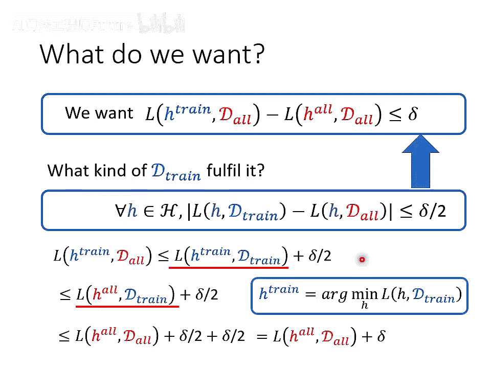

所以现在再重新描述一下我们的目标，刚才最开始说我们的目标是，理想跟现实要很接近，那现在我们的目标是，我们要simple到一个好的training data，这个好的training data。

不管代入什么样的H他在D圈上，在这个training data上算出来的lo，跟真正所有资料上面算出来的loss，它的差距要小于等于某一个很小的数值，叫做XO，那我这边呢把二分之delta换成X龙了。

那只是为了之后不要再写除二这件事，那希望不要造成大家的困扰，好，所以呢我们现在知道说，你要怎么让理想跟现实很接近，那就要看你simple到什么样的训练资料，要看你有没有含着金汤匙出生，含着金汤匙出生。

那理想跟现实就很接近了，好那接下来我们要问的问题就是，那我们没有含着金汤匙出生的几率有多大呢，我们如果随便sample1组训练资料，随便sample1组d train sample出来。

上面这个式子不满足，没有办法，让理想跟现实接近的几率到底有多大呢，如果这个几率很大，那么要小心呢，我们的理想跟现实差很远的，如果几率很小诶，那就恭喜你，我们理想跟现实是很接近的。

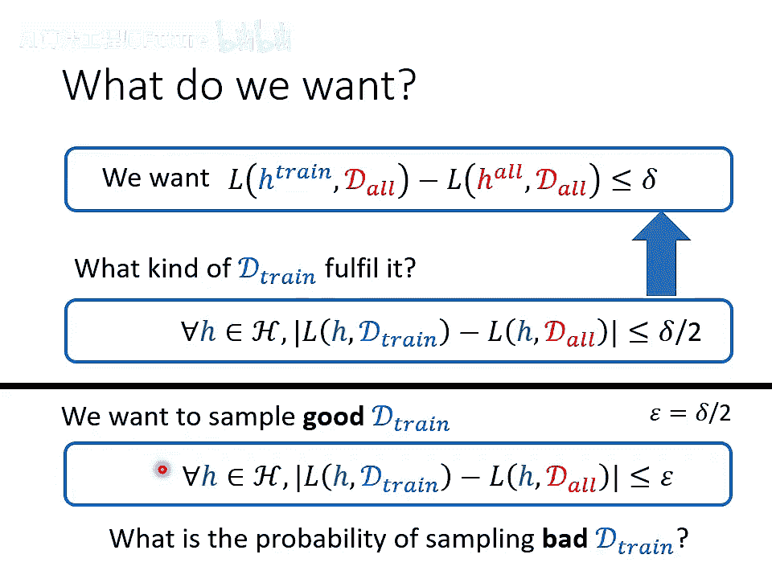

好那以下的讨论呐，这边要强调一下，以下的讨论跟模型没有关系，所以它适用于deep learning或者是其他的模型，那再来呢以下的讨论，对于资料本身的分布并没有假设，我们并没有对资料假设说哎。

他一定要是高选distribution好，最后呢以下的讨论跟loss function是没有关系的，它适用于任何loss function，所以今天虽然我们在讨论的，一直是一个二元分类的问题。

但你完全可以把今天的讨论，直接套到regression上面，因为你知道这个classification和regression的差距，只是lost方向不同啊。

classification上面你可能会用cross entropy作为你的loss，regression上面你可能会用NS1作为你的loss。

那今天等一下的讨论跟loss function是没有关系的，所以他可以不止用在分类上，它也可以用在regression上面，所以等一下要讲的这个机器学习的原理，它是一个非常这个一般化的原理。

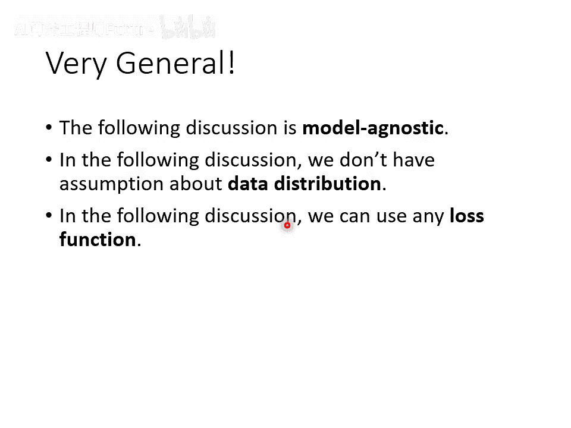

它可以用在很多不同的情境下好，那我们现在主题是什么呢，我们现在主题就是没有含着金汤匙，出生的几率到底有多大呢，simple到一组坏的训练资料的几率到底有多大呢，以下我们用一个点来代表一组训练资料。

注意一下哦，在这个图示里面一个点不是一笔资料哦，一个点是一组训练资料，那蓝色的点代表好的训练资料，可以让理想跟现实接近的训练资料，橙色的点代表坏的训练资料，会让理想跟现实有差距的训练资料，好再强调一次。

现在每一个点不是一笔资料，是一组训练资料，比如说我们刚才simple过一个好的训练资料，叫做的确one，在这个图上它就是一个点，我们刚才simple到一组很坏的训练资料，叫做DETTO。

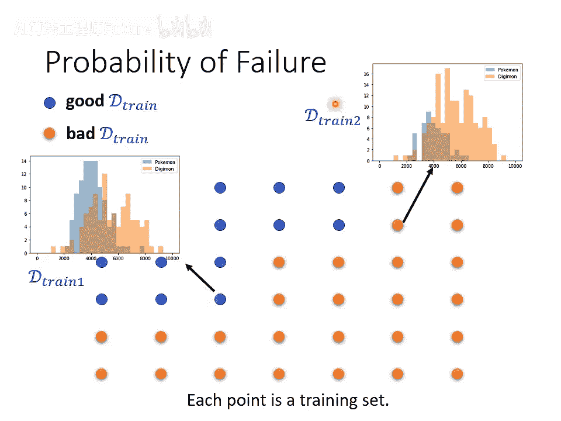

它也是图上的一个点好，那假设我们你知道每一个训练资料啊，他都有被simple到的几率，如果我们可以把这边每一个橙色的点的几率，通通都算出来进行加总，我们都知道。

我们simple到坏的训练资料的几率有多少，那我们当然希望这个呃橙色的点，它所占的总几率越在sample，所有的资料里面占的总几率越小越好好，那怎么计算这些橙色的点所占有的几率，总共有多大呢。

直接一个点一个点算，显然是很麻烦的，不知道要怎么做，那这边有一个方法来估测，橙色的点所占的几率有多少。

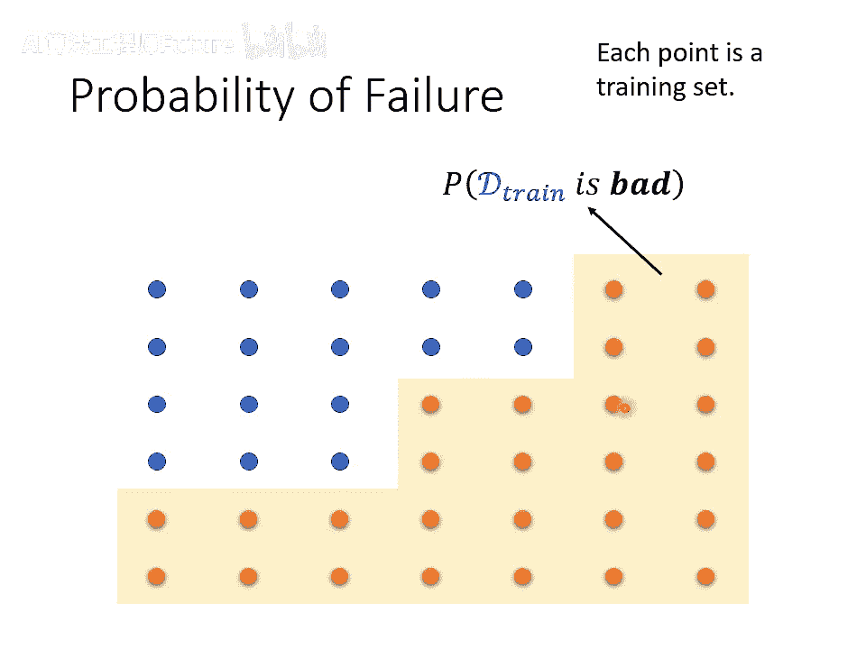

怎么估测呢，我们先回忆一下什么叫做一个dataset d train，它是不好的，如果你可以找得到任何一个H，这个H可以让在D券上算出来的，loss跟DIO上算出来的north大过AXO。

那这个训练资料就是不好的，那前几页投影片里面我们是正面的定义，怎么怎么样叫做一个好的训练资料，就是对所有的H而言，在training set上算出来的loss，跟所有资料上算出来的loss是够接近的。

叫做好，那前面定义好是说所有的H都要满足，那现在反过来不是好就是坏了，什么叫做坏的训练资料，就是找到一个哪怕只有一个，找得到一个H训练资料上算出来的loss，跟所有资料上算出来的loss有足够的差距。

那就叫做这个资料是不好的好，所以呀每一个H每一个坏的资料，后面必定有至少一个H把它弄坏，那我们这个图示的意思就是HY他弄坏了，这一些资料集，就是说h one这一个fresh ho这一个参数，这个数值。

它会让这一些training的data，跟所有的data的差距超过XERO，它的loss，这个h two在这九个训练资资料上，它的loss会跟所有的训练资料，第二差距大于XL，然后H3他很厉害。

他弄坏了这么多的训练资料，这一些训练资料当用H3计算loss的时候，跟H3在所有资料上面计算的loss会超过SL，所以知道每一个红橙橙色的点，至少会被一个H某一个H框岛，当然有可能说同一个H。

它会被好几个不同的同一个资料集，它会被好几个不同的H弄坏，这件事情是有可能发生的，但是总之每一个坏的资料集，至少会被一个H弄坏，那被多个H弄坏也叫做坏的资料集，被一个H弄坏也叫做坏的资料集好。

那我们就要进入在接下来的推导了，呃，所以我们现在啊把把H，把被H弄坏的这一些训练资料的几率呀，我们这边就用比较简单的文字来表示它了，它我们说某一个训练资料是差的，因为h one的时候。

就代表说这个训练资料是被h one弄坏的，那我们把这个黄色框框里面的，这一些训练资料的几率加起来叫做p of，d train是差的，因为h one的关系，然后这一些训练资料的几率加起来叫做p of。

的确是差的。

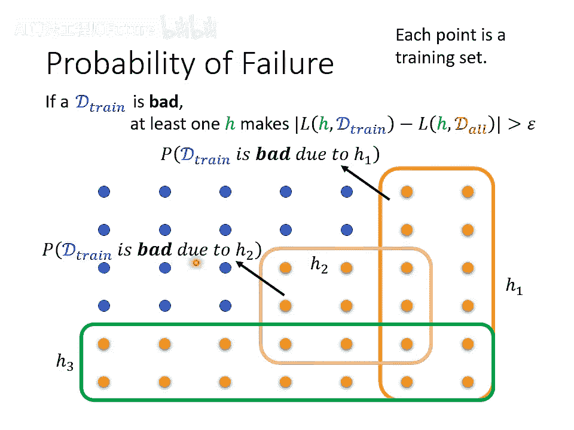

因为h two的关系，现在知道训练资料是差的，出现的几率等于这边所有的这边所有框框里面，框到的几率的union的连级，对不对，穷你穷举所有的H然后呢计算出嗯，嗯所以资料集是差的，因为H的几率。

然后把所有的H通通union起来，当然因为他们有那个overlap的地方了，所以你不是直接加起来，你是union起来，那你会等于资料集是差的几率啊，你会等于D确是差的几率好，但是呢。

我们今天如果要考虑这个overlap的地方啊，显然是这个很麻烦的，我们有点难以考虑这个overlap的地方哦，所以呢我们取一个upper bb，我们不知道怎么考虑overlap的地方。

那我们就把union改成SUBMENSION，我们把HY这些这些范围加h two，这些范围加H3的这些范围不取连击，而直接相加，如果直接相加的话，这些重复的地方，就是如果某个资料集会被好几个这个H弄坏。

那它就会被重复计算到，所以它是一个upper bb啊，它是一个UERBB，所以我们知道说今天我们sample到，我们拿到差的资料集的几率，它会小于等于some mention over所有可能的H。

然后呢，把这一个H会弄坏的资料及它的几率，全部加起来，然后some mention over所有可能的H，那这是我们拿到坏的资料集的upper bb，好，讲到这边哎，大家后有没有问题要问呢。

好如果讲到这边，大家哎来来，你说你说你说那个P是呃，我先我先这样左手边的左手边那个P是呃，第一劝我我随便取个点，然后第一圈那个那组支架是坏的，那如果在右手边，这是个什么性的地方。

可是现在的H你有100元代后会不会再对的P，我我一起提是0~0到一之间的那个几率，按分给100个加钱V超过一，对不对，你说这个，你就不要随便把这个union改成SUMMENSION了，会不会超过一。

如果是union的话，显然是不会超过一的嘛，那SUMENSION有可能会超过一，有可能会，所以当超过一的时候，这个理论就完全没有用，这样子对，所以实际上通常你算出来都会超过一这样。

所以这个理论没什么用的，哎，你有没有觉得今天来这边听这歌很浪费时间呢，对你问的问题很好，会超过一，就这样好好人，有问题要问，好那如果没有问题的话，那我们就继续下去咯。

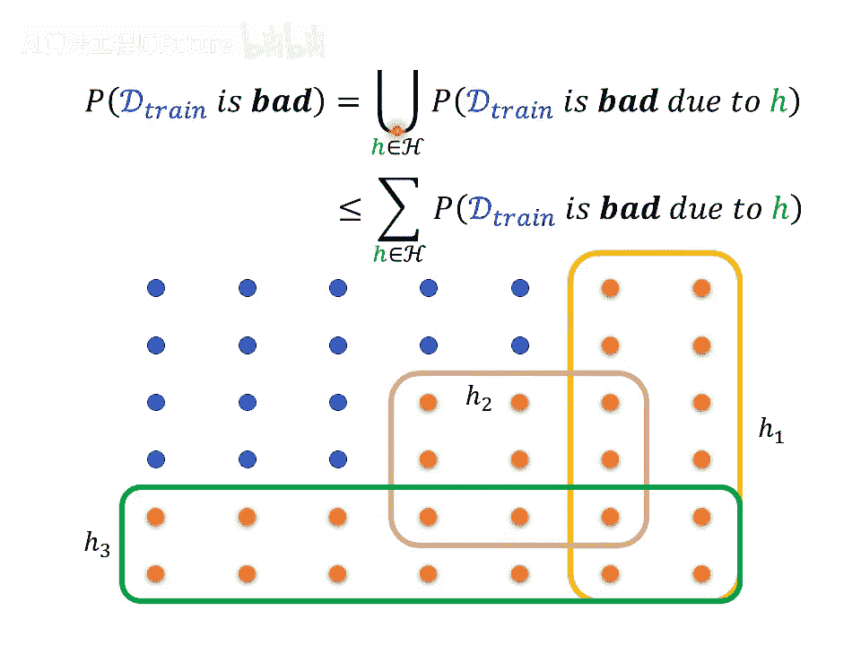

就继续下去了，好，那接下来的问题就是，我们能不能够算出给定某一个H，不会被他弄坏的那些D券出现的几率呢，我们能不能够计算出这一项呢，可以的，等一下呢，我们只讲观念，不讲证明，虽然这个证明。

理论上你在纪律与统计那门课应该是学过的了，那我这边只讲观念好，我们来回忆一下什么叫做的确是差的，因为H的关系什么意思呢，就是如果我今天拿H来在D圈上计算loss，相较于H拿在DIO上计算loss。

它的差距大于XXL，我们说这个叫做的确是差的好，那我们再再来看一下，回忆一下大L是怎么算出来的，大L是D里面的每一笔训练资料计算出来的，小L的平均好，那我们现在用一个三角形呢来代表某一笔资料。

用某一个H计算出来的loft，那今天所谓的呃H在DIO上面计算出来的，loss是什么呢，就是我们在很多很多笔，在所有我们可以收集到的宇宙间，所有可能搜集到的资料上面都去计算小小L。

再去平均就是这一个H在DIO上面的loss好，那这个是LHDO这一项，那l hd train这一项呢，我们记得d train是哪来的，d train是从DO里面sample出来的。

我们之所以当我们在算H在d train上面的loss，的时候，实际上我们做的事情就是，从全世界所有资料的loss里面simple1些loss出来，simple1些小L出来做。

平均就是H在D圈上算出来的loss，所以你在所有的资料上面算出来的lost，等于平小L的平均，就是H在DO上算出来的lost，你在部分sample到的资料上面算出来的。

loft的平均就是H在d train上面的loss，而而这两个东西呀，哎他们显然会有可能是蛮接近的，对不对，因为这里的下面的这些数值，就是从上面这些数值里面sample出来的，但是他们到底有多接近呢。

这个你其实在基于统计那门课学过了，那我就不这个呃，讲你可能已经知道的东西，我们直接告诉你结论，那假设你已经忘记机率与统计，你学过什么的话。

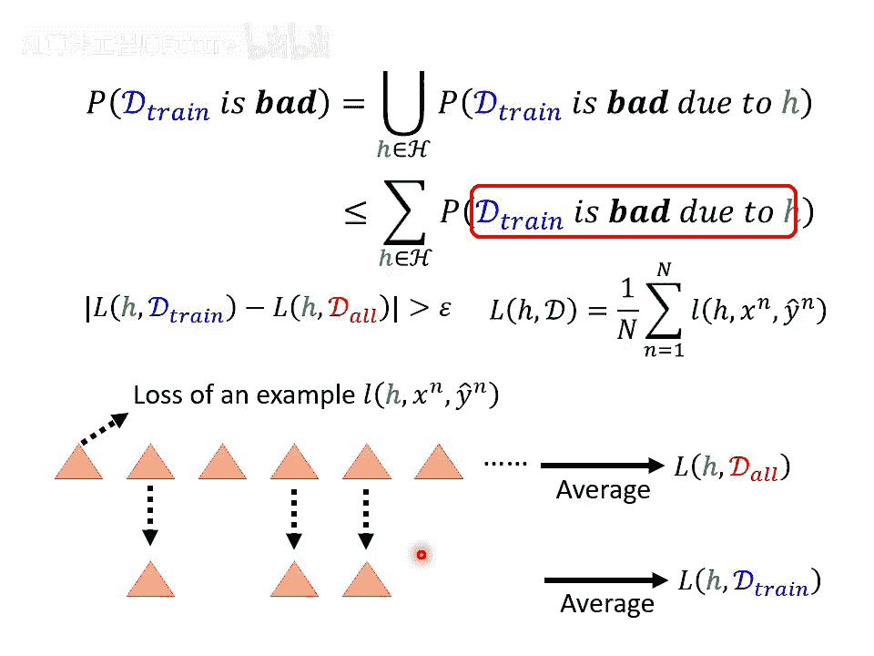

你就记得结论这边的结论是什么，这边的结论是啊，那这个就是hosting的equality d，的确被某一个H弄坏的几率，它有一个UERBB，有一个上界，这个上界小于等于两倍的exponential。

两倍的N乘以XTHEL平方，那这边有一个前提是我们要假设loss啊，它的十是介于0~1之间，上面那个式子才会成立啦，那我刚才有说lose其实没有什么限制，那这边还是个限制啊，需要介于0~1之间。

但是对于loss的function长什么样子，你是可为的，不可为的是identity还是cross entropy还是regression，这点是没有限制的，只对它数值的范围有限制，N是什么。

N是训练资料的数目哦，就在第一圈里面的训练资料的数目就是大N好，所以我们现在知道一件事，我们现在知道说某一个H把某把d train弄坏的，几率，小于等于两倍的exponential-2。

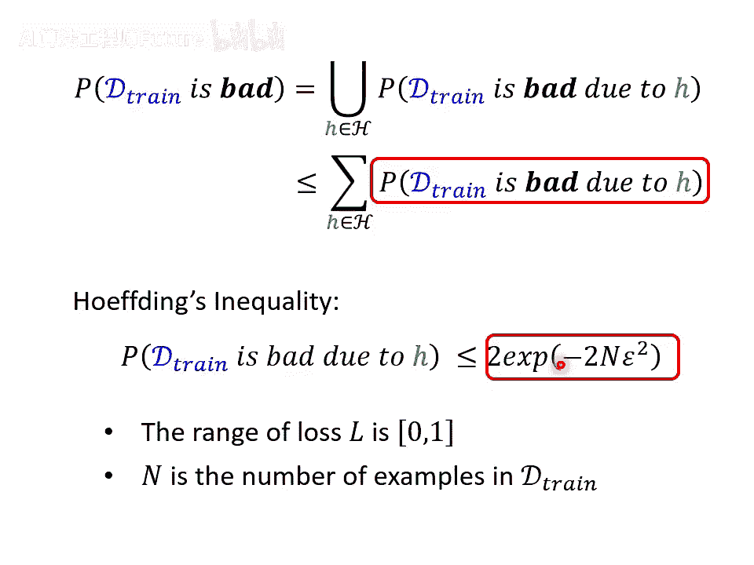

那接下来呢你就是把两倍的EXPANAL-2，X轴平方带进去带进去哦，所以变成小于等于，因为这个东西是它的一个上界了，所以小于等于，some mention over所有的H两倍的exponential。

两倍的NX的平方，但你发现了两倍的EXPENTIAL，两倍的NX的平方跟H是没有关系的，对不对，这个虽然说some mention oversaw的H。

但是SUMMENSION里面的东西跟H是没有关系的，所以我们可以直接看一下我们有多少的H，我们的大H里面总共有多少个可能的选择，把它直接乘到两倍的X轴-2NX轴平方前面。

所以我们现在我们已经得到我们的结论，就是一个chinese set，它是会坏掉的几率有多少呢，小于等于你可以选择的function的数目，就是H大H的绝对值乘上两倍的EXPANATION。

两倍的NX这种平方好，那怎么让这个simple到的data是坏的的几率变低呢，怎么让d train是差的几率变低呢，那你就要看一下这个式子了，怎么让这个几率变低呢，那就看看这个式子里面有什么。

X龙是你自己定的啦，就是看你希望现实跟理想多接近吗，X龙是你自己定的，但N跟H是你可以调的，我们今天如果让N越大A，那sample到坏资料的几率就越低，N是什么，N是训练资料的数目。

所以知道训练资料的数目越多，一个training set里面训练资料的数目越多，你sample到坏资料的几率就越低，然后另外一个是假设这个H的绝对值啊，它越小，那sample到坏资料的几率也越低。

所以假设你有一个比较小的大H，你让可以选择的function的这个数目变少的话，诶那simple到坏资料的几率也会跟着变低。

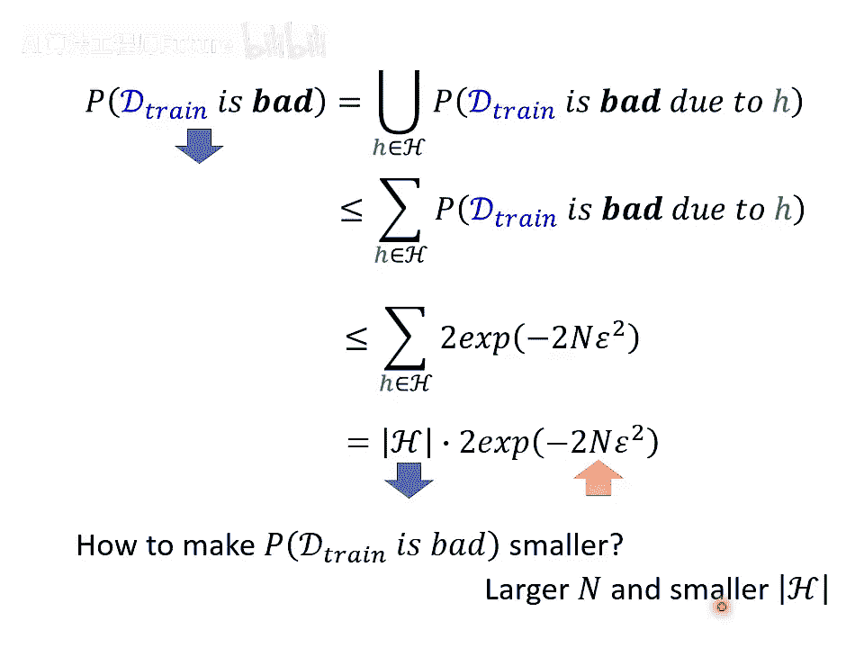

好那这边是图示一下，当你把N调大的时候，会得到什么这样的效果，因为把N调大的时候，但实际上做的事情就是让每一个H可以弄坏的，training data变少了，当我们把N调大的时候。

一个H要把某一个training set，弄坏的难度就增加了，所以当你把N调大的时候，每一个H它可以弄坏的training的data set，哎就变小了。

所以整体而言比较差的sample到差的training，data set的几率就变小了。

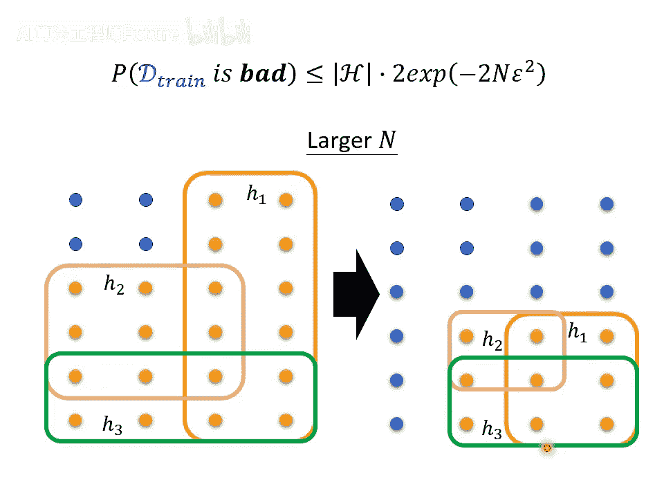

那另外一方面，如果我们今天把大H的绝对值变小，那达到什么样的效果呢，每一个H它们管的范围还是一样，但是当我们把H的速度变小的时候，我们也可以让差的data set。

坏的DATASET被sample到的几率变小，所以N跟H它们从两个不同的方向让差了，data set被sample到的几率变小。

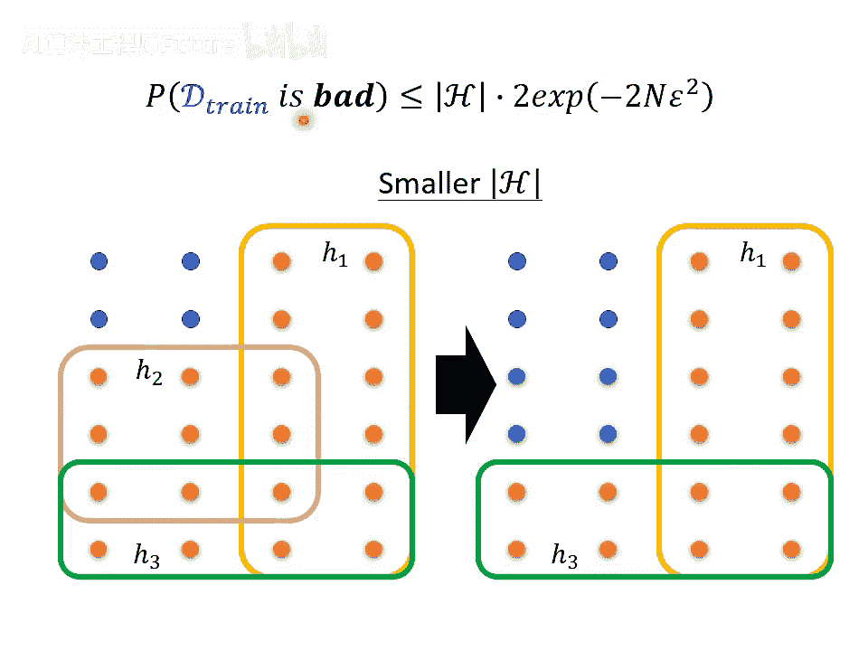

好那这边呢我们就可以跟大家举一个例子啊，看一下说这个式子是怎么运作的，假设啊，现在大H是1万，我们刚才说我们的fresh fold就是从一设到1万，总共只有1万个，可能n training data。

我们说就是100笔，我们就是抓100只把动物来，然后标注他是宝可梦还是数码宝贝，ACCO是你自己决定的，就是你要求说呢，哎这个我什么叫做好的训练资料，好的训练资料。

就是任何的H在训练资料上算出来的loss，跟所有资料上算出来的loss要小于等于XL，也就是小于等于0。1，把这个H把这个N，把这个X龙如果都带进去的话，你算出来的数值是多少呢，算一下啊。

小于等于2707啦，这这个几率sample到坏的几率的呃，sample和坏data塔的几率小于等于2707，所以这个式子就是一个干化，他什么都没有说，他告诉你，你有你小于你simple到差的几率。

就是啊小于等于2707，这个理论推导出来的结果啊，嗯这种状况非常经常发生，所以你会发现说诶你真的在做机器学习的时候，几乎没有人会特别把这些理论拿出来，在实际的资料上面进行计算。

因为你算出来往往都是大于一的数值，但他只是试图去解释机器学习原理，告诉你说这个model的complexity跟训练资料，到底对结果造成什么影响，那它是一个upper bb，它是一个上界。

这个上界离实际的数值差距被往往非常的巨大，所以在实际的应用上，你很难把这一个理论派上用场，我这边随便举一个例子哇，这个几率大过一等于什么都没有讲啊，不过我们今天呢怎么让坏的训练资料。

被sample到的机遇变小呢，唉增加训练质量的数目，所以发现说增加训练资料的收入，其实是非常有效的，当我们把训练资料从100笔，增加到500笔的时候，sample到坏资料的几率就小于等于0。91了。

如果我今天把资料增加到1000笔的时候，sample到坏的资料几率就变得非常低，0。00004，sample到坏资料的几率就变得非常低了，但是这边只是一个例子而已，你可以想见说在一般的情境下。

在正常的模型上，比如说你作业一用的模型上，这个H它是非常非常巨大的一个数字，所以你真的带到这个不等式里面去计算。

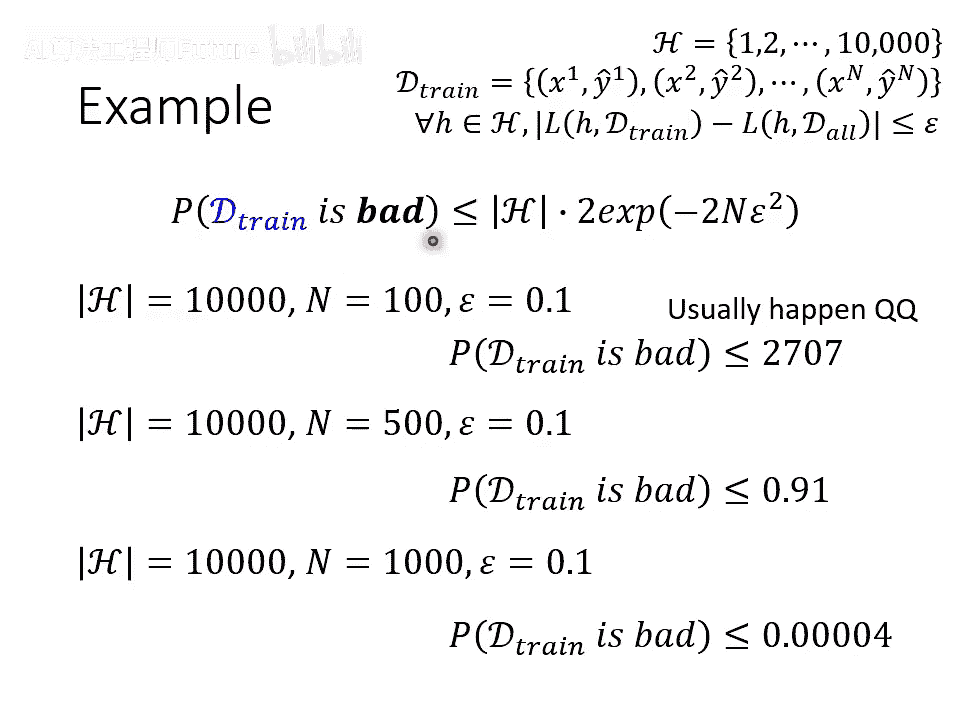

你往往算出来的上界都是大于比一的好，那这边我们也可以换另外一个方式，来问这个问题，所以有人可以问说，如果我今天希望啊坏的资料被simple到的几率，小于等于某一个小的数值delta。

那我需要准备多少笔训练资料才够呢，好那这个题目你就可以这样做啊，你说你想要这个几率，simple到坏资料的几率小于等于DA，那如果你要保证这件事成立，那你就要让它的上界就是H的绝对值。

乘以两倍的exponential-2NX的平方，你就要让这个上界小于等于delta，然后呢你再把这个式子做一下，组装以后做一下，把这些项目啊做一下，左右对调以后，你可以推导出你需要多少的训练资料呢。

训练资料的数目需要大于等于两倍的X的平方，分支log两倍的H的绝对值除以DOTA，那这个结果呢非常的合理啊，这非常的直观，就假设你今天希望这件事情，先把它坏资料的几率越低越好，那你的N就得越大越好。

如果你今天对于什么叫做理想跟现实的要求，非常的龟毛，你希望X总很小，那你的N也要越大越好，如果你今天的模型很复杂，就是这个大H的值越大，那你N训练资料量也要越大越好。

怎么推出N要大于等于两倍X的平方分之log，两倍的H除以DA，而如果带进去数值的话，呃H是1万，DOTA是0。1，我们希望呢，这个抽到坏资料的几率应该小于0。1，然后呢我们对于XM的要求是0。1啊。

那算出来N呢要大于等于610啊，也就是说，假设你的训练资料里面有大过610只的，宝可梦加数码宝贝的话，那你抽到坏资料的几率诶，就小于10percent了，就小于0。1了。

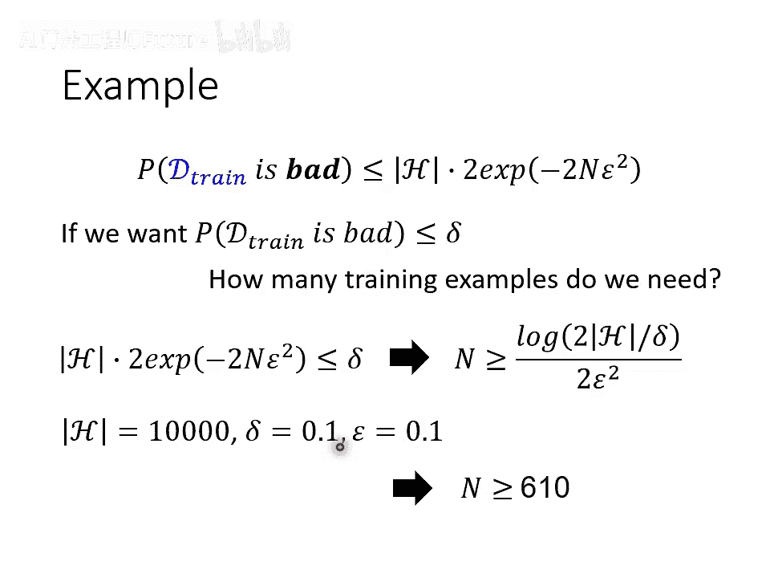

好那这边我们又遇到了一个问题，在这个式子里面有一个H的绝对值，我们说这个H的绝对值是什么啊，它是你有可能选择的function的数目，但你仔细想一想呃，在刚才的例子里面，我们说H就是123到1万。

它是离散，总共只有1万个，可能咦，但是一般在train network的时候，我就算是不是train network，就算只是linear model的时候，我们的参数不是都是连续的吗。

如果参数是连续的，那这个H的绝对值不是应该是无穷大吗，如果它是无穷大的话，那这个式子还有什么用呢，那你就只是推出说simple到差的data的几率，小于等于无穷大而已，这句话有讲跟没有讲是一样的好。

那如果要回答这个问题啊，有两个回答的方向，第一个回答方向就是告诉你说，世界上没有真正连续的东西，对不对，在这个数位的世界里面，在电脑里面所有的计算其实都是discrete，所有的计算都是离散的，对不对。

你在表示一个参数的时候，在你表面上觉得它是连续的，但它的精度还是有限的啊，你用八八个beat，16个beat，32个bit来描述一个数值，你的精度终究是有限的啊，所以这个H还是可以数的。

就算是你号称说你用的参数是连续的，但这个连续不是真正的连续，它其实还是离散的，所以H的速度还是算得出来的，只是非常大而已好，所以这是第一个解释的方法，那希望你不要觉得这个解释的方法太牵强。

希望这个解释的方法可以稍微说服你，说这个式子偶尔还是有机会可以派得上用场的，好的，另外一个真正的解释的方法是什么呢，有一个东西叫做vc dimension。

它是另外一个方法来计算一个参数是continues的，模型的复杂程度，所以就算有一个模型，它的参数是连续的，并不代表它的复杂的程度就是无穷大，还是有办法估计的，那这个描述一个模型复杂程度的指标。

就叫vc dimension，那这门课我们并不会提到vc dimension，那如果你想知道vc dimension是什么，你可以说李轩田老师的机器学习，你会更深入的了解。

怎么评量一个模型的复杂的程度好。

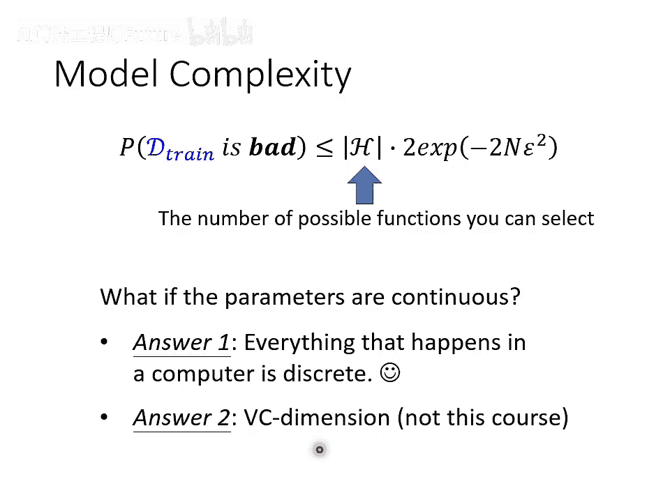

那我们刚才已经看到说，怎么让理想跟现实比较接近呢，要么是增加训练资料，要么是减低模型的复杂程度，增加训练资料，它有着它的副作用，就是诶你要耗费比较大的成本，你往往没有办法自己决定。

说你的训练资料要用多少，那如果在课堂上哎，作业的训练资料是给定的，所以这个部分你是没有办法自己决定的，但你会把所有的给定的资料通通都用上，但你没办法用更多，既然在现实的application中。

你在一个公司工作，你可能以为大公司收集资料都很容易，其实也不一定啊，大公司不见得收集资料很容易，尤其是假设你的主管对机器学习没有那么了解，你就跟他说哦，我们今天先花个100万收集资料吧。

他就告诉机器自己会学习收什么训练资料，你说开100万训练资料，你就要保证说进入这个正确率要变两个C以上，不然你不准收训练资料，你就会遇到各式各样的卡啦，所以训练资料不是你想搜就可以搜的。

而另外一方面H倒是你可以自己决定的，所以从这个角度看来，如果我们要让现实跟理想越接近越好，诶，这个H好像应该要哎越小越好哦，但H越小越好，会遇到什么样的问题呢，H太小的话会遇到什么样的问题呢。

如果你去你想想看H太小会有什么样的副作用，想想看，到底我当我们说一个training data，是好的意思的时候，我们指的是什么，我们指的是理想跟现实是接近的，当我们说的确是好的时候。

意味着不管是哪一个HD券上算出来的loss，跟DIO上算出来的loss都很接近，然后这个条件可以告诉我们说，在DIO上，不管你是用H2算还是用H圈算，你算出来的loss。

它们的差距都会小于等于一个小的数值，叫做DA，所以当我们说一个training set是好的的时候，我们其实意思是说，用这一个training set上面所算出来的loss。

你会用这个training set所找出来的h train，在DO上面跟最好的这个HO，它的loss的差距没有太大，但是当我们把这个H的绝对值弄得很小的时候，会发生什么事情呢，注意一下这个HO是哪来的。

HO是所有大H里面的小H，可以让DO上面算出来的loss，最小的那个H叫做HO，当我们把H调的很小的时候，你可以选择的小H就非常有限了，当你可以选择的小H非常有限的时候。

你就没有办法让HO在DIO上面算出来的loss，真的很小，当你可以选择的H有限的时候，你没有办法真的找到一个很好的DIO，他你没有办法找到一个真的很好的HO，他在DIO上面算出来的lose很小。

所以当有很小的H的时候，意味着什么，意味着你的理想崩坏了，你的理想根本就是坏掉的东西，所以这个时候你就算是让现实跟理想很接近，那理想是个坏掉的东西，那你拿到的其实也是一个坏掉的东西。

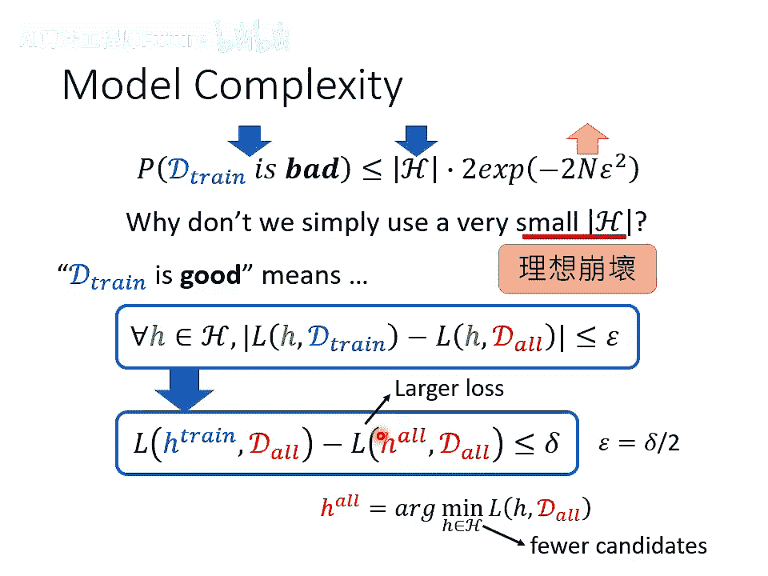

好讲到这里呢，我们发现我们陷入了一个两难，如果我们想要让理想跟现实比较接近的话，我们需要比较大的N，比较小的H的绝对值，但是如额通常我们比较难呢，收集到比较大量的N，通常N呢不是你可以自己决定的。

那也许你就会想说，为了让理想跟现实比较接近，你选了一个比较小的大H呃，你让你可以选择的function的数量比较少，但是如果你选择了一个比较小的大H，会造成什么问题呢，选择比较小的大H。

虽然可以让理想跟现实比较接近，但它可能会造成你的理想直接崩坏，如果你的理想崩坏的话，就算现实跟一个崩坏的理想接近，那也是一个崩坏的现实，那也不是我们要的，如果用图像化的方法来说明的话，左边是大的大H。

右边是小的大H，当你有比较大的大H的时候，你的理想会是比较好的，你会有比较小的这个啊，你的这个HO在DIO上面会算出比较小的loss，那如果你有比较，你只有比较小的大H。

那HO在DIO上面就可能会算出比较大的loss，但是另外一方面，假设我们考虑理想与现实间的距离诶，那这个呃如果今天有比较大的H，那理想与现实间的差距就会比较明显哦，也就是说你的这个h train。

在DIO上面算出来的loss，很有可能会远大于HO在DIO上算出来的loss，另外一方面，如果今天的H比较小的话，那理想与现实间的差距就会比较小，那你在h train在DIO上面算出来的loss。

可能就会比较接近HO在DIO上算出来的loss，但是因为这个理想已经崩坏了，所以就算现实跟理想接近也没有什么用，看来我们陷入了一个两难，怎么办呢，有没有可能鱼与熊掌都兼得呢，有没有可能。

我们想办法让HO在DO上面算出来loss，可以小而同时理想与现实又是接近的，同时HTRA算在DO上面的结果又要接近，HO算在DO上面的结果呢，有没有可能让鱼与熊掌可以兼得呢，是没有可能的。

这个可以让鱼与熊掌兼得的办法就是深度学习，那至于深度学习怎么做到这件事情。

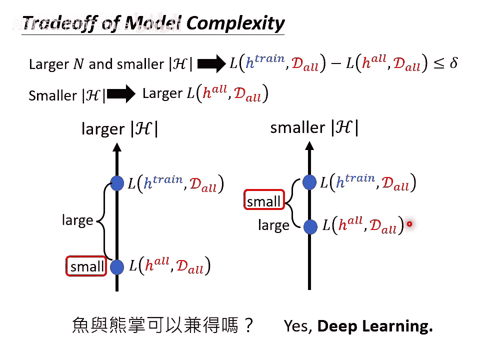