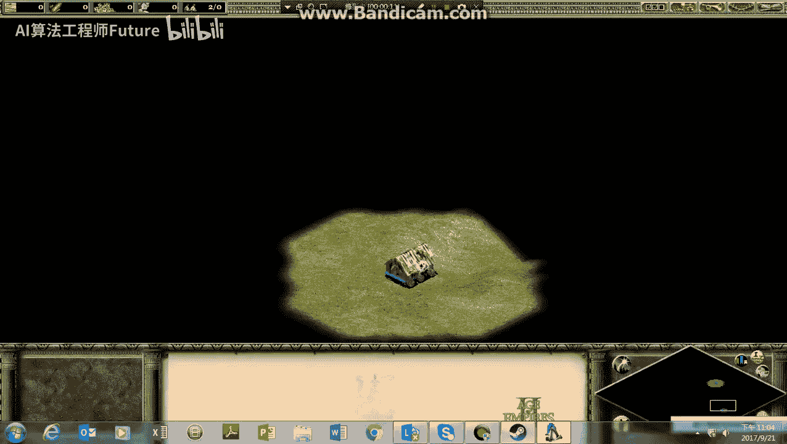
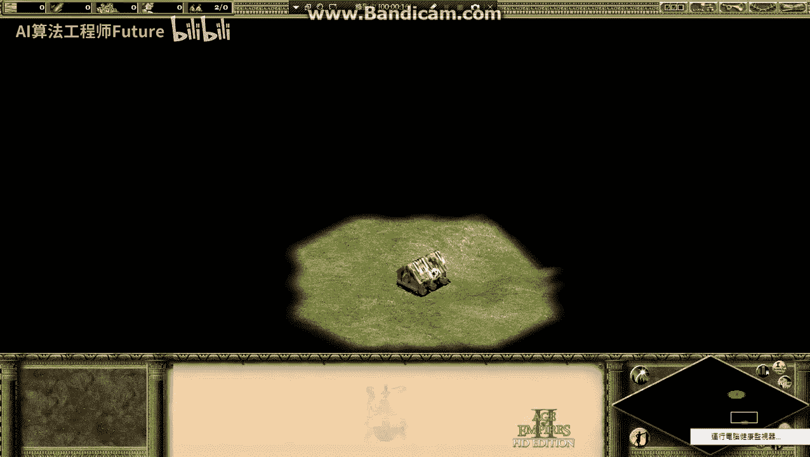
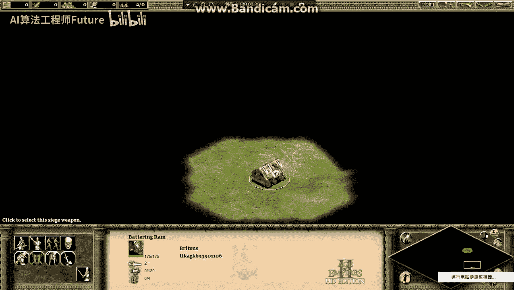
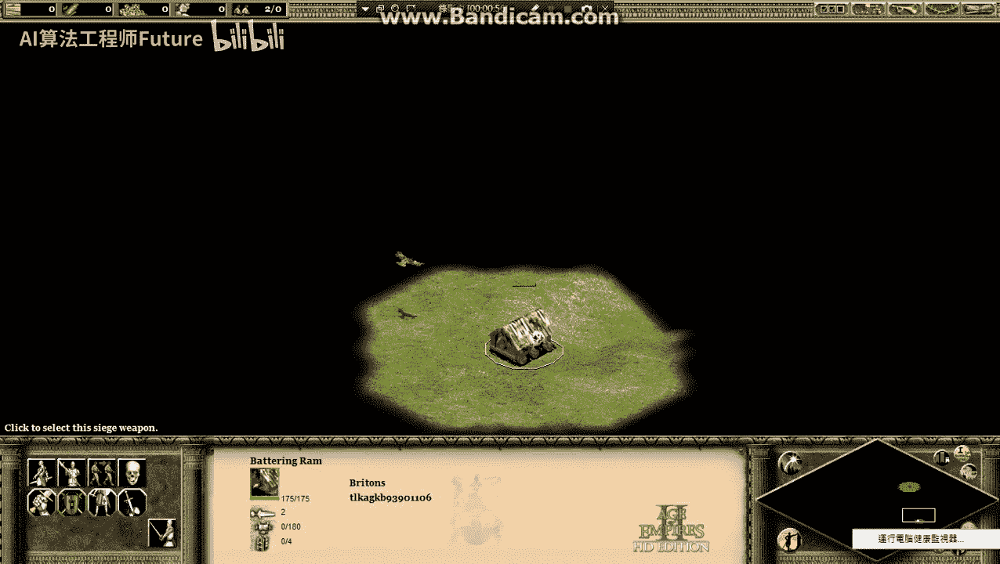
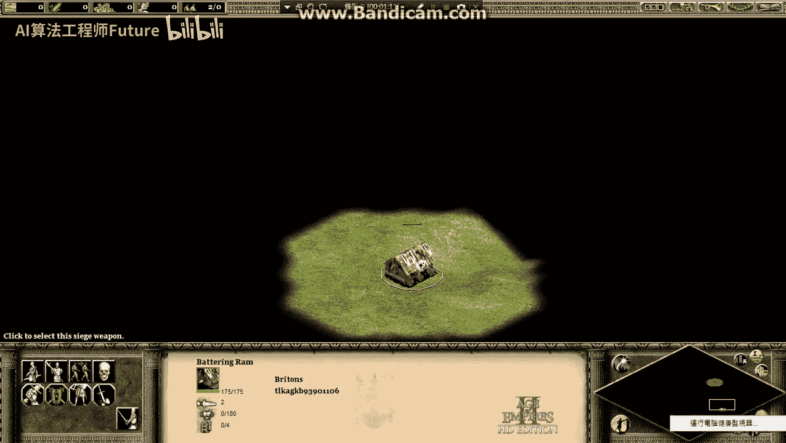
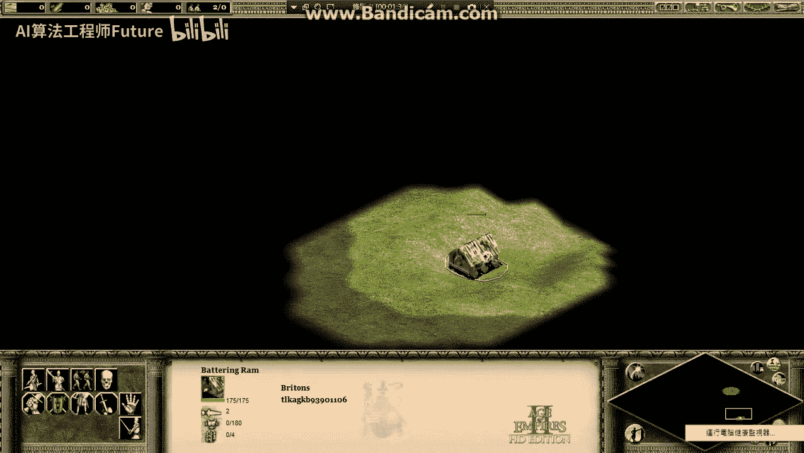
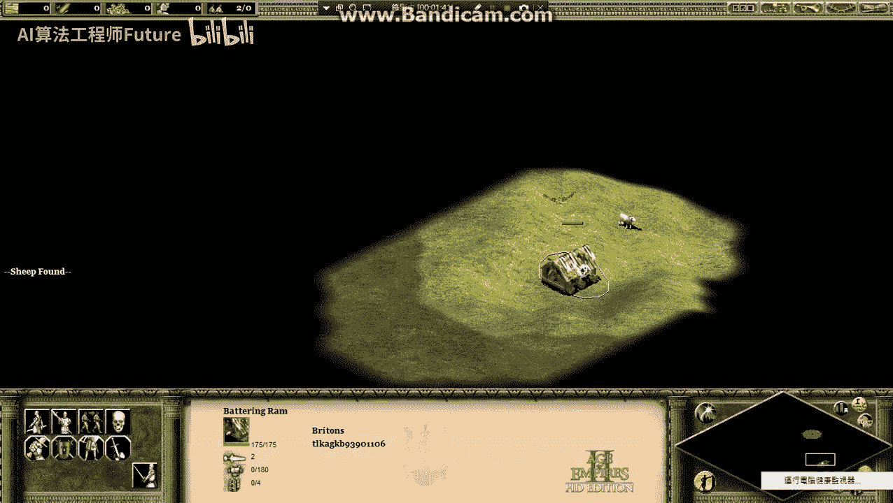
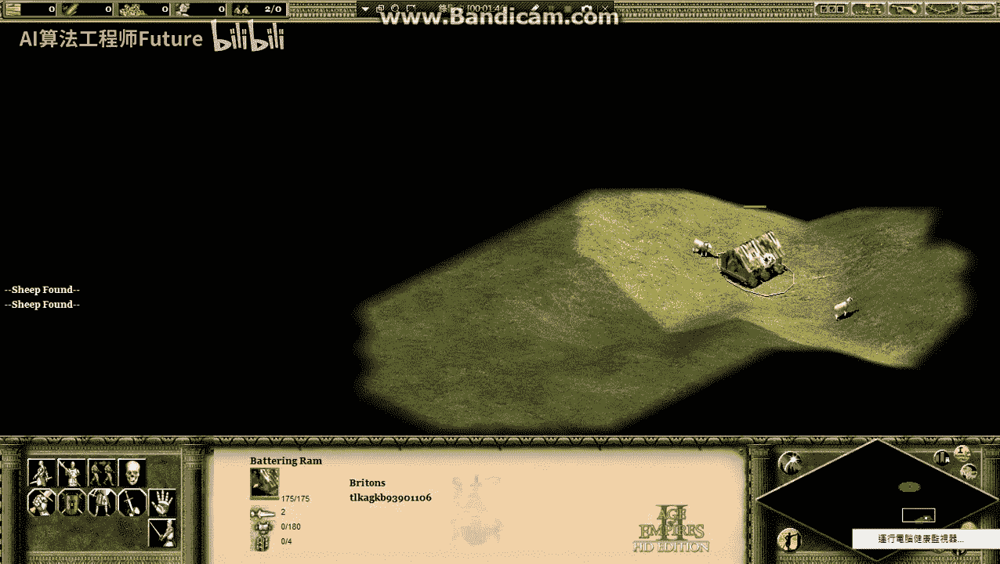
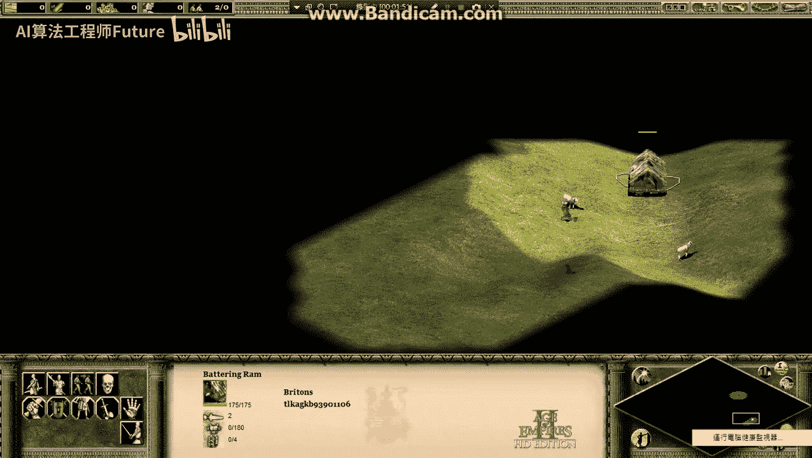

# 【官授搬运】2026年全新优化版李宏毅机器学习系统课程，这才是真正的初学者体系课程！—人工智能／深度学习／神经网络 - P19：7-选修-梯度下降Gradient Descent-1 - AI算法工程师Future - BV1ruqABeEFX

好我们来看看真正在做gradient descend的时候。

感觉起来像是什么样子哦，这是在做gradient descend的时候。

你要想成呢，你好像是在玩世纪帝国一样啊。

世纪帝国大家知道吗，哦在这个游戏里面呢，诶你可以操纵这一个单位哦。

在地图上探索，那这个地图上呢，多数的位置都是有暂物所覆盖的。

都是黑的，都是你看不到的，只有你的单位走过的地方。

你才知道那边长什么样子。

那现在呢我们想象我们在做gradient descent。

这个地图上的海拔就是我们的loss function的值。

那我们现在呢要来找海拔的最低点。

我们现在操控的这个单位啊，这是一个冲撞车啊，这个冲撞车所在的位置呢就代表了一组参数。

现在我们要gradient descend方法。

改变这个冲撞车的位置，调整我们参数。

找到loss最低的地方，那用gradient design方法怎么做呢，首先先随机初始一个位置。

那我现在随机初始的位置呢就在这个地方好。

那我们现在呢看看周遭，看看哪边比较低啊。

就把往比较低的地方呢走一步。

哦发现一只羊唉，好看看哪边比较低哦，这边比较低。

然后再往这边走一步，再又发现另外一只羊。

好那再来看看哪边比较低，行这边比较低，再往前走一步。

好好像前面比较遗迹的地方比较低啊，再往前走一步好，那我们找到遗迹这个地方，那环顾四周呢，发现说哦遗迹的地方呢是最低点啊，它比四周呢都还要低哦。

所以遗迹的地方是一个local maxim local mini嘛，那呃这个local mini嘛，它是不是一个global mini嘛呢，我们永远不会知道为什么，除非你开天眼，开天眼，大家知道吗。

开天眼我来试着开一下天眼啊，秘籍好像是MARCO，对不对好，你要开天眼，才能够看到整个地图上面所有的地貌，但是我没有开天眼，所以你永远不知道说你所在的位置，他是这个这你所在的这个local mini嘛。

