# 【官授搬运】2026年全新优化版李宏毅机器学习系统课程，这才是真正的初学者体系课程！—人工智能／深度学习／神经网络 - P1：导学：课程大纲概述（记得一定要完成每一讲最后的作业，学习效果才好） - AI算法工程师Future - BV1ruqABeEFX

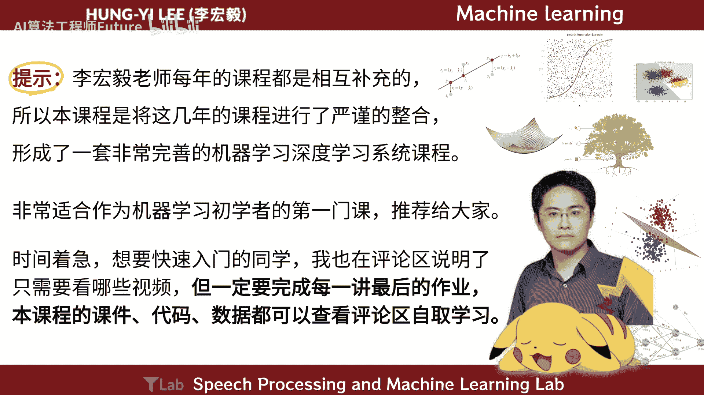

好那我们来很快的概述一下这个学期，你预期可以学到什么样的东西。

好那这边呢是课程网页的连接好，那本课程呢总共有15讲，那课程的录影目前都已经放在课程网页上了，所以你现在就可以开始学习，你完全可以花一个周末，把所有的课程从头到尾一口气通通看完哦。

所以你可以每一周按部就班的学习，你也完全可以用一周的时间，把所有的内容通通学完，那up after you，你可以自己决定你要用什么的，不怎么样的步调来学习机器学习，好那每一讲呢都有一个对应的作业啊。

作业的内容之后呢，会在上课的时间公告，那呃就像我刚才说的，如果你没有办法来教室，你没有办法听直播，完全没有关系，因为作业的讲解也通通会录影好，那上课时间会做什么呢，哎你说既然录影都已经有了，上课会讲。

除了讲这个助教的作业，除了讲请助教来讲作业以外，还会做什么事情呢，今年上课呢会再讲一些新的内容，但是新的内容是跟作业没有关系的，那你自己决定要不要来听，其实根据我过去的经验呢。

这个新的内容跟作业完全无关的，这个200人的课堂，最后有来五个人，我就已经偷笑了，这样子嘿好，那我们就开始来讲一下这门课，你预期会学到什么，这门课既然叫做机器学习，那么就预习学到什么是机器学习。

但什么是机器学习呢，你在报章杂志上可能会听到很多对AI的吹捧，你已经知道说，机器学习跟AI是息息相关的一个技术，但具体而言机器学习是什么呢，具体而言，机器学习其实就是叫机器帮我们找一个函数，好函数。

这个是一个你国高中的时候就有的概念，而机器学习做的事情其实就是找一个函数，我知道你在坊间在各种科普的文章，可能可以找到各式各样拟人化的讲法，告诉你说机器学习就是机器在模仿人类。

然后3号他就知道怎么学习了，然后你根本不知道那个科普文章在讲什么，但实际上机器学习就是找一个函式，举例来说，假设你要叫机器做语音辨识好，今天呢几乎每一只手机都有语音辨识的功能，你对手机讲一句话。

他可以把你说的声音讯号转成文字，那手机是怎么做到语音辨识的呢，那就是手机里面有一个函式，这个函式在投影片上，我们用小F来表示，这个函式的输入网是一段声音讯号输出，就是这段声音讯号对应的文字。

那这个函式显然非常非常的复杂，你可以想见，把声音讯号转换成文字，这是一个非常巨大的工程，这个函式显然非常的复杂，但不是人类可以写出来的函式，所以怎么办，我们期待透过机器的力量把这个函式找出来。

这个就是机器学习好，那同样的，如果你要做影像辨识，那影像辨识今天对大家来说，也不是什么太新鲜的技术，当你把一张照片上传到FACEBOOK的时候，FACEBOOK会直接自动tag你的朋友。

这就是影像辨识的一个例子，那机器怎么做影像辨识呢，一样找出一个函式，函式的输入是一张图片，输出是你要的结果。

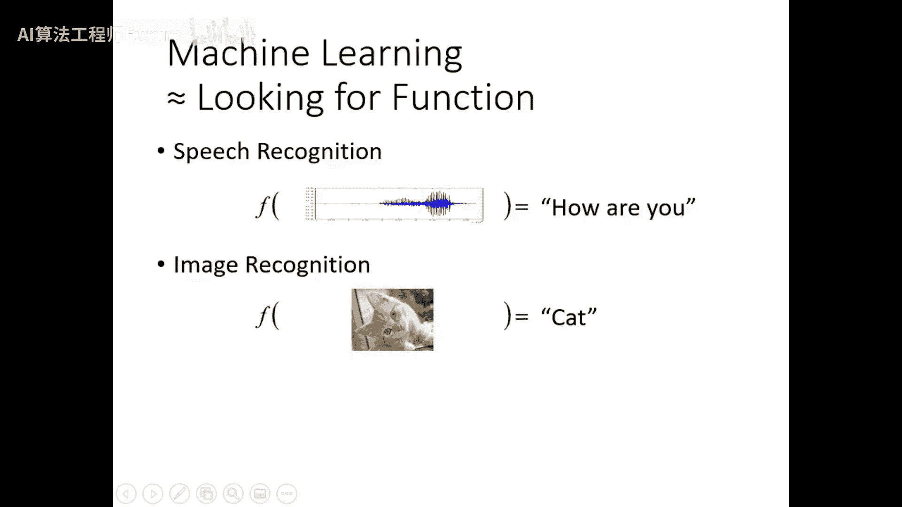

比如说图片里面有什么样的东西，这就是影像辨识，就算是大家都知道的。

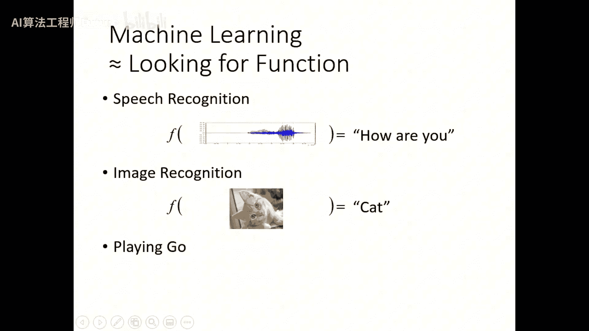

阿尔法go其实也就是一个函式，这个函式的输入是棋盘上黑子跟白子的位置，输出是下一步应该落子的位置，所以机器学习就是帮我们找一个，人类写不出来的复杂函式好，那在这门课里面呢。

我们其实只会特别着重在机器学习里面的，某一个关键技术叫做深度学习，当我们说深度学习的时候，我们的意思是说我们的函式啊，我们说机器学习就是找一个函式，当我们说深度学习的时候。

我们的意思是说机器就是要找一个函式，而这个函式是用一个类神经网络的，整个内神经网络一听就觉得是一个很潮的东西，但是你很快就会知道说说什么类神经网络，就是模拟大脑的神经啊，然后怎样怎样。

然后不知道怎么回事，他就会学习啊，那完全就是一片片麻瓜的讲法，这样好，那我反正在这门课里面，我们的函式就是一个类神经网络，那它可以有各式各样的输出，举例来说它可以有各式各样的输入，举例来说。

它的输入可以是一个向量，或者是他的输入可以是一个矩阵，什么时候我们会希望函式的输入是矩阵呢，举例来说，你在做影像辨识的时候，往往一张图片就是用一个矩阵来表示它，或者是这个函式的输入，也可以是一个序列。

举例来说，如果你要做语音辨识，你要做翻译，你的函式的输入是一段声音讯号，一句话或者是一段文字，这个时候你的输入其实就是一个序列，那也有各式各样的输出，你的输出可以是一个数值，输出是一个数值的任务啊。

叫做regression，你的输出可以是一个类别，所谓输出是类别的意思，就是说你提供给机器几个选项，叫他选择其中一个，那这样子的任务叫做分类哦，那还有其他更复杂的输出，比如说你可以叫机器写一段话。

写一篇文章，或甚至叫机器画图，那这些各种各样的输入跟输出，我们在这堂课都会很快的在其中之前就交给你，告诉你说怎么用内神经网络来制造这些函式，让它可以做各式各样的输入和输出，举例来说，在第一个作业。

我们做的是有关COVID，nineteen的这个确诊率的预测，那我们的函式的输入就是一个向量，输出，就是一个数值，那你很快就会看到这件事情是怎么达成的，好那在第二个作业呢。

我们会做风铃的classification，那你不知道PHING的classification是什么，没有关系，它其实是一个语音辨识的简化版，那在这个任务里面，我们的输入是一个向量。

我们的输出是一个类别，好在第三讲对的作业里面，我们要做影像电视，那这个时候我们的输入就是一个向量，也就是一张图片，我们的输出是这个图片所对应的类别，在第四讲的作业里面，我们会做愚者辨认。

也就让机器听一段声音，他判断说这段声音是谁讲的，这个时候他的输入是序列，它的输出是类别，那在第五讲的作业里面，我们会做机器翻译，让机器比如说读一段中文，把它翻译成英文，这个时候你的输入是一个句子。

你的输出也是一个句子，你的输入是一个序列，你的输出是另一个序列，我们会来看看机器怎么做这一种，把一个序列转成另外一个序列的问题，那在第六讲里面我们会做呃，动漫人人物人脸的生成。

那这个时候你会学到机器怎么画一张图好。

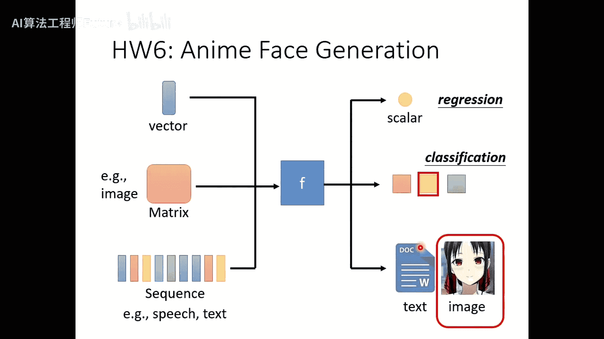

这个是我们前六讲所对应的作业好，那再来呢，我们要问机器是怎么找出这些方向的呢，我们说机器学习它就是自动找一个函数，但是自动找一个函数这件事情是怎么做的呢，在第一讲到第五讲啊。

我们用的方法叫做supervised learning，那supervised learning是怎么做的呢，简单来说，假设你今天呐想要做一个，宝可梦跟数码宝贝的分类器哦。

就是你想训练你的机器看到一只动物，然后他就告诉你说，这只动物是宝可梦还是数码宝贝，知道数码宝贝的同学举手一下，好吧好蛮多人知道的，好手放下，那我就不需要解释数码宝贝是什么。

它就是它就是另外一种跟宝可梦很像的生物了，哎好那你要叫机器学习，怎么看到一只动物，判断它是宝可梦还是数码宝贝，那在supervised learning这样子的学习情境下，我们是怎么做的呢。

在supervised learning里面呢，我们的做法会是你要收集一大堆的训练资料，什么样的训练资料呢，你要去路上呢抓很多的动物，然后每抓来一只，你就给它做一个标记标记。

说这只动物它是宝可梦还是数码宝贝，好了，这边呢假设你就抓了四只动物，那第一只动物这个看起来笑得非常猥琐的，它是什么呢，它是小火龙啊，所以他是宝可梦，第二只它看起来是个麻雀，但它不是普通的麻雀。

它是一只波波，它也是宝可梦好，第三只它不是暴龙哦，它是亚古兽，知道吗，它是亚古兽，它是一个宝可梦，说错了说错了，你看这宝可梦数码宝贝真的很容易弄错，他是一个数码宝贝，而是用最右边这一只呢。

这只我也不认识，我也不知道他是什么东西，但他的手变成一个刀，我们就他首刀乌龟吧，首刀乌龟，他是数码宝贝好，那接下来呢你有了这一些标注之后啊，这些标注我们叫做label，你有这些label以后。

你就可以叫机器自动找出一个function，这个function的输入是一只动物输出，就告诉你是宝可梦还是数码宝贝，那这是在第一到第五个作业。

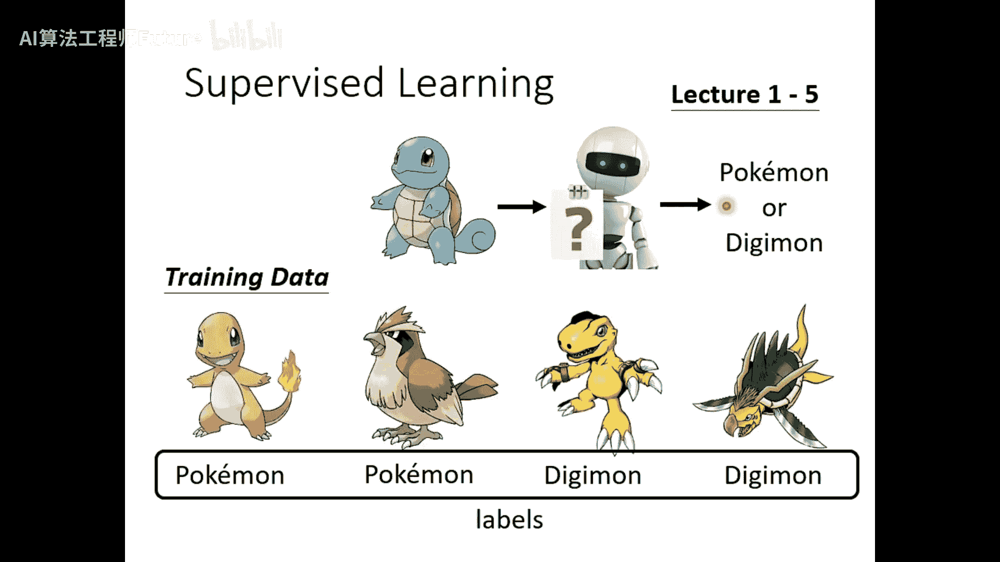

我们会做的事情好，但是光是有supervised learning是不够的，supervised learning有什么样的问题呢，你要做标记，它显然是一个非常耗费人工的事情。

所以你可能收集到的标记资料往往不会太多，而且啊，如果我们要为每一个任务，都收集足够的标记资料，这不是一件非常麻烦的事情吗，因为除了宝可梦跟数码宝贝的分类以外，你可能还想要做其他种类东西的分类。

你想要分猫跟狗，你想要分脚踏车跟汽车，你想要分苹果跟橘子，但是你每一个任务都要收集大量的，有标注的资料，这显然是非常花时间的一件事情，所以怎么办呢。

有一个新的概念叫做self supervised learning，在self supervised learning里面，我们期待模型做到的事情是在训练之前呢，先练成一些基本功。

这个练基本功的过程就叫做PRETRAIN啊，顾名思义就是在训练之前做的事情，所以叫做PRETRAIN，那期待说透过这个PRETRAIN的过程，让机器学会做各种不同影像，辨识相关任务的基本功。

期待他把基本功练好以后，他就可以在新的任务上面做得很好，就好像说当我看过鬼灭之刃，对不对，鬼灭之刃里面有各式各样的呼吸法，那每个人都只会学一种呼吸法而已，但这些呼吸法有共同的基本功，大家知道是什么吗。

诶这就是吹吹那个葫芦不是吗，就你要把一个葫芦吹爆，这样子要把一个葫芦吹爆，然后这样可以练肺活量，然后你就可以把各种呼吸统统练起来哦。

所以呢今天sell supervised learning这个普劝做的事情，就是吹葫芦那一个动作哦，让机器呢先去学，把基本功学起来，希望在其他的任务上就可以很快的学会，那这个基本功要怎么练成呢。

就影像辨识而言呐，今天在练基本功的时候，不需要任何的标注，只需要网络上查一大堆的影像的资料，机器就会自动学会，是我们要他学习的基本能力，那是透过这些大量没有标注的资料，机器会怎么学习呢。

我们今天先不讲它的细节，他举例来说，你可能做的事情就是把一张图片左右反转，问机器说诶他们是不是一样，或把图片变色，问机器说他们是不是一样，让机器去透过这些完全没有标注的资料，学一些基本的任务。

神奇的就是当他学会这些基本任务以后，你有一些真正想要他解决的问题，比如说分类宝可梦和数码宝贝，或分类苹果跟橘子，那这些我们真正要机器解决问题，叫做刚需的任务，叫做下游任务。

当机器呢在这些没有标注的资料上面，他学会分辨左右反转的照片是同一张，学会分辨两张不同颜色的图片，其实对应里面的这个物件是同一个的时候，当他学会这些非常基本的事情的时候，神奇的事情是。

他就可以在我们真正关心的下游任务上面，得到好的结果，那这个就是sales supervised learning的概念，但是这个学期我们在上课的时间，会花比较多的时间跟大家分享的新的技术好。

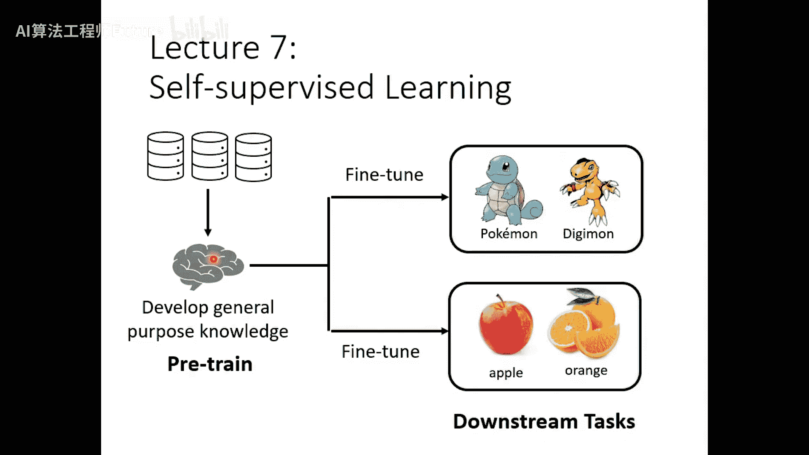

那如果要做个比方啊，我觉得这个PRETRAINING跟downstream task，它们之间的关系，就是今天作业系统跟应用之间的关系，大家都知道说，今天你想要自己在手机上，自己开发一个应用程序。

并不是一件非常困难的事情，往往单一个工程师就可以为手机增添新的功能，为什么今天帮手机增添新的功能这么方便呢，因为真正复杂的事情都已经被enjoy，或者是IOS做掉了，所以你今天在开发一个新的应用的时候。

你不需要从头开发起，你并不需要去管你的应用如何跟硬体沟通，因为这些都工作都已经被作业系统做掉了，所以你可以快速的开发新的应用，而在cell supervised learning里面。

PRETRAIN和当初任务的关系也是一样，你有一个好的preter model，就像有一个好的作业系统，他把困难的事情做掉，当你要开发新的任务的时候，会变得非常简单啊。

那很多人又把这个PRETRAIN的模型呢，今天又叫做foundation model哦，又叫做基础的模型，因为刚才我说他是这他就是基本功，所以我们叫它基础，给他一个很潮的名字。

叫做foundation model，好，那在foundation model里面，最知名的就是一个叫做BT的模型啊，BRT啊，pert呢就是这个黄色的尖头啊，他是一个芝麻街的人物，他长得是这个样子。

所以每次一提到bird的时候呢，你一定要放这个芝麻街的人物。

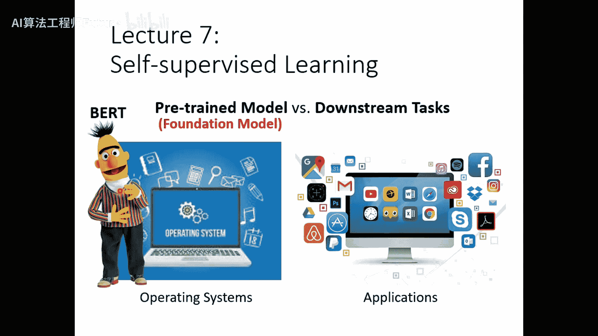

代表你要讲bird这个东西了，阿贝特在大家的印象里面呢，他就是一个硕大无朋的怪物，就好像是超巨大巨人一样，一脚可以踢破玛利亚之墙的那一种，那为什么大家会有这个印象呢。

因为bird有340个million的参数，那虽然340个million听起来很惊人，但是其实今天看来，他也只是一个没有非常大的模型而已，比它大的模型比比皆是，而而且呢这个我你知道。

我发现BERT跟晋级的巨人是真的有，非常强的关联的，你知道什么吗，好一下。

我巨人雷了，他不想听的，就把那个耳朵捂起来，把眼睛闭起来好。

这个观点是什么呢，好以下我要暴雷喽，啊大家都知道说这个巨人呐，他背后是由人操控的，对不对，其实巨人他们本来也是跟我们一样的人类，那你知道最大的那个超巨大巨人是谁操控的吗，是贝尔托特，对不对。

他的名字里面有贝特啊，我跟你讲，这个绝对不是一个巧合，这个绝对不是一个巧合，对就是这样子，哦我我知道有人可能会想说，哎这个应该是先有晋级的巨人，才有BT这个模型吧，这个时间顺序上感觉有点奇怪。

我就告诉你了，那个作者用晋级巨人之力，他可以看到未来就是这个样子哦，所以他就把超巨大巨人的使用者，命名为贝尔托特，就是这样，但是如同我刚才讲的，贝尔特今天已经不是什么了不起的巨大模型。

这个时间点就好像是有人发动了地名一样，有超多超巨大的巨人从地底涌出，那他们是我们自在，在这门课里面很快就会看到的非常重要的模型，好。

那第六讲呢我们会讲generative adversal network，那generative adversal network，最重要的一个关键的应用啊。

就是刚才在讲supervised learning的时候，我们说假设你要让机器输入X输出Y，你要产生大量成对的资料，你需要告诉机器说，我如果输入x1，我希望它输出什么样的y one，我输入x2。

我希望它输出什么样的YQ收集到够多的资料，机器才有办法做supervise的learning，但是如果你有generative adversal network这样的技术，你有这个ADVERSAL。

你有这样子的技术的话，你可以做到什么事情呢，你只需要收集到大量的X跟收集到大量的Y，你不需要它们之间成对的关系，机器就有办法自动把它们之间的关联找出来，那这个技术听起来非常的神奇。

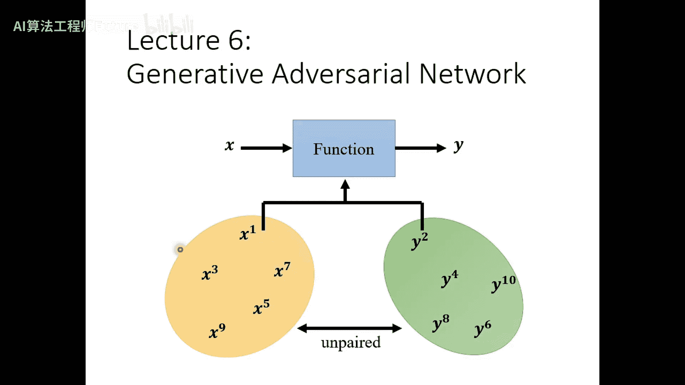

但是今天已经不是完全不可能做到，举例来说，假设你要做语音辨识，一般对语音辨识的想象就是，你要收集一大堆声音讯号，然后这些声音讯号你需要找工读声，标出它对应的文字，你就可以让机器学会。

怎么把一段声音转成一段文字，怎么做语音辨识这件事，但是当有了generative advertiable network这个技术以后，今天有可能做到只让机器听大量的声音讯号，接下来读大量的文字。

这些C选套中文字不需要是同样的来源，不需要讲他们的内容，机器也有办法自动学会做语音辨识这件事情，那假设你对这个技术有兴趣的话呢，目前呃做的最好的结果是来自FACEBOOK的一篇paper。

那我把它连接呢放在这个地方，那其实台大语音处理实验室呢，是最早开发出类似技术的团队，那我们把最早的文章呢放在这里，对在刚开始的时候啊，你知道这个18年的时候啊，呃刚开始开发这样技术的时候啊。

那时候错误率啊都比正确率高这样，但是我们已经觉得非常兴奋了，今天用FACEBOOK的资源，他们甚至可以在某些情况下，让on supervise的结果比supervise还要稍微好一点。

你可以看他们的文章，这个结果非常的惊人好。

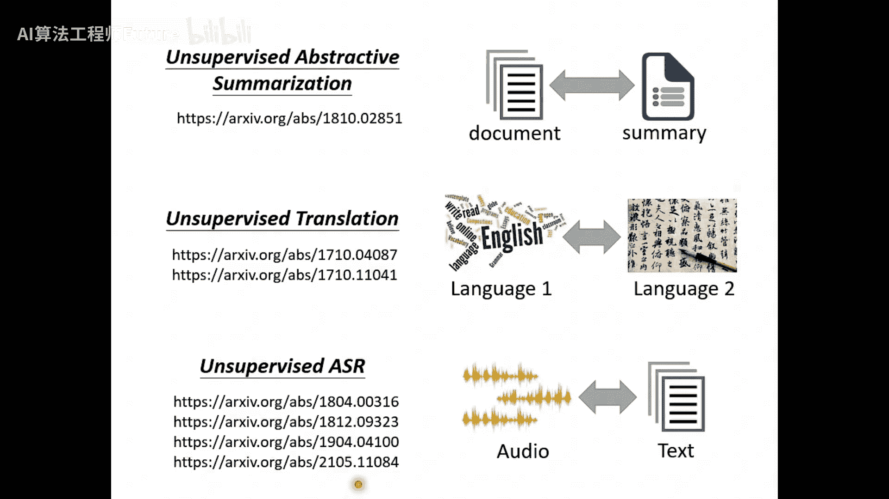

那除了supervised learning以外呢，我们还会讲reinforcement learning，那什么时候我们会用到reinforcement learning呢。

你会用到reinforcement learning，最常见的状况是，你不知道你要怎么标注资料的时候，举例来说，假设你想要叫机器学会下围棋，理论上你只要教机器说看到这样的盘式，你就落在什么样的位置。

你就可以教机器，用supervised learning的方法教机器下围棋，但问题是人类自己也不知道说看到某个盘式，到底接下来应该要下载哪一首才是最好的，人类也不知道最好的那一首应该要落在哪里。

这个时候怎么办呢，这个时候你就需要用到reinforcement learning的技术，所以当你今天你不知道怎么标注资料，但是你可以判断好坏的时候，在围棋里面下赢就是好，下输就是不好。

你不知道怎么标注资料，但是你可以定义什么叫做成功的时候，这个时候你就可以用到reinforcement learning的技术好，那这门课呢我们还会讲一些进阶的课题，也就是说我们在做机器学习的时候。

我们不只是追求正确率，我们还有其他我们要关注的事情，还有什么我们要关注的事情呢，第一个我们叫做anomaly的detection，就是异常检测，什么意思呢，假设你今天真的成功训练起来。

一个宝可梦跟数码宝贝的分类器，他真的可以看到一个这个是小火龙，他就说它是宝可梦，他看到这只亚古兽，他就说他是数码宝贝，但是今天如果有人给他一只真正的暴龙，他会说他看到什么呢，他在训练的过程中。

只有看过宝可梦跟数码宝贝，那我们要他硬是回答，这个暴龙一定是宝可梦和数码宝贝的其中一个，还是他可以说这个东西我觉得他是奇怪的东西，我要回答我不知道哦，所以异常检测就是让机器能够具备回答。

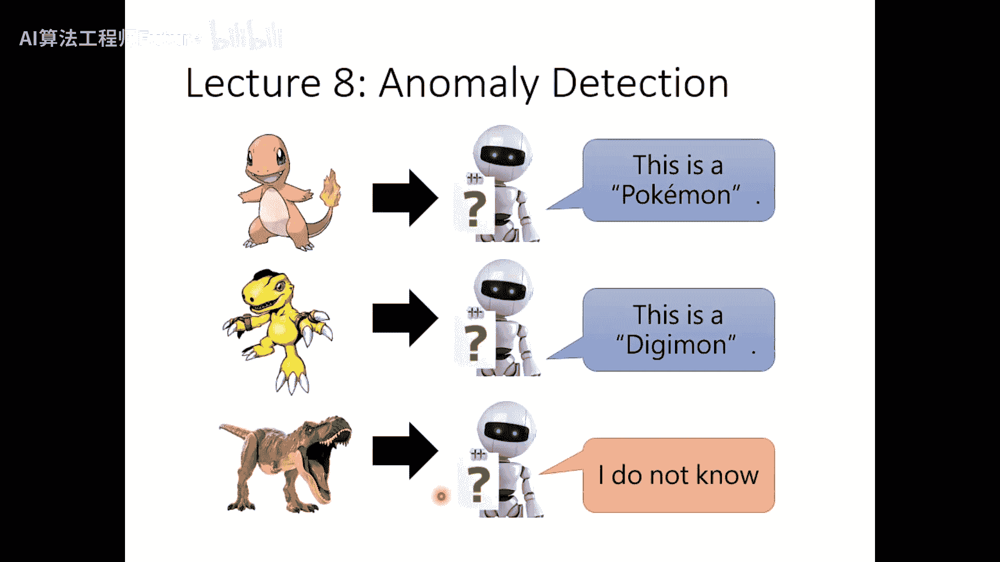

我不知道的成立啊，我们会在第八讲提到异常检测好，那在地球讲呢，我们会讲explicable的AI，那什么是explainable的AI呢，今天假设你真的做出了一个分类器，他看到这个杰尼龟知道他是宝可梦。

真的代表他很聪明吗，真的代表他知道宝可梦长什么样子吗，未必未必，我们要让它不只是回答正确的答案，同时他还要告诉我们，为什么他知道答案应该是这样，那这个就是EXPLAABLEAI，可解释性AI。

那为什么可解释性AI是一个重要的议题呢，以下呢我举一个真正的例子啦，你知道宝可梦跟数码宝贝的分类啊，并不是一个随便乱举的例子，我是真的有做过宝可梦跟数码宝贝的分类的，真心不片啊，这真心不片。

而我本来以为这是一个非常困难的问题，但是我随便兜了一个很简单的内神经网络，但实际上它是什么不重要，很快你就会学到好，随便登了一个类神经网络，一坐下去，在从来没有看过的资料上面咯。

在新的宝可梦跟数码宝贝上面咯，正确率达到98。4，percent啊，不得了，这个美哉机器学习，你知道怎么这也是很合理的，知道机器现在就很厉害啊，机器今天呢没有打败人类呢，你都不好意思出门，你知道吗。

那今天这是机器学习，又战胜人类的另外一个例子，继阿尔法go之后，而机器判断宝可梦和数码宝贝的人的能力，其实也是超越人类的，那我就很好奇，为什么机器可以做到分辨宝可梦和数码宝贝呢。

我决定做一下更详细的检测，所以我就用explainable AI的技术让机器告诉我们，他怎么知道一张图片是宝可梦还是数码宝贝的，那像explainable AI这种技术啊，有很多不同的变形。

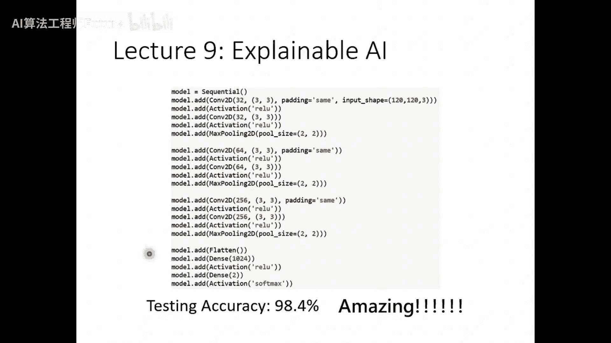

我这边使用的这个技术呢，可以告诉我们说给他一张图片，他觉得这张图片里面哪些地方是重要，举例来说我给我的模型，这些数码宝贝啊，什么数码宝贝好。

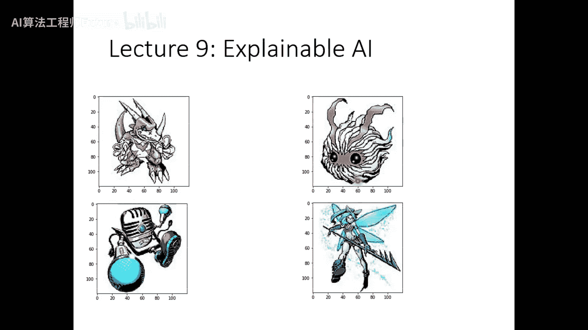

OK还有对数码宝贝，他会把他觉得是重要的地方，放一些亮亮的颜色，代表他觉得这些地方是重要的，然后觉得有点奇怪，看起来重要的地方是分布在图片的四个角。

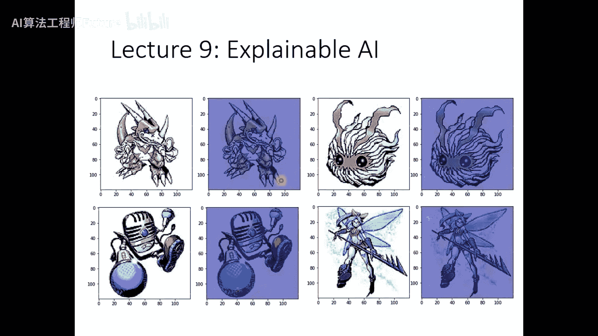

不知道怎么回事，而接下来呢我又让他看了很多宝可梦。

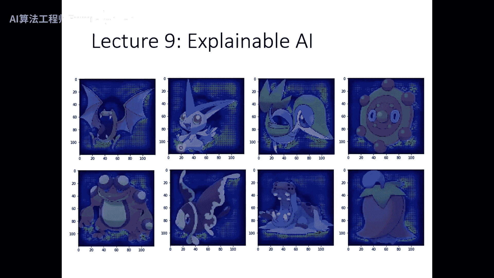

咦为什么今天机器觉得重要的地方，都跟宝可梦的本体没有关联呢，哇后来我发现因为所有的宝可梦都是PNG党的，所有数码宝贝都是JK的党了，把PNG档读进来后，背景是黑的啦，所以机器其实什么都没有学到啦。

所以这个故事告诉我们，说这个你以后看到有人说什么，哎这个机器比人厉害啊，小心搞不好是什么奇怪的骗局，这个故事我其实在2020年就讲过了啊，所以很可能很多同学都听过这个故事。

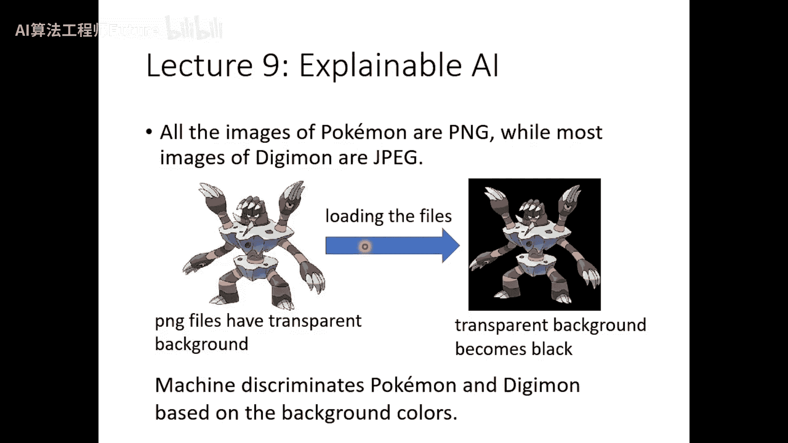

但是这个学期我要告诉你说，当我把这个box fix以后，当我把所有的图片都弄成PNG档以后，接下来会发生什么事情好，那大家就期待之后的课程好，那除了这个explainable AI以外。

第十课我们要讲这个模型的攻击，什么叫模型的攻击呢，今天虽然号称影像辨识系统有多厉害，什么可以跟人类相匹敌，但是他真的有那么厉害吗，你可以在网络上随便找一个很厉害的，可以做影像辨识的模型。

把一张猫的图片丢给它，他可能会给你这样子的答案，举例来说，我用了一个50层的network，给他一张图片以后，他告诉我说这是一个tiger cat，那它不止会告诉你是哪一只猫。

它还哪一家不止告诉你它是一只猫，它还告诉你猫的品种，但是奇怪的地方是，当我在这个图片里面加入了一个小小的杂讯，你可能会说杂讯在哪里哇，那杂讯太小了，小到人的肉眼都没有办法看到，奇怪的是。

这张图片就被辨识成海信，而且下面这个分数是什么，下面这个是信心分数，本来机器还没有特别确定它是一只猫，它现在百分之百肯定这个就是一个海星，那为了要证明说，这两张图片真的是有一点不同的。

我不是把同一张图片复制两次来骗你，所以我们把这两张图片呢做一个相减，但光相减不够，因为那个杂性实在太小了，光相减你是看不出东西来的，所以怎么办，相减以后乘上50倍诶，看到说杂讯长的是这个样子。

这个杂讯看起来跟海星不太有关系，但神奇的事情是，把这个杂讯加到图片里面，机器就会变识错误，那这个就是人类对模型的攻击，那在这堂课里面，在这门课里面我们会看看有什么样攻击的技术。

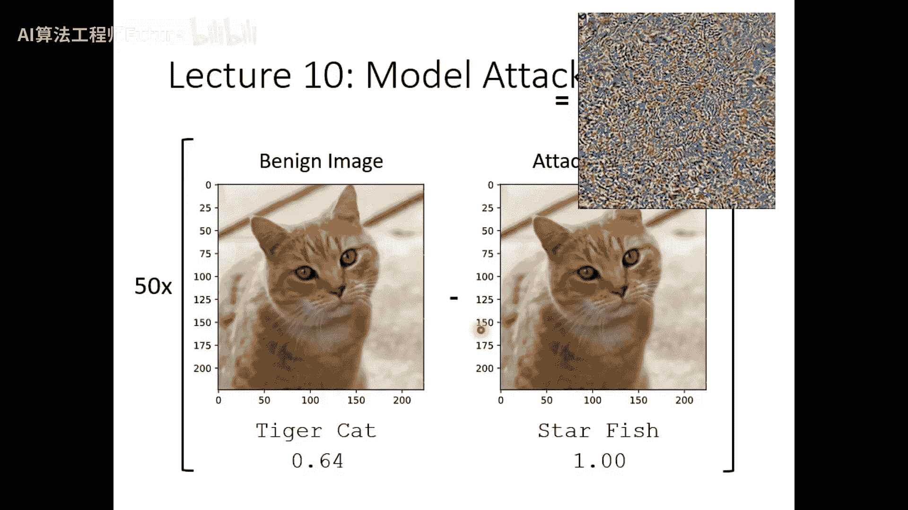

还有防御的可能性好，那在第11讲呢，我们会讲dman in adaptation，Dmain attention，什么意思呢，懂main attation的意思是说，一般我们在做机器学习的时候。

我们往往假设训练资料跟测试资料，它们的分布是类似的，举例来说，你的老板叫你做了一个手写数字辨识的模型，他可以看到一张图片，便是图片中有什么样的数字，那你心里往往预期的事情是。

今天你的客户在上传图片的时候，叫你帮他做手写数字面试的时候，那要辨识的图片，应该长得跟训练的资料有非常类似，它们有同样的分布，那确实，假设今天训练资料跟测试资料的分布非常类似，在这个资料集上。

那以下数据是取自右下角这篇文献，你可以得到99。5percent的正确率，非常正确率非常的高，但是你真的觉得你的客户就会丢一个分布，很像的图片吗，他可能会丢这样子的图片，他可能会丢彩色的数字。

那你的老板会觉得说这个黑白的数字可以辨识，彩色的数字，不会不能辨识吧，但神奇的地方是，当你今天就算是手写数字辨识这么简单的问题，如果我们的训练资料是黑白的，但测试资料是彩色的。

这个时候机器的正确率会突然暴跌啊，在文件上它会跌到57。5percent，那怎么解决这个问题。

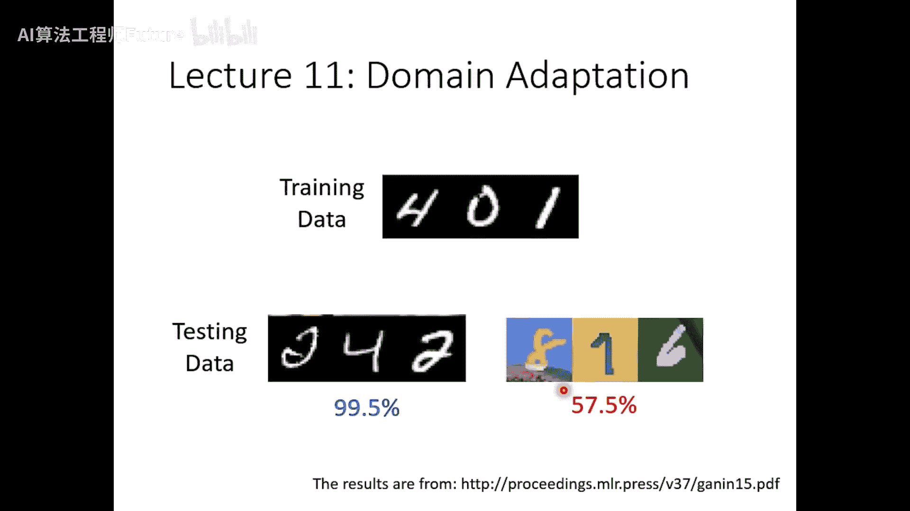

就是第11讲要探讨的技术好，那第13讲呢我们要讲模型的压缩。

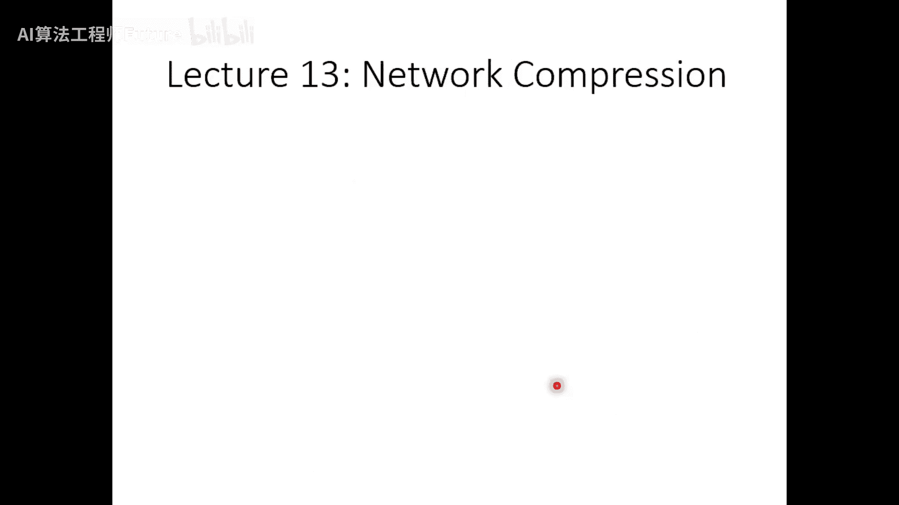

那我们刚才已经有看到说，BT是一个硕大无朋的模型，像这样巨大的模型，你可能很难把它跑在h device上，当你的运算资源有限的时候，你可能很难去跑这些巨大的模型，那怎么办呢。

有很多的技术可以把这些模型变小，让他们可以跑在，比如说手机上，跑在智能手表上或跑在ROM上面。

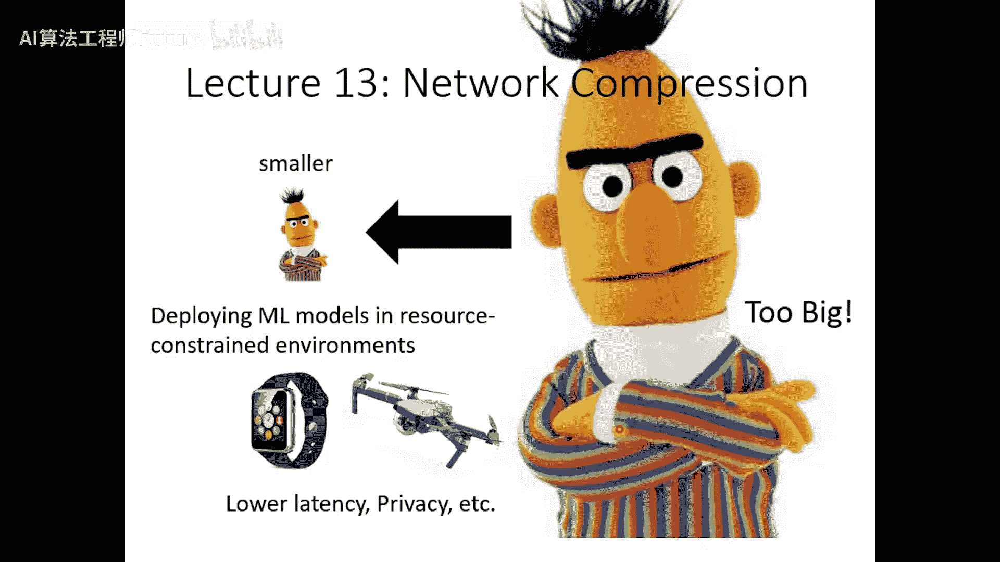

那至于这怎么做，我们会在第13课的时候讲到，那第14课呢我们要讲lifelong learning，什么是lifelong learning呢，Lifelong learning。

其实就是大家对于人工智慧长久的一个想象，往往在科幻小说里面都会告诉我们说，今天有一个机器，你先教他一个什么东西，他就学会了哎，再多教他一点东西，他就变得更厉害了，你再多教他一点东西，他就变得越来越厉害。

他活个上千年，上万年，把所有的技术都学会以后，他就变成天网，就可以统治人类好，但是做到第14课的时候，你就会开始怀疑，为什么做了这么多作业，天网都还没有出现呢，那在第14课接近课程尾声的时候。

会告诉你想要做一个天网到底有什么样的挑战，为什么我们没有办法让机器不断的学习。

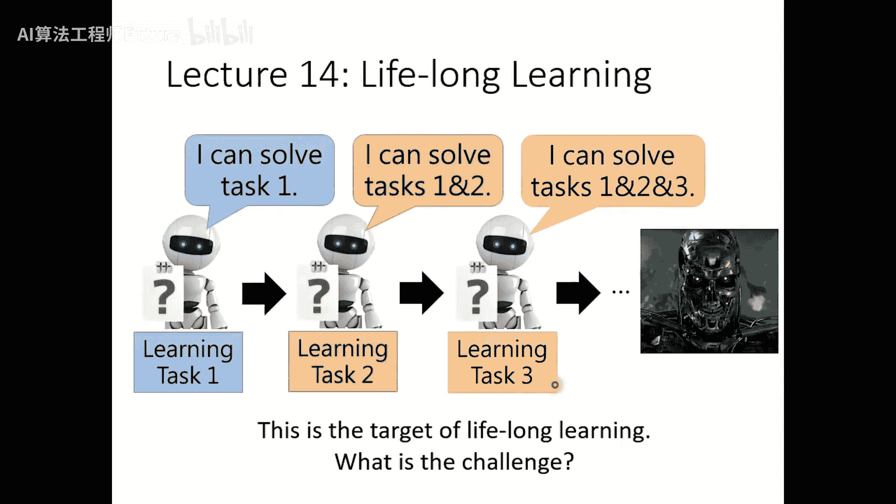

新的技术好，那在第15课啊，我们要进入一个全新的环节，我们不止做的是机器学习，我们要叫机器学习如何学习，而学习如何学习这个技术呢，就叫做meta learning好。

那这个meta learning它真它实际上是什么样运作的呢，经过去啊，在第14课之前，在第14讲之前呢，我们都是人呢去设计了一个学习的演算法，让机器具备分类的能力好。

但是在第15课在讲meta learning的时候，我们让机器从大量的任务里面，自己发明新的演算法，也就是机器不再使用人所设人所发明的演算法，它从过去的学习经验里面发明出新的演算法。

希望他可以把他希望他可以变得更厉害，那其实meta learning呢跟一个叫FUSHA，learning的技术是非常有关系的，那few sha learning，这个FUSHA的意思就是。

用非常少量的标注资料就进行学习，那很多人呢甚至会把meta learning跟future learning划上等号，为什么人们往往把它划上等号呢，是因为今天往往你想要做到Q下learning。

你会需要用到meta learning的技术，也就是凭着人所设计的演算法，没有厉害到让机器可以看一两个example，就学会某个任务，我们需要让机器自己发明新的演算法。

他才有办法透过少量的资料进行学习好，那这个是mea learning跟future learning之间的关系好。

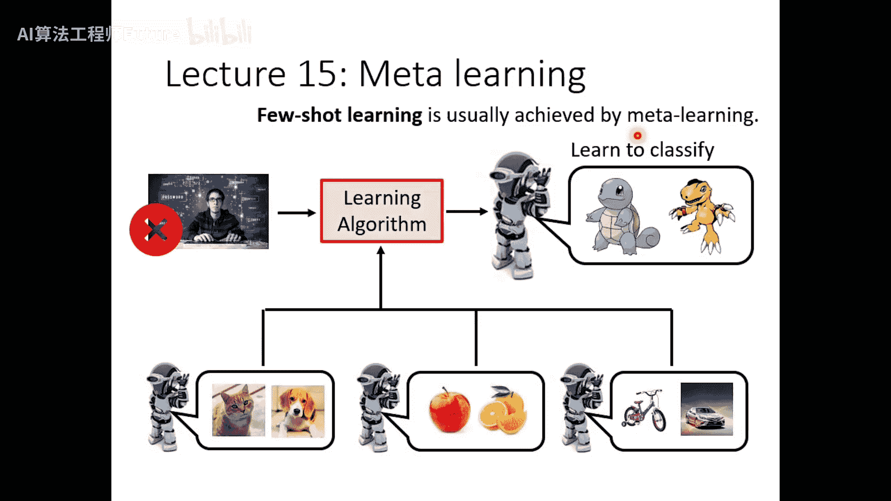

那以上呢就是很快的带大家看过这门课，会告诉大家事情。

