# 【官授搬运】2026年全新优化版李宏毅机器学习系统课程，这才是真正的初学者体系课程！—人工智能／深度学习／神经网络 - P21：9-选修-深度学习新的优化器 -1 - AI算法工程师Future - BV1ruqABeEFX

大家早安，好啊，那我们就开始上课哦。

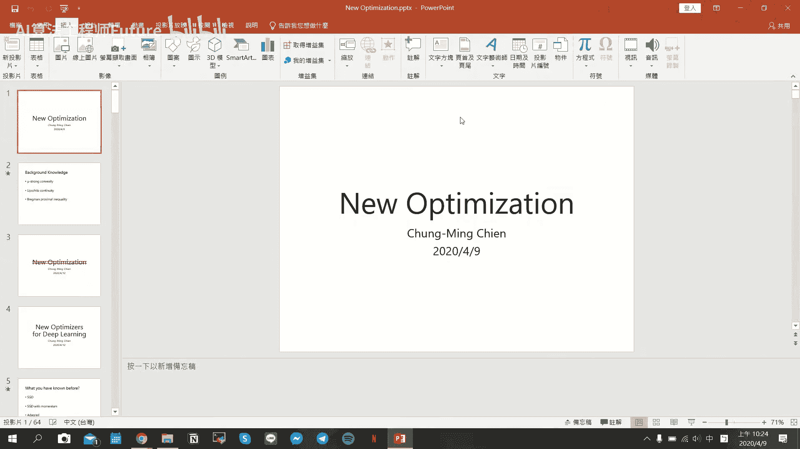

今天我们要讲一下的主题是new optimization啊，哦等下先讲一下，刚刚忘记讲，等一下大家如果就是上课中途有问题的话，因为现在人没有很多，所以可以直接插话进来，应该没有关系。

应该不会拖到大家监督，反正人不多，这样他如果不好意思的话，也可以打字在聊天室里面这样好，那我们今天要来讲一下new optimization这个主题。

也就是大家平常训练neural network的时候，常用到的，ADAM或者是SGD这种optimization的方法好，那在我们开始之前，我们会先需要一些背光knowledge好。

这些背光knowledge可能包含这几个名词对，但是大家会好像会觉得奇怪，这几个名词的我完全没有听过就没错，我在大家这个时候这么大的时候也没有听过啊，这些都是一些很数学的方法，对啊。

任何一个东西其实都不是一堂课或两堂课，讲的完了，所以其实我们今天不会go through，这这些很详细的数学证明，我们今天不会去详细证明任何一个optimizer，它会在某一些情况下。

它可以达到convergence的guarantee，所以我们今天其实会比较概念上的来讲解，optimization这个主题，所以我觉得呢这堂课与其叫做用optimization。

我们不如把它叫做new optimizers for deep learning，也就是我们今天会让大家带走一些像ADAM，像SGD这种，你在KERAS，在PYTORCH里面，你可以随扣随用的东西。

然后还有他们一些概念上的解释，但我们不会很详细去证明说，他们在什么样的情况下可以converge，毕竟这些guarantee都是在很强的情况下，才能保证它可以converge。

所以在DELEARNING这种这么复杂的应用上，其实不管你有再强的guarantee，其实对DEMNING来说都是不够用的好，那我们先来复习一下我们之前学过什么东西，这个应该是李宏毅老师上课有讲过的。

在以前有一份投影片是，some tips for deep learning里面应该会有讲过这些主题，首先我们有SGD就是STOC，Okay，take gradient descent哦。

S g d with momentum，我们之后可能会用SGDM来代表这个算法哦，Adaggrade rms prop。

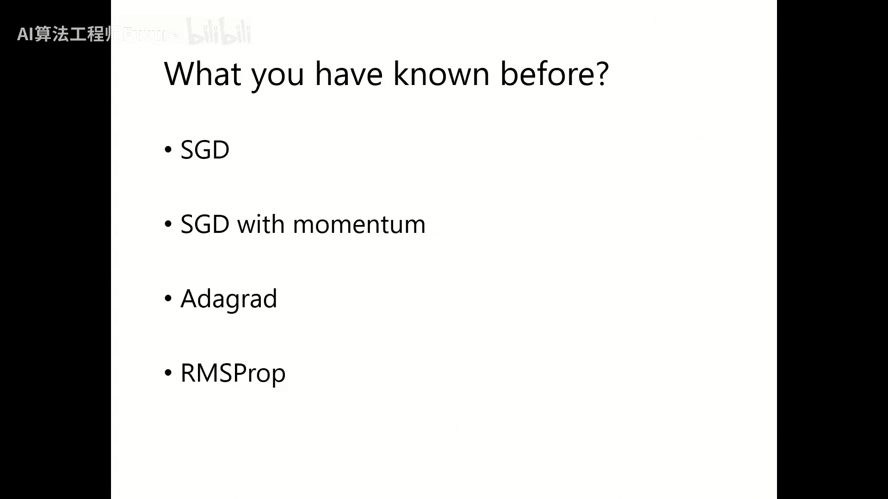

还有最后的A等这五个算法好，那我们先啊讲一下这堂课，整堂会用到的notation好，首先我们会用THETT代表整个神经网络的参数，也就是我们这个训练中，我们想要去optimize的问题。

接下来我们会用到L这个东西，来估计某一组theta在特定的时候它的loss，然后并且我们会对这个loss去算gradient，所以我们对这个漏算GRA点以后。

我们就可以根据目前的THETT来optimize，得到下一个time step的theta t加一好，接下来我们还有momentum，就是M这个东西，但这个东西啊李辉老师以前上课有讲过。

但是如果之前没有看过影片的，你可以先把它想成，它是记录了一些关于gradient的history，也就是它会记录mt加一这个东西，它其实包含了所有第零个time step。

到第T个time dt加一个time step，它的theta的的那个gradient，所以其实他就可以行，挂了前面说过的资讯，但是他会有一些压缩，并不是完全就是全部都盖过好，那看最下面这个图好。

看一下我的荧光笔，好最下面这个图就是一个general神经网络架构，首先我们会有一个input，就是XT，接着送进了theta t，就是在第七第七个time step上面。

神经网络的参数我们会得到一个prediction，就是YFT，这prediction有可能如果你们在做classification的话，它就是一个呃一个过soft max以后的几率向量。

或者是如果你们做的是generative model生成，比如说生成图片的模型的话，那这个WIP就会是一张你生成的图片，那这张YFT跟会拿去跟一个y hit of t，去算一个lows。

这y head of t也就是你训练的时候的光truth，就是你训练的时候那些one hot的label，或者是在你做generative test的时候，可能是你训练的图片这样好。

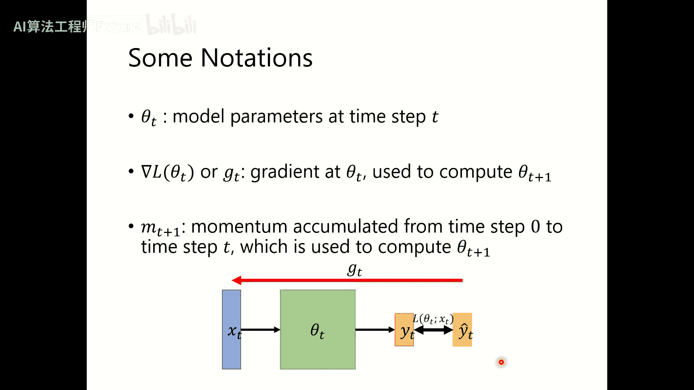

那我们现在考虑一下，我们做optimization是要做什么事情，我们要对这，为什么要对这神经网络做optimization，我们其实就是要找出一个sea。

它可以让你training data里面所有的X，算出来的lose可以最小，也就是你要找到一个神经网络的参数，可以越贴近你的训练资料越好，让你的任何一个ST丢进你的神经网络以后。

算出来的YT都要很接近y head of t，所以它让就是让你这个submention over所有的X，它的loss越小越好，那换句话说，如果我们现在就是用特定的X的话。

其实我们就是要再找一组theta，它可以在一个像是这样的平面中达到最小值，可能是这个点或者是这个点，我们要找到一组theta，它可以的，有在这个这是一个low surface上面有最小的值，好哦。

那我们要怎么去找这个东西，首先可能有同学会问说哎，我们每一个time step我们只会看到一个XT，那我们要怎么去sum over所有的time set，就是所有的data set里面的X。

因为我们随时其实都只知道一部分的资讯。

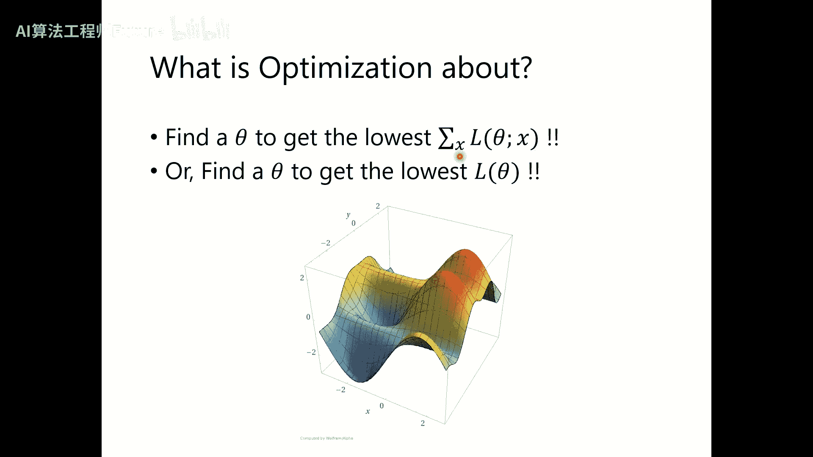

那其实这个有一些背后有些理论，但是我们今天的处理就是等下我们今天的处理，就是我们不要理他，我们在刚刚说的这种方法，其实就是在每一个time step，我们只会看到一个XT啊，这个在正式上来说。

我们会把它叫做online learning，相对来说另一种就是offline learning，也就是我们在每一个time step，可以看到所有的X还有所有的Y，还有所有的帮助。

相对来说我们做offline learning应该会比较容易一些，因为我们一次就可以看到所有的training data，但其实会有个问题，因为我们在训练神经网络的时候，我们并没有这么大的记忆体空间。

或者是我们没有这么多资源，所以我们没有办法把所有的data都塞进去，于是呢我们就在事实上宣的时候，我们一次只会得到一个X，但是我们在这堂课里面，我们会先忽略掉这部分，我们会假装我们任何一个时刻。

我们都可以得到所有的X，还有所有的Y，然后算出一个完整的l of theta，这个东西只depend on theta或depend on x，这样我们的接下来的讨论会比较容易一些。

那我们刚说的这种setting，就是假设我们已经知道了，所有的X跟所有的Y的话，其实这个东西我们就会叫它是offline的。

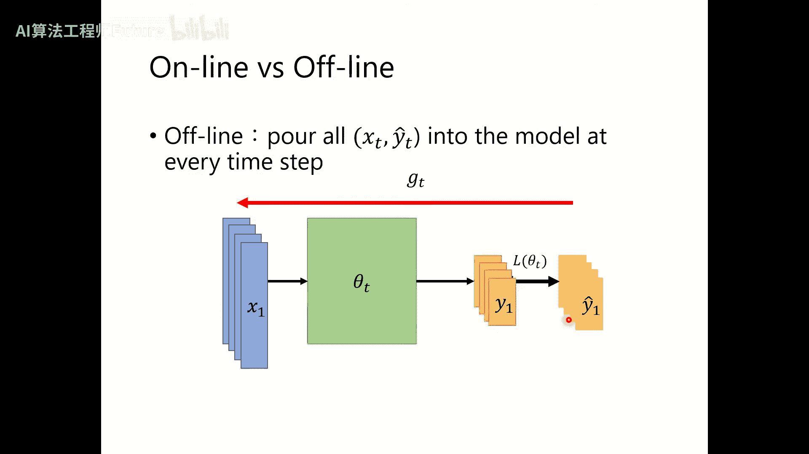

Optimization，也就是他一次可以拿到所有的训练资料，我们这堂课里面主要会FOCON这样的一个setting。

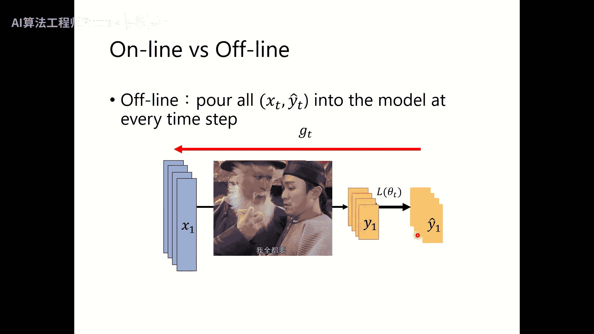

那我们现在就要开始复习，之前学过的一些optimization的方法，首先是SGD，SGD是stop castic，Gradient，descent是所有的方法里面最基本的一种。

首先我们会在theta0这个insulation位置开始，接着算它的GRADI，就算完GRA点以后，我们就根据gradient的方向，我们往反方向走一个，因为gradient的方向就是L增加了方向。

所以我们要往它反方向走，就是往L减少的方向走，因为我们的目标是要找到一个theta，可以有最小雷咯，所以我们就直接往这边走一步，也就是在这个图上，我们的gradient往这边，所以我们就往反方向走。

接着在下一个time step，我们再算theta one这一点的gradient，接着再往反方向反方向走，每一个time step都是往反方向走一步，就是这样子啊，这一张是李宏毅老师上课的投影片。

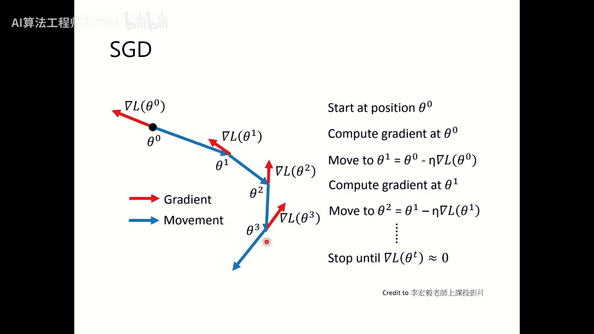

就是借用一下，这样好，那第二个算法是h g d with momentum，这个东西就是会用到我们刚刚说的momentum，这个东西一开始一样，我们先从C20开始。

这个时候我们定义了一个参数叫做momentum，不应该不要说参数定了一个向量是momentum啊，他一开始引力所来的值也是被设成零，接着我们在这下零的这一点算它的gradient，也就是这个红色的箭头。

接着我们要去更新刚刚说的这个V0，这个momentum的值我们要怎么更新它，我们就把原本旧的V0，因为V0原本是零，所以这一项其实是零，没错，把它再减掉，这个E塔是running rate。

一塔乘上GRADIL，那这是什么东西，这个东西其实就是你算出来，刚刚SGD里面算出来，你要update那个方向，所以你在这里，你先你在这里你得到了这个GRA点，然后你把你这个update方向。

这个东西累计到momentum里面，然后你就根据这个moment meter的大小，我们移动一点点，就是这个东西，那这个momentum为什么，它要乘上一个过去的momentum。

最后再加上你算出来的GRADI呢，再减掉你算出来的GRADI，其实他是要做一个在时间上面的wait su，也就是还要把过去的time step的history累加起来。

所以其实你每一个time set的gradient，你会影响到不指的是这个time step走的方向，其实你还会影响到下一个TSTATE走的方向，因为你在这边它会有一个过去的momentum。

那为什么要做这个东西呢，原因是这样，因为你在做这个东西的时候，其实有可能你在某一个time step，他会算到一个接近是零的gradient，假设这个弹CEPT他的GRA点接近零的话。

那这时候就会出问题，为什么，如果你用SGD这样他就会卡在这里不动了，但是在做DEMNING的时候，有可能他只是并不是一个最低点，有可能他只是刚好算出一个GRA点是零。

有点像是一个local minima的概念，那用momentum算法以后，因为你这边还有个过去累加的项，所以他就可以确保它一直在移动，不会停在这个点，因为不管怎么来说。

你多看多看一些东西总是会比较好一点好。

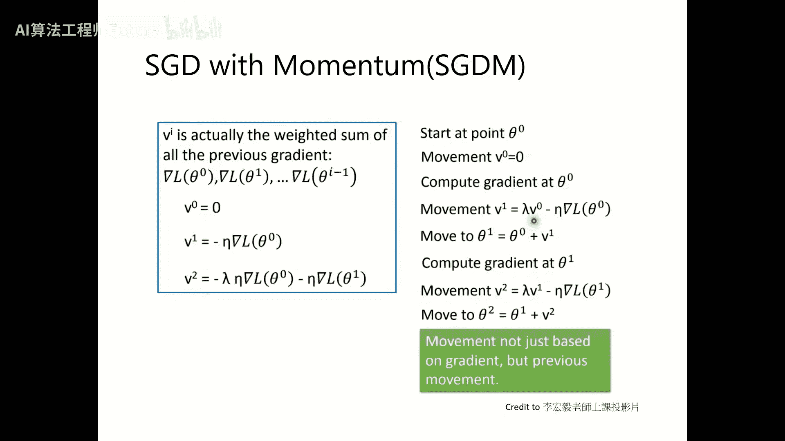

那如果用画图来说，就是这个样子，我们一开始在最左边的这个点，然后我们开始做optimization，一开始我们算了一个GRA点，然后所以移动过来，接着在这个点上我们又算了一个拐点，但这个点很平。

所以这个拐点比较小，但是因为我们前面有了这个东西，所以我们我们前面的移动会累加到下一步，所以我们这边的移动，会受到前面这个GRA点的影响，所以我们会继续移动，接着到了这个点，到这个点就是出事了。

因为你的鬼点算出来是零，那如果用SGD的话，这样他就卡在这里不会动，但是因为我们刚刚有前两个time step累加的移动，所以我们这边momentum还是会有一个固定的大小，所以我们会继续往下移动。

这样然后到了这个点好，现在它的拐点其实往反方向了，但是你现在因为你看到所有的图，所以你知道这个坡在这边会更有更低的值，如果你用SGD的话，它会直接往回走，就卡在这个点，但是你现在用momentum。

所以因为你前面有些累加的，某某那个累加的momentum，所以他这个拐点虽然叫往反方向走，但是因为还有一些过去的history，所以他会继续再往前走，然后可以达到更低的点，这样好啊。

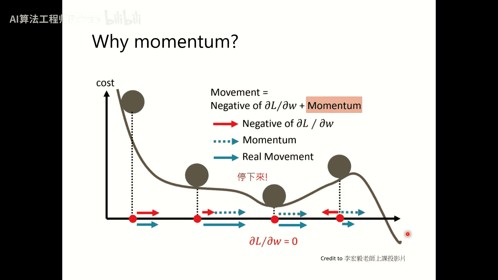

等一下我忘记讲这个东西了，好，那接下来我们介绍阿达grade，ADAGGRADE的概念，就是说，你把SGD的这个一塔就是它learning rate加上一个分母，为什么要加上这个分母呢。

其实它的概念就是说，如果你的gradient在前几个time step。

它的值很大的时候，那会发生什么事。

你的在前几个GRA点那个time sb他的值很大，它有可能一开始就会暴走，暴走就会走太多步，那你可能就会走到一个反而更差的位置，那他加上了这个下面这个分母。

它是过去所有type tap gradient的和，也就是说如果过去的规点很大的话，那他就这个东西就会很大，所以他就走小步一点，因为过去的规点很大，就表示他是在一个比较崎岖的一个方向。

因为你的可能表表示你在这个方向，这个方向它是比较陡的，所以在这个方向的gradient，因为GRADI这每个GRA点都是一个向量，在这个方向的GRADI，它的过去从D0到DT减一个time set。

它过去的grading会比较大，所以这样你就用小一点的人in r，避免你一下走太步，大步就跳过去了，那在你的gradient比较小的方向，你就用一个比较大的人in ray，因为这里比较平缓。

所以你可以放心的往那个方向走下去，好那接下来下一个算法是rms prop。

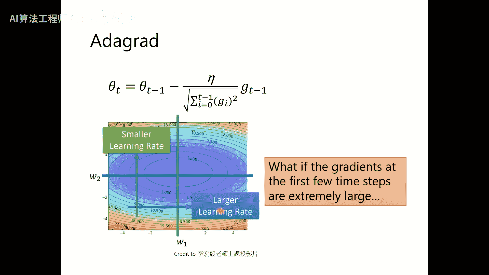

那这个东西跟阿达grade的差别，唯一的差别只在一件事，他这个分母的算法不大一样，原本阿拉gram，你是直接把所有的过去的gradient加起来，但是他现在有点借用了类似ADAM的那个算法。

它现在呃类似momentum的那个算法，他现在会把一个过去time step累积的gradim sun，这个V其实就是一个sum of gradient呃，Sum of great gradient。

它把它乘上一个阿尔法，然后再把目前这个time step的gradient，乘上一个一减阿尔法，把这个东西加起来。

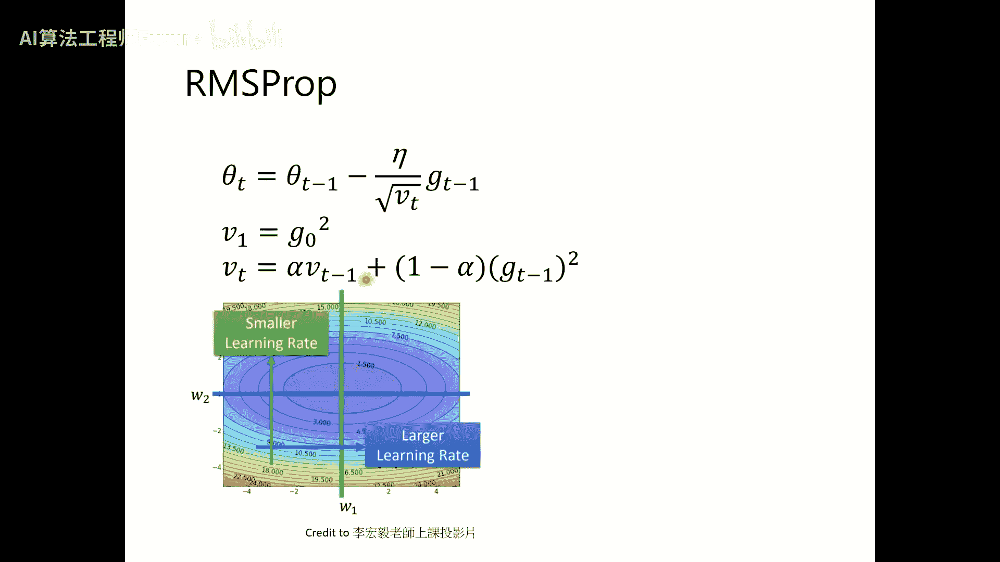

那为什么要这样加呢，因为回来在ALAGGRADE里面，它这个东西是mono通的，也就是说它会一直无止境的累加，所以如果你一开始的gradient太大的话，那会发生一件事情。

就是你呢这个人因为一下子就会变得很小。

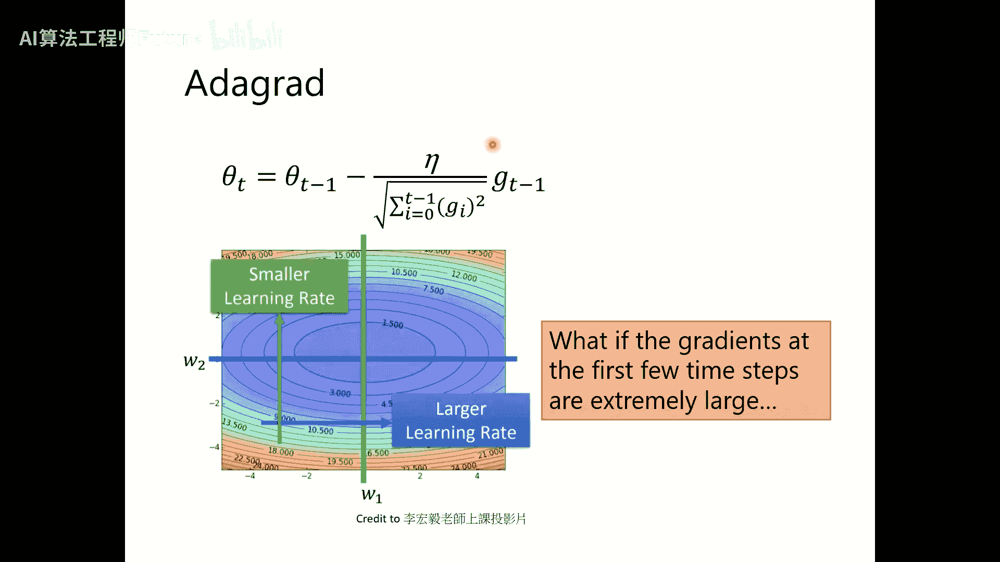

它一下子就会变得很小，那如果这样的话，他可能没走没几步，它就卡住了，所以我们这边用了这个算法，确保这一个VT它会不断的变化，而不能就是他不会永无止境的变大，而是他会在时间上有一个问题上。

所以这样我们可以确保这个optimizer不会再走，没几步以后，就因为前几步的gradient太大，所以停下来好，但是，但是嗯这样的话确实是可以解决，就是它下面的这个BT就是这边说的EMA不。

就是让它不会永无止境的增加。

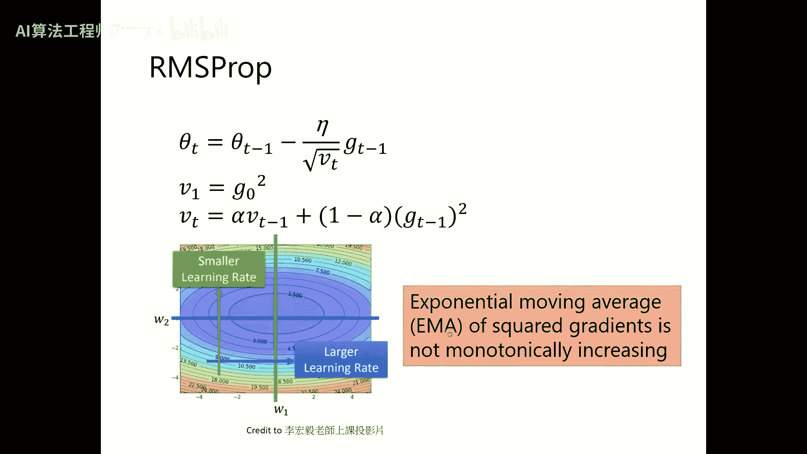

但是这样还是没有办法处理到，一开始说你用SGD的话，他有可能会卡在一个GRA点为零的位置的，这个问题，所以接下来ADAM算法，它就把SGD加上了arms prop，这两个东西合在一起。

那它要怎么合在一起呢，我这边对于momentum的东西，我们的记号有稍微改一下，为了配合一下ADAM的论文，所以我们记号稍微改一下，但大家可以回去check一下，跟前面的东西其实是差不多的。

好那在A等里面，我们的公式就变成这个样子，原本后面是一个gradient tern，现在这个东西在ararmies prop里面，这个gradient turn。

就是改成了HDM里面的这个moment特，但是大家注意一下，这里有个黑，为什么会有这个hit呢，因为这个H其实是你的mt，这个momentum要除上一个东西，为什么要除上这个东西呢。

原因是因为你在一开始的时候点了，这个M1定是会随着时间累积，因为这个贝塔是一个小于一的值，所以它一开始的时候会比较小，会随着时间累积才慢慢稳定下来，所以在T小的时候，你帮他去。

就是帮它除上一个小于一的数，所以让你T小的时候的这个IMMATION可以是准的，而不会在你T小的时候就用这个贝塔小于一，所以这个M其实是一个不够大的数字，它除上这个东西以后，确保这个wait su。

在你从T到零到T到你最后一个time set的时候，这个mt它的大小变化不会随着时间增加，额越来越大，而是会因为你在T小的时候，这个东西会比较小，这个分母会比较小，所以它让你的这个M随着时间的变化。

不会这么大，那对VT也是做同样一件事情，然后这个贝塔和贝塔图呢，其实作者有提出一个值，就是也就是这个这边这个问题上的值，作者提出来就是0。9跟0。999，然后还有最下面这个x zone。

就是怕你一开始提等于零的时候的，这个BT会是零，所以它加上X我们来避免一开始的时候会爆掉，然后造成一个无限大人人类的情况好，那这就是A等好讲到这边，我们其实都在复习之前学过的东西，就是这五个算法。

那这五个算法我们可以看一下，他是什么时候提出来的，第一个SGD这东西诶，这个东西其实1847年就提出来了，然后HD为什么met这个东西，是1986年提出来的好。

那接下来下面这三个adaptive learning rate的方法，也adaptive learning rate，就是说他learning ray下面除上了刚刚的那一个分母。

那他们三个用了不同的分母的算法，但是我们都会统称他们叫是叫做addictive，learning rate方法，ARAGGRIS是2011年提出来的，r m s prop是2013年提出来的。

这个比较有趣一点，他是心疼在他一个lecture slide里面提出来的，其他都算是一些正式论文或者是著作里面，但这是这个东西第一次被提出来，是在CORSA上面好。

那最后ADAM这个是2015年被提出来的好，那我们现在除了这几个以外，大家还有听过什么样的optimizer，其实就没有了，其实我也差不多，我会用的，可能也就是这几个里面随便挑一挑。

那每一个都是都挑看看，然后试看看，那为什么大侠的ATTRACER，都是2014年提出来的，就是这中间到底是出了什么问题，嗯好等我喝一下水，大家前面的部分都没有问题吗，嗯如果都没有问题的话，喂喂喂。

如果都没有问题，后面有问题的话，我就继续讲讲讲诶，刚刚怎么有一个很大的，哦好，这样还会有吗，那没有了哦，我不知道到时候我应该把我的喇叭都换掉了，不为什么还是会有回音哦，所以你们刚听不会有回音吗。

应该是我开了手机才会有回音哦，好抱歉，不好意思啊，如果都没有问题的话，那我们就是继续来讲，刚刚讲到为什么大家用的optimizer，都是等下午所有人打电话来，我现在在会议室，我们不要理他，这样好。

那刚刚讲到为什么ARTIMIZE，这些ARTIMIZER都是在2015年，甚至虽然ADEN发表在2015年的i clear，但他其实是2014年就被提出来了，所以为什么这些这么有名的RPI。

这都是2014年被提出来呢，我们就来想一下，就是我们平常用的这些很知名的大神model，人家培训的model都是怎么训练出来的。

那第一个就是讲bird好了，BT是一个做文艺理解或者做QA甚至做生，就是文章生成都超强的model，这是2018年提出来的。

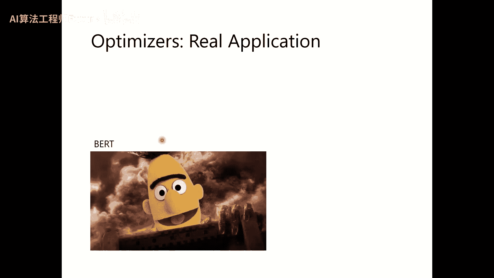

那这个东西是用ADAM训练出来的，接下来transformer这个东西是BT的backbone，那他是拿来做翻译的。

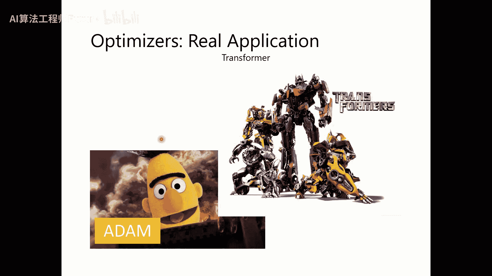

那他也是用ADAM训练出来的，接下来是title song torchong，是一个算是最早可以用neal network，做到很逼真的语音生成的模型，那这个东西大概2017年被提出来。

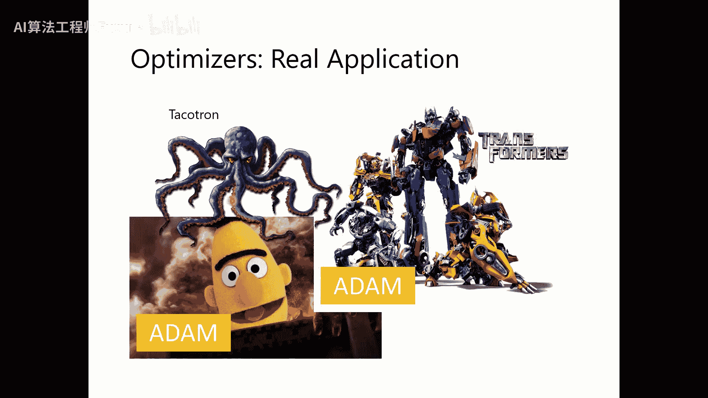

它也是用ADM训练出来的好，那接下来来看yo。

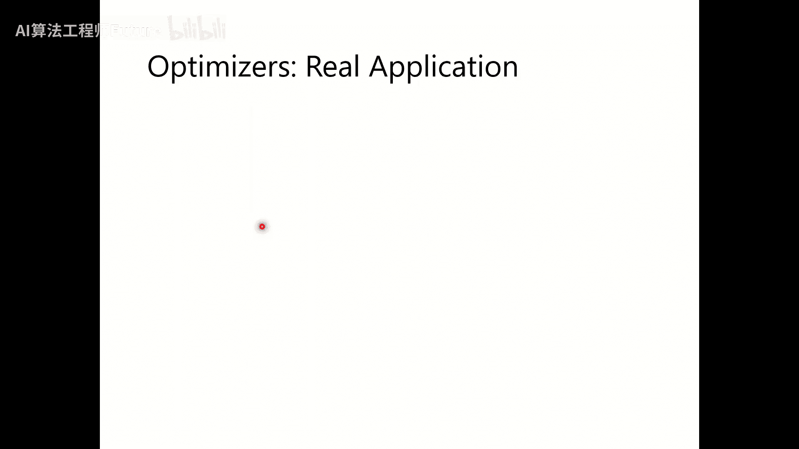

yo是那个做computer vision里面，他要做呃，影像侦测里面一个算是早期最快的一个model，那这个东西是用HDSGDM训练出来的，大家等我一下，我就把电话挂掉，他好烦。

ok i m back好，那这东西是HSGDM训练出来的。

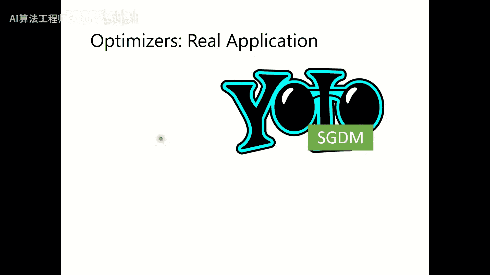

那接下来看mask r cn n，那它也是一样，就是它会在一个图片里面框出它detect，detect到的物体，那跟yo做的事情是类似的，这东西也是HDN训练出来的。

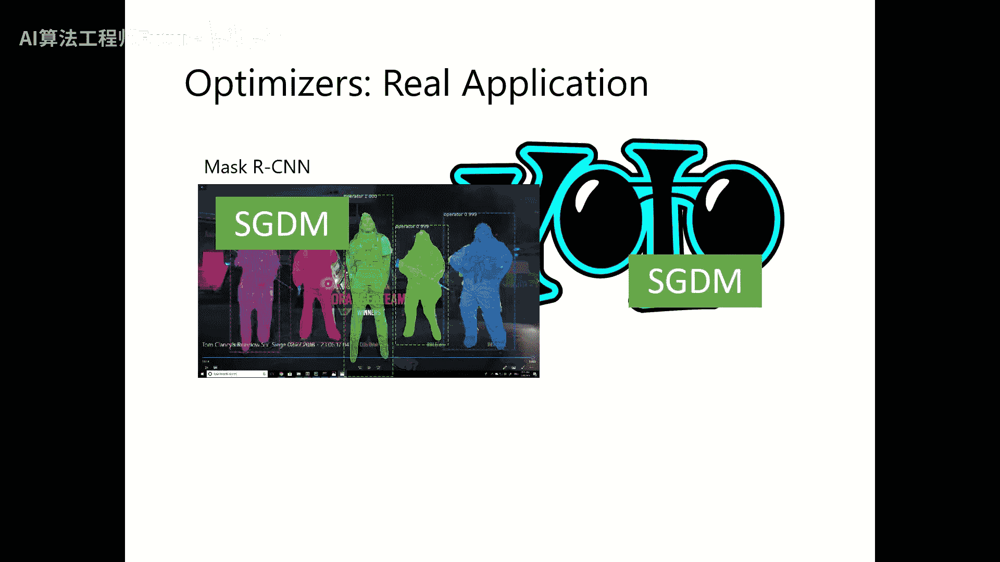

那接下来race net，这个是比较早期做那个影像分类里面，最强大的model，那这东西也是HGHGDM训练出来的。

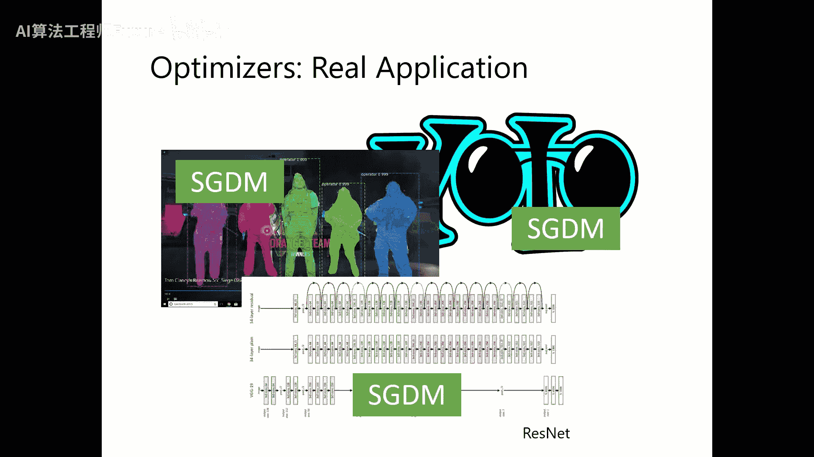

那甚至再到近期一点一些新的东西，那首先begin这个是gain，就是在做生成的，那big gain是应该算是一个很强的图，生成影像的model这样。

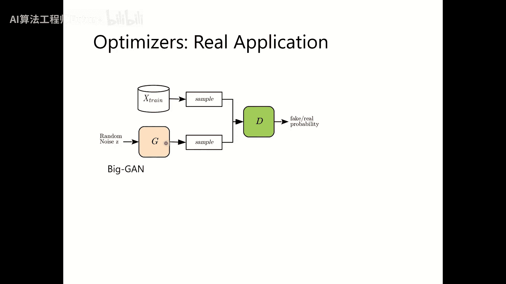

那这个东西也是A的训练出来的，那到比较近期现这一两年比较红的memo演算法，那这个东西就你就可以想象他是要训练一个network，但是这个network可以很容易，很快速的学会一些新的task。

比如说有点像是你在教小朋友的时候，他要你要教小朋友分类汽车，分类花或者是分类嗯，家具好了，那你教小朋友的时候，其实他可以从这几个test里面去，得学到一些共同的资讯，那memo就是想要模拟这件事情。

他想要让他在不同的分类任务里面，学到一些共同的资讯，所以你学会这几个分类以后，你要再学新的分类，比如说你要分类嗯，要分类风景好了，那它就可以很快的去学到新的分类方法，那这东西也是ADAM训练出来的好。

那再来问题就来了，为什么点这些有名的model，全部都是不是用HDHGDM，如果做computer vision，可能会用SHDN来训练，或者是用A等来训练出来的呢，那其实这个问题我一开始也不知道。

这样我一开始分到这个题目的时候，我想说啊，要讲这一两年的新发展好了，那我来想看看，这一两年我看过什么新的optimizer，结果想了下，就还真的没有什么新的app ize，我感觉我比较会用到的。

所以那我们通常这种时候我们可能就会来想，为什么会发生这件事情，是因为这是2014年以后，就没有东西提出来了呢，还是因为提出来的东西都有些缺陷，我们没有办法用，但是这6年来说。

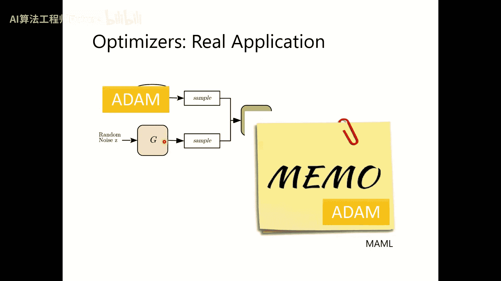

其实很长的一段时间，2014年是什么样的时代，2014年的时候，那个我们的宇宙勇士队还没有拿过冠军，然后阿法狗还没有出现。

所以人类还没有被超越，所以那时候还没有人会讨论。

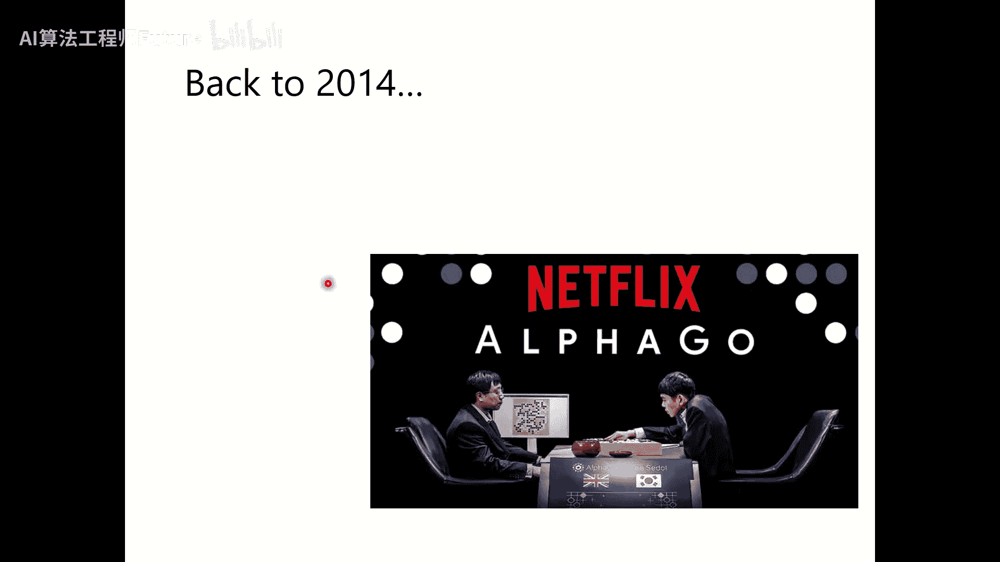

人类什么时候被AI统治好，接下来川普也还没有当选美国总统。

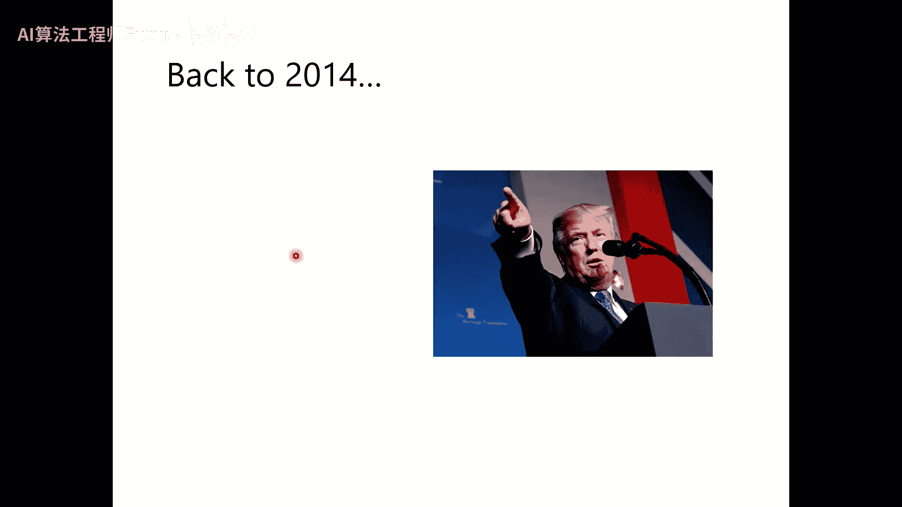

然后在2014年的时候，其实对我印象蛮深刻的，就是apple第一次推出不是黑白的手机。

就第一次推出有颜色的手机，这样好，那2014年的时候。

猎人还在休刊，不过现在也还在休刊呢，然后2014年的时候，李宏毅老师才刚从国外回来，所以他还没有开过任何一门嘛训练营的课，但是现在那个老师的课程，已经在网络上满天飞了。

好那这么长一段时间为什么都没有东西。

真的都没有了吗，就还真的都没有了，因为在这段时间里面，被提出来的东西都没有能够超过A的，或者是没有能够显著的超过HHDM，那为什么他们没有办法超过呢。

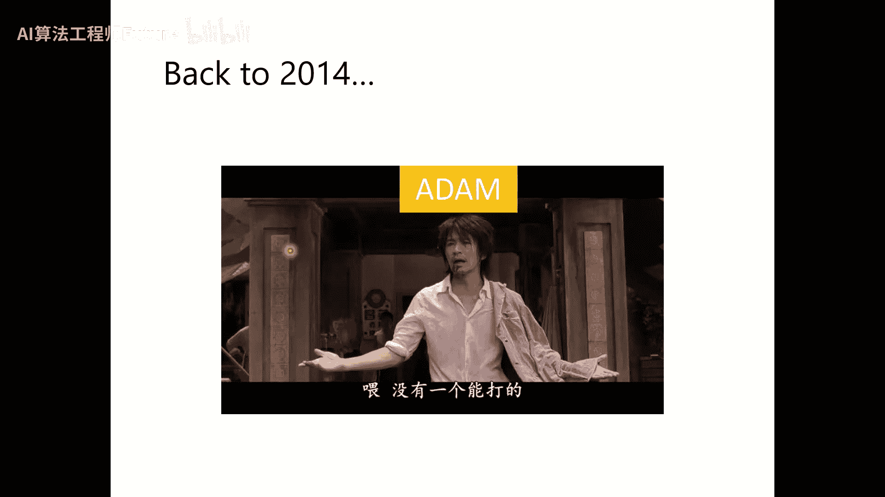

原因是这样，这个是我自己认为的原因，好我认为的原因是，因为ADAM跟SGDM，他们已经先抢到了两个最极端的位置，那他们抢到了两个极端的位置以后，其他人都只是在他们之间来填一些空而已。

但是因为你在使用的时候，你只需要第一名，你不需要第二名，所以那些第二名的阿平来，这就没有人在用这个样子，那他们是怎么样抢到两个极端的位置，我们来可以来看一下，就是实际的例子，这个例子是网络上呃。

一个训练猫狗分类的实验，这样那原本的就是网络上的文章，我链接放在这边，大家有兴趣的话可以点进去看，这样好，那这个是在training他的accuracy上面，他的表现我们可以看到ADAM就冲在第一个。

很快就到最高这条橘色线，那SGDM是棕色，这条线它好像在中间看起来没有特别强，这样看起来A的M应该会稍微好一点，这样那接下来来看validation set上面，然后就看到那个HGTEM。

反而他刚刚在training上没有特别强，但他在validation set上面一下就冲到第一名，那A等反而是在下面这些有一些上下起伏，这样那这个问题我们等下再详细讨论一下，是为什么这样的原因。

所以而且看到ADAM这也稍微比较不稳定一点，那接下来来看这是某一篇paper上面截下来的图，好，那这边这是他们在train race内34的时候，他们得到的结果，可以看到那个ADAM它就在中间这边。

看起来没有特别强，然后SGDM就是蓝色的，这个它冲塔比ADAM上面，而且看起来也比较平稳一点，那上面这两条虚线的话，我们先不要理它，这个是等一下会讲到的东西，他们最上面这两条曲线。

因为这篇论文其实就在做这个东西的，所以他当然会让他自己的方法做到第一名，但这一步在这张图里面，这不是我们要看的重点好，那接下来，嗯来这是训练LSTM的结果，我们可以看到这个东西就是这个metric。

叫perplexity，它是一个我们在做嗯，类似机器翻译或文艺生成的时候会用到的matrix，然后这东西是越低越好好，我们看A等一开始也是下降的最快，但是到后来他竟然被SGD这些东西超越了。

它只是一开始下降的比较快，但他在后期好像没有比较厉害。

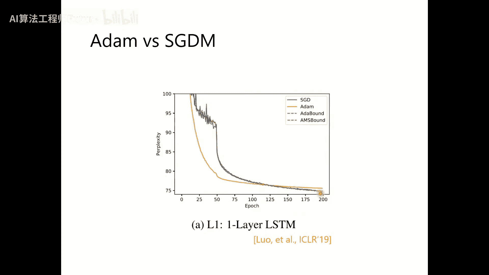

我们从刚刚那四张图我们可以得到一些结论，第一个就是A等，通常他训练的时候可以冲的很快，那HGDM他训练的时候比较慢，但是它通常比较稳一些，比较不会有上下起伏的状况。

并且A等我看到他training的时候，可能大部分人来说都会比较好，但是他general来他的general action能力，也就是在validation set上，他的表现就会有比较大的落差。

那相对来说HDDM它的落差就比较小，而且它好像可以converge比较好，那嗯我们先解释一下那个，为什么两个算法算出来的命令嘛，也就是算出来的theta，它的整容来选能力也会不一样。

我们可以参考一下下面这张图嗯，这里有两个mini嘛，它的值一样，那黑色线是training的时候的那个function，红色线是testing的时候的function。

那这两个东西其实就是我们前面讲过的，你对所有的data uc里面的X算出来的l o theta，还有X它上起来的东西，那因为training跟testing，它的data set有一点点分布上的差异。

它的X是不一样的东西，所以它的这个loss function可能会长得有点像，但不完全一样，所以他们之间会有一个小小的差距，那如果你现在找到的是一个比较平坦的，mini man的话。

这两个loss function都会比较平坦，所以这个general来选的差距就不会太大，但如果你是一个比较sharp的mini mu的话，那这边的generalization的差距就会非常大，这样。

但是这并不是说，ADAM一定是找到了一个比较sharp mini嘛，而SGDM是找到一个比较平繁的mini嘛，这个东西只是说为什么可能会发生这个东西，但其实还有别的原因。

但我这边只是来就是就是稍微解释一下，为什么可能会发生这样的事情而已，好啊，那接下来我们就想说，既然ADAM比较快，SGD比较稳，而且他在最后就是训练最后时候阶段，他好像可以收敛到比较小的值。

那我们有没有办法就是直接结合两个东西，然后得到更好的效果，所以这个东西早就有人想过了，这个东西叫SWATTS，他是2017年被提出来的，他其实就一句话，一开始用A的，因为A的比较快。

然后最后的收敛阶段用SHEDM，然后所以他就是在做这件事情，但是你在切换的时候，有些事情需要考虑到，第一个就是说你在什么时候要切换，第二个就是说你切换的时候。

因为ADAM的learning rate它是一个adaptive learning rate，那这个人ning rate你要怎么样调整，因为adaptive learning rate。

它需要过去的一些moment这些东西累积，所以如果你直接把那个C塔呃，那个一塔拿过来的话，它会被分，ADAM会被这个东西它会被分母影响，所以你不知道要怎么去定出来HGDM的值，那swatch这个演算法。

它就是提出了一个initialization的方法，然后他切换的时候，其实他用的方法没有很科学，他是就作者给出了一个一个切换的点，但其实他没有很详细去说明，也没有去证明说为什么要在这个地方切换。

所以这基本上还是一个比较土炮的算法，就只是很单纯的一开始用A的，最后用HDN这个算法哦。

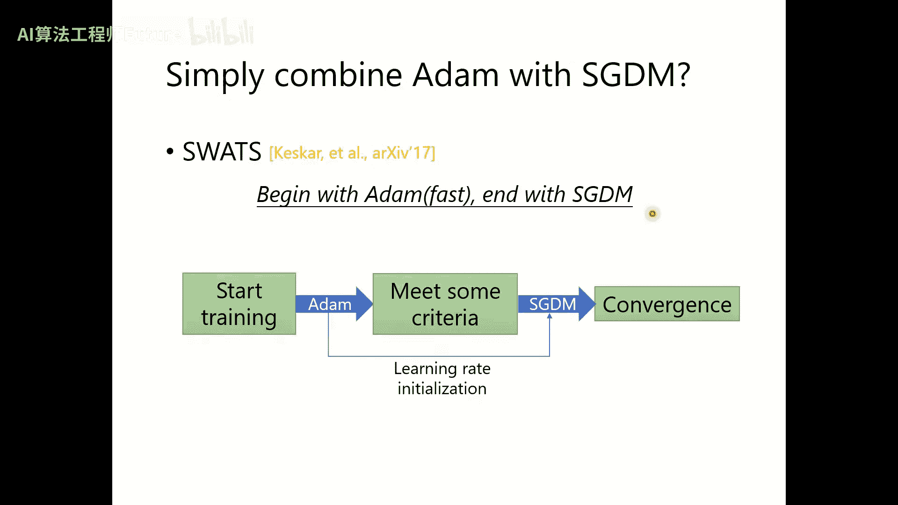

既然我们刚刚讲了啊，ADAM会这个算法，它的特性是它可以收敛比较快，那HDM他们收敛的特性就是，它会收敛的比较稳，收敛的比较好，那我们就想说我们有没有办法去修正A等。

让ADAM可以像SGDM一样收敛的又稳又好，所以我们现在就先观察一下ADAM有什么问题，然后因为这边呢没等这个M跟SGDM，它的M其实是一样的东西，所以我们在这里我们先假设这个。

就干脆假设这个M它的贝塔one是零，也就是它其实没有用momentum，所以我们focus在这个adaptor ning ray，对A等造成了影响。

那我们可以看一下这个det learning r的公式，他每次都会乘上0。999，所以其实这边会变成一个等比级数的相加，也就是说在这个VT这边，它受到gradient的影响，大概会维持1-0。

999分之一，就是大约是1000个step这么久，那这样会发生什么事了。

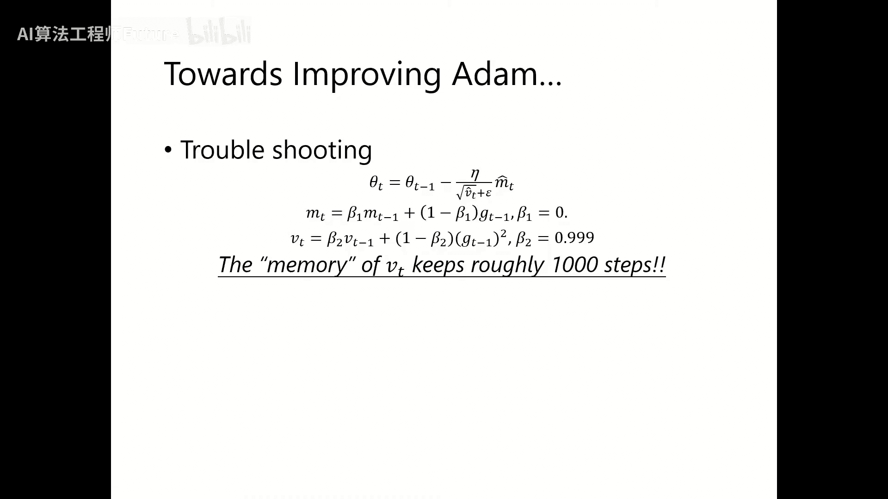

呃这个作者在实验中呢，他发现如果你劝到最后的时候，大部分的GRA点都会很小，而且就没有什么不会提供你的方向的咨询，那只有某几个mini batch的gradient会很大，然后就是很明确的告诉你。

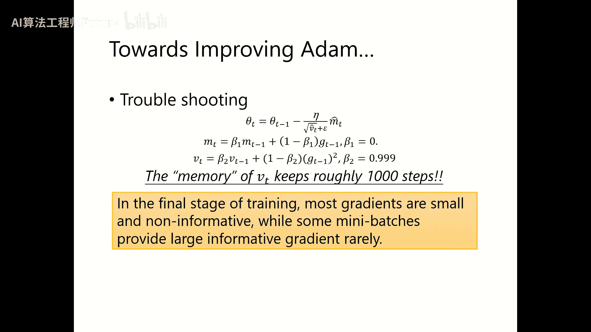

应该要往哪一个方向走，那这样会发生什么事呢，我们就把值带进来算看看，首先我们假设已经欠了10万个step，那一开始GRADI这几个就是很小的鬼点，假设它是一，那到过了1000step以后。

突然喷了一个大小是10万的微点，那会发生什么事呢，首先我们来看这个adam update的公式，这个M因为我们假设它的贝塔完是零，所以M在这里其实就是鬼点，就等于鬼点的大小好，那这个分母。

因为假设前面有很多个也都是一的话，那这个分母的VT其实它的大小就刚好是一，那这个N也是一，所以他这一步的movement大小就是一塔，那再来过来，这几步的大小也全部都是一哈，没有没有问题，那到了这个点。

他喷了一个大小是10万的gradient，会发生什么事，首先看这个M大小就会变成10万10的五次方，那下面这个VT因为这边鬼点要平方，所以是十的十次方，再乘上0。001，所以根号里面的是十的七次方。

开根号30的3。5次方，所以分母是10。3。5次方，分子是十的五次方，他们最后算出来的结果就会是十根号11啊，这样然后再下一个step，这个M只剩下一，然后分母还是十的3。5次方，所以他就是十的-3。

5次方一塔这样，那这会发生什么问题呢。

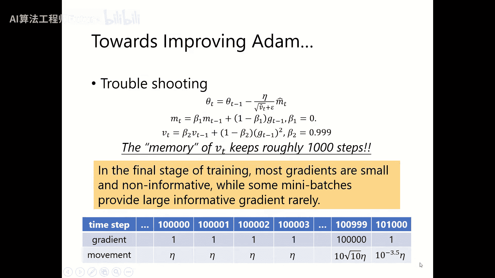

你可以看到前面的这1000步，它们加起来移动的大小是1100塔，那最后这个它真正提供了一个有意义的方向，它只会移动室跟耗时，也就是31塔左右，所以呢这样就表示你真的提供了比较多。

information的那些规定，它在update的时候，他反而只有办法造成一个很小的影响，那在前面的这些鬼点比较小的时候，因为他不知道后来面会有一个这么大的鬼点，所以他可能觉得这些鬼点已经不错了。

所以他就是翅膀硬了，所以前面这些update就会他其实不知道该往哪边走，他就乱走，所以反而会造成比较不好的影响，那这个会造成这个现象的原因，其实就是因为他的adaptive learning way的。

原因，所以他最多最多不管你的这个东西再大，它最多的移动大小，做事只能这么大，所以呢，讲只要你的GRADI大部分的时候都很小，那他就会产生这样的问题，它会被小的鬼点牵着鼻子走好。

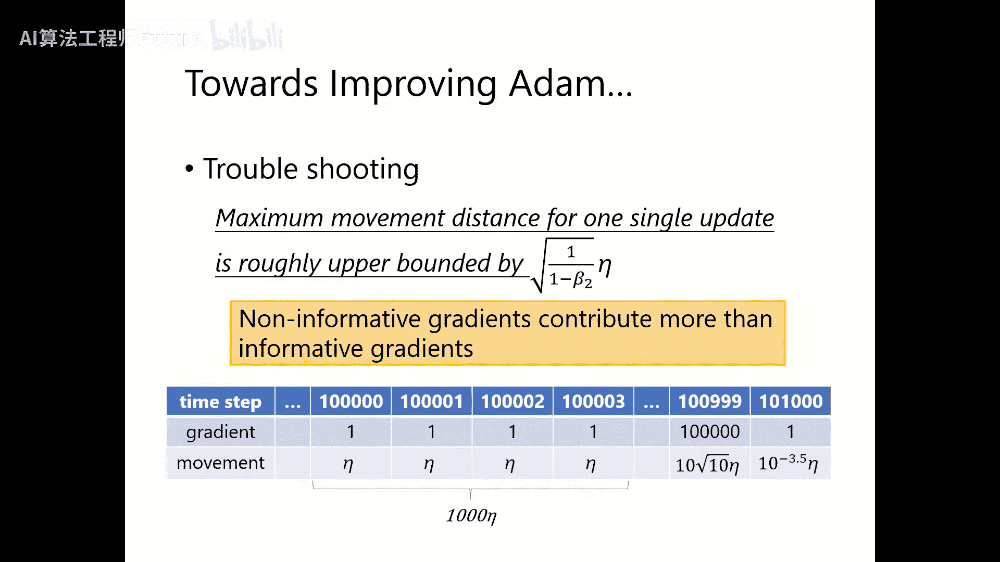

那作者提出的解法叫做a m s grade，他的做法是这样嗯，他的目标是要说，他想要去移除这些比较小的拐点的造成的影响，所以呢他在这个B下面加上了一个max，如果你下一个time step。

这个V比之前的那个V还要大的话，这个B是前一个这个BT是前一个TX代的BT，加上这个time set的GRA点平方两个的柜体上，那你如果这个比这个还大的话，你就直接把这个BT改成下面的这个东西。

它如果它没有比较大的话，那就用原本的这个东西，那为什么要这样做，他就是要避免说，因为你前面这边他会这样。

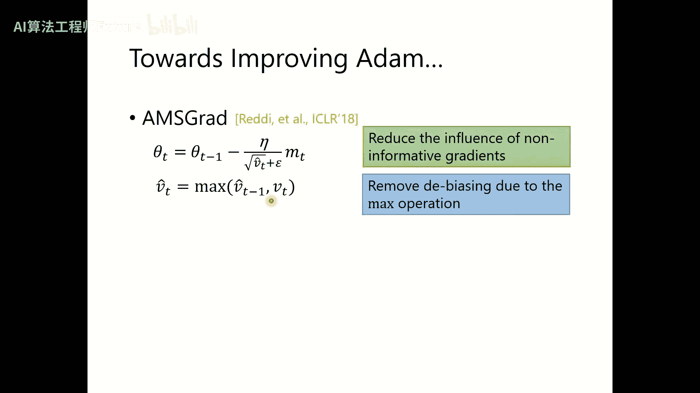

这些小的拐点会造成这么大的，就会造成这么大移动，原因就是因为这样，因为你的你前面可能也有一个很大的GRA点，但是在这几个time set，他忘记以前没有这么大的东西，所以他就移动了这么多。

但是等到后面的大的东西来的时候，他反而移动的不够多，所以他想的做法就是说，那你前面这些小的GRA点的时候，你不能忘记前面可能有一个很大的鬼点。

所以你要移动少一点，也就是说他这边的这个max，他去记住过去最大的时候的这个VT，那它就不会在你的大部分你的鬼点很小的时候，他就不会忘记以前看过很大的鬼点，所以它就会这样移动。

但是这样可能会出问出一个问题啊。

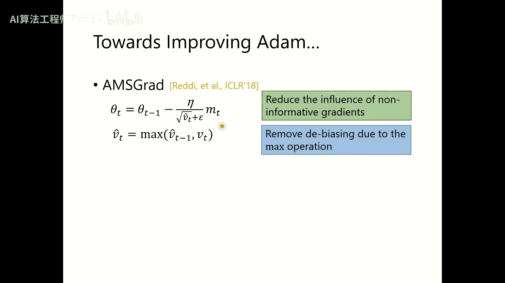

就是就是可能有人看到这就觉得不对，那我们记得我们课程刚开始的时候，我们有比较为什么要把ARDIGRADE换成arms prop，我没有说，因为ADAGGRAD它下面的这个分母。

它是monotonic increasing的，所以他最后会越走越小，越走越少，所以有可能他一开始不会电爆，冲太快的话，那他就直接走了没几步它就不动了，这样因为下面的这个东西太大，让这整个变得很小。

所以这个东西我们的对应瑞一直变小，那这个东西不就是我们之前要解决的问题吗，他自己怎么又走了回头路，所以这个东西可能嗯不是一个，这是我自己的common。

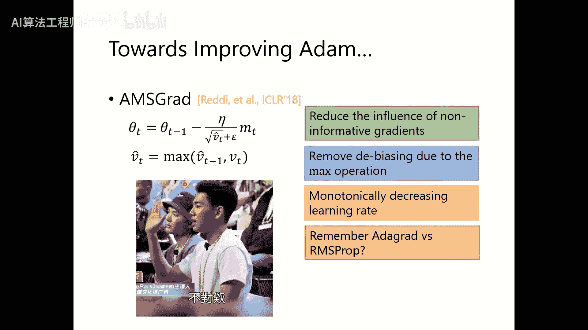

这不是一个非常好的解法，这样那再来就是要解决另一个类似问题，又有人提出了另一个解法啊。

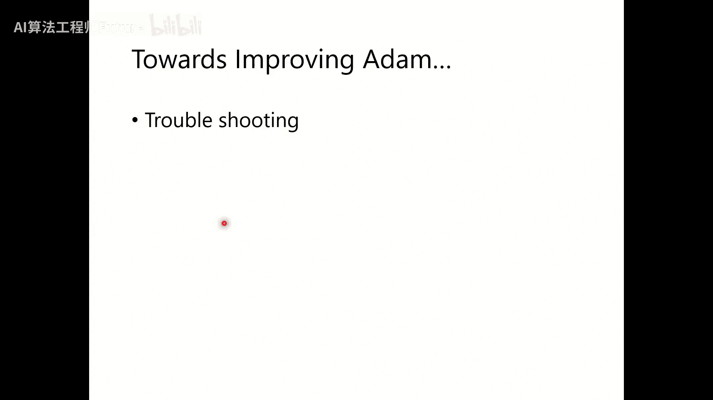

等一下刚刚忘记讲了，这东西我们就叫它是m s grade，是2018年提出来的一个算法好。

那接下来我们有另一个类似的方法。

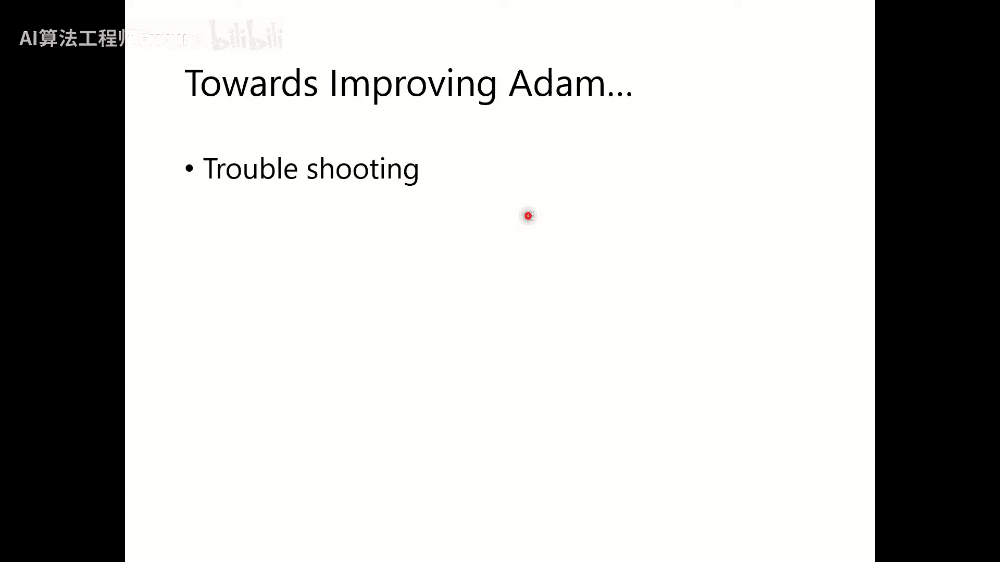

想要解决类似的问题，前面am grape的时候，他有提到这件事情，那你在最后的时候大部分GRA点都很小嘛，那你的或者或者是那，所以表示你的那位要么就是很大，要么就是很小。

因为你的这个如果你的gradient很小的话。

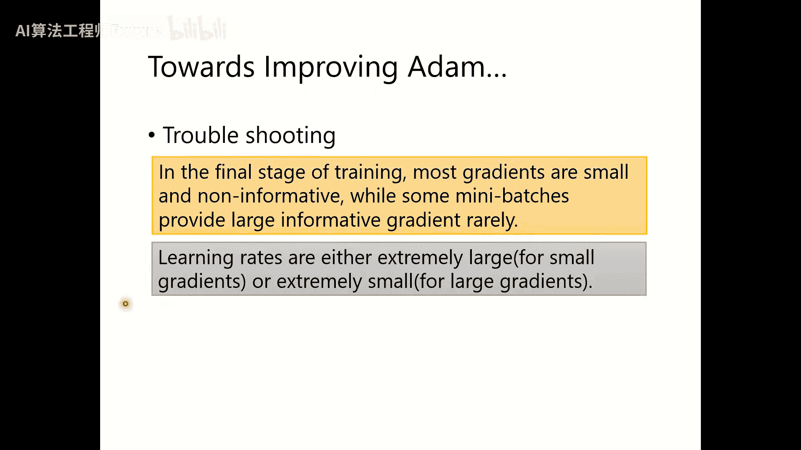

那前面的这个东西就会很小，所以它的定位就会很大，而如果你的鬼点突然爆冲的话，这的定位就会很小。

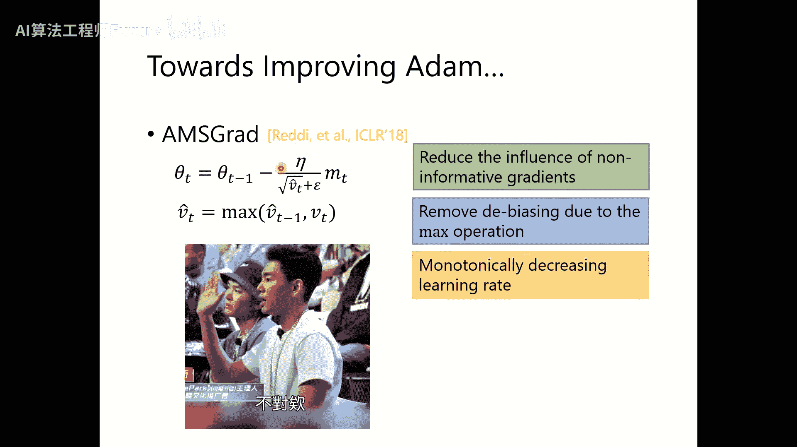

所以前面这一篇paper他只有想要解决，说GRA电就是你的规店小的时候，他的人因为太大状况，而现在这一篇的另一个作者，他想要解决的问题是，他还要解决你的learning ray，你的GRA点太大的时候。

learning r也不能让它变得太小，所以他要怎么解决呢，那那下面这张图呢，就是他实际训练那个好像是race name的时候，它里面其中的一个conclusion kernel。

得到的gradient大小的状况的人的人，零位大小的状况，那这个是log scale的，所以可以看到大部分的GRADI要么就是超级小，而大部分的人认为要么就超级小，可能十的三次方，五次方。

要么就是超级大，十的四次方，十的八次方，所以你的learning rate其实是很极端的。

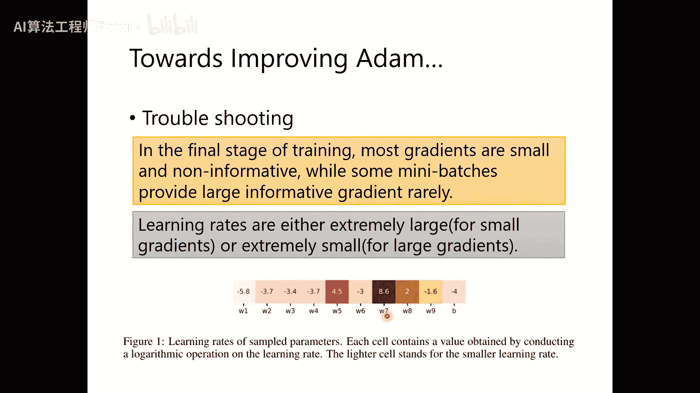

要么很大，要么很小，所以它解决了方法是这样，因为前面那一篇提到了em script，它只去handle那位太大的时候的状况，那这个作者提出了另外一个算法，这是2019年提出来的。

那这个东西它提出来叫阿达棒，也就是我们前面刚刚有看到的，在某某两张图上有看到那个虚线，那它的方法是这样，他就直接把这个东西的learning rate去做一个clip，那这个clip怎么算。

他就作者直接给出了这样一条，有点算是经验法则的算式，那这个东西跟什么有关系，贝塔two就是你A等的那个项分母的那个贝塔two，还有T有关系，那他马clip一个下界，还有一个上界，那有人看到这里可能想说。

我们为什么要做adaptive learning rate，我们要做adaptive learning rate，其实就是希望你的learning rate可以自己动态调整，但是根据你不同的task。

不同的lose，可能你今天做影像分类，你今天做那个文艺理解它的low surface不一样，但是他可以不管在什么样的rose surface，他都可以自己调整出一个好的learning rate。

那比如想到这边，看到这边这个lower bn和这个up er bb，都是人工定出来的，那为什么是这两个数字，就是这个是作者直接给出来的答案，那也没有说为什么，你要是这两个这两个东西。

其实跟你的lose完全没有关系，那这样其实就有点失去，我们来做deering rate的意义了，因为你希望它可以自己动态调整，但你又强制不管在什么model，什么螺丝上面，都给他一个load b。

一个UERBB，就是这完全就不是adaptive想要用的东西。

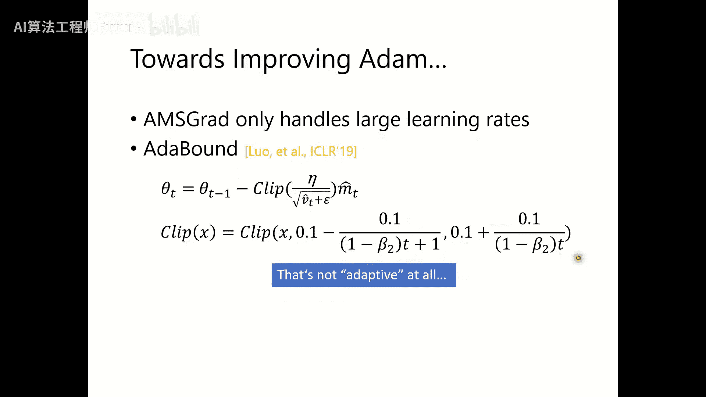

然后这太粗暴了，对，所以这东西我觉得也不是一个，就是最漂亮的解答，因为我们其实在做数学的时候，其实除了东西这东西能不能用以外，我们其实有时候还蛮在意说你的art，你你的算式是不是有对称。

然后就是有一种优雅优不优雅这种感觉，但是这个棋就是比较粗鲁，有点像是工程上的解决方法，所以我们就觉得他可能还不是一个最好的方法。

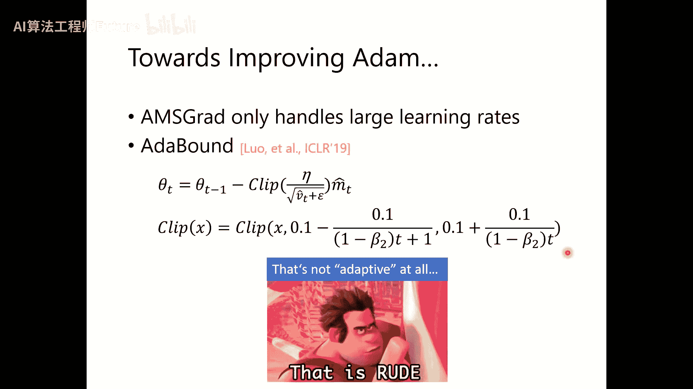

这样好，那现在我们从另一个方向来想，我们要把刚刚说我们希望把A等，让A等把它改的好一点，像HDM一样稳定一点，那我们现在从另一个方向来想，HGDM它的优势是它比较稳，然后他收敛比较好，但是他就是妈妈对。

那为什么它会慢，因为adaptive的算法它可以去动态调整，也learning rate，那他在你需要大步的时候走大步，需要小步的时候走小步，所以在某些不重要的地方，或者是比较平缓的地方。

它就可以大步走过去，这样那HHDM没有办法这样做，那他现在要怎么让HTD学会这件事情呢，其实没有办法，但是他就想说，那既然这样，那我也没有办法去找到，帮SGD找到一个最佳的人。

因瑞这人因瑞不会随着时间改变，但是他可能收敛的比较快，所以可以让HGD的performance比较接近A等。

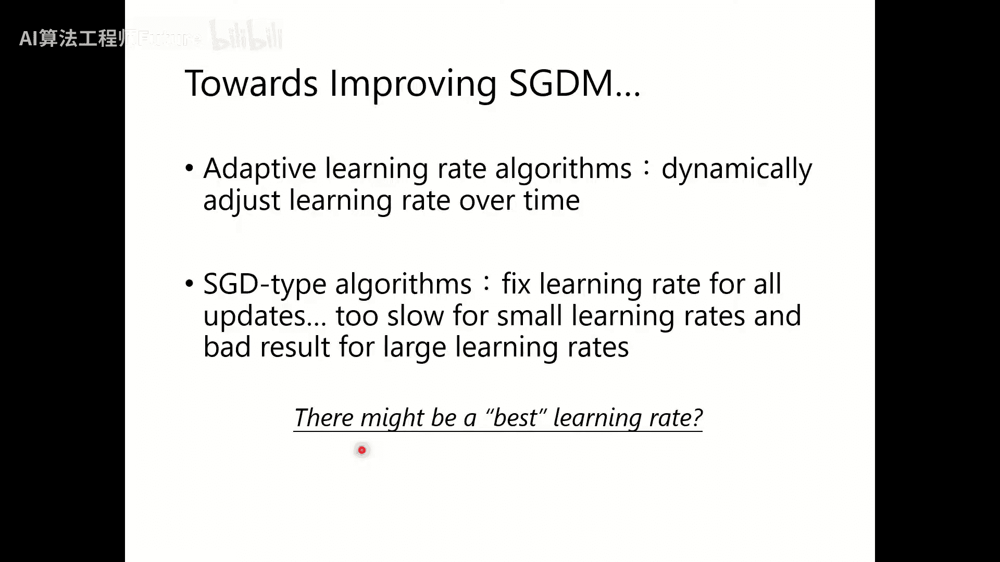

让它快一点，这样好，那其实我们在调learning r的时候，大家如果做实验，其实常常会有类似这样的经验，那这个东西就是说年内润润很小的时候，跟年润润很大的时候，performance都不会。

最好就是一定是认因为四中的superman会比较好，其实这个其实是一个蛮trivial的结果，那这东西就是他们叫做l r range test，所以我们可以用在调整人员位的时候。

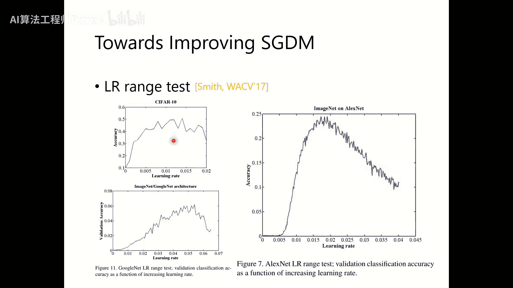

你可以得到一个比较好的的韵味，那接下来就是在2017年这篇配里面，这个作者提出了一个叫psychical learning rate的东西，他的结果就是这个样子。

你的learning rate是在大小大小这样变化，一个周期性的变化，一下子就为大，一下子认为小，那为什么要这样做呢，因为你的音瑞大的时候，就相当于你在做一个explorer的动作。

那你认为小的时候就相当于你在做一个fighting，或者做一个收敛的动作，那通常我们在做人类RISCHEDUING的时候，我们认为的是越来越小，那他这里在变大的意思。

就是说他鼓励这个model不要满足于现状，还要在适当的时候再去做更多exploration，所以当你觉得你熟练的够好的时候，你就说等一下先暂停，我们再看一下附近还有没有更好的点，所以再把那个re再调大。

然后再变小，但如果你现在已经收敛到一个很好的点的话，那你的人就会变大，应该也是不会很容易跑出这个山谷，这样那这样的一个周期性的变化，就是它有一些参数要决定，第一个就是你的step size。

你要多长的周期，然后再就是你最大和最小的learning rate，那你最大跟最小的learning rate的话，你可以用刚刚的那个l r range test来决定。

然后step size的话通常是设成几个A趴这样，那这个算法其实它就可以，在你遇到local密码的时候，因为你会再把单UI调大，或者是遇到一些比较平缓的平地的地方，因为你借由你把那位调大的东西。

你就可以逃离这个地方，所以有点类似A等于在一个平缓的地方，你就会调大的，因为这个概念好，那再来这个是另一个做法，那个很类似，只是它调整的方法不一样，刚刚他是就是用一个三角坡的函数来调整好啊。

嗯那这个做法他就是说你不用去做increase，慢慢increase这个动作，你直接重来就好了，所以原本刚刚这边你是慢慢增加这一片，他就直接变小以后，然后再直接调到最大再变小，再调到最大再变小。

但是整体的概念其实是大同小异，然最后一个也是2017年提出来的方法，它这个叫one cycle等于rate，它其实就是说你只做一个cycle好，那这三款就把它分成三段，第一个是warm up。

就是你能力会越来越大，所以它可以就是慢慢从initialize，然后慢慢增加它的step size，然后再来他等到他找到一个还不错的明朗附近，以后，开始做ANA类，就是他慢慢人因为在慢慢变小。

所以在这个附近他就是在做一个嗯，慢慢熟练的动作，然后最后在一小段这个东西，就是那因为越来越小，就是让它收敛到越来越好，所以你画出来的最后结果会有点像是这样子，它会到最后以后他会再往上一段。

再往上这一段就是最后你fine tune的时候，他收敛的结果，但我觉得这东西有点做到太也这个队有点强啊，就是你前面你觉得你做太多的cycle的效果好，所以现在就只做一个cycle这样。

但是就感觉还是不是一个很漂亮的解决方法，这样好，那讲到这边是刚刚说对SGD要怎么把它改进，让它变得跟ADAM一样去加速它，所以我们提出了这呃，我们看到这些方法都是主要fox在。

你要怎么去调整learning r上面啊，因为adapt turning rate，它就是根据lows来调整learning rate，而前面这几个方法。

它就是先给出了一个learning rate调整的模式，然后等一下就根据这个模式来调整，这样，哎现在11。20，那我们先休息5分钟好了，他上台讲，大上台久，大家的专专注力不好。

所以我们就在这边先休息一下，那下一节课11：25分开始。

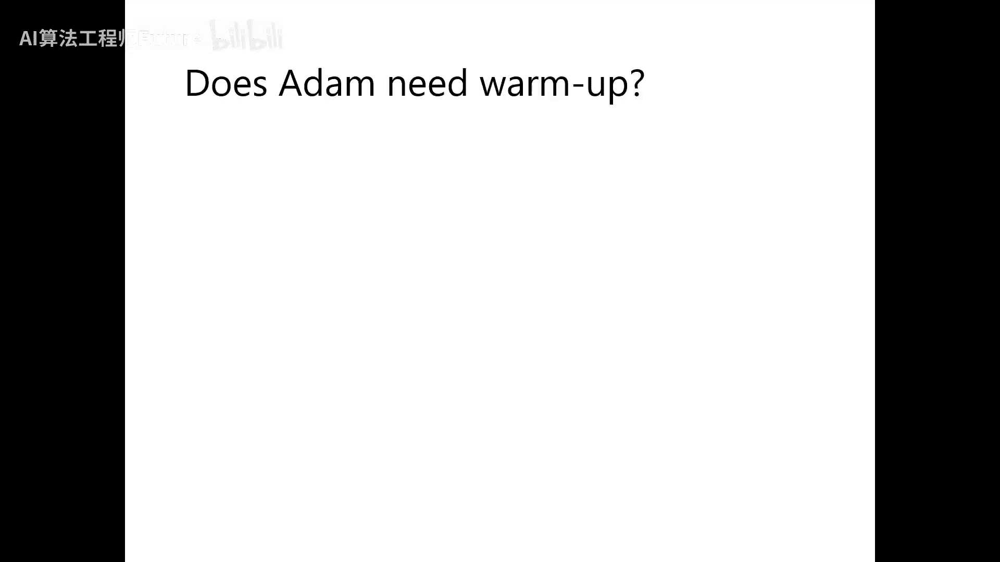