# 【官授搬运】2026年全新优化版李宏毅机器学习系统课程，这才是真正的初学者体系课程！—人工智能／深度学习／神经网络 - P22：10-选修-深度学习新的优化器-2 - AI算法工程师Future - BV1ruqABeEFX

等下等下。

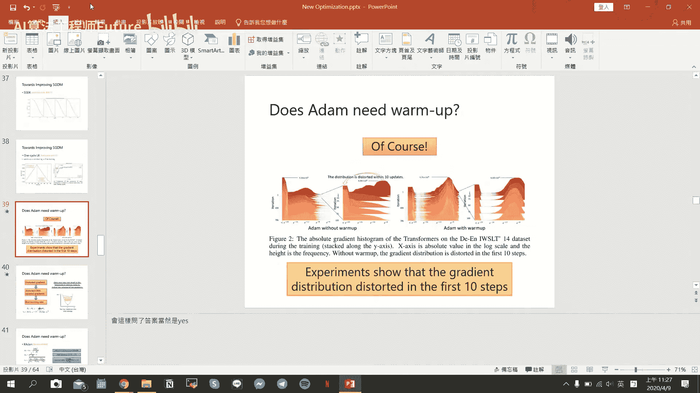

哎这什么东西。

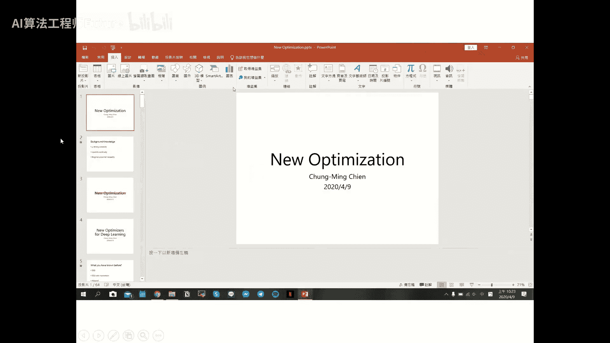

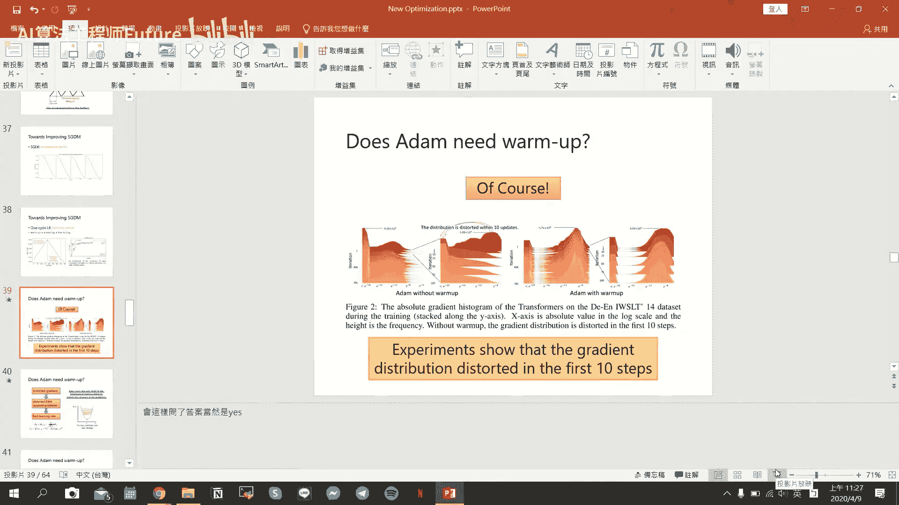

好那我们从这边继续好，我们刚刚讲到复习一下刚刚讲过的东西，我们复习了，前面讲李宏宇老师讲过的一些比较有名的算法，里面包括最常用到的两个就是h g d with momentum，还有A等这样的算法。

然后这两个算法优点跟缺点有什么，GD通常它比较稳，然后收益也比较好，但是A等方他算的比较快，所以我们一般在做的时候，也都是以这两个optimize为主，好接下来我们介绍了一些做法。

可能来修正他们的一些问题，希望他们可以就是改进这两个算法，让他们就是互相向对方学习，那这些里面有包括阿达棒，包括挂AMGRA这两个算法是改善A等的算法，那他们在想的就是。

因为你the running ray有可能会太大或太小，让他们用一些方法来避免掉这样的情况，让ADAM在最后比较稳一点，不然如果你一下认为一下太大一下太小，那A等最后收敛的时候就会不稳。

他们觉得这可能是造成A等B，HGDM不稳的原因，那我们介绍了一些，在HGDM上调整了运会的方法，那里面有PSYCLILR，然后有最后的one scol r，那这些都是希望去透过人工的方式来。

定出一个调整的零位的方法，让HGDM可以收敛的比较快，不不用在那边慢慢等它收敛好，那我们刚刚讲到最后的one cycle l r，它其实有三个部分组成的，第一个部分是WUP，然后再来本另一类。

还有最后的fine tm令，那我们就想到那ADAM需要这个东西吗，就是我们需不需要一开始先减d item0R，后来再增加它呢，结果是会这样问，结论一定是当然需要嘛，那为什么需要有人会想说。

那你就是ADEN1开始不就已经做了adaptive，adaptive learr吗，那为什么我们还需要去调整这个东西，原因是这样的，因为这是在实际做实验做出来的，再一个机器翻译的实验上做出来的结果。

那你就可以看到这几张图的纵轴是iteration，然后横轴是嗯，看一下，the gradient的distribution，那一开始看起来GRADI的distribution都是一个，有点像是高选。

然后最后这边有一堆，几乎就是几乎没有gradient的parameter好，那再把它放大一点来看，我们突然发现了前面几个time step，好像它的分布跟人家不大一样。

然后那为什么他们的分布会跟人家不大一样呢，原因是这样，因为你一开始刚开始训练的时候，你的INTRATION的时候你不知道你你领袖在哪个地方，所以一开始几个time step它有可能规定会很乱。

再加上你一开始的时候，因为你的那个底下那个分母，它的估计可能不会估计的很准，因为那那个e m a square of gradient的估计，它一定是你在做了越多time step以后。

它的估计才会越来越准，所以一开始那个任意位的估计不准，所以他有可能会一下走太多，一下走太少，所以他整体来说就不稳了，那不稳的话，他的贵一点，当然也会分布的比较乱一点。

所以这就是为什么我们需要WUP的原因，那右边这张图可以看到，如果ADAM做了warm up以后，他其实前面几个time step，它那个鬼点分布很乱的情形就会被改善，因为他就不会一开始一下子跳太多。

这样子好，那至于ADAM你要怎么做，warn up其实有蛮多实际上的做法，就是你直接定一个曲线，可能是一个，等下看一下我的简报笔，你就直接定个曲线，通常是定个像这样的曲线，就是一开始LINUX增加。

然后最后慢慢减少了曲线，这是工程上蛮常用到的做法，可能像我自己在做研究的时候，我在训练title tr，训练语音生成的模型，我自己就会做这样的事情，然后前面的这个linear increase。

可能是嗯4000步之类的，4000个update，然后后来就慢慢减少，就1exponential decay，这样好，那这个东西它我们通会通常会用几千部的文化，但他这边他说。

其实他大概只有在前四个step，会有gradient descent的情况发生，那他这里有个作者，他提出了另一种warm up的方法，我们来看一下他是怎么做one up的，好。

来我们现在先看这个是adam update的方式，然后我们这边就focus在这个V上面，就是他在adaptic gradient的估计上面，因为M的部分就跟那个momentum是一样的。

所以我们要比较momenta跟A等的差别，我们就只比较的dejing way的部分好，那我们一开始GRA点如果估计很乱的话，那我们下面的这个VT的估计也会不稳定，一下走太大步，一下走太小步。

那如果画图画起来就是这样子，你一开始看嗯，就是他可以直接顺顺的下来，但他走太大步，它就会在这边震动很厉害，所以你的GRADI就会规定方向会很乱，然后大小也会很乱，所以你的人定位的这个东西。

它整个估计的东西就会不大稳定，那应我们应该怎么做呢，我们应该在你还不确定你这个估计，好不好的时候，你就走小步一点，走小步一点不一定会往好的方向收敛，但是走小步点，这样你可以确定一件事，你走一小步的时候。

规定的变化不会差太多，所以他一开始这个东西估计可以比较稳定，因为你现在你没有办法期望，你的model在前十步就收敛到一个很好的值，但你最少可以给他一个最低期望，就是你不要暴走，这里不要暴走，好啊。

这篇课文它的作者很有想说，一开始你要估计这个V的时候，一开始它会很不稳，那要怎么做呢，首先它先定出了一个楼梯，这个楼梯呢，其实就是前面有稍微提过的那个EMA。

它effective的memory size，但我们前面直接用一减贝塔分之一来代表啊，这边他用了一个比较更准确的估计，就是可以估计成这个东西，那贝塔无限大呃，不是贝塔low无限大。

就是说最大的memory size，也就是说你到达稳态T趋近于无限大的时候，这个effective的memory size，那他又为什么要定这两个东西呢，原因就是因为。

原因是因为他定了这个楼梯跟楼无限大以后，它可以有助于他来估计这个RT，这个RT是什么东西呢，这个RT其实是在近似VT分之一分之the variance，分之V无限大分之一的variance。

那为什么要估计这个东西呢，首先先注意一件事情，当你的VT的variance越大的时候，你的VT分之一的variance也会越大，所以当你的这个variance越大的时候，你的R应该就会越小。

那我们回来想刚刚这件事情，你的variance越大的时候，表示现在风向很乱，所以你应该要走小步一点，BeryL是小的时候，那就表示现在在一个比较稳定的的区域，所以你就可以走大步一点。

所以呢这个时候这个R其实就可以，直接把它拿来承载的零位上面，帮助他来决定现在要走大步还是走小步，那你可能会想说，这边这个low只depend on ke，还有贝塔就是A等的参数，然后这个R又子底排行哦。

那为什么跟实际上你算出来的规定没有关系呢，原因是因为这个作者假设你的gradient，是从某一个distribution，可以想象成从一个高选里面去sample出来的，所以他都是随机sample出来的。

所以这个时候你看这个啊，TRAAPPROXIMATE的这个variance，其实就只会跟你的T有关系，跟你总共sample了几次有关系，那还有一个问题呢，就是这边这个R你看这里面根号里面的东西。

它只有在low大于四的时候，这个R的估计草也是准的，才是这个根号才可以开，所以当你的楼梯小于四的时候，这个估计不能用啊，所以这个作者他就说那你楼梯小于四的时候，既然你没有办法这样估计，那就就算了。

那我们就一开始先用SGDM，那等到时间到了楼梯大于四以后，那再来用他提出的这个random，也就是在你的dictive learning rate前面，乘上这个warm up的R。

这个R画出来跟T画出来一个曲线，就是长这样，这个其实也就是他的warm up running way的一个曲线，这样它会随着时间增加好。

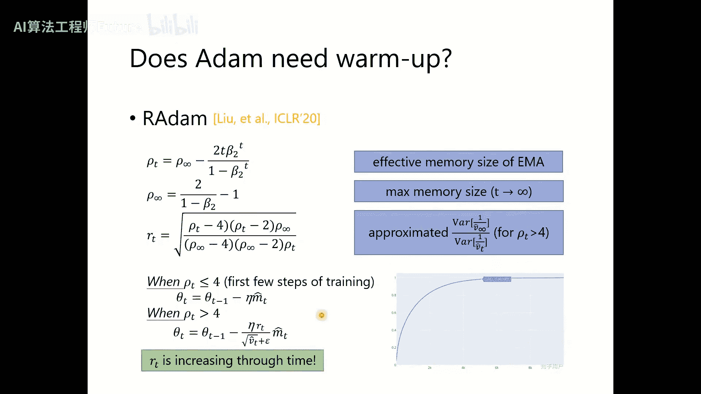

那我们就是看到这边，我想一下比较一下random跟SWATTS，为什么他们两个要做一样，都是optimization，但他们的事情是有点反过来，感觉swatch是一开始用HGDM，然后最后用A呃。

一开始用ADAM，最后用HGDM，而random是一开始用HGDM，后面用A的，这样好，那先我们要先讨论一下，为什么他们这两个演算法，分别是想解决什么问题，那random它要解决的问题是你的GRADI。

一开始它的variance很大，所以你而代替ring rap不准，所以呢他就帮ADAPTIONARYR乘上了一个R，让variance大的时候他走小步一点好，那swatch他要做的事情呢。

他是因为他觉得ADAM就是快，然后SGD就是比较稳，所以他一开始就用ADAM来加速，而后面就用SGD，那它们做的方法就是random，就像刚刚讲的，他乘上了一个warm up running rate。

就是这个R来让他嗯，来让这整个optimization的过程中，他的就是gradient distortion不会这么严重，那SWASS就是直接把两个坎配起来，先做SS呃，先做A等，再做SGD。

至于他们为什么要做这个switch呢，swatch的部分，他做这个switch的原因，就是因为他觉得HD可以converge到比较好的值，所以他是为了conversion来做这个东西。

那random他做这个switch，其实跟他要不converge这件事没有关系，他做这个的原因只是因为他的这个R的估计，这个warm up本人瑞的估计在某个time stage之前。

就是楼梯小于四的时候，这个估计是不能用的，所以他就想了个折中方法，既然这估计还不能用，那我还不能做A等，那我就先做SGD，先用SGDM做update这样，所以他切换的点就是你的那一个估计出来的。

R是可以用，以后low大于四以后，它可以用，那它就切换成A的，然后swatch切换的点就是它定了一些标准来说，ADM到某个阶段，他可能快要收敛了，就换成HDM，所以他们两个其实有本质上的不一样。

random把从SGDN切到A等的原因，是因为他一开始没有办法用A的，有的那个one marr的估计，所以是一个折中的做法，那SWATTS从ADAM切到GDM的原因是。

因为他想要追求可以converge到更好的值。

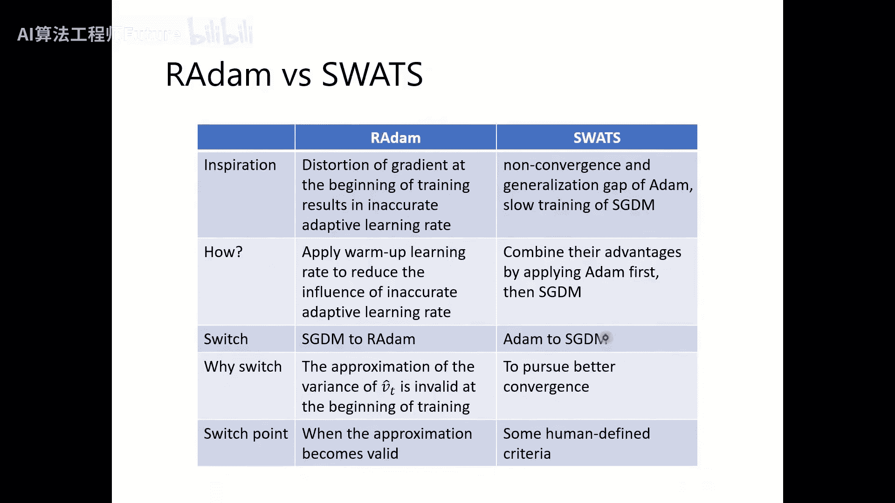

这样好，那接下来来讲下一个演算法，这其这个跟前几个演算法的概念，比较不一样一点，这个是去年提出来的，这个也是HINTON的团队里面提出来的，我补充一下前面的s g d with momentum。

还有ada grade，哎，arms还有arms prop，其实都是HINTON的团队提出来的，那HINTON是就是整个地球上面，最早提倡depending的人之一，所以就是在这最近就是最近这几年。

DEPENNING比较红以后，其实就是一个蛮重量级的学者，那有人说他是tiring字符这样好，那这个look ahead，look ahead是HINTON的团队提出来的，那先注意一下。

他这边并不是像前面的演算法一样，他就是一个optimizer，他其实可以把它想成，他是一个optimizer的rapper呃，rapper不是唱rap的那个，他的意思就是说你的optimizer。

可以在外面再包上一层东西，所以不管是你的A等还是你的HHDM，还是刚刚讲到任何一个m grade或者是freedom，他都可以包上这个东西，那这东西要怎么用，其实你可以把它想象成它就是走一走以后。

每走几步以后会检查一下，看一下哦，我们现在走的方向O不OK，然后再走几步后再检查一下我们方向走的东西，O不OK，所以这个look ahead，他的paper tidy的title其实就写这句话。

就是k step forward one step back，就是说他每走K步往前，他就会退一步，回来来看看我们刚刚说的方向O不OK，那如果写成演算法的话，其实就是这样。

一开始你现在整个model它有两组5weight，其中一组weight是用来explore的，它叫这个theta，这组weight它是用来EXPR，也就是这边这个蓝色的线啊。

红色的weight是model真正要的，它就是比较稳的weight，然后他叫这个sea叫做fast weight，然后这个fire叫做slow weight，好，那一开始他有个outer loop。

还有个inner group，在你outer loop里面，你一开始把这个fat weight initially成slow，weight的值，就是在这个蓝色的点。

接下来在你的inner group里面，你把这fast way用某个optimizer，这optimizer可以是SGD，可以是A的，可以是a s grade，可以是任何东西，那这里就没有什么好讲的。

就是做一下做几步啊，Timization，然后这个K可以自己设这样，所以你现在做完评选以后，你就是诶你是从这边开始，所以你就走到这边来，那你做完这个optimization以后，你走了K步以后。

你就暂停停下来，然后这个时候你做一件事情，你把你的这个THETTK，就是你最后停的这个点的feat weight，去减掉你开始的那一个点，因为开始的点就是在这边西塔T0，减掉你开始的点。

然后乘上一个阿尔法，然后再加上开始的那个点，所以意思就是说你在这个点跟fast way，最终的点中间取一个interpretation，所以你从这边走到这边以后。

你把这个点跟这个点做一个interpretation，他们的中间点把它SN到新的所有位置上面，所以他做事情，其实这个就是他在fast way走了K步以后，然后他把这些拆掉，他说等一下我们刚走的都不算。

我现在再回到这个点，然后再开始继续走，所以继续走以后，他就从这下一个弹time save，就从这个点开始，他可能就会这样走，然后fast way走到一个点以后又停下来说，我再跟我的出发点最后一个BO选。

然后取中间点再继续往下走，这样那如果有些有看过一些比较进阶课程的人，可能会觉得这个东西跟我们刚刚提到memo，memo就是刚刚说到你一个model可以学好几个任务，然后让他可以很快速的适应。

新的任务的那个演算法，那嗯，这个东西其实跟memo系列的其中一个演算法，叫reptile，其实很像好，那，这里面有一些参数嘛，第一个是这个K第二这个是这个阿尔法，那这篇paper的作者里面。

他propose是说这个阿尔法调的值，其实嗯你怎么调都不会差太多，你只要不要调一些很极端的词，它的效果就不会太差，这样好，那，再来这个安全染色也可以是任何一个安全的，比如说有个呃。

去年年底放到face AI的block上面的up pianter叫ranger，他其实就是把random加上look head，然后提出来的新的一个optimizer。

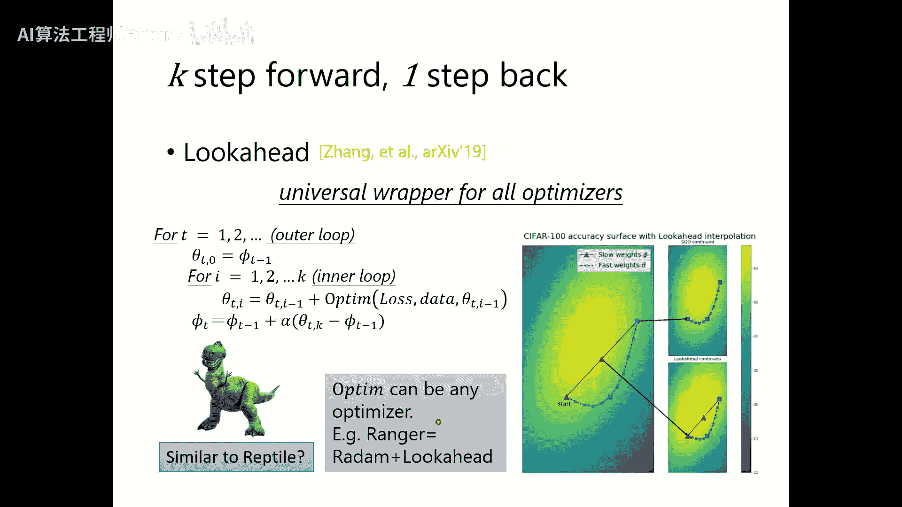

这样好，那再来看一下它的实验结果，那这个是在训练后期的时候出现的情况，你的蓝色的是fast weight of FA，然后绿色是那个slow weight的update，所以你可以看到。

在你训练后期几乎要收敛的时候，其实你的FACEBOOK也基本上都在抽，就是他每次都越来越差，但是如果你不用look at的话，它其实它可能就会往下掉下去，但是因为你用了look edd。

然后slow weight其实它的特性就是它很稳定，它不会很容易爆冲，所以你的FTWEIGHT虽然都在戳，但你的slow weight可以稳住好，那为什么要做这个one step back。

其实他就是在避免掉你去做太危险，太危险的inspiration，也就是说你可能进到了一个嗯很深的峡谷里面，那你走不出来啊，他其实因为你的slow weight他比较稳定，那为什么这个东西可能会得到一个。

比较好的结果，你可以想象说，如果你现在feat weight走到了一个很崎岖的地方，里面，一个很深的峡谷，通常这种峡谷就像我们刚刚说的，它可能generalization的效果不会太好。

我们通常希望他走到一个比较平坦的mini码，它比较有可以在testing set或varization set，上面有较好的循环代选，所以我们希望他走到一个比较平坦的命啊，那在很深的峡谷。

你们会发生什么事，你把fast weight跟slow weight做interpretation，可能他们两个的结果分别都不错。

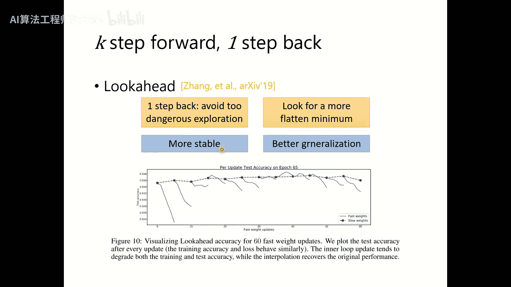

但是做了一个interpretation以后，得到新的step的这个slow weight。

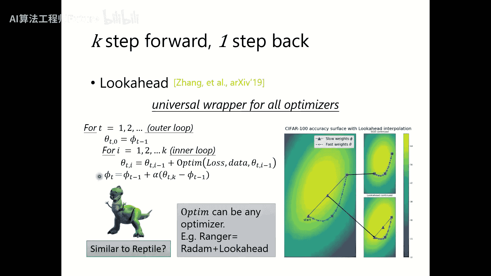

它的结果就会很烂，所以你做了这个one step back，其实它可以避免掉，你去到一个太崎岖的峡谷的地方，所以他可以尽量保持你在一个比较平坦的区域。

所以它可能会比较有效的去做到generalize generalization，这样也就是像下面这个图片里面做的，它的test accuracy不会因为你去做到嗯，Fast way。

移动到太危险的地方就掉下去，好，这是look ahead，look ahead好，那接下来我们就是在讲的这个东西，跟前面的东西没有太大的关系啊，这东西其实是一个蛮久以前就被提出来的，演算法，好。

那我们现在回到最早讲MENTON的时候，我们一开始说MOMENTTON就是从球从这边滚下来，但他到平地的时候，他也可以保持一个有移动的方向，继续往下滚好，那我们现在那个我们现在考虑另一个方向。

如果我从这边开始走，会发生什么事，我从这样走过来走过来走过来，首先我从这里开始走，鬼点方向往这边，所以还往这里走，然后走到这个点以后，那个红色的鬼点就是零，他就会跟这颗小球停下来。

但绿色啊不要看下面的绿色箭头，因为这张图是弘毅老师的投影片上面截下来的，所以这张图片我没有办法修改，所以我们不要理下面的箭头，我们现在自己想象它momentum会怎么走。

我的momentum应该会往左边走嘛，所以gradient叫他停下来，但是我每天就会说让我看看，他要想他要想再export一下，所以还会继续往这边走，继续往这边走以后他可能我们才够大。

所以他虽然这里鬼点是微微往右边，但他还是会继续往这边走，那最后它就会冲到这个上面，但这个上面明显是一个比较差的点吗，那到这里红色的还是会跟他说停下来，但鬼点还是说让我看看啊，到这个比较差一点以后。

这个时候那个momentum发现不对了，因为这也是一个明显比较差的点，然后他就会跟GRADI说，你你不行，你要先讲啊啊，这时候鬼点就会说什么，就是他就会说，gradient在这里早就已经跟你讲了。

但是他怎么会知道这里会这么惨对，因为没有人会知道你没有走之前没有人会知道，所以现在我们要讲的这个算法，它其实就是一个通灵的演算法，还要先预测到未来，然后知道这边很惨，所以他就不能过去那边这样好。

那这个东西其实是很久以前被提出来的，是1983年被提出来的，然后提出了这个letter of，他其实是专门做数学optimization的一个大师，算近代做optimization。

最有名的一个数学大师之一，那这个1983年被提出来，那个时候其实深度学习根本就还没有红起来，所以这个东西其实不是提出来要做这个引用的，他是做一个general的optimization。

那这个东西我们把它叫做zero of accelerate，Accelerated gradient，或者简称叫RNG，那这个NAG，它其实就把原本的SGDM做了一些修改。

你看SGDM是你的THET减掉一个momentum，然后这个momentum是前一个time set momentum，再加上现在这个time step的gradient，然后这边的正负号。

我稍微跟前面讲moment meant的地方做了一个修改，为了配合那个之后讲了paper里面他用到的记号，所以这两个符号有交换过，但结果上是一样的好，那做这个东西，那我现在要怎么做一个通灵的算法。

就是我要直接看到未来呢，我现在我一样减掉这个M，但这个M我用一些修改，我把它变成我减前一个time step2momentum，再加上这个特殊点的拐点，这个特殊点是什么东西。

它把CAT减一减掉前一个time step的moment，就是你上个TC移动的量，因为这是上mt减一，就是mt是这个TC移动的量，所以mt减一是三个times sc移动的量，那为什么要去减掉这个东西。

其实他是在预测，他就是想要在这一个点的时候，就预测到下一个点，它移动会移动到一个GRA点是怎么样的地方，所以这边这个GRA点，其实就是他在预测下一个time step时候，它会移动到怎么样的一个地方。

但是你做到这边你可能会想到嗯，你可能会觉得第一个是说这个东西会等于mp吗，当然不会等于MP，但是因为你现在你还不知道你这个time ce表，怎么走。

所以你就先用前一个time set的moment entation来代替，就是想说来大概估计一下，那再也会想到第二件事是说这样我不就要去，就是要maintain两，在你做深度学习的时候。

你要maintain两份的那个model的parameter，因为你第一份是这边你要把CAT减一，减掉一个东西后去算他的GRA点，这是你要复制一份PRIMETER，但是你原本的C它体检你也不能丢掉。

因为你等一下还要做update，所以你这边剪掉以后，这个是你复要先复制一份parameter，然后算鬼点以后，然后得到mt，然后再把原本这份parameter减掉mt，但你需要两份parameter。

那但是再来我们可以做一些magic，我们做一些mage，可以让它不需要maintain，两份parameter，这样，然后这边的数学会比较多一点，就是先给大家心理准备啊，如果就是不想看数据的话。

可以直接等下直接跳到结果，没关系好，那首先这个东西是我们刚刚那套公式嘛，然后我们现在另一个新的c a t pro，我们令这个东西叫做CAT键，万达mt好，那西塔T方等于CAT减到难题。

因为这个西塔T等于CRT减一减NT，所以把这个这项展开就会变成下面这一行好，那接着再做一件事情，我把这个mp再展开NT就是下面这条式子展开，所以这一行在展开以后就变成在下面这行算式。

那这行算式你看到这个东西，你就会想到一个熟悉的定义，thett plan不就等于CAT简单的mt，所以这个其实就是CAT减一的pro，所以你就会得到这行算式好，那我们这边其实还有一件事情。

就是我们把CAT减一，这里有个CAT减一减掉兰达mt减一，然后这个东西我们也把它改成，改写成C哈T减1pom好，所以我们的update就变成这样的东西，我现在不要对C它做update。

因为这个东西对任何一个time step t都是成立的，所以你原本的这个update公式，其实你可以把它改写成另一个公式，就是这个东西吉他t plan等于这个东西好，那你现在要做update参数。

突然间就变成C塔T呃，突然你的参数就变成嘻哈t pl了，这样好，那这个烂达mt的定义其实跟前面一样，就是这个东西，然后因为你现在我现在就不要管其他题，我所有的东西都用theta plan来代替。

所以里面的这个东西我把它改成CAT减1plan，所以我最后的update公式就变成下面这两行，那我们到这边我们可以仔细看一下，其实我们就不需要再多maintain1份parameter了。

因为我把这个time sb系掉，让他去算gradient，然后这边也算它的gradient，然后再加上之前的momentum，会得到现在的moment ent特，然后把这个东西再减掉以后。

我们就会得到这个东西，所以我其实就可以不需要多mt1份参数了，好，做到这边其实我们就会得到NAH的update公式，其实跟前面SGDM的公式长得非常像，唯一的差别只在它多减了一项这个东西。

不然这个MT跟SGDM的mt，其实是一样的东西，所以他多减掉了一个gradient，好，我们可以比较一下，我们一样这里都有个C塔P减一，然后要减掉这个东西，再点掉这个东西，这个东西跟它这个NT是一样的。

所以只差在这个地方好，那我们，SGDM其实也可以用另一个方法把它来改写，就是我直接把这个西塔提改斜侧，这样那因为mt1等于烂大，mt减一加上这个东西，所以我直接把这个mt带上来。

所以我就变成这样一个update的公式好，那这两条公式差在哪里，这两条公式的差别就是仔细看一下，这一项跟这一项一样，唯一的差别就是你把前一个time step h d m。

他是这里是用前一个time step的mt，就是那在NAH里面，他用了下现在这个TEC的NT，所以你有两种看法可以来看NAG这演算法，第一个看法是说你在后面多减掉一下，这个HGGDM后面多减掉一下。

这个或者是呢你也可以等价成把它看成这个mt，把现在的mt换成未来的mt，因为这个mt其实是需要你这一个time step的GRADI，才可以得到，所以其实你把mt往前往前移移一个time step。

就可以从HEDM变成NAH好，那这个东西其实就是一个超前部署的概念好，那接下来要回到我们的主题，就是讲A等系列演算法，我们还要讲的这句话叫做N等，它其实就是把NAH的概念用到了A等上面。

我们刚刚最后的结论是什么，你要把HDM变成A等，你只需要做一件事情，就是把mt超前部署一个time set，所以呢他原本HDM的mt，你可以把它展开成这样，这个东西empty head前面有个分母嘛。

这个东西就是刚之前说要防止前几个times stemt，太小的东西好，那里面的是mt的公式，就是前一个times c mt加上GRA点的integration好，这东西把它拆开就变成这两项好。

这两项这一项只跟规定有关系，所以其实就对应到这一项，就对应了这一项，那另一项是跟mt有关系，所以就是这一项好，那你A段里面的这一项，我如果告诉我要把它超前部署一个time step。

其实就等于你把这一项换成这样，你把下面的T1变成T加一，把上面的mt减一变成NT就没有就结束了，这样好嗯，所以他全部要做的就是这件事情，他只改了一个地方，就是把这里改掉。

然后其他的定义都跟A等于一模一样，所以这个东西就是内等好，那讲了这么多optimizer，就是其实到最后，我们还是没有说哪一个IP来说比较好，但是我们先问自己一件事情，就是我们讲了这么多。

其实你真的知道你的R品牌社在做什么事情吗，你的RT买车可能比你想象中的还要复杂，但你自己不知道好，我们讲到这个是，就是大概2016年左右发生一件事情，就是当大家用ADD用的很开心的时候。

其实都没有人注意到你的那个套件里面的A等，可能写错了，这样对，而且这东西过了一两年以后才有人发现好，那我们做ATTRALIZATION的时候，常常会加上一个l two regulation，对不对。

我们会把全部的C塔去一个to弄的平方，然后再乘上一个weight，就希望你的这个西塔不要太大，因为C塔大的时候像李宏毅老师上课讲过，他可能就会变成对应到一个比较崎岖的low surface。

所以他不会太好使他的收敛，而他卷入外旋的效果不会太好好，那我们的rose就等于l two，REGARREGULARIZATION的loss就会等于原本的loss，加上这个regularization。

Turn a regu，我这里打错了，这个应该是regular rization，我这边打错了，这样好，接下来我们来SGD的情况下，这个会怎么做，这个东西微分很简单嘛，就把二放下来。

所以就变成二伽马乘上这个东西，所以SGD的时候就等于零，最后如果这个伽马是1/2的话，二分这里应该写1/2伽马才对，这边我写这边写错了，这样好，那把二放下以后。

就等于你的theta减掉原本的GRA点以后，再减掉一个伽马乘三原信号，所以这个东西为什么可以让你的西塔不要太大，因为他最后会再减掉这个东西，这边我应该要加一个绝对值，我这边价值，哎没事，这边没有加错。

这样对好，那它就等于把你的每一个time step里面，除了做一个正常，这一段是一个正常的S距离以外，还要额外再减掉一个他的自己的weight，然后这一项我们通常叫它为decay。

就是他想要让他的weight不要太大好，那如果SGDM的时候，我们要怎么做，我们的公式变成这样吗，等于C还T减一减掉这个moment meter，然后再减掉这个ZZ1整串叫做鬼点，Z等串就是鬼点。

就是这边这个鬼点好，那我们的NT累积的方式也变成这个样子，那到这里我们就想到一件事情，那我们我们在做momentum的时候，我们应该要只算这个主项的gradient。

还是我们应该要把后面这个regular，regular arization turn的GRA点也算进去呢，所以我们应不应该要加上这一项，这就是我们的问题，还是我们只要原本的这一项就好了好。

那ADAM的方面也是我们应该要不管我们在算mt，再算momentum，或者在算adapted learning rate分母的时候，我们应不应该要把这个东西加上去，还是我们只要用原本的GRA点就好了呢。

那这个东西其实是一个没有标准答案的东西，但这篇作者他做出了一个那个的结论，他说你把那个东西拿掉比较好，拿掉相当于是什么事情呢，相当于你在做optimization的时候。

你的mt跟VT这个东西是不会受到REGUL，regularization影响的，但是你要怎么去做regularization的效果，所以这样他最后还是有达到，regularization的效果。

但是这个东西不会进到NT跟VT里面，那这个做法就是你先算完M跟V以后，最后再减掉一个VDEK项，这个做法我们叫WEDK，然后原本的如果原本把呃，这一项也融入到M跟T的计算里面。

我们这叫它l two regalization好，我们在传统这个东西是，2017年被丢到R开服上面的一篇paper，所以我们在2014年到2017年之间，我们所有的套件其实用的都是l two。

Regularization，但是2017年这篇paper提出来，他说他实验的结果你用v decay的效果会比较好，然后所以就得到了这两个东西，叫A等W，还有SGDAWM好，那这两个演算法。

可能是我们今天讲到的所有演算法里面，第一个，你在呃一些重要的implementation上会被用到的，演算法，前面不管是内等，不管是AMIGRADE或者是嗯像刚刚讲到的look head。

他其实都还没有很丰富的实战经验，都是某一篇paper propose出来，然后可能研究optimization的时候，人会研究它，但是practitioner就是像你在train bird。

在tra transformer，在全begin，他们这些人其实不会去考虑这个算法，但是ADAMW这个optimizer它有一个蛮重要的应用，就是如果有在做嗯NLP研究的同学。

有可能会使用过huging face上面PRETRAIN的bird系列的，还有的bird系BD系列的model，就是目前应该是PYTORCH版本里面，最多人使用的PRECHABIRD。

那它里面有个optimizer，其实就是这个A等W，所以这应该是今天讲到整个的整整堂课里面，你可能最需要记的一个演算法，这样好，那我们今天主要的课程，其实到这边已经差不多快结束了。

那我们最后再会再提一些嗯，有可能会对你的optimization有帮助的事情，好第一个我们这部分就是这一页的，这三个东西都是跟嗯，你要增加model的随机性有关系。

shuffle one就是你的data输入的时候，你不要照顺序输入，你要每次换一下它的顺序，然后你的mini batch每次要重新切，这样让不同的data可以混在同一个mini batch。

所以他提他算出了规定方向会比较有变化，那drop out，虽然drop po一般是去说传统节上，去去鼓励每一个NEAL都去学到有意义的资讯。

因为drop out就是说你在train training的时候，有一些neon的输出会被秒掉，所以他鼓励每一个冥王都去学到有用的资讯，这样某些冥龙被冥用掉的时候，他就可以有其他内容顶上来。

那但是实际上我们在optimization的时候，也可以把drop po视为一个增加随机性的方法，所以我们也可以把广义的把它想成是，去增加随机性，那最后一个gradient noise。

gradient nose其实就是你算完gradient以后，你把它加上一个高血noise，那这个高血noise会随着T变大，这个nose会越来越小，那也就是说你在最后接近收敛的时候。

你就不要加太大note这样，那这是一篇2015年的paper，那这几个做法呢其实都是在做同一件事，他在鼓励你的MOTO，你的model去做exploration，去增加model的随机性。

所以他可以做比较多的探索，所以他觉得这样就可以得到一个比较好的结果，这样诶等一下这堂课到目前为止有人有问题啊，刚刚讲的那几个算法，像NDOM，还有rhythm，还有LUEH。

还有最后讲的那个A等W跟HDEWM，好如果没有人有问题的话，那我们就继续讲这样好，那接下来还有其他一些招数，就是这些是跟你的learning r调整有关的，倒数第一个就是刚刚讲过很多的warm up。

一开始人in r比较小，等到你的训练稳定以后，让人林瑞慢慢调大，然后再是一个很类似的setting，这个叫curriculum learning，这个是22009年被提出来了。

这个时候其实DEBRING还没有红，那个时候最红的机器学习也算法，应该是support vector machine，这样对，那这个做法呢，其实他就是说一开始你的model还很弱的时候。

你先用比较简单的data，譬如说你用没有杂讯的声音去训练它，然后等到你的model慢慢够强以后，你再去用比较困难的data去训练它，那为什么要这样做呢，原因是第一个像刚刚讲的，因为model弱的时候。

你用太难的data训练它，太压苗助长，反而可能不会有好好的结果，那另一个原因是，因为你一开始在你的学习开始的时候，它会决定整个model的大方向走向，然后到后面你的能力会越来越小以后。

它就是变成在一个固定的范围，它可以调到某一个那个local minima附近，所以它就会在某一个固定的范围这边，那他的想法是说你的clean data，他应该是有点像是所有data的平均值这个概念。

所以你可以先找到一片还不错的local密码，那这个local密码可能是比较generalized的，那之后你再用比较困难的data，然后再到这一片local密码附近，去找到一个最好的点。

这样他就不会去掉到一个太狭窄的山谷里面，因为你一开始用的简单的data，会决定出一片大概的区域，所以这片大概区域里面就都不会太差，这个样子好，那最后就是fine tuning，Fine tuning。

就是说你可以用一些人家PRETRA好的model，比如说呃网络上可以找到PRETRAINER，Resnet，pretrainer bird这些东西，那这些东西其实是如果要做研究的话，是蛮有用的。

因为你不可能每次要做研究，都重新创一个RESNET，重新train一个bird，那你可能光圈这个bird等到你开始做研究，可能就一两个月过去了，而且也很浪费资源。

就是有人统计过那个得劝一个bird要用几，就是会产生多少二氧化碳，其实有一些那些大型好几十几10G的model，其实它的碳排放量都很惊人，所以在这样的情况下，其实就鼓励说我们可以用人家劝好的东西。

不用每次都自己重新做，避免大家去重复，一直重复做一样的事情，有点像是你站在巨人的肩膀上这个概念，那这几个招这几个trick，我们把它用一句话整理的话，其实就是你对你的model要有耐心。

一开始先从简单的或者是先从update的，不要太多的方法开始做，然后到最后再去做，find you这样好，那再来还有一些做法，就是可能像normalization。

那normalization就是这几年这3年左右，有就是提出来的方法跟他一样多，那这边就不会一一细讲好，那再来就是像regularization，刚刚讲过的regulation。

他也是可以避免您的model学到一些太极端的weight，这样好，那我们今天课期差不多就到这个地方结束好，那我们来复习一下今天学过的东西，首先我们有一堆s g d type的演算法。

还有一堆ADAM帮A比较像A的美颜算法，那首先SGD这边就是最基本的两个，就是HGD跟SGDM，那ADAM这一对就是呃depage learning rate这一对。

他有我们之前在李宏毅老师之前教过ARAGGRADE，Arms core，还有A等，那接下来如果把这两个东西结合呢，就会得到SWATTS，那你要怎么办，A等改三层，让它跟GD的差距比较，这很明显。

因为SGD通常它conversion比较好，然后训练比较稳定，那再来这两个做法，它就是对item的learning rate做一些限制，让它不要出现太大或太小的learning rate。

所以他就不会有不稳定的情况，那就是a m s grape跟阿达榜，他们出力的是极端的的林瑞的状况好，那接下来SGD，你要怎么去找到一个比较好的learning rate。

让他的train training可以快一点呢，包括刚刚讲到的那些CYCLILR或者是one，cycle l r这些事情好，但是今天虽然讲到这个是讲在举例上面。

但其实这些learning rischedule0，其实可以也可以用在A等，或者其他任何optimization算法，只要他有个等于位的parameter。

你就可以用learning reschedule ing的方式去调整它好，那再来你的ADAM要怎么做人RISCHEDULING呢，其实像你的random，它一开始那个R比较小。

然后后来随着你的微电FRENTS的估计越来越小，以后，那个R就会变大，好那嗯，接下来如果你把你的动量momentum，改成那个neural momentum的话。

那我们的SGDM就会变成NHACCATE，Accelerated gradient，那把这个东西用到A等上面，就得到NE等，那接下来我们ADEN还有哪里有问题呢，我们刚刚讲到。

我们有一个跟l two regular，Right，Regular，regular rization有关的东西，是我们之前在ADAM提出来前两三年没有人注意到，但是做了一些修正以后，就得到SGDWM。

还有AMW好，那最后还有一个是万能的optimization rapper，就是look ahead，这些上面全部的所有东西，都可以跟look ahead做结合，这样好，那。

嗯这里怎么没有改到原本要写华图，we leartoday的好，那我们今天学到什么，SGDN它这系列演化通常它比较慢，然后A等于通比较快，但是HDM通常converge也比较好啊。

ADAMM有可能会不converge这样，然后HGDMM通常它比较稳，然后A等就不大稳定这个样子，然后HD它通常会有，那比较不会遇到general alization的问题。

就是他在testing set上的表现，不会跟training set差太多，那A等可能就会有一个明显的落差好，那再来是给大家，如果要实际训练model的话的一些建议，首先呢如果你要什么情况下。

你需要用到HDM，第一个是CV领域，通常都是用SGDN，那都有一些网上可以找到一些结果，就是用A等跟HHDM在做CB上会有明显的落差，那就可能包括像影像分类啊。

或者segmentation或者detection这些都算好，那如果你在做NLP就是自然语言处理的话，其实大部分都会选择用A的，包括你做QA，可能你要打squad。

或者是你要做translation或者是summary，这些跟文字处理有关系，通常都会用A的，接着呢如果你要做语音生成的话，通常也会用A等，然后你要训练game的话，通常也会用A等来训练。

那可能还有一些其他领域，但是我不是特别熟悉，所以我这边就没有举出来这样，那哦还有一个通常在做REINFOR，reinforcement learning的时候，也会用ADAM来训练。

但是我也有看过用HDMI训练，所以这部分可能不是这么肯定好，这堂课讲了两个小时，讲了这么久，那有没有一个optimizer是万能的，或者是宇宙optimizer呢，答案是当然没有。

不然我们就不会在这边做研究了，我们只要把model丢下去，然后去吃个午餐，回来就可以得到一个宇宙model，那就不用做这么多研究了，好所以呢我们在做，在训练一个神经网络模型的时候。

要选择optimizer，基本上还是靠我前一页的那些标准去选择，接下来就是多测试多调整，然后基本上我们会使用的IPLS，就是一些比较常见的app来说，像是HGDM，像是A等，或者是最后提到了A等。

865SGDWM这些optimizer，那如果你想测试一些比较冷门，或者是研究型的optimizer，当然也是可以，但你可能相对来说没有那么多人试过，所以有可能会遇到一些问题。

这样但是通常你在做研究的时候，你的模型训练出不起来，都不是optimize的问题，optimizer通常只能在你训练的起来的情况下，再提升一点improvement，但是如果你是训练不起来。

或者是有一段明显的差距的话，通常就是你的data不够好，或者你的架构不好，或者是你训练的技巧不好，但是这些东西通常都不是你换一个ARTIMEZOR，就能解决的，因为没有一个ARTIMEZOR是万能的。

它可以帮你做好所有事情，包括任意way scheduing，或者是刚提到任何事情，所以通常这些细节都还是要手动去调整的好。

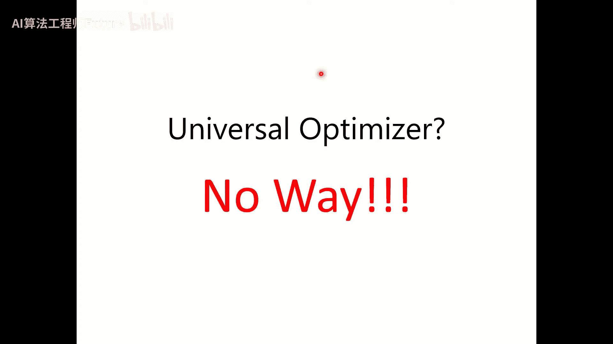

那最后就是放个来，今天这堂课程，可能大家来之前，会以为我们今天可以学到一个新的阿P来着，然后就可以把艾伦丢进垃圾桶好，那这是大家来之前是觉得今天会学到事情，但是最后我们事实上学到适应。

就是我们又从垃圾桶里面把ADAM捡回来，这个样子对，所以以后大家写作业还是乖乖用A的慢慢考好。

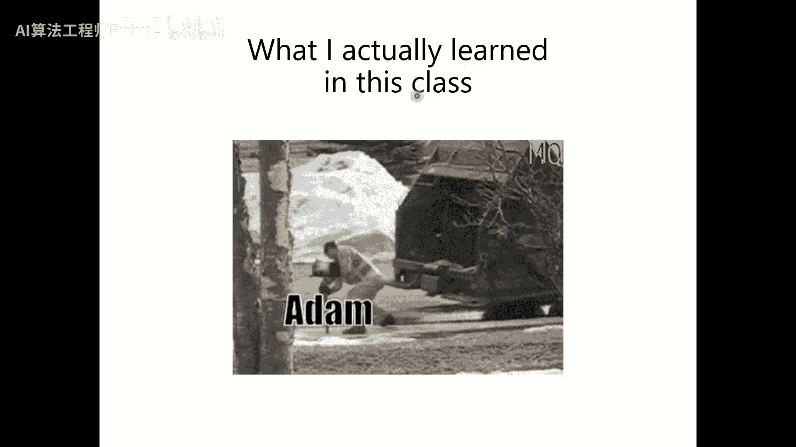

那今天就上到这边，那最后自己也是一些reference。

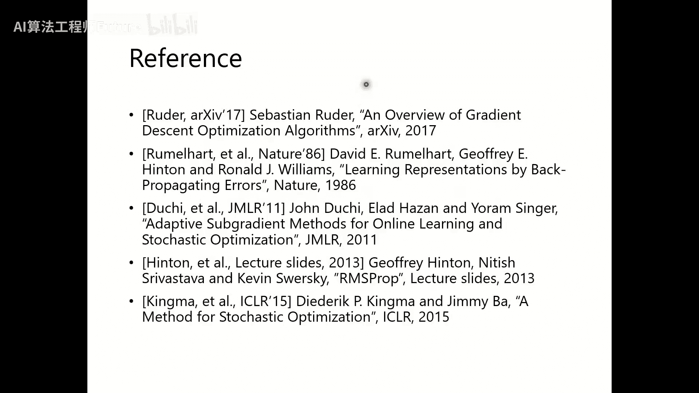

Out。

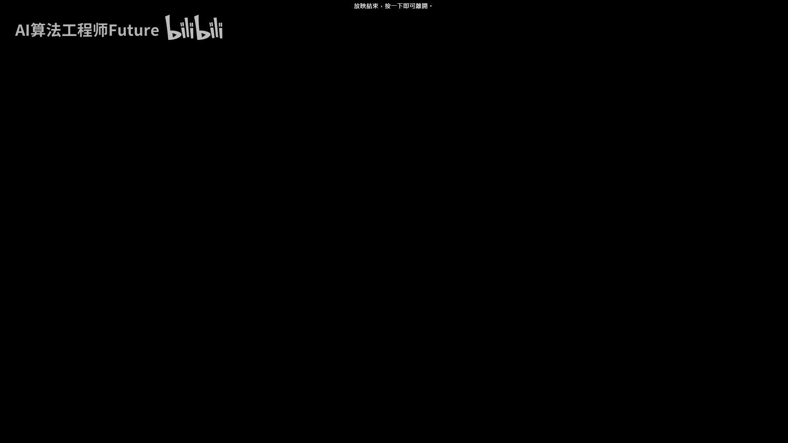

今天的课程就到这边结束。

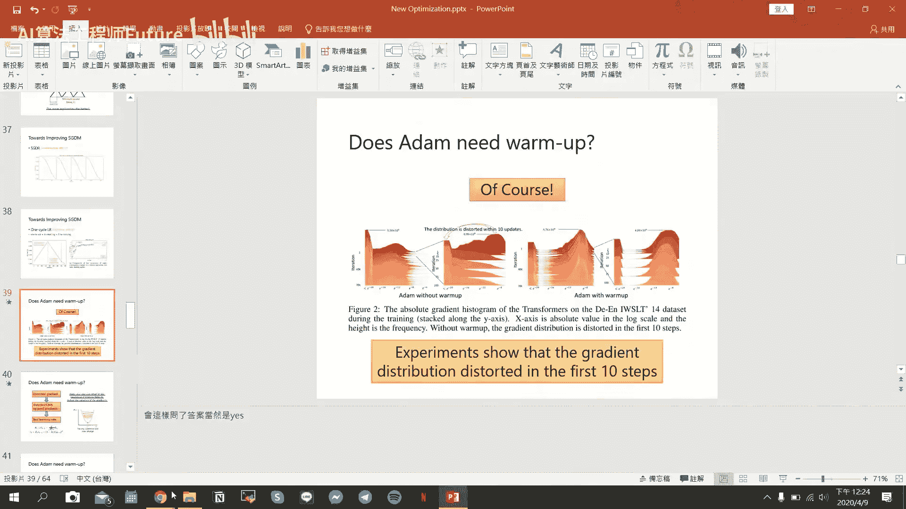

那有没有人有问题的看一下，那如果没有人有问题的话，今天课程就到这边结束啊，我等一下会把投影片放到FACEBOOK社团上面，那如果有问题的话，也可以在那个社团那边留言问一下。

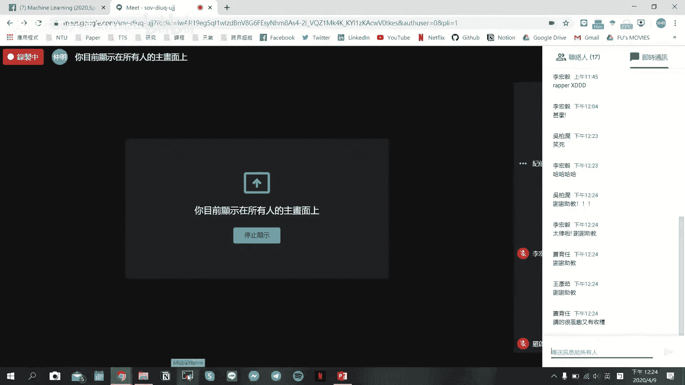

这样好，那今天就到这边。

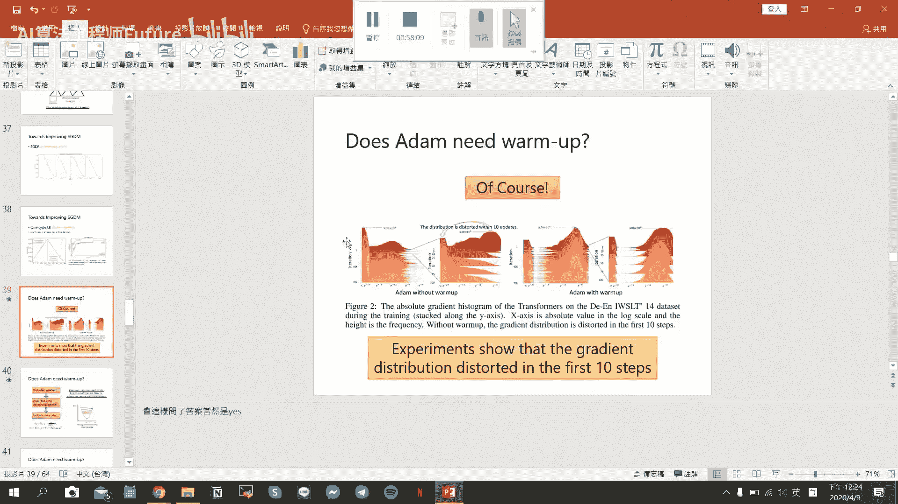