# 【官授搬运】2026年全新优化版李宏毅机器学习系统课程，这才是真正的初学者体系课程！—人工智能／深度学习／神经网络 - P23：作业说明 Homework2 - AI算法工程师Future - BV1ruqABeEFX

Hello，大家好，我是作业二的助教，然后现在我们开始讲作业二，那我会分三个部分讲这次的作业，第一个就是简介一下我们要做的这个task，然后第二个部分是我会讲解一下。

我们提供给你们的DATASET跟data的格式，然后第三个部分是我们会讲一下如何缴交作业，跟我们的grading policy好。

那我们这次要做的这个任务呢是phoning classification，那他在做的事情，就是把呃我们的音档就会是一些语音的音档，然后我们会想要去把它标注出funny，你可以理解成是音标。

就是我们要把它标出它是哪个音标这样子，那这样子的任务会需要两个部分，第一部分是data preprocessing，就是因为我们给你们的东西如果是in档的话，我们会需要把它做一些转换，那才可以做分类。

那这个部分我等下会讲一下要怎么做，但是我们已经帮你们做好了，那我们真正想要请你们做的东西，就是第二个部分就是classification，那就是应该会是你们比较熟悉的，就是用PYTORCH。

去把我们提供给你们的这些资料去做分类好，然后接下来就要讲一下什么是FING，那fling就是这里就是假设我们讲一段话，那假设是machine的话，那我们可能就可以把我们的声音切成很多段。

那第一段呢可能我一开始说嗯，跟么跟二的前半段的时候，他都会可以辨识出它是M，那中间这个O的时候可能也有一些长度，它会辨识出它是O，那最后我们的目的就是我们要这一整个句子，假设我们把它切成很多段的话。

每一段我们都可以知道它是怎样子的声音，那比如说像是machine learning的话，那可能就可以切成这样子N21嗯，然后还有learning这样，然后呃它分类的依据就是，如果你们学过KK音标的话。

那基本上就大约可以把它理解成，一个声音的分类，就是可以对应到点音调这样子，那实际上我们要怎么做它呢，就是呃，如果我们要直接拿一个微form去做分类的话，其实很难，因为第一个就是一个微form。

他的资料量太多，然后他的就是资料的格式，可能也不是适合做分类的，那所以我们会做一件事情，就是我们会把它切断，那通常我们习惯的是25ms切一段，那一一段就可以叫做一个window或者一个frame。

然后之后我们会往前花就是十个毫秒，然后再切一段，这样但你会发现这两个中间会有OVERLA，那原因是因为比如说刚那个machine的那个例子来说，它前面这里可能是嗯，那后面这里可能就变成A了。

那它就没有截取到那个money的部分，所以我们会希望就是如果我都没overlap的切，可能就真的清空了，所以我们就会希望切的时候不要切的那么干净，这样子，然后切完这些东西之后呢。

我们会每一个这个的frame呢，我们都会把它转换成一个feature，那这样子的feature常见的有几种，那我们这里用的是所谓的MMCC，那等下会再深入的讲一下MMCC是什么东西。

那它通常会是39个维度的，所以最后你就会得到你要去做分类的资料，其实是长右边这个样子，就是呢值得一排是39位，然后有很多个，然后我们把它叫做T的长度好呢。

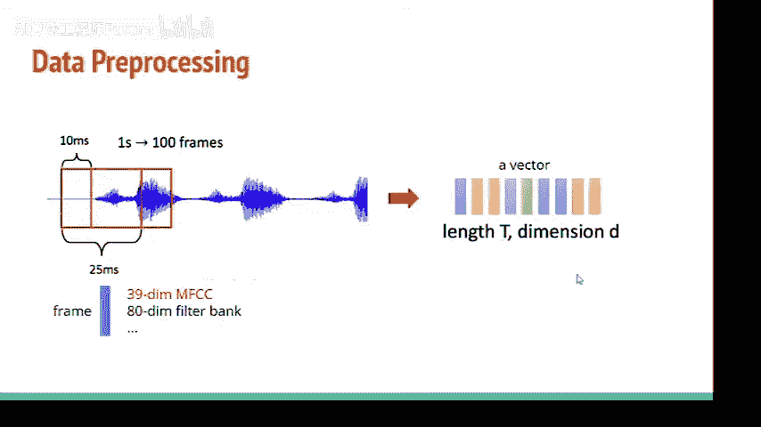

M m c c，就是我们刚刚说我们把微form转换成一个，我们比较好去做分类的形式吗，他具体上来说是怎么做呢，那这里我就不讲的太详细，那如果大家有兴趣，可以去看这个林珊老师的DSP。

或是黄毅老师也有做过相关的主题，这样那是是别的课，那我这里就简单讲一下，就是一开始我们的声音就是wait for，那但是实际上如果要，因为因为我们的语音是根据人的认知，去做分类的嘛。

所以我们理想上应该也把微form转换成，比较接近人可以理解的格式，再去做分类会比较好，那具体的方式就是，第一步，我们会先透过这个应该是foreer transform对，然后去得到SPECTRGRAM。

那SPECTROGRAM它的横轴呢就是时间，纵轴是频率，那上面这个颜色代表的是它的强度，所以它就变成是一个频率强度呃，就是你可以在同一个时间内得到不同频率强度，这样子那就比较会接近人类所听到的。

因为你听到的可能会是一个，比如说一个低的声音，那可能是低频，高的声音，可能是高频这样子，所以它会比较接近人类的理解，那接下来我们再去用13个这个东西，叫做filter bank。

然后filter bank它就是一个这样子的函数，它在一整个轴上面，它可能只有一小段是有东西，其他部分都是零，那这个东西就跟这样子的东西相乘之后，我们就可以得到这个这么长的东西，里面的其中一小段。

这样然后我们去做了13个，那取得这13个，它的取的依据是就是根据人的认知，就是人在某些频率，比如说他可能听的不会那么仔细，那fter bin在这边就学比较少，那有些地方对我们的就是声音的理解。

可能比较重要，这边就学的比较密集，这样那经过这个filter bank之后。

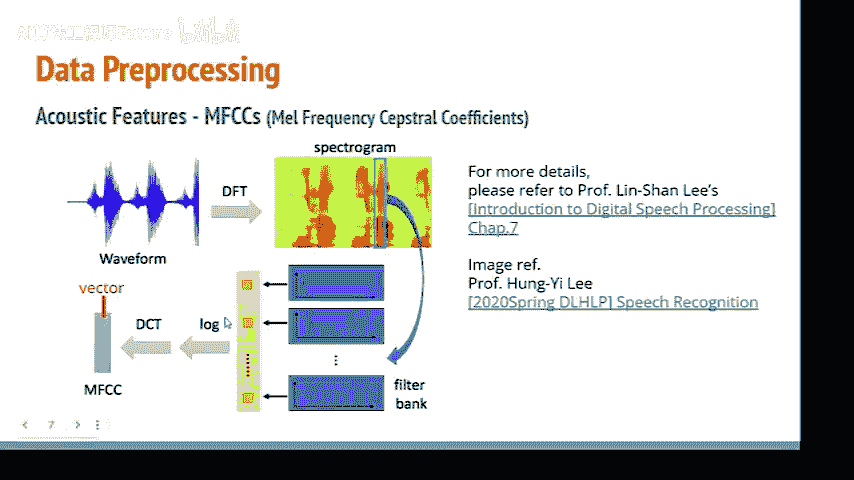

再做一些转换，就可以到我们最后的m cc这样，然后所以呃，这我们知道就是我们刚刚说你会有T为乘以呃，这个D为的向量，那额，但是啊，因为我们刚刚说我们一次切只切25ms嘛，但是长一个。

比如说我说machine machine learning的呃好了，它可就不止25ms，那所以我们会希望机器可以有多一点点的依据，去判断我刚中间的这个音到底是不是个，要不然他如果只填到一小段。

可能就是一个很奇怪的东西，它就很难去做判断，所以我们会想要把就是呢，比如说这个是我们的目标，那我们会给它前后，比如说这里的话是画前后各五个，我们就给它前后各五个frame，那让他有这么多的资料去判断。

中间这一个the phoning the label，这样这个是呃，就是我们会希望你们去做的就是叫concatenation，那经过这个COMPEATATION，它的分类表现会好很多。

那另外有一个小小要注意的部分，就是因为机器在读这个资料的时候，我会把它摊平，所以最后他实际上处理的会是这样子，就是他是11×39位，这么多位的一个向量，然后接下来讲一下我们提供给你们的DATASET。

那这个是degree speech，这个是呃，基本上my standard的一个语音的DATASET，这样那我们是取其中的一个subset，来让你们做分类。

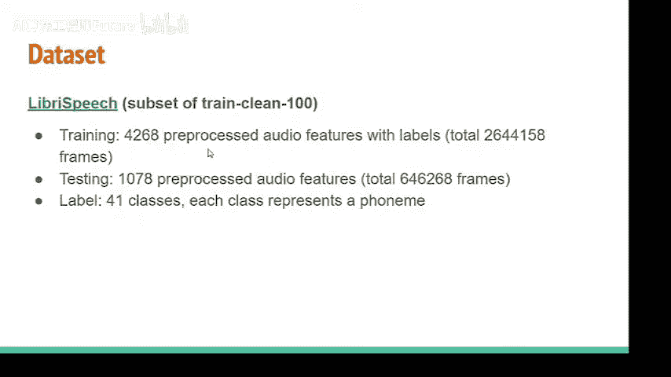

所以刚讲了这么多，就其实你如果都听不懂的话，其实没关系，你就知道，反正你会拿到一些我们给你们的资料，那它会是一些已经处理好的向量，那你只要针对这些向量去做分类就好，那我们给你们只要会讲这样子。

就是呢他的根目录会有三个text档，然后还有一个资料夹里面有更多的资料，那这三个text档呢有两个会是train，split跟test split，那这个split就是它的meta data。

就是基本上就是挡零了，那也就是他会告诉你，哪些档案应该要在train的范围，哪些应该是test，然后再来label的部分，就会是因为一个音档呢，它会是这一句话，所以它会有很多的呃很多的label。

因为一句话里面会有超级多的封印嘛，对所以就得看这里会有一排的LAL，那这个fit的资料表里面就会有很多点pt t档，那这个点PT档呢就会是原本的一个音档，然后它转换成MCC。

那这个点PT档呢你们其实就可以很容易的用，在Python里面，可以用torch点漏，然后这里括号里面打上它的相对位置，就可以打开它，那打开之后，它就会是一个T乘以39的这个tensor。

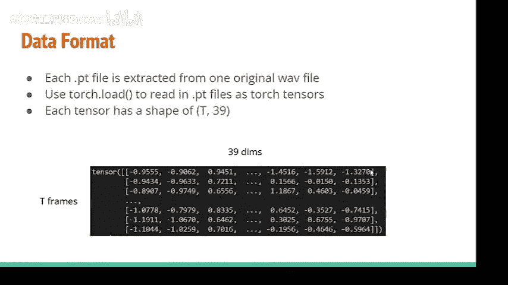

好然后接下来讲一下这个作业。

你们会需要缴交的东西，那第一个是CAO的LEADERBOARD，跟上一次应该是一样的，然后cos Mission也有，那就请你们转交到NTUPO上面再来，第三个部分是reports，reports的话。

我们的时候用一个叫grade scope的东西，那我们等下会简单的讲一下他要怎么用，那基本上他不会太难用了，所以大家就也可以不用那么担心，那这里是几个呃，这里就是我们的public baseline。

那等下sample code我们会再做讲解，那呃其他的这个杯赛，我们我们都会给你们一些的提示，让你们去做到这些的杯赛，比如说medium base line，就会请你大约就是大概增加一些layer。

然后还有也增加每一个layer的参数量，他可能就可以做的蛮好的，然后后面就是比如说VACOM跟抓到，然后跟最后这个bus bus spline是用sequence labeling，用RNA去做的。

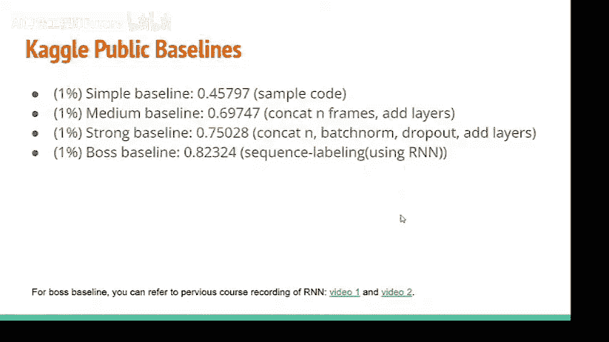

然后cargo的部分呃，跟上次应该没有太大不同，那唯一邀请你们注意的是，上次就是有很多同学有来问，说这个所谓的team name是什么东西，那他可能就以为是账号名字，然后就因为账号名字好像没办法改。

所以他就去把自己的账号删掉。

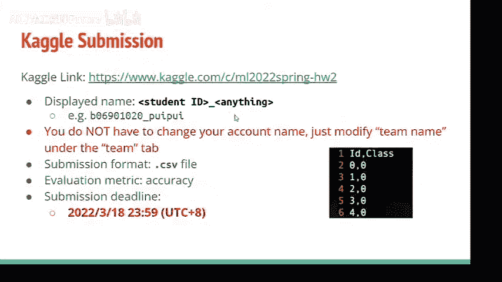

然后再重创一个这样，那其实就是要跟各位同学做，其实不用那么麻烦，就是说你们上到那个链接去看，应该可以在这边看到一个team的标签，然后你点下去，我们要你改的就是这个team name而已。

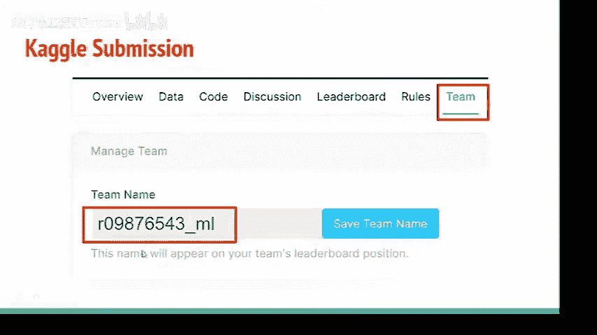

就是让我们可以看出就是你是我们的修课同学，这样，然后再来就是审submit的时候，也要记得要选两个呃，你的CSP档次当做private的分数，然后CONSUMISSION应该也是差不多。

就是我们会希望你们命名要照这样的规则，然后记得不要传自己的model跟data set，然后如果你的扣没办法reproduce出你的成本，你的就是submission的话，它就有可能被存0。9。

所以大家自己注意一下，然后那个deadline的话是三个礼拜后的礼拜五，3月18晚上的11：59，接下来就看一下reports的问题，那我们这次会给你们就是sample code。

我们其实会让你们很容易的，可以去加深或者加宽，那所以我希望你们去做两件事，一个就是我们希望你们去试一个比较高，但是比较窄的model，跟一个比较宽，但是比较浅的model，那两个参数量是差不多的。

然后你们可以去观察一下他们，比如说收敛的速度啊等等，那呃，因为怕你们不知道要怎么去找这样子的参数，所以我们其实有提供就是深的是六，然后1024，那浅的是二一千七这样。

然后我们去算过它的参数量大约是差不多，然后我们就有请你们去report他的training and，Validation of accuracy，那单其实你们自己还可以观察的东西。

就是比如说谁收敛的比较快，或是呃比如说泰森会不会有trap shop之类的状况，然后好或是比如说那个generalization的能力，但这个东西我们没有听人在report里面回答。

就是那第二个就是也是类似，就是我们请你们去加drop out layer，然后我们会希望你们去观察不同的dropout rates，然后我们给你们0。25，0。5跟0。75。

希望你们回报他的training and validation accuracy，那report的submission呢它也是一样，是在3月18，但是它比前两个的deadline晚一分钟。

所以你们就可以极限操作一下。

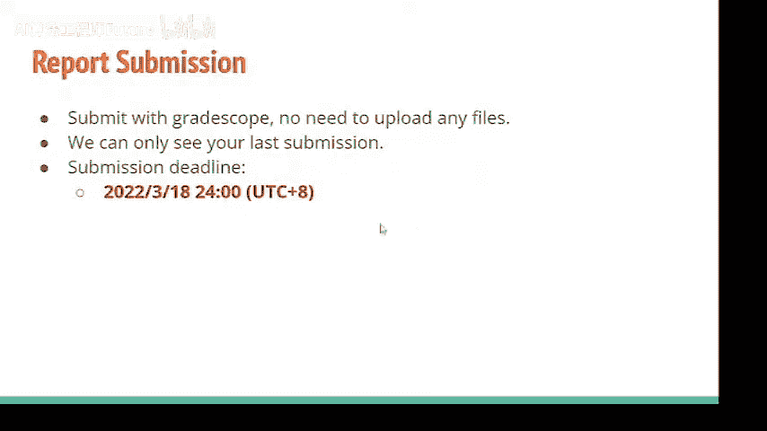

哈哈好。

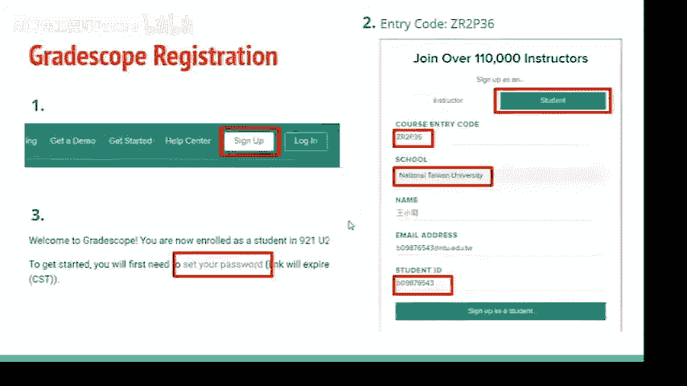

然后接下来讲一下，这是我们现在用的，这个是诶，这个我们现在用的是grade ste。

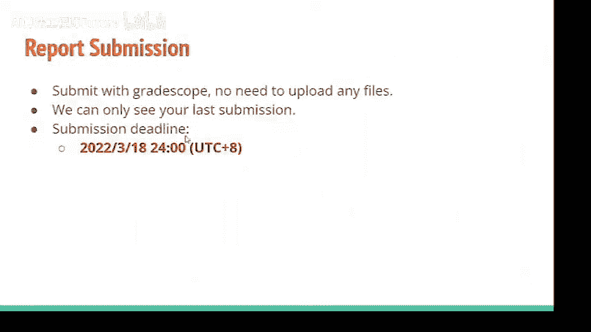

那等一下我们会稍微示范一下，就是great so great score上面长怎样，那这里就是简单跟你们讲一下，会你们要做的事情就是到那个great scope到com，然后它会右上角有个sign。

你就点下去，然后选set up as a student，然后这里的entry code是最重要的地方，就是要输这个ZR2P36，才可以进到我们的ml的课里面。

然后再来这个school跟student id也请你招十天，那再来这个name和email address，虽然它不是最重要的，但是希望你们就是不要乱填奇怪的东西啊，你就填本名就好。

然后email也是填个可以联络到你们的email，这样子，这样万一有什么状况的话，就比较不会有意外，然后等到你按下这个sign up之后，你就会收到一封信，他会请你去点这个链接，然后就可以设定年龄了。

那等你设定完之后点进去。

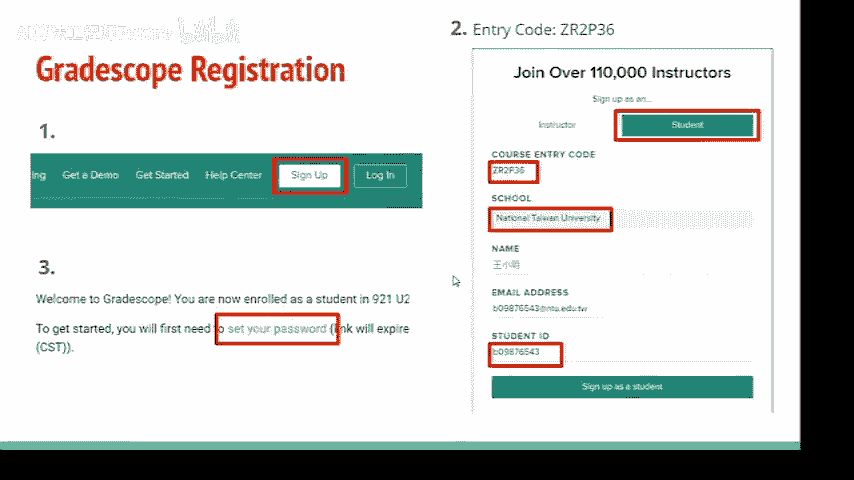

你们应该就可以看到一个类似这样子的东西，那你就把它再拧下去，再点下去，你就可以看到有一个这个，那这个它就会类似一个google表单的东西，所以你们其实不需要自己去做一个PDF档之类的。

你们就直接到这break scope，然后把你的答案填上去，然后交交就可以了，然后最后这个regulation，应该跟上一次的是差不多的，那呃要注意的就是我这里有加这个部分。

就是如果你们的作业被发现是有问题的，那总成绩乘以0。9之外，档次的作业也不会积分，然后呃如果你们有问题的话，一样可以到NPU库的那个讨论版上面，那别人可能已经有问相同问题，或者你也可以问问题。

我们就会回答，那或是你们也可以寄email，然后再来就是我们之后也会有TALL，但是这个东西我们可能下礼拜会再公布，对好那大家对作业二目前为止有问题吗。

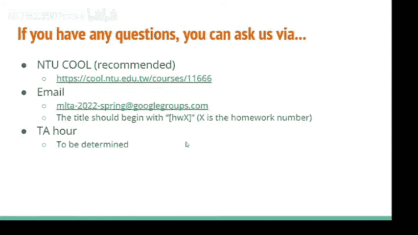

没有的话，就是我看一下那个great scope的东西。

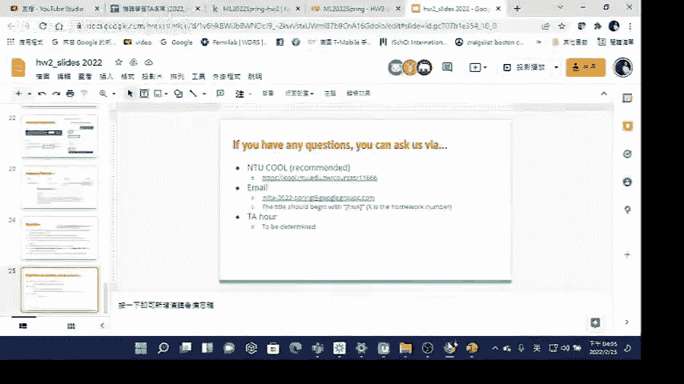

让你们看他大概会长这样，就是你们登进去之后啊，它就会长大概这样子，那你就点home over two。

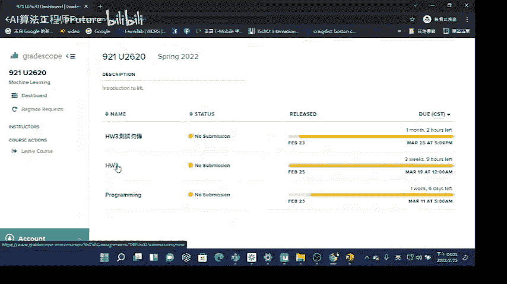

然后它就会这是问题一样会给你们，然后我们要你们回答，就是因为我们的A跟model a跟model b，没有强迫你们的参数如何设定，所以这里你就打上你们的参数怎么设定。

然后回报你们的training跟validation的accuracy，那第二题也是类似，就是题目在这里，然后我们之后会帮你们每个setting的training。

跟balization of accuracy，然后去submit，这样就可以了，好应该轻松吧，那接下来就。

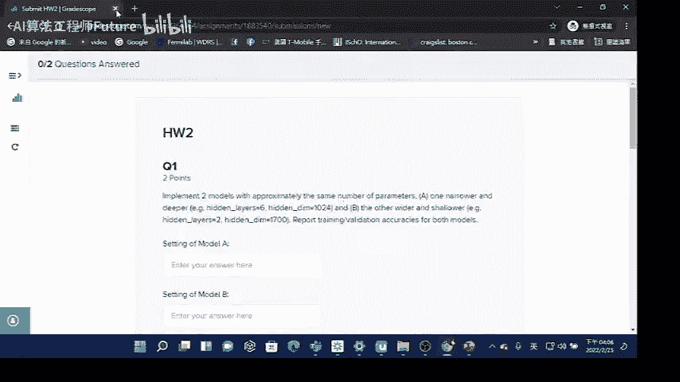

我们就带你们看一下这次给你们的sample p，然后然后现在我就带大家看一下我们的sample co，I love，红卫衣，大家应该已经知道怎么抛口袋，所以我就不跑。

就是带大家看一下我大概做什么这样子好。

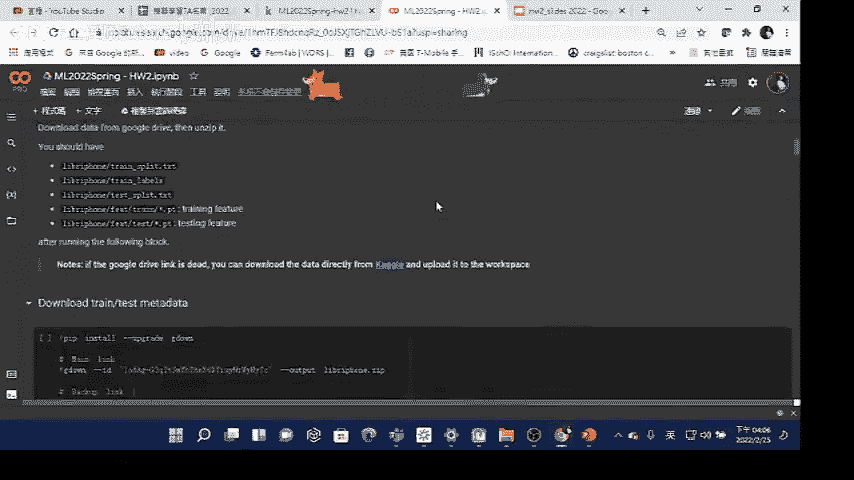

然后第一个呢就是我们data塔的形式，就跟刚团影片讲的一样，会有一个就是train的档名的file，然后一个是会有label train label，然后另外就是只有test的打印而已。

然后另外呢还有一个FEIT资料加点，因为包含你training跟testing的feature好。

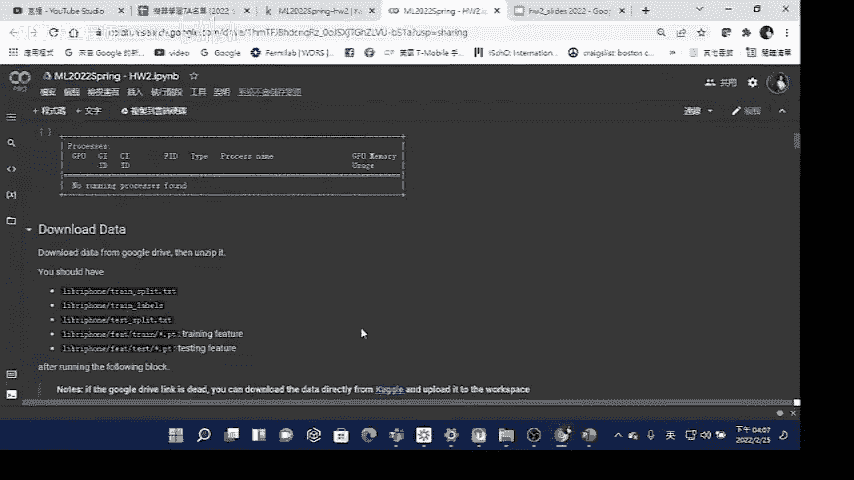

然后这边我们帮大家准备300，所以其中有一个link坏掉的话，你可以试试看，用其他两个link下载好。

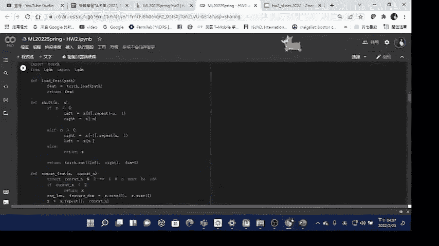

然后因为homework to的data比较复杂一点的，所以就是我们preposance data这边稍微复杂一点，就简单跟大家讲一下，首先我们就是data漏进来之后。

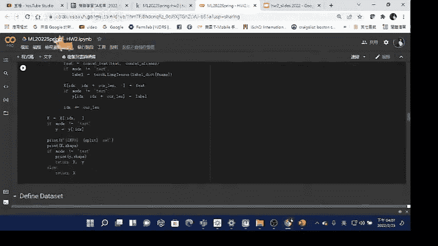

就是用torch显漏，漏其中一个点P1样进来就会得到一个tensor，然后我们帮大家写了一个CONCAFE，这个function就是前面同一篇有讲到，就是一个风铃，它其实不会只有一个frame。

所以我们在训练的时候，如果接上前后的呃frame的话，它的training accuracy会比较好，然后大家注意是这content n呢，传入的数字呢是你总共的frame。

比如说你今天想要接前五个跟后五个frame的话，你这样总共是11个嘛，你抗泰N的话就要串11这样子啊。

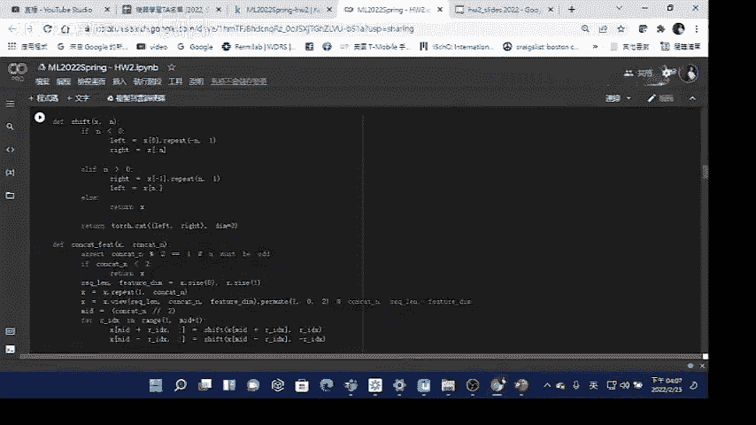

然后我们写这个方程，就是假设是你前后都接对称数量的frame。

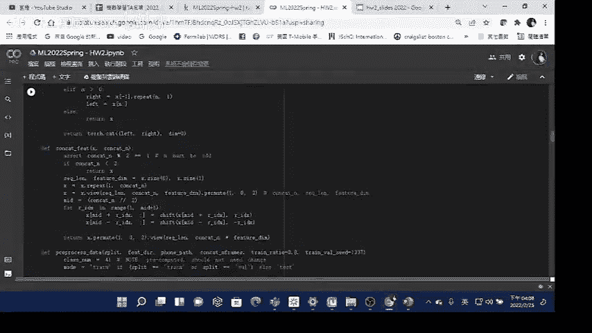

所以就是N你要传奇数的这样好，然后比如从da low进来之后，然后再呃处理要不要contact之后呢，就会把所有的frame都接，每个音档的所有的frame都接在一起。

所以之后呢就会return一个X跟Y这样，然后这个X呢就是你总共有多少个frame，然后第二个维度呢就是呃，比如说你如果不contact的话，就只有39维的MMCC。

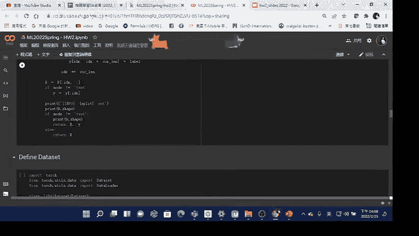

然后如果抗can几个F话，就39乘以N这样子老外就是对应的LABE呃。

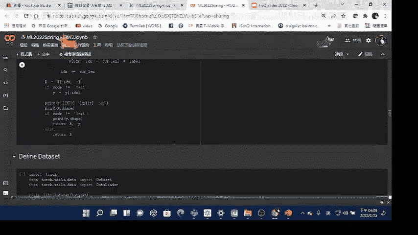

那如果大家就是对于就是contact那个方程。

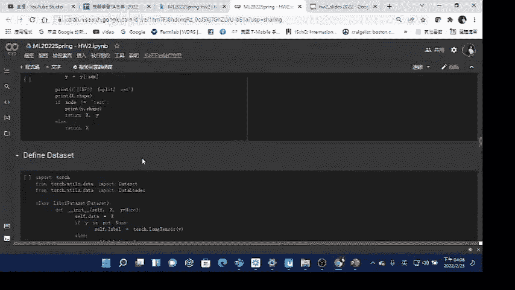

想要自己写的话呢，就是也是没有问题的，但是就是要注意呃，最后你自己要检查就不可以DP掉任何的frame，一定要就是检查你的数量。

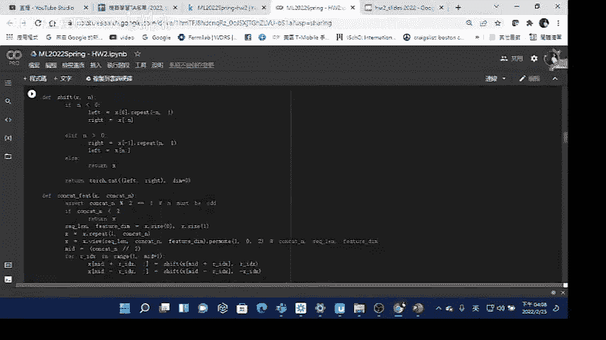

跟投影片讲的那个frame的数量是一样的，否则就是上传之后会有问题好。

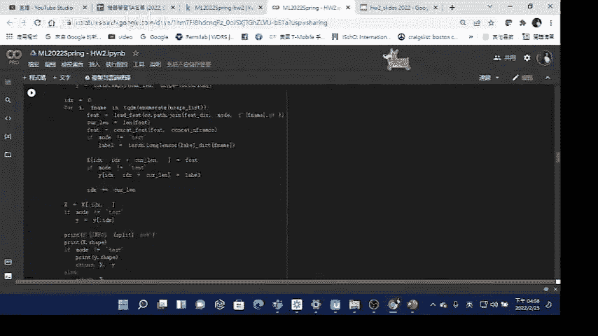

然后后面给他set的部分就是没有什么特别的。

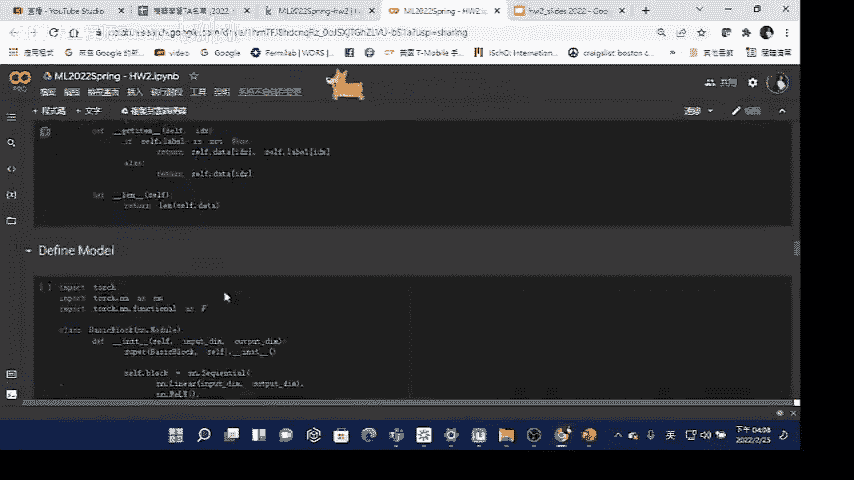

就不讲，然后这个是model的部分，然后这边就是一些training的参数，然后后面就是跟作业一差不多的training流程，这样子好，然后呃山坡背上以后，就是跑完这个山坡扣就可以过了。

然后V点跟strong呢基本上也就是调这边的参数，主要就是调这个。

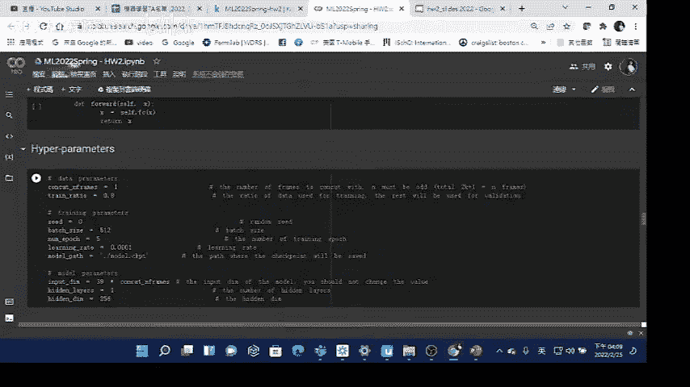

然后CONCARE几个frame，然后跟调model的架构就可以了啧。

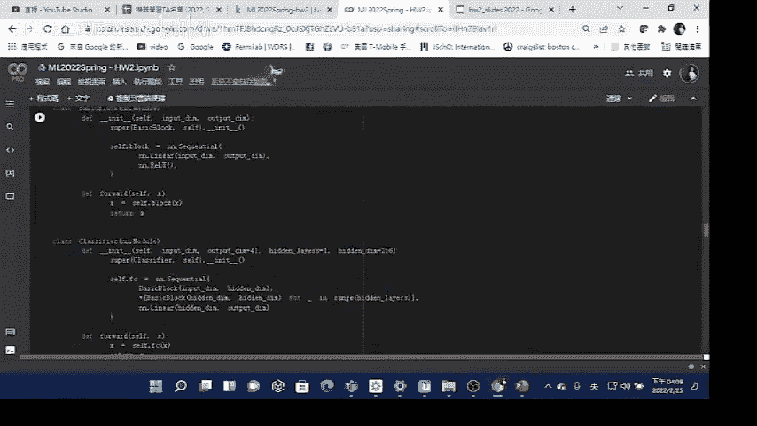

呃但是boss space sign的话，其实是有点超过就是目前讲的范围，不过老师之后很快就会讲到的，我们用的是细分SLIN的方法，然后用到RNN的model，但是呃如果要过boss杯赛的话呢。

其实就需要大家自己去实做呃，重新写一个data set，然后model的架构也要大改，就是不是改一改，就是这个sample po参数就可以过的，然后大家如果之后是做有什么问题的话，可以再问我们这样子好。

然后作二的前后后代。