# 【官授搬运】2026年全新优化版李宏毅机器学习系统课程，这才是真正的初学者体系课程！—人工智能／深度学习／神经网络 - P24：【第3讲】1-卷积神经网络-CNN - AI算法工程师Future - BV1ruqABeEFX

我们要来讲network的架构，我们开始探讨network的架构设计，那我第一个要跟大家讲的，network架构的变形呢是CONVOLUTIONAL的neural network，它的缩写呢就是CNN。

那这个CNN呐，它是专门被用在影像上的，那我希望透过CNN这个例子，来让你知道说network的架构，它的设计有什么样的想法，那为什么设计network的架构。

可以让我们的呃呃network结果做得更好好。

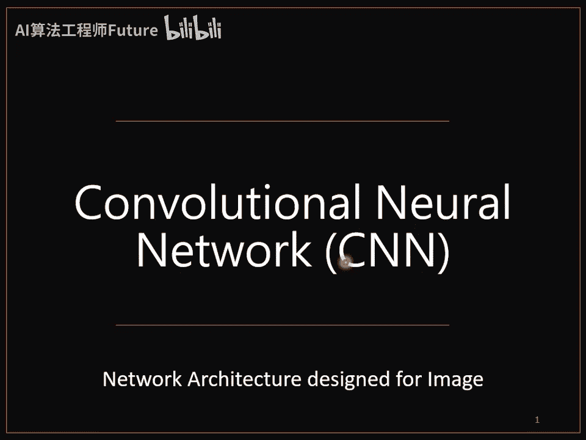

那我们接下来呢要讲的例子是跟影像有关的，我们今天就想象说我们要做影像的分类，也就是给机器一张图片，他要去决定说这张图片里面有什么样的东西好，那怎么做呢，我们已经跟大家讲过怎么做分类这件事情。

在以下的讨论里面，我们都假设我们的模型输入的图片，大小是固定的，举例来说，它固定输入的图片大小都是100×100的，解析度，我们假设说不会突然出现大小不一的照片，其实今天一般在做影像辨识的时候。

往往都有这样子的假设，就算是今天这个deep learning已经这么的popular，我们往往都还是需要假设，说一个模型输入的影像大小都是一样的，诶说图片可能有大有小啊，而且不是说我图片都是正方形。

大家有长方形的怎么办，今天常见的处理方式，究竟影像辨识系统处理方式，就是把所有图片都先与scale成大小一样，再丢到影像的辨识系统里面，好，那我们的模型的输出应该是什么呢，我们模型的目标啊是分类。

所以我们会把每一个类别表示成一个，one hot的factor，我们的目标呢就叫做one hand，好，那在这个one hard的vector里面呢，假设我们现在的类别是一个猫的话。

那猫所对应的dimension，它的数值就是一，其他的东西所对应的dimension的数值就是零，那这个dimension的长度，就决定了你现在的模型，可以辨识出多少不同种类的东西。

如果你这个向量的长度是2000，就代表说你这个模型可以辨识出，2000种不同的东西，那今天比较强的影像辨识系统，往往可以辨识出1000种以上的东西，甚至到上万种不同的object。

那如果你今天希望你的影像辨识系统，它可以辨识上万种object，那你的label就会是一个上万维维度是上万的呃，one half fe好，那我们的模型的输出啊，通过soft max以后输出是WIFI。

然后呢我们就是希望WIFI跟y hand，他们的cross entropy越小越好，那有关这个cross entropy的部分呢，我们已经跟大家讲过了，接下来的问题是。

怎么把一张影像当做一个模型的输入呢，那我们先来看一下对呃电脑来说，一张影像是什么样的东西，那其实对一个machine来说呢，一张图片其实是一个三维的tensor，那什么叫做tensor呢。

如果不知道tensor是什么的话，你就想成他是维度大于二的矩阵哎，就是tensor，就是啊矩阵是二维的嘛，那二维以上的呃，超过二维的矩阵啊，你就叫它tensor，一张图片它是一个三维的tensor。

哪三维呢，其中一维代表图片的宽，另外一维代表图片的高，还有一维代表图片的channel的数目，这个所谓的channel是什么意思呢，一张彩色的图片呐，今天它每一个pixel都是由RGB3个颜色所组成的。

所以这三个channel就代表了RGB3个颜色，那长跟宽就代表了今天这张图片的解析度，代表这张图片里面有的pixel，有的像素的数目好，那接下来啊，我们就要把这一个呃三维的tensor把它拉直。

我们把它拉直以后就可以丢到一个network里面去了，还记得吗，到目前为止我们所讲的network，它的输入其实都是一个向量，所以我们只要能够把一张图片变成一个向量。

我们就可以把它当做是network的输入，但是怎么把这个三维的tensor变成一个向量呢，那最直觉的方法就是直接拉直，它一个三维的tensor里面有几个数字呢。

有在这个例子里面有100×100乘以三个数字，所以一张图片是由100×100乘以三个数字，所组成的，把这些数字统统拿出来，排成一排，就是一个巨大的向量，这个向量可以作为network的输入。

而这个向量里面每一维，它里面存的数值其实就是某一个pixel，某一个颜色的强度，对不对，每一个pixel有RGB3个颜色所组成，每个颜色都有一个数值，代表说这个颜色的强度，在这个向量里面。

每一维它的数值就代表了某一个位置的。

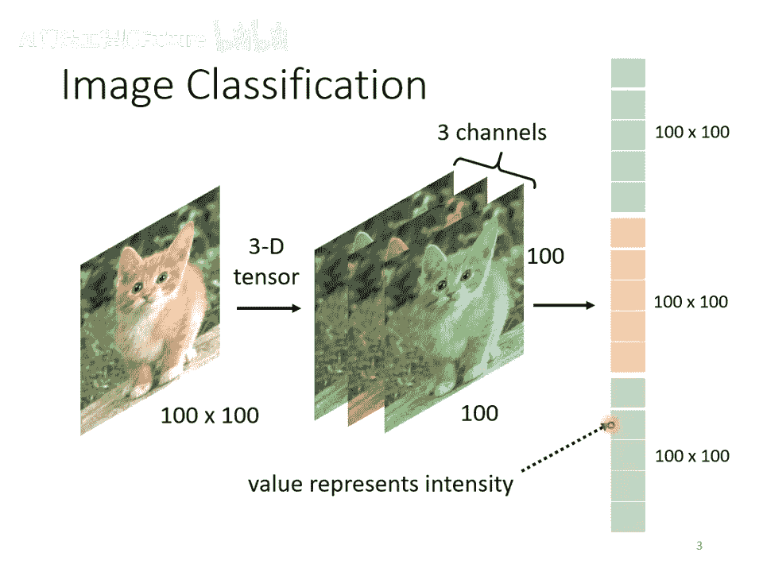

某一个颜色的强度，好，那这个向量啊，我们可以把它当做是一个network的输入，那我们到目前为止只讲过了fully connected的network好，那如果我们把这个向量当做network的输入。

那我们input这边这个feature vector啊，它的长度就是100×100乘以三，非常长的一个vector，那假设我们现在的第一层的，neuron的数目有1000个，那你能计算一下呃。

这边第一层总共有多少个weight吗，我们每一个neural，它跟输入的向量的每一个数值都会有一个weight，所以如果输入的向量长度是100×100乘以三，有1000个neural。

那我们现在第一层的weight就有1000100乘，100×3，也就是3×10的七次方，是一个非常巨大的数目，那如果参数越多，会有什么样的问题呢，虽然随着参数的增加，我们可以增加模型的啊弹性。

我们可以增加他啊他的能力，但是我们也增加了OVERFITTING的风险，有关什么叫模型的弹性，到底OVERFITTING怎么产生的，下周吴培元老师会从数学上给大家，非常明清楚的证明。

那我们这边就讲概念上，如果模型的弹性越大，就越容易OVERFITTING，那我们怎么呃怎么减少在做影像辨识的时候，怎么避免使用这么多的参数呢，那考虑到影像辨识这个问题本身的特性。

其实我们并不一定需要fully connected这件事，考虑影像本身的特特性，我们其实不需要每一个neural跟input的，每一个dimension都有一个稳定，怎么说呢。

接下来就是对影像辨识这个问题，对影像本身的特性的一些观察，第一个观察是对影像辨识这个问题而言，假设我们想要知道说啊，这张图片里面有一只动物，这个动物是一个鸟，要怎么做呢，也许对一个影像辨识的系统而言。

对于一个影像辨识的neural，对一个影像辨识的类神经网络，里面的神经核元元而言，他要做的就是侦测，说现在这张图片里面，有没有出现一些特别重要的pattern，而这些pattern是代表了某种物件的。

举例来说，如果现在有某个neural说，他看到鸟嘴这个pattern，有某个neuron又说他看到眼睛这个pattern，用某个neuron说他看到鸟爪这个pattern，也许看到这些pattern。

综合起来就代表说我们看到了一只鸟类，神经网络，就可以告诉你说，因为看到这些pattern，所以他看到了一只鸟，那也许你会觉得说啊看peter，然后决定他是什么，这件事情好像没有很聪明，但你仔细想想。

人是不是也是用同样的方法来看一张图片中，有没有一只鸟呢。

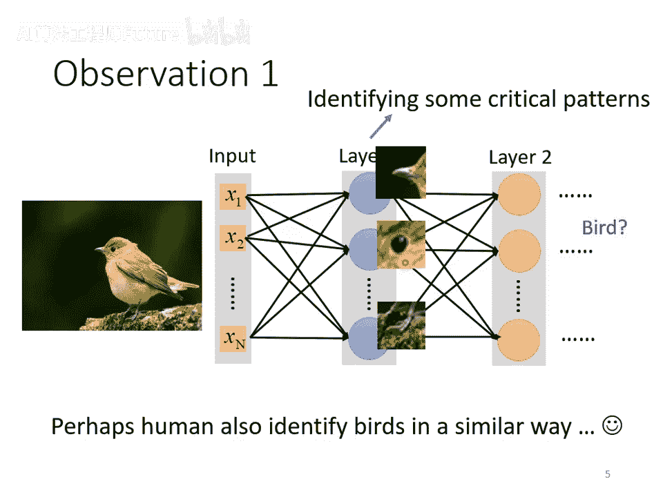

举例来说这一个例子，诶，不知道你有没有看到这里面有什么样的动物啦，诶你看这边有一个鸟嘴啦，哦这边有一个眼睛啦，看起来他是一个乌鸦啦，但是它其实是一只猫，这样子唉如果你看到它是一只鸟的话。

那你就应该放下酒杯了，因为这是一只猫好，所以其实就算是人，我们在判断一个物件的时候，往往也是抓最重要的特征，然后看到这些特征以后，你很直觉的就会觉得说你看到了某种意见，对机器来说。

也许这也是一个有效的判断。

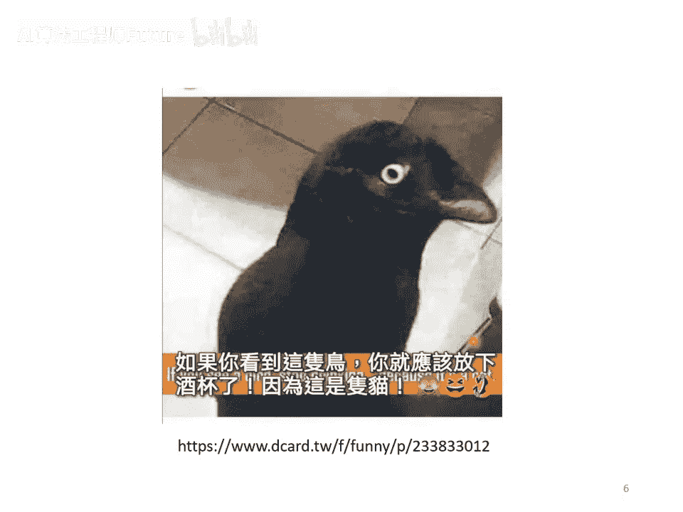

影像中有什么物件的方法，但是假设我们现在要neuron做的事情，其实就是判断说现在有没有某种pattern出现，那也许我们并不需要每一个牛肉，都去看一张完整的图片，因为这一些重要的pattern。

比如说鸟嘴啊，比如说眼睛啊，比如说鸟爪，并不需要看整张完整的图片，才能够得到这些资讯，你要知道说这边有没有一个鸟嘴，你其实只要看非常小的范围就知道了，你并不需要看整张图片，所以这些neural。

也许根本就不需要把整张图片当做输入，他们只需要把图片的一小部分当做输入，就足以让他们侦测某些特别关键的pattern，有没有出现呢，这是第一个观察。

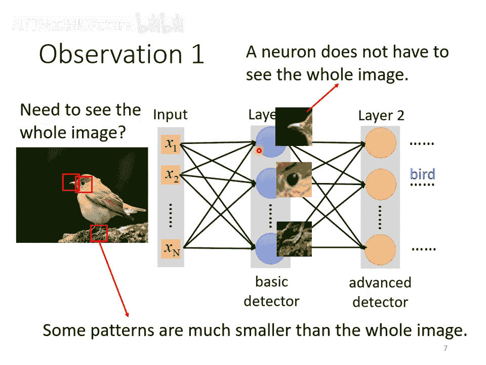

根据这个观察我们就可以做第一个简化，怎么简化呢，本来我们每一个neural他要看完整的图片，把图片里面的每一个pixel，每个pixel都还有三个数字，把一张图片里面所有的资讯都丢给一个neural。

然后让他产生矛盾，这是fully connected network做的事情，但是现在我们已经观察到说，也许不需要让一个neural看完整的图片，只要让他看图片的一小部分就足够了。

那怎么通过这个观察来设计我们的neural network呢，在CNN里面呢有一个这样的做法，我们会设定一个区域叫做receptive field。

每一个neural都只关心自己的receptive field，里面发生的事情就好了，举例来说，你会先定义说这个蓝色的neural，他的守备范围就是这一个receptive file。

那这个receptive file里面有33乘以三个数值，这里这个小的立方体里面有三乘以，3×3个数值，那对这个男生的NEO来说，他只需要关心这一个小范围就好了，不需要在意整张图片里面有什么东西。

只在意他自己的receptive field里面发生的事情就好，那这个neural怎么考虑这个reset，a field里面有发生什么样的事情呢，他要做的事情，就是把这3×3乘以三个数值拉直。

变成一个长度是3×3乘以三，也就是27维的向量，再把这27维的向量作为这个neural的输入，这个neural会给27维的向量的，每一个dimension一个位，所以这个neural有33乘以三。

27个weight，再加上IS的那个输出，这个输出再送给下一层的牛肉，当做输入好，所以每一个neural他只考虑自己的receptive fi，那这个receptive fi要怎么定义，怎么决定出来呢。

那这个就要问你自己了，你可以说啊这边有个蓝色的neural，它就看左上角这个范围，这是它的receptive field，另外又有另外一个黄色的牛肉，它是看右下角这个3×3乘以三的范围。

这个呃立体的部分我们就画不出来了，我这边画一个正方形，代表3×3乘以三的范围，这个是黄色这个neural的RECEPTIF，那reset tifill彼此之间呐也可以是重叠的。

比如说我现在画一个reset tifill，在这个地方它是绿色的neural的守备范围，它跟蓝色的跟黄色的都有一些重叠的空间，这样也是可以的好，所以reset tifill彼此之间是可以重叠的啊。

你可以说两个人的守备范围彼此是有重叠的，那你甚至可以两个不同的neural，他们守备调到的范围，也许一个范围只用一个neural来守备，你没有办法侦测所有的pattern。

所以同个范围可以有多个不同的neural，所以不同同的REACTIFD他们可以有多个呃，所以多个neural，他们可以去守备同一个respective fi，那接下来你就会浮想联翩，有各式各样的想法。

举例来说呃，那我可不可以receptive fi有大有小呢，因为毕竟pattern有的比较小，有的比较大嘛，有的pattern也许在33的范围内，就可以被侦测出来，有的pattern。

也许要11×11的范围才能被侦测出来，那我可不可以reset it fill，有大有，这个算是常见的招式了，呃我可不可以reset tifill，只考虑某些channel呢。

我们这边看起来我们的reactive view啊，是RGB3个channel都考虑，但也许有些pattern只在红色的channel会出现呢，也许有些patterns在蓝色的channel会出现呢。

我可不可以有的neuron只考虑一个channel呢，可以其实之后再讲到network compression的时候，会讲到这种network的架构，在一般CNN里面，你不常这样子考虑。

但是有这样子的做法好，那有人会问说，诶这边reset tifd通通都是正方形的，你刚才举的例子里面，3×31乘11也都是正方形的，可不可以是长方形的呢，可以可以是长方形的，这完全都是你自己设计的。

receptive field是你自己定义的，你完全可以根据你对这个问题的理解决定，你觉得receptive field应该要长什么样子，按这边还可以有各式各样怪怪的想法啊。

你可能会说reset a fi一定要是啊，respect fill的范围一定要相连吗，我们可不可以说哦，有一个neuron，它的reset tifill就是影像的左上角跟右上角，理论上可以。

但是你就要想看为什么你要这么做吗，会不会有什么pattern，是会，也要看一个图片的左上角跟右下角，才能够找到的，也许没有，如果没有的话，这种RECEPTIFW就没什么用。

我们之所以receptive fill都是啊一个相连的领地，就是我们觉得要增设一个pattern，那这个pattern，它就出现在整个图片里面的某一个位置，而不是出现，而不是分成好几部分。

出现在图片里面的不同的位置，所以reset tifill呢，它都是相通常见到的都是相连的领地，但如果你说你要设计很奇怪的reset tifill，去解决很特别的问题，那完全是可以的。

这都是你自己决定的好，虽然reset a field你可以任意设计，但这边要跟大家讲一下，最经典的receptive field的安排方式，那最经典的安排方式是什么呢。

第一个就是会看所有的channel，一般在做影像辨识的时候，我们可能呃，你可能不会觉得说，某有些pattern只出现在某一个channel里面，所以会看全部的channel。

所以既然会看全部的channel，我们在描述一个receptive field的时候，只要讲它的高跟宽就好了，就不用讲它的深度，反正深度一定是考虑全部的channel。

而这个高跟宽呐合起来叫做kernel size，举例来说，在这个例子里面，我们的kernel size就是33，那一般我们这个kernel size啊其实不会设太大。

你在影像电视里面往往做个33的kernel size，就足够了啊，如果你说你设个7×79乘九，那这算是蛮大的，kernel size一般往往都做33，那讲到这边你就会问说哎。

那如果kernel size都是33，意味着说我们觉得在做影像辨识的时候，重要的pattern都只在33，这么小的范围内就可以被侦测出来咯，听起来好像怪怪的，有些pattern也许很大啊。

也许3×3的范围没办法侦测出来啊，等一下我们会再回答这个问题，那我现在先告诉你说啊，常见的reset a field设定方式就是kernel size33。

然后一般呢同一个respective field，会有一组new肉去啊守备这个范围，所以你画一个receptive fid以后，不会只有一个neuron去关关照它，不会只有一个neuron去守备它。

往往会有一组一排neuron去守备它，比如说64个或者是128个neuron，去守备一个reset tifid的范围好，那到目前为止我们讲的都是一个receptive field。

那各个不同receptive file之间的关系是怎么样呢，你会把你在最左上角的这个receptive fill啊，往右移一点，然后就制造一个新的守备范围。

制造一个另外一个exceptive field，那这个移动的范围啊，这个移动的量啊叫做strike，像在这个例子里面呢，stride呢就等于二，那stride是一个你自己决定的参数了。

决定的那个hyper parameter，你要自己调的，但这个strike你往往不会设太大，往往设一或二就可以了，因为你希望这些receptive field跟receptive field之间呢。

是有重叠的，为什么我们需要receptive field之间是有重叠的呢，因为假设respective field完全没有重叠，那有一个pattern就正好出现在两个。

receptive field的交界上面，那就会变成没有任何neuron去侦测它，那你可能就会miss掉这个PTERN，所以我会希望respective fid，彼此之间有高度的重叠好。

那假设我们设strike等于二，那第一个respective field就在这边，那第二个就是在这边，那第三个呢就再往右移两格啊，再往右移两格就放在这边，那这边就遇到一个问题了。

它超出了影像的范围怎么办呢，那有人可能会说，那就不要在这边摆reset a field，但这样就漏掉了影像的边边的地方啊，有个pattern出现在边边的地方。

你就没有neuron去关照那些pattern啦，没有neuron去侦测出现在边边的pattern了，所以一般边边的地方也会考虑的，但超出范围了怎么办呢，超出范围你就做heading。

什么叫padding，padding就是补零，所以如果你今天reset tifd，有一部分超出影像的范围之外了，那就当做那个里面的值都是零，其实也有别的补值的方法啊，heading就是补值的意思。

有别的补值的方法，比如说有人会说我这边标要补零好不好，我补整张一整张图片里面所有value的平均可以，或者你说我把边边的这些数字拿出来补，在这个没有值的地方。

可不可以可以有各种不同的heading的方法好，那你除了这个横着移动，你也会这个直着移动啊，你也会有这个呃垂直方向上的移动，那在这边呢我们一样垂直方向拽的呢也是设二，所以你有一个reset tifo。

在这边垂直方向移动两格，就有个receptive field在这个地方啊，你就按照这个方式扫过整张图片，所以整张图片里面每一寸土地，都是有被某一个exceptive field覆盖的。

也就图片里面每一个位置都有一群neural，在侦测那个地方有没有出现某些pattern好，那这个是第一个简化fully connected network的方式好，那第二个观察是什么呢。

第二个观察就是同样的pattern，它可能会出现在图片的不同区域里面。

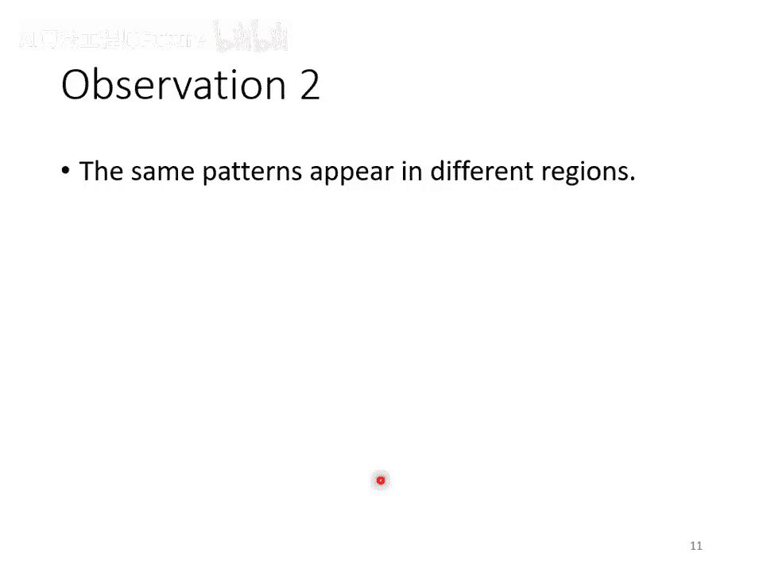

比如说鸟嘴，这个pattern它可能出现在图片的左上角，也可能出现在图片的中间，虽然它们的形状都是一样的，都是鸟嘴，但是它们可能出现在图片里面的不同的位置，按照我们按照我们刚才的讨论。

以同样的pattern出现在图片的不同的位置，似乎也不是太大的问题，因为出现在左上角的瞄准，它一定它落在某一个reset tifill里面，因为reset tifill是盖满整个图片的。

所以图片里面没有任何地方，不是在某个new room的守备范围内，所以这些这个地方一定是某一个neuron的reset，Tifd，那假设在那个reset tic field里面有一个neural。

他的工作就是侦测鸟嘴的话，那鸟嘴就会被侦测出来哦，所以就算鸟腿出现在中间也没有关系，假设有，这边一定是在某一个receptive field的范围里面。

那个reset a field一定有一组neuron在照顾，那假设其中有一个neuron，它可以侦测鸟嘴的话，那鸟嘴出现在图片的中间也会被侦测出来，但这边的问题是，这些侦测鸟嘴的neural。

他们做的事情其实是一样的，只是他们手背的范围是不一样的，那既然他们做的事情是一样的，守备范围是不一样的，我们真的需要每一个守备范围，都去放一个侦测鸟嘴的牛肉吗，他们做的事情根本就是重复的啊。

只是他们的守备范围不一样啊，如果不同的守备范围，都要有一个侦测鸟嘴的neural，那你的参数量不会太多了吗，哦这个概念就好像是啊，为什么教务处希望可以推大型的课程一样啊。

假设说每一个科系其实都需要城市相关的课程，或每一个科系都都需要机器学习相关的课程，那到底需不需要在每一个呃，细锁偷开机器学习的课程，还是说开一个比较大班的课程，让所有细锁的人都可以休克。

这个就是教务处推动大型课程的想法好，那如果放在影像处理上的话是怎么样呢。

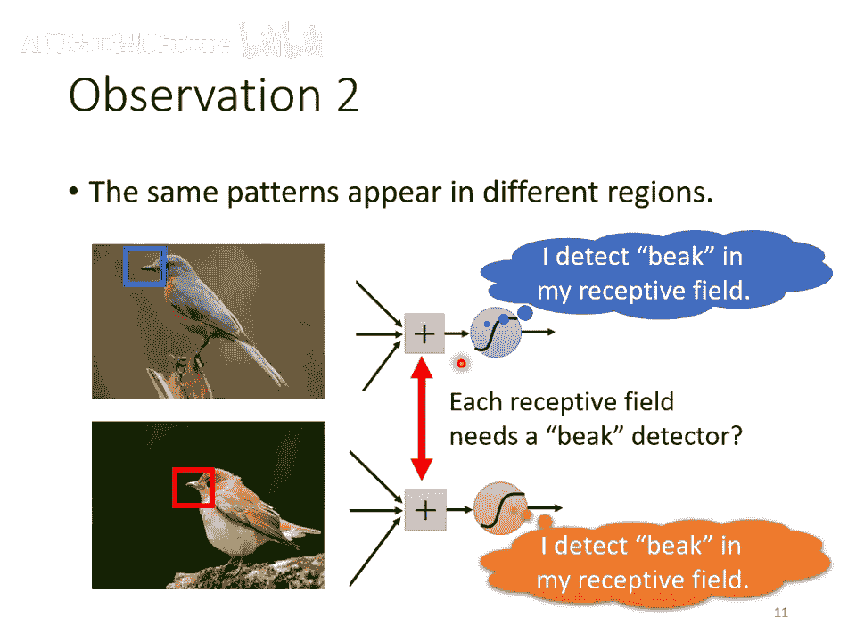

啊如果放在影像处理上的话，我们能不能够让不同receptive field的neural，他们共享参数，也就是做parameter sharing，就是共享参数，那共享参数是什么意思呢。

这边举得更具体一点，所谓共享参数就是这两个neural，它们的weight完全是一样的，我这边特别用颜色来告诉你说，他们的weight完全是一样的。

上面这个new ro的第一个weight叫做w one，下面这个neural的第一个weight也是up one，它们是同一个weight，我们都用黄色来表示，上面这个NEURO的第二个位是w to。

下面这个neuron的第二个weight也是w to，他们都用黄色来表示，以此类推，上面这个neural跟下面这个neural，他们手背的receptive field是不一样的。

但是他们的参数是一模一样的，那有人可能就会问说诶他的参数是一模一样，那它会不会输出永远都是一样的啊，不会为什么，因为他们的输入是不一样的，这两个neural的参数一模一样，但是他们照顾的范围是不一样的。

所以上面这个neural我们说它的输入是x1，X two，下面这个neural我们说它的输入是x1，Px 6pl，那它们的输出是什么呢，上面这个neuron的输出就是x1乘w one。

加x2乘w two，全部加加加再加bias，然后通过activation function得到输出，下面这个neuron虽然也有w one w two，但w one跟WQ是除以是乘以x1。

Px one x two five，所以它的输出不会跟上面这个neural一样哦，因为输入不一样的关系，所以就算是两个neuron共用参数，它们的输出也不会是一样的，那你可以想见说。

你不会让两个手背一模一样，receptive field的neural共享参数，因为如果今天两个手背一样的区域的neural，共享参数的话，他们的输出就一定都固定会是一样的。

那如果两个neural守备范围不一样，就像他们参数一样，他们的输出也不会是一样的，所以这是第二个简化，我们让一些neural可以共享参数，那至于要怎么共享，你你完全可以自己决定。

而这个是你可以自己决定的事情，但是接下来还是要告诉大家。

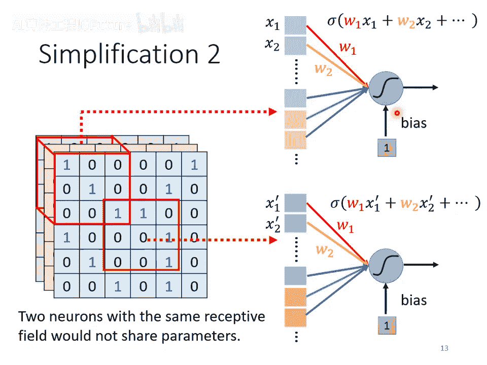

常见的在影像辨识上面的共享的方法，是怎么设定的，那么刚才已经讲说，每一个RECEPTIFILL它都有一组neural在负责收费，比如说64个牛肉，所以这个reset tif有64个neural。

这个receptive field也有64个neural，那他们彼此之间会怎么共享参数呢，我们这边用一样的颜色，就代表说这两个neural共享一样的参数。

所以其实每一个receptive field都只有一组参数而已，就是这个reset tifw的第一个new ro，会跟这个reset tifield的第一个neural共用参数。

它的第二个neural跟他的第二个neural，共用参数，他的第三个neural跟他的第三个neuron，共用参数，所以每一个receptive field都只有一组参数而已。

那这些参数有一个名字叫做filter，所以这两个neuron它们共用同一组参数，这组参数就叫filter one，这两个neural它们共用同一组参数，这组参数就叫filter to，叫filter。

三，叫filter for，以此类推，好，这是第二个简化的方法，好我们目前已经讲了两个简化的方法。

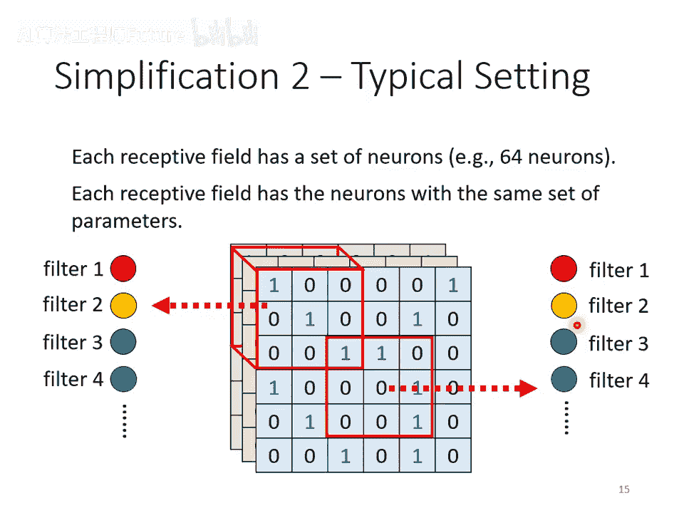

那我们来整理一下我们学到了什么哦，这是fully connected的network，它是弹性最大，那我们说因为不需要看整张图片，也许只要看图片的一小部分，就可以侦测出重要的pattern。

所以我们有了receptive field的概念，当我们强制一个neural，只能看一张图片里面的一个范围的时候，它的弹性是变小的，如果是fully connected network。

他可以决定他要看整张图片还是只开一个范围，就如果他只想只看一个范围，就把很多weight设成零，就只看一个范围嘛，所以fully connected layer，他自己决定还要看整张图片还是一个小范围。

但加上receptive fid的概念以后，意思就是说没得选了，就只能够看一个小范围，反正我们觉得看一个小范围就够了，所以只能看一个小范围，所以加reset tifill以后。

你的network的弹性是变小的好，那接下来呢接下来我们还有参数共享这件事，参数共享这件事又更进一步限制了network的弹性，本来在learning的时候。

它可以决定说这两个network的参数要是什么，每个内每一个neural可以各自有不同的参数，他们可以正好学出一模一样的参数，也可以有不一样的参数，但是加入参数共享以后，就意味着说某一些牛肉无论如何。

参数就算一模一样的，也没得选了，参数要一模一样，所以这又更增加了对牛肉的限制，而receptive field加上parameter sharing，就是convolutional layer。

就是大家常常听到的convolutional layer，那有用convolutional layer的network就叫CONVOLUTIONAL，Neural network，就是CNN。

所以从这个图上啊，你可以很明显地知道说，其实CNN它的bias比较大，它的model的bias比较大，那你可能会想说，哎呦model bias比较大不是一件坏事吗，model biss大不一定是坏事。

因为当model biss小，model的flexibility很高的时候，它比较容易OVERFIT，Fully，Connected layer，他可以做各式各样的事情，他可以有各式各样的变化。

但是他可能没有办法在任何特定的任务上做好，而convolutional layer它是专门为影像设计的，刚才讲的RECEPTICBD参数共享，这些观察都是为影像设计的。

那因为convolutional layers是特别为影像设计的，所以它在影像上仍然可以做得好，虽然他的model bias很大，但这个在影像上不是问题，但是如果它用在影像之外的任务，那你就要很小心了。

你就要仔细想想，那些任务有没有我们刚才讲的影像有的特性好。

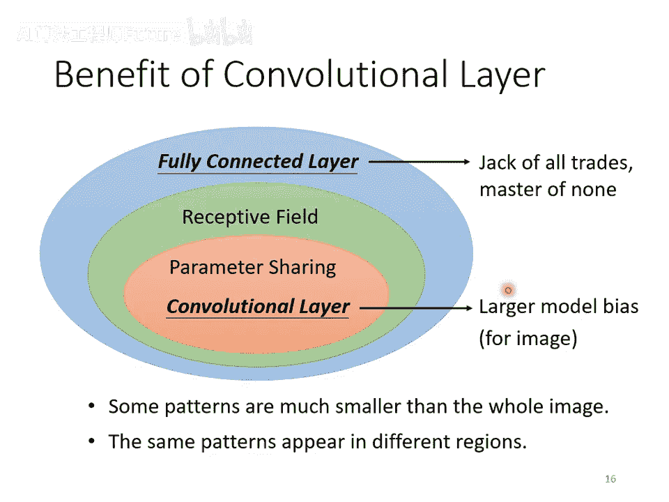

那其实刚才是CNN的某一种介绍方式了，那现在我们要讲另外一种介绍方式，第二种介绍方式，跟刚才讲的介绍方式是一模一样的，只是同个故事用不同的版本来说明，那你看看你比较喜欢哪一个版本，那这个第二个版本是呃。

你比较常见的说明CNN的方式，那第二个版本，故事跟第一个版本故事是一模一样的，所以假设第一个版本你听得有点迷迷糊糊的话，那我们来听第二个版本，第二个版本是这样的。

什么叫做convolution layer啊，CONVOLUTIONAL的layer就是里面呢有很多的filter，这些filter啊，它们的大小是33乘以channel的size。

那所谓channel就是如果今天是呃彩色图片的话，那就是RGB3个channel，如果是黑白的图片的话，它的channel就等于一那一个CONVOLUTIONAL的layer。

里面呢里面就是有一排的filter，每个filter呢它都是一个33乘以channel，这么大的tensor，那每一个filter的作用啊，就是要去图片里面抓取某一个pattern。

但这些pattern要在33乘以channel，那么小的范围内了，那才能够被这些FTER抓出来啊。

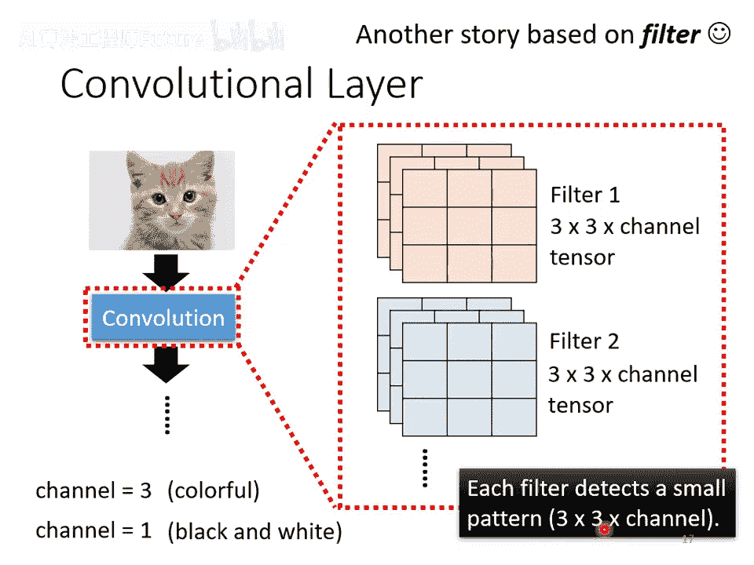

那这些filter怎么去图片里面抓pattern的呢，我们现在举一个实际的例子，那在等一下例子里面，我们假设channel是一，也就是说我们图片是黑白的图片，那我们假设这些filter的参数是已知的。

Filter，就是一个一个的tensor，这个tensor里面的数值我们都已经知道了，但实际上这些tensor里面的数值，其实就是model里面的parameter。

这些filter里面的数值其实是未知的，它是要透过gradient desc去找出来的，那我们现在已经假设说，这些filter里面的数字已经找出来了，我们来看看说。

这些filter是怎么跟一张图片进行运作，怎么去图片上面把pattern侦测出来的，好，这是我们的图片，它是一个6×6的大小的图片好，那这些filter怎么在这个图片上面去侦测，pattern呢。

他的做法就是这样，先把filter放在图片的左上角，然后把filter里面所有的值在这边有九个值，把这九个值跟左上角这个范围内的，九个值做相乘，也就是把这个filter里面的九个值。

跟这个范围里面的九个值呢做in a prada，做完是多少呢，先算是三好，接下来这个filter呢本来放在左上角，接下来就往右移一点，那这个移动的距离呀叫做strive。

那在刚才讲前一个版本的故事的时候，我们strike是设二，那在这个版本的故事里面呢，我们是strike，就设为一啊，那往右移一点，然后呃，再把这个filter跟这个范围里面的数值算inner pa。

算出来是多少呢，新算算出来是一吗，哦对哦，这个太简单了，这是太简单的数学哎，把它再往右移一点啊，这边有一这边有一有一啊，这边一负一负一算出来多少好三，然后就以此类推，再往右移一点再算一下。

然后这边全部扫完以后就往下移一点再算一下，以此类推，一直到把这个filter放在右下角算出一个数值，它是多少，这边111，这边一一负一，答案就是一，就这样，反正这个filter怎么说。

它在侦测pattern呢，哎看这个filter里面它对角线的地方都是一，所以他看到image里面出现什么东西的时候，它的值会最大，看到image里面也出现，连三个一的时候，它的数值会最大。

所以你会发现说呢在这边的输出里面，左上角的地方的值最大，左下角的地方的值最大，就告诉我们说，这个图片里面左上角有出现三左下呃，左上角有出现这个pattern。

左下角有出现这个三个一连在一起的pattern，这个是第一个filter好，那接下来呢，我们把每一个filter都做重复的person，比如说这边有第二个filter，第一个filter很明显。

它就要侦测一排成一直线的时候的状况，我们就把第二个filter先从左上角开始扫起，得到的数值往右移一点，再得到一个数值，再往右移点，再得到一个数值，反复同样的BUON，反复同样的操作。

直到把整张图片都扫完，我们又得到另外一群数字，所以每一个filter都会给我们一群数字，红色的filter给我们一群数字，黄色对蓝色的filter给我们一起数字，如果我们有64个filter。

我们就得到64群的数字了，那这群数字啊他又有一个名字。

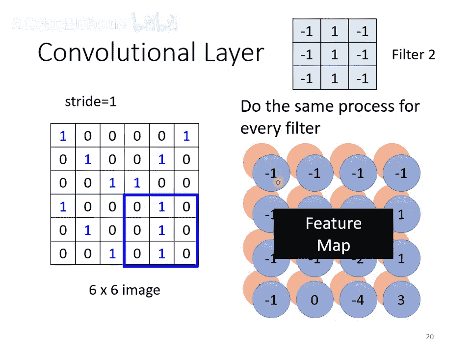

它叫做feature man，所以当我们把一张图片通过一个convolutional layer，里面有一堆filter的时候，我们产生出来的一个feature map。

那假设这个convolution node layer里面，它有64个FTER，那我我们产生出来的这个feature map了，就有64组数字，每一组在这个例子里面是4×4啦。

就第一个filter产生44个数字，第二个filter也产生44的数字，第三个也产生4×4的数字，乃至到64个filter都产生44的数字，那这个feature map可以看成是什么呢。

这个feature map你可以看成是另外一张新的图片，只是这个图片的channel啊，不是RGB这个图片的channel有64个，每一个channel就对应到一个filter。

本来一张图片它三个channel通过一个convolution，它变成一张新的图片，有64个channel好，那这个convolutional layer啊，当然是可以叠很多层的，当然是叠了第一层。

那如果叠第二层会发生什么事呢，第二层的convolution里面也有一堆的filter啊，也有一堆的filter，那每一个filter呢，它的大小我们这边也设3×3，那它的高度呢它的高度必须设为64。

为什么我们知道说filter的啊，这个高度网就是他要处理的影像的channel哦，所以跟刚才第一层的convolution，假设输入的影像是黑白的，channel是一。

那我们的filter的高度就是一输入的影像，如果是彩色的channel是三，那filter的高度就是三，那在第二层里面我们也会得到一张影像，对第二个CONVOLUTIONAL的layer来说。

它的输入也是一张图片，那这个图片的channel是多少，这个图片的channel是64，这64整来，这个64，是前一个convolutional layer的的的filter数。

目前一个convolutional layer，它filter数目64啊，那输出以后就是64个channel，所以第二层假设你想要把这个图片当做输入，那你的filter的高度也得是64啊。

所以第二层也有一把filter，只是这把filter他们的高度是64好。

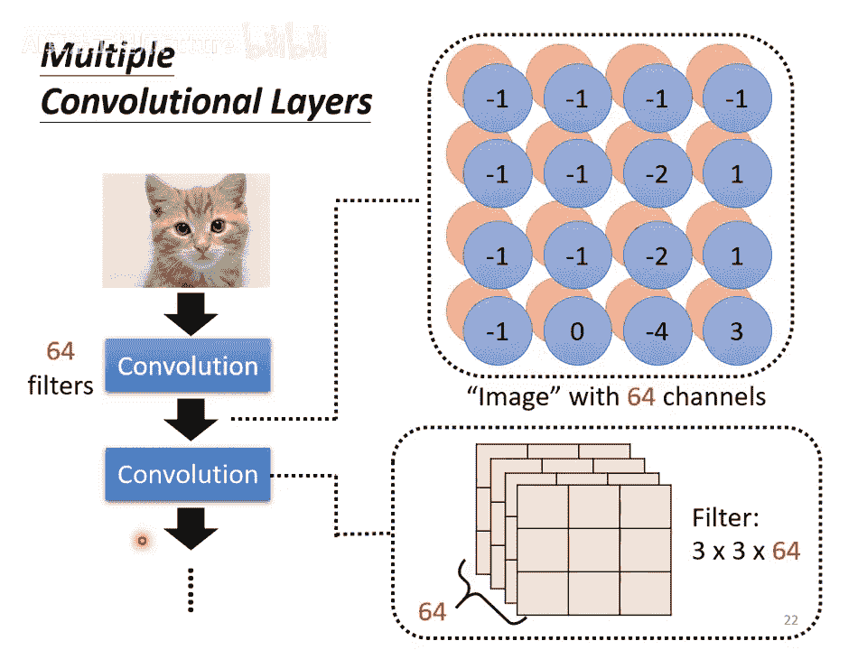

那接下来要回答一个问题，就是如果我们的filter的大小一直设33，会不会让我们的network没有办法看，比较大范围的pattern呢，其实不会的，因为你想想看。

如果我们在第二层convolutional AD layer，我们的filter的大小一样，设3×3的话，会发生什么事情呢，如果我们一样设3×3的话，当我们看最左上角这个数值的时候，最左上角这个数值。

在影像上其实是对应到这个范围，右下角的数值在影像上其实是对应到这个范围，所以当我们看这3×3的范围的时候，看第一个convolutional layer的输出的这个feature。

map的33的范围的时候，我们在原来的影像上，其实是考虑了一个5×5的范围，所以虽然我们的filter只有33，但它在影像上考虑的范围是比较大的，是5×5，所以今天你的network叠得越深。

同样是33的大小的filter，它看的范围就会越来越大，所以network够深，你不用怕你侦测不到比较大的pattern，它还是可以侦测到比较大的pattern。

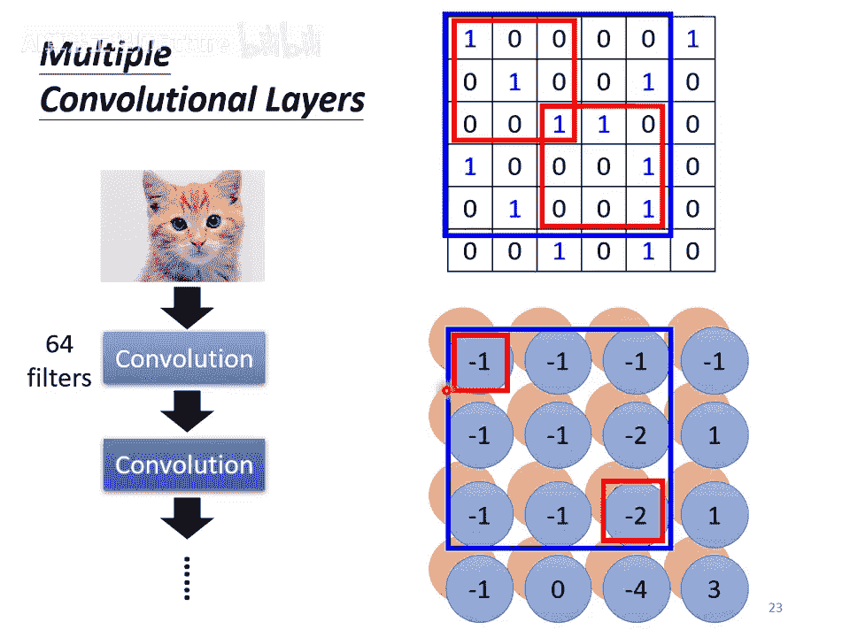

好，刚才我们讲了两个版本的故事了，那这两个版本的故事是一模一样的，我们在第一个版本故事里面说到了，有一些new room，这些NEURROOM会共用参数，这些共用的参数就是第二个版本故事里面的。

我们这边这组参数有3×3乘以三个，这个filter里面有33乘以三个数字，我这边特别还用颜色把这些数字圈起来，告诉你说这个weight就是这个数字，这个weight就是这个数字。

这个weight可能就是这个数字，以此类推，那这边呢我把bias去掉了，那neural这个是有bias的，这个filter有没有bias呢，其实有的只是在刚才的故事里面没有提到啊，在一般的这个实作上。

你的CNN的这些filter，其实都还是有那个BIOS的数值的，然后呢在刚才第一个版本的故事里面，我们说不同的new ro他们可以share weight，然后去守备不同的范围。

而share weight这件事，其实就是我们把filter扫过一张图片，那把filter扫过一张图片，这件事啊叫做其实就是convolution，这就是为什么convolution layer。

要叫convolution layer的关系，因为把filter扫过一张图片，这件事情其实就是convolution，那所谓的把filter扫过图片，这件事情其实就是不同的。

receptive field neurope可以共用参数。

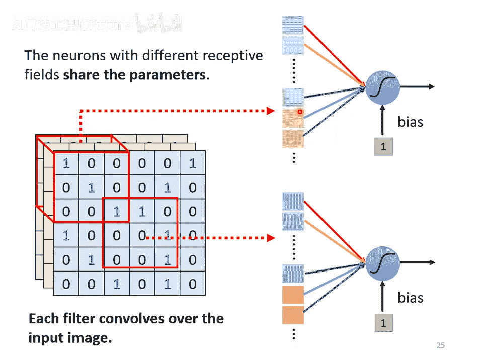

而这组共用的参数就叫做一个filter，好，我们今天特别从两个不同的面相跟你讲，CNN这个东西，希望可以帮助你对CNN有更深的了解，所以我们说这个为什么用CNN是基于两个观察。

第一个观察是我们不需要看整张图片，那对NEUROPE的故事版本，对第一个故事而言，就是neural只看图片一小部分，对filter的故事而言，就是我们有一组filter，每个filter只看一个小范围。

它只真正小的pattern，然后我们说啊，同样的pattern可能出现在图片的不同的地方，所以new room间可以共用参数，对filter的故事而言，就是一个filter，要扫过整张图片。

这个就是convolutional layer。

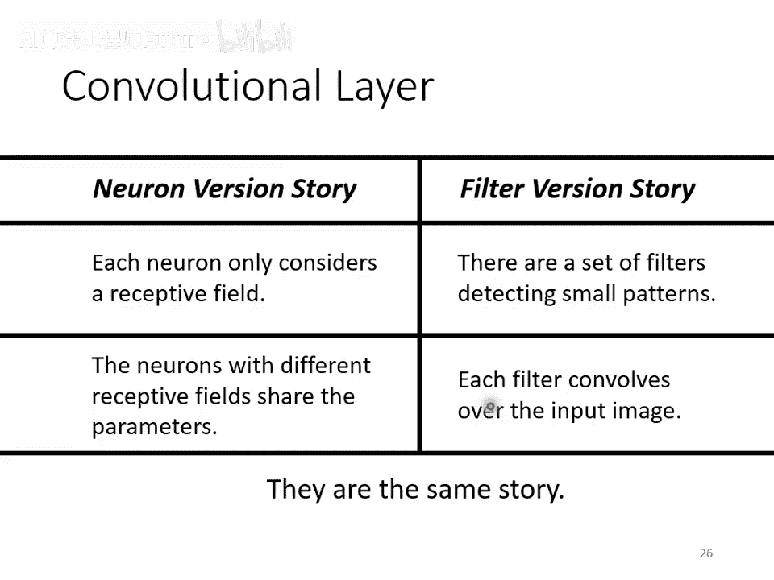

那convolutional layer呃，在做影像辨识的时候呢，其实还有第三个常用的东西，这个东西呢叫做ping，那pulling是怎么来的呢，pulling来自于另外一个观察。

这个观察是我们把一张比较大的图片，做SUBSIMPLY，举例来说，你把偶数的color都拿掉，奇数的弱都拿掉，图片变原为原来的1/4，但是不会影响里面是什么东西，把一张大的图片缩小，这是一只鸟。

这张小图片看起来还是一只鸟哦。

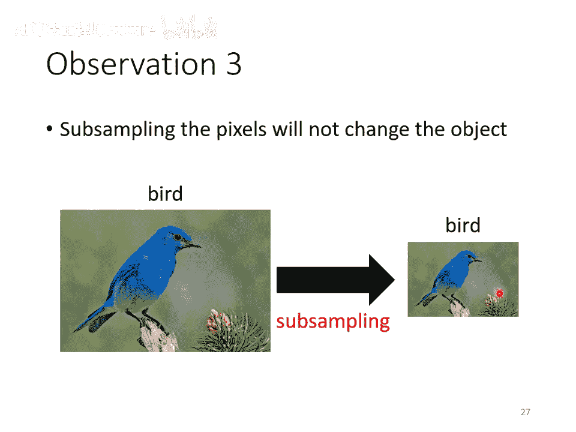

那所以呢有了ping这样的设计，那ping是怎么运作的呢，ping这个东西呀，它本身没有参数，所以呃它不是一个layer，它里面没有wake，它没有要嫩的东西，所以有人会告诉你说。

pulling呢比较像是一个activation function，比较像是SIGMOI呀，re录那些，因为它里面是没有要learn的东西的，它就是一个operator，它的行为都是固定好的。

没有要根据data学任何东西，那ping其实也有很多不同的版本啦，我们这边讲的是max图里好，max ping是怎么运作的呢，我们刚才说每一个filter都产生一把数字。

每一个filter都产生一把数字，要做ping的时候，我们就把这些数字几个几个一组，比如说在这个例子里面，就是22×2个一组，2×2个一组，2×2个一组。

每一组里面选一个代表在max pooling里面，我们选的代表就是最大的那一个，那你可能会问说为什么是选最大的那一个呢，你不一定要选最大的那个，这个是你自己可以决定的。

max ping这个方法是选最大的那一个，但是也有main ping呐，main ping就是选平均嘛，我还看过选几何平均的，所以有各式各样的ping的方法，那你说这边一定要2×2个一组吗，也不一定。

这个也是你自己决定的，你要3×3，4×4也可以，这个是你自己决定的好。

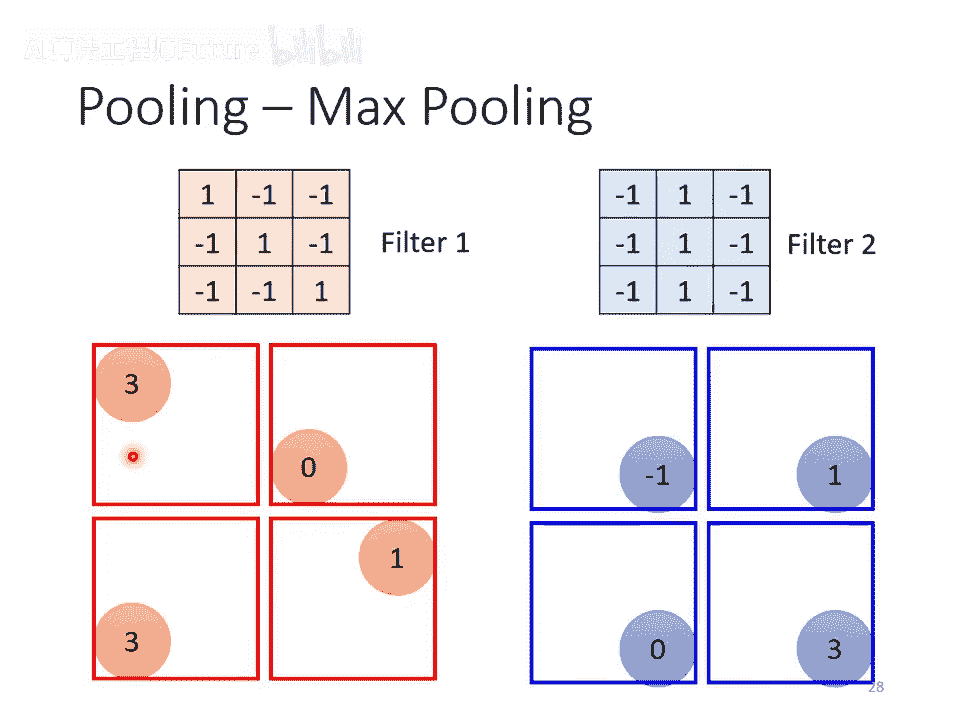

所以我们做完convolution以后，往往后面呢还会搭配ping，那ping做的事情就是把图片变小，做完convolution以后，我们会得到一张图片，这张图片里面有很多的channel。

那做完ping以后，我们就是把这张图片的channel不变，本来64个channel还是64个channel，但是我们会把图片变得比较小仓一点，在刚才的例子里面，本来4×4的图片。

如果我们把呃这这个这个这个output的数值啊，2×2个一组的话，那4×4的图片就会变成2×2的图片，那这个就是ping所做的事情，那一般在实作上啊，往往就是convolution跟ping交替使用。

就是你可能做几次convolution，做一次ping，比如两次convolution一次ping，两次convolution一次ping，不过你可以想见说，ply对于你的performance。

还是可能会带来一点伤害的，因为假设你今天要侦测的是非常维系的东西，那你随便做some sembly performance，可能会稍微差一点，所以近年来你会发现很多呃，影像辨识的network的设计。

往往也开始把ping丢掉，他会做这种for convolution的neural network，就整个network里面统统都是convolution，完全都不用普理，那是因为近年来运算能力越来越强。

ping组最主要的理由是为了来减少运算量，做SUBSAMPLING，把影像变少小，减少运算量，那如果你今天你的运算资源足够支撑，你不做ping的话，很多network的架构的设计往往今天就不做ping。

全convolution，Convolution，从头到尾，然后看看做不做得起，来看看能不能够做的更好好。

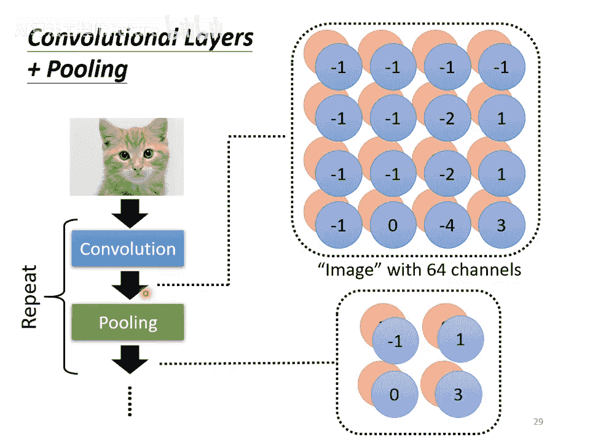

那一般以后啊你的架构就是convolution加pulling，那我刚才讲过说ping是可有可无啦，今天很多人可能会选择不用ping好，那如果你做完几次convolution以后。

接下来呢最终怎么得到最后的结果呢，你会把ping的output做一件事情，叫做flatter fton这个字眼，刚才在作业二里面，助教其实也有提到，所以FTON的意思就是把这个影像里面呐。

本来排成矩阵的样子的东西拉直，把所有的数值拉直变成一个向量，再把这个向量丢进fully connected layer里面，最终你可能还要过个soft max，然后最终得到像辨识的结果。

这就是一个经典的像辨识的network，他可能有的样子啊，就是长这样，里面有convolution，有ply，有flatten，最后再通过几个fully connected layer。

过soft max，最终得到影像辨识的结果，那我们在作业三就是会做一个影像辨识的题目。

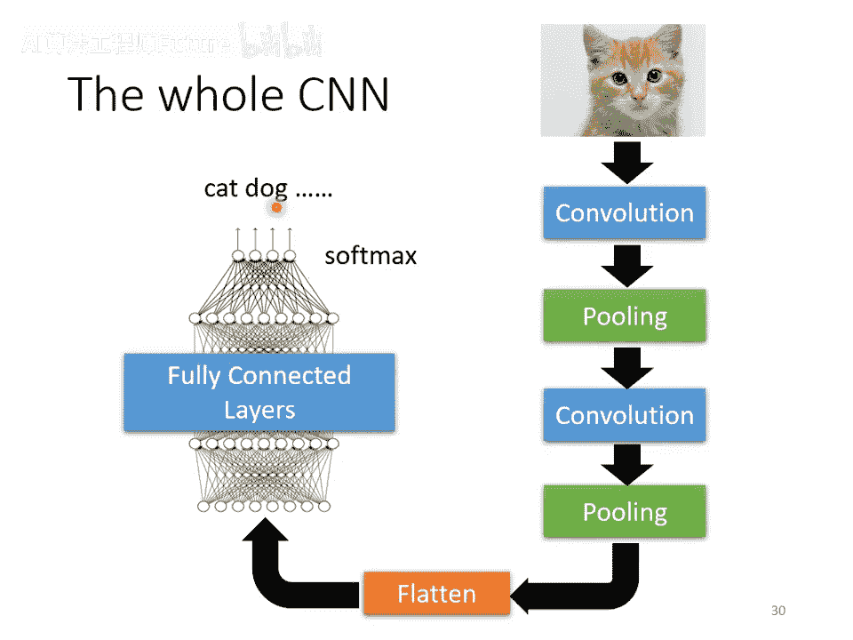

好，那除了影像辨识以外啊，你可能听过CNN，另外一个最常见的最耳熟能详的应用，就是用来下围棋，那今天呢如果讲个机器学习的课，没有提到阿尔法go，大家就觉得你什么都没有讲，对不对。

所以我们来提一下阿法go好，怎么用这个CNN来下围棋呢，我们说下围棋其实就是一个分类的问题啊，你的network的输入是棋盘上黑子跟白子的位置，你的输出就是下一步应该要落子的位置。

可是我们今天已经知道说，network的输入就是一个向量啊，那怎么把棋盘表示成一个向量呢，完全没有问题，棋盘上就是有19×19个位置嘛，那我们就把一个棋盘，表示成一个19×19维的向量，在这个向量里面。

如果某一个位置有一个黑子，那那个位置我们就填一，如果白纸我们就填一，如果没有子，我们就填零，那么就可以告诉network说，我们就可以告诉network说，现在棋盘上的盘式长什么样子。

我们可以用一个19×19维的向量，来描述一个棋盘，当然这不一定是要这么做啦，不一定要黑子是一，白纸是一，然后没有纸就是零，这只是一个可能的表示方式而已，你往你你可以想出其它更神奇的表示方式。

总之我们有办法把棋盘上的盘式，用一个向量来描述，把这个向量输到一个network里面，然后呢你就可以把下围棋当做个分类的问题，叫这个network去预测下一步应该落子的位置，落在哪里最好。

所以下围棋就是一个有19乘，19个类别的分类的问题，network会output说在这19层19个类别里面，哪一个类别是最好的，应该要选择下一步落子的位置应该在哪里，那这个问题。

完全可以用一个fully connected的network来解决，但是用CNN的效果更好，为什么用CNN的效果更好呢，首先你完全可以把一个棋盘看作是一张图片，一个棋盘可以看作是一个解析度。

19×19的图片，但一般图片很大，一般图片可能都呃100×100的解析度，都是很小的图片啦，但是棋盘是一个更小的图片，这个图片它的解析度只有19×19，这个图片里面每一个像素。

每一个pencil就代表棋盘上一个可以落子的位置，那channel呢一般图片的channel就是RGB嘛，RGB代表一个颜色，那棋盘上每一个pixel的channel应该是什么呢。

在阿尔法狗的原始论文里面，他告诉你说每一个棋盘的位置，每一个棋盘上的pixel它是用48个channel来描述，也就是说棋盘上的每一个位置，他都用48个数字来描述，那个位置发生了什么事。

那至于为什么是这48个，那这个显然是围棋高手设计出来的，那48个位置，包括比如说啊这个位置是不是要被叫吃了啊，这个位置旁边有没有颜色不一样的等等，就是这样子描述每一个位置，所以你会用48个数字来描述。

棋盘上的一个位置，这个棋盘它就是19×19的解析度的图片，它的channel就是48好。

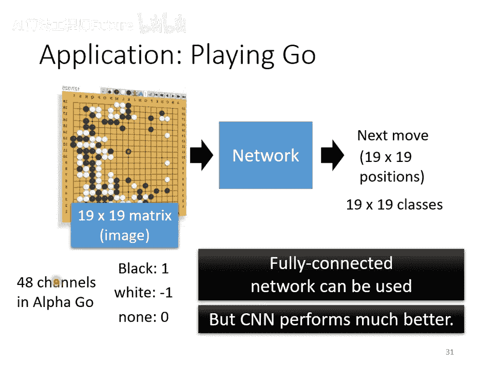

但是为什么CNN可以用在下围棋上呢，我们刚才就有强调说CNN呐，其实并不是你随便用都会好的，他是为影像设计的，所以如果一个问题，他跟影像没有什么共通的特性的话，你其实不该用CNN。

所以今天既然在下围棋可以用CNN，那意味着什么，那意味着围棋跟影像有共同的特性，什么样共同的特性呢，我们刚才讲说，在影像上的第一个观察是很多重要的pattern，你只需要看小范围。

就知道下围棋是不是也是一样呢，举例来说这个pattern，你你就算不用看整个棋盘和盘式，你都知道说这边发生了什么事，这个就是白纸被黑子围住了嘛，那接下来黑子如果放在这边就可以把白纸提走。

那白纸要放在这边才不会呃才可以接啊，这个白纸才不会被提走，这样那其实在阿尔法go里面呢，它的第一层的layer，它的filter的大小就是55，所以显然在设计这个network的人。

觉得说棋盘上很多重要的pattern，也许看5×5的范围就可以知道，再来是我们说影像上的第二个观察是同样的，pattern可能会出现在不同的位置，在下围棋里面是不是也是一样呢，这个叫吃的呃。

Pattern，它可以出现在棋盘上的任何位置，它可以出现在左上角，也可以出现在右下角，所以从这个观点来看，影像跟下围棋有很多共通之处，但是让人想不透的地方是在做影像的时候，我们说我们都会做ping。

也就是一张影像，做SUBSAMPLING以后，并不会影响我们对影像中物件的判读，但是棋盘是这个样子吗，你可以把棋盘上的奇数行跟偶数列拿掉，还是同一个棋局吗，听起来好像不是，对不对，下围棋这么精细的任务。

你随便拿掉一个COLIN，拿掉一个roll，整个棋整个局势就不一样了，怎么可能拿掉一个row，拿掉一个COLIN还会没有问题呢，所以有人就会说啊，CNN里面就是要有ping呐。

然后影像变速都是用ping呐，所以阿尔法go也一定有ping呐，所以代表阿尔法狗很烂啊，针对ping这个弱点去攻击他，一定就可以把他打爆，真的是这样吗，和阿法狗这么强，显然他没有这么显而易见的弱点。

所以这个问题就让我有点困扰哦，但后来我就去仔细读了一下阿尔法go那篇paper了，那其实阿尔法狗在natural上的paper其实没有多长，大概就也就五六页而已，所以其实你一下子就可以看完。

而且在这个文章的正文里面呢，甚至没有提他用的网络架构是什么样子，他没有讲network架构的细节，这个细节在哪里呢，这个细节在附件里面，所以我就仔细读了一下部件，看看说阿尔法狗的网络结构长什么样好。

我们再来看一下这个附件里面是怎么描述，阿尔法go的类神经网络结构的啊，他先说呢我们把一个棋盘看作19乘，19×48那么大小的总，刚才讲过了，把棋盘看作是一个图片好。

接下来他说他有做zero padding padding这件事，我们有讲吗，就是你的filter如果超出影像的范围就补零啊，zero padding就是超出范围就补零的意思。

好他说他的filter的大小啊，kernel size就是filter的大小是55，然后有K个filter，K是多少，K是192，这大概是试出来的啦，他也试了128跟256，发现192最好啦。

好这是第一层，然后strike等于一，strike是什么，我们刚才也解释过了，然后这边有用了，rectifier non里面ALERITY这是什么，这个就是redo了，这就是re录好。

然后在第二层呢到第12层都有做zero padding，然后呢这个kernel size都是33，一样是K个filter，也就是每一层都是192个filter，帅的呢一样是一，那就这样叠了很多层以后呢。

因为是一个分类的问题，最后加上了一个soft max，读完以后你有发现什么玄机吗，你发现他没有用ping呐，就是这个样子哦，所以这给我们一个很好的例子，就是类神经网络的设计，这个应用之道存乎一心呐。

你不要看影像上面都有用ping，就觉得ping一定是好的，在下围棋的时候就是不适合用ping，所以你要想清楚说你今天用一个network架构的时候，我这个network的架构到底代表什么意思。

它适不适合用在我现在这个任务上，而那CNN呢除了下围棋，还有五项以外诶，近年来也用在语音上，也用在文字处理上，这边我们就不再细讲，但是呢你如果你真的想把CNN用在语音上，用在这个文字处理上。

你要仔细看一下文献上的方法，哎，这个在影像，在语音上，在文字上那个receptive field的设计呀，这个参数共享的设计啊，跟影像上不是一样的，所以你要想清楚。

那些receptive fill用在影语音用在文字上的设计，跟影像上不是一样，是考虑了语音跟文字的特性以后所设计的，所以你不要以为在影像上的CNN直接套到语音上，可以work，可能是不work的。

你要想清楚说你像语音有什么样的特性，那你要怎么设计合适的receptive field好。

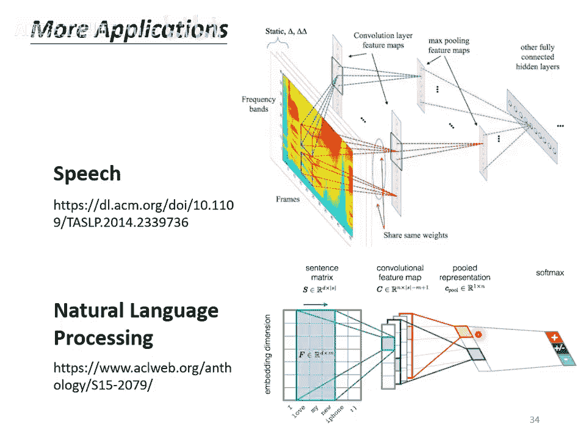

那有人会说CNN呐，呃其实CNN呐，它没有办法处理影像放大，缩小或者是旋转的问题，怎么说呢，假设今天你给CN跟看的狗都是这个大小，它可以辨识说这是一只狗，当你把这个图片放大的时候。

它可以辨识说它还是一只狗吗，可能是不行的，你可能想说诶怎么会不能够变式呢，这两个形状不是一模一样啊，怎么放大就不能变身呢，CNN这么笨吗，他就是这么笨诶，对他来说，这两张图片虽然这个形状是一模一样的。

但是如果你把它拉拉长成向量的话，它里面的数值就是不一样的啊，所以对CNN来说，虽然你人眼一看觉得它形状很像，但对CNN network来说，它是非常不一样，所以事实上CNN并不能够处理影像放大。

缩小或者是旋转的问题，当你今当它当它今天在某种大小的影像上，某假设你里面的物件都是比较小的，他在上面学会做影像辨识，你把物件放大，它就会整个裁掉，所以CNN并没有你想象的那么强。

那就是为什么在做影像辨识的时候，往往都要做data augmentation，所以data augmentation的意思就是说你把你的训练资料，每张图片都呃里面截一小块出来放大。

让CNN有看过不同大小的pattern，然后把图片旋转，让他有看过说某一个物件旋转以后长什么样子，CNN才会做到好的结果，哎，说哎CNN这个不能够处理SKILLING跟rotation的问题呀。

那有没有什么network架构是可以处理这个问题呢，其实有的有一个架构叫special transformer layer，我们不会讲，它们就把他的这个录影的链接放在这边。

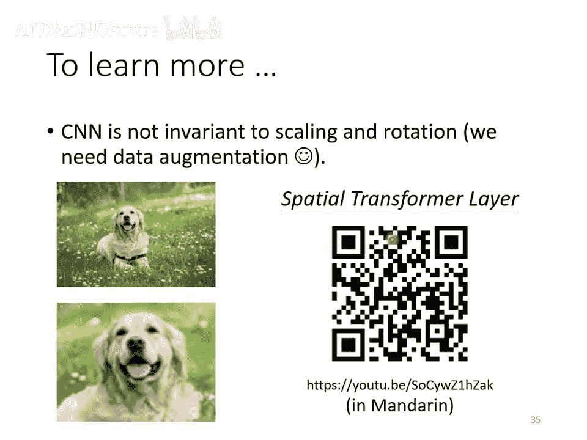