# 【官授搬运】2026年全新优化版李宏毅机器学习系统课程，这才是真正的初学者体系课程！—人工智能／深度学习／神经网络 - P26：3-鱼与熊掌可以兼得的深度学习 - AI算法工程师Future - BV1ruqABeEFX

今天这堂课啊，要告诉大家说深度学习到底好在哪里好。

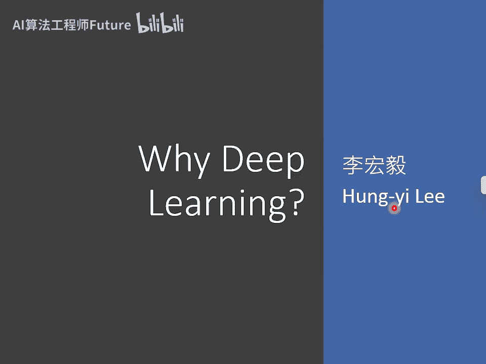

那我们说我们这个陷入了两难，这个两难是什么呢，这个两难是如果我们把模型选择比较大，也就是说呢我们今天在做optimization的时候，可以选择的function比较多。

这个时候虽然我们可以让这个l of h o d o，也就是最理想的状况，理想的状况他的loss压得很低，但是同时它的坏处是什么呢，它的坏处就是理想跟现实会有比较大的差距，反过来说。

如果我们选择了一个比较小的模型，只有比较少的可以选择的function，那我们的loss呢就会比较大，我们的理想会比较糟，虽然我们的理想跟现实会比较接近，所以上次我们停在这边说我们陷入了两难。

那最后我说鱼与熊掌有没有可能可以兼得呢，什么叫做鱼与熊掌可以兼得，我们有没有可能既有一个loss很低的理想，同时又让现实跟理想很接近了，要怎么做到这个鱼与熊掌兼得的状况呢。

如果你今天在找这个理想的HO的时候哦，如果你今天呢要从大H里面找出某一个方式，小H把小H用在DO所有的data上，要让loss越小越好，找出这个HO，如果你今天可以找到一个大H，这个大H有神奇的能力。

第一个大H呢本身里面的成员没有很多，你只有很少的可以选择的方选，同时虽然这边里面的成员很少，但他们的成员呢都是精英，可以让这个大L可以让你的loss又很低很低，即HG项又让loft很低。

如果这两者同时可以成立的话，那我们就可以让鱼与熊掌兼得，我们就可以有好的理想，loss低的理想，同时又让现实跟理想很接近，这是我们要的状况，那么上次就说什么样的模型可以做到这件事呢。

接下来我们要讲深度学习，如何做到鱼与熊掌兼得好。

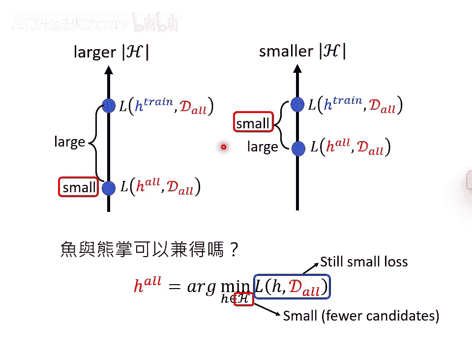

那在开始讲深度学习之前，那帮大家复习一下，为什么我们需要深度学习，为什么我们需要hidden layer好，那在教大家预习的那个录音里面，以及跟大家讲过hidden layer的重要性。

所以以下这一段呢是这个啊，复习这段讲的比较快一点呢，他是这个预习的影片里面已经有了复习，那如果你大家听的没有很清楚的话，你再回去看预习的影片好，那为什么我们要deep learning。

为什么我们要加hidden layer呢，在预习的影片中跟你讲的理由是这个样子的。

我们说我们可以透过一个hidden layer，就制造出所有可能的function，我们要找一个function，它的输入就是这个图上的X轴，它的输出是这个图上的Y轴。

我们怎么找一个function来逼近，所以就我们今天呢随便画一条线，怎么找一个function，怎么用一个network来逼近这一条线呢，怎么用一个network来产生这条线呢。

首先你先把这条线呢分成一段一段的，好，把它截成一段一段的，然后呢把这个每一个线段呢，它的这个端点间连起来，得到一个peace wise linear的function。

那这个peace wise linear的function也就这个绿色的线呢，虽然在这个例子里面，可能跟黑色的线没有非常的接近，但你可以很直觉地想到说。

如果今天这个peace wise linear的这个，这个绿色的这条线呢，如果它的线段够多，我在切这个peace的时候呢，切的够碎，那绿色的线跟黑色的线就会足够接近，好那接下来要跟大家讲的就是。

你可以用一个一个hidden layer的neural network，轻易地制造出绿色的这一条peace，wise linear的线段，那一个neural network怎么制造出绿色的这个线段呢。

那我们经过观察发现说这个绿色的线段呢，可以看作是一个常数项，加上一堆这样形状的蓝色的function啊，好所以一个绿色的peace wise linear的function，它可以看作是一个常数。

加上一堆三坡形的function，那在这个投影片上呢跟大家举了一个例子，怎么制造这个绿色的peace wise linear的function呢，首先你要有一个这个常数项。

这个常数项的高度呢就跟这边这个绿色的线段，最左边的这个斑点的地方一样高，那接下来你加上第一个阶梯型的function，第一个阶梯型的function呢是为了要产生这个线段。

接下来呢你再加第二个阶梯形的function，第二个阶梯型的function呢是为了产生第二个线段，产生第二个线段，你再加第三个阶梯型的function，为了产生第三个线段啊。

这个常数项加上这三个阶梯形的方式，把它合在一起以后，就可以制造出绿色的peace wise linear的function，所以一个peace wise linear的function。

你可以用常数项加上一堆阶梯型的function组合出来，而peace wise linear的function可以逼近任何的方式，所以任何的function。

你其实都有办法用neural network制造出来，那neural network怎么制造出这个，peace wise linear的function呢，怎么表示这个阶梯型的function呢。

那我们可以用一个叫做SIGMOID的function，来近似这个阶梯形的function，那这个阶梯形的方式呢，有人又叫做hard的sigmoid function好，那接下来呢每一个neural哦。

假设我们造了一个一个hidden layer的neural network，他的每一个neural，都是可以制造出一个阶梯型的function，假设你现在你的neural network。

你选择的activation function是SIGMOID的话，那你可以透过设定不同的位，设定不同的bias，制造出不同的sigmoid function。

那你制造出合适的sigmoid function，把它们统统加起来，再加上常数项以后，你可以产生任何的peace wise linear的function。

那就可以用这个peace wise linear的方式，去逼近任何的方式，所以我们上课的时候就告诉你说，任何再复杂的方式，你也不用怕，你只要有足够多的neural。

你就可以想办法去产生任何的function。

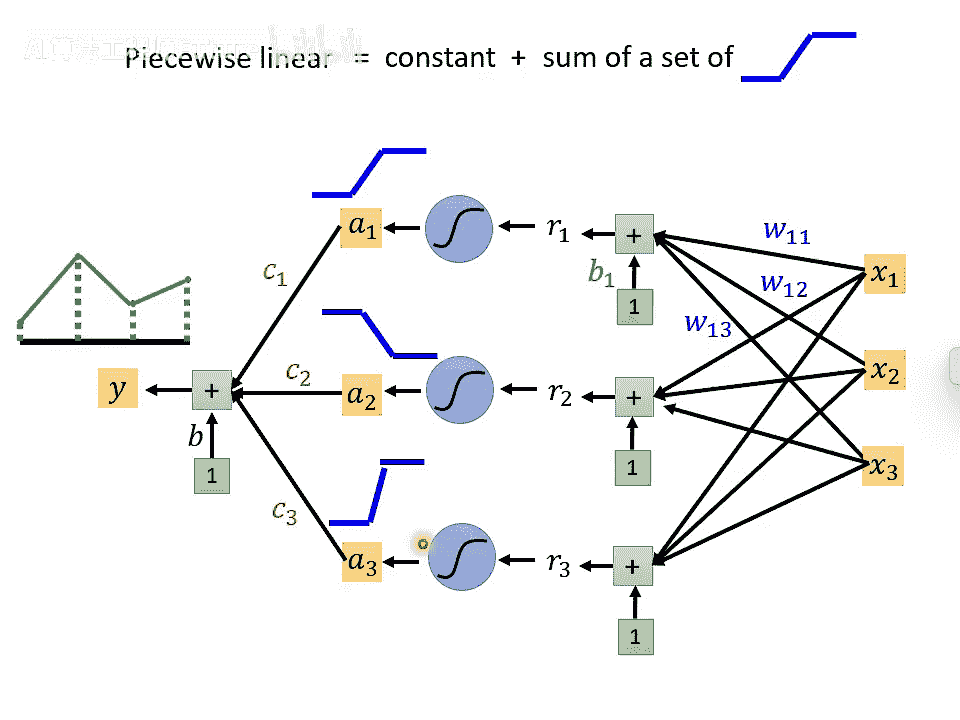

另外一个表示这个heart sigmoid function的方法呢，是用另外一个叫做两个renew的function所组合成的啊，REDU的function就是长的是这样子的形状啊。

长的是这样子的形状呃，他有一个这个转角的地方，在转角的地方其中一边都是零啊，另外一边是一条直线啊，这个function呢叫做review，那用两个re6叠起来。

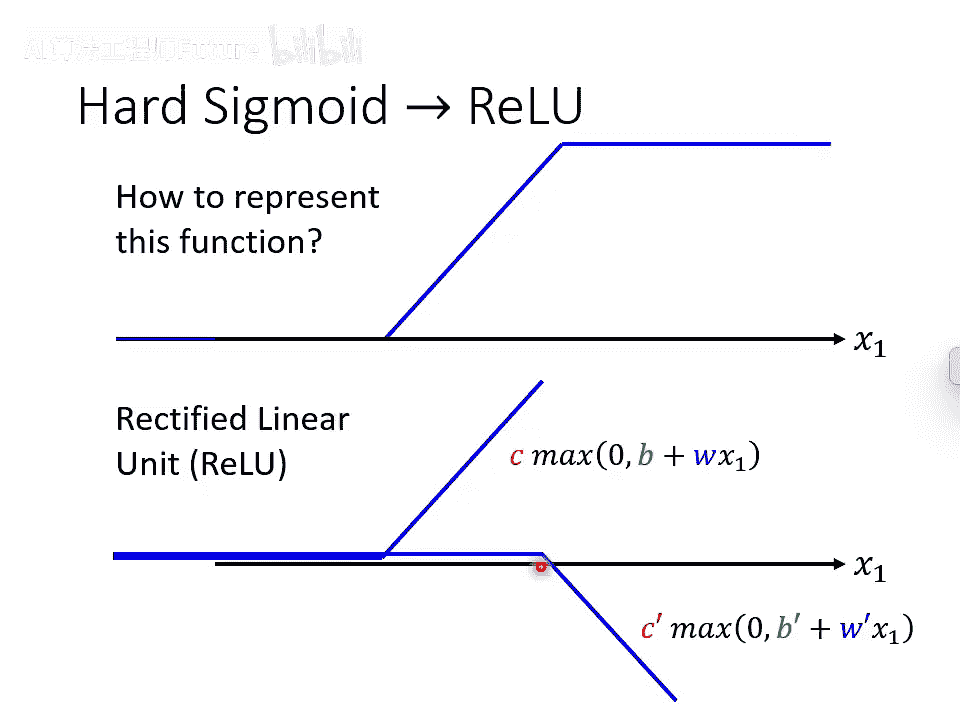

可以产生一个hard的sigmoid function哦，所以如果我们有一个hen layer的network，这个这个network里面它的neural啊都是RELO，那我们有够多的。

有review当做activation function的neural，把它全部叠起来，两个re路可以形成一个heart sigmoid。

过多的哈斯MOE可以形成任何peace wise linear function，peace wise linear function可以逼近任何的方式好。

所以就算是我们的neural是review也没有关系，有够多的REVIE，把够多的REVIE组组合起来，可以变成任何peace wise linear的function，可以逼近任何的方向好。

那讲到这边呢，有一个很自然的问题，你就会想到一个问题，这个问题是呃，我们一直强调有一个hien layer的network，它可以产生任何的方向，它可以逼近任何的方CTION。

那只要一个hidden layer就够啦，弄一个deep the network有什么意义呢，所以有人就说deep learning它只是一个行销的骗局，就是deep和听起来就非常的厉害。

其实只要一个hidden layer就可以做所有的事情，你只要有一个够胖的network，一个提人类有很多牛肉就很胖嘛，你只有一个够胖的network，他可以做任何的事情。

只是因为fat neural network听起来实在是太废了，所以我们比较喜欢deep learning，deep learning听起来就是比较潮，真的是这样子吗。

在实验上你其实可以发现deep the network确实比较强。

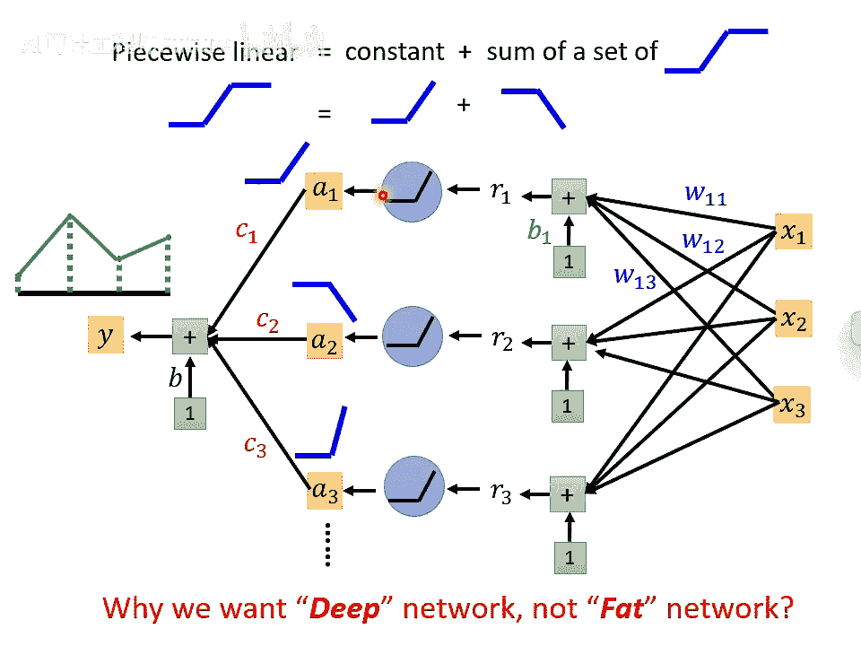

那你通常在文献上你会看到这样子的实验结果，那这个呢是取自一篇inter speech，2011年的paper啊，这个10年以前的paper啊，那个时代呢deep learning还是一个非常潮的东西。

可以叠个五六层的network，所以大家觉得惊为天人，觉得哇好深哦，好可怕啊，虽然现在这样子等级的network，你在作业二里面随便劝也是劝个五个八个，这样我当年呢要劝这种network还是非常困难的。

像我们今天像这样，像这样这个这个作业二啊，你你你吹个三层，五层内work，你大概跑个一个小时就可以结束了吧，但是你想想看，同样的东西，在刚我刚回台大任教的时候，差不多类似的作业大概要跑个一天左右。

然后这个时候我就会告诉你说，如果你离deadline只剩24个小时，你唯一可以做的事情就是放弃这样子，因为你不可能把这个network ch晚的，但现在哇，你都可以赶在这个作业交交前的前。

一个晚上再来报起，在更久之前，我还是学生的时候，如果你要圈一个类似的NEVO通，你的时间是用周来计算的，知道吗，然后如果这个电击器突然跳电，你就欲哭无泪这样子，所以这个这个我只能说时代变了啊。

大人这个时代变了，现在大家随随便便都劝个158成的network好，那总之呢在文献上，你常常可以看到这样子的结果哦，我一开始呢有一个layer，然后呢每个layer有2K2000个牛肉，那这个时候呢啊。

这边paper是一个跟语音辨识有关的paper了啊，那他这边report的数据呢是语音辨识的错误率，那错误率当然是越低越好嘛，啊那其实啊在这一篇paper里面诶。

他实际上把deep learning使用的方式，跟大家在作业二做的方式是一样的，就大家知道在作业二里面呢，我们并不是真的产生语音辨识的结果，对不对，你是对一小段一小段的声音讯号。

我们叫做friend去预测每一个frame属于哪一个forming，那他并不是真的语音辨识，因为你凹不公平，人也看不懂嘛，而且他那个封印呢还会重复很多次，所以那根本不是真正的语音辨识，但是在早年呐。

在再次在还没有那个NQN印券一发的那种network，之前呢，其实如果你说你用deep learning做语音辨识，你就是坐下作业二那个方式，就你先用类似作业二的network产生每一个friend。

它对应到哪一个缝里，接下来呢你再把它丢到另外一个哎，如果是我们叫WFST啦，那你就想成是ROBSE的东西就对了，接下来呢别扣了，他可以把那个封ling的吸管吃进去，然后想办法呢把它转成文字。

这样那从封ING转成文字那一段，你可以想成它其实是用规则产生出来的哦，所以总之其实这篇文章里面做的事，跟大家在作业二里面做的其实是一样的好，虽然他是语音辨识，但它并不是真的跑出文字。

它其实也是跑出风拧来，其实那个时候啊跑出来的也不是风林，它跑出来是比风领更小的单位，叫做see NO这样子的一个封面啊，有三个C弄所组成，那个时候觉得预测封面还是更困难一点，所以我预测一个更小的单位。

预测叫做C弄的东西，我这个都是就是过去的历史啦，你可以直接弄个sequence to sequence model，丢进声音讯号，直接就输出文字，然后中间呢就不需要再借助人的力量了。

好那我们回到这个投影片上的数据啊，如果我们是一层的network，2000的neural错误率24。2，两层的network每一层一样是2000个neural，20。4percent的错误率，三层18。

44×17。8，5×17。2，7×17。1啊，这个network越深，错误率越低，所以内窝越深表现越好，这个哇就是deep learning的力量，但当你这么讲的时候。

有人就会质疑说诶这个当network越深的时候，它是参数量就越多啊，当参数量越多的时候，你可以让你的理想越来越美好，那这样你的理想越来越美好，如果今天你的资料量足够多，你知道这个呃理想跟现实的差距。

取决于两件事嘛，一件事情是呃这个你的模型有多大，如果太大，差距就会很大，但另外一件事情是取决于你有多少的训练资料，如果你今天收集得到足够多的训练资料，就算你的模型很大，理想跟现实也会是接近的哦。

所以当我们把network越叠越深的时候，代表说你的这个H你的模型越来越大，那你的这个理想会越来越好，你的理想的loss会越来越低，那如果今天有足够的资料量，理想跟现实也不会差太多。

所以深度学习没什么神奇的，就是需要一个大模型，但大模型往往伴随着需要大量的资料，所以很多人对深度学习的印象就是，深度学习就是大模型，大模型叫大资料，没有大资料就会OVERFITTING，所以没有大资料。

我们不适合用深度学习，那接下来还会有人质疑说，用个大模型有什么了不起的，不需要深度学习，我们也可以制造出很大的模型呢，举例来说，我们也可以让模型不要往天空发展。

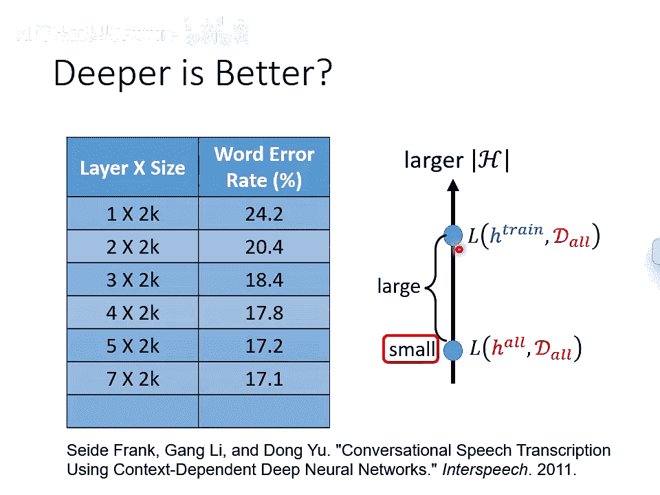

不要往直向的发展，而让它变胖，往横向的发展，这样子也可以制造出很大的模型呢，哦所以光是把这个是这个layer的加深，把深度学习网络加深，说他performance会比较好。

说他的这个WHERRAY语音辨色错误率会比较低，是不够的，如果你要真的体现深度学习的力量的话，你应该把一个矮这个矮胖的network，跟一个高瘦的network来进行评比，当他们参数量一样的时候。

当他们有一样的参数量，一样的未知的参数的时候，那到底谁会比较好呢，所以刚才在同一篇论文里面。

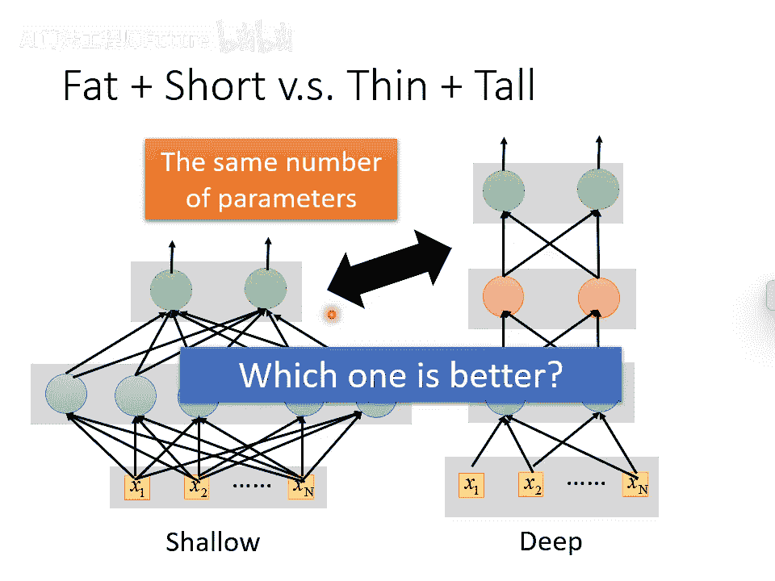

他就做了以下这一个实验，好在论文中有这么一个实验，他说我们现在是个一层的network吧，一层的network，但是把它长得很胖，有3772跟牛肉，那为什么选3772呢。

就是当你一层network3772和neuron的时候，它的参数量会跟五层内work，2000个neural的参数量是接近的，当你选择一层3772的neuron的时候，你的错误率是22。5。

你会发现说同样的参数量下，当我们把这些参数往直向发展，往天空发展，往深的多层的方向发展的时候，诶模型的表现是比较好的好，同样的道理，今天七成每层2000个neural，跟一层4634个neural。

他们的参数量是一样的，但是七层的network表现是远好于一层的network，甚至当你把参数量不断的增加，一层的network有16pk个neuron的时候哦，所以这个页右下角的这个network。

它的参数量是远大于投影片上的其他的network，就算是你开了一个很大的一层的矮胖的network，他的performance虽然比同样层数，2000的neural还要好。

但是你只要叠两层的network，虽然它的参数量是远少于这个巨大模型的，但是深的模型，深的网络它的错误率还是比较低的，所以这个是深度学习真正的力量，当你有同样大小的模型的时候，与其把内work变胖。

不如把内work变高，反而会比较得到比较好的结果，那接下来问的问题就是为什么会这样呢，为什么把network变高。

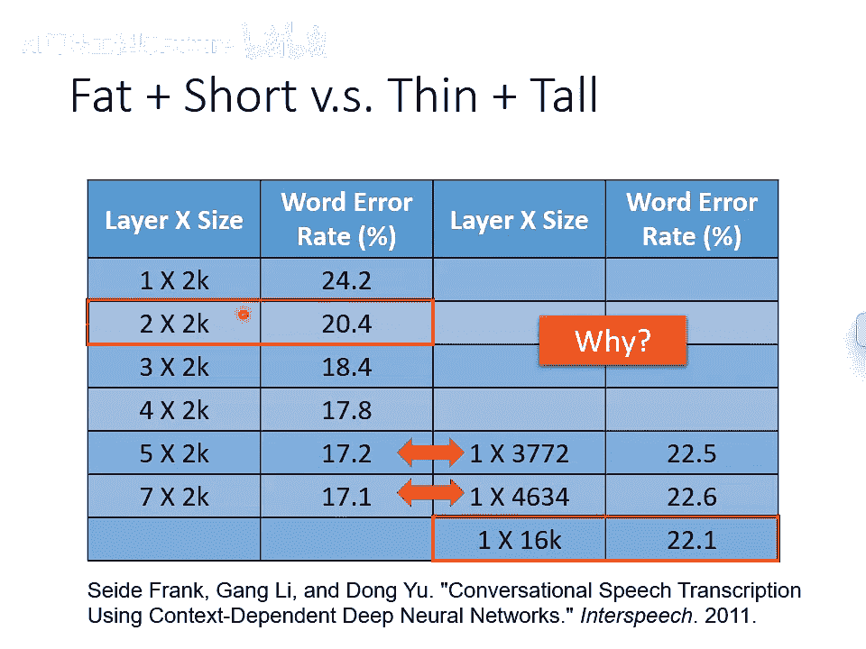

比把network变胖更加的有效能好，那直接跟大家讲结论好，虽然呢一个hidden layer的network可以表示任何方式，但是当你要表示某一个方向的时候，往往用一个D的架构会是比较有效率的。

举例来说，假设你有某一个function，那这边就随便画一个绿色的function，你可以用一个矮胖的network来产生这个function。

你也可以用一个高寿的network来产生这个function，但是往往使用高寿的network，你需要的参数量是比较少的，矮胖的network反而会需要比较多的参数哦，所以你会发现说你要做到同一件事。

你要产生某一个function，用高受的network反而是比较有效率的，所以用deep learning并不是比较容易OVERFITTING，很多人对deep learning都有个误解。

所谓的deep就是大的模型，很多个layer增加了参数，增加了参数，如果你没有足够的data，那就会OVERFIT，但这不是deep learning的核心，并不是learning真正的优势所在。

并learning真正的优势所在是当你要做某一件事，情，当你要产生某一个方程的时候，你需要比较少的参数，比较少的参数意味着什么，比较少的参数意味着你比较不会OVERFIT。

或者是你只需要比较少的训练资料，是不是跟你直觉想到的，或者是跟坊间报章杂志上随便看到的，是正好相反的呢，一般的印象就是deep learning就是大资料容易over feed，但事实上。

deep learning他真正的强项反而是不容易over feat好。

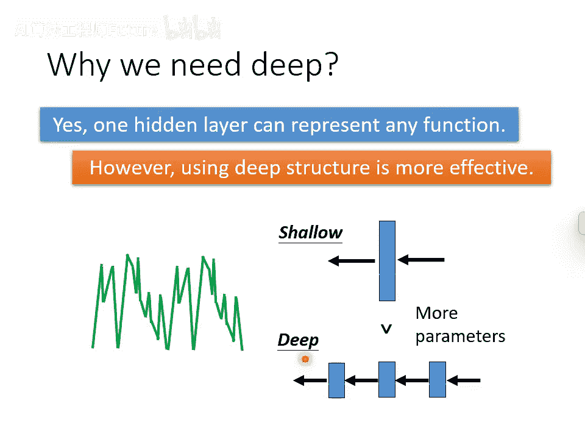

那我们来再有，那我们来讲一下，为什么为什么把network叠多层会得到这样的效果呢，在我们直接探讨deep learning的好处之前，我们先来举几个例子，告诉你说深多层往往会带来什么好处好。

第一个例子呢是有关逻辑电路啦，这个修过逻辑电路的同学举手一下好，很多好手放下，还对大多数的同学都修过逻辑电路好，那今天假设有人说我们要用逻辑电路呢，来兜一个party check的模组。

什么是parity check呢，party check的模组啊，就是你给你的电路呢一串0101的sequence，然后接下来呢你的电路要去数这个这个sequence，里面呐。

一出现的次数是奇数还是偶数啊，如果一出现的次数是偶数，那就输出一，如果一出现的次数是奇数，就输出零，那像这样子的模组呢，在通讯领域里面是很重要的，好那假设有人叫你都这样子的一个电路出来。

其实如果你有修过这个逻辑电路设计的话，你会知道说不管什么样的要求，你一定都可以把电路都出来，为什么，因为只要两层电路，只要两层逻辑闸可以制造出任何的function，对不对哦，所以在这个例子里面。

如果你要做一个party check的模组，如果你只用两层的逻辑闸的话，那你需要二的D次方，这边D是什么，D是输入的sequence的长度，假设输入的sequence长度叫做D的话。

你需要二的第一次方的G，你就可以兜出这个party check的模组，但是你知道说这并不是一个有效率的方法，你可以用两层逻辑电路做出任何的东西，但是没有人用两层的逻辑电路来做一台电脑。

因为你知道说把逻辑电路用其他的方式来呃，建构可能会产生更有效率的，可能是有可能会是更有效率的解法，举例来说，在party check里面，如果你要用逻辑电路来解party check的问题。

你根本不需要用到二个第一次方的G，其实如果依照上面这个例子，输入是四个beat的时候，你其实只需要三个XNORE的get，就可以得到我们想要的结果了，那XNORE的get是什么呢。

它的真值表呢就写在右上角，当输入s store的gain呢，就是输入两个beat，输出一个be，当输入的两个be不一样的时候，输出就是零，输入两个beat一样的时候，输出就是一好。

所以当XLOE的game，比如说举这个例子啊，输入是1010，然后一零呢进去XNORE的game，它就输出零，然后接下来呢把第一个ex node的gate，跟第三个bit it结合起来。

再得到第二个输出，然后呢把第二个输出再跟最后一个被结合起来，得到最终的输出，你会得到你要的答案，所以你发现说，当你把这些ignore的gate不是排成两层，而是排成一个deep的结构的时候。

就是诶第一个snode game，它的输出会是下一个s node的G的输入，下一个x node的gate的输出，又会再次下一个x node的gate的输入，当你把它们串成一排的时候。

你会用用比较少的get，就做到比较复杂的事情好，这个是用逻辑电路来做举例好，那如果用程式来做举例的话，也是一样的啊，你知道说啊，今天我们在写程式的时候，你的城市里面也是会有架构的。

你不会把所有的东西都放在你的main function里面，对不对，你除了main function以外，你会写很多的MOJ，你会在适当的时机去呼唤这些MOJ，然后呢。

每一个module或者每一个这个function里面都还有，他可以去呼叫的SAFUNCTION，然后不同的function也可以呼叫同样的SAFUNCTION，哪知道你在写程序的时候。

你也是会有某种结构的，而有这种结构的好处是什么呢，有这种结构的好处是，它会避免你的城市太过冗长，增加它的可读性，那如果同一个功能在呃一个城市里面，需要再反复使用的话，那你可以去抠同样的function。

可以让你的城市更为简洁好，所以在写程式的时候，其实你也会用到底的结构，或者是假设我们再举一个跟电基职工领域。

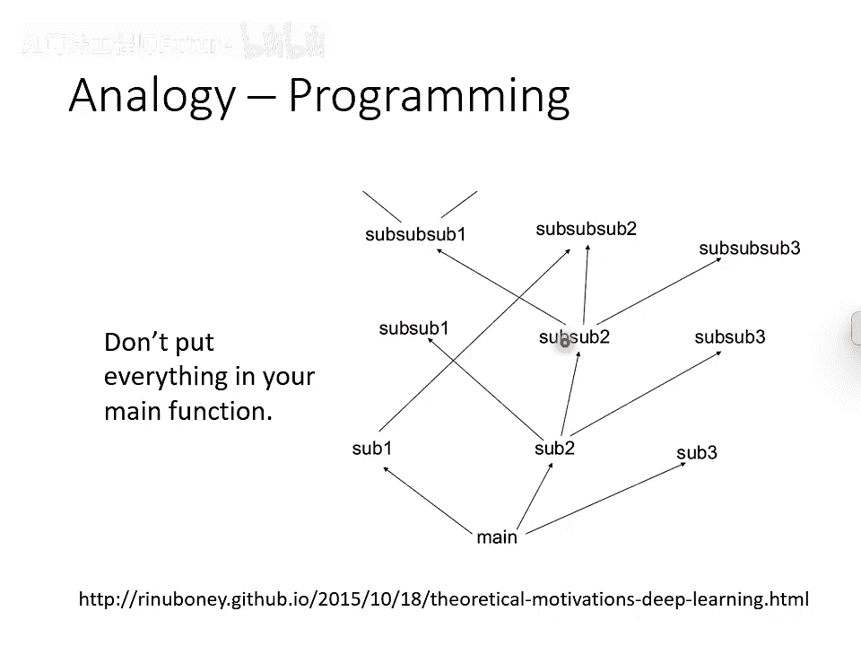

完全无关的例子，那这边举的例子呢是剪窗花，大家应该都知道剪窗花是什么吧，啊就那个色纸，然后把这个色子呢把它折起来，然后再折起来的色纸上剪几刀展开，你就有一个复杂的图案，那算这个复杂的图案。

你也可以直接去剪它，但你要直接剪出这个复杂的图案，给来一张色纸来直接剪出这个图案，没有先把纸中对折，直接剪，那是很麻烦的，你要剪很多刀，但如果我们把纸折起来，我们只需要剪几刀就可以剪出复杂的图案。

我们会比较有效率哦，所以今天这个折纸的过程，把纸对折再对折，这个对折的过程，其实就是deep learning里面的layer在做的事情好，那以上呢就是举一些例子，跟大家说明底有什么潜在的好处好。

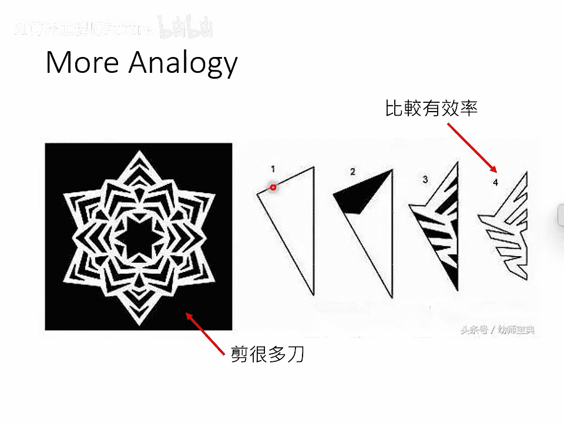

那接下来我们就真的来看，当一个network把它弄成deep的时候，会发生什么样的事情，我们先来看一个只有一层的泄漏的network，这个只有一层的SHAO的network，它的输入我们叫做X。

它的输出我们叫做a one好，那这个network呢假设它的参数我们都已经知道了哦，他有两个neural，第一个new ro呢它的weight是1bias是-0。5。

第二个new ro呢它的weight是一，它的BIOS是0。5好，那在进入这两个NEURROOM之前呢，进入这两个neuron的数值，分别是X减0。5跟负X加0。5，那这两个neural呢。

我们这边用的activation function是reload，这个activation function哦，所以把X减0。5跟负X加0。5通过RELOON，然后呢再加起来，那再加起来的时候呢。

我们会把这两个neural的output都乘上一，再加起来得到a one，那我们现在来想一下，这个X跟a one之间的关系是长什么样子的，假设我们的横轴是X啊，这个图其实不是横轴啊，这边是纵轴啦。

这个图呢是你要把头转90度来看的啊，希望你可以看得懂好，这个这个轴是我们的X，这个轴是我们的a one，那我们来画一下X跟a one有什么样的关系，好那你其实可以用想的。

你就可以想一下S跟a one之间的关系啊，因为第一个neural啊，它是一个软路，它是一个软路，所以当输入的这个X大于0。5的时候哦，输入的X大于0。5的时候，输出就会跟输入一样啊。

如果今天输入的X小于0。5的时候，输出就会是零哦，所以第一个neural他制造出了这一条线，它制造出了这一条线，当输入的值小于0。5的时候，输出就是零了，它对他对a one呢就没有任何贡献了。

好那这个呢负X加0。5呢，如果输入小于0。5，会发生什么事呢，如果输入小于0。5的话，那输出就会跟输入一样，如果输入大于0。5的话，那输出就会是零，所以下面这个neural它贡献了这一条线。

贡献这一条线，当输入大于0。5的时候，输出就会是零，就没有任何贡献了，所以把这两个蓝蓝色的neuron结合起来，我们产生的是这样一条线，我们产生的是这样的一个凹骨，那两个牛肉分别贡献一半。

把这两个女友的输出叠合起来，就变成一个凹谷，那这个对大家来说都非常简单，非常的直觉好，那接下来我们把这个network变身，看看会发生什么样的事情好，所以我们再加第二层的neural。

那怎么把第二层的neural加上去呢，首先呢第一个neural啊，他把之前的a one加上一个bias，那我们这边bias呢舍-0。5好，所以第一个neural它的输入是AY减0。5。

那第二个neural呢，第二个neural呢，它把前面这两个蓝色neural的输出都乘上一，都乘上一，然后呢在呃呃，因为本来如果蓝色这两个neon都乘上一，就会变a one嘛啊如果都乘上一。

那就变成负a one，然后把这个负a one呢再加上bias好，这边bias的舍0。5，得到负a one加0。5，然后再通过一个redude activation function啊。

这个是我们第二层的两个neural，那我们把我们第二层的这两个neural呢，它的输出都乘上一，再加起来得到AQ，再来我们要问的问题，就是X跟a two间现在会有什么样的关系呢。

我们已经知道X跟a one的关系，那a one跟a two的关系，我们其实也可以轻易的把它想出来，这个a one跟a two的关系是什么呢，这个a one跟a two的关系呀。

其实跟X还有a one的关系是一样的，对不对，我们已经知道说，假设第一个neural，它的activation方程的输入是X减0。5，第二个duo他的收入是负X加0。5，那我们知道S跟k one的关系。

就是这个图的这个样子，那现在如果第一个绿色的neuron，它的输入是a one减0。5，第二个绿色的neuron，它的输入是负a one加0。5，那这个a one跟A6之间的关系会长什么样子呢。

你就是把蓝色这条线换成绿色这条线，把黑色这条线换成蓝色这条线，a one跟a two之间的关系也是一个山谷的形状好，那但是我们现在真正关心的问题是，S跟a two之间的关系。

那S跟A6之间有什么样的关系呢，我们已经知道X跟a one之间的关系，我们也知道a one跟a two之间的关系，那接下来我们要问的就是，那X跟AQ之间的关系应该是什么样子呢，好那我们就来想想看。

当我们把X从零一直挪到一的时候，好当我们把X从零挪到一的时候，AQ会有什么样的变化，而当我们把零把X从零挪到一的时候，我们先从这个地方开始，从零的地方，然后一直移一移，把这个值X的值一直增加。

增加到中间，增加到0。5的时候，X从零增加到0。5的时候，绿色这一条线也就是AY是怎么变的，它从一变到零，它从一变到零，所以X从零挪到0。5的时候，绿色这一条线也就是AY它是从一变到零。

a one从一变到零，a two呢a two他就经历了一次轮回，他从一呢变到零又变回一，他就经历了从一变到零又变回一这个过程，所以从零到0。5，X从零到0。5的过程中，a two已经经历了一次轮回。

从1~0又变回了一好，那这个是X从零到0。5的变化，那X如果从0。5到一会发生什么事呢，X从0。5到一，这个蓝色这一条线是从0~1，蓝色这一条线是从0~1，那蓝色这条线从0~1。

绿色这一条线是从一变到零再变回一，所以绿色这条线就从一变为零再变回一，所以X跟A6的关系是两个，一个这个W的形状啊，一个W的形状本来只是一个V的形状不能，但是呢这个这个S跟a one的关系。

是一个V的形状，a one跟a two的关系是一个V的形状，两个加起来就变成一个W的形状好，那这个是接了第二层，而接下来呢我们接第三层看看，我们现在呢把AT加上一个bias。

当做第三层的第一个neural的输入，我们也给第三层加另外一个neural，这个neural呢它的输入是负a two5加G点五，那把这两个红色的内容的输出加起来得到A3，那你就可以很直觉的发现。

说这边S跟a one的关系，a one跟a two的关系，还有AQ跟A3的关系其实都是一样的，所以A6跟A3的关系一样，可以画出一个V字型，当AQ从零变到一的时候，A3呢从一变回零再变回一。

所以AQ跟A3的关系是一个V字形，那现在我们要问的是，那X跟A3的关系是什么样子呢，S跟A3的关系才是这整个network所代表的方式吗，那S跟A3的关系是什么样呢，我们已经知道X跟a two的关系。

我们知道A2跟A3的关系，两者叠起来会发生什么事呢，好那我们就来看看X跟A3的关系是什么，那S从零变到一的时候，好，当X从零变到一的时候，A3会有什么样的变化呢，当X从零变到一的时候。

首先我们先来看前面这1/4的移动哦，X移动了前面14，从零到0。25，这个时候绿色这一条线是从一一路降到零，绿色这条线从一一路降到零，那红色这条线就从一变回零，再变回一哦。

所以呢红色这条线就产生了一个V字型，同样的道理，当黑色这条线再从这个0。25挪到你0。5，从0。25挪到0。5的时候，红色的线会有什么变化呢，黑色线从0。25挪到0。5的时候，绿色这条线从零变异。

从零变异，所以红色这条线就再产生一个V字形，又再产生一个理智性哦，实际上同样的道理，剩下这边这个从0。5到一，从0。5到一会发生什么事呢，绿色这条线从一变到零再变到一，从一变到零再变回一。

这红色这一条线它是1~0到一，又从1~0到一好，所以你发现说呢，这个当X的变化从0。5到一的时候，这个红色这个线呐，也就是我们的这个A3钛金几经轮回，从1~0又变回一，再变到零，再变到一。

又产生了另外一个W型，所以现在啊如果我们看X跟A3的关系，看这个有三成的neural network，它的input的X跟output a3的关系，那你发现呢A3他有二的三次方个线段。

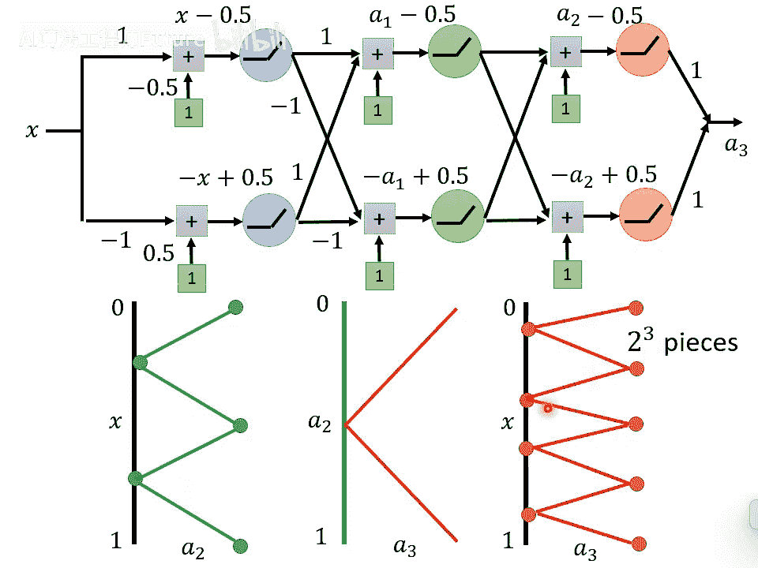

二的三次方个pieces好，那以此类推，假设今天在0~1之间呐，在X从0~1变化的过程中，你想让一个neural network啊的output y呢，它有二的K次方的线段，二的K次方的pieces。

那你需要多复杂的deep neural network呢，我现在你的network input是x output是Y，input是x output是YY，希望有二个K次方的像这样锯齿状的线段。

那你其实不需要一个太复杂的network，你只要哦有K层，每层两个neural，总共2K个neural，就可以达成像这样子的input跟output的关系。

但同样的这个锯齿状的input跟output的关系，如果你想要用一个shallow的network，你要怎么做到呢，哦假设一样输入是X输出是Y，但是你的network只有一层。

你要怎么产生这个锯齿状的输入，跟输出的关系呢，那也不是做不到，因为我们说就算是只有一个hidden layer，其实也可以制造出任何可能的function，但是你需要大量的neural。

因为当做一个hidden layer的时候，假设你用的neural是re6，你看activation fun程式REVIE，那每一个neural只能制造一个线段出来。

二的K次方的线段就需要二的K次方跟牛肉哦，所以我们比较一个shallow跟deep的network，要产生同样的function啊，If the network。

二K1个neural shallow的network是二的K次方的，牛肉和他们的差距是非常显著的，它们是EXPANCIAL的差别哦，所以今天要产生同样的function的时候。

deep the network参数量比较小，它有比较简单的模型，而shallow的network它的参数量比较大，你需要一个比较复杂的模型，而复杂的模型比较容易overfeed，或者是复杂的模型。

因为比较容易overfeed，所以你必须要比较大量的资料哦，所以deep learning的优势跟你直觉想象的是反过来的，很多人以为deep learning需要大量的资料，但事实上你要做到同样的事情。

你不用deep the network，选择shadow的network，你需要更大量的资料好。

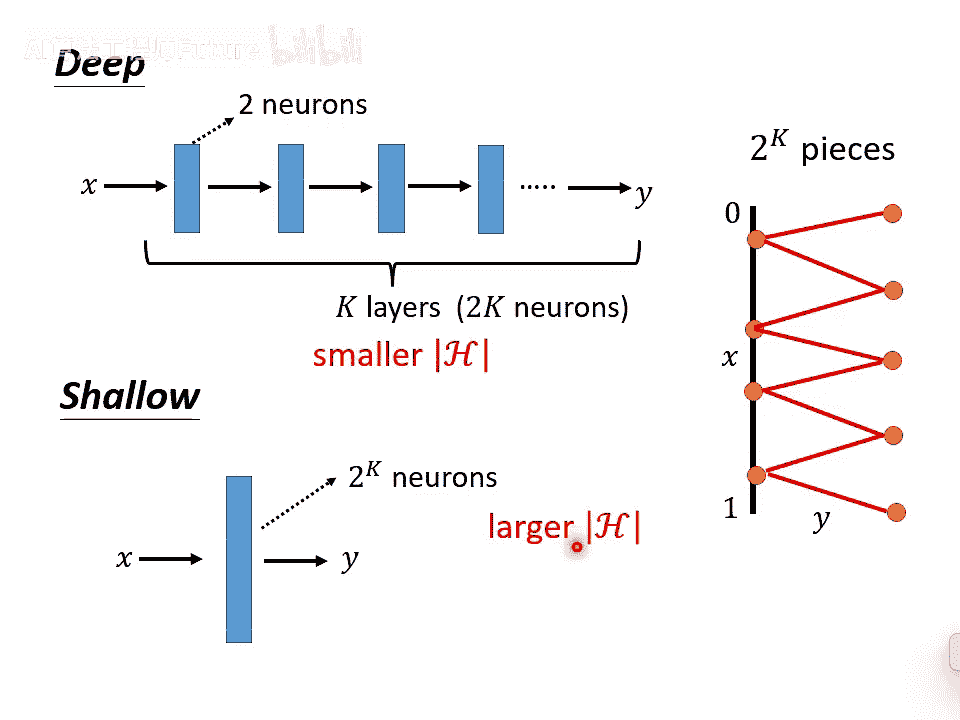

所以我们今天学到一件事哦，如果你今天呢你的目标的function，也就是可以让你的loss很低的那个function，它是复杂而且有规律的。

那deep的network会优于shallow的network，那什么样的问题会让loss低的那些function，会是复杂且有规律的呢，那很有可能语音。

影像等等这些问题会让loss低的那些function，是复杂而有规律的，那这可以解释说为什么今天深度学习在影像上，在语音上，尤其是效果非常的好呢，那可能就是因为语音跟影像上。

那些可以让lost特别低的function，正好是复杂而有规律的，那有人会问说，那到底要多复杂的function，deep相较于shallow才能够占到优势呢，那如果说方选到真的很复杂的时候。

deep才会有优势，那也许多数的状况deep仍然是不会有优势的，好那边，那这那在以下这两段影片里面呢，就是实际举例告诉你说，也许这个所谓的复杂也不用复杂到哪里去，那在以下这两段影片中会直接告诉你说。

假设今天有一个function叫Y等于X平方，那Y等于X平方，那显然是一个非常简单的方式，我们用shallow的network去产生这样的function。

跟用deep的network去产生这样子的function，这个比较起来呀，deep是比shallow还要exponential的好，什么叫exponential的好。

就是shallow的network相较于deep的network，要产生Y等于X平方，这个方式，它需要exponential多的参数量。

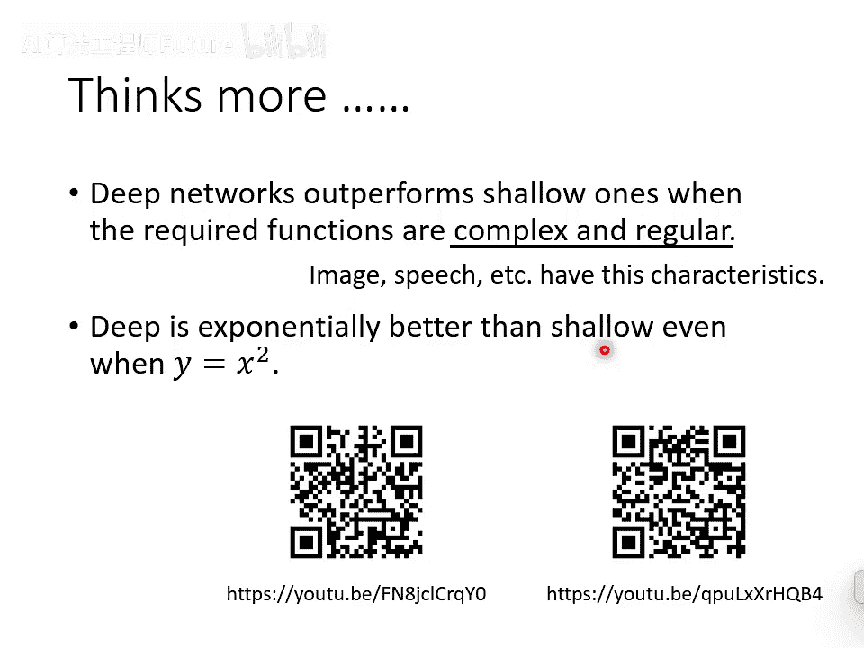

最后就是今天这堂课的结论，深度学习是一个可以让鱼与熊掌可以，兼得的方法，透过深度学习，我们有机会在比较少的参数量的情况下，得到比较低的loss，这就是为什么深度学习是一个有潜力的方法。

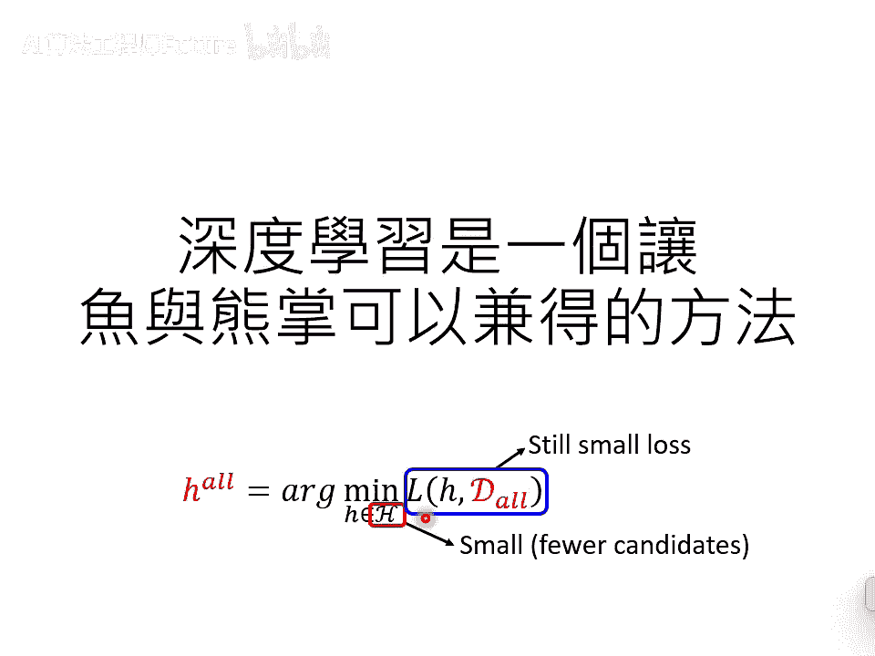