# 【官授搬运】2026年全新优化版李宏毅机器学习系统课程，这才是真正的初学者体系课程！—人工智能／深度学习／神经网络 - P27：4-选修-Spatial Transformer Layer - AI算法工程师Future - BV1ruqABeEFX

好接下来我们要讲一下special transformer，Ok special，所以接下来我们要接下来这份投影，要讲的是一些特别的这个呃，特特别但是有用的network架构啊。

第一个我想要讲的是special transformer的layer，那什么是special transformer的layer呢，为什么会想讲这个，因为我常常会遇到的问题，就是有人就会问说呃。

呃不知道为什么大家都有一个想法，就是觉得CNN呐是呃，skill invvor或者是rotation invariant，我不太确定这个想法是怎么来的，我我大家好像都这么相信，但事实上并不完全是这样。

你想想看，如果是skill in variance的话，你可能期待说哦，我的图片里面有一个呃小很小的洞，然后CON知道他是狗，然后把那个狗放大啊，占满整个图片，他也既知道说那个是狗，这样子呃。

CNN做得到这件事吗，呃他其实应该是做不到这件事的，你像他的有什么机制可以让他做这件事吗，每个filter size就是一个固定的啊，那个filter如果认出来是detect小只的狗。

他就是顶配小智的狗，decay大智的狗，他认出来是decay大字的狗，就是decay大字的狗，他嗯没有学到skill embarance这件事，但如果你说你的CNN可以detect，大只的狗和小只的狗。

他都认出来是狗，那只是因为你圈data面有大只的狗，也有小只的狗而已，这样子哎，所以我并不认为他有SKILLING的embarrass这个特性。

它其实也没有rotation in variance的特性，或者是呃他的rotation emba特性，并不会并没有真的很强，意思是说，如果我们今天给它呃，比如说你给他画写一个数字三。

然后你把这个数字三放倒，变成那个变成一个麦当劳这样子，那对他来说那个就是麦当劳的，那就不是数字战，对他来说那个就是不一样的东西，这个CNN并不能够真的做到rotation vari。

那他有translation embarra，有一些translation embarra，就是你把你image里面的某一个object挪动一点点，对他来说可能是一样。

那这是因为max pooling的关系，就是你的图片的左上角一个人，然后那个人呢稍微往右走一步呃，对CN来说可能是一样，但是如果今天这个人从左上角移到右下角，对CNN来说他还是不一样。

所以我觉得CNN有一些这个translation的EMBARRA，但他没有完全的translation的EMBARRA哦，所以也就是说假设我们现在要做DJ的classification。

那么input image讲的是呃，把我比较出来，我我们input image input地址长的是这样子，或者是这样子，对CN来说，这个东西可能就不像自由这个东西，可能就不像自由。

因为对他来说无长的就是这样，六长的就是这样，你把它缩小变成一点点，对他来说就是就是不一样的东西诶，那所以怎么办呢，这边这个special transformer的layer。

是他想要真的任一个layer，这个layer呢它可以对input image呢做旋转缩放哦，这个layer它的功用就是对input immy做旋转缩放，也就是本来的五呢。

在这边它顶它会对这一小块呢自我放大，让它变成这样，再丢到CNN里面，CN就可能真的可以认出他是他，那这个是六哦，然后呢他知道说六就是这一小块，把这一小块放大丢到CNN里面，CN就可以得到正确的辨识结果。

那这个transform这个这个special transtransformer，Layer，它既然是个layer，所以它也是一个neural network，它也是neural network。

那呃呃而且呢它不只是它，而且它可以跟CNN呢JO你的理论，也就是说你只是在原来CN的layer前面，再多叠了一个layer，而是这个layer是特别设计的，但是它也是一个layer。

他也是它也是neural network用的layer，它也是由那些weight什么所构成的，所以你也可以就用直接用PAPAGATION，把这个layer的参数跟CN的参数一起train。

所以这是一个it，你可以做n tn的training，然后呢这个呃它不止可以transform input image，其实你也可以transform CNN的每一个非全麦诶，哦为什么。

因为其实一个feature map，你也可以把它想成是一个image啊，只那个image的channel，他的channel数目是DEPON，你有几个filter，冷月你有500个filter。

那他的channel就是500，那所以这一个transform mode layer，它不止可以transform input image。

它也可以transform这个每一个feature map的layer。

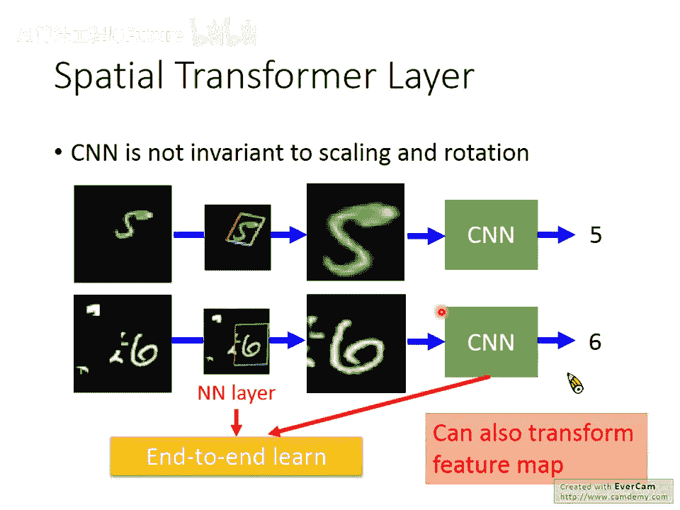

所以它也可以被放在CNN里面去，transform那些feature map好，那，那这个呢呃这个这个这个special transformer layer，其实我觉得他也还蛮难解释的。

是来解释给大家听看看啊，这个我们要怎么做一做这个special，我们要怎么对一个image做transform呢，或者怎么对一个feature map做transform呢。

我们假设左边这个image是transform前的结果，右边这个ab是transform的结果啊，transform后的结果，那你可以很明显的看出说，这个transform是把image呢。

由上往下呢做一个平移而已好，那我们假设transform前的结果就是layer l减一，transform后的结果就是layer l的output，就transform前是transform前。

是某一个layer的input，或是前一个layer的，或者说是前一个layer的open，那transform后是哪一个special transformer，layer的output。

那in general而言，如果我们今天in in general而言，一个general的layer，它的式子可以写成下面这个样子，对不对，一个fully connected的layer。

我们可以写成下面这个样子，DL个layer里面的每一个neural的output，A上标L下标NNNN代表N跟N代表它的index，就这边的每一个A你可以说它就是input，这个L减一的layer里面。

每一个element的linear combination，所有的element都乘上一个weight，然后加起来就得到下一个layer的offer，那这个weight呢这个W有四个下标NNIJ。

意思是说从IJ这index连到NN那个index，in general而言，一个fully connected的lay，他可以写成这个样子，而且这个fully connected layer。

他其实是可以做到transformation，假设比如说假设我们今天这个transformation，是是要对这个image呢做一下平移，那怎么做呢，我们只要适当的适当的去调这些weight。

只要这个weight是一个适当的值，我们就可以做到平移这件事，那什么样的weight可以让我们做到平移这件事呢，我们看说这个这个呃我们想要做translate，也要想要做translate。

也就是说第L个layer的DNN个额，这个这个这个这个value会等于N减，前一个LN的N减1N这个index value，那这个value等于这个value，这个value等于这个value。

我想大家应该知道我的意思，那怎么做到这件事呢，怎么做到这个平移呢，其实你只需要说我们的weight设计成我们的weight，设计成对呃，index在NN的neural而言。

假设我们现在要算的下标是N跟N的话，那如果今天这个IJ啊，IF是N减一，J是N那为的就是在其他case wait是零，如果你这样子设你的weight的话，你其实就可以做到平移。

所以我们想要做把一张image做旋转缩放，变成另外一张image，我们需要的其实只是把这个weight啊，做不同的设计，我们就可以做到旋转缩放这件事，举举例来说，如果我们现在的weight的设计是。

这个点连到这个点，这个点连到其他都是零，这个点连到这个点，这个点连到其他都是零，那这样子我们就是向下移移，如果我们做说哦这个点连到这个点的，这个点连到它的位置是一，这个点连到其他点的位置都是零。

这个点连到这个点的weight是一，连到其他点的weight都是零，这个点点到这个点的weight是以其他都是零，以此类推，那我们就可以做到类似旋转的功能，所以我们只要妥当的呃找到这些weight。

我们就可以做各种旋转缩放，但是问题就是呃怎么怎么怎么找这些wait呢，那这些我们用我们可以用一个NN呢，来控制这两个image之间的weight的连接方式，而这听起来呃呃真的很玄，我们待会想说。

怎么用NN呢，来控制两个layer之间的weight的连接方式，我这边呢在概念上，就是把这个L减一的layer的output，丢到一个NN里面，让NN呢output1些参数，然后根据那些参数就可以决定。

这里的每一个neural，要怎么连到前一个layer的output呃，一样，这边呢把这些所有的东西丢到NN里面去，nn output1组参数，它会决定说这里的每一个neural要怎么连到前。

这里的每一个呃，neural要怎么连到前一个layer的open啊，好那我们现在看一下。

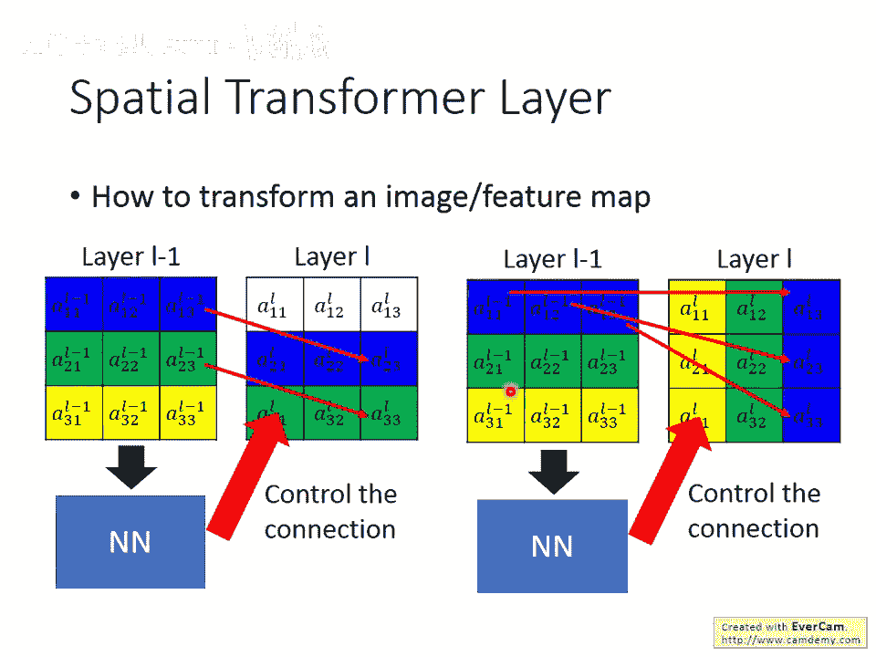

如果我们这些这如我们在现代的时候呢，棋手学过说，如果我们要对一个image做平移旋转缩放的话，我们要怎么做，还要怎么做，假设呢，我现在这边有一张image，这样子好好，这只是预判媒体，那这是预八美器。

然后如果我们要把这个image放大的话，要怎么做呢，我们怎么做呢，呃，我们的做法就是原来的假设，我们先把先把每一个pixel呢都坐标化啊，每一个这个IMAX上面pixel呢都给他一个坐标。

所以每个IP上pixel都有个坐标XY，那我们把每一个pixel在XY的位置和pixel，移移到一个新的位置，XYY换，你只要妥当的设计XY跟XPYP的关系，我们就可以把一张image的放大好。

我就可以把一个image放大，怎么做呢怎么做，你只要说比如说如果我想要放大两倍，那我的做法就是XY乘以一个matrix，最后matrix是2002，然后呢再加上零零，这边代表说没有平移。

这最后这项要控制平移，所以叫没有平移，那我就得到x y y pl，那如果我把XY的位置挪到XPY派的位置，那这张image呢就被放大两倍，那如果我今天想把这张image缩小，然后塞到右上角的话。

那我要怎么做呢，我要怎么设计这个XY和X，YYFI之间的关系呢，那我要列出这样一个式子，我我我这边假设这个高是一，这边的高是一，这边宽是一，那我把我们如果把XY乘上0。5，000。5的话。

那这张image就变成原来的12，然后呢再加0。5，再加0。5，那再加0。5，加0。5，我们就把它移到右下。

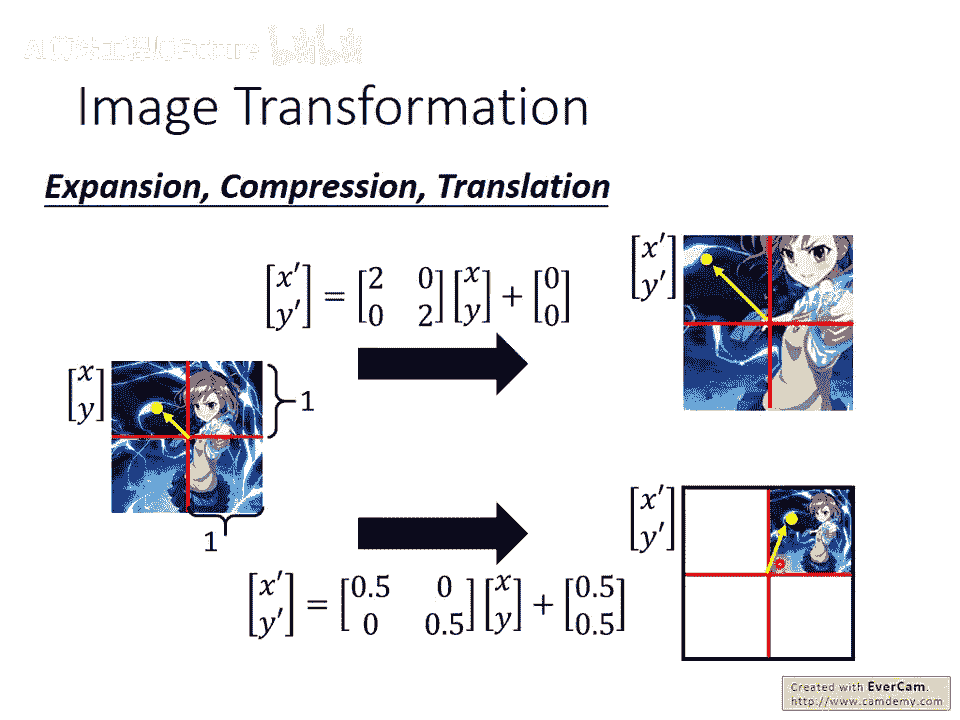

好对吧，移到右下嗯，哦那或者是如果今天想要做旋转。

那如果要做旋转要怎么做呢，假设这边有一个image好，这个是凉宫春日啊，有不知道的说一下哈，对然后这个image如果要旋转的话，怎么旋转呢，嗯选比如说我们要把它这个逆时针旋转S大度，那怎么办。

逆时针旋转S大，do do呢，我们就把原来的index x y乘上一个matrix cos，负sin跟sin cos就可以变变成XPY，快把原来在XY的点挪到x py pi，我们就做了旋转这件事情。

好的，所以呃，今天如果我们要控制这个两张image之间的关系，如果我们要控制这个两张image之间之间的关系。

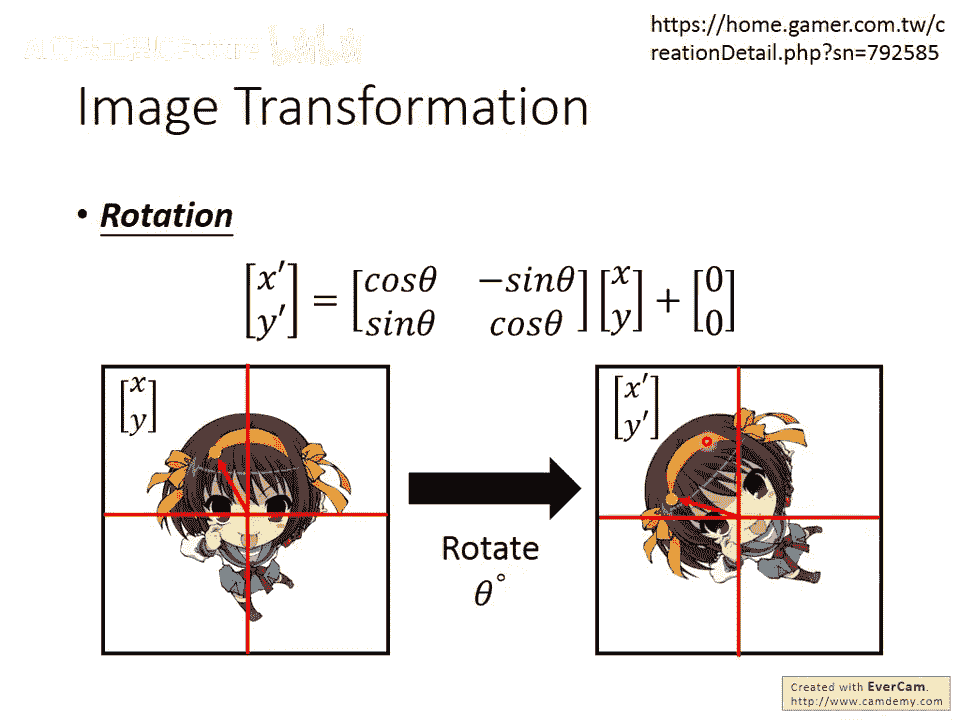

我们要怎么做呢，其实如果只是呃旋转平移缩放的话，其实这个叫做finance form，而如果只是finance form的话呢，我们其实只需要六个参数，我们只需要六个参数，也就是说我们只需要知道AB。

CD跟EF这六个参数，我们就可以把一张image变成另外一张image，那这件所以呢我们今天的这个network，我们今天在control l，减一和L这两个layer之间的关系的network。

我们需要的他需要的就只是输出六个值而已哦，所以这个network呢它的input是整张image，但它的output就是一个六维的vector，它output就是六个值。

这六个词分别就代表了ABCD和EF，它的前四个值就是这个magic，它的后两个值就是E跟F，那接下来这个XY跟XPYP分别是什么呢，我们可以假设XY就是DL个layer的。

每一个neuron的index，比如说这个点它就是X等于一，Y等于一，这个neural它就是X等于二，Y等于二，这个neural就是X等于三，Y等于二，而在原始paper里面。

他呃他其实不是exactly这样做的，但是概念是一样，对我觉得这样解释比较简单一点，它概念是一样好，那在x py pan里面，在x pine y p什么呢。

x pine y pine就是DL减一个layer，它里面的每一个呃，每一个值的index，那或者是我们举一个实际的例子，假设现在这个neural，它的output的六个值分别是0110一负一哦。

分别是0110一负一，那意思就是说呃这个ABCD就是0110，EF就是一负一，那我们现在呢把这边的每一个pixel都去计算，说它应该对应到把DL个layer里面的每一个pixel。

那把DL个layer里面的每一个neon的output，都去计算，说它应该对应到DL减一个layer的哪一个，哪一个neural的output，那怎么做呢，我们比如说我们考虑这个二乘。

我们考虑二二这个牛肉，我们还二二，这个牛肉现X等于二，Y等于二，把X等于二，Y等于二带进去，那你算出来你有没有办法心算一下呢，是不是得到一跟一对不对，就如果你这X带2Y带二，然后这个值跟这个值是知道的。

这个MATRIC跟这个vector是知道的，计算一下你就得到XY等于一，y pine等于一，意思就是说A22A上标L下标二二，这一个neural，它的input就是接到A上标L减一下标一一。

这一个output，然接到其他地方的就是零哦，或者是我们可以再计算一下，这边是二三，我们把二三呢乘上呃，然后这1001啊，然后乘啊写反了，嗯这01110，然后乘上二三，然后加上一负一，我会得到多少呢。

这个就是得到一跟二，这就是小学的数学，得到一跟二诶，得到二分理好，那但是呢这样并没有结束这个现在啊，现在你算出来这边XY你带个整数进去，OPPO正好是一个整数。

那是因为这个matrix跟这个weight也都是整数啊，如果它不是整数呢，如果我今天output是这个样子，10。5100。60。4，那会发生什么事呢，让我们来看看A22的这个case，如果X等于二。

Y等于二，代入这个式子以后算出来x pine是1。6，y pine是2。4，所以A22YL根据这个式子，它应该接到一个X等于1。6，Y等于2。4的的的的的open，他应该接到一个index是X等于1。

6，Y等于2。4毫克，但是问题就是没有没有人有这种index，index都是整数，那怎么办，还可以说那没关系，就找个最近的1。6跟2。4取四舍五入以后，取四舍五入以后应该就是接到XY等于二。

YY等于二的case好，所以这个case就应该接到这个配置，这好啊，那呃你觉得这样OK吗，你可以接受这样的做法吗，你有发现这个有什么问题吗，有发现这个有什么问题吗，那第一个问题就是你觉得这样子的做法。

你可以用gradient descent来解吧，你可能会说嗯这个式子这么怪怪的，其实这显然不是一个可为的，它可能不，它显然不是一个在每一个点都可微分的方式，呃，额嗯应该不能归电DESCEN解吧。

而且每这不是在每一个点都可微分方向，还是可以归点DESCEN解，你记得吗，就是IOU的activation function maxon network，Max pooling。

他们都不是在每一个地方都可为，但他们是可以用GRAENTDESCEN解的，那今天这个配置，你觉得他可以用过一些decent解吗，给大家十秒钟的时间讲一下，好啊。

你觉得他可以用gradient descen的，你既然有propose这个方法，那显然是可以显示可以做的，对不对，那你觉得以前还是可以做的，你觉得他可能会烟disc解的同学举手一下，呃没有人吗。

有一些人吗，哎哎你就好好写手放下，谢谢，而且他不能用威廉DESCENSION的方式去搜一下，唉人就觉得一一少部分觉得行，少部分觉得不行好呃，其实呢这个case是不能用gradient descn解的啊。

所以仔细想一下，为什么它不能用gradient descn解呃，什么是GRA点归点，就是如果我们今天把参数做小小的变化，它对output会有什么样的影响，对不对，那如果我们今天把这一个N。

N的参数做小小的改变，那它的output会有小小的改变，它的凹凸有小小的改变，呃这个值算出来，就这边这个黄色的MATRIC跟红色的Mac vector，有小小的改变，当然最后X派和Y派会有小小的改变呃。

但是问题就是现在假设我1。6变成1。6，一，2。4变成2。39呃，他还是接到同一个就这个呃L呃，layer l里面的A上标L下标二二，还是接到layer l减一的同的位置啊，它们还接到同一个位置。

所以output不会有任何变化，所以微分是零，所以对这个network来说，你它里面的每一个参数对cos function的微分都是零，所以根本没办法，你根本无无法确认这个network。

根本无无法衬这个雷窝，那所以所以怎么办呢，所以怎么办呢，所以实际上呢真的要做这个方法的时候，你需要有一个你需要做interpolation。

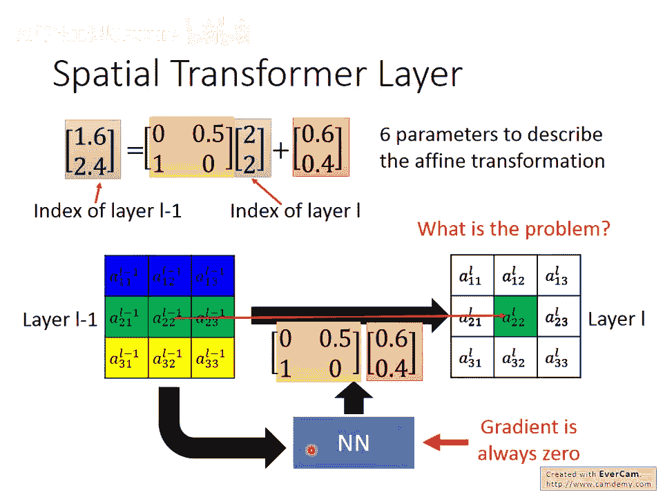

什么意思呢，是这个意思是这样，这个1。62。4啊，他其实是介于四个四个，前一个layer的output中间的，对不对，1。62。4，它介于A下标一二，A下标一三，A下标二二，A下标二三中间啊。

它是介于这四个点中间，还记得这四个点中间，那它跟这个点的Y坐标的距离是0。6，X坐标的距离是0。4，他对这个点的Y坐标距离是0。6，X坐标距离也是0。6，它对这个点的Y坐标的距离是0。4。

X坐标距离是0。6，而在这个点的X坐标，Y坐标的距离都是0。40。4，所以我们不要把这个A22所对应的道值，直接设成跟他最近的哪一个value，如果把它直接设成跟他最近的那个value。

可能是会有一些问题的，因为你会变得没有办法微分，所以怎么办，所以怎么办，我们的做法应该是好呃，所以这个DL和layer的A22呢，就等于这个A12A13，A22A23哦。

等于DL减一个layer的这四个pixel的value，的interpolation哦，那这个in interpolation的weight呢，就取决于这这四个pixel呃，这四个这个value呢。

它们跟这个1。62。4间的距离哦，所以A呃，DL和layer的A22呢，就是DL减一个layer的A22，乘上呢1-0。4，1-0。4好A12呢乘上这个1-0。6，1-0。4，A13呢乘上1-0。6。

1-0。6，A23呢乘上1-0。4，1-0。6，那于是呢，这个问题现在就可以用gradient descen解了，为什么呢，当这个transformer的呃啊，为什么呢，因为我们发现说呢。

当这六个参数有些微的变化的时候哦，这个值呢1。62。4，这个值呢会有细微的变化，比如说变成1。61，变成2。39等等，当这里的值有纤维变化的时候呢，这个A22呢d l a layer的呃。

A22呢它的值也会有些微的变化，因为这些值变了吗啊这些值变了啊，所以这个值会有些微的变化，所以你就可以算得出他的GRADI。

你就可以用gradient descent去optimize这个network，额这个是原始的paper上的图，那他就把这个画成这样，这个U呢是input image，他这边呢不只是一个image。

它是个feature map，所以它它画成一个立方体，它的channel是很宽的啊，它有很多channel，那通过一个localization的network。

localization network呢，就是我刚才讲的会open6个参数的那个network，那他就会做一个transformation，告诉你说下一个layer的每一个output。

他应该接到input那个layer的哪个地方，哪一个牛肉，那这个东西我们现在用一个菱形呢来表示它，那这个菱形呢它不止可以我们刚才讲过，它不止可以放在network最前面啊，假设我们要做手写数字辨识。

就是input一个image output，就是看是0~9哪个数字，它不止可以放在input这个地方，它也可以放在任何的feature map的output，就你每次做完convolution。

得到一个feature map，你都可以再加上这个special transformer的layer，那甚至special transformer layer，你不止可以只有一个。

你可以在同的同一层里面放两个，Transformer layer，我们等下会看到如果这样做会发生什么事，你可以在同一层做两种不同的transformer，得到两个不同的output。

然后再看看后面的network要怎么处理。

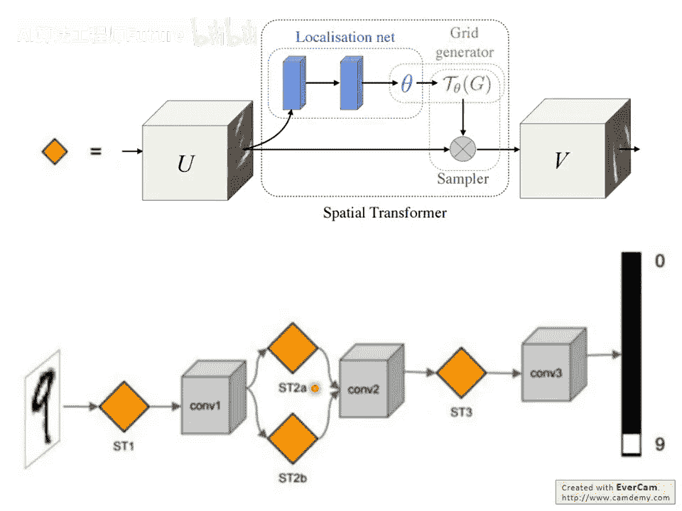

这两个不同的offer好，那这边是一些例子吧。

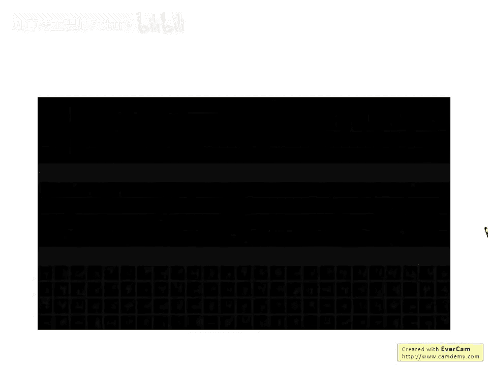

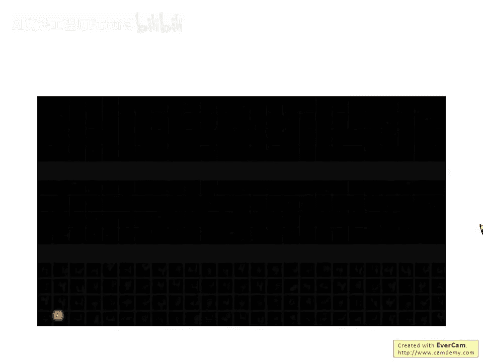

嗯我要切回那个，我要切回键号才够点，对不对，哦对这是deep麦做的好。

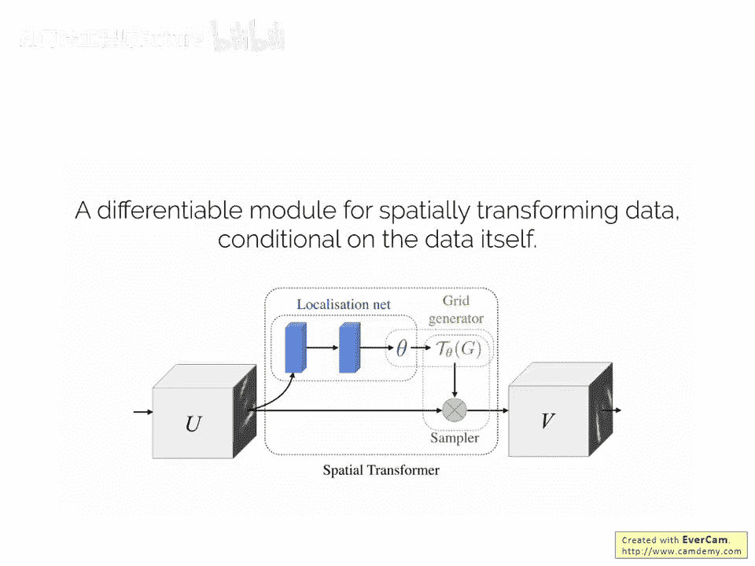

这就是刚才那张图，啊这个是要说什么呢。

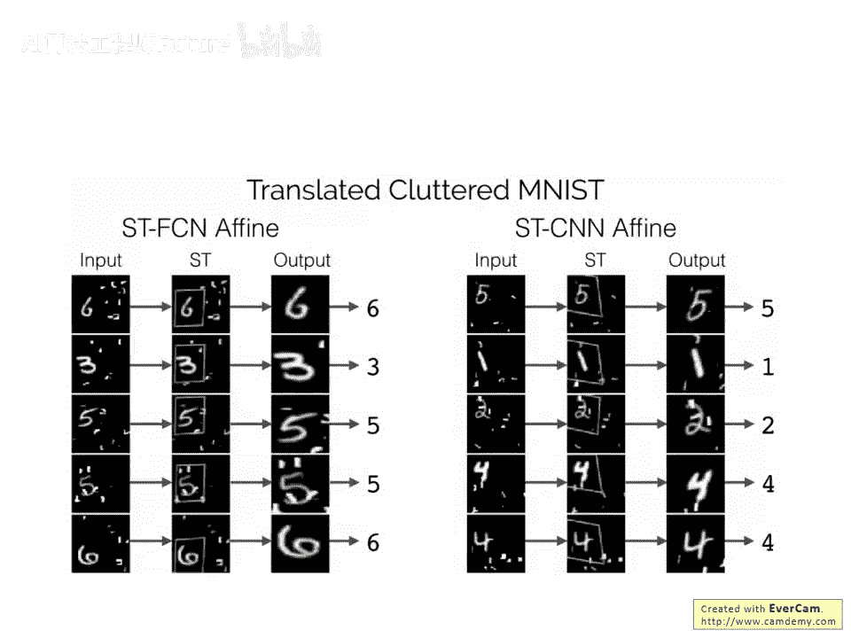

这个这个图是要说现在他就是坐在m list上，那等下看到m list以外的例子，他现在就坐在m list上，那坐在m list上呢，这个是呃这个是input嘛。

然后这个他这个他用的这个是distorted at least，所以他的enlist呢是有故意做一些奇怪的变化，然后故意让他呢呃这个很难做好，那是input image。

然后这个是special transformation的结果，这是special transformation layer，经过special transformation以后得到这个output啊。

得到这个output，然后呢最后呢再去丢back class classify，然后呢在这边做的时候呢，是故意的给不同的input，把input这个image呢做应该是做一下平移。

然后看看说呃，在这个transfer transformation的layer output。

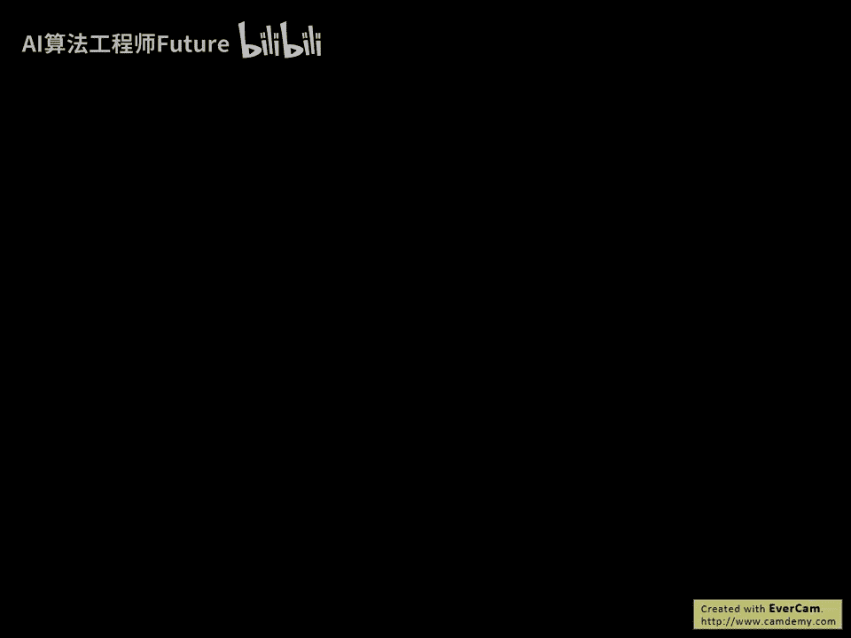

会发生什么事情。

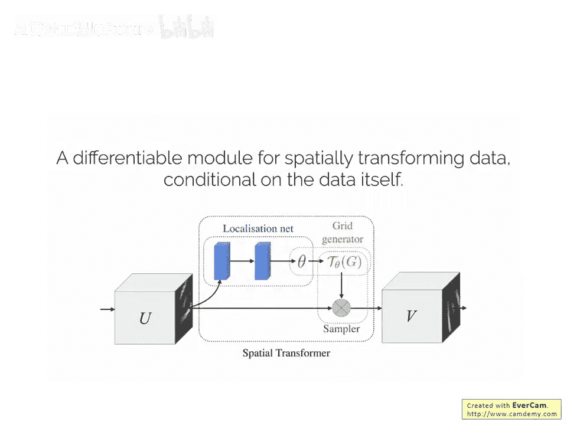

好这边就是把input做平移，但是你发现对output来说，它是几乎没有动的哦，所以CNN看到的output是是不会动的。

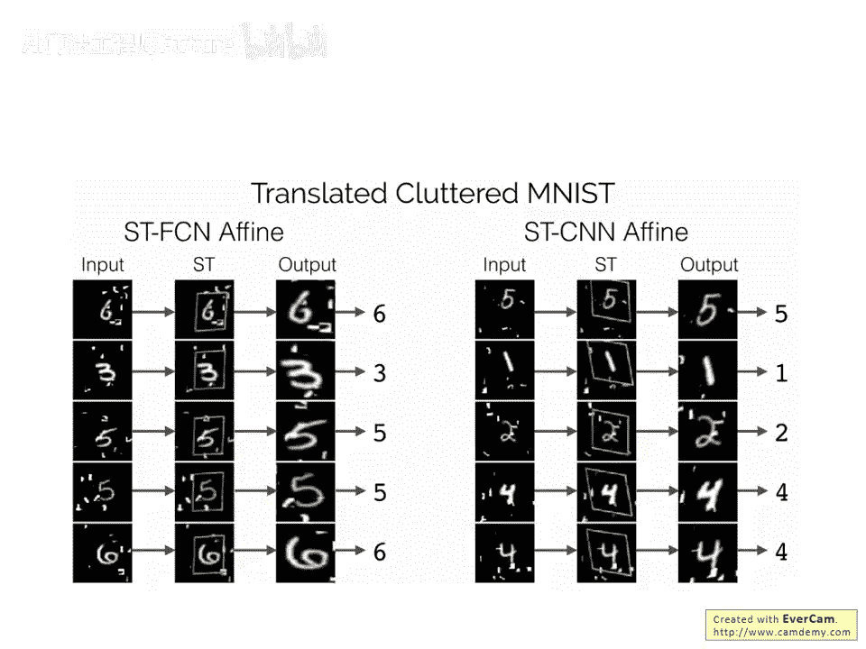

所以CON就可以正确的开始摆这些image啊，这个是input做旋转，那对CNN来说，CNN看到的input是没有旋转的。

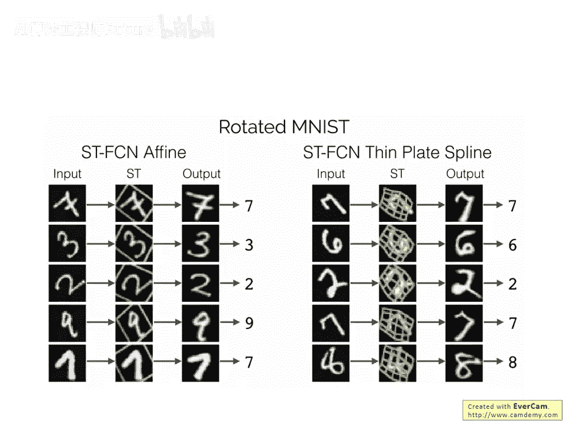

哦这个是撞到墙以后再反射对啊。

重点就是CN对CN来说，它的input呢都是固定的。

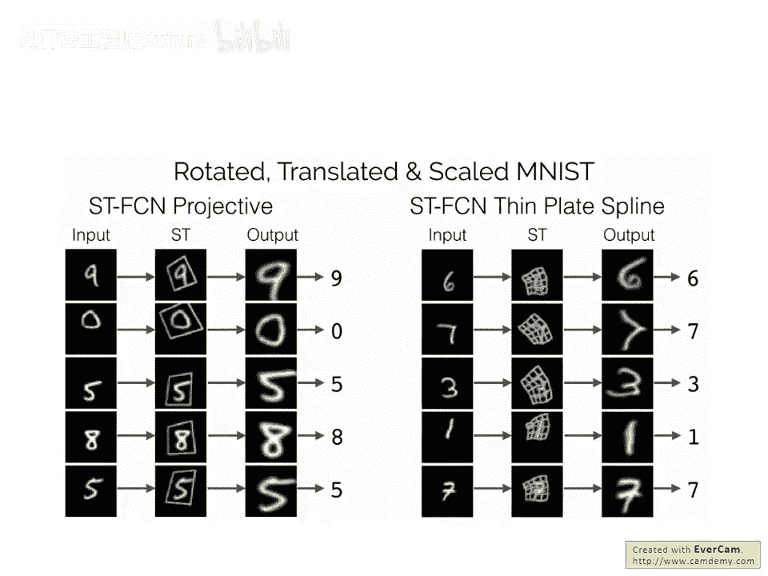

就是，这样哦这个是比较怪。

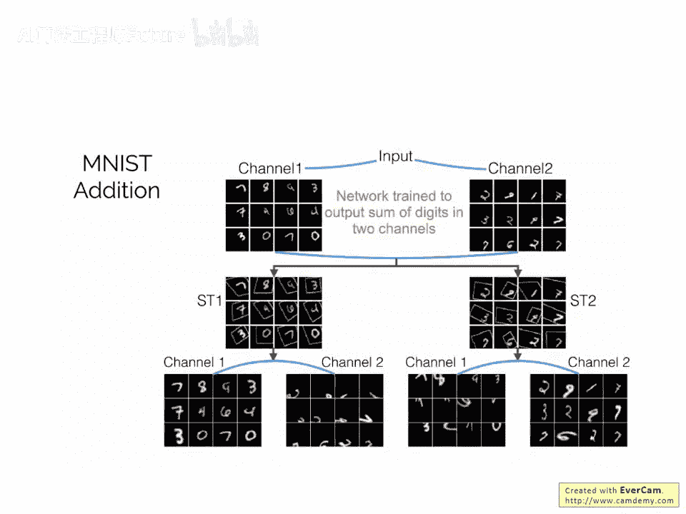

这是看两个音频，我们不要看这个，我们跳过去，然后这个是做一个更复杂的，他其实也是它是数字辨识啊，不不是手写，不是，不过不是手写的数字辨识，它是门牌数字辨识，然后这个门牌数字变色task呢。

他在这个image里面哪会有不止一个数字，比如说这个case里面image的input是260，来自280，哎呀我比马逊搞好，我比马逊还弱，啊是260哎，应该是260吧，好然后哦这是260。

这边有一个答案了，然后额诶这边是这样，他的这个output的network会有55维的output，什么意思呢，因为这个image里面最多就只有五个数字，最多就只有15个数字。

然后output55维的意思，就是说现在每11维对应到一个数字，大家了解我的意思吗，就是前11维这个有11维，那前面的十维就是对应到0~9，最后一维是什么，最后一维代表说没有没有数字啊。

然后output呢就是总共有五个11维，所以总共55维，所以如果这55维维里面有三个诺，那就代表这个一米曲面只有两个数字，你在看出那两个不是诺的数字是多少，那就是你的答案可好。

所以这边output呢其实应该是由55维，那只是其中有两个11维是诺，剩下三个11维分别就output260，所以答案就是260好，那这个是一些实验的结果，就这是一些过去的方法，过去的方法。

那这边应该是算sequence error，我猜应该是sequence error全对，就整个sequence全对，你才算是才算是才算是对，那如果你加上transformation的layer的话呢。

可以得到更好的performance，那他有做single translation跟the train trick，single transformation就是transformation4。

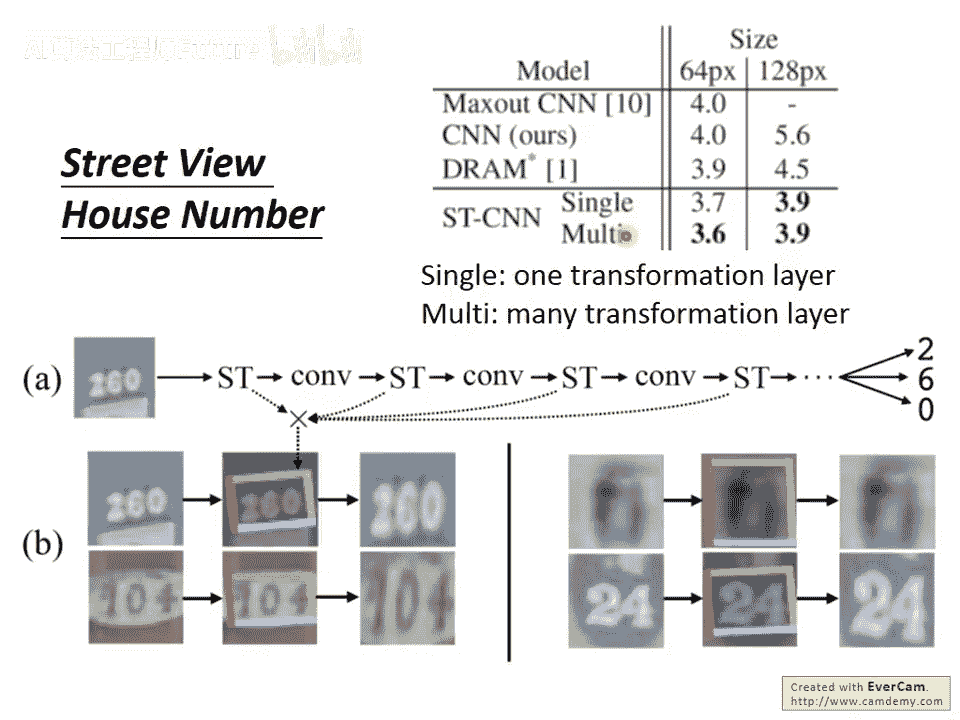

然后multm transformation就是像下面这个图一样，transformation很多次，每次只要过完convolution就作为次transformation啊。

这边是一个visualization的式子，他是说如果把这四次的transformation加起来，那network做了什么事呢，如果把这四次transformation加起来，NEO做的事情。

就是把这个比较小的260呢放大变成这样，我把104呢放大变成这样，这个大概是六吧，还是零，这个真的很难诶，呃人也不见得能够做对的好，那另外那这个也是数字辨识，那有说的不是数字变色，是那个鸟的辨识。

也就是分类说现在input里面的image它是哪一种鸟，那它的network呢是这样子的，input on image以后，这个image呢会通过两个transformation。

而这两个transformation分别会给你，不同的transformation的结果，就第一个transformation说，我们把这张image变成这个样子。

第二个transformation说我们要把这张image变成这样，然后再分别呢丢到呃in inception里面去，就是一个很很deep的network。

然后把output concatenate起来再看，辨识出来总共200种鸟，看200种鸟哪一种，那另外在这边呢这个transformation layer，其实所做一些特别的设计。

刚才是说output6个数字，要output6个数字来控制图片的旋转说话，那现在呢只output4个数字，假设这两维呢就不一定是零，只output4个数字，如果只output4个数字就无法旋转。

它只能够做这个缩放，那这个有点像是focus的味道，就是你看着这张鸟，然你看不清楚，然后你决定把它放大变成这边，然后放大变成这边，他就他就只能做额，他就只能做缩放而已，他还是只能做缩，做缩放和平移。

那这当然实验结果是会比较好的了，那这边是一些实验结果，那红色的框框跟绿色的框框，就是那两个transformation分别呃做成缝的位置，也就是说第一个卡给machine看这张image。

第一个transformation说他要把这一张图截出来啊，第2transformation说他要把绿色的框框截出来，那你会发现说在这个example里面，大多数时候我觉得除了这一张以外。

红色的框框都是看那个鸟的头啊，都是看鸟的头和鸟的嘴的地方，比如我们去想要先，他一方面要确认一下，鸟的头跟它的会长什么样子，那另外一个框框的绿色框框，都是focus在鸟的翅膀的地方，或者是鸟的身体的地方。

因为他看着鸟，他仔细看鸟的头都会在鸟的身体的地方，最后决定说它是哪一种鸟，好好这个是special transformation的内容啊，讲真大家有问题吗，好那下一个要讲的是呀，大家有问题吗。

