# 【官授搬运】2026年全新优化版李宏毅机器学习系统课程，这才是真正的初学者体系课程！—人工智能／深度学习／神经网络 - P28：作业说明 Homework3 - AI算法工程师Future - BV1ruqABeEFX

好不好意思，让大家久等，那我们请助教讲作业三咯，喂喂喂好，大家好，我是作业三的助教，那我今天来讲解作业三，作业三要做的是image classification。

就是同学用上课教过的CNN来去解image classification的问题，然后会让大家实做data appentation，还会呃让大家了解到一些模型里面常有的技巧，像是VC9。

那先介绍一下task的内容，他是要做实物的分类，那这个data set的话是把实物实物分成11个类别，那training的话有9866张照片，validation是3430张。

testing是3347张，那先讲一下这次的规则，因为这次有一个额外的规则要请同学特别注意，就是除了前面不能够去找本来资料的label之外，然后不能够用额外的资料来train。

那另外特别要注意是不能用pretrain model night train，因为呃因为pretrain model就是太太强了，这样就随便做就会很高，那也不要在竞赛的期间去尝试说。

pretrain model的成果到底如何，就是不能够闪避到KO这样，那但是同学可以用任何公开的额code或者是套件，都是允许的，那也也因为这一点，所以不能够在竞赛期间把自己的code公开。

或者自己的model公开，那在使用public packages的时候，要记得看他是不是用pretrain model，因为通常大部分都是，所以要把它改成不不不使用pre model的版本。

那base ine的话就是像上面写的这样，那额simple的话是只要只要跑sample code，有高机遇就会过这样，那有时候还有一些不稳定，所以所以如果没有过的话，就train久一点，应该就会过。

那medium的话预测是要做training的augmentation，那strong的话预测是要做training augmentation，再加model design就可以过。

不过如果再加上cross validation跟ENSEMBLED话，就可以更容易得过，那boss的话就是再加上一个叫test time augmentation，就是等一下会进一步说明。

That's the mission format，就是像这样，每一张test的照片会有一个id，那最后就是把id跟category整理成一个CSP之后，就可以上传。

那第一个是model selection的部分呃，我没有给同学一个sample model，那同学可以从sample model去这去改里面的参数。

或者是直接从torch vision点models去找，去找一些pretrain the model the structure，那另外TIM这个套件也有很多。

其他比较新一点的model structure，那再注意要注意说，如果用这些predefine the structure的时候呃，最好是set直接标呃，明确的设PRETRAIN等于FX。

才不会不小心用到餐里面的参数，这样那torch vision点models点下去之后，就会出现，像下面这个画面里面就会有很多的不同的结构，那同学在使用这些结构的时候。

也推荐同学去点进去他的source code，去看他实际的额判断是什么样子，那data pentation的话就是我们在呃check在本来照片的话，如果你每次都用一样的照片问题。

model很容易就会OVERFIT，所以我们会把照片做不同的额，譬如说旋转或者是近色或是色调会改变一下，会使这样会使得模型比较容容易学到，general的照片的表示是什么。

因为我们人在看这些旋转照片的时候，还是能够做出它的分类，那就可以用torch vision，点transform这一个呃，这个module来来去实做这个data augmentation。

那在coding的话是，就是在code里面有一个train t f n这一个函式，就在里面加上data augmentation的的东西。

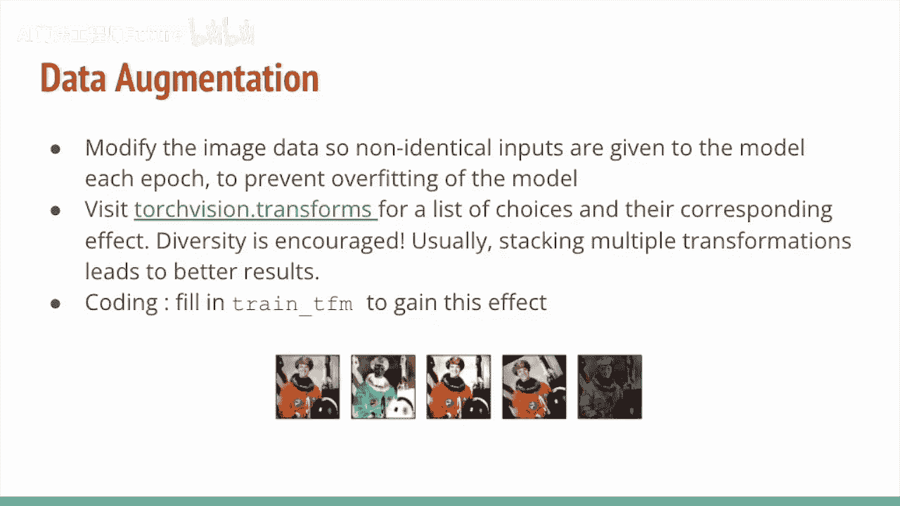

应该就会应该就会有达到这个效果，那另外有一个比较进阶的data adventation，是如果有余力的话，可以实做，就是叫做mix up，这里有一个连接可以去看他本来的paper。

那他的想法其实蛮简单的，就是假设我有一个label0的照片，跟你个label是一的照片，那我就可以对这个照片做the tensor，直接做线性的组合，变成一个叠加的状态的照片。

那label的话就把它改成是一半的label。

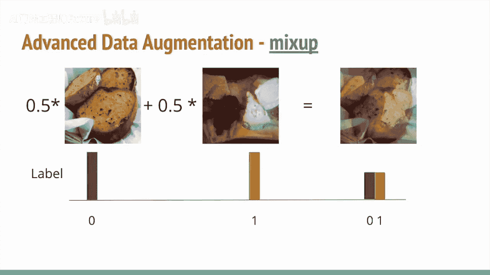

零一半的label1，那这个的coding就比较复杂一点，就要改的有这些部分，第一个是你的get item本来是回传一个照片，那你就要让他能够把两张照片都读进来。

然后结合在一起变成他的linear combination，那第二件事情要做的是，现在label是回传一个数字，那因为现在变成mix up的话，就需要有两个label。

所以你要让它能够回传一个有两个label的东西，然后里面还要有probability，那另外1cross entroplos是没有资源，多个label，所以也要把cross entropy。

loss的数学函式直接写出来，把把这个loss function换掉，换成你自己写成的数学函数，接下来是test time augmentation，Testine augmentation。

就是一般来讲在test transform的时候，我们会希望照片是比较清楚，所以我们会用一个standard的transform去预测要test呃，去预测test的照片。

可是事实上如果你有training pentation的话，你用多张training的augmentation，全部结合在一起去predict。

可能效果会优于你只用一个center craft的test augmentation，所以可以利用training的augmentation，在testing的时候用产生多张照片之后。

再predict之后再去投票或是赢ensemble，那ZG的话就是要在要把testing的augmentation的机制，改成training的augmentation，而且要做多次才会显现出它的优势。

那因为testing呃，test的transform还是通常还是会比较好，所以有时候我们会增加test的权重，以这个例子而言，就是training有五张照片产生出来，可以把他的呃logic全部平均。

然后testing的testing的logic就是自己就是只有一个，这样，那final prediction可以是testing加权多一点，然后training加权少一点，这样不一定要是全部一比一。

通常testing加钱多一点点会比较好，因为testing的照片，毕竟还是会比较容易看得出是什么，那接下来是cross validation，Cross validation。

就是把training跟validation就sample层不同的portion，那这样你就可以train好几个不同的model，他看到的是不同份的资料，那这样on sample起来就会比较好一点。

那这个在coding的话，实作方式就是要把training跟validation的pass，全部都结合在一起之后，你自己再去分呃，再去重新分配training跟validation set。

那就算不想要train多个model的话，还是可以建议做类似刚才重新map，training跟validation的事情，因为它本来的DATASET，用的training跟validation是三比一。

那用太多的validation data其实没有用，因为它只是让你确定说model没有显著的OVERFIT，所以所以多一点的training data，会对整体的效能会提有提升。

那最后ensemble的话有两种最常见的方式，第一种就是把出来的logic直接取平均，那第二个是voting，那第一个的优点就是，那第一个的优点就是，它比较不会没有模糊的空间，因为它都是一个呃浮点数。

所以不太会有平手的情形，但是你就需要把完整的output全部记下来，才能做这件事情，那voting的话就比较简单，因为你只要产生好几个CSP档之后，再去做voting就好，但是它就会有呃平手的问题。

就必须要解决，平手的时候要怎么去判断是哪一个分类，那coding的话就是用一些简单的Python的operation去做，好接下来是KO的tutorial，这次因为呃因为开狗助教在用开口做的时候。

就比较呃比较容易做出来，所以建议大家用开口这样，因为开口有以下几个好处，第一个是它GPU是16G的，然后他的data的IO会比google再快一点。

因为它会直接data set绑定在competition里面，所以会进来之后它的IO是比较顺畅，那另外他的checkpoint如果train到一半，train到一半还想要继续TRAK，时间到的话。

他比较容易去存checkpoint，他的checkpoint不会不会不小心就不见这样，但是他有他有一呃时间上的限制，就是30个小时，每个礼拜三四个小时，那每一次每一次也是只能跑12个小时。

跟google是一样，那我强烈建议使用K狗。

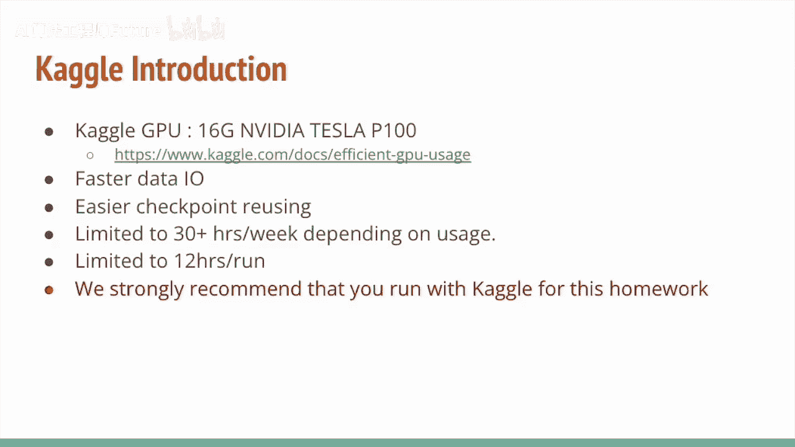

好，那额跑的方式就是在在code这边，会有会有一个new notebook的按键可以去写自己的co，那也我们也有提供sample code，在这里，那我先试一下跑跑pod。

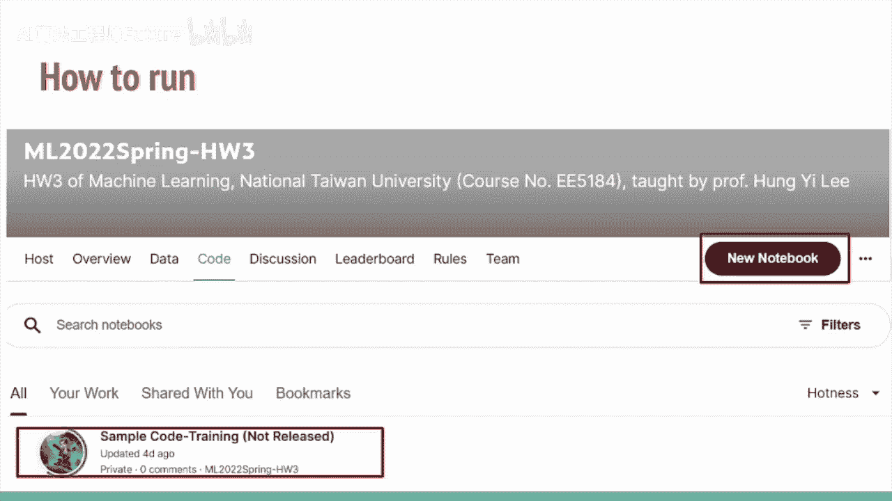

可以打。

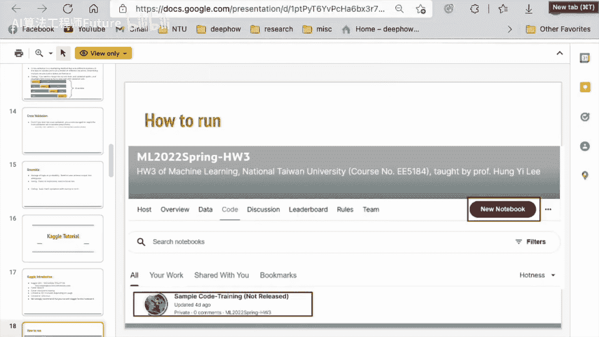

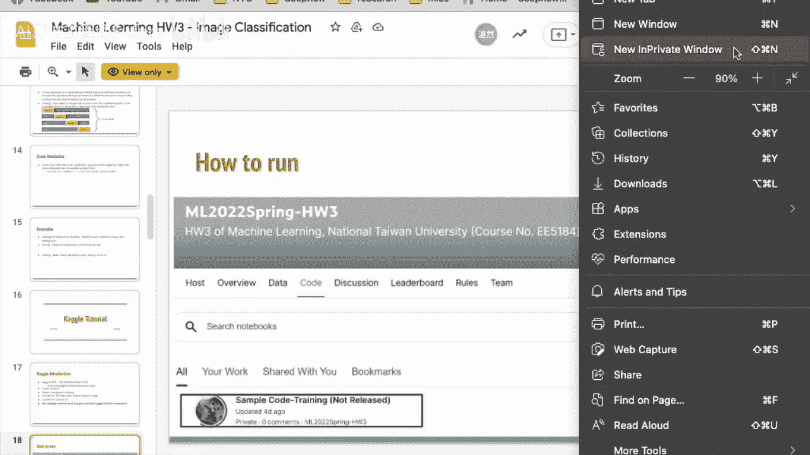

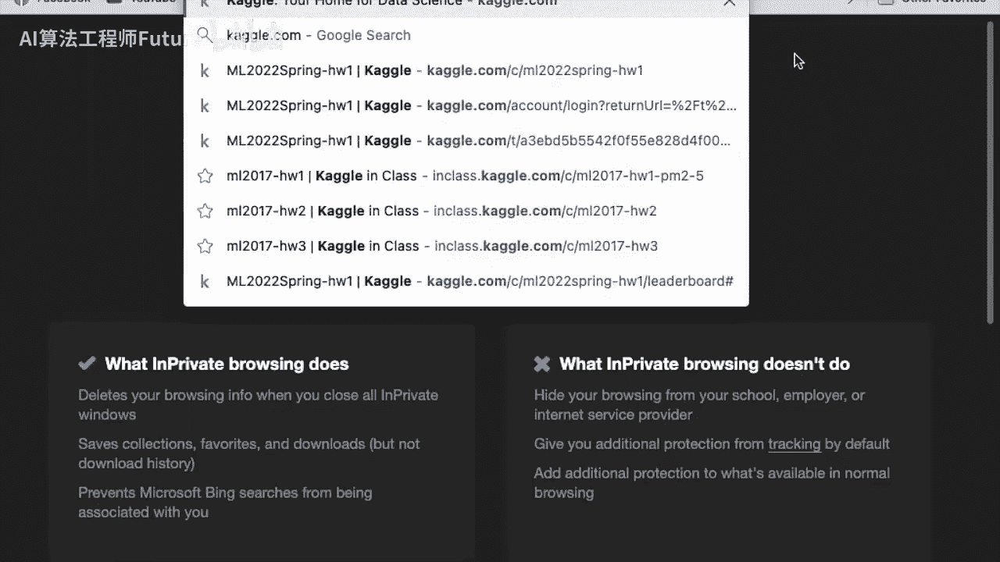

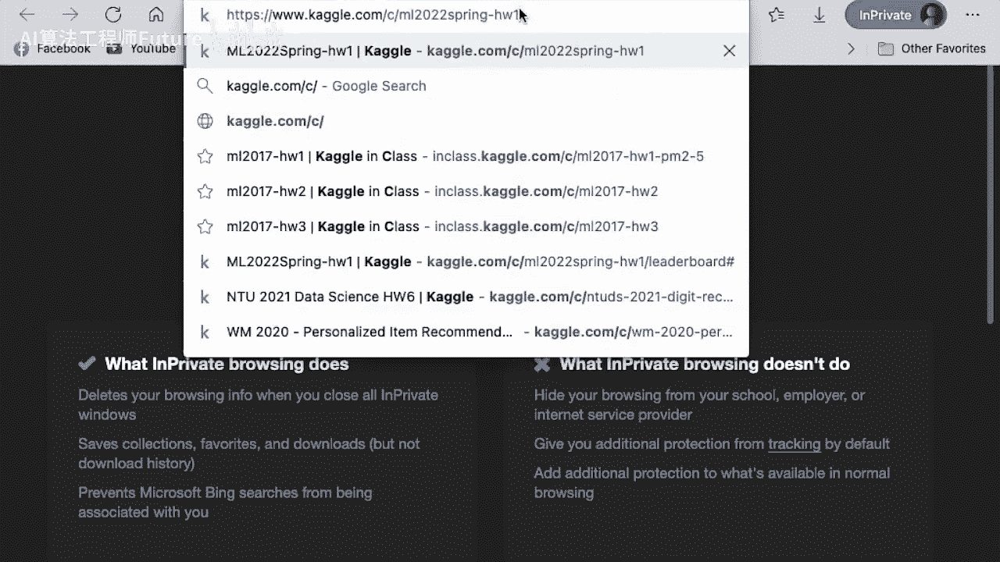

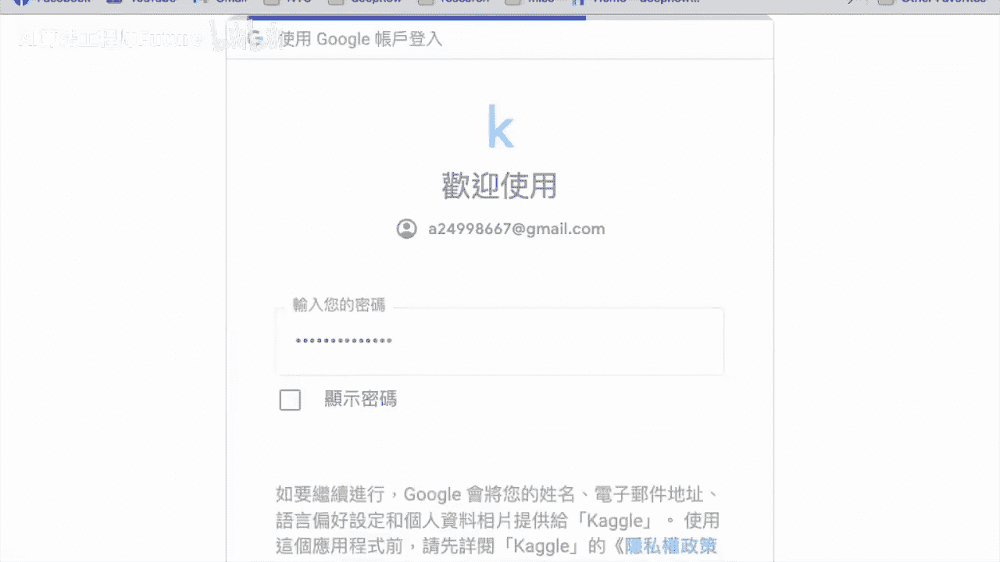

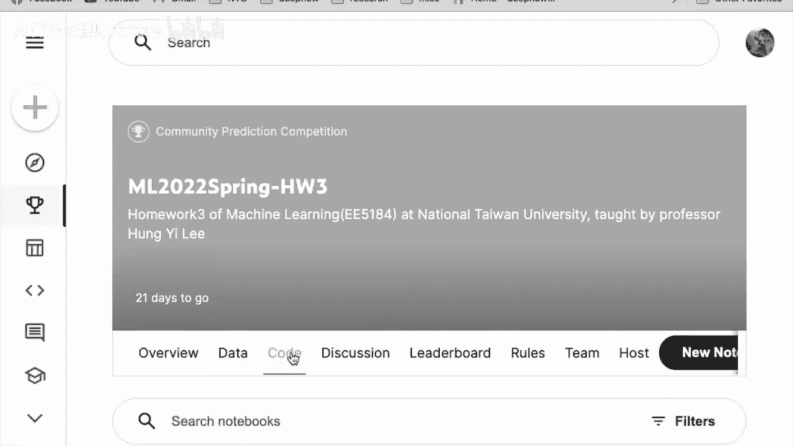

然后我发现他我发现他这个hardness的指标怪怪，他会有时候会秀不出来，所以如果没看到话，就是换成其他的呃，其他排序方式就会出现，那这里有一个training加prediction。

那就把它点进去之后，然后在这里就可以按执行，全部就就可以开始执行，然后要先要确保是用GPU跑，那我就先跑，等一下再来看看结果，怎么奇怪。

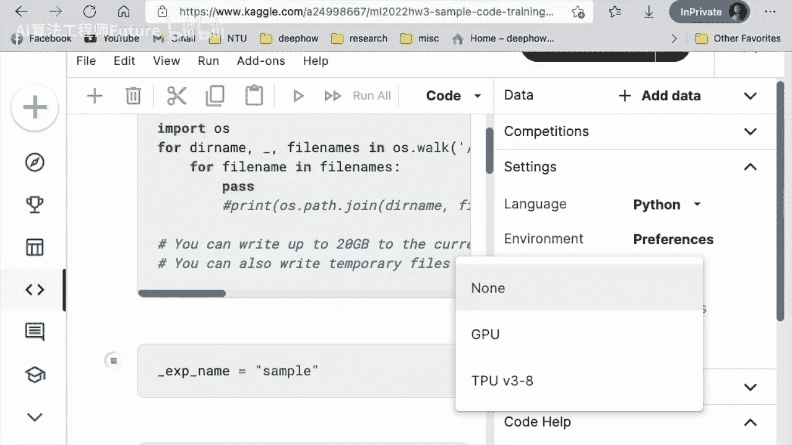

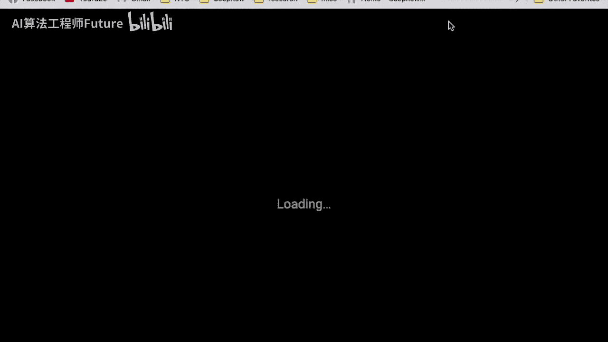

好那点进来的之后应该会长这个样子，那右边的话就会有它的，应该就会直接data就会出现在里面，那如果没有的话，就要自己呃，在ADD data，然后输入这个ml，202spring homework3。

那GPU的话就是在这个CELERATOR这个地方，把它切换成GPU，那GPU是有时间限制的，所以如果还在debug阶段的时候，建议不要用GPU，那如果是用这一排上面这一排操作的话。

就是run interactivity的方法，就是可以一格一格执行，那也可以回去执执行，就可以修改之后再从中间再开始执行，这样那所有的output都会输出到output这边。

他的开go working这个这个资料夹，就是LOK在点斜的位置，所以直接输出到当前的资料夹，最后就会出现在这边，那出现在这边的档案全部都可以直接下载。

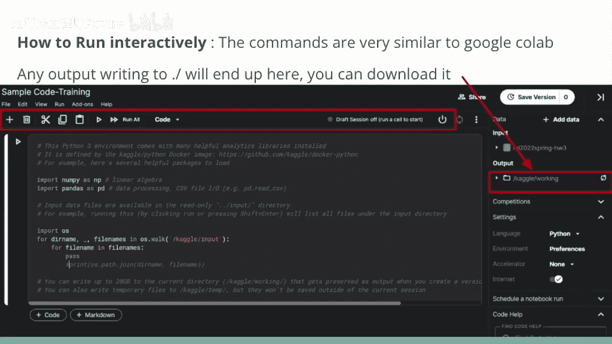

那K狗也有资源可以跑在背景跑的功能，就是他就是会在他就是从头执行到尾，这样那output有限制20G，然后max run time是12个小时，因为有些model可能会很大。

所以建议不要每一个IPOD都去存model，这样可能最后就会超出他的年龄，那也要也要确定说自己扣的不会执行，到一半就有出现bug，因为他如果遇到有任何一个block遇到bug的话，就不会继续执行。

他就会中断在那边。

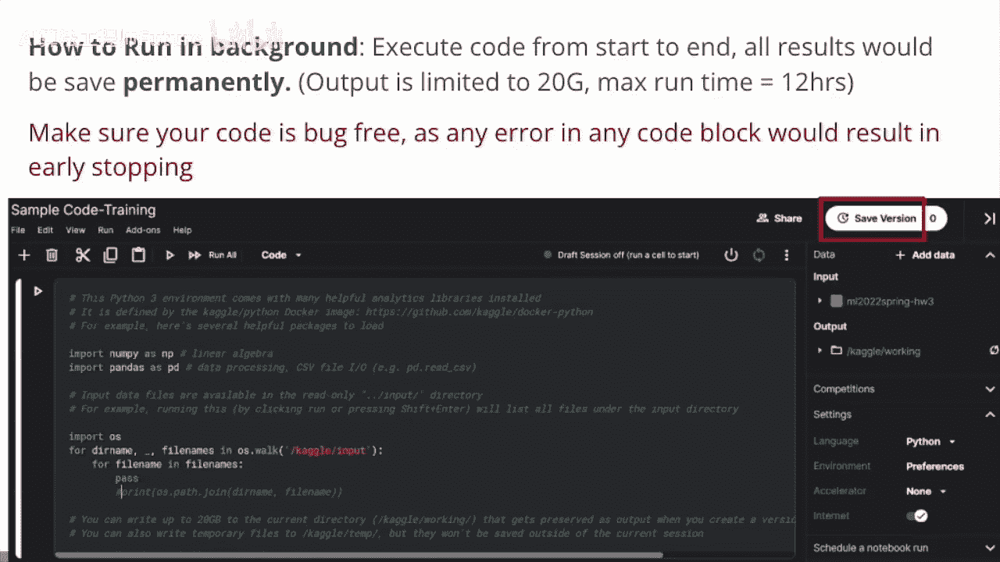

那执行完之后它就会有不同，每执行一次他就多一个版本，这样那可以点右边的这个数字，来看自己之前执行过的版本，那呃就是跑到12个小时的话，它就会自动中断，可是就算它中断，它还是会把资料存下来。

所以不用担心跑12个小时被切掉，所有的资料都还是会被储存起来，那点旁边的三个点之后。

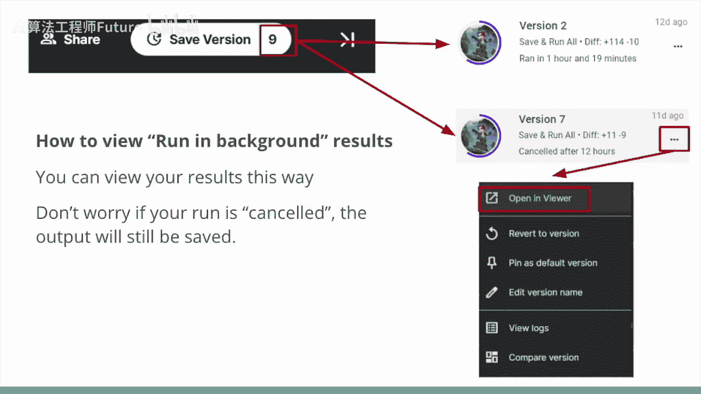

再点opening viewer，就可以看执行的结果，执行的结果之后，最重要的就是切到data这个tab，那它旁边就会有自己存的所有的东西，就是只要输出到点写的东西全部都会存在这边。

那档案的话就可以下载，或者是可以呃，可以个别下载，或者按这个download all就可以全部下载，那另外可以也可以按这new data set，意思就是把它存成你自己的。

把自己model存成一个data set，那之后你就可以再用同一分code，然后import自己的model，再继续train下去，那另外也可以按new notebook也是一样的意思。

但是它就会变成不是，它就会变成一个新新的notebook，之前的的他不会继承之前的扣，所以应该是同学应该比较需要用的是new dataset，把它存成一个DATASET之后。

再用本来coach import那个DATASET，去xx到已经执行过的model，所以嗯总结来说的话，train再加上prediction的话，就是直接跑整份code就可以就可以完成整个流程。

那就会有一个submission点CSV出现，就可以把它下载下来，再上传到submission page上面，那如果是要retrain from checkpoint，就是12个小时，感觉还没收令。

可以感觉继续train下去还会进步的话，就是先跑完之后，然后把output model存成DATASET，再把这个DATASET用ADD data import到notebook之后。

重新跑同一份code，然后code里面要去load之前的checkpoint，然后再再跑一次之后，再把submission上传，那接下来是一些小技巧，那第一个是时间管理，就是开狗的tango。

分配时间是会根据这一周你有没有执行，如果有执行任何GPU的话，他下周就会分配比较多一点的时间，所以建议同学可以今天就执行，随便任何用GPU的扣，那这个时间的话是在额星期六的早上八点重置。

那还有一点要注意的是，不管是在不管是interactive执行的，或是在背景执行的，全部都是会算到GPU的时间，所以他的时间算起来是总和，不是说一次执行多个就会扣比较少的时间，那就请尽早开始。

那另外这个时间的额度是可以超过一点点，就是如果你时间快到的时候，你可以在背景跑一个12个小时的run time，那它它它不会中断你跑的run time，所以你可以用这个来去来去获得额外的时间。

所以如果时间快用完的时候，在背景跑一次城市就多12个小时，那两只就是24小时，那最多就是两个，他只最多只能同时在背景跑两个城市，那因为呃因为他背景可以跑两个层次的关系。

所以也可以在觉得自己快要过base赛的时候，就用这个方法去同时跑两个差不多的扣，但是可能会有可以用不同的random se，或不同的train validation的split。

或者是不同的model structure，那就可以同时在，就可以用比较短的时间去获得两份的结果，那就可以按sample就会获得比较好的分数，那以这次作业的boss space style而言。

是有机会可以train train12个小，就是你有改三之前说的model selection，然后有TESTINEARGENTATION，有training augmentation的话。

这12个小时之后，prediction就有办法过，不过更保险，而且快速的方法的话就是train好几个好几个model，然后ensemble就可以用不同render cy或train。

validation sp或model structure，那也可以继续train下去，如果觉得还没熟练的话。

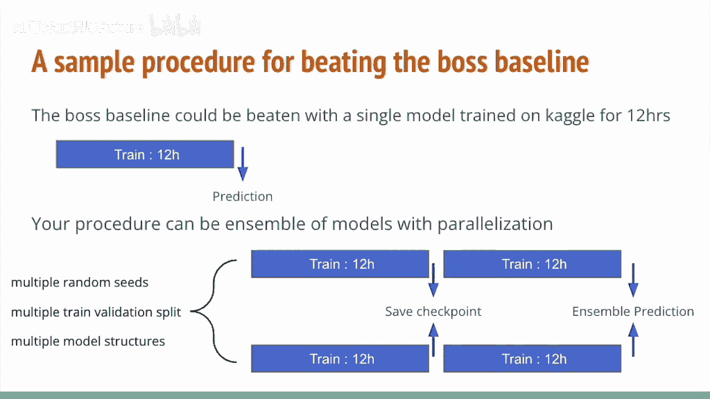

那接下来就是ARMENTATION是一定要做的，因为如果没有ARMENTATION，很快就要over fit，那如果你的augmentation比较多元的话。

在test time orgentation，这个阶段又可以在强化一次performance，因为你就有更多不同样式的照片可以让他去呃，可以让model去辨别说它到底是什么这样。

那如果是你不是直接import model structure，而是从我们提供的structure去改的话，就是不用害怕是把自己的model变很大。

因为用很多predefined的model structure都蛮大的，所以所以可以尽量打这样，那我们实验发现说，当三有当3RLING的model，会word会比较performance比较好。

所以可以去看哪些model有DOWNSAMPLING，然后选择那些model来使用，那不要直接就看它上面image net的performance来决定，用它最好。

因为它的PRETRAINING有些可能也不一样，那我们不能用pretrain with，所以就这这这个东西没有什么参考价值，那另外一些其他的trick。

就像是在classification上面可以用label smooth，cross entroplos或者是focal loss，那在optimization上面就跟之前一样，也可以用drop out。

然后gradient accumulation是，如果你用一个很大的mode，你可能batch size要调很小，那为了要让bad size有呃近似于大的batch size的效果。

就可以accumulate几次gradient之后，再再back propagation，那就额可以参考上面的连连接。

那也可以做batch normalization跟image normalization，image normalization就是照片，它是一个tensor，所以它也可以normalize成呃。

也可以参考image net的normal的normalization的方式，去去正规化他的他的tensor，那如果是用collab run的话，要记得不要把data存到自己的硬碟里面。

因为从硬碟load里面是很慢的，就存在点写就好，那因为现在基数的policy是有有storage living的，而且他好像不会提醒说到，所以所以要密切注意有没有超过它的容量。

因为有些model东西很快就会超过容量，那它会把你的g google账号停权，所以就要小心。

那接下来是report的问题，第一个就是要实做training的ARMENTATION，那就是把你弄呃，你写好的train tfm，直接贴到grade scope的问题上面就好，直接贴code就可以。

不需要解释，那train tfm必须要至少有，必须要至少能够产生五种以上的结果，就是在把照片丢进train tfm之后，所以如果只有一种或两种的话，就是不符合规定。

那不不见得要跟你实际上training的一样。

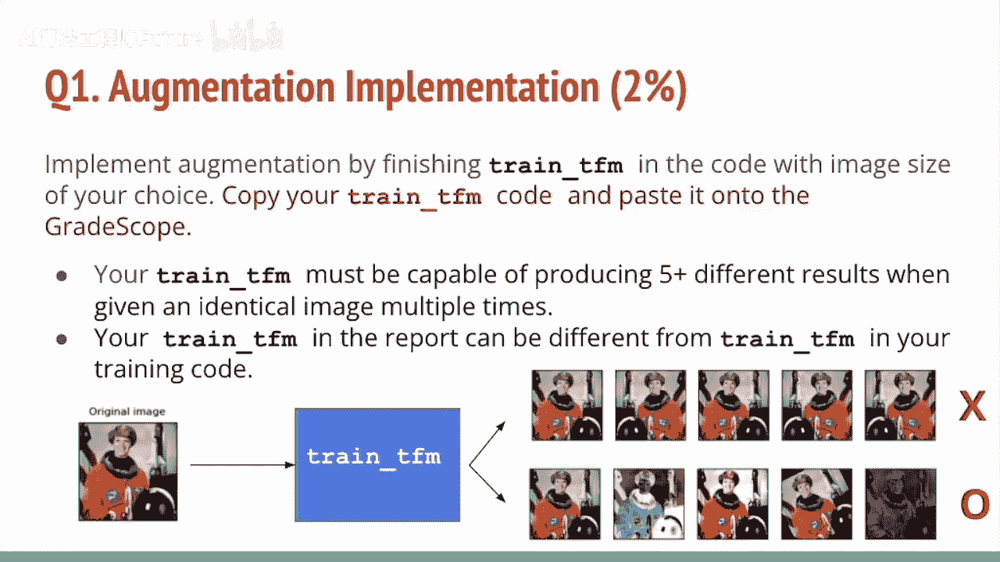

你可以写一个不同的，那第二个就是recedual connection，Receduconnection。

是在一些是在这篇deep recedual learning for image reconnection，这篇paper上面有提到，那他就是因为在他发现在很深的模型当中的话，如果有RECE。

就connection，就可以比较避免它gradient vanishing的问题，所以它的做法就是把input呃，input colayer的output再跟input用。

用一个connection接在一起，它把它相加之后就是recedual connection，那我们在code里面已经要给一个recedual model。

那他是目他是目前是没有被实做RECEDUCONNECTION，所以同学就把forward这一个函式，改成有RECEDUCONNECTION都可以就就可以了。

那cn and layer的话都已经自定义好了，所以就不用自己写，也是一样，把它贴到GRA，把co贴到GRAS口就好，所以角交的时候就会像这样，第一个就是t train tfm的呃韩式。

然后第二个就是TVC，就network，那在COLAB跟开口都有这两个模型，好最后grading的部分就是这样，com Mission应该是交到NTU库，然后记得不要传到model或data。

所以我们有设一个呃，File size，里面是25mega这样，那report就是交到graceful，然后daylight是3月25号，好这rose刚才也讲过了，那这也是跟之前都一样。

最后是一些连接的部分，那这是嗯，因为都是建议用开口，所以如果有问题的话，也可以直接在上面的discussion直接回应，这样应该在training的时候也比较容易去探索，有可能有什么样的问题。

所以建议也可以用开口discussion直接发问。

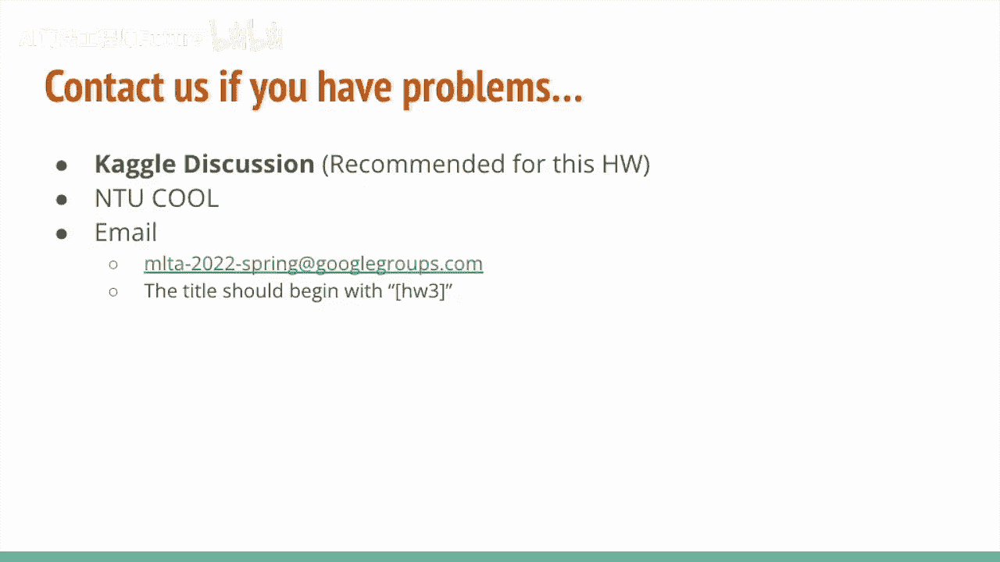

好那我我看一下train的。

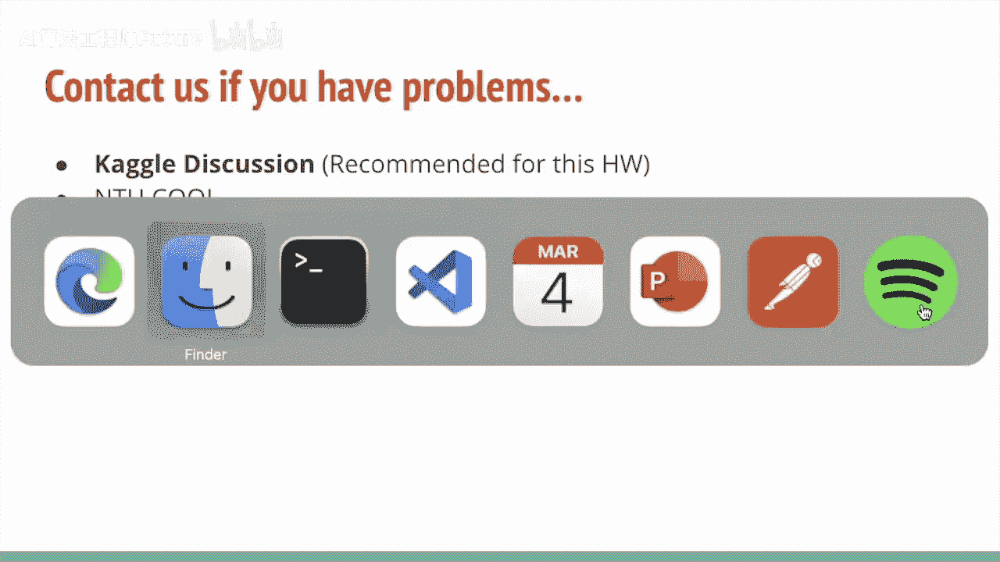

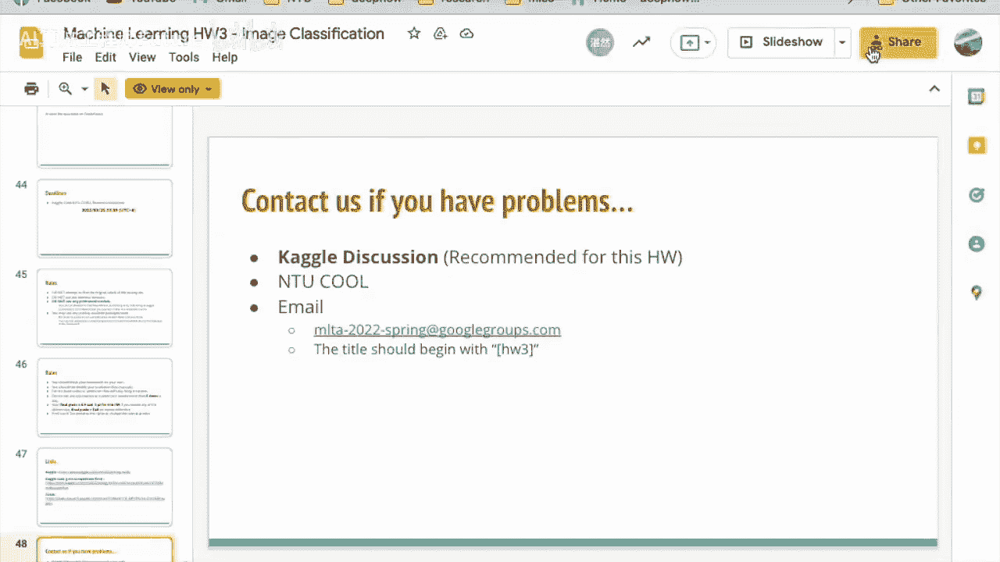

嗯你要尴尬，我们可以把它变小一点，不要太。

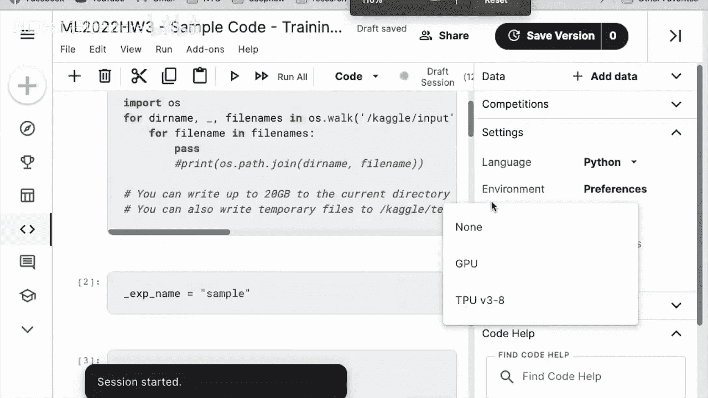

好我玩的吗。

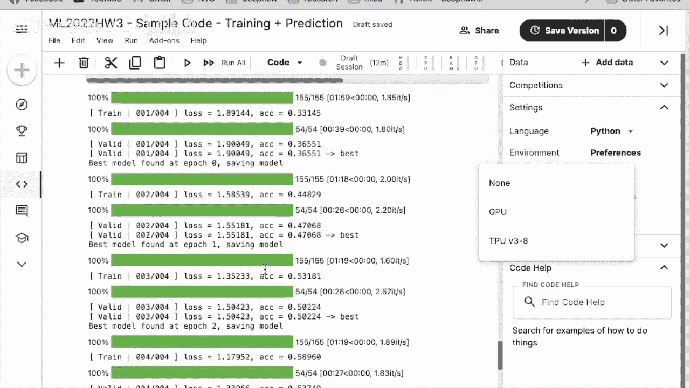

哦哦那我就下载下来。

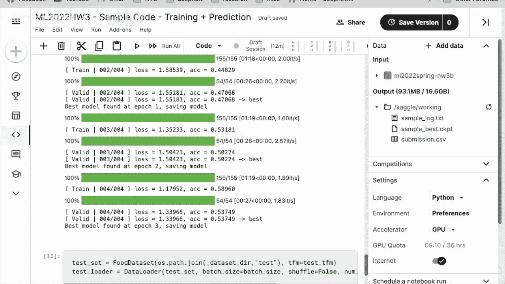

然后。

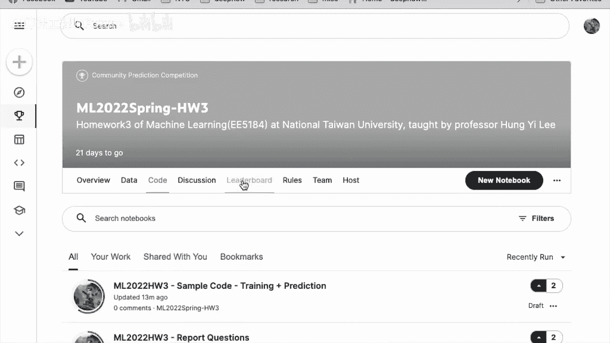

在哪里，当然是这个吗。

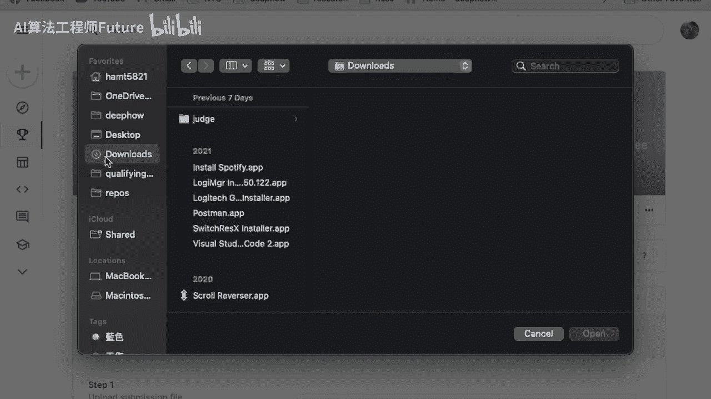

对。

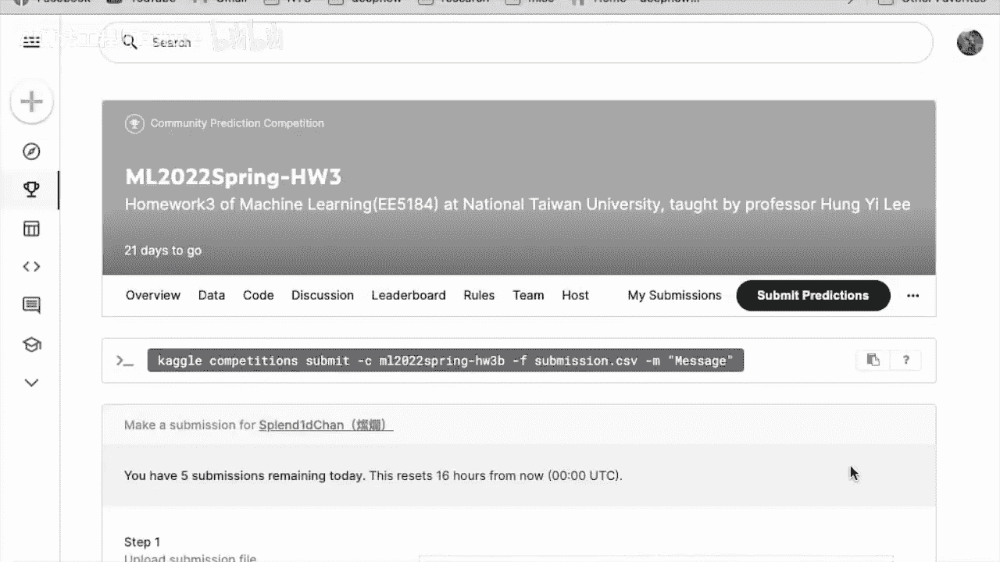

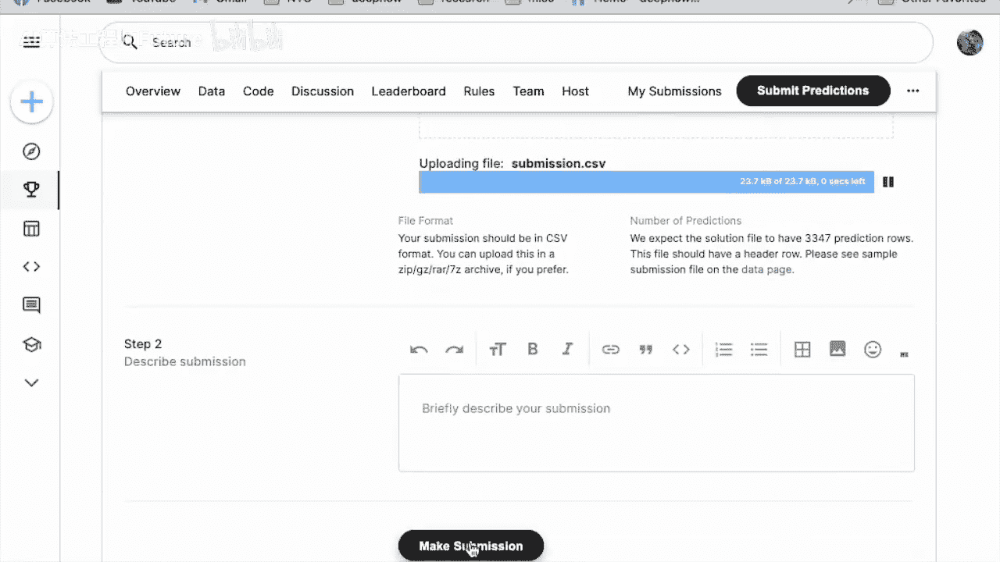

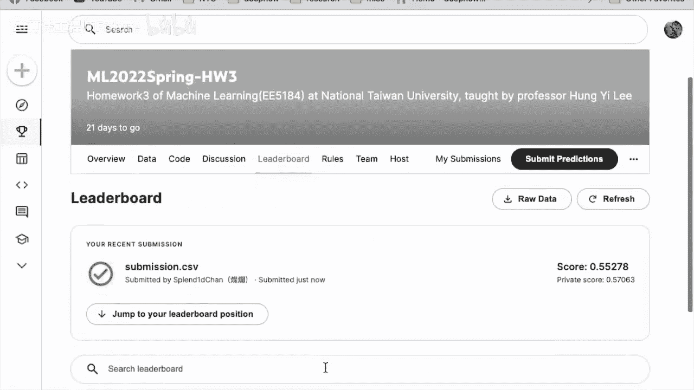

哦我有那个哦，反正就是有脚就杯哦，好呃所以就反正就有过simple ba3这样哦，呃然后呃就是我现在呃稍微讲解一下。

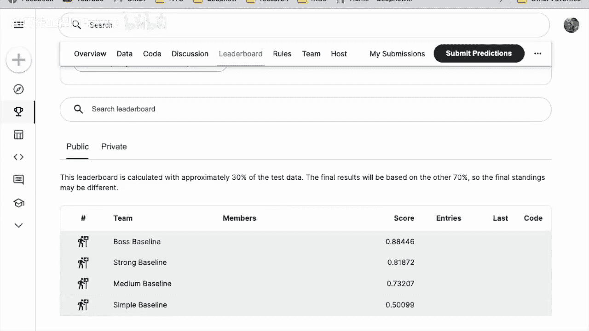

呃抱歉，等一下对不起，小心点到对，电脑太高，你要来这边吗，那个我是要去扣哦。

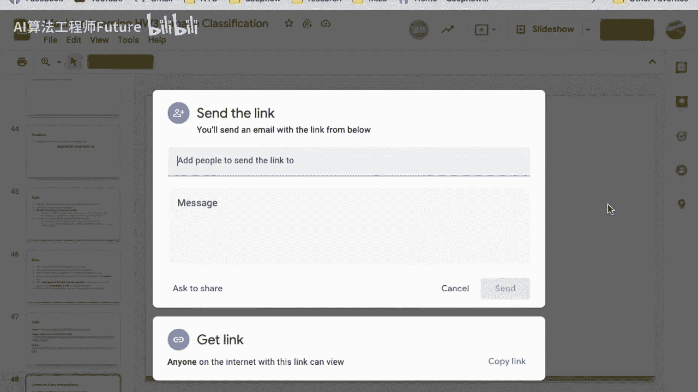

没事，我多点到好，好然后就是课程网站上面有口感链接，所以就是就是如果你还是真的习惯用COLAB的话，就你直接点那个那边也是一样，就是sample code会跑出，就是应该是差不多的结果这样子。

然后呃我来讲解一下，就是我直接用cargo讲诶，cargo讲解这样子对，然后呃刚刚就是如果你是第一次用卡狗的话，你记得旁边设定的话记得调，然后这个internet也要记得把它打开。

因为就是你要配音所有东西的时候，如果没有INTEL打开的话，它会找到对，就他会错误这样子，那前面的话就是in就是import1些package这样子，然后这边也是好。

然后这件事就是调就是RENDANCY，那我们就是有把它固定，所以就才就为的是要就是reproduce它，然后这些都是一些基本的设定，这样子好，那比较重要的是这个作业。

这这个部分是这是data argumentation，那就是刚助教有讲到的，就是呃你可以在这边，就是你可以上PYTORCH的data，那啊data argumentation的网站。

然后上面有非常多的选择，那你就是打呃可能类似，可能transform点reset，reset只是一种，那可能还有什么RANDO呃，Random road take，那还有一大堆就是就是一大堆防尘可以用。

那你就是把它抠下来，然后大爱这边对，那呃比较注意的是你的就是你做完这个唇呃，data argument之之后，就是你要丢进模型吗，那模型你要你要丢进模型是要tensor形式。

所以你最后一定要to tensor，就是你不管改成怎样，你最后一定要整一个这一行，对啊，TE呃这是test，那train也是一样，这样子，然后再就是跟之前作业一样，就是有那个data set的部分对。

那这一次是处理图片的，那可能跟之前有一些不一样，就是嗯就是会有label啊这些的那一样，就是呃其实基本上大大大致上是一样的，那只是处理图片的时候，可能就是会有一些比较不同形式的处理。

那其实同学应该呃不用就是改太多，这边应该都不用不用，基本上不不太用，需要动这样子对，那再来就是model的部分对，那model的部分的话，这是就是sample code。

注要是就是帮你们define一个就是呃model这样子，那你当然也可以自己上，就是其他就是可能已经定义好了，像是呃呃receive your name或是一些VGG之类的，就是network。

那你也可以直接用，那但是不要不要把pretrain model改成就是pretrain model，一定是要改，一定是false，对这一定要say好，就是你如果错的话，就是会被视为违规，这样子对。

那这边基本上如果你是想要用，就是自己define的架构的话，就是你可以自己去加，就是自己盖，那大概是这样子，对那后面这output的时候，这边有一个就是你linear的那个那个，这最后一层linear。

然后才会output，因为这是一个classification的那个的一个task，对，那呃通常这边会有遇到问题的，是你的就是CNN街道，就是linear的第一层，就是这边的那个dimension。

常常会有很多问题，对，那我的建议是就是你不要遇到error，就即兴问助教或者网络上问助教，其实你可以先，因为通常这边的话应该是dimension的error。

那你可以先print的print那个CNN的，就是最后一层的那个shape，然后你就可以知道他的dimension是多少，那你就把它填在linear，第一层应该就不会错了，因为这是之前很常见的一个问题。

所以提醒大家一下，这样子啊，如果真的还是有问题的话，呃，就是可以在就是cool或是discussion那边，就是询问一下助教队，那其实你也可以用计算的啦，对计算的话，网络上其实也有也有很多。

就是你你查一下就是关键字，你就知道他是他有一个数学的公式，就是可以让你算出你现在要多少dimension，那如果你觉得那很麻烦的话，你就是刚刚我讲的，就是你直接把print出来就可以了。

对好那这边就是batch size，这些应该跟之前是一样的，然后还有data torder，这边也是一样，对，那这边就是device嘛，就是显那个要用显示库的显示卡，然后还有一些参数，像是AIRPOD。

然后这patient就是early stop的概念，就是你要多你要在什么时候就是减呃，你的模型没有进步，然后你要再多大多多少step时候去停止，你的training，这样子也都是可以自己设定的。

对那一样是把model丢丢到device，然后我们的这是我们现在目前就是sample code，用的loss是cross entropy loss，对，那如果同学想要实做。

就是像助教投影片讲的mix的话，呃这边的话就要改，因为cross entropy就是不支援，就是呃两个会就两个label的对，就会有两个label的对，那所以如果你有就是有想要实做其他东西。

这边需要更改这样子，然后还有optimization对里面有一些参数，大家可以就是自己去研究，这样子自己去改，然后再就是training的一个过程对，主要其实training的过程应该跟之前都蛮类似的。

那我这边就是快速的往下往下带过，就是这边是train，然后再down是validation嘛，对然后最后是呃，最后是这边是在写，说就是你的early star的部分，就是你的model没有进步了。

那他就会停下来这样子，那呃值得讲的是，刚刚有讲过，就是test time的argumentation，那那个部分的话，除了你在前面，ARGUARARGUMENTATION要去做更改之外。

你要对就是呃你的test st去做一些更改，那可能可能你可以改为这边，或是呃基本上整个架构你都可以改啊，那你也可以就是改在test c这边对好，然后这边的话就是我们要去jing prediction。

然后后面的话就是就把麻最好的model，改成就是evaluation的模式，然后再来就是生成CSV档，然后你再去这边output里面，可以下载那个刚的那个submission file。

然后再把它交到coo上面，这样就是这是整个扣的的流程，对好那呃，有人对code或是对cargo的这个界面就是有疑问吗，哦对一样就是跟cod一样，Five。

我这边可以去download的那个notebook，就是可以把它挡在脚下诶，载下来，然后再就压成压缩成这这样，然后搅到N95call这样子好。

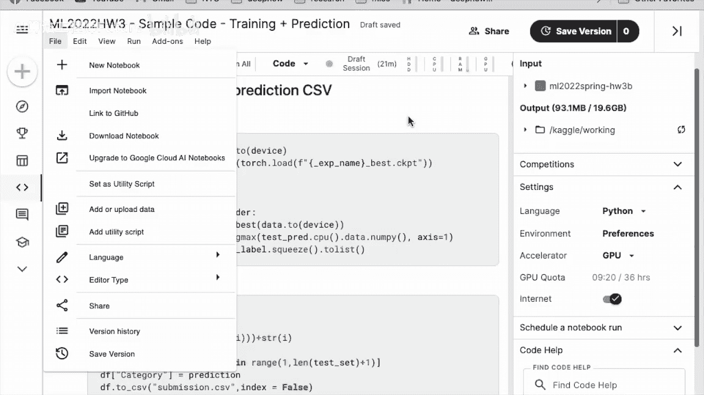

那我问题吗。