# 【官授搬运】2026年全新优化版李宏毅机器学习系统课程，这才是真正的初学者体系课程！—人工智能／深度学习／神经网络 - P29：【第4讲】1-自注意力机制 (Self-attention) (上) - AI算法工程师Future - BV1ruqABeEFX

好接下来要讲什么呢，讲完了CNN以后，我们要讲另外一个常见的network架构，这个架构叫做self attention啊，这个self attention想要解决的问题是什么呢。

他想要解决的问题是到目前为止啊，我们的network input都是一个向量，不管是在预测这个YOUTUBE观看人数的问题上啊，还是影像处理上啊，我们的输入都可以看作是一个向量。

然后我们的输出可能是一个数值，这个是regression，可能是一个类别，这是classification，但假设我们遇到更复杂的问题呢，假设我们说输入是一排向量呢。

而且这个输入的向量的数目是会改变的呢，我们刚才在讲影像辨识的时候，我还特别跟你强调说，我们假设输入的影像大小都是一样的，那现在假设我们的输入会不一样呢，每次我们model输入的sequence的数目。

sequence的长度都不一样呢，那这个时候应该要怎么处理好，那有什么样的例子是输入是一个sequence，而且长度会改变的呢。

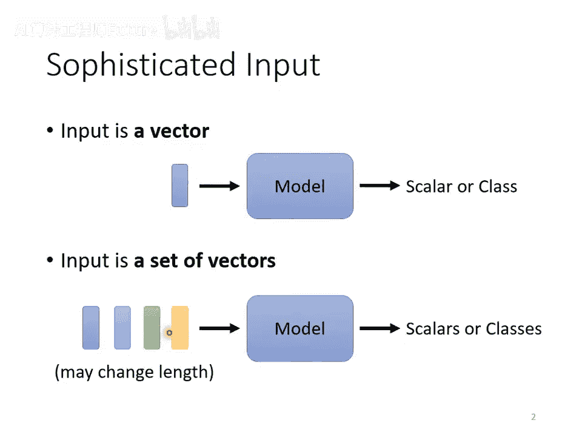

第一个例子是文字处理啊，假设我们今天要network的输入七个句子的话，难道每个句子的长度都不一样嘛，每个句子里面词汇的数目都不一样嘛，如果我们把一个句子里面的每一个词汇，都描述成一个向量。

用个向量来表示的话，那我们的model的输入就会是一个vector的set，而且这个vector set的大小每次都不一样，你句子长度不一样，那你的vector set的大小就不一样。

那有同学可能会问说，那怎么把一个词汇表示成一个向量呢，那简单来说最简单的做法是one hot encoding。

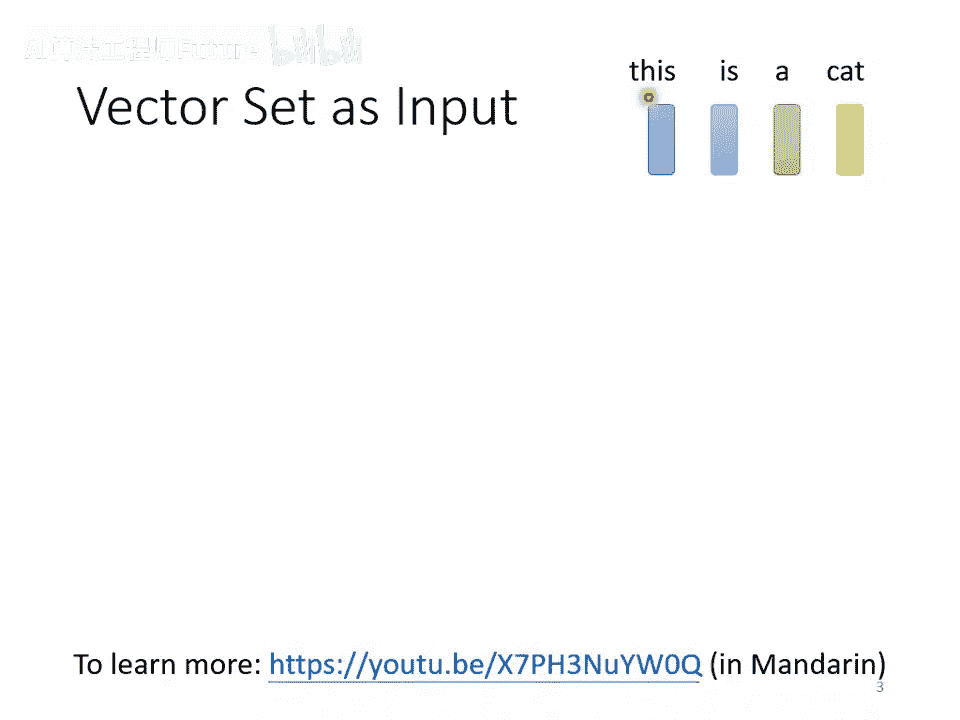

你就开一个很长很长的向量，这个向量的长度啊，跟世界上存在的词汇的数目是一样多的，假设英文是10万个词汇，就要开一个10万维的向量，每一个维度对应到一个词汇，apple就是100，bag就是010。

cat就是001，以此类推，但是这样子的表示方法有一个非常严重的问题，怎么样严重的问题呢，它假设所有的词汇彼此之间都是没有关系的，从这个向量里面你看不到说，也许cat跟dog都是动物。

所以他们比较接近cat跟apple一个动物，一个植物，所以它们比较不相像，看不出来这件事情，这个向量里面没有任何语义的咨询，有另外一个方法叫做war embedding。

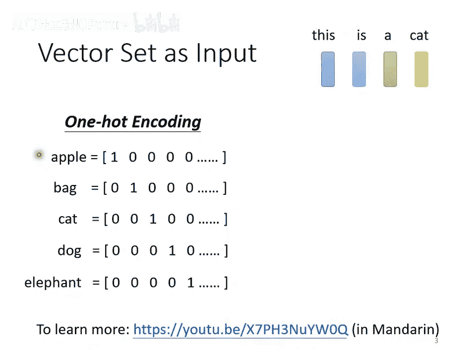

我embedding就是我们会给每一个词汇一个向量，而这个向量是有语义的资讯的，如果你把word embedding画出来的话，你会发现所有的动物可能聚集成一团，所有的植物可能聚集成一团。

所有的动词可能聚集成一团等等，那when embedding是怎么得到的呢，这个就不是今天讲课的重点了。

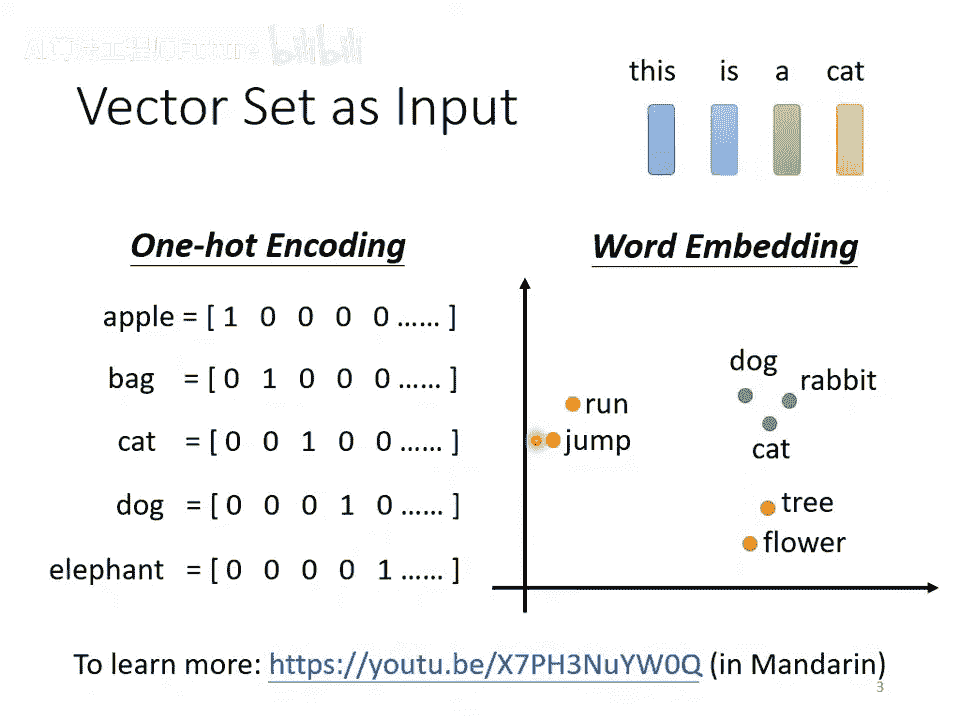

如果你有兴趣的话，可以看一下下的录影，总之你现在在网络上可以载到一种东西。

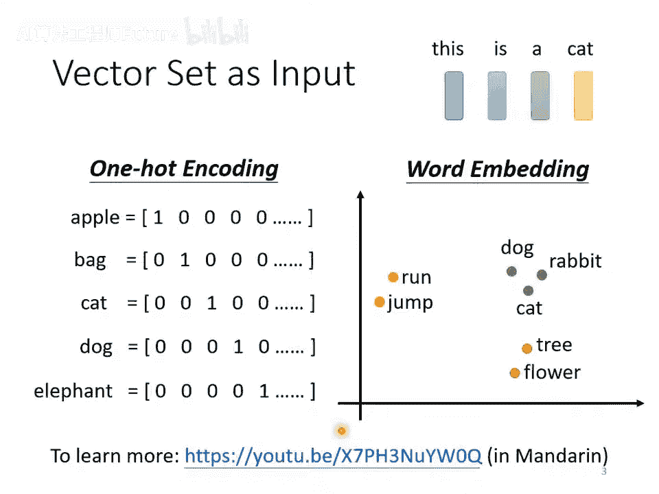

叫做war embedding，这个war embedding会给每一个词汇一个向量，而一个句子就是一排长度不一的向量好。

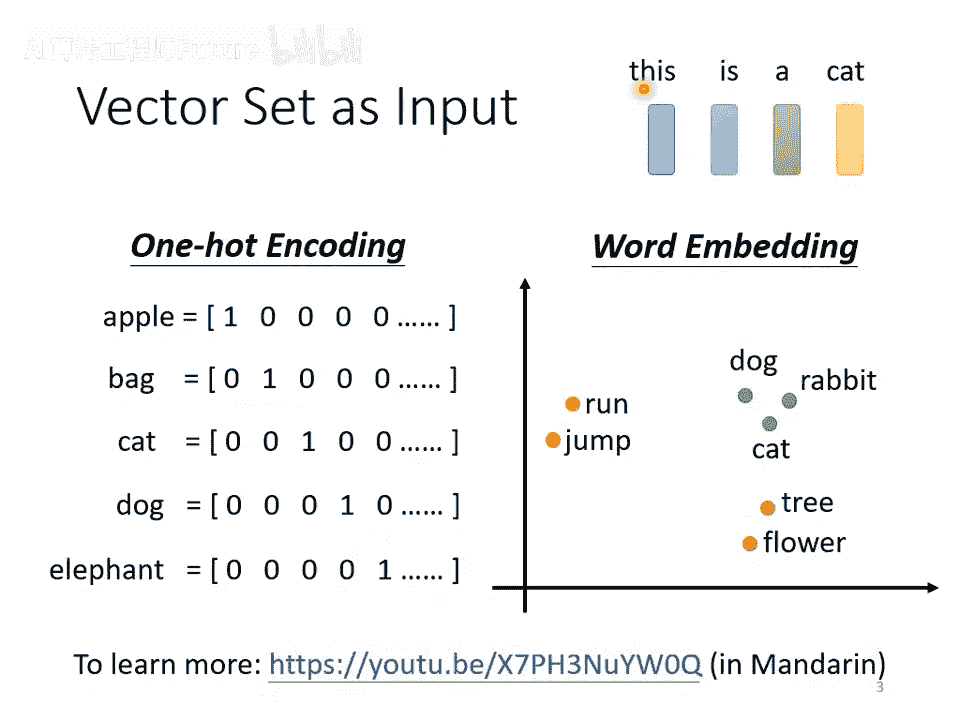

那接下来还有什么样的例子，我们需要把这个一个向量的sequence当做输入呢，举例来说。

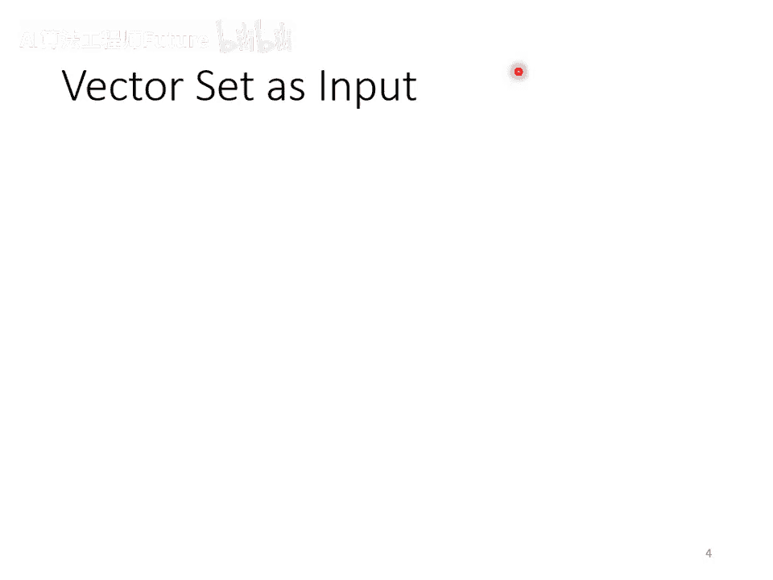

作业二一段声音讯号其实是一排向量，怎么说呢，我们会把一段声音讯号取一个范围，这个范围叫做一个window，把这个window里面的资讯呢描述成一个向量，这个向量就叫做一个frame。

好在语音上我们会把一个向量叫做一个frame，通常这个window的长度啊就是25个millisecond，那怎么把这么一个小段的声音讯号，变成一个frame。

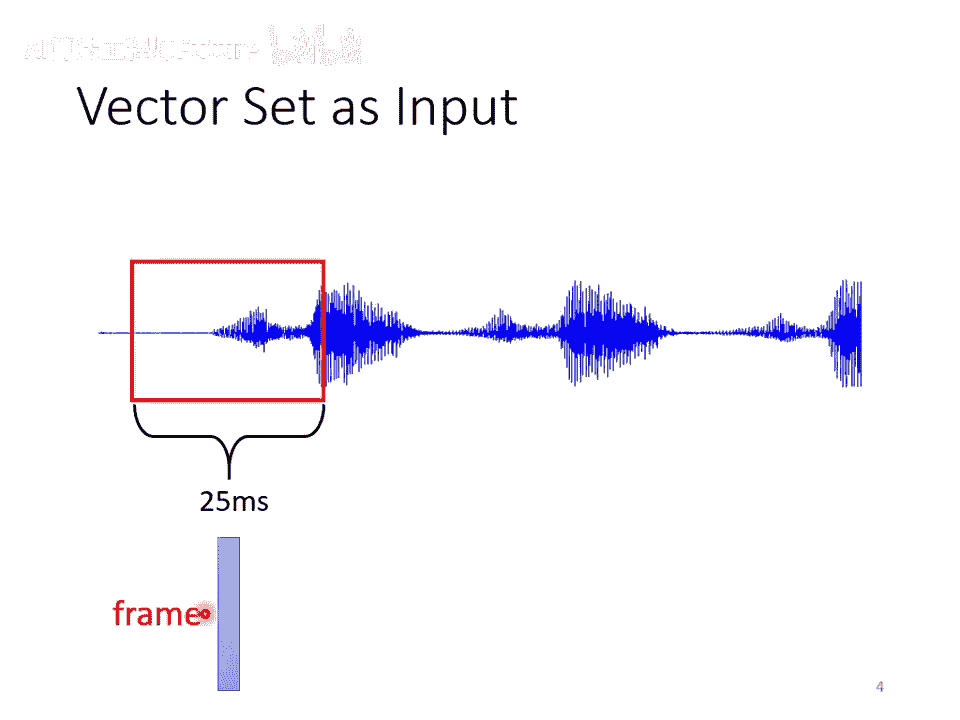

变成一个向量呢，啊这边就有百百种做法啦，那这边就不细讲，那就是有各式各样的做法，可以用一个向量来描述一小段，25个millisecond里面的语音讯号，然后呢你为了要描述一整段的声音讯号。

你会把这个window往右移一点，通常移动的大小是十个millisecond，那有人就会问说，为什么这边是25，为什么这个十这个问题呢就很难回答，这个古圣先贤帮你调好了，你知道吗。

这个你自己调上的都是比较差，这古圣先贤已经把所有的可能都试过了，然后调一个最好的结果，然后就这样哎好，那总之呢一段声音讯号，你就是用一串向量来表示，而因为每一个window啊。

他们往右移都是移动十个millisecond，所以秒钟的声音讯号有几个向量呢，有100个，所以一分钟的声音讯号就有这个一，100×60就6000个向量，所以语音其实很复杂的一小段声音讯号。

它里面包含的资讯量其实是非常可观的，所以声音讯号也是一堆向量。

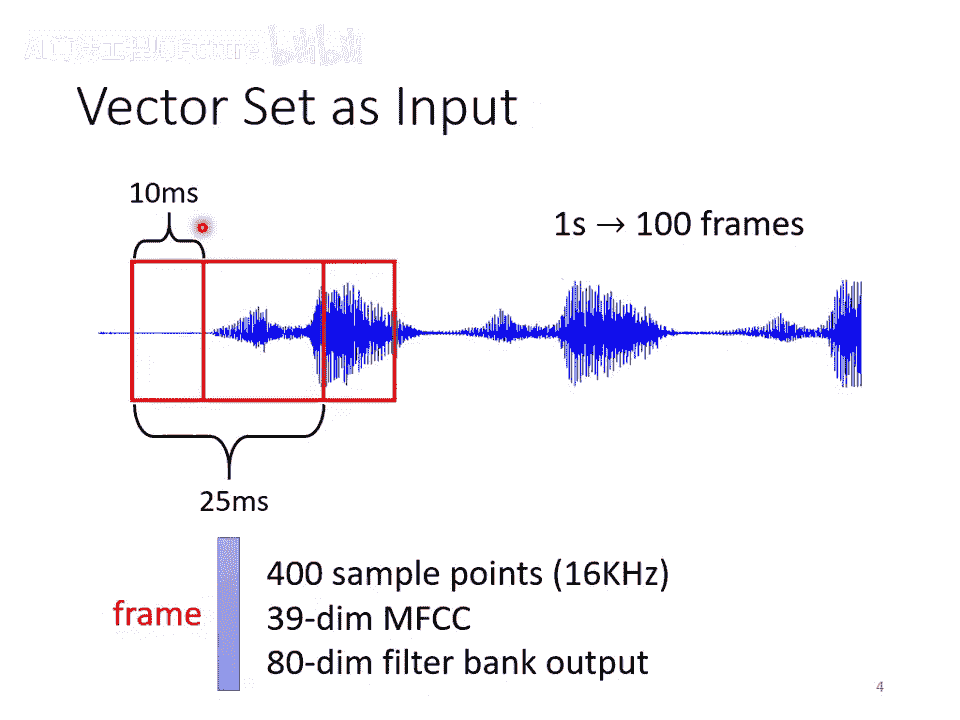

还有什么东西是堆向量呢，一个graph，一个graph，一个图也是一堆向量，怎么说呢。

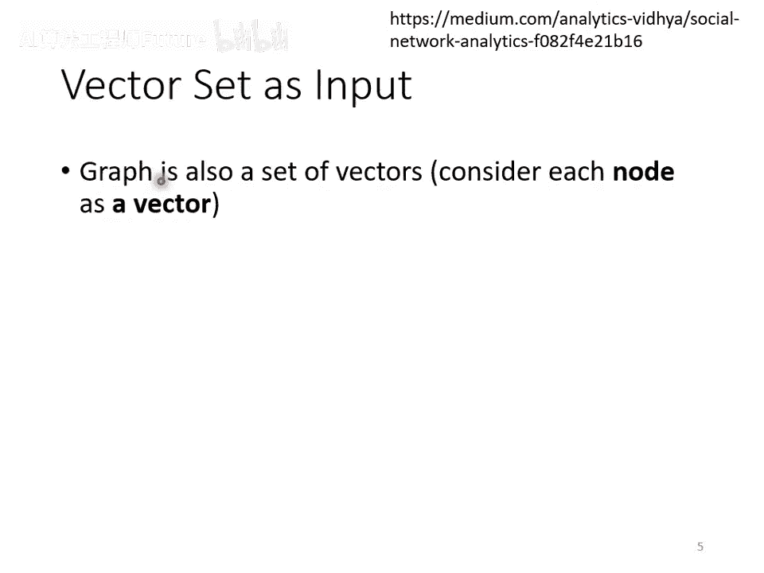

啊我们知道说social network就是一个gram，在social network上面每一个节点就是一个人。

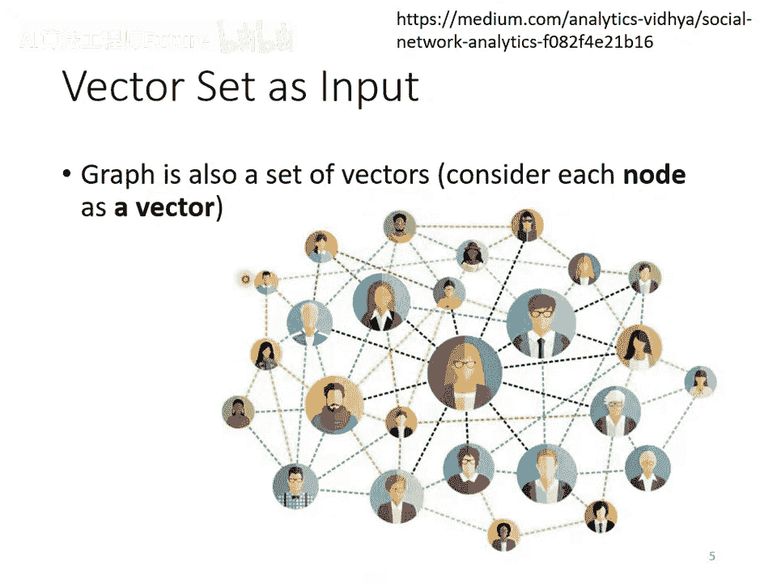

然后节点和节点之间的age就是他们两个。

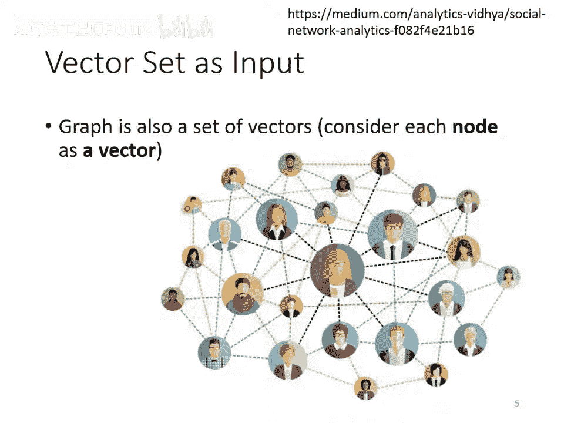

比如说是不是朋友等等，而每一个节点可以看作是一个向量。

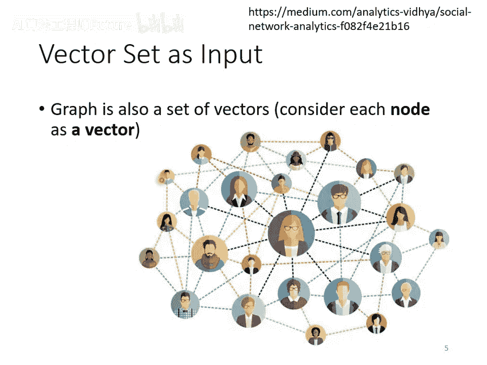

你可以拿每一个人的啊，比如说他的profile里面的资讯啊，他的性别啊，他的年龄啊，他的工作啊，他讲过的话啊等等，把这些资讯用一个向量来表示，所以一个social network。

一个graph你也可以看作是一堆的向量所组成的。

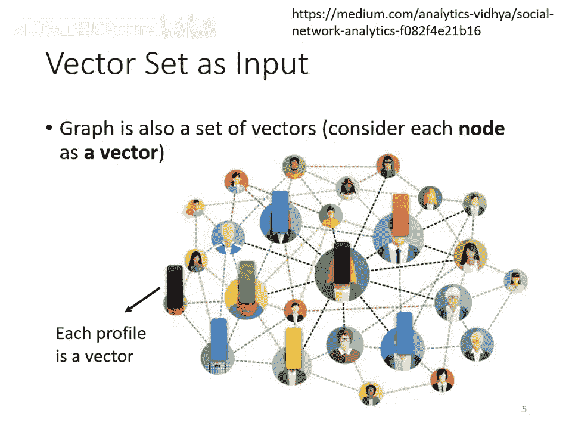

那还有什么例子跟graph有关呢，举例来说一个分子它也可以看作是一个graph，那现在像这种drug discovery的应用非常的受到重视，尤其是在COVID ninety这段时间，很多人都期待。

也许用机器学习，可以在drug discovery上面做到什么突破，那这个时候你就需要把一个分子，当做是你的模型的输入，而一个分子可以看作是一个gram，分子上面的每一个球就是一个原子，你就是一个向量。

那个原子怎么用个向量来表示呢，你可以用one half factor来表示，你可以说氢就是100，零，碳就是0100，然后这个氧就是0010，可以用one tap factor来表示每一个原子。

那一个分子就是一个gram，它就是一堆向量好。

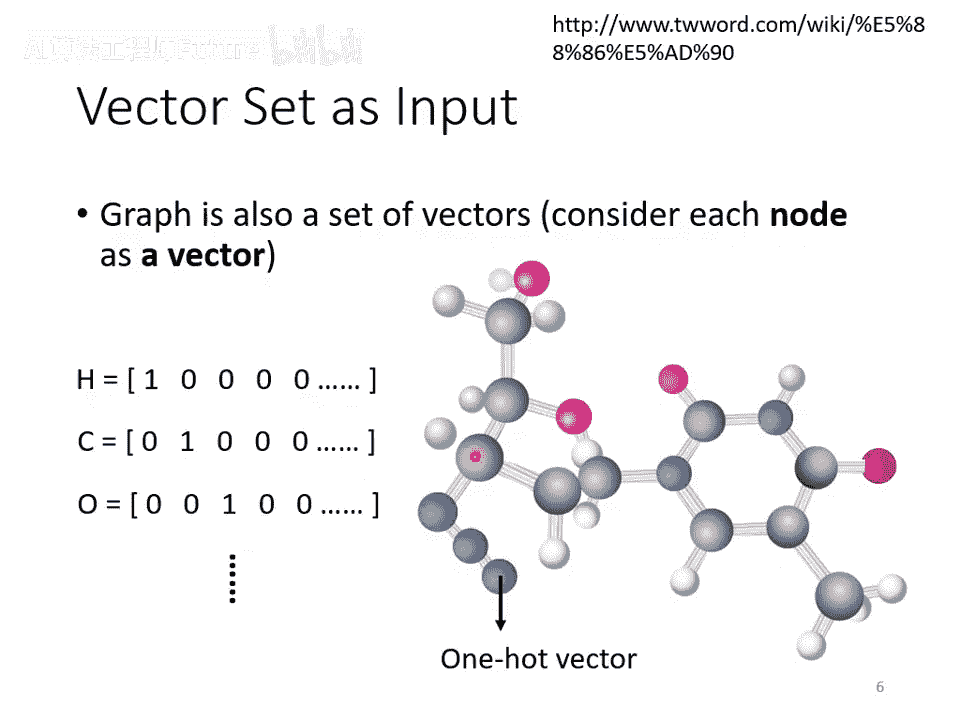

那输出是什么，我们刚才已经看说输入是一对向量，它可以是文字，可以是语音，可以是graph，那这个时候我们有可能有什么样的输出呢，有三种可能性，第一种可能性是，每一个向量都有一个对应的label。

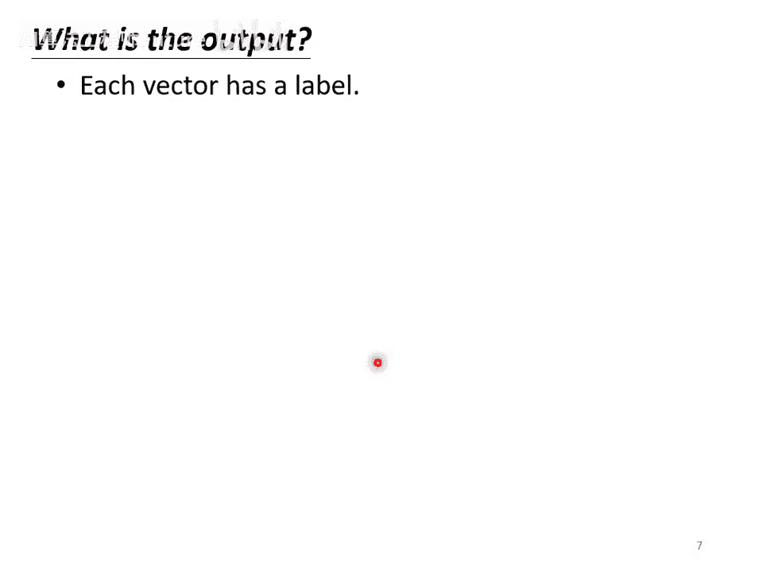

也就是说，当你的模型看到输入是四个向量的时候，它就要输出四个label，而每个label它可能是一个数值，那就是regression的问题，如果每一个label是一个class。

那就是一个classification的问题，但是在第一种可能性里面，输入跟输出的长度是一样的，所以模型不需要去烦恼要输出多少的label，输出多少的SCALA，反正输入是四个向量，输出就是四个向量。

输入五个向量呃，输入五个向量输出就是五个label，这是第一种类型，那什么样的呃。

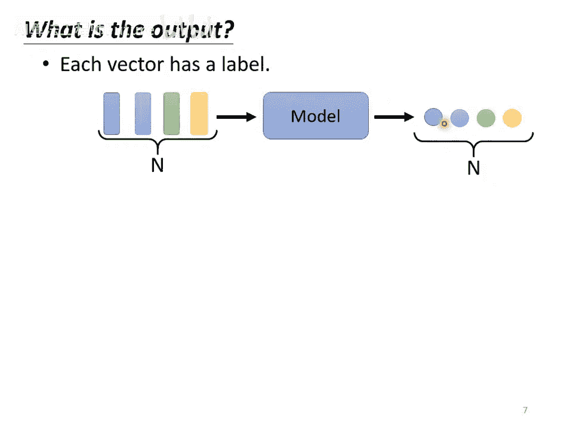

application会用到第一种类型的输出呢，举例来说，在文字处理上，假设你今天先要做的是p o s taking，p o s taking是什么呢，p o s taken就是词性标注。

你要让机器自动决定说每一个词汇，它是什么样的词性，它是名词还是动词还是形容词等等，那这个任务啊其实并没有很容易，举例来说，你现在看到一个句子哎so和so，这并不是打错，并不是你看一个看。

而是呃我看到一个句子，这个第二个so当名词用的时候，它是句子，它是句子，而不是sentence，那个句子是可以锯东西的句子，知道吗好，那所以机器要知道说第一个so是个动词，第二个so虽然它也是个so。

但它是名词，但是每一个输入的词汇，都要有一个对应的输出的磁性，这个任务就是啊输入跟输出的啊长度是一样的，case这个就是属于第一个类型的输出，那如果是语音的话，你可以想想看我们作业二就是这样子的任务。

像我们作业二没有给大家一个完整的sequence吧，我们是把每一个每一个，每一个vector分开给大家了吧，但是串起来就是一段声音讯号里面有一串vector，每一个vector你都要决定他是哪一个封。

你也就是哪一个润知道封面是什么，就是音就当做音标来看，就是哪一个音标，当然这个不是真正的语音辨识啊。

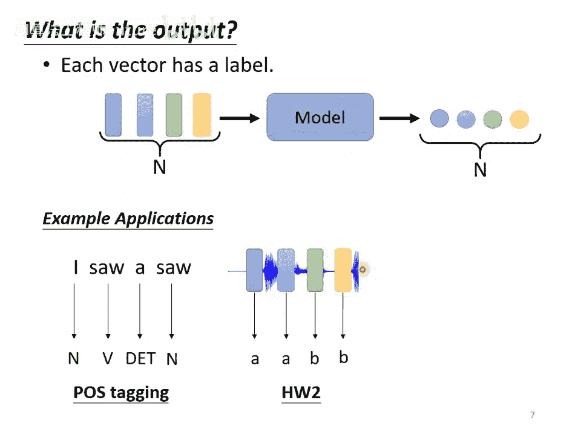

这是一个语音辨识的简化版，或者是如果是social network的话啊，就是给一个graph，给一个social network，那你的性能，你的model呢要决定每一个节点它有什么样的特性。

比如说他会不会买某个商品，这样我们才知道说，要不要推荐某一个商品给他好，所以以下以上呢，就是举输入跟输出数目一样的例子好。

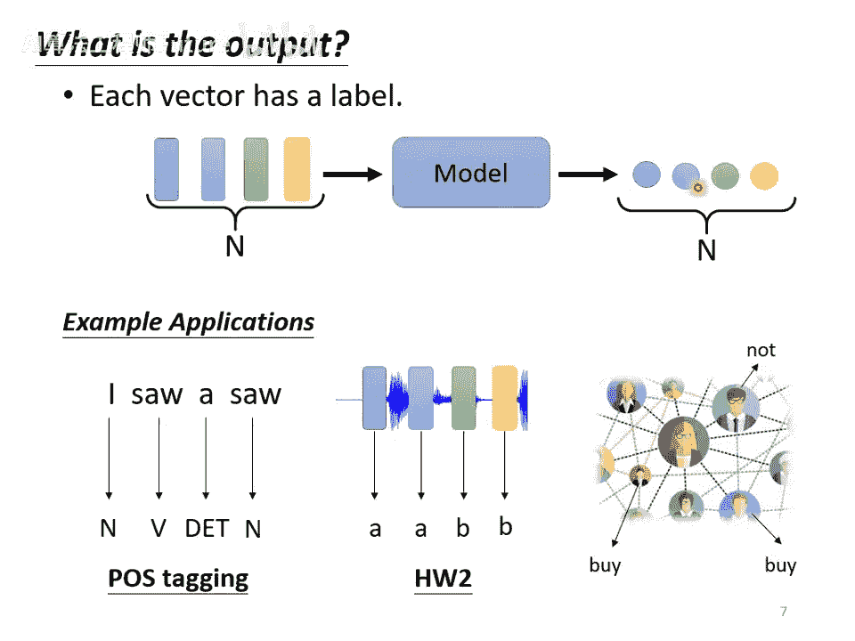

这是第一种可能的输出，第二种可能的输出是什么，第二种可能的输出是我们一整个sequence，只需要输出一个label就好。

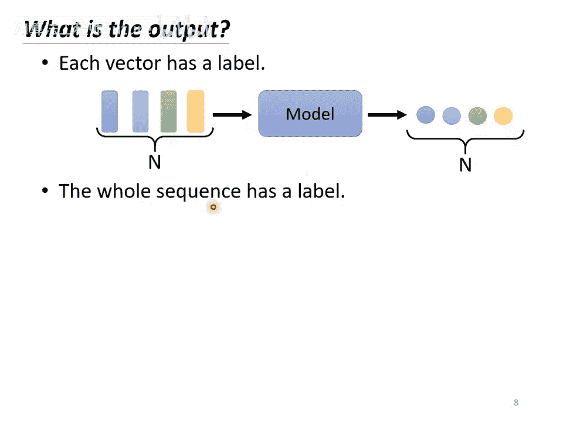

举例来说，如果是呃文字的话，我们就说sentiment analysis，SETANALYSIS是什么呢，SENTIANALYSIS就是给机器看一段话，然后决定说这段话呢是正面的还是负面的。

那可以想象说这种应用很有用啊，假设你的公司开发了一个产品啊，这个产品上线了，你想要知道网友的评价怎么样，但是你又不可能一则一则网友的留言都去分析。

那也许你就可以用这种sentiment analysis，的技术，让机器自动去判读，说当一则贴文里面有提到某个产品的时候，它是正面的还是负面的，那就可以知道你的产品，在网友心中的评价怎么样。

这个是sentiment analysis，给一整个句子，只需要一个label，那positive或negative。

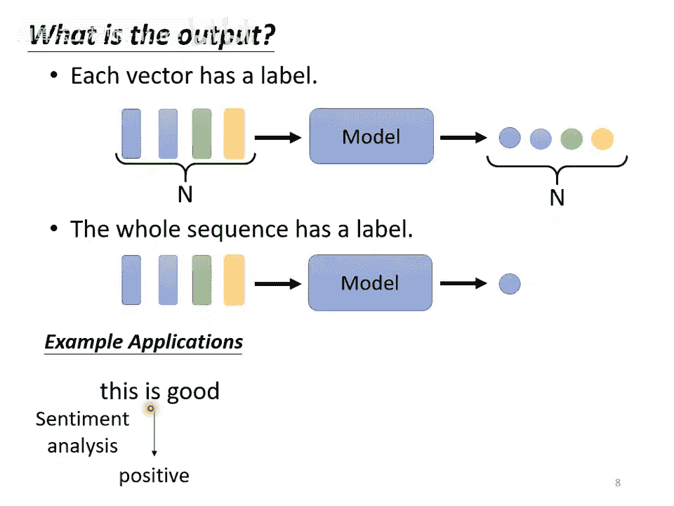

那这个就是第二类的输出，那如果是语音的例子的话呢，在作业四里面我们会做愚者辨认，及其要听一段声音。

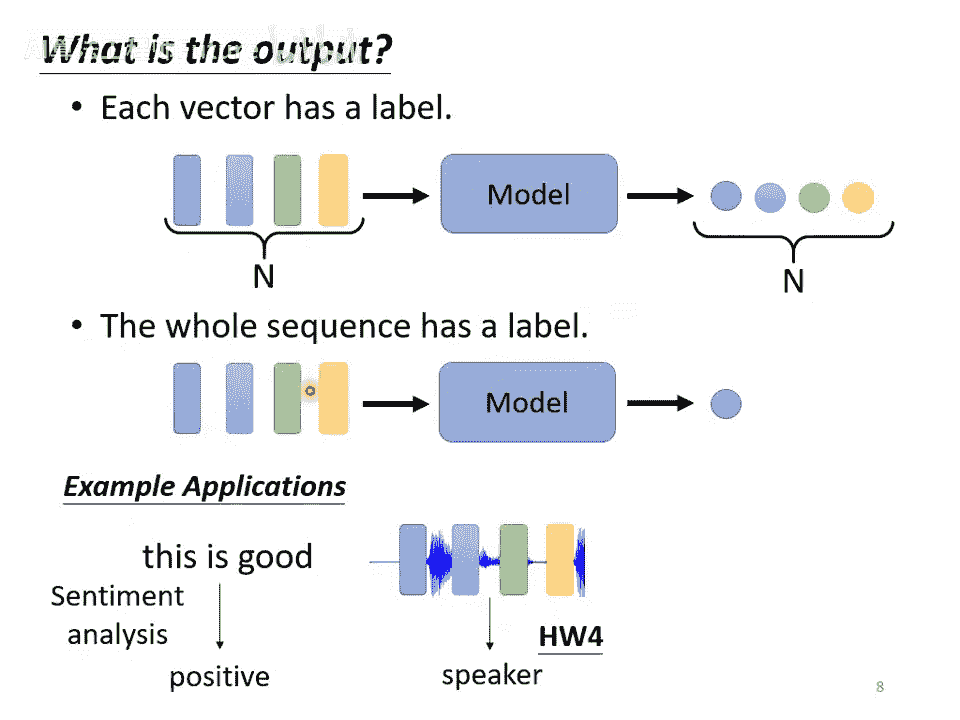

然后决定它是谁讲的，这个也是第二种输出的例子，或者是如果是graph的话呢，今天你可能想要给一个分子，然后要预测说这个分子，比如说它有没有毒性，或者是它的亲水性如何。

那这就是给一个graph输出一个label，这也是第二个例子好。

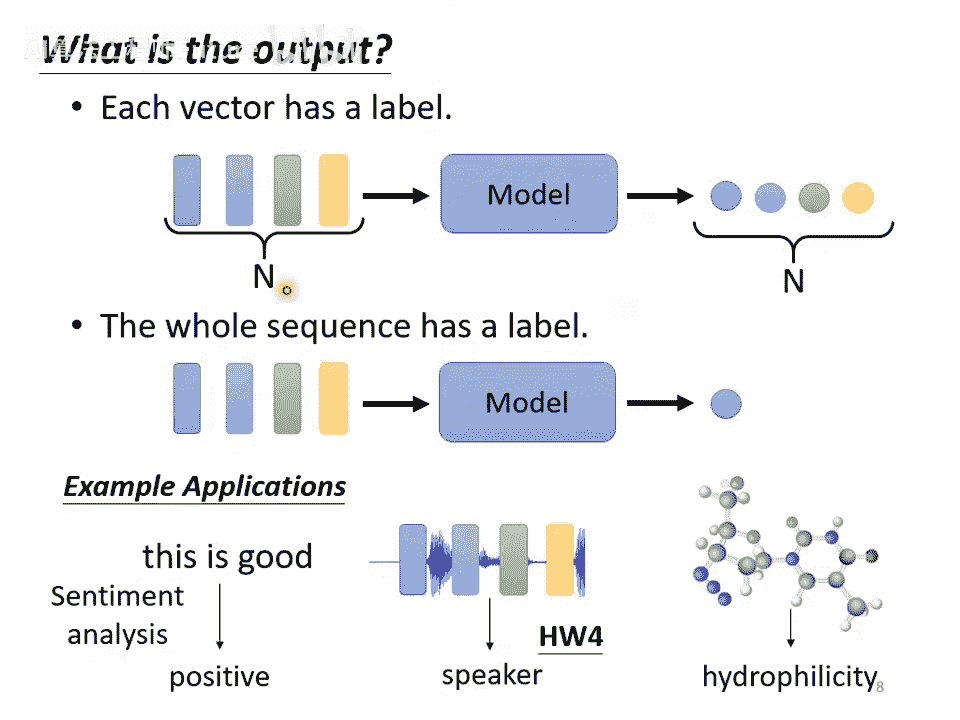

那还有第三个可能的输出，第三个可能的输出，就是我们不知道应该输出多少个label，机器要自己决定应该要输出多少个label哦。

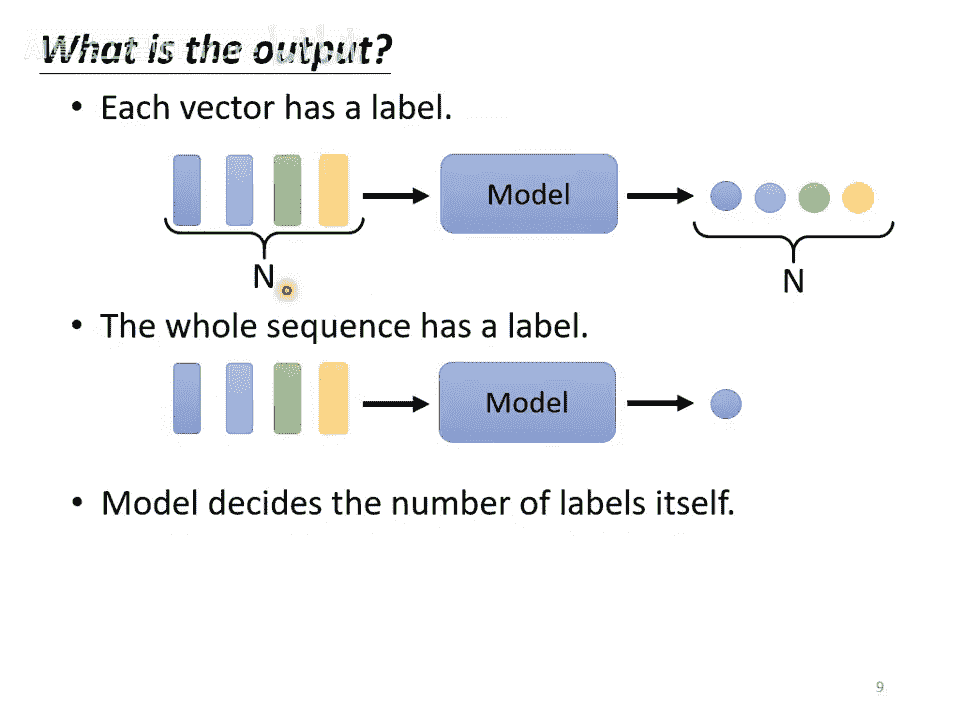

可能你输入是N个向量，输出可能是N派的label，为什么是n pi，机器自己决定好，那这种任务啊又叫做sequence to sequence的任务。

那我们在作业五呢会有sequence to sequence的作业，所以这个之后我们还会再讲啊，那可以想象说翻译就是sequence to sequence的任务，因为输入输出是不同的语言。

他们的词汇的数目本来就不会一样多，或者是语音辨识也是真正的语音辨识，也是一个sequence to sequence的任务，输入一句话，然后输出一段文字。

这也是一个sequence to sequence的任务，好那第三种类型之后会讲。

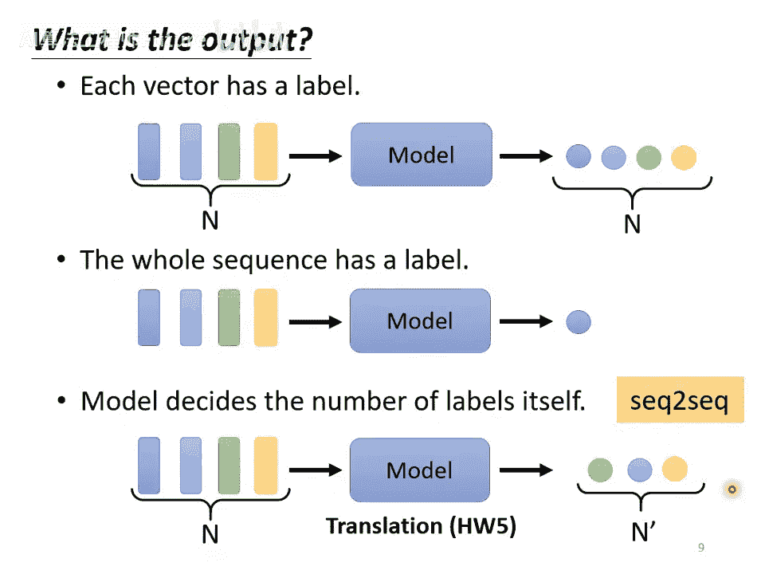

今天我们只讲第一种类型，第二种类型呃。

我们有作业室，你可以把做，你可以自己去看看作业式的城市。

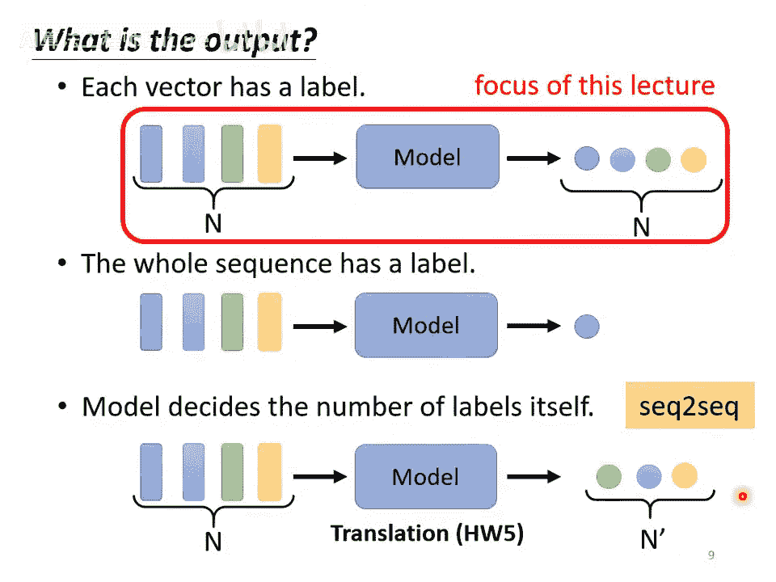

看看第一种类型的问题是怎么处理的啊，因为上课时间有限，所以上课我们今天就先只讲第一个类型，也就是输入跟输出数目一样多的状况，那这种输入跟输出数目一样多的状况啊。

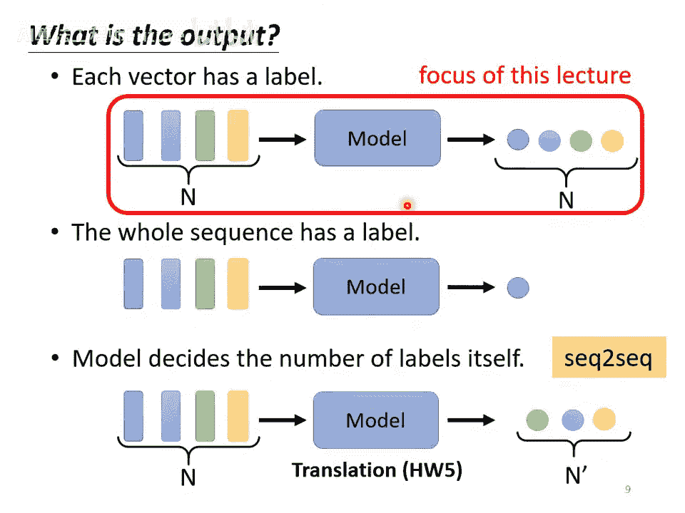

它又叫做sequence labeling，然后给sequence里面的每一个向量，都给它一个label，那要怎么解sequence laing的问题呢。

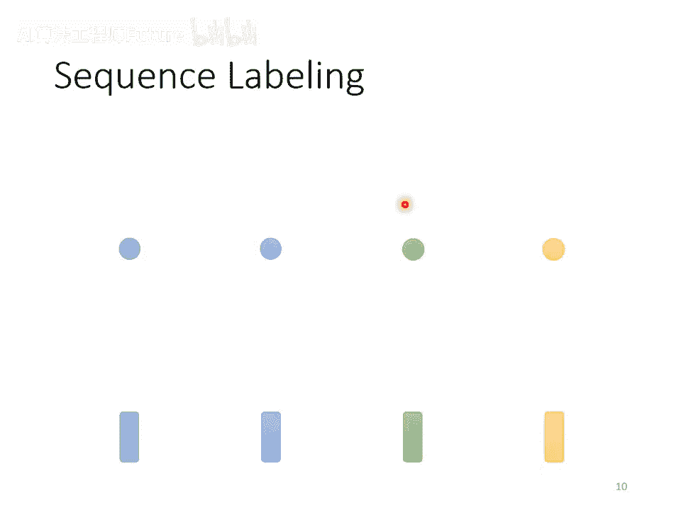

那直觉的想法就是诶就跟作业二一样哎，呃我们就拿着福利connected的network，然后虽然这个输入是一个sequence，但我们就各个击破，不要管它，不要管它是不是一个sequence，各个击破。

把每一个向量分别输入到呃fully connected network里面，然后呢fully connected network就会给我们输出。

那现在看看你要做的是regression还是classification，产生正确的对应的输出就结束了，但这么做显然有非常大的瑕疵，什么要非常大的瑕疵呢，假设今天是呃词性标记的问题，你给机器一个句子。

I saw a soul，对fully connected network来说，这个so跟这个so完全一模一样啊，它们是同一个词汇啊。

既然fully connected the network输入同一个词汇，他没有理由输出不同的东西啊，但实际上你期待第一个so要输出动词，第二个so要输出名词，但对network来说，他不可能做到。

因为这两个soul明明是一模一样的，你叫他这个要输出动词，要输这个要输出名词，它会非常的困惑，完全不知道要怎么处理，所以怎么办。

有没有可能让fully connected the network考虑更多的，比如说上下文的context的资讯呢，这是有可能的，怎么做呃，你就把这一个向量前后几个向量都串起来。

一起丢到福利connected的network就结束了，事实上在作业二里面，助教也已经这么做了，在作业二里面，我们不是只看一个friend，去判断这个friend属于哪一个风铃，也就属于哪一个音标。

而是看这个frame的前面五个加后面五个，也就总共看11个frame。

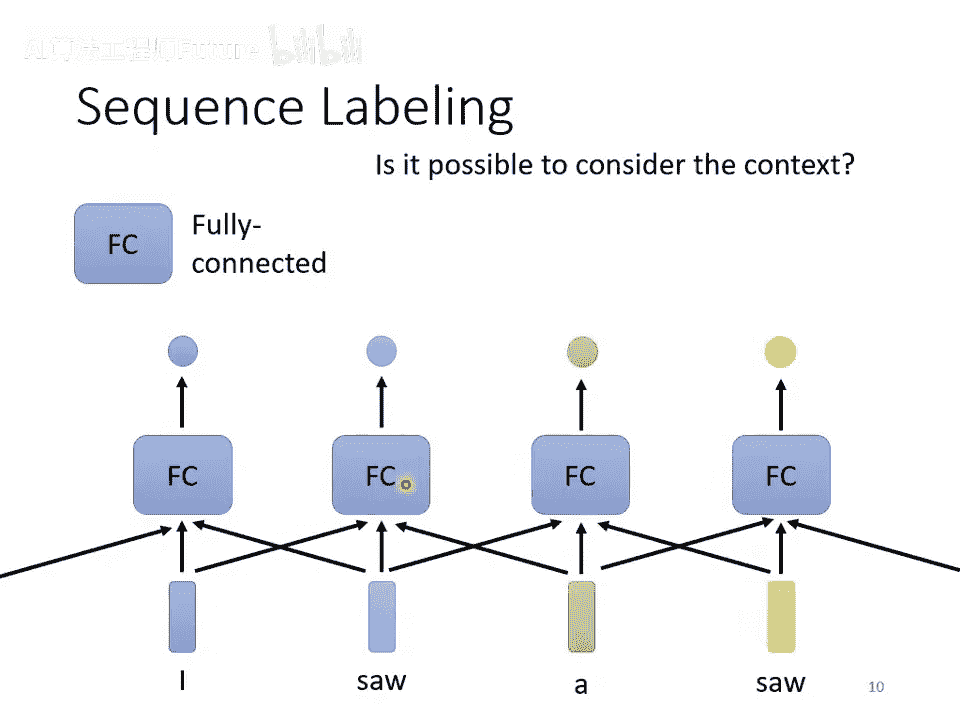

来决定它是哪一个音标哦，所以我们可以给fully connected的network1整个window的咨询，让他可以考虑一些上下文的，跟我现在要考虑的这个向量，相邻的其他向量的咨询。

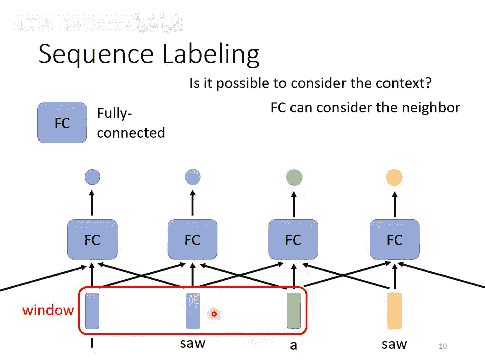

但是这样子的方法还是有极限，如果是在作业二，其实用这个方法就够好了，作业二就算是给你sequence的资讯，你考虑整个sequence，你可能也很难再做的更好啦，作业二考虑前后五个friend。

其实就可以得到很不错的结果了，所以你要过strong bassline，重点并不在于考虑整个sequence，你就不需要往那个方向想了，你就用注要现有给你的data，你就可以轻易的过装备slide好。

但是真正的问题，但是如果今天我们有某一个任务，不是考虑一个window就可以解决的，而是要考虑一整个sequence才能够解决的话，那要怎么办呢，那有人可能会想说，这个还不容易。

我就把window开大一点呐，大到可以把整个sequence盖住，不就结束了吗，但是不要忘了今天sequence的长度是有长有短的，我们刚才有说，我们输入给我们的model的sequence的长度。

每次可能都不一样，如果你今天说我真的要开一个window，把整个sequence盖盖住，那你可能要统计一下你的训练资料，然后看看你的训练资料里面，最长的sequence有多长。

然后开一个window比最长的sequence还要长，才有可能把整个sequence盖住，但是你开一个这么大的window，意味着说你的fully connected network。

它需要非常多的参数，那可能不止运算量很大，可能还容易open fin，所以有没有更好的方法来考虑整个input。

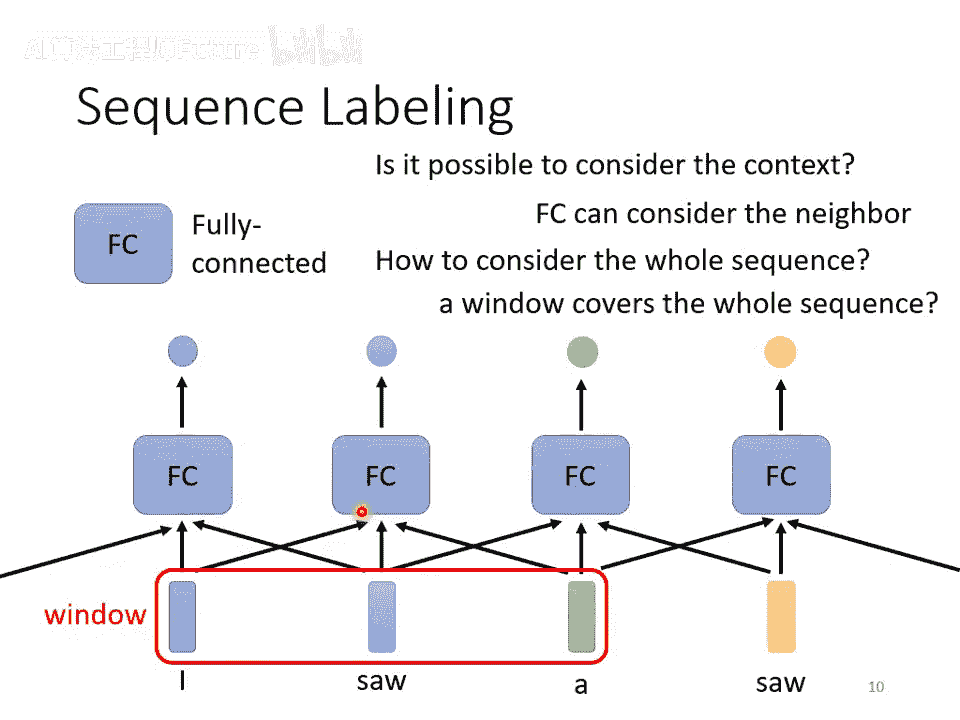

sequence的资讯呢，这就要用到我们接下来要跟大家介绍的，self attention这个技术好，那self attention是怎么运作的呢。

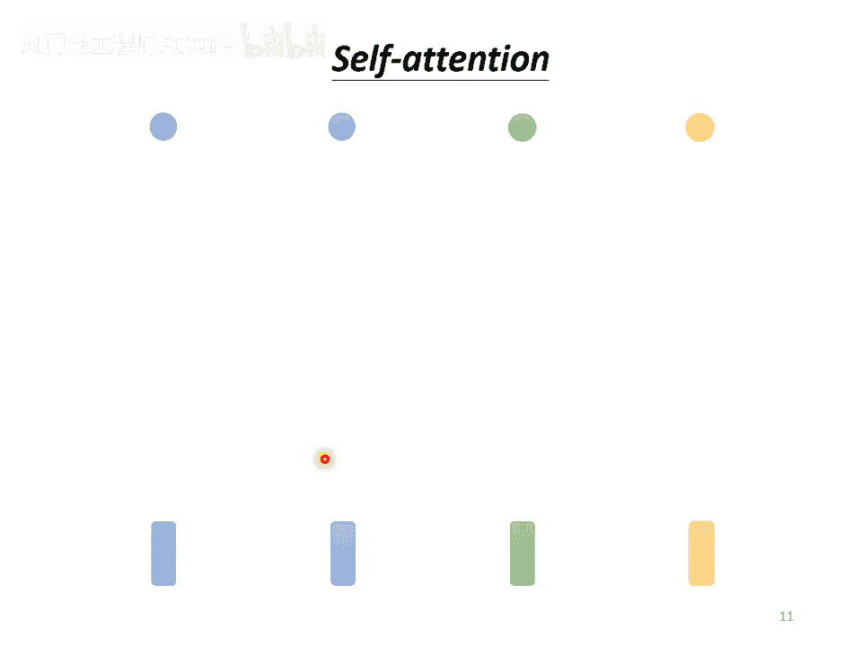

self attention的运作方式就是self attention，会吃一整个sequence的资讯，然后你input几个vector，他就输出几个vector。

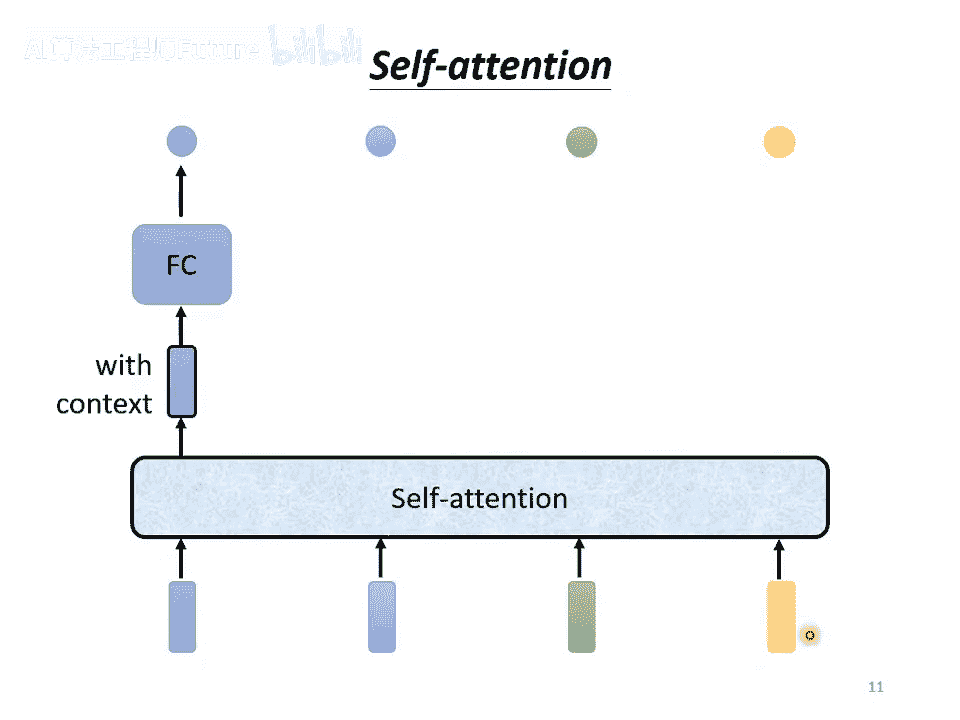

比如说你这边input一个深蓝色的vector，这边就给你一个另外一个vector，这边给个浅蓝色，他就给你另外一个vector，你这边输入四个vector，它就output4个vector。

那这四个vector有什么特别的地方呢，这四个vector啊，他们都是考虑一整个sequence以后才得到的，那等下我会讲说self attention，怎么考虑一整个sequence的咨询哦。

所以这边每一个向量啊，我们特别给它一个黑色的框框，代表说它不是一个普通的向量，它是考虑了整个句子以后才得到的资讯，再把这个有考虑整个句子的向量。

丢进fully connected the network，然后再来决定说啊，他应该是什么样的东西，什么样的类别或OPPO什么样的数字，那你用这个方法，如此一来。

你这个fully connected的network，它就不是只考虑一个非常小的范围，或一个小的window，而是考虑整个sequence的资讯，再来决定，现在应该要输出什么样的结果。

那这个就是self attention，那self attention呢不是只能用一次，你可以叠加很多次。

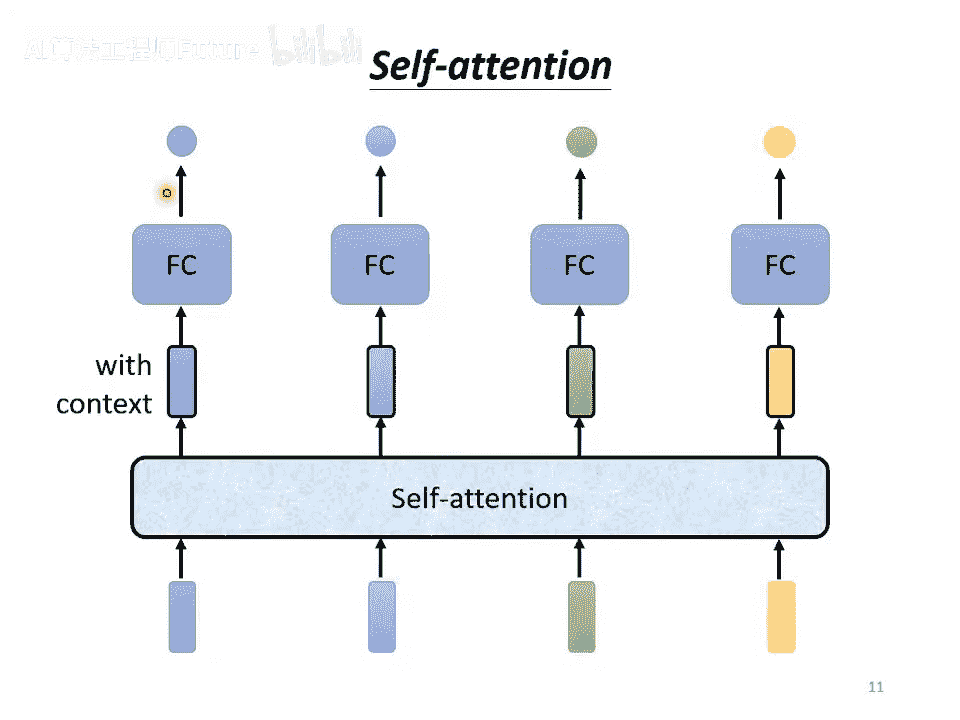

你可以说啊，我这个self attention的输出呢，通过fully connected network以后得到fully connected network的输出。

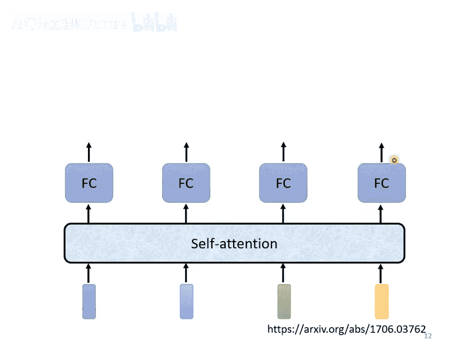

ply connected or network输出，再做一次self attention，Fully connected the network，再过一次，Self attention。

再重新考虑一次整个input sequence的资讯。

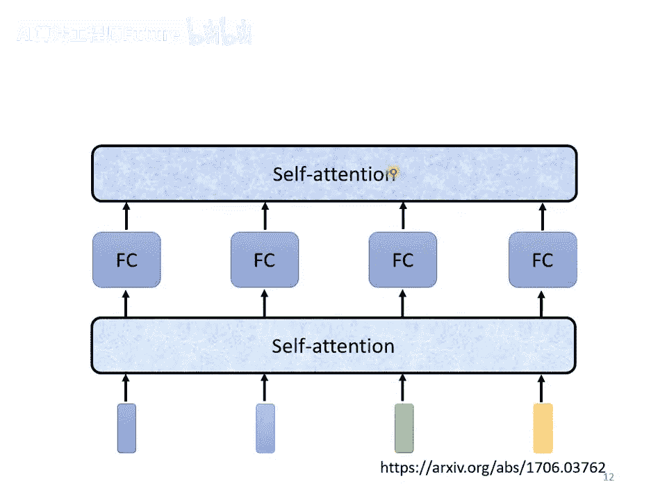

再丢到另外一个fully connected network，最后再得到最终的结果，所以你可以把fully connected network and self attention交替使用。

就是self attention处理整个sequence的资讯，Fully connected or network，专注于处理某一个位置的资讯，然后你可以再用self attention。

再把整个sequence的资讯再处理一次，然后交替使用self attention跟fully connected的内容，那有关self attention呢。

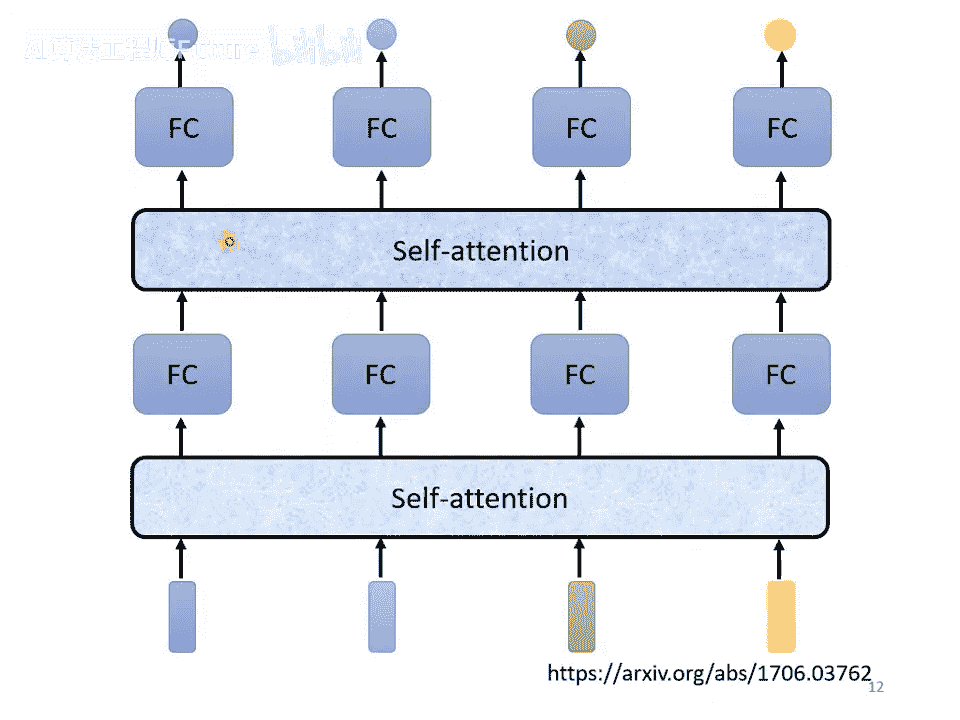

最知名的相关的文章就是attention is all you need。

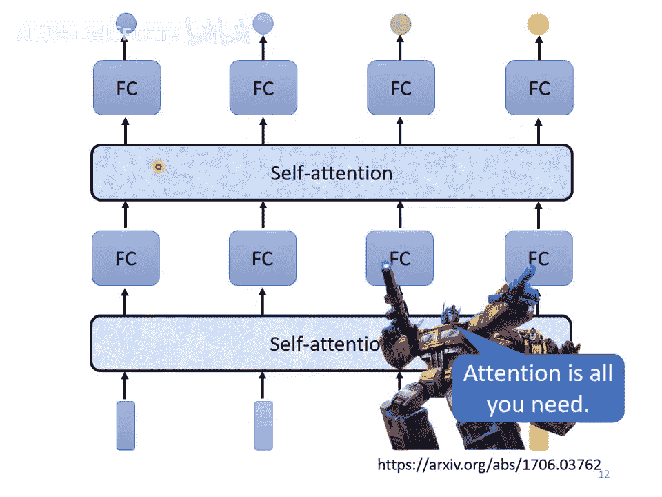

那在这篇paper里面呢，google提出了transformer这样的network架构，那transformer就是变形金刚啦，所以提到这个network的时候呢，我们就会有变形金刚这个形象。

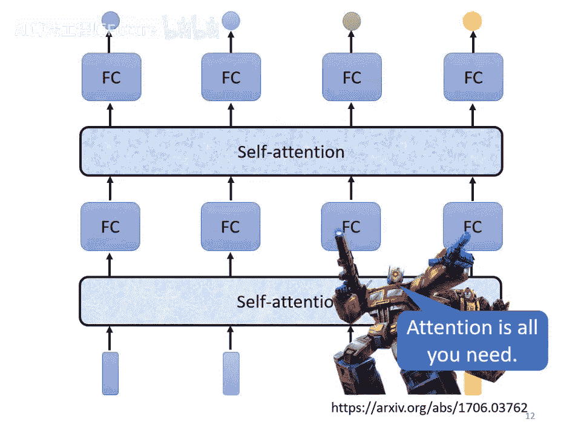

那在transformer里面一个最重要的module，transformer我们今天还不会讲到，但我们之后会讲到transformer里面，一个最重要的module呢就是self attention。

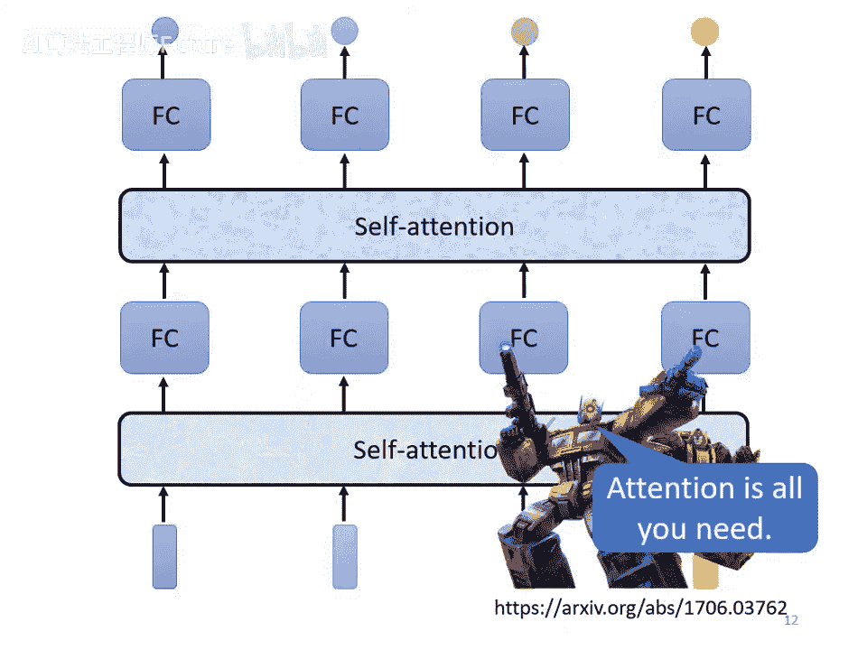

它就是变形金刚的火种源，那这篇paper最厉害的地方就是。

它有个霸气的名字啊，那霸气的名字就是attention is all you need，那其实像self attention这样的架构啊。

最早我并不会说它是出现在attention is all you need。

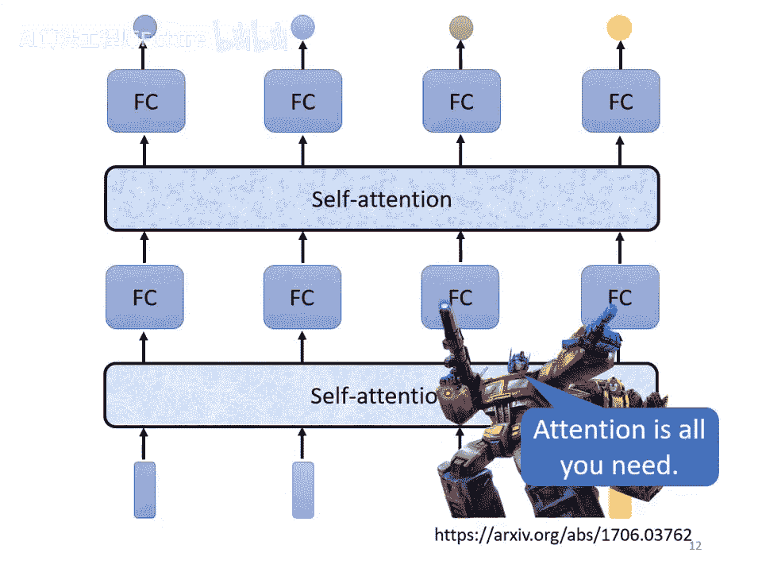

这样的paper，因为其实很多更早的paper就有提出过类似的架构，只是不见得叫做self attention，比如说叫做self match啊，或者是叫别的名字。

不过呢是attention is all you need，这边paper把self attention这个麻球把它发扬光大。

好，那self attention是怎么运作的呢。

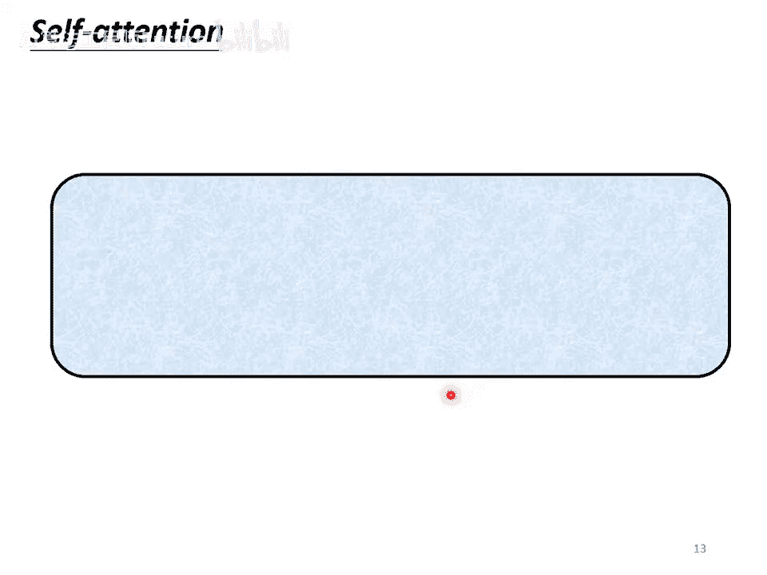

self attention的input它就是一串的vector，那这个vector可能是你整个network的input，它也可能是某个hidden layer的output。

所以我们这边不是用X来表示它，我们用A来表示，它代表说他有可能是前面已经做过一些处理，它是某个hidden layer的output，那input1排A这个向量以后，Self attention。

要open另外一排B这个向量，那这个B呢，每一个B呢，都都是考虑了所有的A以后才生成出来的，所以这边特意画了非常非常多的箭头，告诉你说BY考虑了a one到a four产生的b two。

考虑a one到AF产生的B3B4也是一样，考虑了整个input sequence才产生出来的好，那接下来呢就是要跟大家说明，怎么产生b one这个向量，那你知道怎么产生b one这个向量以后。

你就知道怎么产生。

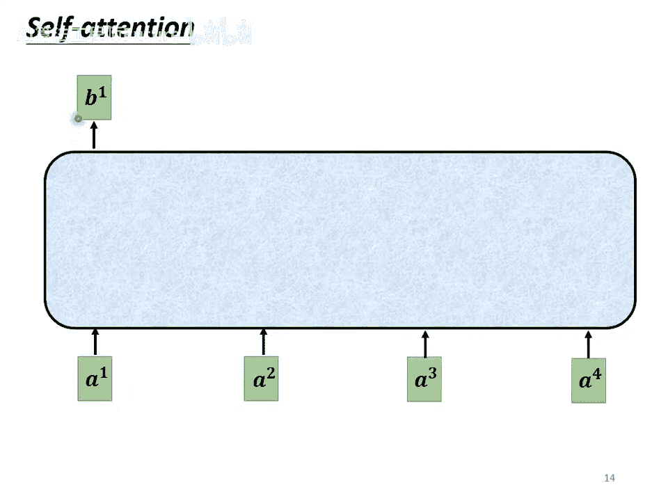

剩下b one b b2B三B四，剩下的向量好，怎么产生b one这个向量呢，第一个步骤啊，是根据a one找出这个sequence里面，跟a one相关的其他向量。

我们知道说今天我们要做self attention，目的就是为了要考虑整个sequence，但是我们又不希望把整个sequence，所有的资讯包在一个window里面，所以我们有一个特别的机制。

这个机制是根据a one这个向量，找出说整个很长的sequence里面，到底哪些部分是重要的，哪些部分跟判断a one是哪一个label是有关系的，哪些部分是我们要决定a one的class。

决定a one的regression的数值的时候，所需要用到的资讯好，那每一个向量跟a one的关联的程度，我们用一个数值叫阿尔法来表示啊，再来的问题就是这个self attention的module。

怎么自动决定两个向量之间的关联性呢，你给他两个向量，a one跟AF它怎么决定a one跟a four有多相关，然后给它一个数值，阿尔法呢好，那这边呢你就需要一个计算attention的模组啊。

这个计算attention的模组呢，它就是拿两个向量作为输入，然后他就直接输出阿尔法那个数值，那就可以把阿尔法那个数值，当做两个向量的关联的程度啊，那怎么计算这个阿尔法的数值呢，这边就有各种不同的做法。

那比较常见的做法呢叫做用搭pa，那DPA怎么做呢，你把输入的这两个向量，分别乘上两个不同的矩阵哦，左边这个向量乘上WQ这个矩阵，右边这个向量乘上wk这个矩阵，接下来得到Q跟K这两个向量。

那再把Q跟K做DPDA，就是把它们做itement wise的相乘，再全部加起来以后就得到，就把Q跟K做搭发达以后得到一个SCALA，这个SCALA就是阿尔法，这是一种计算阿尔法的方式。

那其实还有其他的计算方式，比如说右边呢有另外一个叫做DITIVE的计算方式。

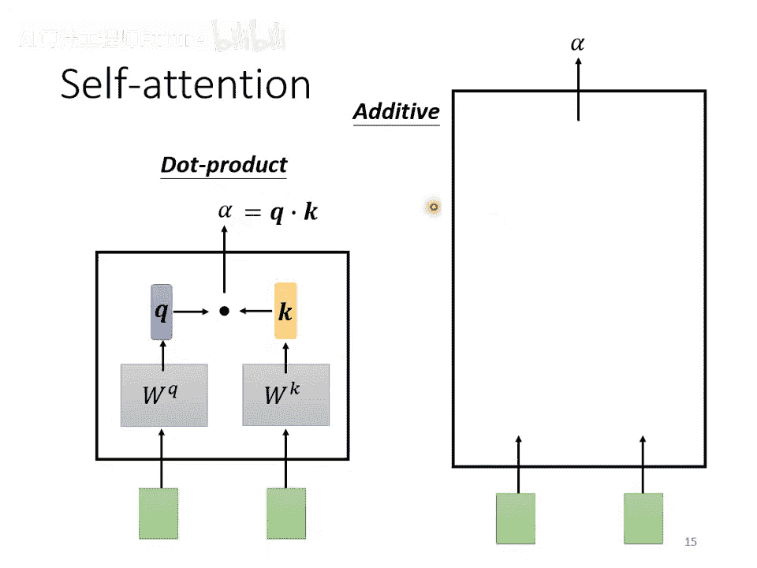

那它的计算方法就是啊，同样这两个向量通过WQWK得到Q跟K，那我们不是把它做搭八的，是把它这个串起来，然后丢到这个过一个activation function，然后再通过一个transform。

然后得到阿尔法，总之有非常多不同的方法可以计算attention啊，可以计算这个阿尔法的数值，可以计算这个关联的程度。

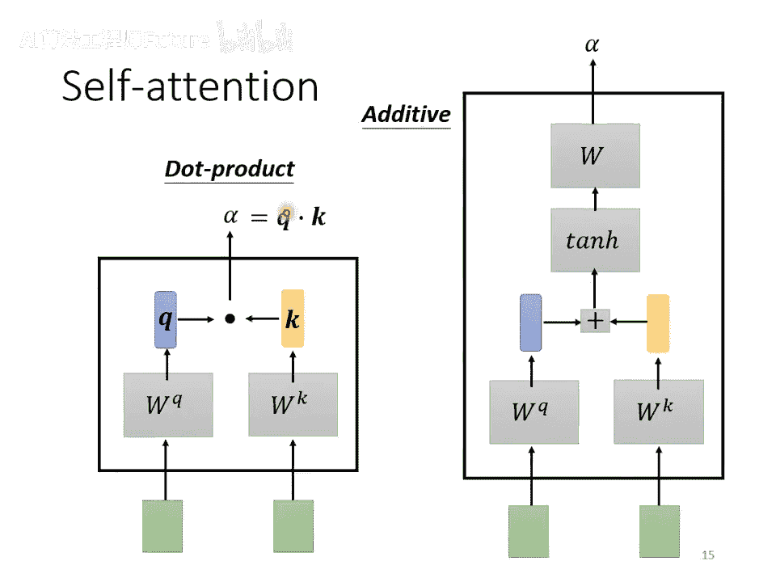

但是哎在接下来的讨论里面，我们都只用左边这个方法，这也是今日最常用的方法，也是用在transformer里面的方法好，那接下来啊，我们就要讲怎么计算出这个阿尔法好，那讲完这个呃。

就讲哎诶我们这边我们就快要讲到一个段落了，那讲到一个段落呢，我们就可以下课，或者看看大家有没有问题好，总之呢我们就是用这两个vector。

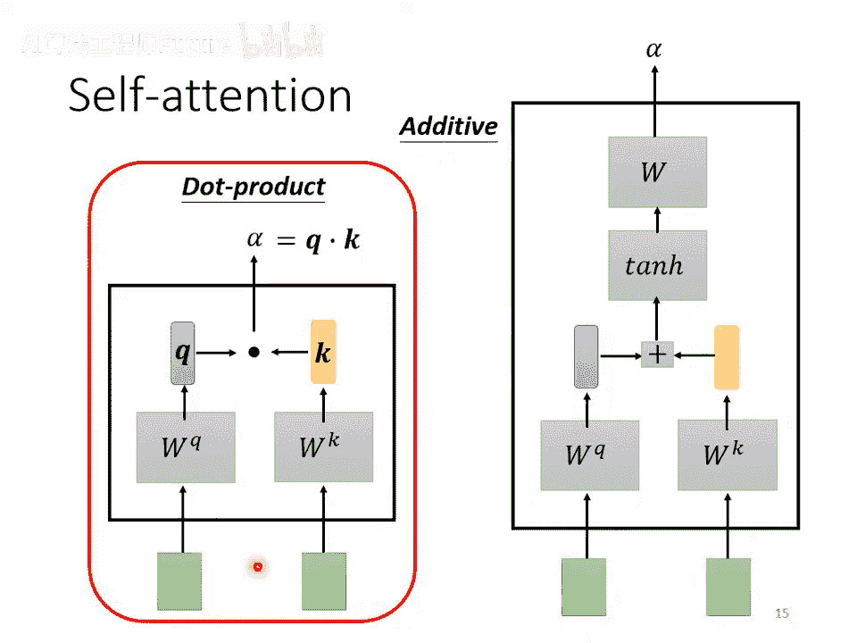

可以计算出阿尔法，那接下来怎么把它套用在self attention里面呢，那你就要把这边的a one去跟这边的A2A3，A4分别都去计算它们之间的关联性，也就是去计算它们之间的阿尔法，那怎么做呢。

你把a one乘上WQ得到q one，那这个Q有一个名字啊，我们叫做query，它就像是你搜寻引擎的时候，去搜寻相关文章的问题，就让搜寻相关文章的关键字，所以这边叫做berry。

然后接下来呢A2A3A四啊，你都要去把它乘上wk得到K这个vector，那K这个vector呢有个名字叫做key，那你把这个query啊，q one跟这个key啊。

k two算inner pa就得到阿尔法，我们这边用阿尔法一二来代表，说呢是哎query是一提供的，key是二提供的时候啊，这个一跟二它们之间的关联性，这个我们用阿尔法一二来表示。

那这个阿尔法这个关联性呢，也有一个称号叫做attention的score，叫做attention的分数好，那q one跟k two，也就a one跟a two计算出它们的attention的分数。

计算出它们的关联性以后，接下来也要跟A3A4来计算，那怎么跟A3A4计算呢，你就把A3乘上wk得到K3。

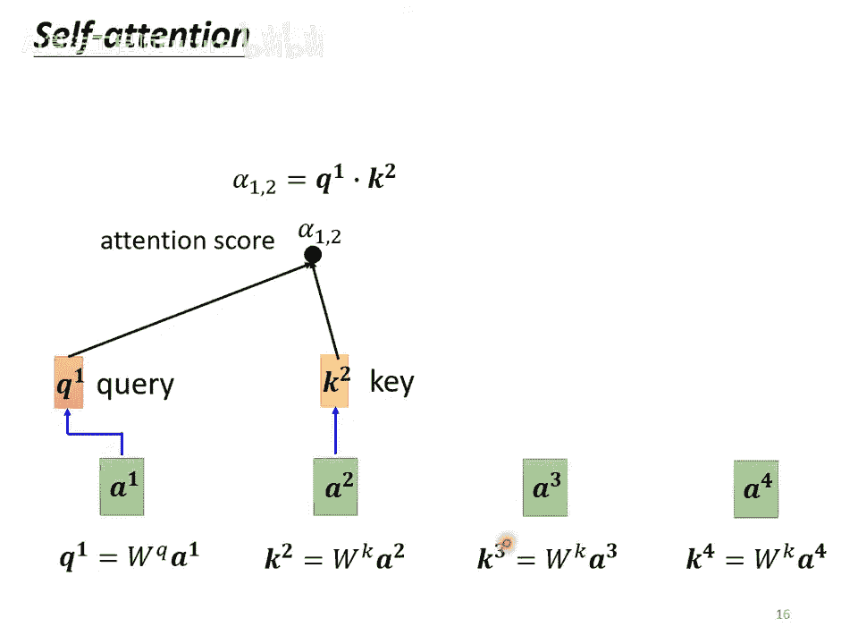

得到另外一个key，A4乘上wk得到K4，得到另外一个T，然后你再把K3这个key跟q one这个query做，ina pa得到一跟三之间的关联性，得到一跟三的tension。

你把K4跟q one做DPA得到阿尔法一四，得到一跟四之间的关联性，就把a one去计算它跟a two a3A四的关联性，这个关联性用attention score阿尔法来表示它。

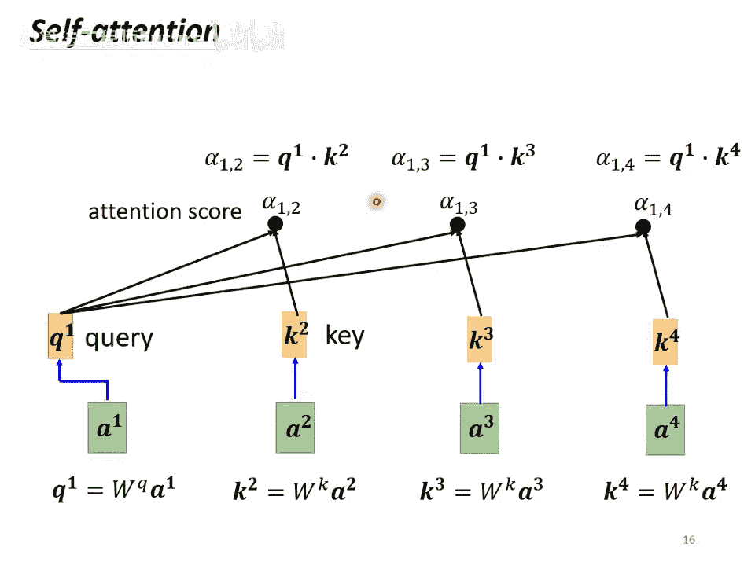

那其实啊一般在实做的时候，q one也会跟自己算关联性啊，所以你也要把a one乘上WK得到k one，把q one跟k one去计算它的关联性，自己跟自己计算关联性。

那自己跟自己计算关联性这件事情有多重要呢，呃你可以自己在做作业的时候试试看，看看这件事情的影响大不大啦。

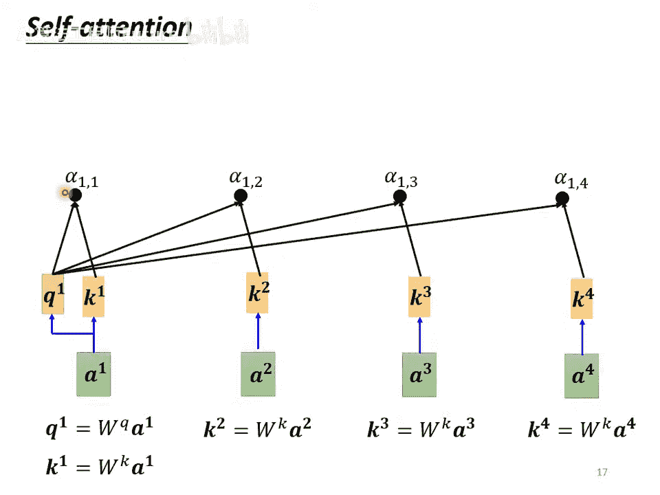

好那我们计算出呃，a one跟每一个向量的关联性以后，接下来啊这边会做一个soft max，这边有点有这边这边这个soft max啊，跟分类的时候的那个soft max是一模一样的。

我们就把这边的阿尔法呢全部乘上exponential，然后呢再把exponential的值全部加起来，做normalize得到阿尔法plan，所以soft max的输出就是一排阿尔法派。

所以本来有一排阿尔法，通过soft max就得到阿尔法宽，那你可能会问说这边为什么要用soft max，刚才你说啊，这个分类用soft max，你说有一串道理，只是没有讲而已，那这边有道理吗。

这边就没有什么道理，这样这边你我不一定要用soft max，你可以用别的东西也没问题，比如说有人尝试过说做个re录啊，啊这边通通做个re录啊，那结果发现还比soft max好一点。

所以这边你不一定用soft max，这边你你要用什么activation function都行，诶你高兴就好，你可以试试看看，那soft max是最常见的啦，但你可以自己试试。

看看能不能试出比soft max更好的结果好。

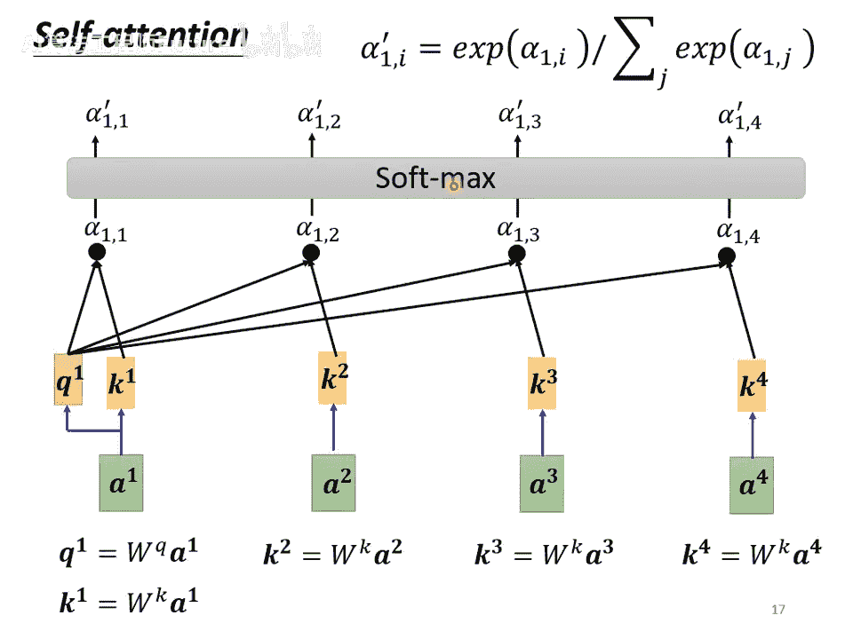

那得到这个阿尔法pl以后，接下来呢得到这个阿尔法pine以后，接下来呀，我们就要根据这个阿尔法P去抽取出这个，sequence里面重要的资讯，根据这个阿尔法。

我们已经知道说哪些向量跟a one是最有关系的，接下来我们要根据这个关联性，根据这个attention的分数来抽取重要的咨询。

怎么抽取重要的资讯呢，我们会把a one到a four这边，每一个向量乘上WV得到新的向量。

那这边分别就是用v one v two v3V四来表示，接下来啊把这边的V1到V4，每一个向量都去乘上attention的分数。

都去乘上阿尔法派，然后呢再把它加起来，我们把式子写在这边，我们就是把这边的每一个V1都乘上阿尔法派，得到BY那你可以想见说，如果某一个向量他得到的分数越高，比如说如果a one跟a two的关联性很强。

这个阿尔法派得到的值很大。

那我们今天在做wait sun以后，得到的b one的值就可能会比较接近b two，所以这边谁的值最大，谁啊，谁的那个attention的分数最大，谁抽谁的那个V就会dominant，你抽出来的结果好。

所以这边呢我们就讲了。