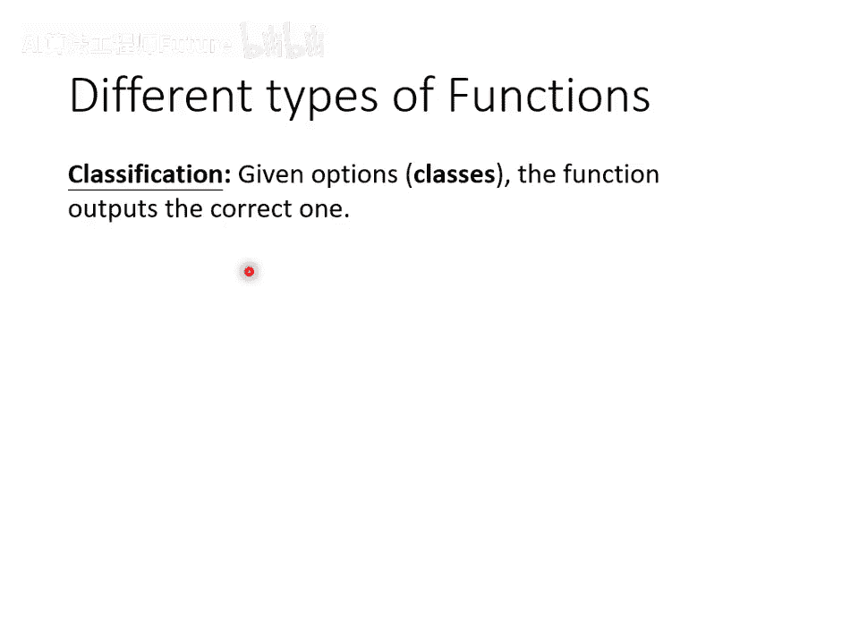
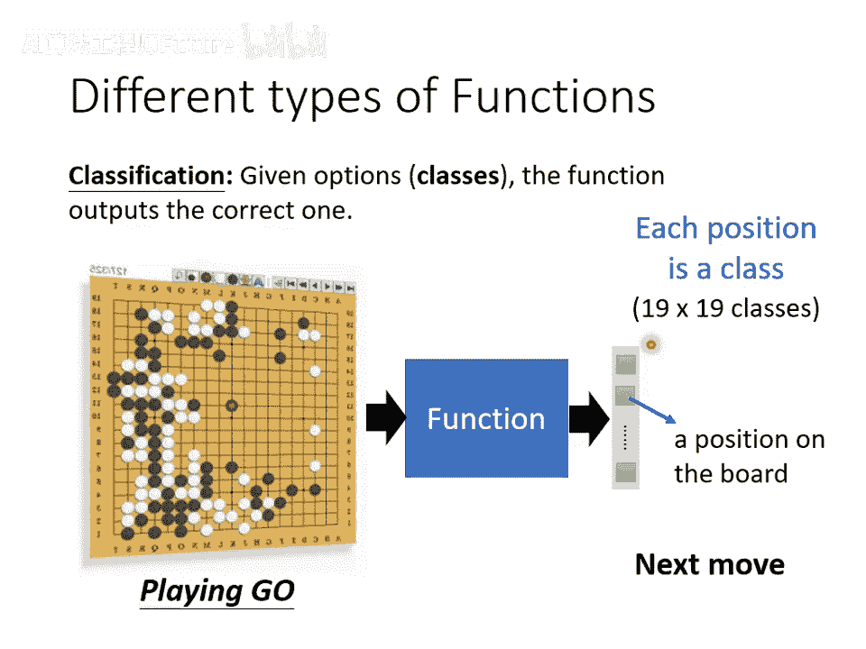
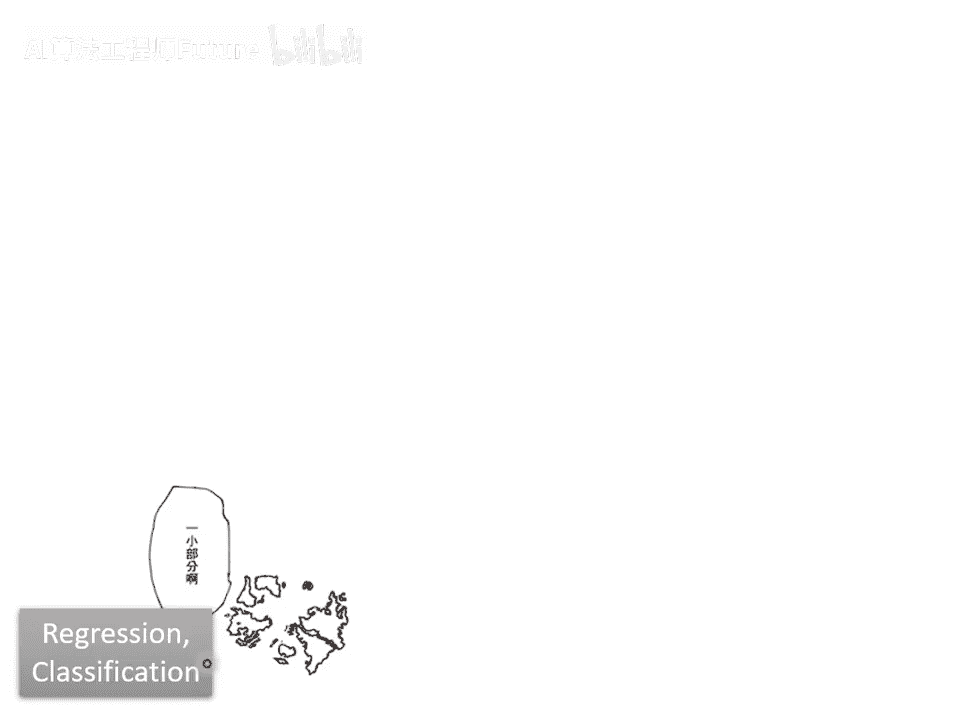
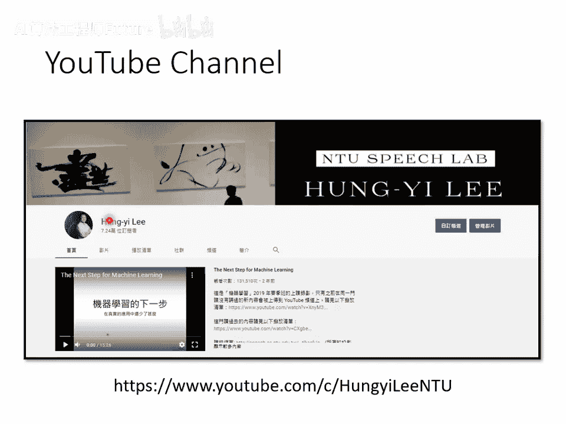
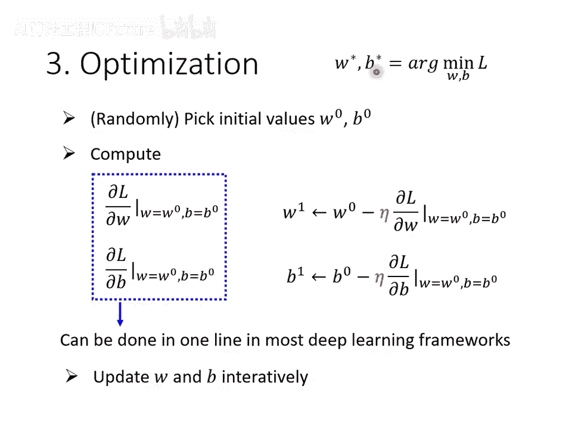
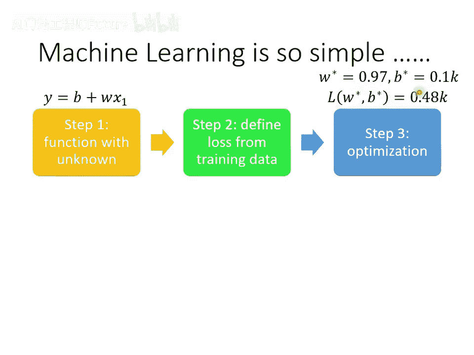
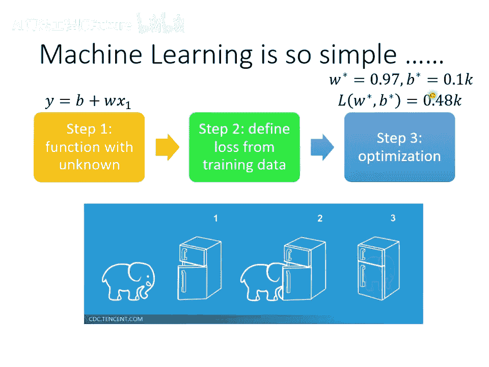
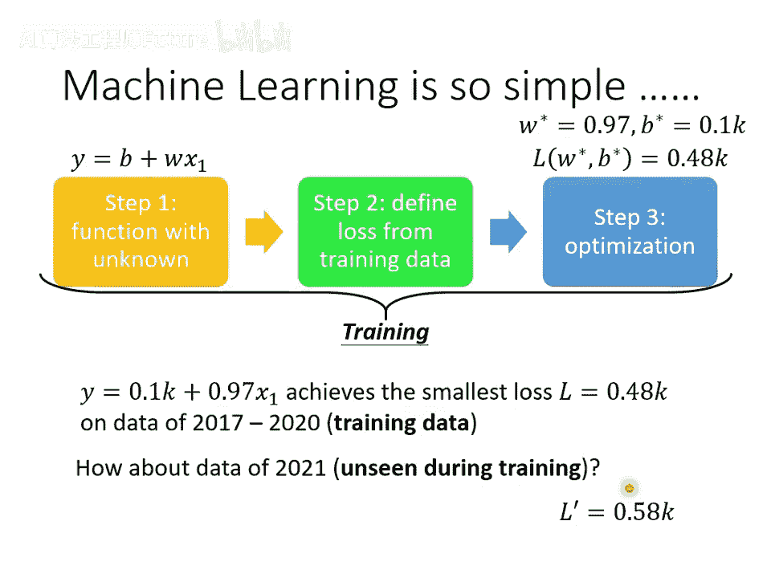
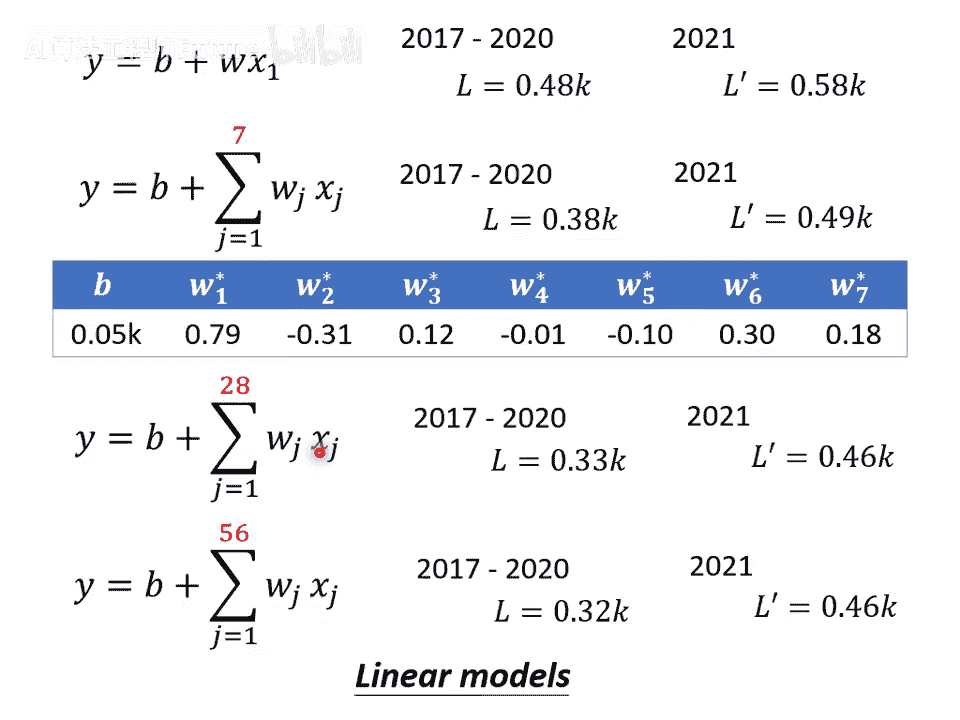

# 【官授搬运】2026年全新优化版李宏毅机器学习系统课程，这才是真正的初学者体系课程！—人工智能／深度学习／神经网络 - P2：【第1讲】1-机器学习基本概念-上 - AI算法工程师Future - BV1ruqABeEFX

那我们就开始上课吧，那第一堂课啊是要简单跟大家介绍一下machine learning，还有deep learning的基本概念，那等一下呢，会讲一个跟宝可梦完全没有关系的故事，告诉你机器学习。

还有深度学习的基本概念好，那什么是机器学习呢，那我知我想必大家在报章杂志上，其实往往都已经听过机器学习这个词汇，那你可能也知道说啊，机器学习就是跟今天很热门的AI，好像有那么一点关联。

那所谓的机器学习到底是什么呢，顾名思义好像是说机器它具备有学习的能力，那些科普文章往往把机器学习这个东西，吹得玄之又玄，好像机器会学习以后，我们就有了人工智慧，有了人工智慧以后。

机器接下来就要统治人类了，好那机器学习到底是什么呢，可以用一句话来描述机器学习这件事，什么叫机器学习呢，机器学习就是让机器具备找一个函式的能力，那机器具备找函式的能力以后，他可以做什么样的事情呢。

它确实可以做很多事，举例来说，假设你今天想要叫机器做语音电视，机器听一段声音，产生这段声音对应的文字，那你需要的就是一个函式，这个函式的输入是声音讯号，输出是这段声音讯号的内容。

那你可以想象说这个可以把声音讯号当做输入，文字当做输出的函式，显然非常非常的复杂，它绝对不是你只可以用人手写出来的方程式，这个函式它非常非常的复杂，人类绝对没有能力把它写出来。

所以我们期待凭借着机器的力量，把这个函式自动找出来，这件事情就是机器学习，那刚才举的例子是语音辨识，还有好多好多的任务，我们都需要找一个很复杂的函式，举例来说，假设我们现在要做影像辨识。

那这个影像辨识我们需要什么样的函式呢，这个函式的输入是一张图片，它的输出是什么呢，它是这个图片里面有什么样的内容，或者是大家都知道的阿尔法狗，其实也可以看作是一个函式，要让机器下围棋。

我们需要的就是一个函式，这个函式的输入是棋盘上黑子跟白子的位置，输出是什么，输出是机器下一步应该落子的位置，假设你可以找到一个函式，这个函式的输入就是棋盘上黑子跟白子的位置。

输出就是下一步应该落子的位置，那我们就可以让机器做自动下围棋这件事，就可以做一个阿尔法狗，而那随着我们要找的函式不同啊，机器学习有不同的类别，那这边介绍几个专有名词给大家认识一下好。

第一个专有名词叫做regression，regression的意思是说，假设我们今天要找的函式，它的输出是一个数值好，它的输出是一个scale，那这样子的机器学习的任务，我们称之为regression。

那这边举一个regression的例子，假设我们今天要机器做的事情，是预测未来某一个时间的pm2。5的数值，你要叫机器做的事情是找一个函式啊，这个我们用F来表示，这个函式的输出是明天中午的pm2。

5的数值，它的输入可能是种种，跟预测pm2。5有关的指数，包括今天的pm2。5的数值，今天的平均温度，今天平均的臭氧浓度等等，这个函式可以拿这些数值当做输入输出，明天中午的pm2。5的数值。

那这一个找这个函式的任务叫做regression，那还有别的任务吗，还有别的任务，除了regression以外，另外一个呃大家耳熟能详的任务呢叫做那classification。

这个任务要机器做的是选择题哦，我们人类先准备好一些选项啊，这些选项呢又叫做类别，又叫做PLS，我们现在要找的函式，它的输出啊，就是从我们设定好的选项里面，选择一个当做输出啊。

这个问题这个任务就叫做classification，举例来说好，现在每个人都有gmail com，那gmail com里面呢有一个函数，这个函式可以帮我们侦测一封邮件，是不是乐色邮件。

这个函式的输入是一封电子邮件，那他的输出是什么呢，你要先准备好你要机器选的选项，在侦测垃圾邮件这个问题里面，可能的选项就是两个是垃圾邮件，或不是垃圾邮件，yes或者是NO。

那机器要从yes跟NO里面选一个选项出来，这个问题叫做classification，那classification不止不一定只有两个选项，也可以用多个选项举例来说。

阿尔法狗本身也是一个classification的问题。

那只是这个classification它的选项是比较多的，那如果要叫机器下围棋，你想做一个阿尔法go的话，我们要给机器多少个选项呢，你就想想看棋盘上有多少个位置，那我们知道棋盘上有19×19个位置。

那叫机器下围棋，这个问题，其实就是一个有19×19个选项的选择题，你要叫机器做的就是找一个函式，这个函式的输入是棋盘上黑纸和白纸的位置，输出，就是从19×19个选项里面，选出一个正确的选项。

从19×19个可以落子的位置里面，选出下一步应该要落子的位置，这个问题也是一个分类的问题，那其实很多教科书啊，在讲机器学习的种种不同类型的任务的时候。

往往就讲到这边，告诉你说机器学习两大类任务，一个叫做regression，一个叫做classification，然后就结束了，但是假设你对机器学习的认知只停留在，机器学习，就是两大类任务。

regression和classification，那就好像你以为说这个世界只有五大洲一样，你知道这个世界不是只有五大洲。

对不对，哎这个世界不是外面是有一个黑暗大陆的，哎不在鬼灭之刃联赛之前，我们就已经出发前往黑暗大陆了，鬼灭之刃联赛以后，我们居然都还没有到，可见这个黑暗大陆距离我远，那在机器学习这个领域里面。

所谓的黑暗大陆是什么呢，在regression和classification以外，大家往往害怕碰触的问题叫做structure learning，也就是机器今天不只是要做选择题，不只是输出一个数字。

它要产生一个有结构的物件，举例来说，机器画一张图，写一篇文章，这种叫机器产生有结构的东西的这个问题呀，就叫做structure learning，那如果要讲的比较拟人化，比较潮一点。

Structure learning，你可以用拟人化的讲法说，我们就是要让机器学会创造这件事情好，那到目前为止，我们就是讲了三个机器学习的任务，Regression。

classification跟structure learning，接下来我们要讲的是，那我们说机器学习就是要找一个函式，那机器怎么找一个函式呢，那这边要用个例子跟大家说明说，机器怎么找一个函式。

这边的例子是什么呢，这边的例子在讲这个例子之前呢。

先跟大家说一下，说这门课呢有一个YOUTUBE的频道啦，诶然后这个呃，我会把上课的录音呢，放到这个YOUTUBE的YOUTUBE的频道上面啊，那这个频道呢感谢呃，过去修过这门课的同学不嫌弃。

其实也蛮多人订阅，所以我算是一个三流的YOUTUBE啊，是没有什么太多流量，但是也是有这边也有7万多订阅啦，那为什么突然提到这个YOUTUBE的频道呢，因为我们等一下要举的例子啊。

跟YOUTUBE是有关系的，那你知道身为一个YOUTUBE啊，YOUTUBE在意的东西是什么呢，YOUTUBE在意的就是这个频道的流量，对不对。

那假设这个有一个YOUTUBE呢是靠着YOUTUBE为生的，他会在意说频道有没有流量，这样呢他才会知道他可以获利多少。

所以我在想说，我们有没有可能找一个函式，这个函式它的输入是YOUTUBE后台的资讯输出，是这个频道隔天的总点阅率总共有多少哦，假设你自己有YOUTUBE频道的话，你会知道说在YOUTUBE后台。

你可以看到很多相关的资讯，比如说每一天看你赞的人数有多少啊，每天订阅的人数有多少啊，每天观看的次数有多少，我们能不能够根据一个频道，过往所有的资讯去预测，他明天有可能的观看的次数是多少呢。

我们能不能够找一个函式，这个函式的输入是啊，YOUTUBE上面YOUTUBE后台是我的咨询输出，就是某一天隔天呃，这个频道会有的总观看的次数呢，那你可能会问说为什么要做这个嗯，如果我有盈利的话。

我可以知道我未来可以赚到多少钱，但我其实没有开盈利，所以我也不知道为什么都要做这个，就是完全没有任何卵用，我单纯就是想举一个例子而已好，那接下来啊我们就要问怎么找出这个函式呢，怎么找这个函式。

F输入是YOUTUBE后台的资料输出，是这个频道隔天的点阅的总人数呢，那机器学习找这个函式的过程啊，分成三个步骤，我们就用YOUTUBE频道点阅人数预测这件事情，来跟大家说明这三个步骤是怎么运作的。

第一个步骤是，我们要写出一个带有未知参数的函数，简单来说就是我们先猜测一下，我们打算找的这个函式F，它的数学式到底长什么样，举例来说呃，我们这边先做一个最初步的猜测，这个F长什么样子呢。

这个输入跟Y之间有什么样的关系呢，我们写成这个样子，Y等于B加W乘以XY，这边的每一个数值是什么呢，这个Y呀是就假设是今天吧，这个Y因为今天还没有过完吗，怎么还不知道今天总共的点阅次数是多少。

所以这件事情是我们未知的，Y是我们准备要预测的东西，我们准备要预测的是今天2月26号，这个频道总共观看的人数，那x1是什么呢，x1是这个频道前一天总共观看的人数的，Y跟X呢跟XY呢都是数值，都是我们啊。

这个这个Y呢是我们准备要预测的东西，而XY是我们已经知道的资讯，那B跟W是什么呢，B跟W未知的参数，它是准备要透过资料去找出来的，我们还不知道W跟B应该是多少，我们只是隐约的猜测说。

但这个猜测为什么会有这个猜测呢，这个猜测往往就来自于，你对这个问题的上的了解，也就是for man knowledge，所以常常会听到有人说啊，这个做机器学习呀。

你就需要一些dman in knowledge，这个dommain knowledge通常是用在哪里呢，这个domain knowledge，就是用在写这个带有未知数的函数的时候，所以我们怎么知道说。

这个能够预测未来点阅次数的函数是F，它就一定是前一天的点阅次数乘上W，再加上B呢，我们其实不知道这是一个猜测，也许我们觉得说呃，这个呃，呃今天的点阅次数，总是会跟昨天的点阅次数有点关联吧。

哦所以我们把昨天的点阅次数乘三个数值，但是总是不会一模一样，所以再加上个B做修正，当做是对于2月26号点阅次数的预测啊，这是一个猜测，他不一定是对的，我们等一下回头会再来修正这个猜测好。

那现在总之我们就随便猜，说Y等于B加W乘以XY，而B跟W是未知的，这个带有未知的参数啊，这个parameter中文通常翻译成参数了，这个带有unknown的parameter的这个function啊。

我们就叫做model，所以常常听到有人说模型model这个东西，model这个东西在机器学习里面，就是一个带有未知的parameter的function好，那这个x1哪是这个方式里面。

我们已知的已经知道的东西，它是来自于YOUTUBE后台的资讯，我们已经知道，2月25号点阅的总人数是多少，这个东西叫做feature，而W跟B是我们不知道的，它是unknown的parameter。

那这边我们也给W跟B呢给它一个名字，这个跟feature做相乘的未知的参数，这个W我们叫它weight，这个没有跟feature相乘的，是直接加上去的，这个我们叫它白眼，那这个只是一些名词的定义而已。

让你等一下我们讲课的时候，在称呼模型里面的每一个东西的时候，会更为方便好，那这个是第一个步骤好，那第二个步骤是什么呢，第二个步骤呢是我们要定义一个东西叫做loss，什么是loss呢，loss啊。

它也是一个function，那这个function它的输入是我们model里面的参数，我刚才已经把我们的model写出来了，对不对，我们说我们的model叫做Y等于B加W乘以XY，而第一个W是未知的。

是我们准备要找出来的，那所谓的L啊，所谓的这个loss啊，它是一个function，这个方向的输入是什么，这个方向的输入就是B跟W，所以LO它是一个function，它的输入是parameter。

是model里面的parameter，但这个north这个function的输出的值代表什么呢，这个function输出的值代表说，现在如果我们把这一组未知的参数，设定某一个数值的时候。

这组数值好还是不好，那这样讲可能你觉得有点抽象，所以我就举一个具体的例子，假设现在我们给未知的参数的设定是一，这个bias x等于0。5K，这个WW呢直接等于一，那这个loss怎么计算呢。

如果我们B设0。5K这个W正一，那我们拿来预测，而未来的这个点阅次数的函式啊，就变成Y等于0。5K加一倍的XY，那这样子的一个函式，这个0。5K跟一它们所代表的这个函数，它有多好呢。

这个东西就是loss，那在我们的问题里面，我们要怎么计算这个loss呢，好这个我们就要从训练资料来进行计算，在这个问题里面，我们的训练资料是什么呢，我们的训练资料是这个频道过去的点阅次数，举例来说。

从2017年到2020年的点阅次数，每天的这个频道点阅次数都知道吗，啊这边是假的数字了，随便乱编的好，那所以我们知道2017年1月1号，到2020年12月31号，的点阅数字是多少。

好接下来我们就可以计算loss怎么计算呢，我们把2017年1月1号的点阅次数，带入这一个函式里面，我们已经说，我们想要知道D设定为0。5，KW设定为一的时候，这个函式有多棒，好，当B设定为0。

5KW设定为一的时候，我们拿来预测的这个函数是Y等于0。5K，加一倍的XY，那我们就把这个XY带4。8K，看看预测出来的结果是多少哦，所以根据这个函式，根据B设0。5KKW设一的这个函式。

如果1月1号是4。8K的点阅次数的话，那隔天应该是4。8K乘以10。5K，也就是5。3K的点阅次数，那隔天实际上的点阅次数，1月2号的点阅次数我们知道吗，从后台的资讯里面我们是知道的。

所以我们可以比对一下，现在这个函式预估的结果跟真正的结果，它的差距有多大，这个函式预估的结果是5。3K，真正的结果是多少呢，真正的结果是4。9K，看来是高估了，高估了这个频道可能的这个点阅的人数。

就可以计算一下这个差距，计算一下估测的值跟真实的值的差距，这边估测的值用Y来表示真实的值，用y hand来表示，你可以计算Y跟y hand之间的差距，得到一个1万，代表估测的值跟真实的值之间的差距。

那计算差距其实有不止一种方式，我们这边把Y跟y has相减，直接取绝对值，算出来的值是0。4K好的，我们今天有的资料，不是只有1月1号跟1月2号的资料，我们有2017年1月1号到。

2020年12月31号，总共3年的资料好，那这个真真实的词啊，叫做label啊，所以常常听到有人说做机器学习就需要label，label就是正确的数值，这个东西叫做label好，那我们不只。

我们不是只能够看，用1月1号来预测1月2号的值，我们可以用1月2号的值来预测1月3号的值，如果我们现在的函数是Y等于0。5K，加一倍的XY，那1月2号根据1月2号的点阅次数。

预测的1月3号的点阅次数值是多少呢，是5。4K，你h one带4。9K进去，乘以倍加0。5K等于5。4K，接下来计算这个5。4K跟真正的答案，跟label之间的差距，label是7。5K。

看来是一个低估啊，低估了啊，这个频道在1月3号的时候的点阅次数，那就可以算出EQ啊，这个EQ是Y减跟Y跟y hat之间的差距，算出来12。1K，那同样的方法，你就可以算过这3年来每一天的预测的误差。

假设我们今天的function是Y等于0。5K，加一倍的XY，这是3年来每一天的误差通通都可以算出来，每一天的误差都可以给我们一个小一好，那接下来我们就把每一天的误差通通加起来，好加起来。

然后取一个平均，这个大N呢代表我们的训练资料的次数的个数，那么训练资料的个数就是3年来的训练资料嘛，所以就365×3了，每年365天3年，所以365×3好，那我们算出一个L好，我们算出一个大LL。

这个大L是每一笔训练资料的误差，这个一呀相加以后的结果，这个大LL就是我们的loss，这个大L越大，代表说我们现在这一组参数越不好，这个大L越小代表我们现在这一组参数越好，那这个一呀。

就是计算这个估测的值跟实际的值之间的差距，其实有不同的计算方法，在我们刚才例子里面，我们是算Y跟Y带解绝对值的差距，这种计算差距的方法得到的这个大L啊。

得到的loss啊叫做main absolute error哦，所显示FA1，那在XYA1里面呢，我们是算Y跟y hat相减以后的平方哦，如果你接的一是用相减后平方算出来的。

这个叫msquare error，叫MS1，那NS1跟NA1，它们其实有非常微妙的差别啦，那DOTA你要选择用哪一种方法来衡量距离，那只看你的需求，看你对这个任务的理解，那在这边呢我们就不往下细讲。

反正我们就是选择了ma1，作为我们计算这个误差的方式，把所有的误差加起来就得到loss，但你要选择NS1也是可以的，在作业里面我们会用NNC，那有一些任务有，如果Y跟YH它都是几率都是几率分布的话。

在这个时候你可能会选择cos entropy，那这个我们都之后再说，反正我们这边就是选择了MA1好，那这个是机器学习的第二步，那我刚才举的那些数字不是真正的例子，但是在这门课里面。

我在讲课的时候就是要举真正的例子给你看，所以以下的数字是真实的例子，是这个频道真实的后台的数据所计算出来的，结果好，那我们可以调整不同的W，我们可以调整不同的B穷，举各种W穷取各种V我组合起来以后。

我们可以为不同的W跟的跟B的组合，都不去计算它的loss，然后你就可以画出以下这一个等高线图，好在这个等高线图上面呐，越偏红色系代表计算出来的loss越大，就代表说这一组W跟B呢越差哦。

如果越偏蓝色系就代表loss越小，就代表这一组W跟B呢越好，拿这一组跟W跟B呢放到我们的function里面，放到我们的model里面，那我们的预测会越精准啊，所以你就可以是。

所以你就知道说诶假设W带-0。25，这个B呢大于-500，就代表说了这个W在-0。25，B带-500，就代表说这个频道每天看的人越来越少，而且loss是很大，只能真实的状况不太合，如果W带0。75。

B1带500，那这个正确率会啊，这个会这个估测呢会比较精准，那估测最精准的地方看起来应该是在这里啊，如果你今天W带一个很接近一的值，必须带一个小小的值，比如说100多，那这个时候估测是最精准的。

那这跟大家一起可能是比较接近的，就是你拿前一天的点阅的总次数去预测，隔天的点阅的总次数，那可能前一天跟隔天的点阅的总次数，其实差不多了，所以大家比设一，然后B呢设一个小一点的数值。

也许你的估测就会蛮精准的，那像这样子的一个等高线图啊，就是你试着试了不同的参数，然后计算它的north画出来的这个等高线图哇，叫做error的surface好，那这种是机器学习的第二步好。

那接下来我们进入机器学习的第三步，那第三步要做的事情，其实是解一个最佳化的问题，那如果你知道最佳化的问题是什么的话，也没有关系，我们今天要做的事情就是找一个W跟B，把未知的参数找一个数值出来。

看带哪一个数值进去，可以让我们的大L让我们的loss的值最小，那个就是我们要找的RU跟B，那这个可以让loss最小的W跟B啊，我们就叫做w star，跟B大代表说他们是最好的一组。

W跟B可以让loss的值最小好，那这个东西要怎么做呢，在这门课里面，我们唯一会用到的optimization的方法，叫做gradient descent，好像是graent descend。

这个方法怎么做呢，他是这样做的，为了简化起见，我们先假设我们未知的参数只有一个啊，就是R先假设没有B那个位置的参数，只有他有这个位置的参数，那当我们W在不同的数值的时候，我们就会得到不同的loss。

那这一条曲线就是ao surface，只是刚才在前一个例子里面，我们看到的error surface是二二维的，是2D的，那这边只有一个参数，所以我们看到的这个error surface是1D的好。

那怎么样找一个W去让这个loss的值最小的，那首先呢你要随机选取一个初始的点啊，这个初始的点我们叫做ARGU0，那这个初始的点往往真的就是随机的，就是随便选一个真的都是随机的，那在往后的课程里面。

我们其实会看到，也许有些方法可以给我们一个比较好的，W0的值，那我们先不讲这件事，是我们先当做就是随机的，随便掷个骰子，随机决定说W0的值应该是多少，那假设我们随机决定的结果是在这个地方好，那接下来啊。

你就要计算说这个在W等于W0的时候，他就这个参数对loss的微分是多少，那我假设你知道微分是什么，你知道微分是什么，这对你来说不是个问题，就计算W等于loss的微分是多少，而如果你不知道微分是什么的话。

那没有关系，反正我们做的事情就是计算在这一个点，在W0这个位置呃，这个error surface的切线斜率也就是这一条蓝色的虚线，它的斜率，但如果这个是这条曲线的斜率是负的，那代表什么意思呢。

代表说左边比较高，右边比较低太高，在这个位置附近，左边比较高，右边比较低，那如果左边比较高，右边比较低的话，那我们要做什么样的事情呢，如果左边比较高，右边比较低的话，那我们就把W的值变大。

那我们就可以让loss变小，如果算出来的斜率是正的，就代表说左边比较低，右边比较高，是这个样子啊，左边比较低，右边比较高，如果左边比较低，右边比较高的话，那就代表左代表我们把W变小嘛，W往左边移。

我们可以让roll loss的值变小，那这个时候你就应该把W的值变小，那假设你连斜率是什么的话，是什么都不知道的话，也没有关系，我就想象说有一个人站在这个地方，然后呢他左右环视一下。

那这个算微分这件事啊，就是左右完事，然后他会知道说左边比较高还是右边比较高，看哪边比较低，他就往比较低的地方跨出一步，那这一步要跨多大呢，这一步的步伐的大小啊，取决于两件事情。

第一件事情是这个地方的斜率有多大，这个地方的斜率大，这个步伐就跨大一点，斜率小，步伐就画小一点，另外除了斜率以外，就是除了这个微分这一项和微分这一项，我们刚才说他就代表了斜率，除了微分这一项以外。

这个还有另外一个东西会影响步伐的大小，这个东西我们这边用艾塔来表示，这个艾塔叫做learning rate，叫做学习速率，这个learning rr它是怎么来的呢，它是你自己设定的。

你自己决定这个A塔的大小，如果A塔设大一点，那你每次参数它data的就会量很大，你的学习可能就比较快，如果ELA设小一点，那你参数的update就很慢，每次都会只会改变一点点参数的数值。

那这种你在做机器学习需要自己设定的东西，叫做HYPERPARAMETER，这个我们刚才想说，机器学习第一步就是定一个有未知参数的function，而这些参数，这些未知的参数是机器自己找出来的。

但是有诶你请诶请说好好好，你请说，真的是这好诶这好，这其实是一个好的问题，我复述一下这个问题啊，有同学问说，为什么lost可以是负的呢，为什么lost可以是负的呢，呃loss这个函数是你自己定义的。

所以在刚才我们的定义里面，我们说loss就是估测的值跟正确的值，它的绝对值，那如果根据刚才loss的定义，那它不可能是负，但是loss这个function是你自己决定的，你可以说啊。

我今天要决定一个loss function，就是绝对值再减100诶，那你可能就所以我这边这个curve啊，我这边可能刚才忘了跟大家说明说，这个curve并不是一个真实的loss。

它是我随便乱举的一个例子，因为在我今天想要举一个比较general的case，它并不是一个真实任务的啊，Error surface，那所以这个lost的这个curve。

这个error surface它可以是任何形状，我们这边没有预测的立场，说他一定要是什么形状，但是确实在真实，在刚才这个如果loss的定义，就跟我们刚才定的一样，是绝对值，那他就不可能是负值。

但是loss这个方向自己自己决定的，所以他有可能是负好，既然有同学问问题，我们就在这边停一下，看大家有没有问题想问的好，然后助教以后会帮我看那个YOUTUBE的直播，哎，有有人在那个直播上问问题吗。

如果有的话，你就帮我念一下，对你先看好以后再念给我听，我们就先继续讲，我们等下讲的那个段落，再来继续回答大家的问题，我再问一下现场同学，有有同学想要问问题啊，好没有的话，就请着我继续讲好。

那刚才讲到哪里呢，刚才讲到hyper parameter这个东西，hyper parameter是是不是你自己设的，所以在机器学习的这整个过程中，你需要自己设定的这个东西。

就叫做HYPERPARAMETER，好，那我们说我们要把W0往右移一步啊，这个一星的位置就叫做r b one，那这一步的步伐是ADA乘上微分的结果，那如果你要用数学式来表示它的话，就是把W0减掉。

艾塔乘上微分的结果，得到w one好，那接下来你就是反复进行刚才的操作好，你就计算一下w one这个微分的结果，然后呢再决定现在要把w one移动多少，然后再移动到w two。

然后你再继续反复做同样的操作，不断的把W移动位置，最后你会停下来，什么时候会停下来呢，往往有两种状况，第一种状况是呃你失去耐心了，你一开始会设定说，我今天在调整我的参数的时候，我在计算我的微分的时候。

我最多计算几次，你等于设说嗯我的上限就是设定100万次，所以我参数更新100万次以后，我就不再更新了，那至于要更新几次诶，这个也是一个HYPERPARAMETER，这个是你自己做的代码，就是明天。

那你可能更新的次数就设少一点，不要他下周更新的次数就设的多一点，那还有另外一种理想上的停下来的，可能是今天当我们不断调整参数，调整到一个地方，它的微分的值，就是这一项算出来正好是零的时候。

如果这一项正好算出来是零，零乘上这个learning rate还是零，所以你的参数就不会在移动位置好，那假设我们是一个理想的状况，我们把W0更新到w one，再更新到W6，最终更新到WT这电脑点卡。

等下wt卡住了，也就是算出来这个呃微分的值是零呢，那就不会在参数的位置就不会再更新了，那讲到这边，你可能会马上发现说gradient descent这个方法哇，有一个巨大的问题。

这个巨大的问题在这个例子里面，非常容易被看出来，就是我们没有找到真正最好的景，我们没有找到那个可以让loss最小的那个W，在这个例子里面把W设定在这个地方，你可以让loss最小。

但是如果gradient descent，是从这个地方当做随机初始的位置的话，你很有可能走到这里，你的训练就停住了，你就没有办法再移动W的位置，那这个位置这个真的可以让这个loss。

最小的地方叫做global的mini吗，而这个地方叫做local的命令嘛，它的左右两边都比这个地方的这个loss，还要高一点，但是它不是整个error surface上面的最低点。

这个东西叫做local mini嘛，这常可能会听到有人讲到gradient descent，就会说啊，gradient descent不是个好方法，这个方法会有local mini马的问题。

你没有办法真的找到global mini嘛，但是这一期教科书常常这样讲，农场我常常这样讲，但这个其实只是幻觉而已，事实上假设你有做过深度学习相关的事情，假设你有自己训练network。

自己做gradient descend的经验的话，其实local minima是一个假议题，我们在做gradient descent的时候，我们真正面对的难题不是local mini嘛，那到底是什么。

这个我们之后会再讲到，在这边你就先接受呃，先相信多数人的讲法，说啊，gradient descent有local minia的问题，在这个图上，在这个例子里面显然有local mini a的问题。

但之后会再告诉你说，gradient descend真正的痛点到底是什么，好那刚才举的是只有一个参数的例子而已，那我们实际上我们刚才模型有两个参数，有WW跟B那有两个参数的情况下。

怎么用gradient descend呢，其实跟刚才一个参数没有什么不同，如果一个参数你没有问题的话，你可以很快的推广到两个参数，好我们现在有两个参数，那我们给它两个参数。

我们都给它随机的初始的值就是W0跟B0，然后接接下来呢你要计算W对loss的微分，你要计算B对loss的微分计算在哪里，计算是在W等于W0的位置，B等于B0的位置，在W等于W0的位置，B等于B0的位置。

你要计算W对L的微分计算，一对L的微分计算完以后，就根据我们刚才一个参数的时候的做法，去更新W跟B啊，W0减掉learning rate乘上微分的结果得到w one。

把B0减掉learning rate乘上微分的结果得到BY，那有的同学可能会问，说嘶这个微分这高要怎么算呢，呃在这么你不会算微分的话，不用紧张，怎么不用紧张呢。

在deep learning的framework里面，或在我们做一会用的PYTORCH里面，这个算微分呐，都是程序自动帮你算的，你就扣一行，你就写一行程式，自动就把微分的值就算出来了。

你就算完全不知道自己在干嘛，你还是可以把微分的值算出来，所以这边如果你根本就不知道微分是什么，不用担心这一步骤就是一行程式这样好，那这个等一下之后再做A1的时候，大家可以自己体验看看好。

那就是反复同样的步骤，就不断的更新W跟B，然后期待最后你可以找到一个最好的w w star，跟最好的b b st好。

那这边呢就是举一下例子跟大家看一下，说如果在这个问题上，它操作起来是什么样子，那假设你随便选一个初始值在这个地方，那就先计算一下这个W对L的微分，计算一下B对L的微分。

然后接下来你要更新W跟B更新的方向，就是W对L的微分乘以A塔，再乘一个负号，B对L的微分再乘以A塔乘一个负号，算出这个微分的值，你就可以决定更新的方向，你就可以决定它标要怎么更新，B要怎么更新。

那把W跟B更新的方向结合起来，就是一个向量，就是这个红色的箭头，就从这个位置移到这个位置好，然后再计算一次微分，然后你再决定要走什么样的方向，把这个微分的值乘上learning rate，再乘上负号。

就知道红色的箭头指向哪里，就知道移动W跟B的位置一直移动，一直移动一直移动一直移动，期待最后可以找出一组不错的二比五更B，好，那实际上呢呃真的用gradient design，进行一番计算以后啊。

这个是真正的数据了，我们算出来的最好的W是0。97，最好的B是0。1K跟我们猜测蛮接近的，因为XY的值可能跟Y很接近，所以这个W就设一个接近一的值，B就设一个比较偏小的值，那loss多大呢。

loss算一下是0。48K啊，也就是在2017~2020年的资料上，如果使用这个函数，B代0。1KR6弹0。97，那平均的误差是0。48K，也就是它的误差的预测和观看人数，误差大概是500人次左右。

好那讲到目前为止啊，我们就讲了机器学习的三个步骤，第一个步骤写出一个函数，这个函式里面是有未知数的，第二个步骤，第一个叫做lost的function。

第三个步骤截一个optimization problem，找到一组R6跟B让loss最小，那W跟B的值，刚才你找出来的，那这一组W跟B可以让loss小到0。48K，但是这样是一个值让人满意。

或值得称道的结果吗。

也许为什么，因为这三个步骤合起来啊，叫做训练，我们现在是在我们已经知道答案的资料上去，计算lo哦，2017~2020年的资料我们已经知道啦，我们其实已经知道2017~2020年，每天的观看次数。

所以我们现在其实只是在自嗨而已，就是假装我们不知道隔天的观看次数，然后拿这个函数来进行预测，发现误差10。48K，但是我们真正要在意的是，已经知道的观看次数吗，不是我们要真正在意的是。

我们不知道未来的观看的次数是多少好，所以我们接下来要做的事情是什么呢，就是拿这个函式来真的预测一下，未来的观看次数，那这边我们只有2017年到2020年的值，我们在这个2020年的最后一天。

跨年夜的时候找出了这个函式，接下来从2021年开始，每一天我们都拿这个函式去预测，隔天的观看人次，我们就拿2020年的12月，31号的观看人次去预测，2021年元旦的观看人次。

用2021年元旦的观看人次，预测一下，2021年这个元旦隔天1月2号的观看人次，用1月2号观看人次去预测，1月3号的观看人次，每天都做这件事，一直做到这个2月14号就做到情人节啊，然后得到平均的值。

平均的误差值是多少呢，这个是真实的数据的结果，在2021年没有看过的资料上嗯，这个误差值是我们这边用L派来表示，他是0。58哦，所以在有看过的资料上，在训练资料上误差值是比较小的，在没有看过的资料上。

在2021年的资料上，看起来误差值是比较大的，那我们每天的平均误差有580人左右啊。

600人左右能不能够做得更好呢，哎在做得更好之前，我们先来分析一下结果，这个图怎么看呢，这个图的横轴代表的是时间，所以零这个点啊，最左边的点代表的是2021年1月1号。

最右边的点代表的是2021年2月14号，然后这个纵轴啊就是观看的人次啊，这边是用铅人当做单位啊，红色的线是什么呢，红色的线是真实的真实的这个观看人次，蓝色的线是机器用这一个函式预测出来的，观看人次。

但你会发现很明显的，这个蓝色的线没什么神奇的地方，它就是几乎就是红色的线往右平一天而已，他其实也没做什么特别厉害的预测，就把红色的线往右偏一偏，因为这很合理嘛，因为我们觉得HY也就是前一天的观看人次。

跟隔天观看人次的要怎么拿，前天观看人次去预测隔天的观看人次呢，前天观看人次乘0。97，加上0。1K加上100，就是隔天的观看人次，所以你会发现说，机器几乎就是拿前一天的观看人次来预测，隔天的观看人次。

但是如果你仔细观察这个图，你就会发现这个真实的资料啊，有一个很神奇的现象，它是有周期性的啊，它有神奇的周期性啊，你知道这个周期是什么吗，你知道这个，你知道它每隔七天就会有两天特别低，两天观看的人特别少。

那两天是什么日子呢，那我发现那两天都固定是礼拜五跟礼拜六，礼拜五跟礼拜六我可以了解，就礼拜五周周末啊，大家出去玩啊，谁还要学机器学习啊，礼拜六谁要还要学机器学习啊。

但不知道为什么礼拜天大家是愿意学机器学习，这个我还没有，我还没有参透，为什么是这个样子，也许跟YOUTUBE背后神奇的演算法有关系，比如说YOUTUBE在在YOUTUBE都会推频道的影片嘛。

也许YOUTUBE在推评几频道的影片的时候，他都选择礼拜五，礼拜六不推，只推礼拜天到礼拜四，可是为什么推礼拜天到礼拜四呢，这个我也不了解，但是反正看出来的结果，我们看真实的数据就是这个样子。

每隔七天一个循环，礼拜五礼拜六看的人就是特别少，所以既然我们已经知道每隔七天就是一个循环，那这一个式子这一个model显然很烂，因为它只能够看前一天呢，如果这样，每隔七天开一个循环，我们应该要看七天。

对不对，我们如果我们一个模型，它是参考前七天的资料，把七天前的资料直接复制到，拿来当做预测的结果，哎也许预测的会更准，也说不定，所以我们就要修改一下我们的模型，那通常你对模型的修改。

往往来自于你对这个问题的1G，也就是domain knowledge啊，所以一开始我们对问题完全没不理解的时候，我们就胡乱写一个Y等于B加WXY啊，并没有做的特别好，接下来我们观察了真实的数据以后。

得到的结论是每隔七天有一个循环，所以我们应该要把前七天的观看人次，都列入考虑，所以我们写了一个新的模型，这个模型长什么样子呢，这个模型就是Y等于B加XJXJ代表什么，这个下标J代表是几天前。

然后这个J等于1~7，也就是从一天前两天前一直考虑到七天前，那七天前的资料通通乘上不同的位，乘上不同的WZ加起来，再加上埃尔得到预测的结果，如果这个是我们的model，那我们得到的结果是怎么样呢。

我们在训练资料上的loss是0。38K，那因为这边只考虑一天嘛，这边考虑七天嘛，所以在训练资料上你会得到比较低的loss，这边考虑比较多的资讯，在训练资料上应该要得到更好的更低的loss。

这边算出来是0。38K，但是在他没有看过的资料上面做不做得好呢，在你没有看到的资料上，油比较好，是0。49K啊，所以刚才只考虑一天是0。58K的误差，考虑七天是0。49K的误差，那这边每一个W跟B啊。

我们都会用归根design算出它的最佳值，它的最佳值长什么样子呢，这边秀出来给你看它的最佳值长这个样，当然机器的逻辑我是有点没有办法了解，我本来以为他会选七天前的数据。

七天前的这个观看人数值直接复制过来，我看来还没有这样选，就是他的逻辑是呃，呃前一天跟呃，你要预测的隔天的数值的关系很大，所以w one star是0。79，那不知道为什么他还考虑前三天，前三天是0。

12，然后前六天是0。3，前七天是0。18，不过他知道说如果是前两天，前四天，前五天它的值呢，会跟未来我们预测的隔天的值是成反比的，所以W2W4跟W5他们的最佳的值，让loss可以在训练资料上是0。

38，K的值是负的啊，但是w one w3W六和W7是正的好，我们考虑前七天的值，那你可能会问说能不能够考虑更多天呢，可以轻易的改考虑更多天，本来只考虑前七天好，考虑28天会怎么样呢，28天就一个月嘛。

考虑前一个月每一天的观看人次去预测，隔天的观看人次，预测出来结果怎样呢，训练资料上是0。33K，那在2021年的资料上，在没有看过的资料上是0。46K，看起来又更好一点，好28天。

那接下来考虑56天会怎么样呢，在训练资料上是稍微再好一点，是0。32K，在没看过的资料上诶，还是0。46K，看起来考虑更多天，没有办法在才更进步了，看来考虑天数这件事也许已经到了一个极限好。

那这边呢这些模型他们都是把through的这个X，这个X还记得它叫什么吗，它叫做feature，把feature乘上一个weight，再加上一个BIOS就得到预测的结果。

这样的模型有一个共同的名字叫做linear model好。

