# 【官授搬运】2026年全新优化版李宏毅机器学习系统课程，这才是真正的初学者体系课程！—人工智能／深度学习／神经网络 - P30：2-自注意力机制 (Self-attention)  (下) - AI算法工程师Future - BV1ruqABeEFX

啊那这个呃self attention啊，我们上周呢已经跟大家操作过，怎么根据input sequence得到其中一个output。

那self attention要做的事情就是给一排input vector，得到另外一台output的vector，那我们上周已经操作过说啊，其实上上周了，上上周已经操作过。

说怎么根据input这一排vector sequence得到b one好，那我们就停在这边，那如果上周的东西，上上周的东西没有听到的话啊，那刚刚好我们来讲一下，怎么从这一排vector得到b two啊。

其实从这一排vector得到b one，跟从这一排vector得到b two，他的操作是一模一样的好，所以我们再讲一次怎么从input vector得到b two，等于是帮大家复习上上周说过的东西好。

那在这边要强调一点，是这边的b one到b four啊，他们并不需要依序产生，你并不需要算完b one再算b two，再算B3，再算b four，b one跟到b four。

它们是一次同时被计算出来的好，那怎么计算这个b two呢，好那我们现在的主角呢就变成a two，a two呢会乘上一个transform哦，就你把a two呢乘上一个matrix变成q two。

然后接下来呢你会根据QQ去对a one到a four，这四个位置都去计算attention的score，那怎么计算attention the score呢，你就把q two跟k one做个这个搭发达。

你把QQ跟k two也做个大发大，你把q two跟K3也做搭pa，你把q two跟k four也做DPAA得到四个分数，你得到这四个分数以后，你可能还会做一个normalization。

比如说soft max，然后得到呃最后的attention的score，那我们这边呢用阿尔法派来表示，经过normalization以后的attention score好。

那得到这个attention的这个分数以后，得到这个阿尔法二一，阿尔法二二，阿尔法二三，阿尔法二四这四个数值以后，接下来我们拿这四个数值来做什么呢。

我们把这些数值分别乘上v one v two v3v four，我们把阿尔法二一乘上v one，把阿尔法二二乘上v two，把阿尔法二三乘上V3，把阿尔法二四乘上V4，然后全部加起来就是b two好。

或者是我们把b two的式子列在这边，b two是怎么来的呢，b two就是把VI哦，VI就是这边的v one到v four哦，把VI乘上阿尔法哦，这边每一个V1到v four，都有一个对应的阿尔法。

阿尔法二一到阿尔法二四，把每边每个VI都乘上阿尔法，全部再加起来就得到b two好，所以我们这边呢就再跟大家操作了一下，b two是怎么被计算出来的，同理呢你就可以哦。

由A31个transform得到Q3，然后就计算B3，从a four乘一个transform得到q four，就计算b four哦，所以现在就知道说怎么从a one到a four。

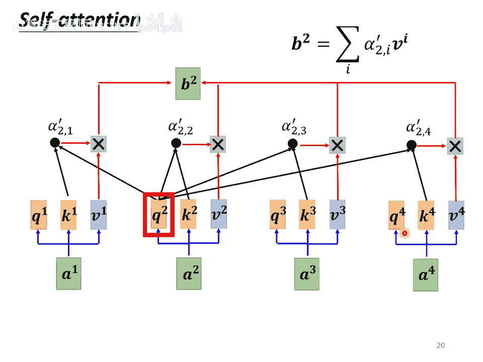

计算出b one到b four，好，那刚才讲的是self呃，是这个self attention它运作的过程，那接下来呢我们从矩阵乘法的角度，再重新讲一次。

我们刚才讲的self attention是怎么运作的好，那self attention是怎么运作的呢，我们现在已经知道说a one到a four，他们每一个A啊都要分别产生QKV。

所以a one要产生q one k one v one，a two要产生q two k two v two，以此类推，每一个A都产生QKV，如果要用矩阵运算表示这个操作的话，是什么样子呢。

哦我们每一个A好，AI都乘上Q这个矩都乘上一个矩阵，我们这边用WQ来表示它得到QI，每一个A都要乘上WQ得到QI，那这个这些不同的A啊，你可以把它合起来当做一个矩阵来看待，什么意思呢。

a one乘上WQ得到q y a two也乘上WQ，得到q two一样，A3A4也都乘上WQ得到Q3QQ4，那你可以把A1到A4拼起来，看作是一个矩阵哦，这个矩阵我们用I来表示好。

这边这个I这个大写的字母I，它代表的是一个矩阵，那这个矩阵有四个COLUM，它的colon就是a one到a four，那I乘上WQ就得到另外一个矩阵，我们用大Q来表示它这个大Q啊。

就是Q1到q four，你把Q1到q four，这四个factor拼起来就是大Q的四个color哦，所以我们从A1到a four，得到Q1到q four这一件事情，这个操作其实就是把一个叫做I的矩阵。

I这个矩阵，它里面的colon就是我们self attention的input，a one到a four，把I这个矩阵乘上另外一个矩阵WQ，那WQ呢其实是network的参数，它是等下要被认出来的。

把I乘上WQ得到大Q啊，这个大Q的四个colon就是Q1到q four好，那接下来怎么产生K跟V呢，它的操作跟Q是一模一样的，我们就不要再细讲，免得你觉得很无聊好，所以A乘上wk就会得到这个key。

就会得到这个K这个vector，那我们把这个input的四个vector，a one到four拼起来，当做是一个矩阵，叫做大I把大I乘上一个矩阵，wk就得到另外一个矩阵，大K大K的四个colon。

就是这四个key k one到k four，那同理V呢也是一模一样的操作，我们已经知道说AI乘上WV会得到VI，也就是说把a one到IPHONE拼起来，得到大I大A乘上矩阵WB会得到大V。

这个矩阵大B的矩阵四个colon，就是这边四个代表value的vector好，所以每一个A怎么得到QKV呢，其实就是把输入的这个vector sequence，乘上三个不同的矩阵。

你就得到了Q得到了K跟得到了V好，这个是怎么从A得到QKV好。

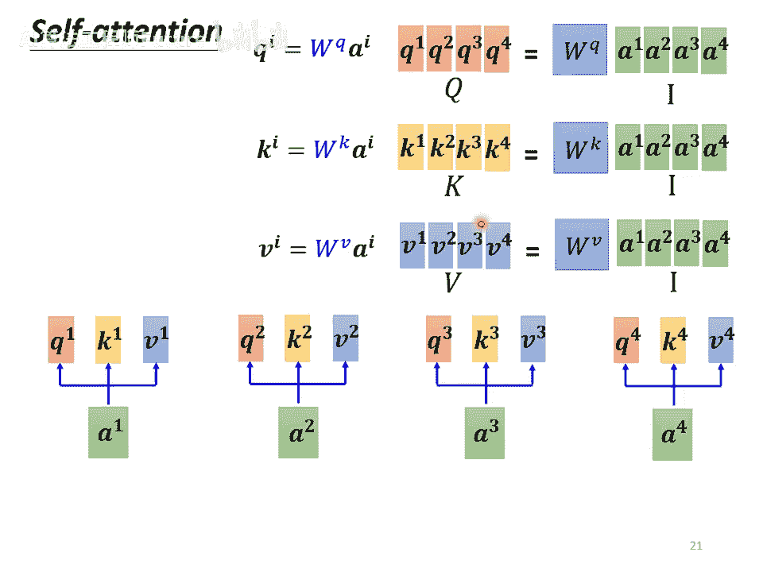

那接下来呢我们说下一步是什么，下一步是每一个Q都会去跟每一个K，去计算这个inner product，去得到这个attention的分数好，那得到attention分数这一件事情。

如果从矩阵操作的角度来看，他在做什么样的事情呢，你就是把q one跟k one做inner pa，得到阿尔法万万哦，所以阿尔法万万就是q one跟k one的inner pada。

那这边呢我就把这个k one呢，它背后的这个向量把它画这个倒下来的喇叭，画画成比较宽一点，代表说它是transpose，希望你可以了解我的意思，所以q one乘上k one的transpose。

也就q one跟k one左inner pa得到阿尔法one one，同理阿尔法one two就是q one跟k two做inner pa，阿尔法一三就是q one跟K3做ina pa呃。

这个阿尔法E4就是q one跟K4做一的化的，那这个四个步骤的操作啊，你其实可以把它拼起来看做是两，看作是矩阵跟向量相乘，什么意思，这边q one乘k one，q one乘K6，q one乘K3。

q one乘k four，这四个动作，你可以看作是我们把k one到k four拼起来，当做是一个矩阵的四个弱，那把这个矩阵呢乘上q one得到另外一个向量啊，你把q one乘上由K所组成的这个矩阵。

就得到另外一个向量，这个向量里面的值就是attention的sport阿尔法，one one到阿尔法，one two阿one four，所以把q one乘上这个矩阵。

你就得到阿尔法万万到阿尔法one four好。

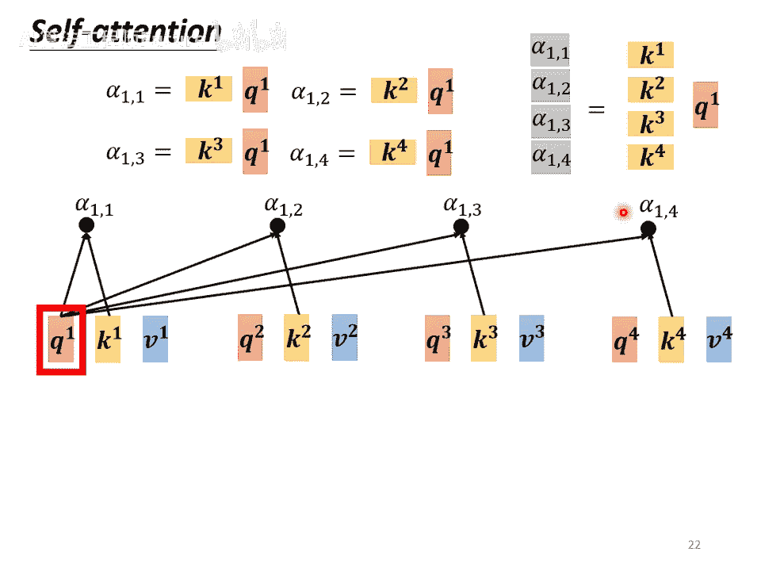

那我们刚才有讲过说呢，我们不只是q one，要对k one到k four计算attention，QQ也要对K1到k four计算attention。

那怎么把q two对k one到k four计算attention呢，你就把QQ呢放在这边啊，本来是走q one要乘上k one到k four，我们现在把q two也乘上k one到k four。

得到阿尔法，two one到阿尔法two four，那怎么拿Q3去做attention，怎么拿q four去做attention呢，你现在的操作啊是一模一样的。

你就把Q3乘k one到k four得到attention，你把Q4乘上k one到k four，得到attention的分数哦，所以这些attention的分数是怎么来的，你可以看作是两个矩阵的相乘。

一个矩阵，它的弱啊，就是k k one到k four，另外一个矩阵它的color呢就是Q，就是q one到q four，把这个K所形成的矩阵乘上Q所形成的矩阵，就得到这些attention的分数好。

所以这边就写说K的transpose，我们我们假设这个K它的color呢就是K，one到k four了，所以在这边相乘的时候呢，我们要对大K这个矩阵做一下transpose。

K的transpose乘上Q就得到一个矩阵，叫做A，那A里面存的就是Q跟跟这个K之间的，attention的分数好，那我说我们会在attention的分数呢。

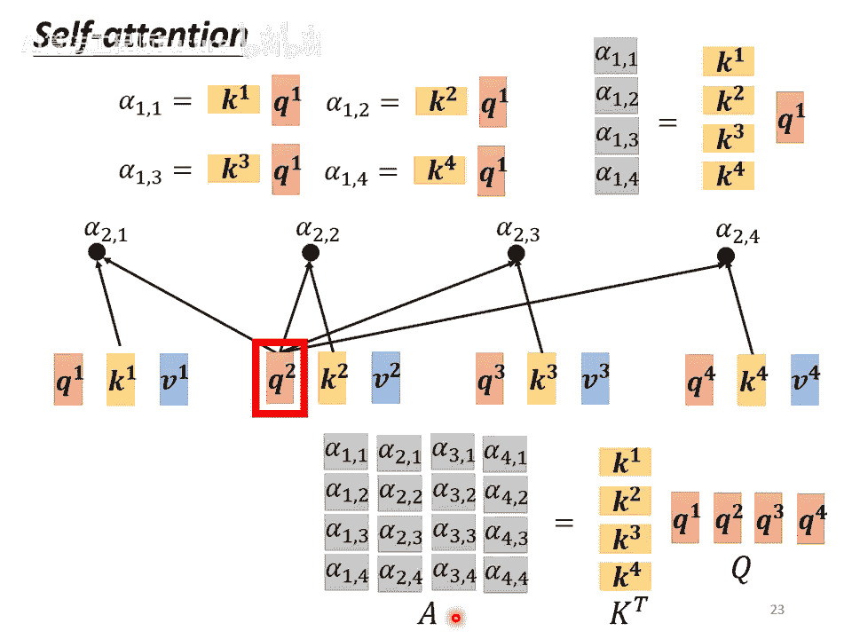

做一下normalization，比如说你会做soft max，你会对这边的每一个color，每一个color做soft max，让每一个color里面的值呢相加是一，但我们之前有讲过说。

其实这边做soft max不是唯一的选项，你完全可以选择其他的操作，比如说redo之类的，那其实得到的结果也不会比较差好，反正我们这边呢就是把A呢通过了soft max以后，它得到值有点不一样了。

所以我们用a plan来表示通过soft max以后的结果好，那接下来呢我们已经计算出a pine以后。

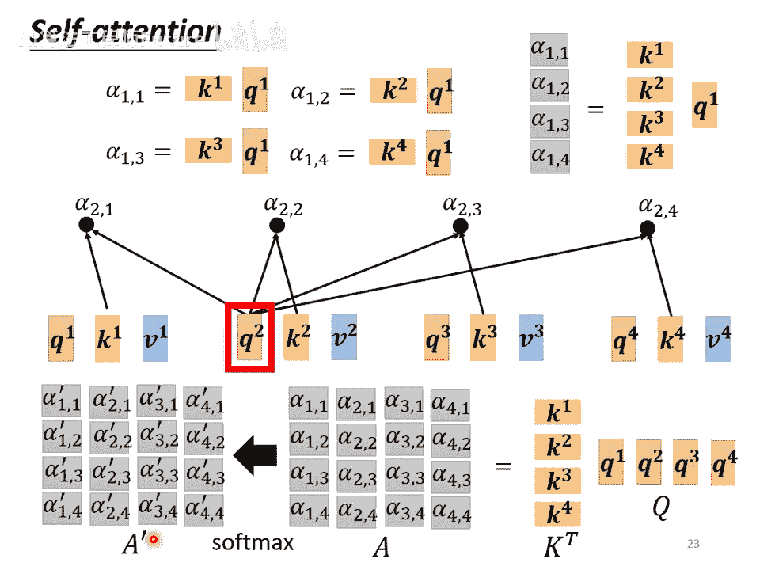

接下来呢接下来下一个步骤啊，我发现我这个投影片上有一个小小的bug啊，这个bug是什么呢，这个bug呢就是这边应该是pg，而不是H，这边应该是pan，不是head，本来最早是写成head啦。

那我才会把它改成pan啊，但这个地方没有改过来好，那我们把这个V呀v one到v four啊，乘上这边的阿尔法以后，好就可以得到B好，得到B啊，那这个B呢是怎么被计算出来的呢。

你就把v one到v four拼起来啊，你把V1到v four，当成是大V这个矩阵的四个column把它拼起来，然后接下来呢你把V乘上A派的第一个color以后，你得到的结果呢就是BY啊。

如果你熟悉线性代数的话，你知道说呃把这个AP乘上V，这个你就是把A派的第一个column乘上V，这一个矩阵，你会得到你output矩阵的第一个colon，而把A的第一个colon乘上V这个矩阵做的事情。

其实就是把V这个矩阵里面的每一个column，根据DA派这个矩阵里面的每一个呃，这个column里面每一个element呢做VT上，那就得到b one，那就是这边的操作，把v one乘上weight。

把v two乘上weight，把B3乘上weight，把B4乘上weight全部加起来，得到b one，如果你用啊矩阵操作的角度来看，它就是把a pine的第一个colon，乘上B就得到BY。

然后接下来呢就是以此类推啦，接下来就不需要再跟你详加说明面的，你觉得这一段非常的柔啊，就是以此类推，把a pi的第二个COLUM乘上V就得到b two，appoint的第三个color乘上B就得到B3。

a point的最后一个color乘上B就得到b for好，所以我们等于就是把a pi这个矩阵乘上V，这个矩阵得到O这个矩阵，O这个矩阵里面的每一个colon。

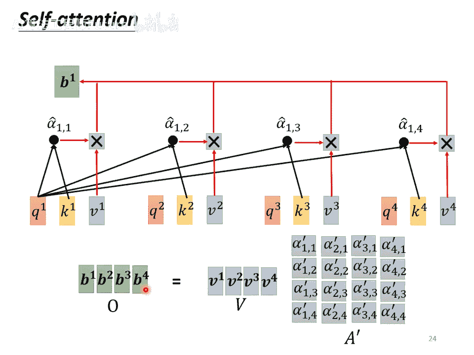

就是self attention的输出，也就是b one到b four，所以其实整个self attention呢我们在讲操作的时候，我们在最开始的时候跟你讲的时候，我们讲说啊，我们先产生了QKB。

然后呢再根据这个Q呢去找出相关的位置，然后呢再对V做V提上，其实这一串操作就是一连串矩阵的乘法而已。

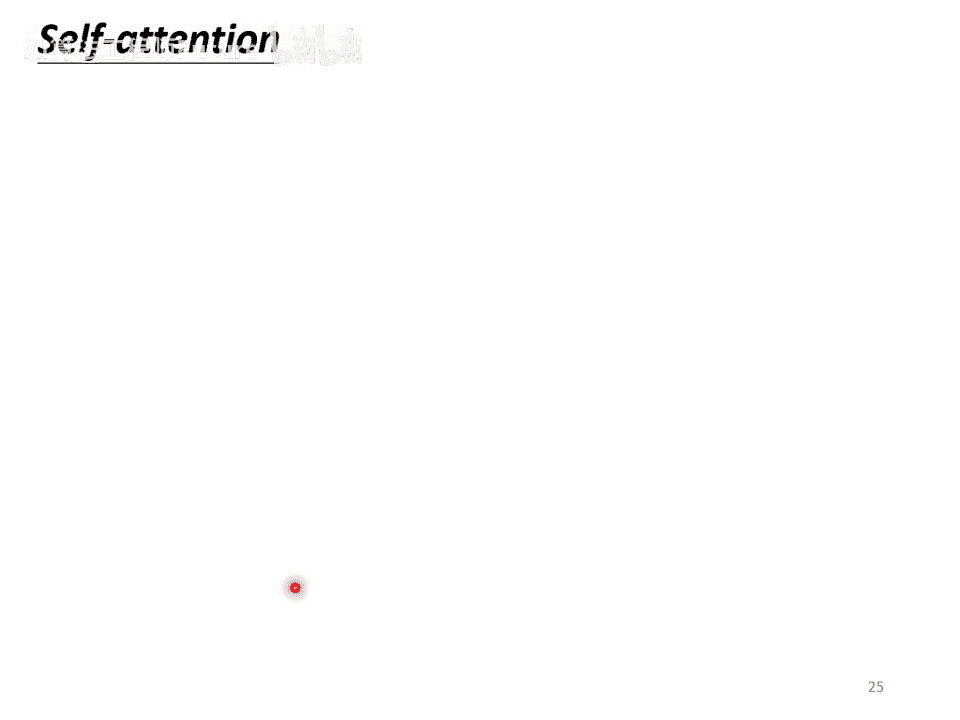

怎么说呢，我们再复习一下我们刚才看到的矩阵乘法，I是什么，I是我们的input，是self attention的input，self attention的input是一串的vector。

是一排的vector，这排vector拼起来当做矩阵的colon就是I哦，所以I是self attention的input，那这个input呢分别乘上三个矩阵。

wq wk跟WB得到大Q大K大V这三个矩阵，接下来呢大Q乘上K的transpose，QKV都算出来了嘛，你把Q乘上K的transpose得到A这个矩阵，A的矩阵，你可能会做一些处理，得到AP。

那有时候我们会把这个AY呢。

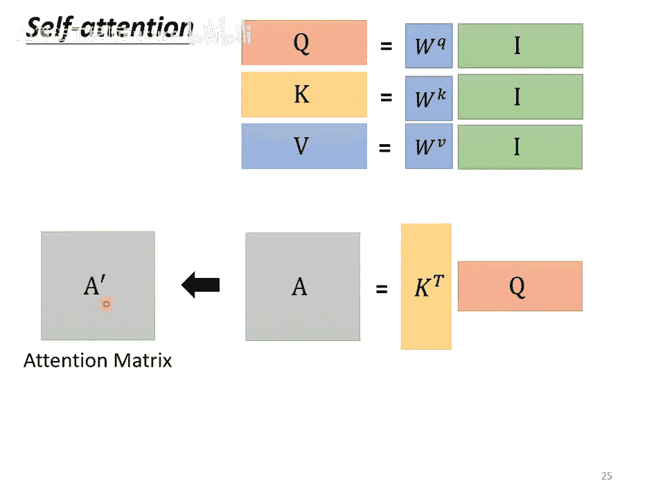

叫做attention的matrix好，接下来呢你把apply再乘上V就得到OO，就是self attention这个layer的输出，所以self attention输入是I，输出是O，那你会发现说。

虽然self attention这边做了一个很复杂的操作，但是其实啊，self attention layer里面，唯一需要学的参数就只有WQWK跟WV而已，只有WQWKWV是未知的。

只需要透过我们的训练资料把它找出来的哦，所以WQWKWV是未知的，是需要被找出来的，但是其他的操作都没有未知的参数，都是我们人为设定好的，都不需要透过training data找出来。

只有WQWKWV是透过training data找出来的好，那这整个就是self attention的操作，从I到O就是做了self attention。

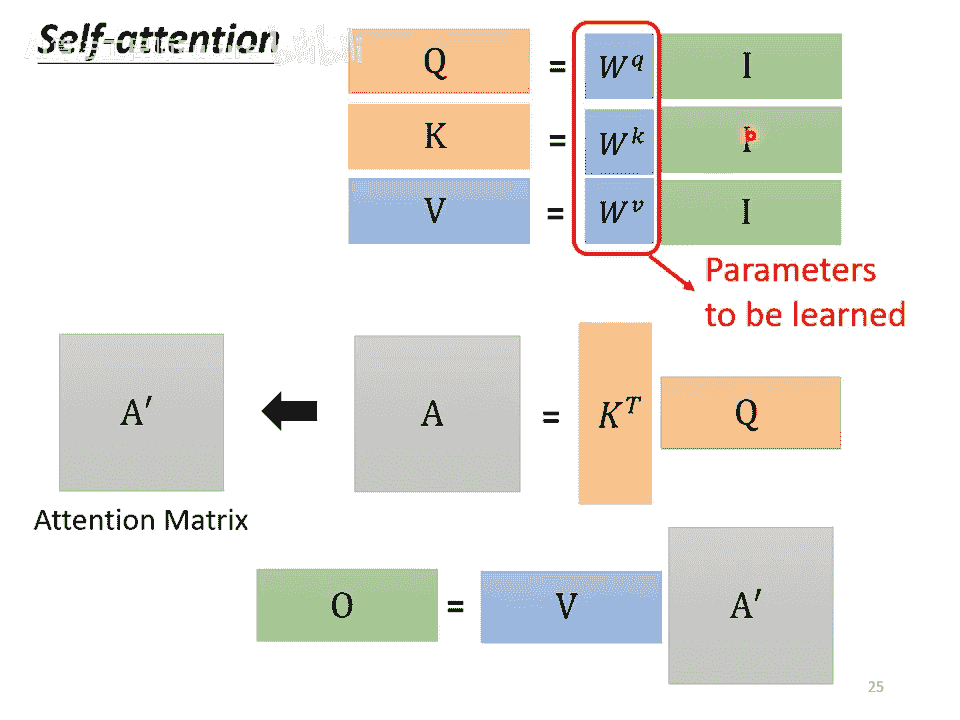

而那self attention呢有一个进阶的版本叫做moti head，Self attention，那mortahead self attention呢，其实今天的使用是非常的广泛的。

那在作业四里面呢，呃助教原来的code是有moti head self attention，它的head的数目是设成二，那刚才助教给你提示说啊，把head的数目改少一点，改成一。

其实就可以过media的杯赛，但并不代表所有的任务都适合呃，用比较少的head，有一些任务，比如说翻译，比如说语音辨识，其实用比较多的head，你反而可以得到比较好的结果，那至于需要用多少的head。

这个又是另外一个hyper parameter，也是你需要调的，那为什么我们会需要比较多的head呢，你可以想成说相关这件事情呢，我们说我们在做这个self attention的时候。

我们就是用Q呢去找相关的K，但是相关这件事情有很多种不同的形式，有很多种不同的定义，所以也许我们不能只有一个Q，我们应该要有多个Q，不同的Q负责不同的不同种类的相关性哦。

所以假设你要做motorhead self attention的话，你会怎么操作呢，你可能会这么操作，你再你先把A呢乘上一个矩阵得到Q，接下来啊你再把Q呢乘上另外两个矩阵。

分别得到q one跟q two，那这边还有这边是用两个上标了，I代表的是位置，然后这个一跟二代表是这个位置的第几个Q啊，所以这边有q i one跟QI，Q代表说我们有两个head。

我们认为这个问题里面有两种不同的相关性，所以我们需要产生两种不同的head，来找两种不同的相关性，那既然Q有两个，那K也就要有两个，那V也就要有两个，那怎么从Q得到q one q two。

怎么从K得到k one k two，怎么从B得到v one v two，那其实就是把Q把K把V分别乘上两个矩阵，两个矩阵，两个矩阵得到不同的这个呃，得到这个不同的hand，就这样子而已好。

那所以对另外一个位置也做一样的事情，另外一个位置AJ输入以后，他也会得到两个Q两个K两个V，那接下来怎么做self attention呢，跟我们之前讲的操作是一模一样的，只是现在呢一那一类的一起做。

二那一类的一起做，也就是这个q one呐，他在算这个attention的分数的时候，他就不要管那个k two了，不要管k two，他就只管k one就好，只管k one就好。

所以q i one就跟k i one算个attention，q i one就跟k j one算个attention，有时就算这个啊DPA，然后呢得到这个attention的分数。

然后今天在做wait song的时候，也不要管v two了，也不要管v two了，看v i one跟v z one就好哦，所以你把TENTION的分数乘v i one。

把TENTION分数乘b j one，然后接下来就得到b i one好，那你得到b i one以后呢，呃接这个这边只用了其中一个head，那你会用另外一个head也做一模一样的事情。

所以q two只对k two做attention，q two只对k two做attention，他们在装wet song的时候，只对v two做wet song，然后接下来呢你就得到BIQ啊。

如果你有多个head，有八个head，有16个head，那也是一样的操作，那这边呢是呃用两个head来当做例子来给你看看，有两个head的时候是怎么操作的啊，现在得到b i one跟BIQ。

然后接下来呢你可能会把b i one跟b i two，把它接起来，然后再通过一个transform，也就再乘上一个矩阵，然后得到BI，然后再送到下一层去。

那这个呢就是moti head attention。

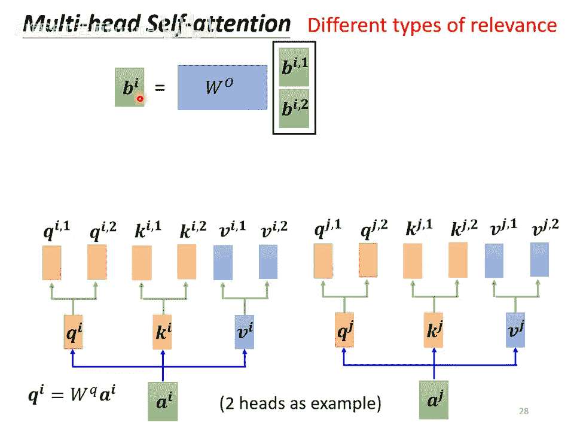

一个这个self attention的变形好，那讲到目前为止啊，你会发现说self attention的这个layer，他少了一个也许很重要的资讯，这个资讯是什么呢，这个资讯是未知的资讯，你想想看。

对一个self attention而言，对于一个self attention layer而言，每一个input它是出现在sequence的最前面，还是最后面，它是完全没有这个资讯的，对不对，你可能说诶。

诶刚才不是说input就是有位置1234吗，但是那个1234是我们画在投影片上的时候，为了帮助大家理解所标上的一个编号，你想想看，对self attention而言，那个位置一跟位置二。

跟位置三和位置四有任何差别吗，完全没有任何差别，对不对，这四个位置的操作其实是一模一样的，对他来说，q one到跟q four的距离并没有特别远，一跟四的距离并没有特别远，二跟三的距离也没有特别近哦。

对他来说就是天涯洛必林哦，所有的位置之间的距离都是一样的，没有任何一个位置距离比较远，也没有任何位置距离比较近，也没有谁在整个sequence的最前面，也没有谁在整个sequence的最后面好。

但是这样子设计可能会有一些问题，因为有时候未知的资讯也许很重要啊，举例来说，我们在做这个p o s tagging，就是词性标记的时候，也许你知道说动词比较不容易出现在句首，所以如果我们知道说啊。

某一个词汇它是放在句首的，那它是动词的可能性可能就比较低，会不会这样子的未知的资讯往往也是有用的啊，可是在我们到目前为止，讲的self attention的操作里面，他根本就没有未知的资讯。

所以怎么办呢，所以你做self attention的时候，如果你觉得位置的资讯是一个重要的事情，那你可以把位置的资讯把它塞进去，怎么把未知的资讯塞进去呢。

这边就要用到一个叫做positional encoding的技术，这个技术是这样子的，你为每一个位置设定一个vector，叫做positional vector，这边用EI来表示上标I代表的是位置好。

每一个不同的位置就有不同的factor，就是1万是一个vector，1two是一个vector，1128是一个vector好，不同的位置都有一个他专属的一，然后把这个一加到AI上面就结束了啊，就结束了。

你等于就是啊告诉你的self attention位置的资讯，如果他看到说I好像有被加上EI，他就知道说嗯，现在出现的位置应该是在I这个位置。

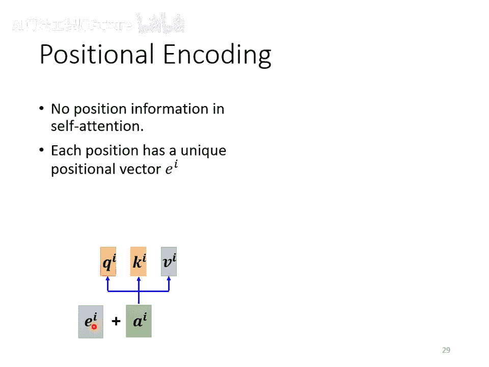

那这个EI长什么样子呢，最早的这个transformer就attention is all you need，那篇paper里面呐，他用的EI长的是这个样子的。

这边这个图上面呢每一个color就代表一个一哦，第一个位置就是1one，第二个位置就是e two，第三个位置就是E3，以此类推哦，所以他就是把这边，这这个这个向量放在第一个位置。

把这个向量加到第二个位置的A上，把这个向量加到第三个位置的A上，以此类推，每一个位置都有一个专属的一，希望透过给每一个位置不同的一，你的model在处理这个input的时候，他可以知道现在的input。

它的位置的资讯是什么样子，那这样子的呃，positional vector啊，他是hand crafted的，也就是他是人设的，那人设的这个vector有很多问题呀。

就假设我现在在定这个vector的时候，只定到128，那我现在SEQU的长度如果是129怎么办呢，哦不过今天在最早的那个attention is all over near。

paper里面比较没有这个问题啦，他这个vector呢是透过某一个规则所产生的，透过一个很神奇的sin cos的function所产生的，那当然你又会有新的问题，为什么是sin和cos呢。

为什么不是别的东西呢，为什么一定要这样产生，HCRAFTED的这个positional vector呢，其实你不一定要这么产生这个positional encoding a，仍然是一个尚待研究的问题。

你可以创造自己新的方法，或甚至positional encoding，是可以根据资料学出来的好。

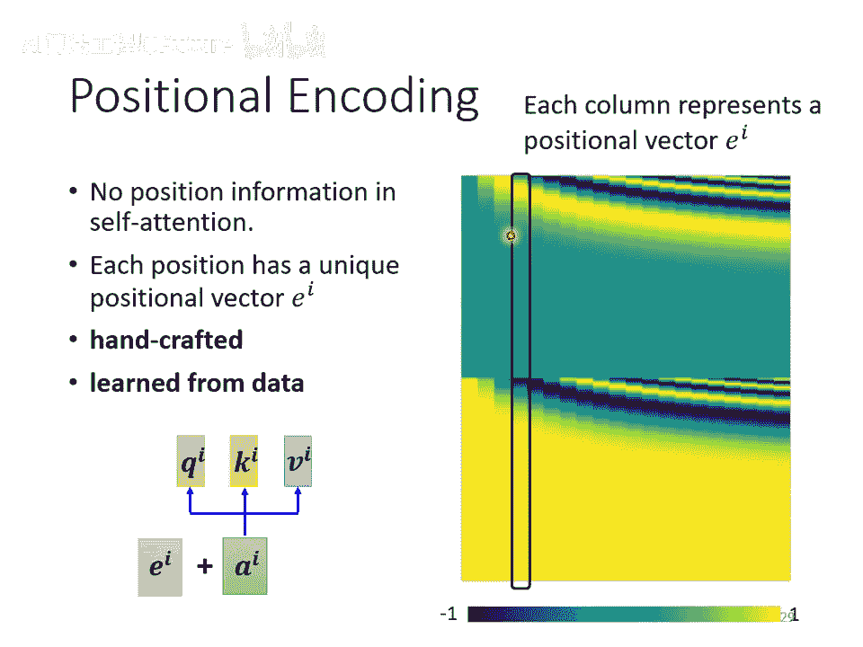

那有关positional encoding呢，你可以再参考一下文献，这个是一个尚待研究的问题，比如说我这边引用了一篇啊，这个是啊去年放在ARCAVE上的论文，所以你可以想见这其实都是很新的，论文。

里面就是比较了跟提出了新的positional encoding，比如说这个是最早的positional encoding，它是用一个神奇的sin方式所产生的。

那如果你的positional encoding，你把positional encoding里面的数值，当做network参数的一部分，直接认出来，看起来是这个样子的哦，这个图是那个横着看的。

它是横着看的，它是每一个roll代表一个position好，所以这个是这个呃最原始的用sin方程产生的，这个是认出来的，那它里面呢有有神奇的做法，比如说这个哦这个是用RNN生出来的。

positional encoding是用RNN生出来的，好这篇paper提出来的叫做float，是用个神奇的network生出来的，总之你有各式各样不同的方法来产生。

Positional encoding，那目前我们还不知道哪一种方法最好，这是一个尚待研究中的问题，所以你不用纠结说为什么SAUSOIDO最好，你永远可以提出新的做法好。

那这个self attention当然是用的很广了，我们已经提过很多次transformer这个东西，那我们大家也都知道说啊，在NLP领域有一个东西叫做bird。

bird里面也用到self attention好，所以self attention在NLP上面的应用，是大家都耳熟能详的，但self attention不是只能用在NLP相关的应用上。

它还可以用在很多其他的问题上。

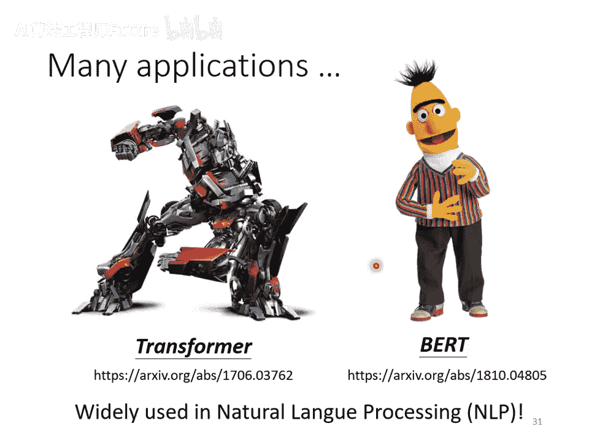

比如说在做语音的时候，你也可以用self attention，不过在做语音的时候啊，用self attention，你可能会希望对self attention做一些小小的改动，举例来说，因为一般语音的。

如果你要把一段声音讯号表示成一排向量的话，这排向量可能会非常的长，因为我们之前有说过说，在做语音辨识的时候，你要把声音讯号表示成一排向量，而每一个向量其实只代表了，10millisecond的长度而已。

所以如果今天是一秒钟的声音讯号，它就有100个向量了，五秒钟的声音讯号就500个向量了，你随便讲一句话都是上千个向量了，所以一段声音讯号你要描述它的时候，那个像这个vector的sequence。

它的长度是非常可观的，那可观的sequence可观的长度会造成什么问题呢，你想想看，我们今天在计算这个attention matrix的时候，他的complexity是长度的平方。

你要计算这个attention mattress a pl，你需要做L乘以L次的啊，呃in the padda，那如果这个L的值很大的话，它的计算量就很可观，如果L很大的话。

你也需要很大的这个memory，才能够把这个矩阵存下来哦，所以今天如果在做语音辨识的时候，你讲一句话，那句话所产生的这个attention metric可能会太大，大到你根本就不容易处理，不容易训练。

所以怎么办呢，在做语音的时候，有一招叫做TRACTED的self attention，Trank itself attention，做的事情就是我们今天在做self attention的时候。

不要看一整句话，就我们就只看一个小的范围就好，那至于这个范围应该要多大，那个是人设定的，但为什么我们知道说今天在做语音辨识的时候，也许只需要看一个小的范围就好，那就是取决于你对这个问题的理解。

也许我们要辨识这个位置有什么样的风ling，这个位置有什么样的内容，我们并不需要看整句话，只要看这句话跟它前后呃，一定范围之内的资讯，其实就可以判断，所以如果在做self attention的时候。

也许没有必要看过一整个句子，也许没有必要让self attention考虑一整个句子，也许只需要考虑一个小范围就好，这样就可以加快运算的速度啊。

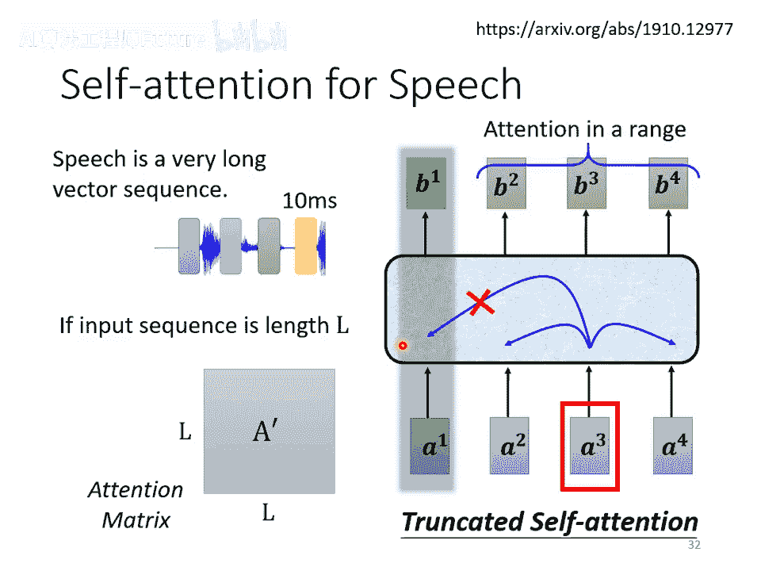

这个是TRACTED的self attention，那其实self attention呢还可以被用在影像上，self attention怎么被用在影像上呢。

那到目前为止我们在讲self attention的时候，我们都说self attention适用的范围是，输入是一排向量的时候，输入是一个vector set的时候。

它适合使用self attention，那我们之前在讲CNN的时候，我们是跟大家说影像啊，一张图片呐，我们把它看作是一个很长的向量，那其实一张图片我们也可以换一个观点，把它看作是一个vector的S。

怎么把一张图片看作是一个vector的sin呢，哦这个是一个呃解析度5×10的图片，那这张图片呢可以看作是一个tensor，这个tensor的大小是510乘以三，三，代表RGB这三个channel。

那你可以把每一个位置的pixel，看作是一个三维的向量哦，所以每一个pixel其实就是一个三维的向量，那整张图片其实就是5×10个向量，所以我们其实可以换一个角度来看，影像这个东西。

影像这个东西其实也是一个vector set，它既然也是一个vector set的话，你完全可以用self attention来处理一张图片。

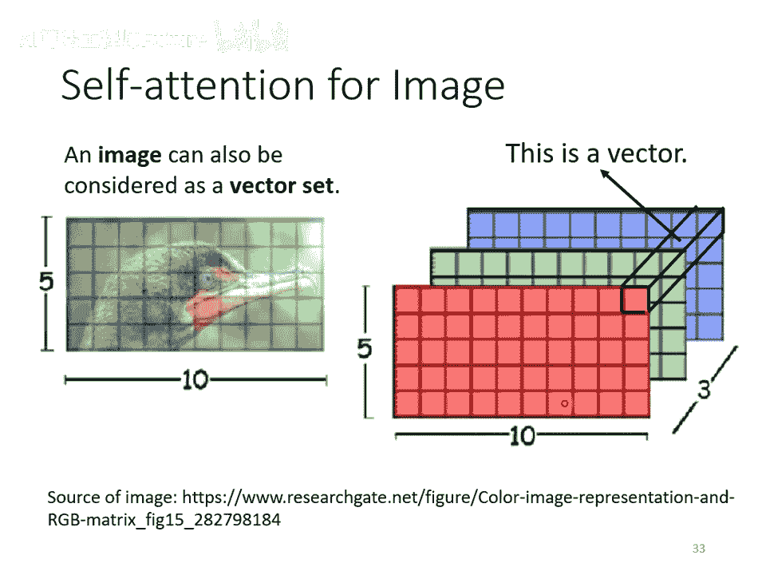

那有没有人用self attention来处理一张图片呢，是有的，那这边就举了两个例子来给大家参考，那先把self attention用在影像处理上，也不算是一个呃非常石破天惊的事情好。

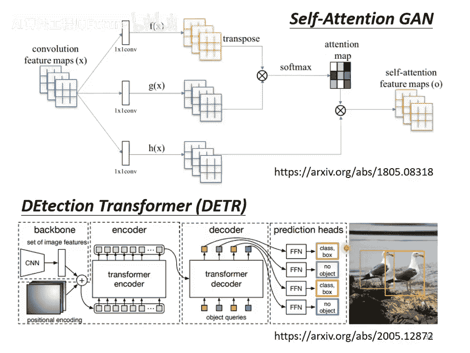

那我们可以来比较一下，self attention跟CNN之间有什么样的差异，或者是关联性，如果我们今天是用self attention来处理一张图片，代表说假设这个是你要考虑的pixel。

那它产生query，其他pixel产生呃，这个这个呃其他pixel产生key好，它产生query，其他pixel产生key，你今天在做inner prada的时候，你考虑的不是一个小范围区。

而是整张影像的资讯，所以但是今天在在做CNN的时候，就会记得我们上上周讲的CNN呢，会画出一个receptive field，每一个filter。

每一个neural只考虑receptive field范围里面的咨询，所以如果我们比较CNN self attention的话，我们可以说CNN是什么。

CNN可以看作是一种简化版的self attention，因为在做CNN的时候，我们只考虑receptive field里面的资讯，而在做self attention的时候，我们是考虑整张图片的资讯。

所以CNN是简化版的self attention，或者是你可以反过来说，self attention是一个复杂化的CNN，在CNN里面我们要划定receptive field。

每一个neuron只考虑receptive field里面的资讯，而receptive field的范围跟大小是人决定的，我记得我们上上周还花了一些时间讲一下。

说receptive field有什么样可能的设计，而对self attention而言，我们用attention去找出相关的pixel，就好像是receptive field是自动被学出来的。

network自己决定说receptive field的形状长什么样子，network自己决定说以这个pixel为中心，哪些pixel是我们真正需要考虑的，哪些pixel是相关的。

所以receptive field的范围不再是人工划定，而是让机器自己学出来好，这边讲的是self attention跟CNN的关系。

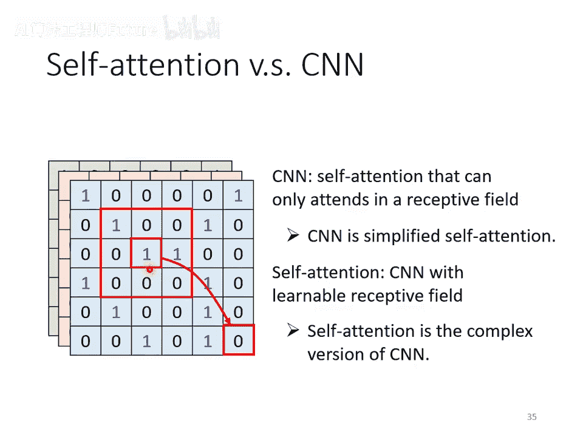

其实你可以读一篇paper，叫做on the relationship，Between self attention and convolutional layer。

在这different paper里面会用啊数学的方式，严谨的告诉你说，其实这个CNN就是self attension的特例，self attention只要设定合适的参数。

它可以做到跟CNN1模一样的事情哦，所以CNN他的function set长这个样子，而self attention它的function set长这个样子CN。

所以self attention是更flexible的CNN，而CNN是有受限制的，Self attention，self attention只要透过某些设计，某些限制，它就会变成CNN。

那这也不是很旧的paper，你发现它放到网络上的时间呢，是19年的11月哦，所以你知道这些我们今天上课里面讲的东西，其实都是很新的资讯好，既然CNN是self attention的一个subset。

self attention比较flexible，那记不记得我们在讲open fitting的时候，我们讲说比较flexible的model，比较需要更多的data，如果你data不够。

就有可能OVERFIT，而小的model，而比较有限制的model，它适合在data小的少的时候，它可能比较不会OVERFITTING，那如果这个限制设的好。

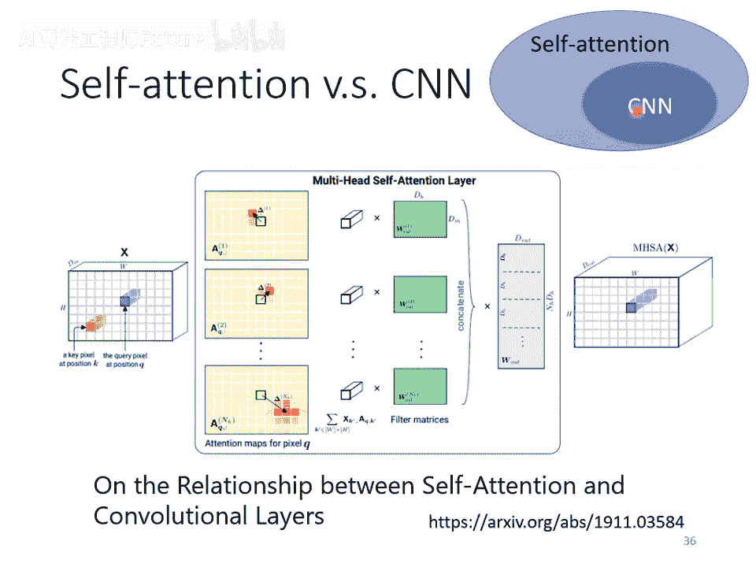

也会有不错的结果，如果你今天呢用不同的data量来训练，CNN跟self attention，你确实可以看到我刚才讲的现象，那这个实验结果啊。

来自于an image is worth1616的words啊，这个是google的paper，它就是把这个呃self attention apply在影像上面。

那其实把一张影像呢拆成1616个patch，然后它把每一个patch呢就想象成是一个word，因为一般我们这个self attention，比较常用在NLP上面嘛。

所以他就说想象每个patch其实就是一个word，所以他就取了一个很fancy的title，叫做一张图呢，呃值16×16个文字好，那这个横轴是什么，横轴是训练的影像的量。

那发现说对google来说用的呃所谓的资料量比较少，也是你没有办法用的资料量啦，这边有十个million，就是1000万张图，是啊资料量比较小的setting。

然后资料量比较大的setting呢有3亿张图片，好在这个实验里面呢，比较了self attention是浅蓝色的，这条线跟CNN是深灰色的，这一条线也就发现说随着资料量越来越多。

那self attention的结果呢就越来越好，最终在资料量最多的时候，self attention可以超过CNN，但在资料量少的时候，CNN它是可以比self attention得到更好的结果的。

那为什么会这样，你就可以从CNN跟self attention，他们的弹性来加以解释啊，这个self attention它弹性比较大，所以需要比较多的训练资料。

训练资料少的时候就会OVERFITTING，而CNN它弹性比较小，在训练资料少的时候结果比较好，但训练资料多的时候，他没有办法从更大量的训练资料得到好处。

所以这个就是self attention跟CNN的比较，那你可能会说那self attention跟CNN谁比较好呢，我应该选哪一个呢，事实上你也可以都用，对不对，在我们作业四里面。

如果你要做strong baseline的话，就特别给你一个提示，就是用conformer里面就是有用到self attention，也有用到CNN好。

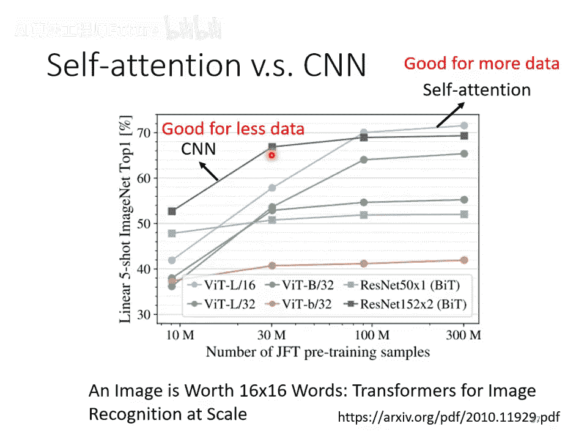

那我们来比较一下self attention跟RNNRNN呢，就是recurrent neural network，那其实在这门课里面呢。

我们现在就不会讲到recurrent neural network，因为recurrent neural network的角色，很大一部分都可以用self attention来取代了，所以在这门课里面。

我们就不会再特别把RNN拿出来讲，但是RN是什么呢，假设你想知道的话，那这边很快的三言两语把它带过去，RN跟self attention一样，都是要处理input是一个sequence的状况。

那在RN里面呢，这是你的input sequence，你有一个memory的vector，然后你有一个RNN的block，这个on the block呢，他吃memory的vector。

吃第一个input vector，然后output一个东西，然后根据这个output的东西，我们通常叫做这个这个hidden，这个这个这个这个这个hidden的layer的open。

然后通过这个fully connected的network，然后再去做你想要的prediction，那RNN这个module呢，接下来当第二个这个sequence里面。

第二个vector作为input的时候，你会把这个啊这个vector，第二个vector当做input，也会把前一个时间点吐出来的东西，当做下一个时间点的输入再丢进RN里面，然后再产生新的vector。

再拿去给fully connected network做你想要做的事情，然后第三个vector进来的时候，你把第三个vector跟前一个时间点的输出，一起丢进RN，再产生新的输出，然后在第四个时间点。

第四个vector输入的时候，把第四个vector跟前一个时间点产生出来的输出，在一起做处理，得到新的输出，再通过福利connected的内容。

这个就是RNN recurrent neural network。

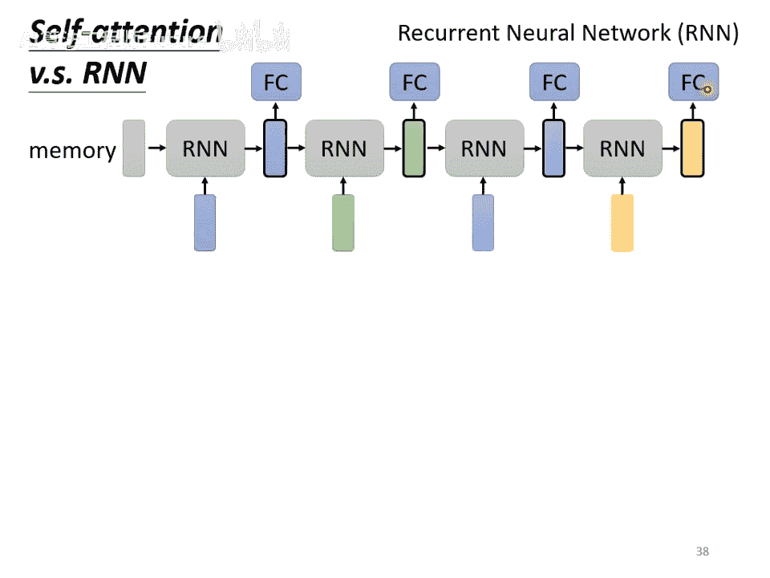

那你会发现说它跟self attention做的事情，其实也非常像，他们的input都是一个vector sequence，他们的input都是一个vector sequence。

Self attention，output是另外一个vector sequence，这里面的每一个vector都考虑了整个input sequence，以后。

再给fully connected的network去做处理，那RNN呢他也会output另外一群vector，这另外一排vector也会给fully connected network，做进一步的处理。

那self attention跟RN有什么不同呢，当然一个非常显而易见的不同，你可能会说啊，这边的每一个vector他都考虑了整个input sequence，而RN每一个vector只考虑了左边。

已经输入的vector，他没有考虑右边的vector，那这是一个很好的观察，但是RN其实也可以是双向的，所以如果你RNN用双向的RN的话，其实这边的每一个hidden的output。

每一个memory的open，其实也可以看作是考虑了整个input sequence，但是假设我们把RNN的open跟self attention open，拿来做对比的话。

就算你用by directional的RN还是有一些差别的，对RN来说，假设最右边这个黄色的vector，要考虑最左边的这个输入，那它必须要把最左边的输入呢存在memory里面，然后接下来都不能够忘掉。

一路带到最右边，才能够在最后一个时间点被考虑，但对self attention来说没有这个问题，他只要这边输出一个query，这边输出一个key，只要他们mesh的起来，天涯若比邻。

你可以从非常远的vector，在整个sequence上，非常远的vector轻易的抽取资讯，所以这是RN跟self attention一个不一样的地方，还有另外一个更主要的不同是。

RNN今天在处理的时候啊，你input psequence，output psequence的时候，RN是没有办法平行化的，你要先产生这个向量，接下来才能产生这个向量，才产生这个向量，才能产生这个向量。

所以RN他今天input1排是vector，Output，另外一排vector的时候，他没有办法一次处理，没有办法平行处理所有的output，但self attention有一个优势是。

它可以平行处理所有的输出，你今天input my vector，在output这四个vector的时候，这四个vector是平行产生的，并不需要等谁先运算完才把其他人运算出来。

output这个vector里面的output，这个vector sequence里面，每一个vector都是同时产生出来的，所以在运算速度化，运算速度上。

self attention会比RNN更有效率，那今天发现说很多的呃，应用，都往往把RNN的架构，逐渐改成sp tension的架构了，好，如果你想要更进一步了解。

RN跟self attention的关系的话，你可以看下面这篇文章，Transformers，RRNN里面会告诉你说self attention诶，你加上了什么东西以后，其实它就变成了RNN诶。

发现说这也不是很旧的paper，这个是去年的6月放到ARKB上的，所以今天讲的都是一些很新的研究成果。

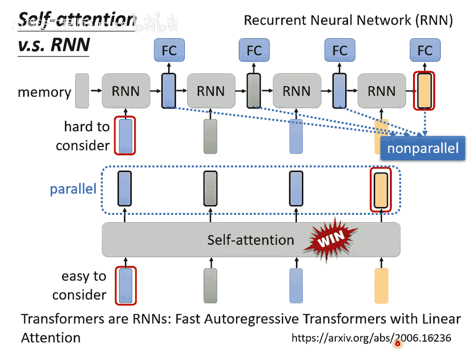

好那RN的部分呢。

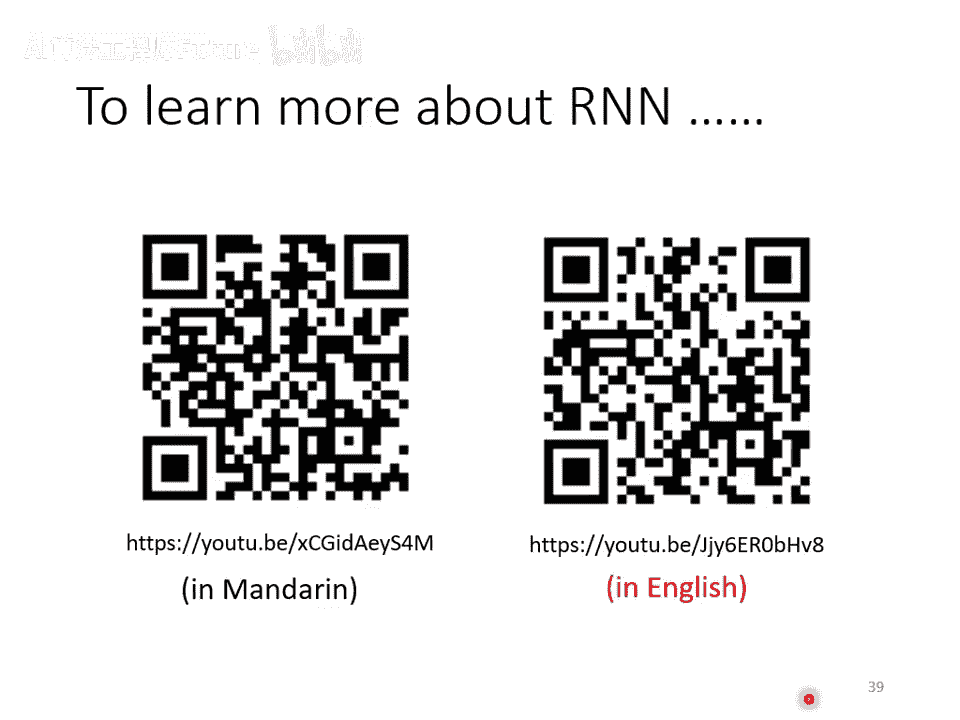

我们这门课就不会提到，假设你对RN有兴趣的话，以下呢是这一门课之前的上课录影。

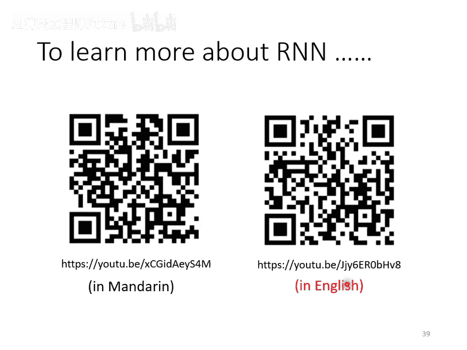

那RN的部分因为这一次不会讲到。

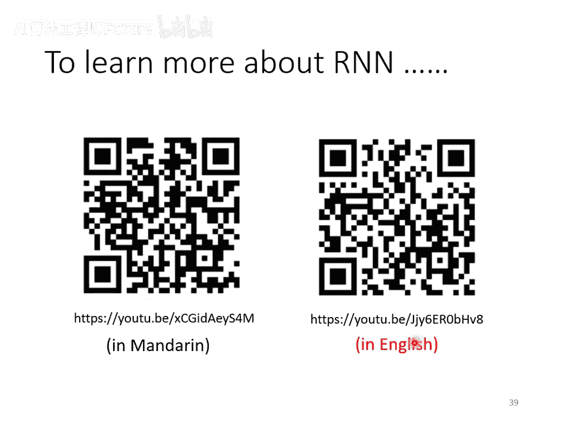

所以特别有做了英文的版本，RNN呢是中文，英文版本都同时有放在YOUTUBE上面的好。

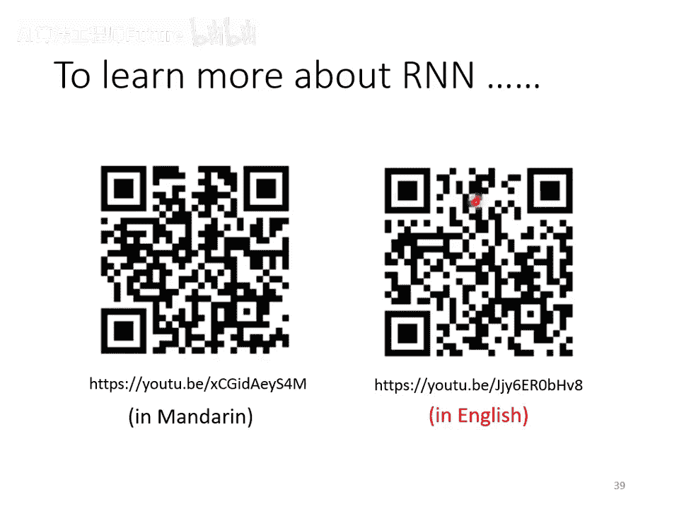

最后呢self attention也可以被用在graph上面，那记得我们在这堂这一份投影片，一开始的时候就有跟你说过，说graph也可以看作是一堆vector，那如果是一堆vector。

就可以用self attention来处理。

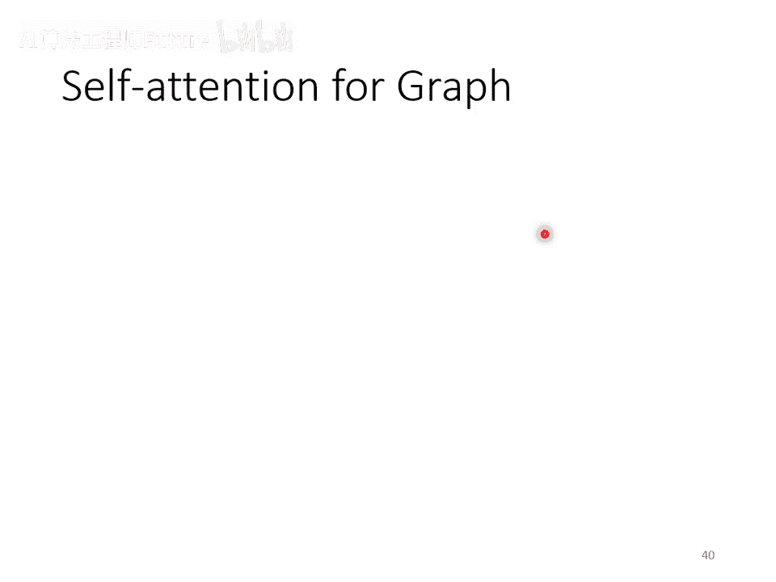

所以self attention也可以用在graph上面，但是当我们把self attention用在graph上面的时候，有什么样特别的地方呢，在graph上面呢，我们不只有每一个note。

我们每一个note可以表示成一个向量，但我们不只有node的资讯，我们还有age的资讯，我们知道哪些node之间是有相连的，也就是哪些node是有关联的。

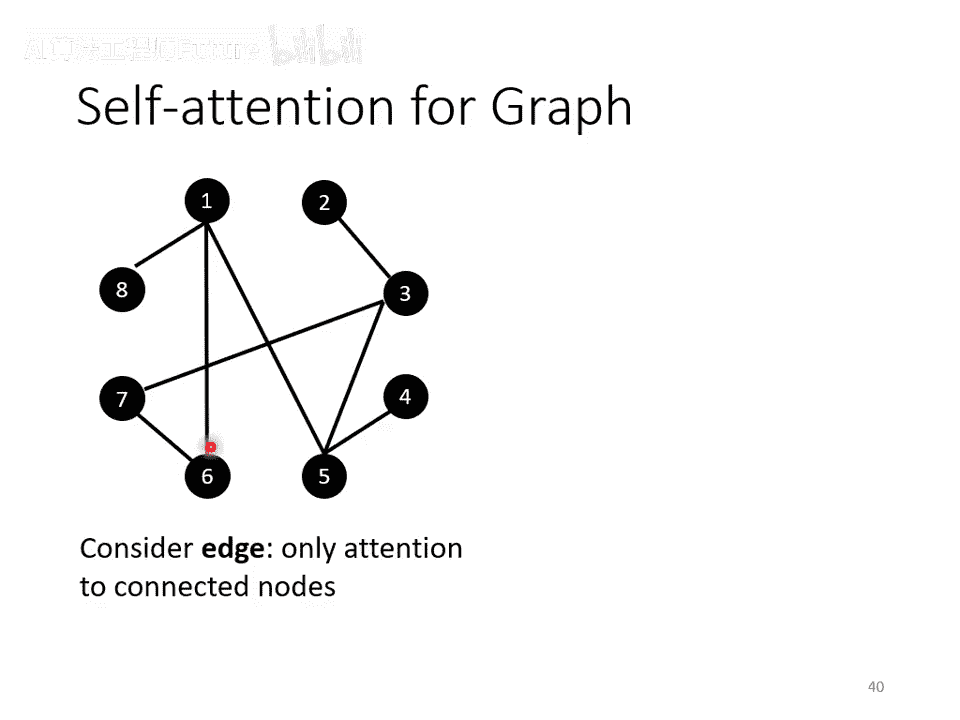

我们知道哪些向量间是有关联的，那之前我们在做self attention的时候，所谓的关联性是network自己找出来的，但是现在既然有了graph的资讯，有了age的资讯。

那关联性也许就不需要透过机器自动找出来的，这这个图上面的H已经暗示了我们，node跟node之间的关联性，所以今天当你把self attention用在graph上面的时候，你有一个选择是。

你在做这个attention match计算的时候，你可以只计算有H相连的node就好了，举例来说，在这个图上哦，note one跟note8有相连，那我们只需要计算node one跟note8。

这两个向量之间的tension的分数，那一跟六相连，所以只有一跟六之间需要计算attention的分数，一跟五有相连，所以之一跟五需要计算attention的分数，二跟三有相连。

所以走二跟三需要计算attention的分数，以此类推，那如果两个note之间没有相连，那其实很有可能就暗示我们，这两个note之间没有关系，既然没有关系。

我们就不需要再去计算它的attention score，直接把它设为零就好了，因为这个graph往往比如说是人为，根据某些domain knowledge建出来的。

那dman knowledge告诉我们说，这两个向量彼此之间没有关联，我们就没有必要再用机器去学习这件事情，那其实当我们把self attention，按照我们这边讲的这种限制。

用在graph上面的时候，其实就是一种graph neural network，也就是一种GNN，那我知道GNN现在也是一个很fancy的题目，那我不会说self attention。

就要囊括了所有GNN的各种变形了，但呃打self attention用在break上面，是某一种类型的graph neural network好。

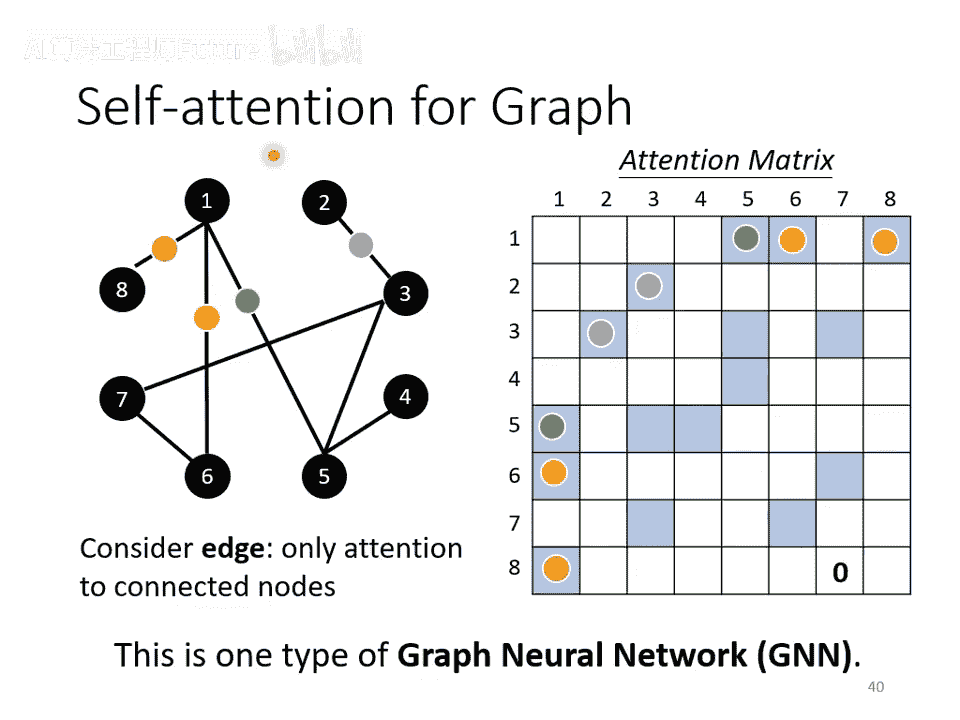

那这边呢一样，我们也没有办法细讲了。

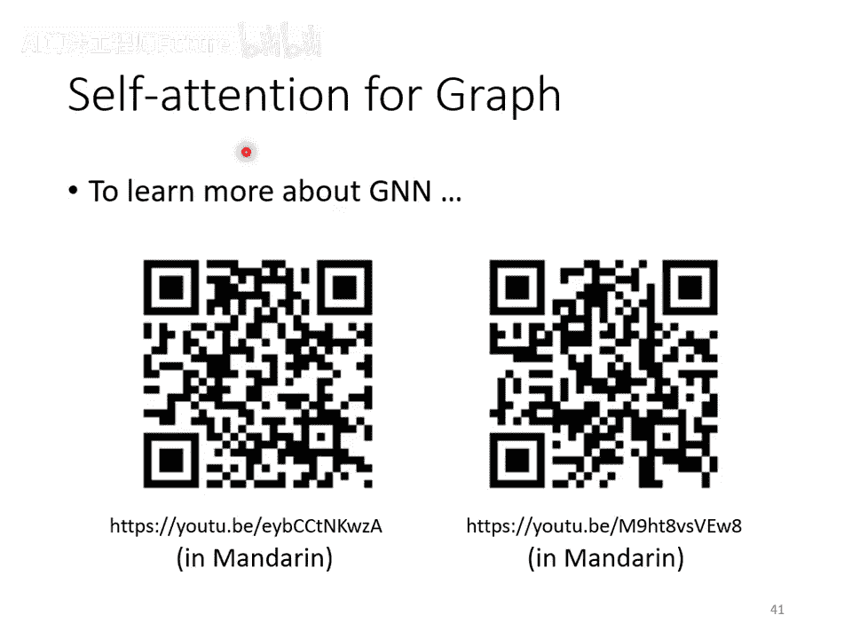

GNN这边坑也是很深呐，这边水也是很深，那就放一下助教之前上课的连接。

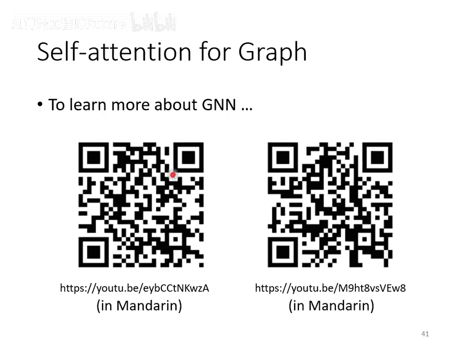

大概花了快三个小时在讲graph neural network。

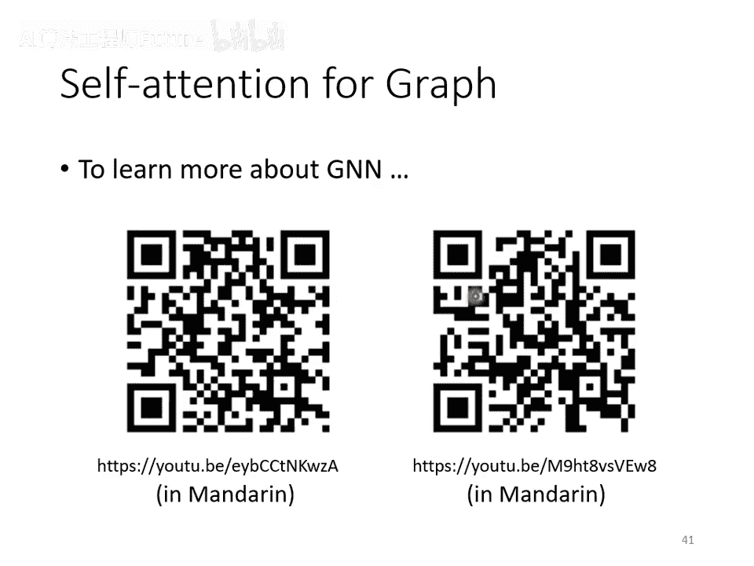

而且其实还没有讲完，那就告诉你说，这graph neural network也是有非常深的技术。

这边水也是很深啊，这不是我们今天这堂课可以讲的内容好，那其实这个self attention呢它有非常非常多的变形，你可以看一篇paper叫做long range arena。

里面比较了各种不同的self attention的变形，因为self attention，它最大的问题就是它的运算量非常的大，所以怎么样减少self attention的运算量，是一个未来的重点。

大家可以看到，这边有各种各式各样self attention的变形，那self attention最早是用在transformer上面，所以很多人讲transformer的时候。

其实它指的就是这个self attention，有人说广义的transformer指的就是self attention，那所以后来各式各样的self attention的变形。

都叫做都叫做是什么former，比如说LINFORMER，Performer，reformer等等哦，所以self attention的变形现在都叫做叉叉former。

那可以看到说呢往右代表它运算的速度，所以有很多各式各样新的叉叉former，他们的速度会比原来的transformer快，但是快的速度带来的就是performance变差。

这个纵轴代表是performance，所以他们往往比原来的transformer，performance差一点，但是速度会比较快，那到底什么样的self attention才能够真的又快又好。

这仍然是一个尚待研究的问题，而如果你对self attention想要进一步研究的话，你还可以看一下efficient transformer什么，这篇paper man create记。

跟你介绍各式各样self attention的变形，那这个就不是我们这一门课可以讲的东西了，我们就停在这边好。

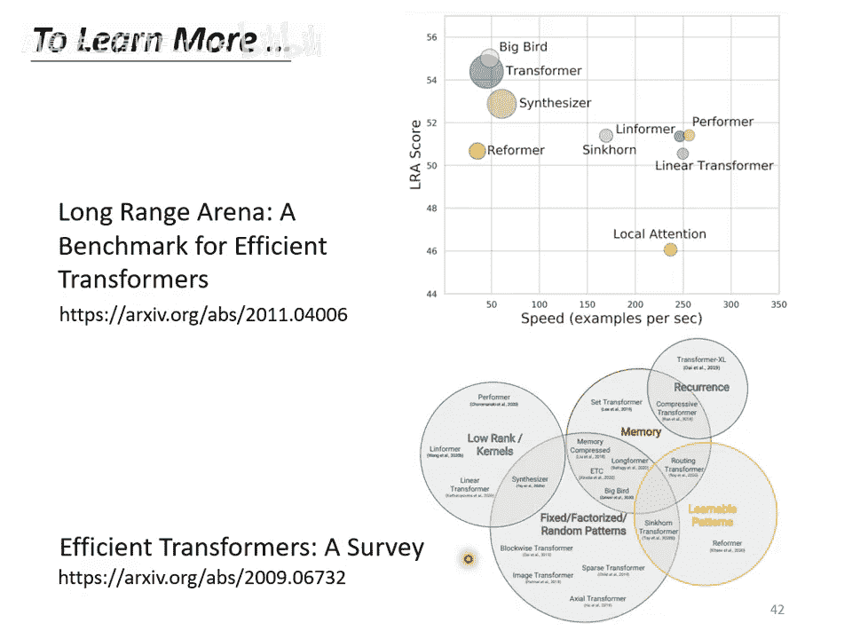

那接下来呢就是看一下各位同学有没有问题，想要问的，啊哎大家有问题想要问的吗，哎线上有问题想要问的吗，好以后我们就是放这一页QNA的时候呢，就是让大家问问题的时候，那这样之后呢。

助教要把你知道这个这个这个影片呐，我们要拿去找人听打，听打以后还要做翻译，然后之后这个呃QNA这个部分呢，在听打的时候就会不用听打，这样子还就不听打，这样哎，那所以放课特别放一页投影片。

这样以后助教比较知道说哪个位，哪个地方就不用停打，没有问题，这样子好，如果大家没有问题的话，那我们在这边呢还是先下课10分钟。

