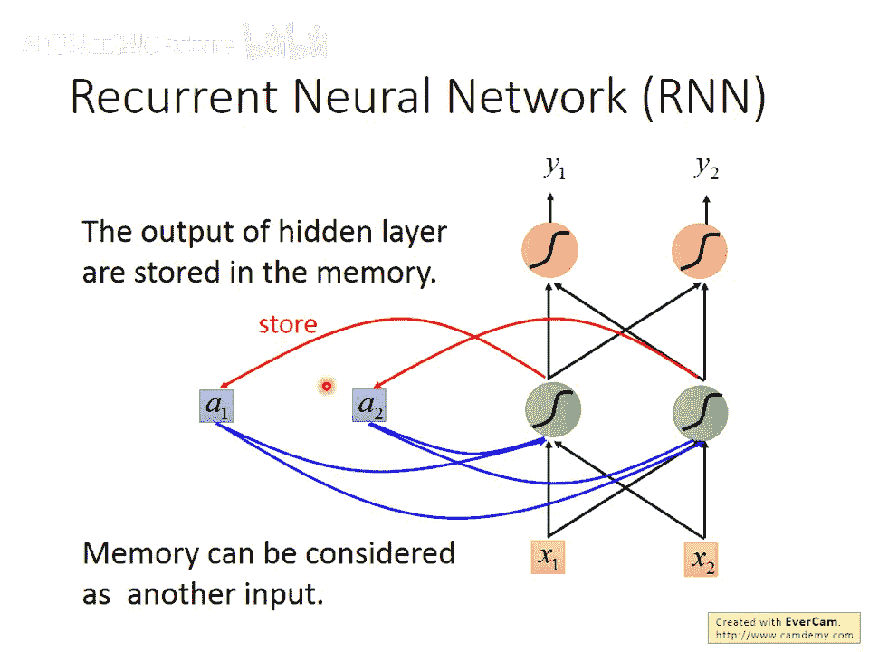
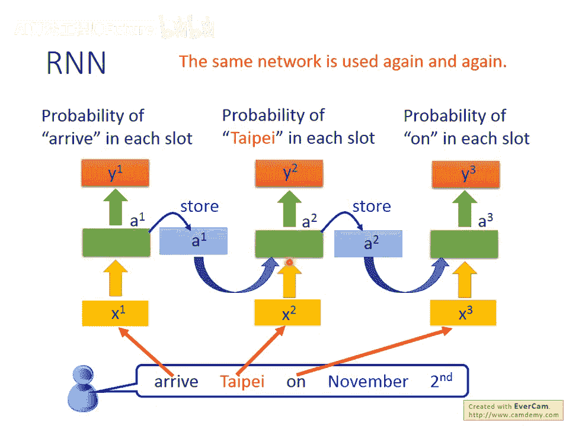
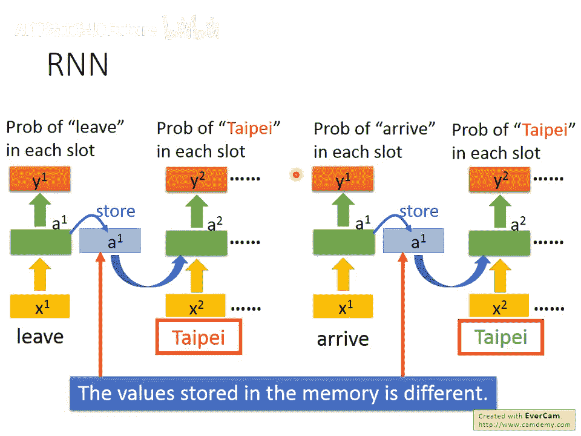
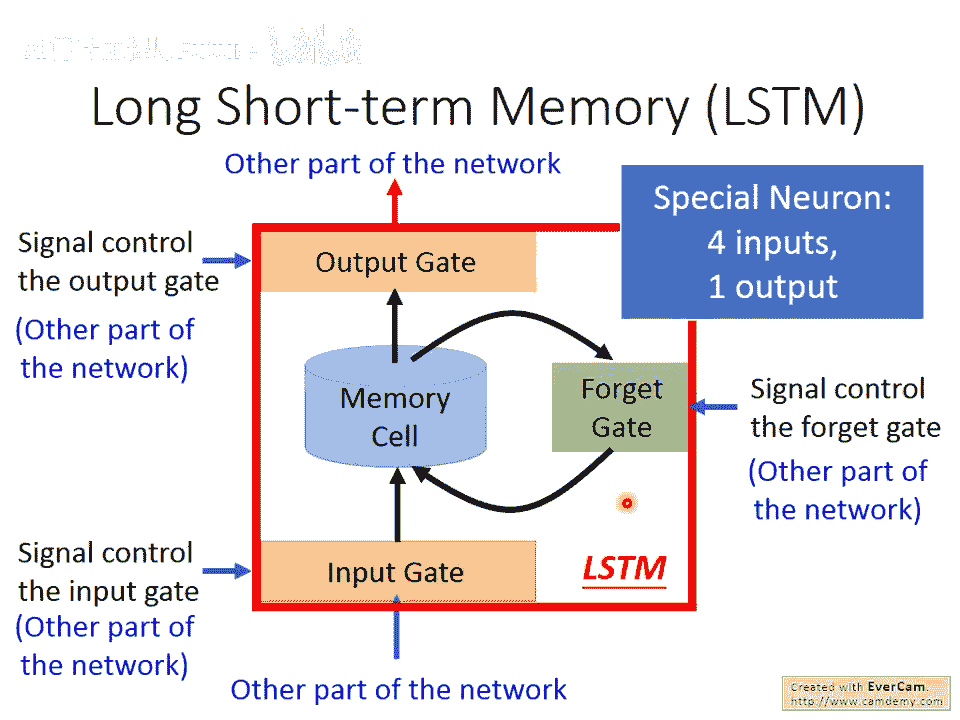
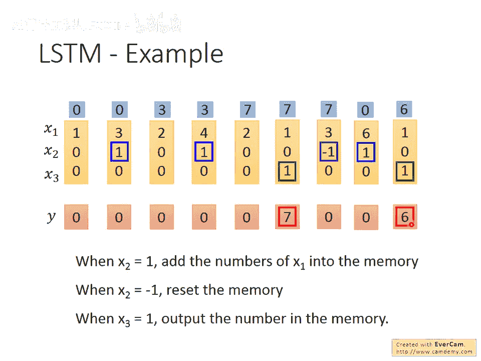
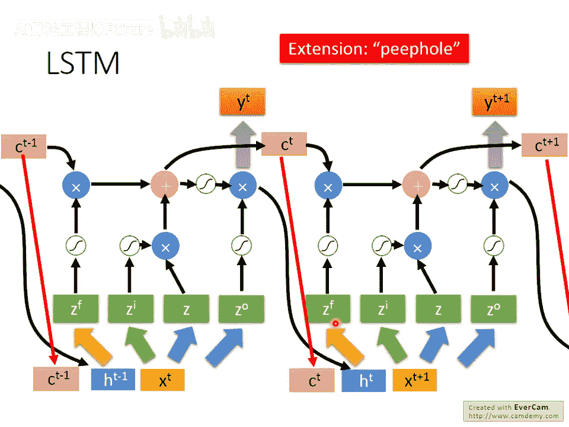
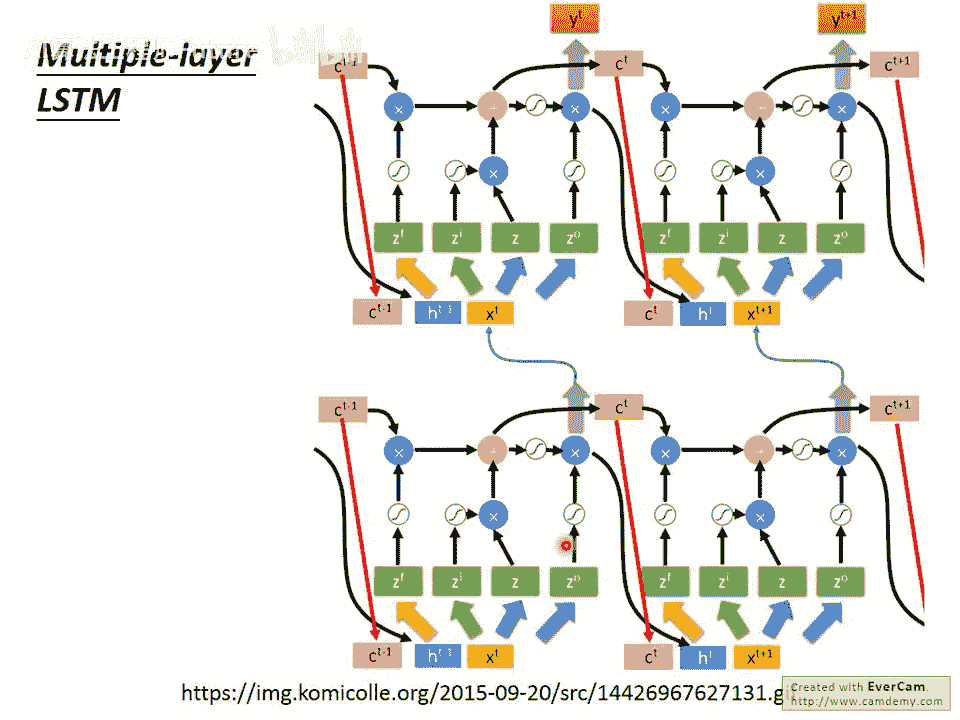
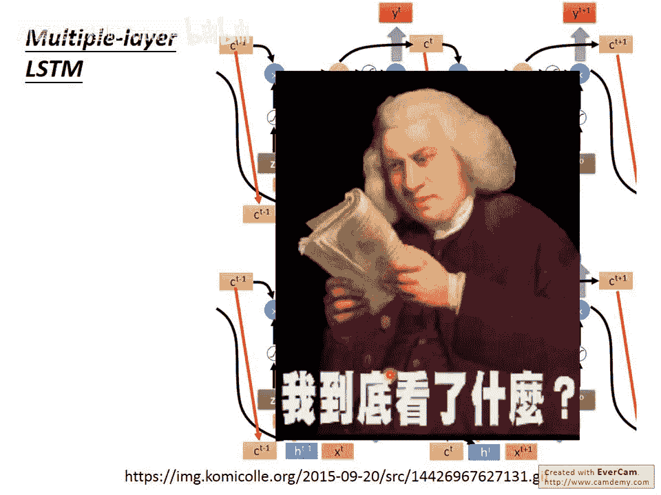
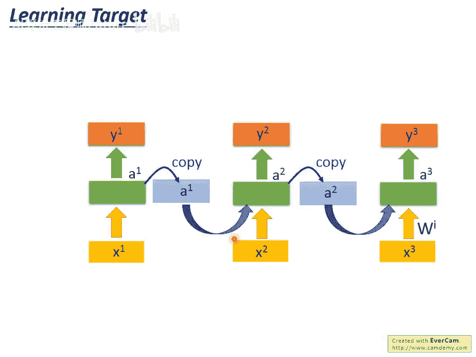

# 【官授搬运】2026年全新优化版李宏毅机器学习系统课程，这才是真正的初学者体系课程！—人工智能／深度学习／神经网络 - P31：3-选修-RNN-1 - AI算法工程师Future - BV1ruqABeEFX

呃各位同学大家好，我们来上课吧，好，那接下来呢我们来讲一下这个recurrent，Neural network，那return your network呢，它其实也可以做到。

我们在前一堂课里面讲的sequence laing的task，那最后呢我们再来说他们有什么样的不同，那我们这边要举的例子呢是slot feeling，我们知道说现在很流行呢。

做一些智慧客服啊什么之类的东西，比如说做一些智慧的订票系统，那这种智慧的客服或智慧定销系统里面呢，你往往需要stop feeling这个技术啊，stuff feeling指的是什么呢。

STARFILLING指的是说啊，比如说假设有一个人对你的订票系统说，I would like to arrive taipei on november second，那你的系统要自动知道说。

你的系统里面有一些slot，比如说在这个呃，在这个订票系统里面呢，它会有一个slot叫做destination，它会有一个slot呢叫做time of arrival。

唉你的系统要自动知道说呢这边的每一个词汇，它属于哪一个slot，那你的系统呢要知道说台北属于destination，这个SLO，那你要是想要知道说november second呢。

属于time of arrival这个slot，那其他的词汇呢就不属于任何slot里面。

那这个问题要怎么解呢。

其实这个问题你当然也可以用一个FEFORWARD，neural network来解，也就说哦我叠一个FEFORWARD的neal network，然后它的input呢就是一个词汇啊。

比如说你把台北呢变成一个vector，丢到这个neural network里面去，但是你要把一个词汇丢到neural network里面去，你必须要先把它呢用一个向量vector来表示。

那怎么把一个词汇用一个向量来表示呢，啊方法实在太多了哦，所以拿if分的方法呢就是one of friencoding，我想这个呢应该就不需要再细讲，那当然你用war vector呢来表述。

表示一个词汇呢也是可以的，那或者是呢有一些beyond one of phencoding的方法，比如说呃，呃有时候呢，如果你只是用wonderful encoding，来描述一个词汇的话。

你会遇到一些问题，因为有很多词汇你你可能从来都没有见过，所以你会需要在one of phencode，里面多加一个dimension，这个dimension呢代表other。

然后所有的词汇如果它不是在我们词典里，有的词汇就归类到are的里面去啊，比如说呃呃甘道夫不在这个vector，不在我们的vector，不在我们的VOCABULA里面。

它就归类到other或者是这个呃索索伦啊，他不在这个vocabulary里面，它就归类到这个vector，那你也可以用某一个词汇的字母，来表示他的vector哦，如果你用某一个词汇的字母的engram。

来表示那个vector的话呢，你就不会有某一个词汇不在词典中的问题啊，比如说你有个词汇叫做apple，那apple呢它里面有出现app，有出现PPL，有出现PLE。

那在这个vector里面对应到app的那个dimension，就是一对应到PLE的dimension，就是一对应到p p l dimension，就是一，而其他的都是零好无论如何。

假设我们可以把一个词汇呢表示成一个vector，那就可以把这个vector呢丢到一个FEEDFORWARD，network里面去，那在slap building这个task里面呢。

你就会希望你的output是一个probability distribution，这个probability distribution代表说我们现在input这个词汇，属于每一个slot的几率。

举例来说，tape属于destination的几率，还有台配属于type of departure的几率等等，但是呢光只有这样是不够的。

v four one network呢没有办法solve这个problem，为什么呢，假设现在有一个使用者说要arrive taipei november second。

那arrive是other taipedestination on，是ARTER，November second，都是时间。

但是如果另外一个使用者说leave taiware november second，那TAIWI这个时候他应该是place of departure，他应该是这个出发地，而不是目的地。

但是对neural network来说，input一样的东西，output就是一样的东西，而你input台北这个词汇，它output要么就都是destination，几率最高。

要么就都是这个place of departure的，都是要么就都是目的地的几率最高，要么就都是出发地的几率最高，你没有办法让他有时候出发地的几率最高，有时候目的地的几率高，那怎么办呢怎么办呢。

这个时候呢我们就希望我们的neural network，他是有记忆力的哦，如果今天neural network是有记忆力的，他记得他在看过这个红色的台北之前，他就已经看过arrive这个词汇。

他记得他在看过绿色的台北之前，他就已经看过leaf这个词汇，他就可以根据一段话的上下文产生不同的open哦，所以如果我们让我们neural network，他是有记忆力的话，他就可以解决音不同的词汇。

但是output必须是不同的这个问题哦，那这种有记忆的neural network呢，就叫做recurrent neural network啊，缩写的是RN。

那在recurrenneural network里面呢，每一次我们的这个hidden layer，每次我们的这个hidden layer里面的neural呢，产生output的时候。

这个output呢都会被存到memory里面去，我们这边呢用绿色的方块呢来表示memory好，当这些hidden layer里面的neural有output的时候呢。

它就会被它就会被存到这个蓝色的方块里面去，那下一次如果当有input的时候，这个hidden layer呢，这个这咳咳这些neural呢他不是只会考虑input，这个x1跟x2。

他还会考虑存在这些memory里面的值啊，对他来说呢除了XY和XQ以外，这些存在memory里面的值呢，a one a two呢也是他必须要呃，也会影响它的output。

那我想呢直接举一个例子呢。

大家可能会比较清楚，假设我们现在这个图上的这个network，它所有的weight呢都是一，然后所有的neural呢都没有任何的BIOS。

然后假设呢所有的activation function呢都是linear好，这样可以不要让计算太复杂，那现在假设我们的input呢是一个sequence，我们的input呢是111122。

那我们把111122，这个sequence input到这个recurrenneal network里面去，会发生什么事呢，那首先呢在你开始要使用这个咳。

recurrent neural network的时候呢，你必须要给memory呢起始值，OK你必须要给memory呢，呃在还没有放弃任何东西的时候，你必须要给它一个初始值，比如说我这边呢。

就假设在还没有放弃任何东西之前，memory里面的值呢是理好，那现在呢输入第一个输入一跟一，OK那接下来会发生咳，接下来会发生什么事呢，对这个neuron来说哦，他接到一他除了接到input1跟一以外。

他还接到memory的零跟零，那因为我们说所有的weight都是一，所以它的output呢就是二，就是二这个new我们的output呢也一样是二，然后接下来呢，接下来呢因为所有的weight都是一。

我们所有的weight都是一，所以红色这两个neural呢，他们的output呢就是四好，所以input1跟一的时候，它的output呢就是四跟四，那接下来呢接下来return new network。

会把这些这个绿色的这个neural嘛，它的output存到memory里面去，所以呢memory面的值呢就被update2，这个二呢会被写进来啊，这个二呢会被写进来。

对memory面值呢叫update变成二好，接下来呢再输入一跟一，这个时候绿色的neuron会有什么样的输出呢，它的输入有四个一跟一跟二跟二，然后wait都是一哦。

所以把2+2加1+1得到的结果呢是六好，那最后呢红色new用的输出就是66，而是12哦，所以当输入一跟一的时候，第二次再输入一跟一的时候，输出就是12跟12哦。

所以对recorneal network来说，你就算是输入一样的东西，你就要给他一模一样的input，在这case里面都是一跟一，咳咳咳，你就算给他一模一样，input在这case里面都是一根一。

它的output是有可能会不一样的，因为存在mar里面的值呢是不一样的，好那原来的值呢，呃在这个这个绿色牛用的output是六跟六，那接下来六跟六呢就会被存到memory里面去。

就会被存到memory里面去哦，所以二呢就被洗掉，好变成六好，接下来呢我们的input是好，二跟二好，假设input是二跟二，这边每一个绿色的neural，他考虑了四个input，二跟二跟六跟六。

所以6+6加2+2是多少呢，得到值是16，那红色用的output呢就是32哦，是input2跟二的时候呢，output是32，那今天在做recorneal network的时候呢，有一件很重要的事情。

就是这个input sequence啊，这个input sequence啊，RECORNEALNE在考虑它的时候，并不是independent哦。

所以今天如果你任意调换input sequence的顺序，比如说把二跟二挪到最前面来，那output呢是会完全不一样，所以在recorneural network里面。

他会考虑input这个sequence的order好，那所以今天如果我们要用recurrent，neon network来处理slot feeling这个问题的话，它看起来就像是这样，有一个使用者说呃。

arrive taipei啊，November second，那arrive呢就变成一个vector，丢到neural network里面去，Neural network，hidden layer呢。

它的output呢我们这边写成a one哦，这个a one是一排neural的output好，所以它其实是一个vector，然后呢根据这个a one呢，我们产生y one啊。

这个y one呢就是arrive，属于每一个slut的几率，接下来呢a one呢会被存到memory里面去，接下来呢台北会变成input，好台表会变成input。

那这个hidden layer呢会同时考虑台北这个input，跟存在memory里面的a one咳得到a two，然后再根据a two才成y two，y two是台北属于每一个slot的几率啊。

这个process呢就以此类推，我们再把ATU存到MARY里面，再把on丢进去，那hidden layer同时考虑input on，这个词汇的vector跟存在memory里面的a two。

得到A3A3，然后A3再得到Y3，它代表on属于每一个slot的几率，那这边要注意的事情是哦，有人看到这个图就说嗯这边有额三个new，这个不是三个network，这样哦，这个是呃同一个network。

在三个不同的时间点被使用了三次，好，我这边呢特别把同样的weight呢，就用同样的颜色来表示，同样的weight呢就用同样的颜色来表示。

我希望大家呢能看得出来好，那所以如果我们有了memory以后，刚才我们讲的输入同一个词汇，我们希望它output不同的，这个问题就有可能被解决哦，比如说如果同样是输入台北这个词汇。

但是因为红色台北前面接的是利，绿色台北前面接的是arrive，所以因为leaf跟arrive他们的vector不一样，所以hidden layer output咳咳也会不同。

所以存在memory里面的值呢也会不同，所以虽然现在x2是一模一样，但是因为存在memory里面的值不同，所以DWLAI的output会不一样，所以最后的output呢也就会不一样。

好那这个是return neal network基本概念。

当然你这个架构的RECORNEALNE架，return your network架构呢你是可以这个任意设计的，比如说他当然可以是dip，我们刚才看到recorneal network。

它只有一个hen layer，当然它可以是deep的recurrenrecurrent neural network，那比如说我们把x1丢进去以后，它可以通过一个hidden layer。

再通过第二个hidden layer，以此类推，通过很多个hidden layer以后才得到最后的offer，那每一个hen layer的output都会被存在memory里面，在下一个时间点的时候呢。

哦在下一个时间点的时候呢，每一个hidden layer，会再把在前一个时间点存的值呢再读出来，再把前一个点是存的值，前一个时间点存的值呢再读出来，最后得到最后的open啊。

这个process呢就一直持续下去，那这个OUTDP你要叠几层呢，都是可以的，那recorneural network有不同的变形，我们刚才讲的呢叫做elon network。

如果我们今天是把T的layer的值存起来，在下一个时间点再读出来哦，这个叫做alment network，还有另外一种呢叫做jordan network，Jordan network。

他存的呢是整个network output的值，然后他再把output的值，在下一个时间点呢再读进来哦，它是把output的值存在memory里面。

那呃传说呢jordan network可以得到比较好的performance，因为这个这边的hidden layer啊，他是没有target的呃，所以有点难控制。

说他学到什么样的hidden的information，他学到把什么东西放在memory里面，但是这个Y啊他是有target的，所以我们今天可以比较清楚，我们放在memory里面的呢是什么样的东西。

啊这个return neal network呢它还可以是双向，它还可以是双向，什么意思呢，我们刚才看到recurrenreal network，你input一个句子的话，它就是从句首一直读到句尾啊。

假设句子里面的每一个词汇，我们都用ST来表示它的话，它就是先读ST1，再读ST加一，再读ST加二，但是呢其实它的读取方向也可以是反过来的，也可以是反过来，他可以先读XT加二，再读ST加一，再读XT哦。

你可以同时train一个正向的recurrent neal network，又同时train一个逆向的recurr neal network，然后把这两个recurrenneural network。

咳咳the hidden layer拿出来，把这两个record neal network的hidden layer拿出来，都接给一个open layer，得到最后的YOK。

所以你把正向的network在input s t的时候，的output跟逆向的network在input s t的时候，output都丢到另外一个，都丢到另外一个。

这个这个hen layer都丢丢给output layer，然后让output layer产生YT，然后产生YT加一吧，产生YT加二，以此类推，那用by directional，咳咳咳。

recorneal network好处呢是呃，你的network呢它在产生output的时候，他看的范围是比较广的，如果今天你只有这个正向的network，正向的network在产生YT的时候。

在产生YT加一的时候，你的network只看过XYXX一直到X71的input，但是如果我们今天是by directional的recurrent，Neural network，在产生YT加一的时候。

你的network不只是看了S1到ST加一，所有的input，他也看了从句尾一直到XT加一等一分，那你的network呢等于是看了整个input，整个input sequence以后。

假设你今天考虑的是slug feeling的话，你的network等于是看了整个sentence以后，才决定每一个词汇的slot呢应该是什么，那这样当然会只比他们会比只看句子的一半。

还要得到更好的performance，那我们刚才讲的return neural network呢，其实只是recurrenneural network的一个最simple的版本。

它其实只是一个最其实只是一个最simple的版本，那我们刚才讲的那个memory呢是最单纯的，就是呃我们随时都可以把值呢存到memory里面去，也可以随时呢把值呢从memory里面读出来。

但现在比较常用的memory呢称之为long short tern的memory，这种long shall turn memory呢，它的简写是LSTN这种long shot turn memory呢。

它是比较复杂的，这个long showtime的memory呢，它有三个gay，当外界当neural network的其他部分，当某个某个那个呃呃neural的open。

想要被写到memory cell里面的时候呢，他必须先通过一个闸门，通过一个input gain，那这个INVOCATE呢它要被打开的时候，你才能够把值呢写到memory cell里面去哦。

如果他被关起来的时候，其他neural就没有办法把值呢写进去，那至于这个input game它是打开还是关起来，这个是neural network自己学的哦，所以他可以自己学。

说他什么时候要把input给打开哦，什么时候要把input给关起来嘶，那输出的地方呢，输出的地方也有一个open gate，那这个apple gate会决定说，外界其他的neural。

可不可以从这个memory里面把字读出来，对那当open play被关闭的时候，就没有办法把值读出来，而只有open bg被打开的时候才可以把值读出来，那跟input gate一样。

open gate什么时候是打开，什么时候是关起来，network呢也是自己学到的，然后第三个get呢叫做forget get，那forget get是决定说什么时候memory cell呢。

要什么时候memory呢，要把过去记得的东西忘掉，或是他什么时候把过去记得的东西呢做一下，否make哦，把它否made掉，那这个fork gay呢，什么时候会把存在memory里面的值否灭掉。

什么时候会把存在memory y里面的值继续保留下来，这个也是network的自己学到的，可那整个LSTI呢你可以看成它有四个input，一个open哦，这四个input是什么呢。

这四个input一个是想要被存到memory cell里面的值，但他不一定存得进去，只要depon input gate，要不让他要不要让这个information过去跟操控input，gate的讯号。

操控OPGATE的讯号和操控forget gate的讯号，所以一个LC2的cell呢，它有四个input，那有这四个input，但他只会得到一个output，好那这边有一个额小小的冷知识啊。

就是这个dash啊，你觉得他应该被放在哪里啊，呃我投影片把它放在这边，但并不代表我投影片，这是对的，这样我可能只是想要我，只是我我有可能只是突然发现我写错了，想要改一下好。

你觉得这个dash应该放在long和show之间的同学，举手一下，没有好，你觉得他应该放在show跟turn之间的同学，举手一下，把手放下啊，对没错，他应该放放在show跟turn之间。

有时候我看到有人放在low跟show之间，那其实这个是比较不make sense，应该是放在show跟turn之间，因为它其实呢还是一个short tern的memory。

这样他只是比较强的shelter memory，就按照这个字面意思，他是比较长的short term memory哦，因为咳咳，因为之前我们看那个return neon network啊。

他的memory在每个时间点都会被洗掉，对不对，每一次有额，如果只要he登，只要每次有新的input进来，每天每一个时间点呢，return neon network都会把memory洗掉。

所以他他这个show turn呢是非常秀的，他只记得前一个时间点的事情，但是如果是long show time的话，他可以记得比较长一点，只要fork k不要决定要否made的话呢。

它的值呢就会被存起来嘶好，那这个MARY的cell呢，如果更仔细的来看它的formulation的话。

他长得像这样，OK这个是呃外界的input，外接要存到sell里面的input，这个是input game，这个是forget gate，这个是ob给咳咳好。

那我们假设呢现在要被存到sell里面的input，叫做Z操控input gate的signal叫做ZI，而这个所谓操控input gate signal，它也就是一个SCALA，也是个SCALA。

也是个数值，那我待会讲说那个数值是从哪里来的，反正这边就是有一个数值，被当做这一个SM的input，好，而不gay有个操控它的数值呢是ZO，综合这些东西以后，最后会得到一个output，这边写作A咳好。

假设我们现在self里面呢在输入这些，在有这个四个输入之前，它里面已经存了值C，那现在呢假设要输入输入的部分呢，输入Z那三个gay分别是由ZIZF，ZO所操控的，那output a呢会长什么样子呢。

我们把Z呢通过一个activation function得到只有Z，然后把ZI呢通过另外一个excavation function得到F，Z i，那这边呢呃这三个ZI。

通常我们会选择sigmoid function，那选择sigmoid function，它的意义就是sigmoid function只是记在0~1之间的，而这个0~1之间的值。

代表了这个KATE呢被打开的程度啊，如果这个F的output呢和这个information方式的output是一，代表这个get的是处于被打开的状态，反之呢代表这个get呢是被关起来的，OK好那。

嗯接下来呢我们就把GOC乘上这个，input gate的值FCI得到JZ乘上FCI，得到FZF，然后接下来呢我们把存在memory里面的值，C呢乘上FZF好吧，C乘上FZF得到C乘FZF。

然后接下来把这个呃C乘上FZF加上g of z，乘上FZI好吧，这两项呢加起来，把这两项加起来得到c pl，c pi呢就是新的存在memory里面的值，新的存在memory里面的值就是CP哦。

所以根据这是到目前为止运算，可以发现说呢这个FZI就是control，这个GZ可不可以呃输入的一个关卡，因为假设FZI等于零，那GZ乘上FZI就等于零，那就等就好像是没有输入一样，如果FZI是等于一。

那就等于是直接把GZ呢当做输入，那这个FZF呢，FZF就是决定说，我们要不要把存在memory里面的值洗掉，假设假设FZF是一，假设FG其实这个fork是假设FDF是一啊。

也就fork k是被开启的时候，for gk在开启的时候呢，这个时候C呢会直接通过啊，C会直接通过，就等于是呃呃把之前存的值呢还是记得，那如果是这个FZF等于零，也就fork k被关闭的时候。

零乘上C获取try memory里面的值呢就会变成零诶，然后把这两个值呢咳咳加起来，当做呃我们把这两个值加起来，然后就写到memory里面，得到supply样子，那我觉得fork gay呢。

它的开关呢跟我们的这个直觉的想法呢，是相反的，而这个fork gay呢，它打开的时候代表的是记得它被关闭的时候，代表的是遗忘这样子啊，所以他的名字我觉得取的有点有点怪啊，或许不该叫他。

或许不该叫他HAGGAY哦，不过反正这个这个这个习惯上的就是这么做，就是这么叫他的好的，把这个C派呢通过H得到h of c p，OK然后接下来呢哦这边有一个output gate。

这OPERGATE呢受ZO所操控，ZO通过F得到F不是U啊，F不是U，如果是一的话，那好这边我们会把这个F和ZO跟HF，c pi乘起来哦，所以如果FZO是一。

就等于是h of c派呢可以通过这个up不给，如果h of f of z o是零，就等于呢呃等于这个这个output就会变成零，就代表说存在memory里面的值呢。

没有办法通过output game呢被读取出来，这也许这样你还是没有觉得很清楚啊，所以后面呢我就打算做一个人体LS体验，这我我从来没有在其他地方看过人体LS体验，因为你可以想象我在拖延是做很久。

那这个我们我们先举一下，我先讲一下我们要举的例子，等一下我们要举的例子是这样，我们的network里面只有一个LSTN的cell，那我们的input都是三维的vector。

output都是一维的vector，那这个三维的vector，它跟open还有memory里面的值的关系是什么呢，这个关系是这样子，假设第二个dimension x2的值是一的时候。

XY的值就会被写到memory里面去，假如x2的值是一的时候，XY的值就会被存到memory里面去，假设x2的值是一的时候，memory就会被reset好，就中每每存的值呢就会被遗忘啊。

假设X3等于一的时候，你才会把OPPO给打开，才能够看到输出哦，所以呢，假设假设我们原来存在memory里面的值是零，那呃当这边是一的时候啊，当这边是一，当这边是一的时候，当x2等于一的时候。

三呢会被存到memory里面去，所以得到的值呢就变成三，那这边又是又出现一次一呃，这边又出现一次一，所以四会被存到memory里面去，所以就得到七，而这边呢X3等于一，所以open gate呢。

所以所以这个七呢会被输出哦，所以得到七，那这边是一哦，如果是一的话呢，就会把memory里面的值呢洗掉哦，所以看到一下一个时间点，memory的值就变成零，然后看到一就会把六存进去，所以得到的值呢是六。

而这边一呢是输出啊，所以得到的值是六，OK好，那我们就来实际做一下运算。

然后实际做一下运算好，那这个是一个memory cell啊，这是一个LSTN的memory cell，那我们知道l s n memory cell呢总共有四个input啊。

这四个input都是SCALA，这个四个input scala是怎么来的呢，这四个SCALA是我们input那个三维的vector，乘上一个这个呃，呃linear transform以后所得到的结果。

OK你就把这三个meta乘上三个值，再加上BIOS就得到这边的input，这三个值再乘上三个三三个位置，再乘上BISS啊，再加上bias就得到它的input，以此类推啊，以此类推，那。

好那这些这些这些值啊，这些值就是你的这个input x y x6X三，要乘上哪些值，还有那个bias的值应该是多少，这件事情呢是透过training data。

用gradient descend是学到的，那么今天只是假设说，我已经知道这些值是多少哦，我已经知道这些值是多少，然后呢我现在得用这样的输入，看会得到什么样的输出好，那我们就实际的来咳运算一下。

不过在实际运算之前呢，我们先根据它的input呢，根据这些参数呢来分析一下，我们可能会得到的结果，那你看在这个地方x1乘一，其他都是乘零，所以呢这边呢就是直接把x1当做输入。

好在这我们看input gate的地方，我们看input get的地方，它是x2乘100bias，咳咳咳，bias呢是副词，也就是说呢假设x2没有值的时候，因为bias是副词。

所以通常input gate呢是被关闭的哦，如果BIOS是十的话，那通过activation function以后呢，它会是通过sigmoid activation function以后呢。

它只会接近零，所以呢代表它是被关闭的，那只有在x2有值的时候，如果x2有值，它就会比BIOS这个十还要大啊，如果x2带一的话呢，它就会比BIOS的这个这个这个，这时候input就是一个很大的正值。

代表input gate被打开，那fork gay呢，fork gay呢，咳咳咳，fork gay呢平常呢都是被打开的，你会发现说因为他掰的只是死哦，所以平常呢都是被打开的，所以平常都会一直记的东西。

只有在x2给它一个很大的负值的时候，它会压过这个BS才会把fork给关起来，然后不给呢，OPERGATE平常呢也都是被关闭的，因为它BIOS的是很大的负值，但是如果今天X3有一个很大的证实的话。

它就可以压过bias，把offer给打开好，所以我们就实际的来input一下，看看我们假设G和H都是linear的，这样计算比较方便，然后假设呢初始值的存在，memory里面的初始值呢是零，好。

那我们现在input第一个vector310啊，Input310，OK那input310会发生什么事呢，3×1哦，所以这边进来的值是三，然后1×100减100，所以这边呢input gin呢约等于一。

而且他是被打开的，那forget gay呢哦是213哦，所以通过input gay以后呢得到的值是三，那forget gay呢3input是310啊，所以fork gay呢是被打开的。

所以fork gay是被打开的，然后呢把0×1加上三，好像fork g是被打开过，里面本来就没有存值好，所以没有什么影响啊，0×1加上三好，所以存在merry面值呢变成三。

然后接下来呢看OPPOK310OPERK的值呢，output gate呢还是被关起来的，所以三呢无法通过，所以输出就是零好，接下来呢input咳咳，input呢410哦。

然后这个input的地方呢还是四，然后这个410呢会把input gain呢呃打开，然后会把forget gay呢呃fork gate也会被打开啊，因为fork g被打开的关系，所以3×1加四。

所以memory里面的尺寸的值呢会变成七，那OBERGATE呢OPGIN仍然是被关闭的啊，OPERGATE仍然是被关闭了啊，所以七呢就直接没有办法被输出啊，所以整个merry的输出呢仍然是零。

好接下来呢input这个200，那input200会发生什么事呢，啊input200哦，所以现在input呢变成二，input变成二，然后呢呃这个input gain会怎样呢。

input gate现在是200啊，所以它哎convention function，input是十哎，divation function input是十，所以output是趋近于零，所以0×2=0。

等于是input备，哼等于input，这个二呢被input gain呢挡住了，那fork gay呢，呃200得到的fork gay呢呃得到division function，input是十。

所以fork gay呢还是打开的，所以7×1加上零啊，原来的存在memory里面的值呢是不动的啊，还是七还是七，那这个七呢它没有办法被输出啊，因为open game呢仍然是关闭的。

所以整个output呢仍然是零好，接下来呢input101啊，input是101，那input101会发生什么事呢，啊这边input呢仍然是一啊，input仍然是一，那这个input gain呢。

input gate是被关闭了，那forget gay呢，forget gay这个时候呢原仍然跟原来一样啊，它是被打开的，所以memory里面存的值呢是不变的。

那open gate呢当你input101的时候，你会打开OPGATE，这时候exeration function的input呢变成90。

通过exservation function以后呢得到一好得到一咳咳，你看1×7=7这样子，OK所以output的地方呢会变成是有值的，也就是memory里面的值呢会每存在memory里面的值。

七呢会被读取出来，好最后让我们试一下三负103负103，一零，这个三呢就被读进来，input gay呢会被关起来，那forget gay呢，咳咳咳，因为这个值呢是一，这个值是一。

所以fork gay的activation function input是-90，activation function in output就是零，所以呢memory里面存的值呢会被洗掉哦。

memory里面存的值呢会乘上fork k的output会被洗掉，就变成那OPGAY呢这个时候呢仍然是关起来哦，不还有开有关也没差，因为反正现在呢存在merry面的值呢变成零，那读出来的值也是零。

咳咳咳嘶好，那嗯你看到这边你可能会有一个问题，这个东西跟我们原来看到neural network，感觉很不像啊，他跟原来的neural network到底有什么样的关系呢。

你可以这样想嘶在我们原来的neural network里面，我们会有很多的neural，我们有很多的牛肉，我们会把input，我们会把input乘上不同的weight，然后当做是不同NEAL的输输入。

然后每一个neural它都是一个function，它输入一个SCALA，Output，另外一个scale，但是如果是LSTN的话呢，你其实只要把LTN的那个memory的cell。

想成是一个new role就好懂吗，所以如果我们今天要用一个LTN的network咳，你做的事情只是把原来一个简单的neural，换成一个LSTM的cell，换成一个LSTN的cell。

而现在的input呢，现在的input x1跟x2它会乘上不同的weight，当做LSTN的不同的输入，OK也就是说XYXQ乘上某一组位，变成假设我们现在只有这个这个hidden layer。

只有两个呃，neural也就只有两个LST，但实际上你不会只有两个neural，通常可能有，比如说1000个new ro，有1000个LSTN的memory cell，我现在假设只有两个new ro。

那x1 x2乘上某一组weight，会去操控第一个LSTN的OPGATE，乘上另外一组weight，操控第一个LTN的input gate，乘上一组weight，当做第一个lcn input。

乘上另外一组way，当做另外一个LSTN的fork gate input，另外一个第二个LTN也是一样，x y x2乘上某一组weight，操控它的output，它会操控它的input，操控。

操控他的OPERGATE，操控它的input gate，操控它的input，操控他的forget gate等等哦，所以我们刚才讲过，说LICN它就是有四个input跟一个output。

而对一个LSN来说，它的这四个input是不一样哦，这四个input都是不一样，这四个input都是不一样，在原来的neural network里面，一个neural就是一个input。

一个output，在LSTN里面它需要四个input，它才能够产生一个output，这样子啊，就好像所有的机器呢它只要插一个电源线，它就可以跑啊，像LSTN呢他要插四个电源线它才能跑。

那所以LSTN因为它需要四个input，而这四个input都是不一样，所以LSN需要的参数量，假设你现在用的neon的数目，就是假设LSTN的network跟neural network。

就原来的这个这个这个你用原来的neural的network，他们的这个neon的数目是一样的，时候，有SDN需要的参数量，会是一般的neural network的四倍，OK而从这个图上呢。

你可以很明显的很明显的看出来，一般的news network只需要这个部分的参数，只需要这个部分的参数，所以他需要四倍的参数，不过这样讲呢，你可能还是没有办法很了解，因为可能没有办法额。

也没有办法体会的，可能是这个跟recurrent，neural network的关系是什么呢，这个好像看起来不太像recurrent neural network，呃咳咳咳。

所以呢我们要画另外一个图呢来表示它，你可以想象这个图呢也是要画非常久的，呃假设我们现在有一整排的neural啊，假设我现在一整排的neural，假设一整排的LOSTN，那这一整排的LSTN里面呢。

他们每一个人的memory里面都存了一个值，OK每一个LSTN的cell它里面都存了一个scale，可把所有的SCALA接起来，好把这些SCALA接起来，它就变成一个vector，这边写成CT减一。

也可以想到这边每一个memory里面存的SCALA呢，就是呃这个vector的代表，这个vector里面的一个dimension，OK好，现在在时间点t input a vector，X t。

这个这个vector呢，他会首先先乘上一个linear的transform，乘上一个mattress，变成另外一个vector z，OK你把XT乘上一个matrix变成Z。

那这个Z呢也是一个vector z，这个vector代表什么呢，ZZ咳Z这个vector的每一个dimension呢，就Z这个vector的每一个dimension呢。

就代表了操控每一个LSTN的input，Ok，所以这个Z它的dimension呢，就正好是LSTN的memory cell的数目啊，正好就是他的数目，那这个Z的第一维就丢给第一个sell。

第二维就丢给第二个SL，以此类推，然希望大家知道我的意思好，那这个ST呢会再乘上另外一个transform，得到ZI，然后这个ZI呢，它的dimension呢也跟cell的数目一样。

ZI的每一个dimension呢都会去操控一个memory，Ok，所以ZI的第一维就是操控它，第一个私有的input gate，第二为就是操控第二个cl的input game。

最后一维就是操控最后一个cl的input gate，那fork gay呢跟OUTCAE呢也是一样啊，这边就不再赘述，你把XT呢乘上乘form得到ZF，然后XT呢等上另外一个conform得到ZO。

ZO会去操控每个cell的OPERGATE好，所以我们把XT乘上四个不同的transform，得到四个不同类，这四个vector dimension都跟sales的数目是一样。

那这四个vector合起来就会去操控呢，这四个vector合起来呢，就会去操控这些memory cell的运作啊，好那我们知道一个memory cell呢就是长这样啊。

现在input分别是ZZIZF跟ZO啊，注意一下，就是这个这四个这四个这个这四个Z啊，他们其实都是vector，OK那么都是vector丢到cell里面的值呢。

其实只是每一个vector的一个dimension，Ok，那因为每一个cell，他们input的那个dimension都是不一样的，好所以每个cell input的值呢都会是不一样哦。

但是咳所有的cell呢是可以共同一起被运算啊，怎么共同一起被运算呢，我们说Z要乘上ZI哦，对不对哦，要不要把ZI先通过activation function，然后把它跟Z相乘。

所以我们就把ZI通过activation function跟Z相乘，这个乘呢是这个element wise的pa的意思，element wise的相乘好。

那这个ZF也要通过fork gate excavation function，它跟之前已经存在self里面的值呢相乘这件事情，它它跟原来存在memory cell里面的值相乘，它它把跟它相乘。

它把把它相乘，然后接下来呢你要把这两个值加起来，要把这两个值加起来，也就是把ZI跟Z相乘的值，把它们加起来好，那output gate呢CEO通过activation function。

然后呢把这个output呢跟咳相加，以后的结果呢再相乘，最后就得到最后的output的Y，那这个时候相加以后的结果就是，memory里面的存的值，相加以后的结果就是main里面存main里面存的值。

也就是ct好，那这个process呢就反复的继续下去，在下一个时间点input x t加一呃，XT加一，然后呢你把Z跟input gain相乘。

你把forget gate跟存在memory里面的值呢相乘，然后再把这个值跟这个值加起来，再乘上open gate的值，然后得到下一个时间点的输出，这样子那可以想说你可能觉得说这已经很复杂。

如果你自己做投影片的话，显然是要做非常久，但是这个不是LSTN的最终形态，这个只是一个simplified version，真正的LSTN会怎么做呢，他会把这个地方啊，这个地方的咳。

这个地方的输出呢把他接进来，咳咳咳，他会把这个这个hen layer的输出呢把他接进来，当做下一个时间点的input哦，也就是说下一个时间点呢操控这些get的值，不是只看那个时间点的input x。

还看前一个时间点的output h，然后其实还不止这样，还会加一个东西呢，叫做people，这people是什么呢，这个pea phone呢就是把存在memory cell里面的值呢，也拉过来啊。

也拉过来哦，所以在操控LCN的四个get的时候，你是同时考虑了X同时考虑了H，同时考虑了C，而你把这个三个这个vector呢并在一起，乘上四个不同的transform，得到这四个不同的vector。

再去操控LSTN，那L线通常不会只有一层，现在胡乱都要叠个五六层才爽的样子。

所以他就长得大概是这个样子，然后呃每一个第一次看到这个东西的人呢。

他的反应都是这个样子，而反应都是这样，那呃就我记得这个大家知道，sequence to sequence model啊。

那个是个google brand propose，然后他我有听过他的这个pk，他说他第一次看到LSTN的时候，他的想法呢就跟这个图上是一样，就这个太复杂了，这应该不work吧，我认识的每一个人。

第一次第一次看到lg都觉得说这个应该不work，克这样，但是他现在其实还quite tender啊，当有当有一个人告诉你说，当你当有一个人说哦，我用RN做了什么事情的时候。

就是你不要去问他说为什么你不用LSTA，因为其实他就是用LSTN，因为现在当你说你在做RN的时候，其实你指的就是就是用LSTN，OK那所以它其实呢是比较私人的，那其实KERAS里面有资源，有STN啦。

所以就算是呃刚才讲的这么复杂的东西，你没听懂，其实就算了，在chaos里面就是打LSTN4个字母，然后就结束了，那AKERAS它其实是源三种repreneural network，一个是LSTN。

一个GRU啊，gr u是LSTN的一个稍微简化版本，它只有两个gate啊，据说少了一个gate，但是performance跟L线差不多，而且少了1/3的参数啊，所以比较不容易OVERFIT。

那如果你要用一般的的R，你要用我们这个这堂课最开始讲的那种，最简单的RN的话，你要说是simple RNN才行，这样子对好。

那我想我们今天就上到这边好了，那我们就下课。