# 【官授搬运】2026年全新优化版李宏毅机器学习系统课程，这才是真正的初学者体系课程！—人工智能／深度学习／神经网络 - P32：4-选修-RNN-2 - AI算法工程师Future - BV1ruqABeEFX

想打九等好，那我们就用旁用旁边父母来讲啊，因为中间的啊总目不知道为什么放不出来。

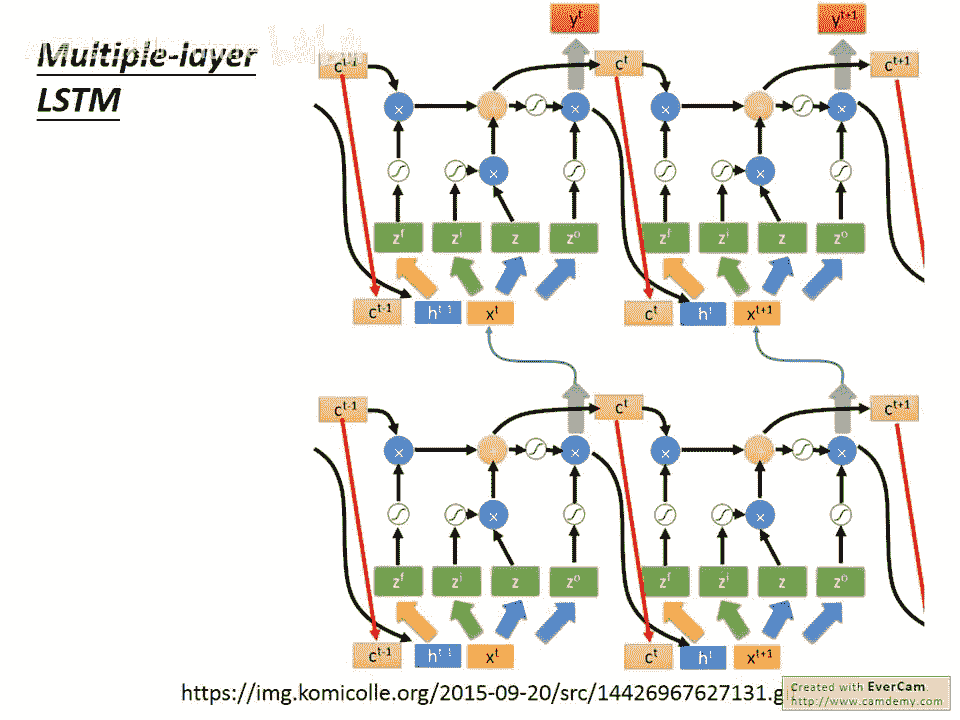

那我们上次呢讲到LSTN，总之就是一个复杂的东西好，那再来的问题是像RECURRENRENEWORK这种架构，它要如何做learning呢，我们之前有说过说如果要做learning的话。

你要定一个cost function来呃，evaluate你的model的parameter是好还是不好，然后你选一个model parameter，可以让这个loss呢最小。

那在recurrent neural network里面，你会怎么定这个loss呢，那以下呢我们就不写算式，直接举个例子，假设我们现在要做的事情呢是sloth feeling。

那你会有training data，好，这个training data是说好给你一些sentence啊，好，诶这个是它是呃，它光是有的哦，要这么近才有，OK好哼，我想坐在这边诶，哦其实是有的哦，那个呃。

啊其实我自己我没有办法看到那个pointer的投影，在荧幕上的光点，诶，你有啊，如果谢谢谢谢，可以可以吗，谢谢谢谢谢谢谢，太感谢好嗯，这个是sentence，OK然后呢你要给sentence呢。

label告诉我们，讯说呢这个第一个word它属于other这个slog，然后台北属于destination，这个SLOON属于other的SLO，NOVEMBER跟second都属于这个出发的目的地。

等要抵达时间的时候，然后接下来呢你希望说你的cost会怎么定呢，把arrive丢到recurrenal network的时候。

recording on network呢会得到一个output y one，接下来呢这个y one呢会和一个reference vector，算它的cos and for b哦，所以你会希望说。

如果我们现在丢进去的是arrive，那YY因它的reference的vector呢，应该是对应到R的那个sloth的dimension value是一，其他是零，这个REFERRECTOR的长度啊。

就是你SLP的数目，比如说定了40个SLP呃，这个reference vector的长度呢，它的dimension就是40，那假设现在input的这个word呢，它应该对照other的这个slot的话。

那对应到R的那个dimension就是一啊，其他的就是零，那现在嗯你把台北丢进去的时候，因为台北属于destination这个词吧，所以就是希望说把x2丢进去的时候。

y two他要跟呃呃呃reference the vector距离越近越好，那y two的reference vector是对应到destination，那个slots是一其他四在这边要注意的事情是。

你在丢sq之前一定要先丢XY，而你在把台北丢进去之前，你一定要先把arrive丢进去，不然你就会不知道存在memory里面的值是多少，对好所以在做training的时候呢。

你也不能够把你的ALTERNS里面的这些word呢，这个word sequence呢打散来看，word sequence呢仍然要当做一个整体来看哦，同样的道理，把on丢进去咳。

还reference factor呢是对应到这个对应到ODER是一来，而对应到R的那个dimension是一，其他是零好，然后所以你的cost就是每一个时间点的r and。

output跟reference vector的cross entropy的和，就是你要去minimize的对象嘶。

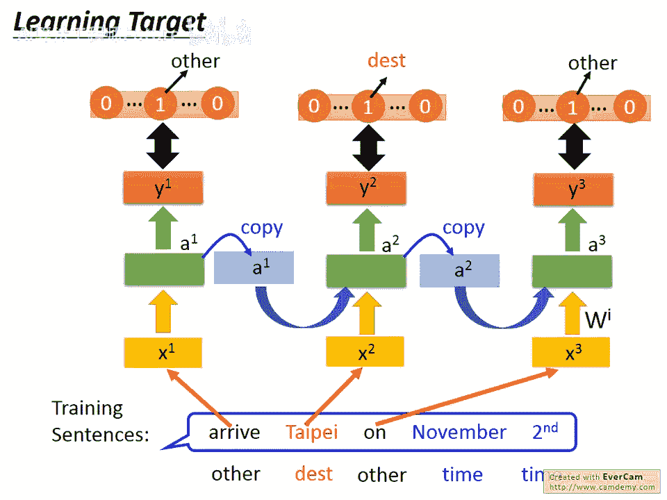

那现在有了这个loss function以后。

training要怎么做呢，training要怎么做呢，training呢其实也是用gradient descent，也就是说如果我们现在已经定出了loss方程。

大L我要update这个network里面的某个参数，W我我要怎么做呢，你要计算W对大L的偏微分好吧，这个偏微分计算出来以后，就用gradient descent的方法的去啊对面一个参数。

那我们之前在讲neural network的时候呢，已经讲过很多次了，那在讲这个之前的那个b phone network之后，我们说gradient descent用在setal network里面。

你要用一个比较有效的演算法，叫做bad application，在recurrenyour network里面，gradient design的原理呢是一模一样的，咳咳但是为了要计算方片。

所以呢也有开发一套演算法啊，这套演算法呢是back propagation的进阶版啊，它叫做这个BPTT，OK那它跟FOBVACATION其实是很类似的。

只是因为recurrenneon network，它是在high sequence上面做运作，所以BPDT呢他需要考虑时间的information，那我们在这边呢我们就不讲BPTT，反正你只要知道说。

反正RNN就是用gradient design train啊，它是可以train的就行了，然而不幸的就是呢，RNN的training呢是比较困难的，那喝口水，RN的training呢是比较困难。

一般而言呢你在做training的时候，你会期待你的这个learning curve呢是向蓝色这一条线，我这边的这个纵轴呢是total lo，这个横轴呢是epoch training的时候的。

epoch的数目，你会希望说呢随着app越来越多，随着参数不断的被update loss呢，应该就是慢慢慢慢慢慢的下降，到最后趋向收敛，但是不幸的是。

当你在训练这个recurrent neon network的时候，你有时候会看到绿色这一条线啊，绿色这条线啊，这个很重要，如果你是第一次train recurrent neural network。

你看到绿色的这样子的这个learning curve，这个learning curse呢非常剧烈的抖动，然后走到某个地方嗯，就传NAN，然后你的城市就省了，可ation for。

而这个时候你会有什么想法呢，我相信你的第一个想法就是城市有bug啊，城市有bug啊，你这个，今年的春天呢我邀那个THOMASMICOLOV来台湾，THOMASMCV就发明那个war vector人啊。

这说讲过了，然后他分跟我分享了，他当时开发RNN的心得啊，他是呃最早开始做RNN的language model的人，大概在09年的时候呢就开始做啊，有很长一段时间呢。

只有他能够把RN的lab model tra起来，其他人呢都劝不起来，好那呃他说他然后在那个年代，那个年代是没有像现在有什么TENSORFLOW啊，DIAO之类的啊，那个年代做什么东西呢。

都是要徒手磕的，所以他徒手磕了一个R对，然后劝完以后就发生这样子的现象，他第一个想法就是城市有bug，城市有bug，然后努力的抵了bug以后，果然有很多bug，然后就把然后就把所有。

但是他们后来就把bug修掉啊休掉，他觉得应该是没有bug，但是这个现象还是在，而且他就觉得很困惑，那其他人就跟他说啊，放弃啦放弃啦，这不沃克这样子，他说嗯，可是我想要，他就想说他要知道结果为什么会这样。

所以他就做分析，等下这个图是来自于他的paper，他分析了一下RN的性质，他发现说呢RNN的error surface，所以error surface是toal lost，对参数的变化是非常的陡峭。

所以非常非常崎岖的啊，所谓的崎岖的意思是说这个error surface，还有一些地方非常平坦，有一些地方的非常的陡峭，就像是有这个悬崖峭壁一样，所以以上这是一个，以前这边这个这个图片上是一个示意图啊。

纵轴呢是pal loss，那这个呃PX轴跟Y轴呢代表两个参数，w one和w two，好，在这个图上显示的就是w y w two，这两个参数对pal loss的影响，而发现说呢在很多地方都是非常平坦。

然在某些地方呢非常的陡峭哦，所以这个会造成什么这样的问题呢，假设你从橙色那个点当做你的初始的点，用gradient descent开始调整你的参数，本来乘车那个点，你算一下gradient。

然后呢update你的参数，然后就跳到下一个橙色的点，再算一下GRADI，再update你的参数诶，你可能正好就跳过一个弦来，所以你的loss loss呢就突然暴增。

因为看到这个loss呢上下非常剧烈的震荡，有时候可能会遇到另外一个更惨的状况，就是你正好就踩一脚踩在这个悬崖上，正好一脚踩在悬崖上，那踩在悬崖上会发生什么事情呢，你踩在悬崖上。

因为在悬崖上的gradient呢很大呃，然后呢之前的规定都很小，所以你措手不及，因为之前规定很小，所以你可能把learning rate调的比较大，但是规点突然很大。

很大的规点在乘上很大的learning r，结果参数呢就update很多，然后整个参数呢就飞出去了，所以你就NAN好，所以城市呢就slementation for。

然后THOMAS后就想说怎么办呢怎么办，他说他不是一个数学家，所以他要用工程师的想法来解决这个问题，然后他就想了一招，这一招呃，这一招呢呃应该是蛮关键的，让很长一段时间只有他的code呢。

可以把RN的lily model全出来，那很长一段时间呢人们是不知道这一招的，因为这一招他觉得实在是太没什么，所以没写在paper里面，直到他在写那个博士论文的时候，那博士论文是比较长的。

所以有些东西就算你觉得区域表，很可能还是会写进去啊，他直到呢他在他在在写这个博士论文的时候，大家才发现了这个秘密，这个秘密是什么呢，这一招呢说穿了就不值钱，这一招呢叫做keeping，keeping的。

意思是说当GRA点大于某个fresh fall的时候，就不要让他超过那个flash ho，在thomas coo的城市里面，我记得就是当gradient大于15的时候，就等于15结束。

这好所以因为你因为GRA点现在不会太大，所以当你做pin的时候，就算是踩在这个拳台上也没有关系，你的参数呢就不会飞出去啊，它会飞到一个比较近的地方，这样你仍然可以继续做R我们的train。

那有人就会问这个，那在接下来的问题就是，为什么RN会有这种奇特的特性呢，为什么RN会有这种奇特的特性呢，有人说有人可能会说哦，是不是因为来自于CMOY方向，我们之前呢有讲过。

在讲IELUALEXAMATIONFM的时候呢，我们讲过一个问题叫做规定managing的问题，然后我们说这个问题是从SIGMOID方向来的，因为SIGMOID的关系是有gradient。

managing这个问题啊，就说RN呢会有这种很小的这个很小的这个呃，呃呃这个很平滑的error，surface是因为来自于gradient vantage。

gradient vantage是因为来自于SIGMOID保险，这件事情呢，我觉得不是真的，等下看，如果这个问题是来自于SIO的方向，换成ILU去解决这个问题啊，是不是这个问题可以跟大家讲一个秘密。

如果你用IOU，你会发现说呢一般在chual network的时候呢，很少用IOU当做activation function，为什么呢，因为如果你把SIGMOD换成IOU。

其实在RNN上面performance呢通常是比较差的，所以activation function并不是这个地方的关键点哦。

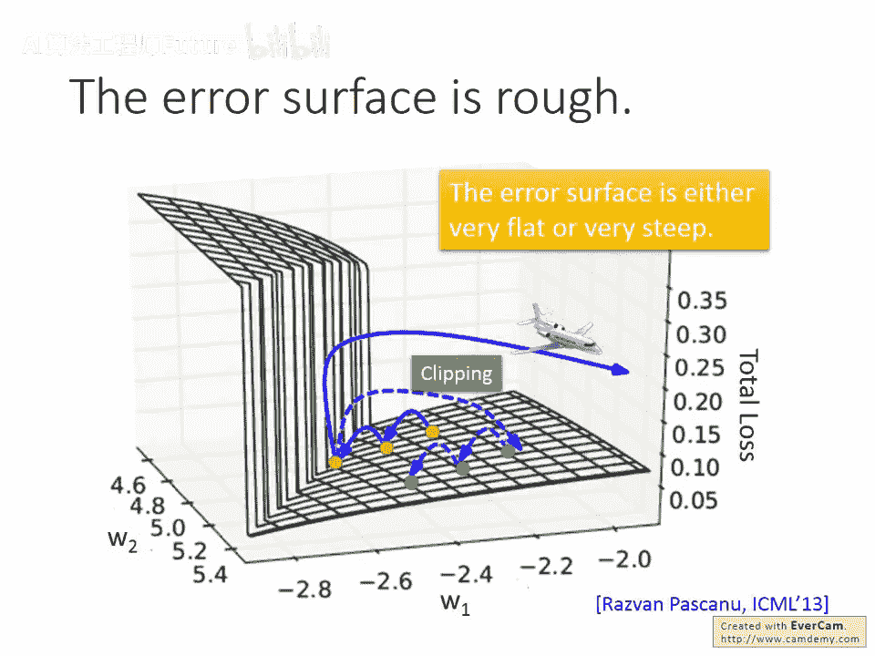

并不是这个地方的关键点，好那呃，如果说我们今天有讲这个backup data or，fruit tie的话，从式子里面呢，你会比较容易看出说为什么会有这个问题。

那我今天没有讲VPAGATION服务台没有关系，我们有一个更直观的方法，可以来知道说一个gradient的大小是什么样啊，这个更直观的方法就是，你把某一个参数做小小的变化。

看他对network output的变化有多大，你就可以测出这个参数的gradient的大小，我们这边呢举一个很简单的RNN，当做我们的例子，今天有一个全世界最简单的法论，他只有一个牛肉。

这个牛肉是LI嗯，他走这个input input没有bias input，weight呢是1output，weight呢也是一那transition的部分呢。

CONSESSION的部分的weight呢是W，也是用事实从memory接到neuron的input weight是W好，现在假设我给这个network的输入是100000，绕第一个时间点数E间。

大家都输入理，那这个network的open会长什么样子呢，比如说这个network在最后一个时间点，第1000个时间点的output值会是多少，我相信大家都可以马上回答我。

它的值呢是W的999次方对吧，你把E输进去，再乘上W再乘上W，再乘上W乘上9994W好，输出就是W的999次方，因为后面的输入都是零嘛，这样不影响，只有一开始一有影响，但是它会通过999次的大V好。

那我现在看假设是我们要learn的参数，我们想要知道它的gradient，所以我们想要知道当我们改变W的值的时候，对network的output有多大的影响，现在呢我们假设W呢等于一，那Y1000。

连我在最后一个时间点的output呢也是一，假设W哼等于1。01，那Y1000是多少呢，Y1000是1。01的999次方，1。001的999次方是多少呢，是2万是一个很大的值，我这个就跟蝴蝶效应一样。

而这个W呢有一点小小的变化，对他的output影响呢是非常大的，所以咳W呢有很大的规点，你刚才想说有很大规点也没有什么，我们只要把他的learning rate设小一点就好，但是事实上如果我把W设成0。

99，那Y1000呢就等于如果我把W呢设0。01，那Y1000还是等于零，也就是说在一这个地方有很大的硅点，但是在0。99的地方，归点呢就突然变得非常非常的小。

这个时候你又需要一个很大的learning rate，我觉得造成说你设人力rate呢很麻烦，你的error surface很稀缺，因为这个硅电呢时大时小，而且在非常短的区区域之内。

GRA点就会有很大的变化，所以从这个例子其实你可以看出来说，为什么RNN会有问题，RNN的training的问题，其实是来自于他把同样的东西呢，在transition的时候呢，在时间和时间转换的时候呢。

反复使用从memory接到neuron的那组way，在不同的时间点都是反复被使用，所以这个W呢只要一有变化，才有可能完全没有造成任何影响，像这边，但一旦它可以造成影响，那影响都会是天崩地裂的影响。

所以他有时候规点很大，有时候鬼点很小，所以你所以这个瑞克咳RN呢会不好，训练的原因并不是来自于activation function，而是来自于他有time sequence，同样的位置。

在不同的时间点是会被反复的不断的被使用好。

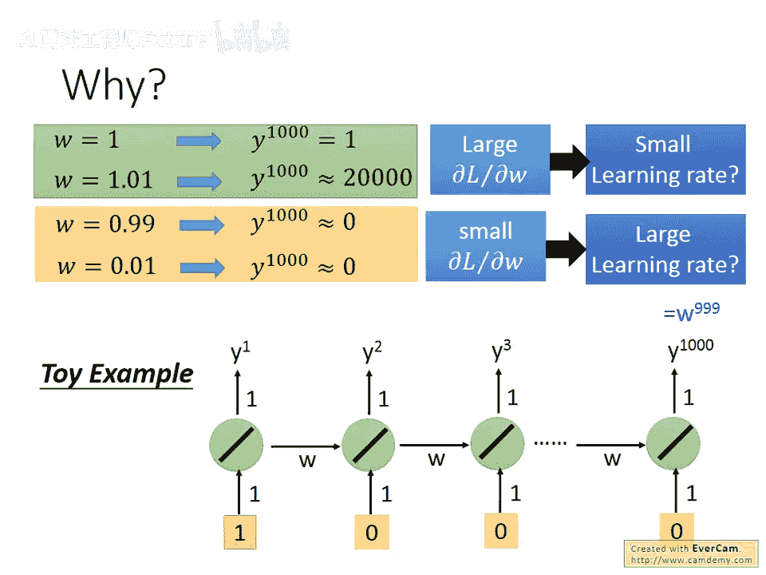

那有什么样的技巧，可以帮助我们解决这个问题呢，其实现在最广泛被使用的技巧呢就是LSPN，就是LSPN，那LSTN呢可以让你的error surface不要那么崎岖，它可以做到的事情是。

他会把那些比较平坦的地方拿掉，它可以解决gradient vanishing的问题，但他不会解决gradient expore的问题，比如你有些地方仍然是会非常的崎岖的好，你有些地方他仍然是这个呃。

变化非常这个这个剧烈的，但是呢不会有特别评判的地方啊，因为如果你在做LSDN的时候，大部分的地方都变化很剧烈，所以呢当你在做这个呃，呃L当你在做这个LSTN的时候呢。

你可以放心的把你的learning rate呢设的小一点，那它呢呃要在learning rn特别小的情况下呢进行训练，那为什么LSTN可以做到额，这个ple gradient vanish的问题呢。

为什么它可以避免让GRADI特别小呢，为什么它可以避免让gradient特别小呢，喂我听说有人在这个面试某家呃，这个呃国际大厂的时候，就被问这个问题样子，那这个问题怎么答比较好呢，如果你答一些什么哦。

LA因为L我知道这个问题是这样，为什么我们把RNN换成LSTA，如果你的答案是我，因为LST比较吵，因为LST比较复杂，这个都都太弱了，这样啊，真正理由就是LSTN可以handle。

GRADIVANISHING的问题，但是接下来人家就会问说，为什么LSTN可以handle gradient，vanishing的问题呢，我来这边呢试着来回答看看，那这样子之后。

如果有人你口试时候再问到这个问题的时候呢，你可以想想看，你又没有办法回答这个，如果你想看RNN跟LS实验，他们在面对这个memory的时候，他们处理的operation其实是不一样的，对不对，你想想看。

在RNN里面，每在每一个时间点，其实memory memory里面的资讯都会被洗掉，每在每一个时间点，neural的output都会被放到memory里面去，所以每一个在每一个时间点。

memory里面的资讯呢都会被覆盖掉，都会被完全洗掉，咳咳咳，但是在LSTN里面不一样，它是把原来memory里面的值乘上一个值，再把input的值呢加起来，放到cell里面，sell里面去啊。

OK所以他的memory和input是相加的，所以今天呢它和RN不同的地方是，如果今天今天你的weight，可以影响到memory里面的值的话，一旦发生影响，这个影响会永远都存在。

我不像RN在每一个时间点值都会被format掉，所以只要这个影响一被format掉，它就消失了，但是在LSTN里面，一旦能够对memory造成影响，那那个影响会永远的留着，除非forgay gay被开。

除非forget gay的被使用，除非fork gate的决定要把memory me的值洗掉，不然一旦memory有改变的时候，每次都只会有新的东西加进来，而不会把原来存在memory里面的值洗掉的。

所以他不会呢有GRADIVANISHING的问题，那你可能会想说，可是现在有forget gay啊，forget gay就是会把过去时的值洗掉啊，事实上在呃LSN97年的时候就可pose。

那第一个pl s d n的第一个版本，其实就是为了解决GRADIBING的问题，所以他是没有FOGG的，fork gay是后来才加上去的，那甚至呢现在传现在有一个传言是呃，你在训练LCN的时候。

你要给FOGGAY的特别大的白，你要确保否KK在多数的情况下都是开启的，只有少数的情况呢它会被否灭掉啊，那那个现在呢有另外一个版本的呃，用git操控这个memory的。

这个这个sell呢叫做git recurrent unit，然后STN呢有三个game，这个git recurrent unit呢它只有两个gate哦。

所以git return unit l缩写是GRU，相较于LSTN呢，它的这个gate呢只有两个啊，只有两个啊，所以呢他需要的参数量呢是比较少的，因为它需要的参数量呢比较少。

所以因为它需要的参数量比较少，所以呢它呢在training的时候呢，是比较robust的人，所以如果你今天踹TRALSTI的时候，你觉得over fting的情况很严重，你可以试一下呢。

用GRU指的那GRU的精神，就是他怎么拿掉一个get呢，我们今天就不讲GRU的详细的原理，他的精神呢就是旧的不去，新的不来，他会把input gay跟forget gay呢联动起来。

还要把input gate呢跟pgay gay联动起来，那也就是说当input gay被打开的时候，forget gate呢就会自动的关闭，把当input game被打开的时候。

forget gate就会洗掉，就会format format掉存在memory里面的字，当我给给没有药format值的时候，input gate呢就会被关起来，也说你要把存在memory里面的值清掉。

才可以把新的值呢放进来，嘶其实还有很多其他的technique呢，是来handle gradient managing这个问题，比如说cart west的RNN。

或者是这个structural contrain，RECURRENNETWORKSCRN等等哦，我就把rap on留在这边呢给大家参考，而最后呢有一个蛮有趣的那个字，有一个蛮有趣的。

paper是hinton propose的诶，这个方法是这样，他说当他用这个呃，当他在引他用一般的RN的，不是用LSTN，他说他一般的RNN，他用identity的matrix。

like initialize transition的meant the way，然后在使用IOU的activation function的时候，他可以得到很好的performance，哎。

可能说我刚才不是说用，还有uer performance会比较差吗，如果你是一般的training的方法，你initialization的weight是render的话呢。

那IOU跟这个呃这个sigmoid function来比的话，sigmoid function performance会比较好，但是如果你今天用了identity的matrix的话啊。

如果你今天用了identity matrix，当INTETRZATION的话，这个时候用还有U的performance就会比较好，这件事情呢真的是非常的神奇啊，人生真的非常神奇，当你用了这一招以后呢。

用一般的RN不用LST，它performance就可以吊打原来的LSTN，那是那就觉得说没有S间弄得这么复杂，结果呢都是白忙一场，这样子就这个是非常神奇的一篇文章嘶。

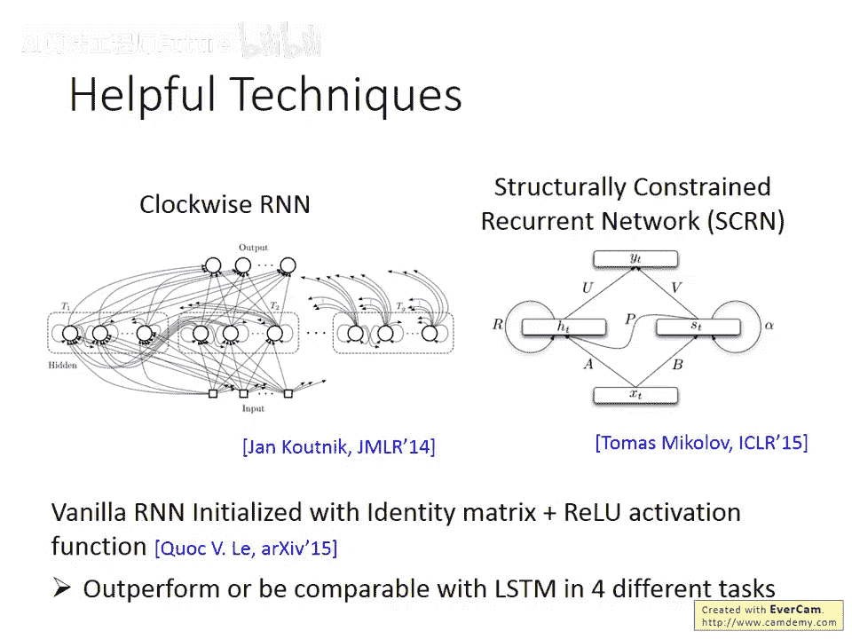

那其实RN呢有很多的vacation，在我们前面举的那个slash feeling的例子里面，我们是假设input和output的element的数目是一样，做的，也就是说因为有几个word。

我们就给每一个word一个这个slot的label，但事实上RN呢他可以做到呢更复杂的事情。

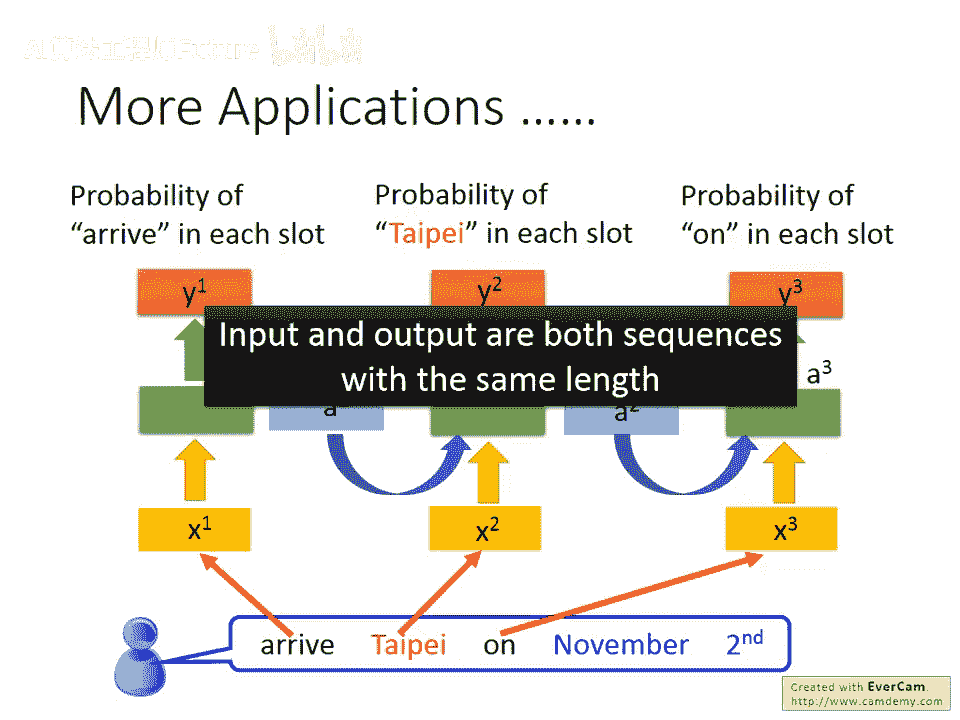

可以做更复杂的事情，比如说它可以input是一个sequence，Output，只是一个vector，这个有什么应用呢，比如说你可以做sentiment analysis。

Sentiment analysis，现在有很多的VICATION，比喻来说，某家公司想要知道说他们的产品在网络上的评，价呢是positive还是negative，他们可能呢就会写一个爬虫。

把跟他们网络评价有关对吧，还跟他们产品有关系的那些呃，网络上的文章呢都爬下来，但是一篇篇看着太累了，所以你可以用一个这个machine learning的方法。

自动呢任意一个classified去说分类，说哪些document是正向的，哪些document是负向，或者是在电影版上呢，sentiment analysis做的事情，就是给mach看很多文章。

然后M讯要自动知道说哪些文章呢是正雷啊，哪些文章呢是傅雷，怎么让我们先做到这件事情呢，你就是认一个recurrenneal network，这个input呢是一个character sequence。

这input呢是一个character sequence，然后呢，recorneural network呢，把这个character sequence呢读过一遍呃，读过一遍读过一遍。

然后呢在最后一个时间点呢把hidden layer拿出来，可能再通过几个把he的layer拿出来，可能再通过几个transform，然后呢你就可以得到最后的sentiment。

analysis的prediction，比如说input这个document，他是超好雷好雷普雷傅雷还是超负累呀，它是一个分类的问题，但是input是一个sequence。

所以你需要用RNN呢来处理这个input，或者是我们实验室做过，用RNN呢来做提TERATTRACTION，所谓提成attraction的意思是说，亚马逊开一篇文章，然后我们去呢。

要predict说这篇文章里面有哪些的关键词汇，然后跟我们在final project里面的第三个task，做的其实是非常类似的事情，哦那如果你今天能够收集到一堆training data塔。

能够收集到一堆打孔，然后这些打孔都有label，说哪些词汇是对它对应的key word的话，那你就可以直接圈一个RN，这个RN呢把document呢当做input好吧。

document word sequence当做input，然后呢通过embedding layer，然后呢，用RNN呢把这个DQ们呢呃读过一次好吧，这个DQ们呢读过一次，然后呢把出现在最后一个。

是把这出现在最后一个时间点的这个output呢，拿过来做attention哦，我们发现说我们没有讲过attention是什么，没有关系，这个地方你就听听就好好用attention以后呢。

你可以把重要的information抽出来，再丢到b for network里面去。

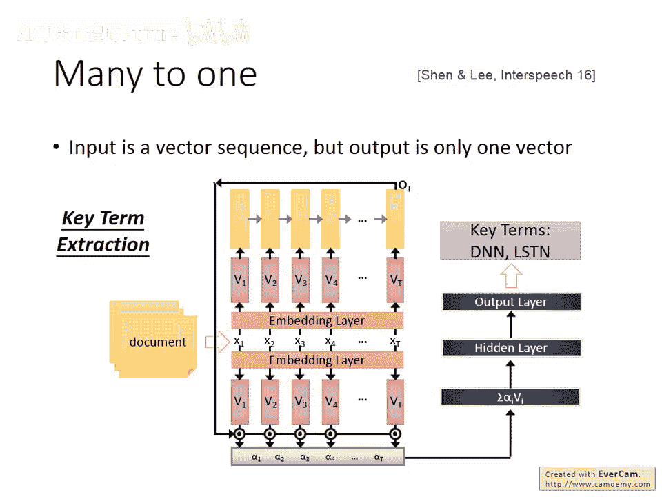

得到最后的好本。

哦那他也可以是多对多的啊，比如说你当你的input和output都是sequence，但是output the sequence比if the sequence短的时候，RNN呢可以处理这个问题。

什么样的任务是input sequence长，OPPOSSEQUENCE短呢，比如说语音辨识，就是这样一个人物在语音辨识这个任务里面，input呢是一串accury future sequence，呃。

我语音是一段声音讯号嘛，嗯你说你要做语音辨识的时候，你就说一句话，那这句话呢是一段声音讯号，哎我们一般处理声音讯号的方式，就是在声音讯号里面，每隔一小段时间就把它用一个vector来表示。

那个一小段时间呢，那个一小段时间通常很短，比如说0。01秒之内，那他的output呢它的output是character的sequence好，那如果你是用原来的R轮。

用我们在做slap feeling那个R轮，你把这一串input丢进去，它充其量呢只能够做到说告诉你每一个vector，它对应到哪一个character，假设说中文的语音辨识的话。

那你的output的target也要按照output target，理论上就是这个世界上所有可能的中文的词汇，而所有可能的中文的character，那这个可能有呃，常用的可能就有8000个吧。

可能这里的这个RN的output，这个quest的数目呢会有8000表，虽然很大，但这个是有办法做的好，但是充其量只能做到说，每一个vector属于一个character。

每一个vector属于一个character，但是input这个每一个vector堆到时间是很短的，通常才0。01秒，所以通常是好多个vector，才对应到同的character哦。

所以你的变色结果就变成好好好棒棒棒棒棒，这样还想说呃，这不是云辨识结果啊，怎么办，你可以有一招叫做TWING啊，TWING就是把重复的东西拿掉就变成好，但是这样会有一个很严重的问题。

因为他就没有办法辨识好方法，这样子哦，对不知道的说一下，这好棒啊，好棒棒，就正好是相反这样子啊，但是我发现很多人都不知道啊，比如我女朋友工作的地方呃，就是呃有一次他们的老板说。

我们来编个我们公司的口号啊，然后就找个台大的人来编这样，而台大其实对公司心怀怨恨，所以所以在口号里面就说好棒棒，杨某某就某某公司好棒棒，然后主管都觉得很棒样子，他们都不知道说这个是负面的意思。

好所以嗯不把好棒跟好棒棒分开来是不行的，所以需要把好棒跟好棒棒分开来，怎么办，我们要用一招叫做CPC，这招呢也是那种说穿了不值钱的方法，但但这招很神妙，他说我们在output的时候。

我们不要不只是offer所有中文的character，我们还多output的符号叫做诺，叫做没有任何东西，所以今天如果我input on a cozy picture sequence。

他的output是好诺诺棒，诺诺诺诺，然后我就把诺的部分拿掉，它就变成好棒，如果我们输入另外一个sequence，它的output是好诺诺棒，诺棒诺诺，它的output呢就是好棒棒，这样子好。

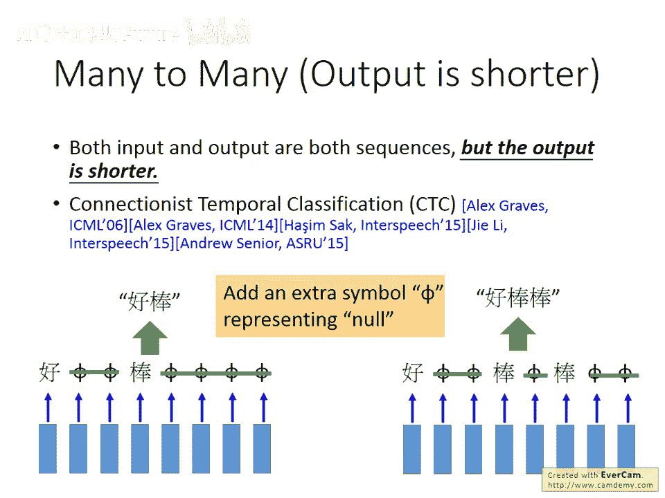

所以就可以解决叠字的问题了，那在训练的network时候。

训练的时候怎么做呢，CTC怎么做训练呢，这个也是可以的，CTC在做训练，在做training的时候啊，你手上的training data就会告诉你说。

这一串有coc feature对应到这一串character sequence，这个sequence对应到这个SE，但他不会告诉你说好是对应第几个frame，到第几个frame。

棒是对应第几个friend，对应到第几个frame，那怎么办呢，穷举所有可能的而来文，简单来说就是我们不知道好对应到哪几个frame，不知道棒对应到好几个frame，我们就假设所有的状况都是可能的。

可能第一个是好，后面接诺棒，后面再接三个诺，可能好，后面接两个落放，后面接两个弱可能好，后面这三个弱放后面接一个路，我们不知道哪个是对的，就假设全部都是对的，在training的时候。

全部都当做是正确的，一起去劝哎，可会想说，穷举所有的可能的可能性感觉太多了，这个有巧妙的演算法可以解决这个问题的，那我们今天呢就不细讲这些这个部分，那以下呢是在文献上CDC得到的一个结果，这个是英文的。

在做英文辨识的时候呢，你的RN的output the target就是character，就英文的字母加上空白，空白就你也不需要到，你也不需要给你的RN10点啊什么之类的，他就直接output字母。

然后呃如果到那个字和字之间boundary，它自动呢就会用空白取个假设一个例子啊，第一个friend叫output lash，第二个frame叫output noor。

第三个friend叫open noor，第四个friend叫output i，第五个frame叫output s好，接下来呢output这个底线这个代表空白保护空白，然后你穿过那F诺诺RI诺END。

诺诺一撇S底线等，那如果你看到output这个样子的话，那最后你把诺的部分拿掉，这句话辨识的结果就是his friend，你不需要告诉我们，迅说HIS是一个词汇，friends是一个词汇。

鲁迅透过training data，他自己会学到这件事情，那传说呢，google现在的语音辨识系统，已经全面换成这个CPC的来做语音辨识，如果你用CPC来做语音辨识的话，就算是有某一个词汇。

比如说英文的人名，地名没有出，从来在training data里面没有出现过，而是从来没有不知道这个词汇，他其实也有机会把它正确的辨识出来。

另外一个神奇的R的应用呢叫做SUPERCYSUPERSLADE，在sequence to sequence learning里面，RN的input和output呢都是sequence这两代价格。

sequence的长度呢是不一样，刚才在讲CDC的时候，input比较长，open比较短，在这边是我们要考虑的case，是不确定input和output谁比较长，谁比较短好。

我们现在呢来做machine trans，比如说我们现在要做的是machine translation input，英文the word sequence，要把它翻译成中文的character。

sequence好，那，我们并不知道说英文跟中文呢谁比较长，谁比较短，我们并不知道谁比较长，谁比较短，都有可能是offer比较长，也有可能是offer比较短，所以怎么办呢。

现在假如input是machine learning等，知道machine learning用RNN呢读过去，用RN读过去，然后呢在最后的，然后呢把问把machine learning呢用RNN读过去。

然后在最后一个时时间，最在最后一个时间点呢，这个memory里面呢就存了所有input的这个，sequence的information，然后接下来呢你就让machine to一个character。

比如说就他可惜他第一个做character呢，就是鸡啊，你把machine man learning让machine读过一遍，然后再让他output character，他可能就要output机好。

接下来呢再叫他output下一个character，你把之前output出来的character呢当做input，再把memory里面存的值读进来，它就会output弃，这样子诶。

那呃呃这个东西这个基呢要怎么接到这里，这个地方呢有很多枝枝节节的技巧，就是你如果呃这个这个太多了，这个以后呢我们再讲一下，这个以后或许下学期在NOTS再讲，就这个有其实有很多枝枝节节的地方。

还有很多各种不同的变形啊，OK好那呃他在下一个时间点气以后呢，他就output血，然后血呢后面就output洗，然后他就会一直凹不下去，那习后面接冠冠，后面接信啊，永远的都不停止啊。

这样就第一次看到这个model，想到华真有这work吗，你更不知道什么时候该停止这样子啊。

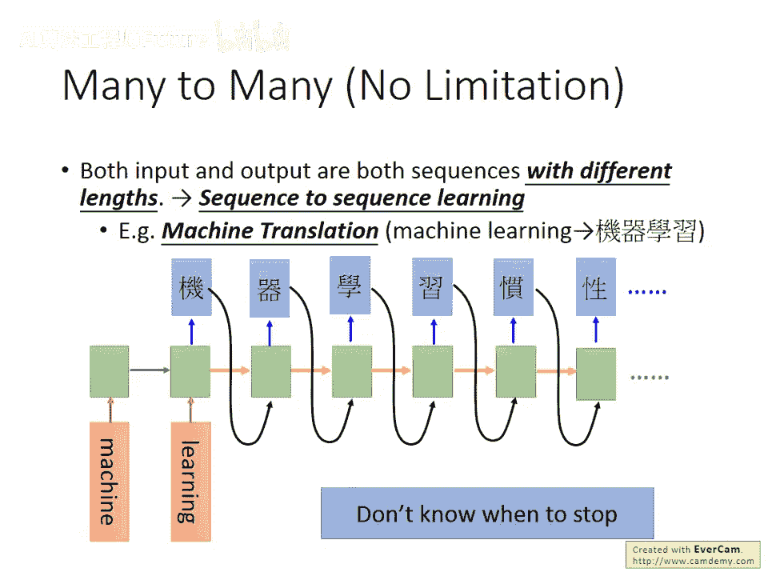

那怎么办呢，这就让我想到这个推文接龙呀。

我不知道他知不知道推文接龙是什么，也不知道，讲一下这个从相邻百科上抄下来了，然后推文接龙是推文中的一种趣味的玩法，和黑棋有点类似，但又有所不同，自在推文中接据上一楼的句子，推出连续的意思。

这样而它的起源于不可靠，也就是说有一个推超以后，下一个就是推人，而人后面再推正，然后一直推推推推推他，你推好几个月他都不会停下来，我也不知道为什么会这样，他不会停下来，那你要怎么让他停下来呢。

你要怎么让他停下来，你要有一个冒险去推个段。

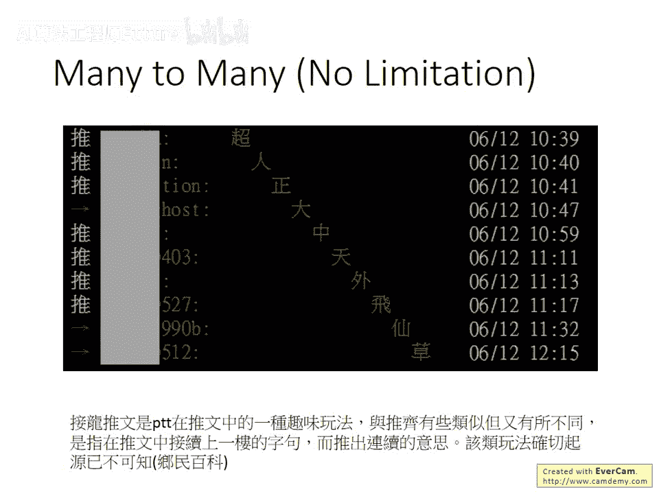

然后就会停下来，让我呃其实也不会停下来啊，哎对对，你要推个断，它就会停下来哦，所以今天亚马逊做的事情也是一样。

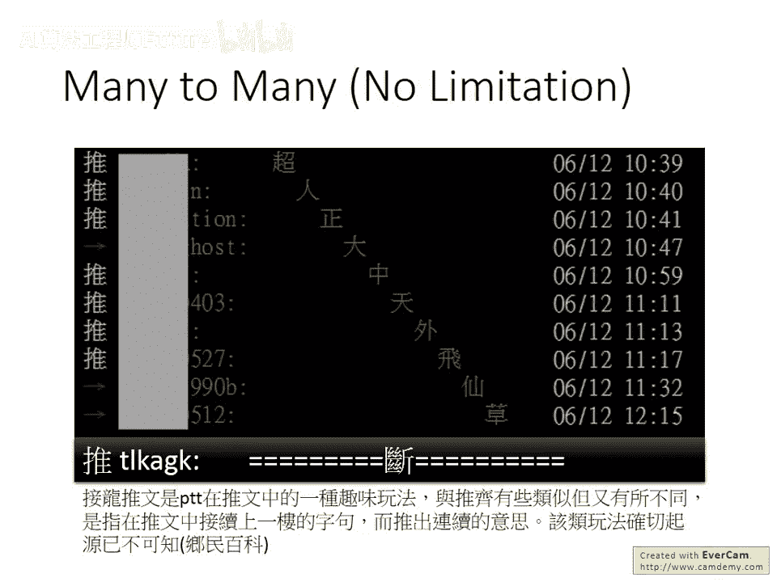

要如何阻止他不断的继续产生词汇呢，你要多加一个simple叫做断，这所以M讯现在不只是output ser的character，他还有一个可能的output叫做断，所以如果今天习后面呢。

他的output是断的话，就停下来诶，可能觉得说嗯这个东西圈得起来吗，嗯圈得起来很神奇的，就是这一招是有用，它也有被用在语音辨识上，你就直接input a coy feature sequence。

直接叫open character sequence，只是这个方法还没有CDC强，所以这个方法还不是COVR的结果，但让人真正损坏的地方就是这么做事情的痛，然后他的结果是没有烂掉的，嗯咳咳，在翻译上呢。

道士据说用这个方法已经可以达到，state of the r的结果，那最近呢这个是应该是google brand，在12月初的时候发的paper，所以是几周前放在阿pad上面的paper。

他们做了一件事情，我相信这件事情很多人都想到，怎没人去做他这个他的想法是这样，Secreto sequence learning，我们原来是input，假设做翻译的话，也就是input某种语言的文字。

然后翻译成另外一种语言的文字，那我们有没有可能直接input，某种语言的声音讯号，包括另外一种语言的文字呢，我们完全不做语音辨识，你就直接呃，so比如说你要把中文翻成，也要把英文翻成中文。

你就收集一大堆英文的句子，看他对应的中文翻译，你完全不要做语音辨识，直接把英文的声音讯号丢到这个model里面去，看他能不能够offer正确的中文，结果这一招居然是看起来是行得通的啊，看起来是行得通的。

我相信很多人想过是没人，大家觉得做不起来，这没有提示啊，那这招呢看来是行得通的，也可以直接一步一串发文的声音讯号，然后呢model呢就得到电视的结果，然后就慢了解到变色结果。

就这件事情是还蛮surprise，就如果这个东西能够成功的话，它可以带给我们的好处是呃，如果你今天在collect这个translation的training room。

我在collect translation的training the data的时候，我们在connect translation的training data的时候，会比较容易，假设你今天要把某种方言。

比如说台语转成英文，但是台语的语音辨识系统其实比较不好做的，因为台语你可能根本就没有呃，他根本没有一个standard的文字的系统，所以你要找来label台语的文字可能也有点麻烦。

如果这到这样子的技术是可以成功的话，未来你在训练台语转英文的语音辨识系统时候，你只需要收集台语的声音讯号跟他的呃，英文的翻译就可以了，你就不需要台语的语音辨识的结果，你就不需要知道台语的文字。

你也可以做这种翻译，那另外一个可，那现在呢还可以用sequence to sequence的技术，甚至可以做到咳咳比亚C位，嗯比如说这个技术呢也被用在detective的passing，tree里面。

用在产生DETECTI的passion tree上面，这个SYTECTED的passing去啊，是什么呢，意思就是让我们新开一个句子，然后他要得到这个句子的文法的结构树，然后得到一个树状的结构，咳咳咳。

要咳，要怎么让马逊得到这样子的树状的结构呢，过去你可能要用structure learning的技术，才能够解这一个问题呃，但现在有了sequence，有sequence learning技术以后。

你只要把这个树状图描述成一个sequence，也说树状图所描述的sequence，当然可以描述成一个C，看这个是root的地方是S，所以这是S的左括号，这是S的右括号，它下面有NP跟BP。

所以有N1的左括号NJ右挂号B键，左方号B接右括号，NP下面有NNPBP，下面有BBZNBBB下面有BBZ，咳咳咳，NBNB小小T等等等等等，OK所以它有一个sequence哦。

它有一个sequence好，那所以如果今天是sequence to sequence learning的话，你就直接扔一个sequence to sequence的model。

他的open呢直接是这个SYTECTED的passion去，他直接offer这个是SYTECTED的，发进去就可以了就可以了，对只有这样子劝你可能觉得说嗯，这样真的TRA的起来吗，嗯可以圈的起来。

这很surprise，非常surprise麦克，那当然如当你可能想说，如果我们讯今天它长长出来的这个额呃，output的这个sequence，如果它不合文法结构呢，如果他记记得加左括号。

却忘了加右括号呢，但问题，但是神奇的地方就是LSTM很好记忆力，所以他不会忘记加上右括号，呃咳好，那我们之前呢讲过WAVECTOR，那我们说，如果我们要把一个表示成一个vector的话。

往往会用backo word这样的方法，但当我们用BO word这样的方法的时候呢，我们就会忽略掉这个world order的information，举例来说。

有一个word sequence是y plus s destroying an infection啊，另外worshiperan infection，Destroy white loc。

这两句话的意思完全是相反，但是如果你用backboard来描述它的话，他们的这个这个呃bad word呢完全是一样的，他们里面有一模一样的六个词汇，但是因为这个词汇的order是不一样的。

所以他们的意思一个变成是positive，另外一个变成是NETIC，它的意思呢是很不一样的，那我们可以用sequence to sequence，OPENCODER这种做法来。

在有考虑sequence的word sequence order的情况下，是把一个document变成一个vector。

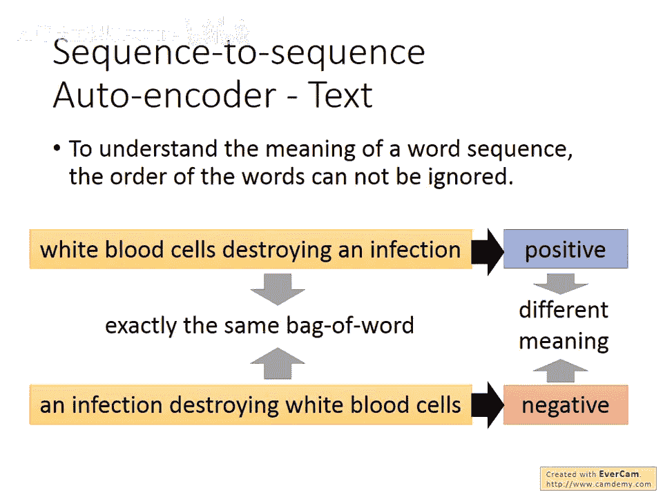

怎么做呢，怎么做呢，我们就input word sequence哦，Mary was hungry dn finan，然后通过一个recurrenal network。

把它变成一个embedded vector，然后再把这个embedded vector，当做这个decoder的输入，然后让这个decoder呢找回一个一模一样的句子。

如果今天呢return your network可以做到这件事情的话，那encoding的这个vector就代表了这个input，sequence里面重要的information哦。

所以这个decoder呢才能够把，根据这个encoder的vector，把这个讯号呢嗯这个这个decode回来，你趁这个sequence to sequence是auto encoder的时候。

你是不需要label data的，你只需要收集到大量的文章，我们只需要收集到大量的文章，然后直接传下去就好了啊，这个sequence to sequence auto encoder呢。

还有另外一个版本呢叫做step soul啊，当你用step Sol的时候，如果是用sequence to sequence auto encoder，input和output都是同的局。

如果你要skip sto的话，你offer target的会是下一个句子啊，如果你用SEVERAGE，Sequence open encoder，通常也得到了coder呢，比较容易表达文法的意思。

如果你要得到语语语义的意思的话，用skis so呢可能会得到比较好的结果啊，这个结构呢甚至可以是hierarchy，你可以每一个句子都先得到一个vector好。

mary was hungry的那个vector，she didn't find any fo的log vector，我再把这些vector呢用，是将这些vector呢加起来。

然后变成一个整个大孔的high level的vector，再用这个整个大部分hievable elector，去产生一串sentence的vector，再根据每一个sentence的vector。

再去解回这个word sequ哦，所以这是一个四层的LS体验，你从word变成sentence，Sequence，再变成document level的东西，再解回sentence的sequence。

再写回word的sequence。

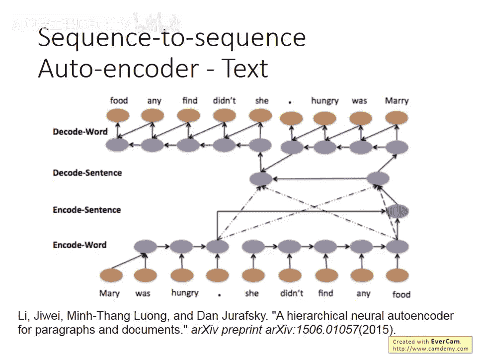

这个东西呢也是可以train，咳那刚才的东西呢也可以被用在语音上啊，sequence to sequence的auto encoder。

所以被用在文字上啊，可以用在语音上啊，如果在语音上的话，他可以做到的事情呢，就是它可以把一段呢audio的segment，把它变成一个this is left的vector，Ok。

比如说呃比如说他可以把动变成，比如说这边有一堆声音讯号啊，它们长长短短都不一样，那你把它们变成vector的话，可能dog跟dogs的vector比较接近。

可能never和ever的vector是比较接近好，那这个呢我称之为audio的water vector啊，就像一般的water vector，他是把一个word变成一个vector就认识吧。

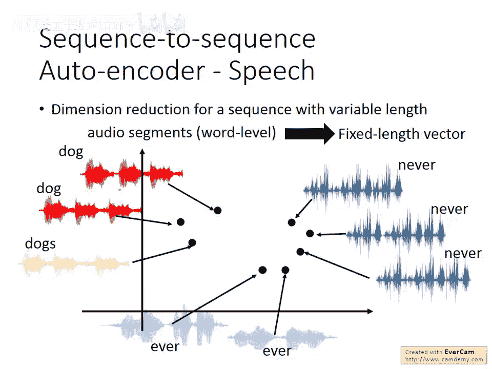

一般一段声音讯号变成一个一个嘶啊。

这个东西呢你可以把它用在有什么用呢，有什么用，一开始在想这个时候我觉得应该就没有什么用，但是它其实有它其实可以拿来做很多事，比如说我们可以拿来做语音的搜寻，什么是语音的搜寻呢。

你有一个声音的database，比如说上课的录影录音，然后你说一句话，然后可以拿，那可以，然后你说比如说你今天要找跟这个呃，美国白宫有关的东西，你就说的说美国白宫，然后不需要做语音辨识。

直接比对声音讯号的相似度，machine就可以从database里面，把有提到美国白宫的部分找出来，那这个怎么做呢，你就先把也有一个audio的database。

来把这个database呢做segmentation，切成一段一段，然后每一段呢用刚才讲的这个audio，segment to vector的这个技术呢，用把它们呢通通变成。

然后现在呢使用者输入一个query啊，这个query呢也是语音的，透过audio segment to vector的技术呢，可以把这段声音讯号呢也变成vector，然后接下来呢计算它们的相似程度。

那接下来呢计算它们的相似程度，然后呢就得到这个搜寻的结果。

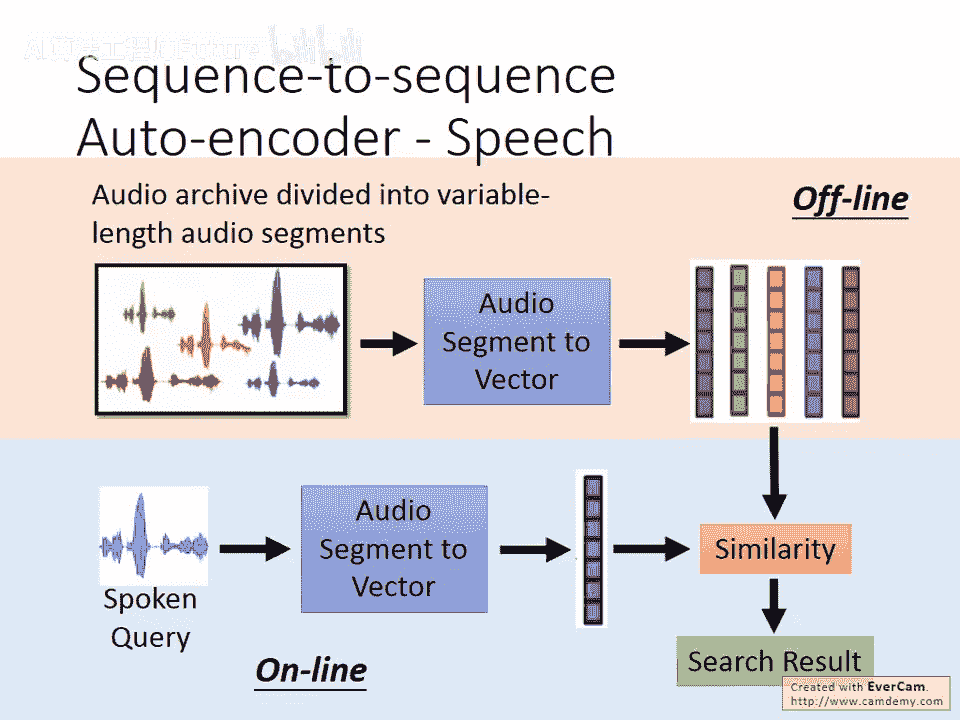

好，咳咳好，然后最后就得到搜寻的结果，然后呢有了，那这件事情怎么做呢，怎么把一个audio的segment变成一个vector呢，那做法是这样。

先把audio和segment呢抽成acousic feature sequence，然后呢把它丢到return neural network里面去啊。

这个recurrenneural network呢，他的角色就是一个encoder，而这个recorneal network，他读过这个cookie feature sequence以后。

它存在memory里面的值，就代表了它在最后一个时间点，存在这个memory里面的值，就代表了整个input的声音讯号，它的这个information。

那这个它存在memory里面的值是一个vector，这个东西，其实就是我们要拿来，表示一整段声音讯号的vector，但是只有这个RN的encoder，我们没有办法train啊。

你要同时呢还要圈一个RN的decoder，Rn decoder，它的过它的作用呢，就是它把encoder存在memory里面的值呢，拿进来当做input。

然后产生一个coc feature sequence，那会希望说这个YY跟x1呢越接近越好，然后根据y one再产生y two，再产生Y3，再产生y four。

而今天训练的target就是希望YY到y four，跟XY到x four，他们呢是越接近的越好的，那在训练的时候，这个R的encoder它跟R的decoder，他们是join理论啊。

这个R的encoder跟on the decoder呢，他们是一起trap的，他们是一起劝的，有如果只有RN的encoder跟RN的decoder，他们只有一个人是没有办法权，但是把他们两个接起来。

你就有一个target，可以一路被从从这边的backup给回来，你就可以同时track on encoder跟decoder啊，这边呢是哦，我们在实验上呢得到的一些有趣的结果。

在这图上每一个点呢其实都是一段声音讯号，我把声音讯号用刚才讲的这个这个sequence to，sequence encoder基数呢，把它变成平面上的一个vector。

来发现说有个fear的位置在左上角，尼尔的位置在右下角，它们中间是这样的关系，Z的位置在左上角，Z的位置在右下角，它们中间的有一个这样子的关系，那你会发现说把fr的开头的F换成N，跟fan开头F换成N。

他们的这个WAVECTOR的这个变化呢，四方向是一样啊，就好像我们之前看到的这个vector一样，各位好像之前我们看到的文字的WAVECTOR一样，我们这边的这个vector还没有办法考虑。

考虑semantic语义的information，那我们下一步要做的事情呢，就是把语义呢加进去啊，但这个部分呢现在还没有完成，那接下来我有个demo。

这个demo呢是用sequence to sequence，auto encoder呢来训练一个缺乏，所以chair霸就是聊天机器人啊，知道现在很很流行的做聊天机器人。

那怎么用这种sequence sequence的，而这个sequence是用oracle的这sequence to sequence learning。

怎么这sequence to sequence learning来确认的CHERF呢，你就收集很多的这个对话，好比如说电影的台词啊，假设电影的台词里面有某一个人说how are you。

然后另外一个人去接，I'm fine，那就告诉我们就说这个C89sequence learning，它的input，当参input是how are you的时候。

这一个model的output就要是安坏啊，你可以搜集到这种data，然后呢就让兴趣圈，那我们就呃收集了4万句的呃，电视以及和美国总统大选的辩论的句子。

然后让我们训了去学这个sequence to sequence的，这个这个这个这个model，这个呢是跟这个呃中央大学，蔡宗翰老师的团队一起开发的，然后做我同学呢，呃台拉这边是有李志伟和呃卢波鲁。

我们来好。

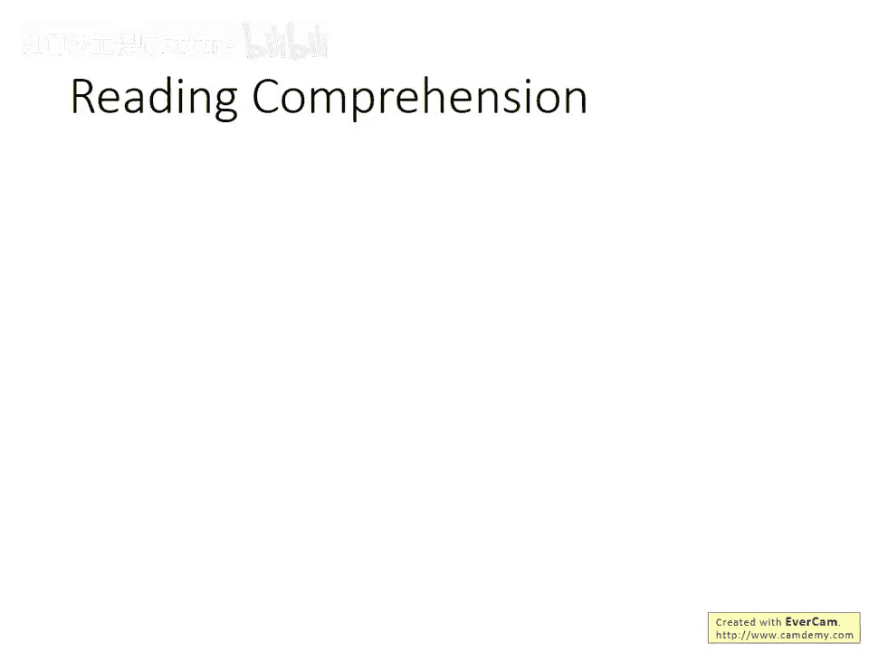

那其实现在除了RN以外呢，还有另外一种有用到memory的network，叫做attension base model，它被想成是RN的一个进阶的版本，那我们知道说呢人的大脑有非常强的记忆力。

而人的大脑呢有非常强的记忆力，所以你可以记得非常非常多的东西，比如说你现在可能同时记得早餐吃了什么，可能同时记得呃，10年前中二的夏天发生了什么事，可能同时记得在这几门课里面学到的东西啊。

当然有人问你说什么是deep learning的时候，那你的脑中呢会去提取重要的information，然后再把这些information组织起来产生答案啊，但是呢呃你的脑子会自动忽略掉。

那些无关的事情，比如10年前中二的夏天的发生的事情等等，好，那其实呢machine也可以做到类似的事情。

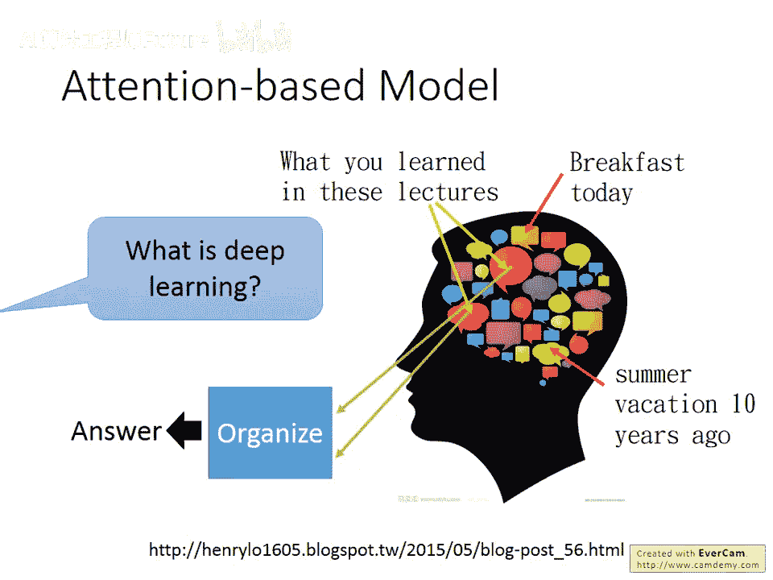

machine也可以有很大的记忆的容量啊，它也可以有一个很大的database，在这个database里面的每一个BON就代表了某种information，被存在了ACH的记忆里面。

当你输入一个input的时候，这个input会被丢进一个中央处理器，这个中央处理器可能是一个DNN，或者是一个RNN，那这个中央处理器呢会操控一个读写头。

我会操控一个reading head controller，这个reading head controller呢会去决定呢这个reading head放的位置，那我们现在从这个reading head。

放的位置里面去读取information出来，然后呢产生最后的open咳，那我们就不打算细讲这样的model，如果你有兴趣的话，可以参考我之前上课的录音，那这个这个这个model呢还有一个2。0的版本。

这个2。0的版本呢，他呢会去操控一个writing head controller，这writing hand control呢会去决定呢，writing head放的位置。

然后呢mach会去把它information，透过这个writing head写进他的贝塔base里面，写进他的贝塔贝斯里面哦，所以它不只是有读的功能，还可以把资讯呢。

它discover出来的东西写到他的memory里面去，这个东西呢就是大名鼎鼎的neural tui machine啊，这些其实都是很新的东西，有些neurotui machine应该是在咳。

我想看114年的年底的时候提出来的，所以是暖是吗，我想看我我也忘了好，好像是一五，不知道是15年，还是不知道是15年初还是14年。

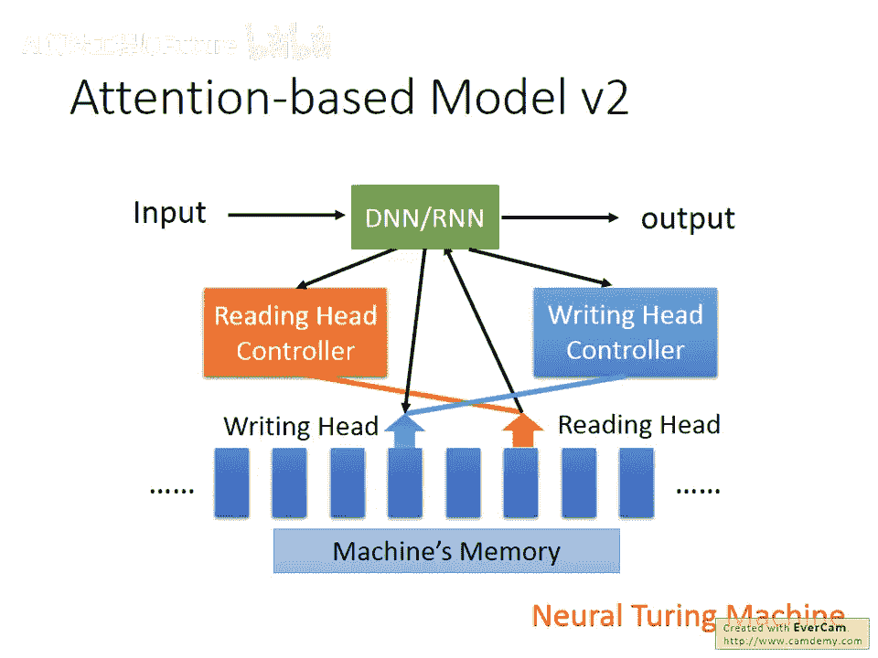

年底的时候提出来的，所以都是很新的东西，好现在这样的attention base model。

常常被用在reading comprehension里面，那所谓的reading comprehension呢，就是让我们新人去读一堆document，然后把这些document呢里面的内容呢。

每一句话呢变成一个vector，是不是啊，这句话里面这个每一个vector呢，代表了某一句话的语义，代表某一句话的semantics，那接下来呢你问了勋一个问题啊，比如说预算有多高啊什么之类。

然后呢这个问题被丢进一个中央处理器里面，那这个中央处理器呢去控制了一个reading head control了，去决定说现在在这个database里面，哪些句子是跟中央处理器呢有关的好。

所以假设呢M讯发现说这个句子，是跟现在的问题呢是有关的，他就把reading time放在这个地方，把information读到中央处理器里面，这个读取information的过程。

它可以是ITERECTI，它可以是重复数次，也就是说machine并不会只从一个地方读取information，他先从这里读取information以后，它还可以换一个位置。

从另外一个地方再去读取information，他把所有他读到以formation connect起来。

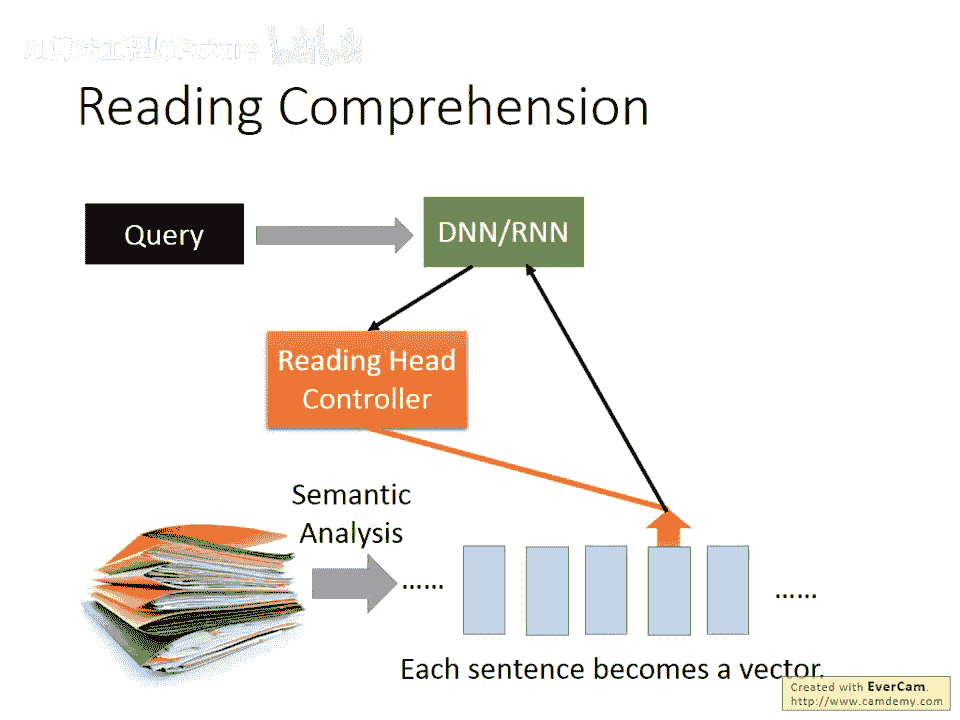

他可以给你一个最终的答案，以下呢是facebook AI research，在一个呃在这个baby这个COPUS上面的一个实验，结果是一个实验结果。

那baby那个COPUS呢是一个q a question engine的test，它其实是比较简单的一个test，那有很多用template产生的document。

还有一些简单的问题让我们需要回答这个问题，我们需要做的事情就是读过这五个句子，来问他说what color spare，那他要得到正确答案yes，那你可以从machine attention的位置。

也就是他reading head的位置看出machine的思路，我这边的蓝色代表了machine的reading test放的位置，那这个号外号Q号two代表号外号，two号two代表的是时间。

也就是说在第一个时间点，machine呢先把他的reading time放在grade里的F，所以他把这个information提取出来，把提取关于the truck等于formation。

而接下来呢他在提取prime from rainformation，那接下来他再提取bris yellow a formation，最后呢他就得到结论说答案了，break的颜色是yellow的。

那这些事情呢是mach自动认出来的，原mach要attend在哪一个位置，这些是呃透过neural network自己去学到，知道怎么做的，也就是说并不是去写程式，告诉我们训说呃，你要先看这个句子。

再看这个句子，再看这个句子，不是这么去自动去决定他要看哪一个句子。

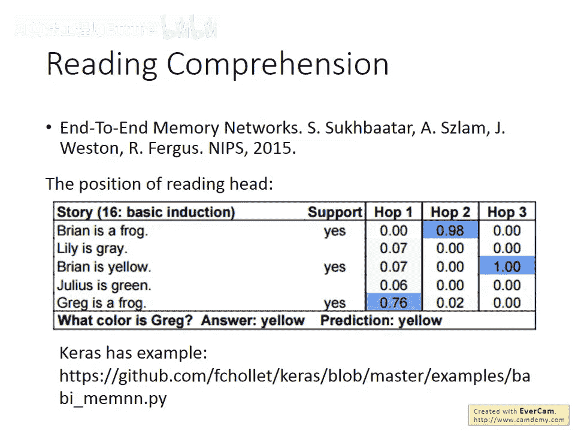

那也可以做video的question answering，Video，Question answering，就是让我去看呃，看一张图，然后问他一个问题，比如问他这是什么，如果他可以正确回答。

是相交的话呢，他就超越部分的人类了，那这个visual question answering怎么做呢，这个video question answering就让马逊呢拍一张图，然后呢透过CNN呢。

你可以把这个图的每一小块region，用一个vector呢来表示，那接下来呢输入一个query，然后这个query呢被丢到中央处理器里面。

那这个中央处理器呢去操控了reading head的controller啊，这reading head controller呢嗯决定了呃，他要读取资讯的位置，看看这这个图片什么位置呢。

是跟现在输入的问题呢是有关的，那把information读到中央处理器里面，那这个这个读取process呢可能有好几个步骤，我们去会分好几次呢，把information读到这处理信念，最后得到答案。

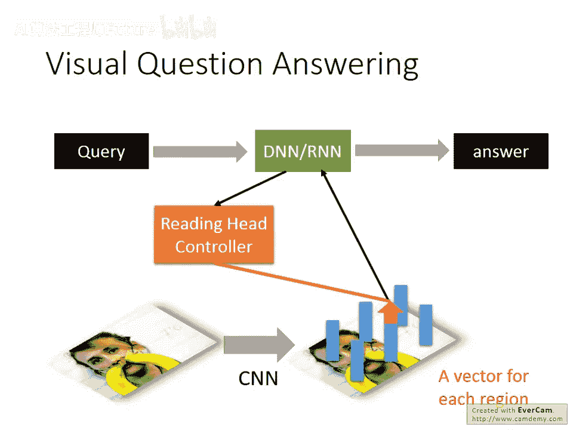

哦那也可以做语音的呃，这个question answer，比如说呃在语音处理实验室，我们让machine做托福的听力测验啊，所以托福听力测验就是让mach听一段声音，然后呢问他问题。

然后从四个正确选项里面呢，我们需要回选出正确的选项，那么去做的事情，跟人类考生做的事情是一模一样啊，我们用来训练和测试和训练资料，就是托福听力测验的资料。

那用的model architecture呢跟我们刚才看到的呢，其实就是大同小异啊，你让我们逊呢先读一下question，好让我们就先读一下question，然后把这个question呢做语义的分析。

得到这个question的语义，那声音的部分呢先用语音辨识把它转成文字，那再把这些文字呢做语义的分析，得到这段文字的语义，那么去了解了PRESTON的问题的语义。

它这个呃audio的story的语义以后，他就可以做attention，决定在这audio story里面哪些部分是和回答问题有关，这个就好像是划重点一样，那我们去根据他画的重点呢产生答案。

那他甚至也可以回头过去，修正它产生出来的答案，那经过几个process以后呢，最后我们训得到他的答案，他把他答案和其他选项呢计算相似度，然后看哪一个选项的相似度最高，它就得到啊，他就他他就选那个选项。

然后选那个选项。

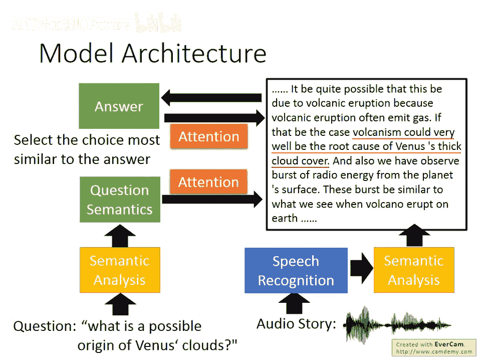

那这整个task其实就是一个大的neural network，除了语音辨识以外，这个question semantic部分呢，还有这个audio stories。

semantic的部分呢都是neural network，所以他们就是JT里train啊，你就只要给machine呢托福听一圈的考古题，然后machine呢就自己会去学了。

好那这个底底下呢是一些实验结果了，底下是一些实验结果呃，这个实验结果是这样的，那random猜啊，正确率是25percent，那你会发现说有两个方法是远比25，percent强，这个是很重要的。

formation这边这五个方法都是拿1F的方法，也就完全不管那个呃文章的内容，就直接看问题跟选项就猜答案，然后我们发现说如果你选最短的那个选项，你就可以得到35和正的正确率了啊，这这个是计中计啊。

你可能会觉得应该选最长，但其实是要选最短，还有另外一个是这样子，如果你分析四个选项的semantic，你做那个sequence to sequence autoencoder。

去把每一个选项的semantic找出来，然后你再去看说某一个选项跟另外三个选项，语义上的相似度，你会发现说选某如果某个选项，他另外三个选项的语义相似度比较高的话，那它那然后你就把它选出来。

那有35percent的正确率啊，这跟你的直觉是相反，我们直觉通常会觉得说我们应该选一个选项，它的语义和另外三个选项四不像，但是人家早就计算到你会这么做了，所以这是个计中计，如果你要选，你要选。

你要选某一个选项的，它的语义跟另外三个选项最像的话，你反而可以得到超过render的答案，如果你今天是选最不像的语音，最不像的那个选项，你得到的答案就会接近render，他都是设计好的好。

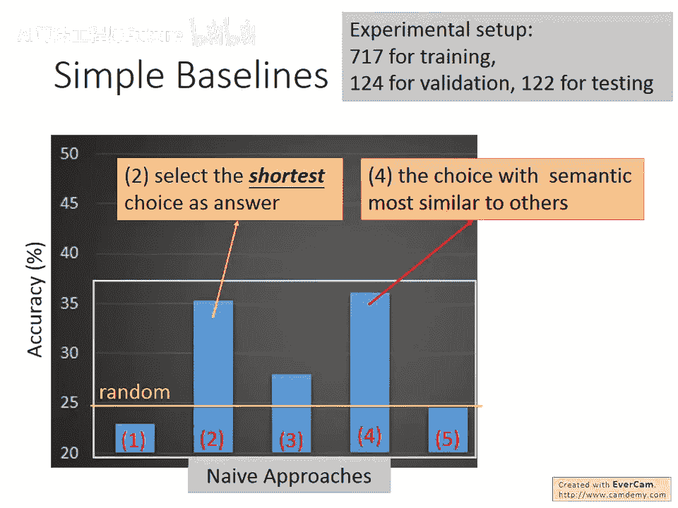

那这个呢都是一些区别的方法。

你可以用先马逊专利的方法，比如说用这个memory network和memory network，可以得到39percent的正确率，是比随机弄一下的还要好一些啊。

如果呢用我们刚才讲的那个model的话呢，我们现在在呃有语音辨识错误的情况下，最好可以做到将近50percent的正确率啦，这其实50percent正确是没有很高。

我觉得这样应该是额额去不了什么美国学校的，但是就是两题可以答对一题，所以如果你没办法两题答对一题的话。

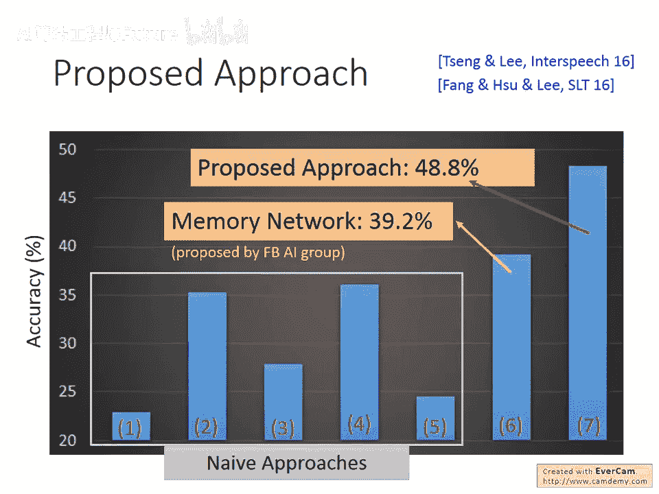

你其实就没有那么寻求，好了，以下是一些reference给大家参考，那最后我这边其实有一个问题，我们讲了deep learning，也讲了structure learning，他们中间有什么样的关系呢。

你想想看，咳咳咳，我们上周讲了HAN，讲了CRF讲了structure和seal和structure s VN，他们可以做的事情是。

比如说做p o s pgg input a sequence or put，另外一个sequence，RNLSTN也可以做到一样的事情，当我们使用deep learning的技术。

和使用structure learning技术有什么不同呢，哎咳咳，呃呃有什么不同，有什么不同，有什么不同，嗯首先嗯假如我们现在用的是unit，directional的RN或LSDN。

当你在make decision的时候，你只看了sentence的一半，而如果你是用structure learning的话，透过米TERY的ALISON，你考虑的是整个句子呃。

如果你用比特币always on的话，可迅会读过整个句子以后才下决心，所以从这个角度来看，也许h NC r f structure s VN等等，还是有占到一些优势，但是这个优势并没有很明显。

因为RNNLSTN等等，他们可以做百里GRESSIONAL，所以他们也有办法考虑一整个句子的information，那，在这个呃HANCIF里面呢，你可以很explicit去考虑。

你的label和label之间的晚期，什么意思呢，举例来说，你今天在做inference的时候，你在用RETURREALPH求解的时候，假设你可以直接把你要的control。

就下到那个RETURREALISON里面去，你了解我的意思吗，你可以直接说，我希望每一个label出现的时候，都要连续出现五次，这件事情你可以轻易的用比特by algm做到。

因为你可以修改比特币algorithm，在mach在选择分数最高的句子的时候，排除掉不符合你要的control的那些结果，但是如果是RNNOLSTN的话，你要线直接下一个CTRL进去是比较难的。

你你没有办法要求RN说哦，你一定要连续吐出某一个label5次才是正确的，你很难让RNN，你可以在training data里面给他看这种training data，但是你叫他去学。

然后再这样是比较麻烦的，比特币可以直接告诉你的mach要他做什么事，所以在这点上似乎是有一些structure能力，似乎是有一些优势的，如果是R和LSTN。

你的cos function跟你实际上最后要考虑的error，往往是没有关系的，想想看，当你在做RNLSDN的时候，你在考虑的cost是，比如说每一个时间点的cross entropy，每一个时间点。

你的name r n的output和reference的cross entropy，它跟你的error往往不见得是直接相关，因为你的error可能是。

比如说呃呃两个sequence之间的edit distance，但是如果你是用structure learning的话。

structure learning的cost会是你的error的一个upper bar，所以从这个角度来看，structure learning也是有一些优势的，但是最后最困难，这是最后最重要的。

MNLSDN可以是定的，而h ISC r f struction personal，他们其实也可以是DP，但是他们拿来做deep的learning其实比较困难，在我们上一堂课讲的内容里面。

他们都是lining，他们都是0年，为什么他们是01年，因为我们定的那个evaluation的function是0年，如果他不是linear的话，你会很麻烦，你在群里的时候会有很多麻烦。

所以他要是linear的，我们才能够套用我们在上一堂课教的那些方法，来做influence跟权利，那在这个比较上呢，deep learning会占到很大的优势，最后整体说起来呢。

其实如果你要得到一些SALOTR的结果，看到SEQUENLIL的test，然后得到scale r的结果，RNLSDN是不可或缺的，所以总体说整体说来，ILSTN这种sel labor的test上面。

表现其实会是比较好的，deep这件事情是比较强的，他非常的，但他非常的重要，那如果你今天用的只是linear的model，如果如果你的model是linear。

你的function space就这么大哦，就算你呃呃可以直接呃minimize一个error的up棒，那又怎样，因为你所有的方程都是坏的啊，所以所以相比之下顶learning可以占到很大的优势。

但是其实deep learning跟structure learning他们是可以被结合起来。

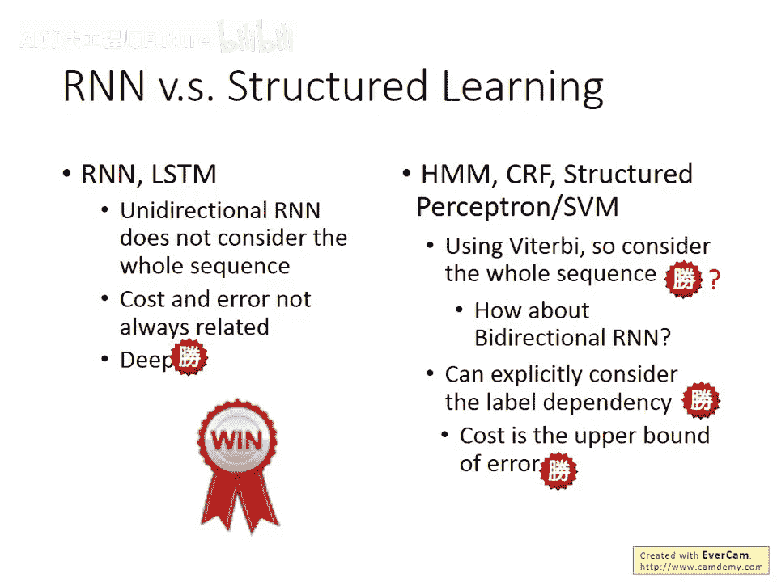

而且有非常非常多的先例，有很多成功的这个这个这个这个结合的先例哦，你可以说我底部呢，就是就是我我我input的这个这个feature，先通过RNN跟LSDN，然后先通过RNLTNLLCN的open。

再作为h NC i f structure s SPN等等的input哦，你用RNNLTN的open来定义h NC i s structure，SEN的这个evaluation的放选，如此呢。

你就可以同时又享有定的好处，同时又享有structure learning的好处，好那这个呢在过去已经有很多先例，比如说呢在呃最好到最后你现在这边有DP吗，哎这边有structure。

这两个是可以joint里一起论，你该想想看这个CRF可用grading decent train呢，那其实structure s b m我们好像没有讲，但是它也可用微廉cent。

所以你可以把deep learning的部分和structure learning分就联合起来，一起用gradient descent来做成立。

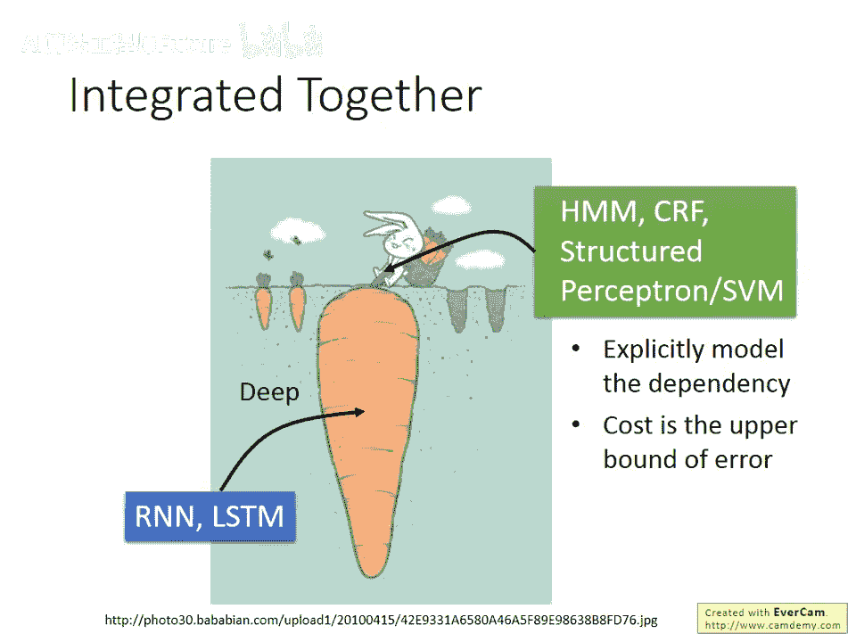

那在语音上呢，我们常常会把deep learning和structure learning合起来，你可以常常见到的组合是呃。

deep learning model CNN l s t n t n n加上HN哦，所以呃我们常常所以做语音的，常常说我们把过去我们所做的东西统统丢掉，其实不是HAN的，往往都还在啊，往往都还在。

如果你要得到最stay of dr的结果，现在还是用这样子hybrid system，得到的结果往往是最好的，那这种hybrid system怎么work呢，我们说在HML里面。

我们必须要去计算X跟Y的状况的人，或是在structure learning里面，我们要计算X和Y的valuation方程，在语音面试里面，X是声音讯号，Y是语音面试的结果。

在ha里面我们有transition的部分，我们有emission的部分，DNN做的事情其实就是去取代了emission的部分，原来在ha里面这个emission就是简单的统计。

就是统计一个高悬mixture model，但是把它换成DNN以后，你会得到很好的可FORMANCE，怎么换呢，怎么换呢，一般RNN呐。

他可以给我们的output是input a coy feature，他告诉你说这个coy feature属于每一个state的几率，你可想这跟我们要的东西不一样啊，我们要的是POX一个Y。

这边给我们的是p o y given x怎么办呢，做一下转换，MK给我们p of x一个Y，然后你可以把master一起分解成POFX，Y除以PFY，再把它分解成PY积分，X乘以PFX除以PFY。

那前面这个p f y given x啊，它可以从RN来，那PFY呢可以从你就直接看，你就可以直接从你COOPUS里面统计，PUY的出现的几率，这POX呢你可以直接无视它，为什么POX可以直接无视它呢。

你想想看，最后你得到这个几率的时候，在influence的时候，X是input，是声音讯号是已知的，你是穷，比所有的Y，看哪一个Y可以知道P我们XY最大，所以跟X有关的项。

最后不会影响第2inference的结果，所以我们不需要把X呢考虑进来，那其实加上HNN，在语音辨识里面是蛮有帮助的，就算是你用RNN，你在做变式的时候啊，常常会遇到的问题，假设我们是一个frame。

每一个一个frame都到RN，然后问他说这个frame这个这个frame属于哪个for，它往往会产生一些怪怪的结果，比如说因为一个phone往往是蔓延好多个frame嘛，哦所以本来理论上你应该会看到说。

比如说第一个friend是A啊，第二个friend是A，第三个是A，第3A第四个定位是A，然后接下来换成BBD，但是如果你用RN在做的时候，你知道RN它每一个产生的这个这个label。

它都是1pendent，所以他可能会突然发狂，在这个地方就突然若无其事的改成B，然后又改回来，这样你会发现他很容易出现这个现象，然后如果今天这是一个比赛的话，你就会有人发现说嗯他们有点弱。

他那边发生种信的说，我手动，只要比如说某一个某某某一个output，跟前后不一样，我就手动把它，我就手动把它改掉，这样然后你就可以得到在两次肾的进步，那就可以吊打其他同学，那如果你加上HN的话。

就不会有这个情形，HAN会帮你把这种状况自动就把它锈掉，这样子可以，所以加上HNN其实是还蛮有帮助的，对RN来说，因为他在training的时候，它是一个一个frame分开考虑的。

所以其实其实今天呐假如这个不同的错误，对语音辨识结果的影响很大，但是RN不知道，如果我们今天把这个B改成错，在这个地方改成错，在这个地方，对最后语音辨识错误的影响其实就很小，但是RN不知道这件事情。

所以对他来说，在这边犯一个错误和这边犯一个错误是一样的，但是RN认不出这件事情来啊，你要做到这，你要让RN可以认出这件事情来，你需要加上一些structure learning的概念才能够做到。

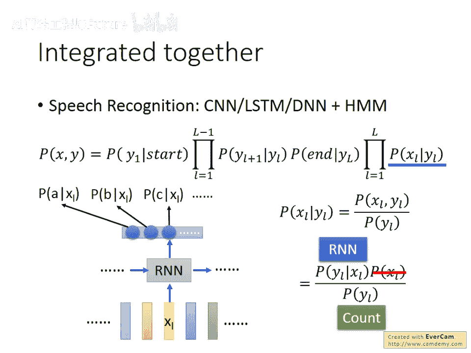

那在做这个SLAFEELING的时候呢，现在也很流行有i directional的LSPN，再加上CIF或者是structure的SBN。

也就是说先用by directional的LSDI操作feature，再把这些feature再拿这些feature来定义，CRF或者是structure s VN里面，我们需要用到的地址啊。

cf和structure s VN都是linear的model，你要先抽个feature，Fia x y，然后弄一个way的W。

那这个final和SY的feature你不要直接从road feature来，你直接从by directional的RN的output，可以得到比较好的结果好。

那有人会说structure learning到底是否是呃practical，我们到socor learning也需要解三个问题，那其中inference那个问题往往是很困难。

你想想看inference那个问题，你要ARG，你要穷举所有的Y，看哪一个Y可以让你的值最大，你要解一个optimization的power，那这optimization power很多。

并不是所有的状况都有好的解，应该说大部分的状况都没有好的神入选，sequence liberty是少数有好的SLUTION的状况，但其他状况都没有什么好的SLUTION。

所以好像会让人觉得说structure learning，并它的用途呢并没有那么广泛，但实际上呢现在未未来未必是这个样子，事实上你想想看我们之前讲过的game。

我认为呢game就是一种structure能力，如果你把discriminator看作是evaluation function，这是我们之前讲的，在structure learning里面。

你有一个POWERONE，你要找出一个evaluation function，如果这个discriminator，我们就可以把它看作是evaluation function好。

所以呢我们就知道problem one怎么做，那最困难的problem two要解一个influence的问题，我们要穷举所有我们未知的东西，看看谁可以让我们的evaluation方式最大。

这一步往往很困难，因为X的可能性太多了，未知的东西可能性太多了，但事实上这个东西它可以就是generator，我们可以想成generator，它不是就是呃给一个noise。

给一个从高选里面sample出来的noise，他就output一个X嘛，它就output一个object出来吗，它output的这个object，不是就是可以让discriminator分辨不出来的。

那发现吗，不是就可以，而如果discriminator就是evaluation function的话，它output的那个option，就是可以让evaluation function的值很大的那个啊。

所以这个卷的REOR他其实就是在解这个问题，就这个generator的open其实就是这个arg max的的open，你可以把generator当做是在解influence的，这个问题。

那paper dream呢，power str你已经知道了，我们怎么去get就是power three的设计权，事实上get training它的structure s b n那些方法。

training你不觉得其实也是有异曲同工之妙吗，大家还记得structure s e n是什么train吗，在structure s e n的training里面。

我们每次找出最competitive的那些example，然后我们希望正确的，然后我们希望正确的example，他的以BELIEVATION的function的分数。

大过competitive example，然后update我们的model，然后再重新选competitive example，然后再让正确的double compactive。

就这样ITERRATIVE的去做，你不觉得电也是在做一样的事情吗，game的GA的training是呃，我们有正确的example，就是这边的他应该要让你没EVATION。

function是DISCRIMINOR的子弹，然后我们每次用这个generator，generate出最competitive的max，也就是可以让discriminator的值最大的那些X。

然后再去train discriminator，discriminator要分辨正确的real的分，Ciror，也就是discriminator要给real example比较大的值。

给那些most competitive的X比较小的值，呃，所以然后这个process就不断的iterative的进行下去啊，你会update discriminator。

然后update你的generator，然后再update你的discriminator，其实这个跟跟那个呃呃呃，这个这个structure s e n的training，其实是有异曲同工之妙。

那你可不想说在game里面，我们现在讲structure s VN的时候，都是有一个input，有一个output，有一个X有一个Y，那我们之前讲的game只有X听起来好像不太像。

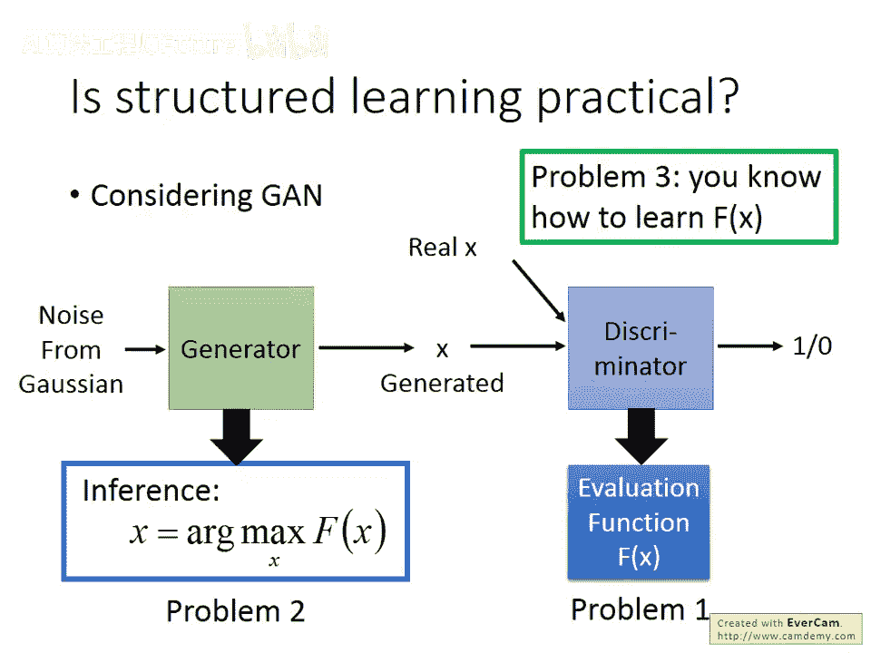

那我们就另外讲一个像的给你听看看。

其实game也可以是conditional的game，什么conditional的game呢，我今天的example都是XY的配，我要解的任务是基本X找出最有可能的Y，比如说他可以就想成是做匀变式。

X是声音讯号，Y是vs出来的文字，OK那如果是用conditional pain的概念怎么做呢，你的generator input一个X，他就会output一个y discriminator呢。

他是去check一个XY的pad，是不是对，如果你给他一个真正的XY的pair，他会给他比较高的分数，你给他一个generator output出来的Y，配上它的一份X所产生的一个假的XY的配。

他会给他比较低的分数，Ten in the process，就跟原来的game是一样，这个东西已经被成功应用，在用文字产生image的这个test上面，再用文字产生image。

这个test就就你用本本没用的去说一句话，说有一只蓝色的鸟，他就画一张蓝色的鸟，这样可好，那这个test呢你的input x就是一句话，output y就是一张平面。

那generator做的事情就是给他一句话啊，在这边啊说this flower has small from grand呃，呃battle with a part purple center也还句话。

然后呢他就产生一张INGE，那discriminator做的事情就是discriminator，给他看一张image，根，一句话让他判断说这个XY的pair。

这个image跟sence pair他们是真的还是不是真的，那如果你把discriminator换成就是evaluation function。

把选择greater换成就是解influence的nature power，其实conditional game跟structure learning他们是可以类比。

或者是你可以说game就是train structure，learning的model的一种方法啊，你可能觉得这听起来或许你有没有没有听很懂，其实就算你可能觉得这可能是我随便讲讲的。

但是我就想说其他人也一定就想到了。

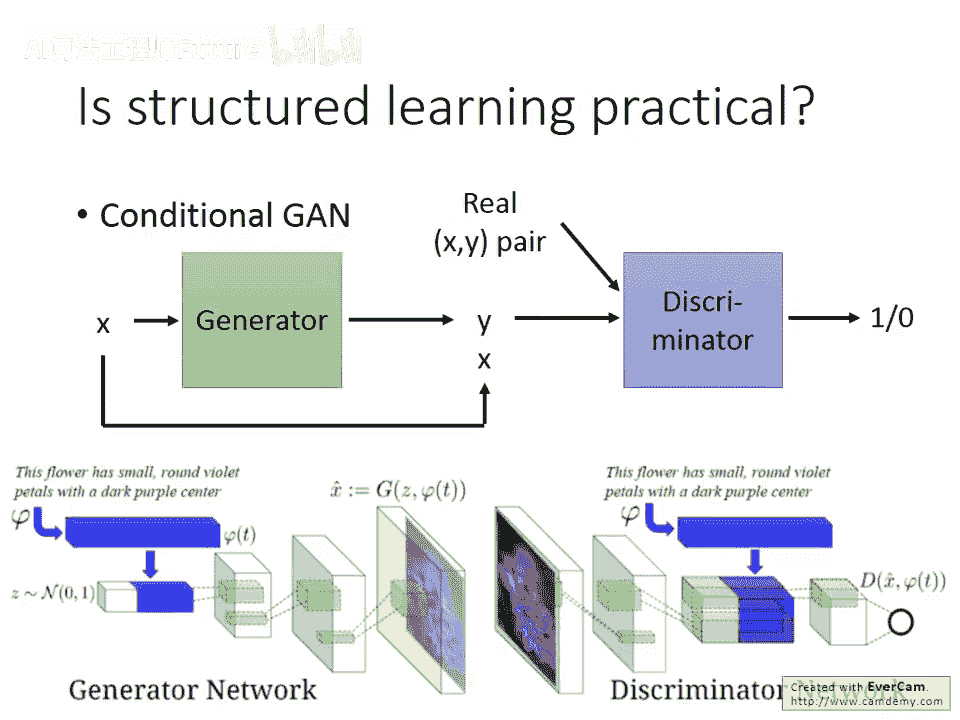

所以我就google了一下其他人的publication，果然其其实很多很多人都有类似的，很多人都有类似的想法，就game呢可以跟energy base model做connection gain。

可以被视为train energy base model的一种方法，所谓的energy base model，其实我们之前有讲过，他就是structure learning的，可以说是另外一种称呼。

而是亚马困提出来，那这边呢有一系列的paper在讲这件事，那你可能觉得说把generator视作是在做influence，这件事情是在在解这个arg max那个problem，听起来感觉很荒谬。

嗯其实也有人就是这么想，也有人想说，这边也列一些refer给大家参考，又有人觉得说一个neural network，他有可能就是在做解a arg max这个problem。

所以也许deep and structure，就是未来一个研究的重点的方向，好好那呃说到deep and structure，其实我就想到我的另外一门课叫machine learning。

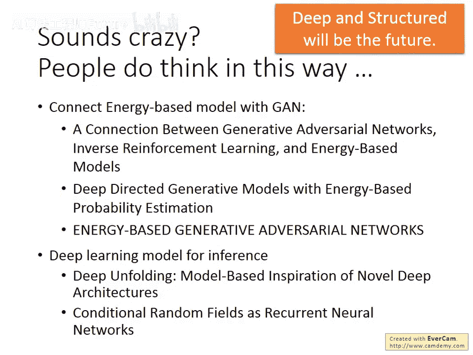

having it deep and structure这样子，那因为有同学即兴问我一些问题，有关下学期开课问题，所以我获取可以在这边就一次统一的回答，首先呢下学期NL跟这个machine lear点。

Happy dience structure，这题刻的名字太长了，所以就缩写成NODS，OK那NL跟NLDS下学期会同时存在，那NLDS跟NL有什么不同呢，呃过去的LLDS的一些内容。

已经被拿到NL里面叫，所以在这学期的LL中有提到的内容，比如说DNN或CNN，在NLDS中呢就不再重复，如果有需要的话，只做一些复习，另外呢我们现在终于有教科书了。

这个yn good fellow还写了一个教科书，就叫做deep learning，我们可以用deep learning这本书呢来当做教科书，那神奇的就是这本教科书的编排。

他所讲的内容其实跟machine learning，having dience structure呢是还蛮match的，真是英雄所见略同啊，哦我我得还把他这句话也剪掉，好。

那个这个think learning那本教科书，它有三个part，一个part讲linear algebr，那我就不管它了，part two是讲对learning part three的内容。

虽然他的title叫做keep learning research，那你会发现大部分的内容讲的其实就是structure，人有他会讲0r factor model呃。

这个structure from dirty model，Monte，这个NC NC partition，Function influence，这个其实都是structure learning的内容。

这样所以有人可能觉得说，怎么我为什么把deep和STRUCTU凑在一起，这个把deep跟structure凑在一起，其实就是未来的趋势，嗯嗯然后呃回答一些同学问题，所有的作业。

我们从开学的时候就是2~4人一组，你可以组好队以后呢，一起来修那NLDS的作业，我发现有些人把过去开课的作业已经做完了啊，太厉害了，但是这个下学期课程的作业，和之前的作业是不一样。

我们就把之前之前的三个作业合成一个，当做作业一样，然后我们之后可以再加别的作业，详细的细节呢我们下学期呃，以下学期公告的为准，那我的规划是可以加attention base model。

Attention base model，还可以还还可以出蛮多东西的，比如说托福的tb券可以算，有可能可以当做作业用，或者是V9的question answer，Video。

question answer都是可能作业，reinforcement learning也高出一个作业，degenerated tomato也都要出一个作业。

然后sequence to sequence learning也应该出一个作业，尽管有机构类可以做东西太多，比如可以做一个check up。

或可以做一个这个video的caption generation等等，都是都是有可能的，然后呃另外就是说明一下，就按LDS的初选就不开放加钱，然后就以组为单位加钱，然后会出一个作业零。

然后作业零就是很简单，我们就是做一个那个b forward neural network，然后你可以用现成的套件，比如说carol。

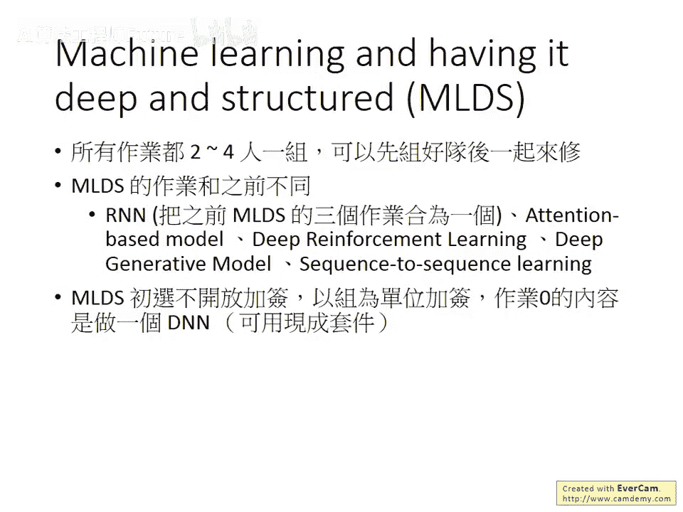