# 【官授搬运】2026年全新优化版李宏毅机器学习系统课程，这才是真正的初学者体系课程！—人工智能／深度学习／神经网络 - P33：5-选修-GNN-1 - AI算法工程师Future - BV1ruqABeEFX

好那各位同学，我们就开始讲今天的呃补充的内容。

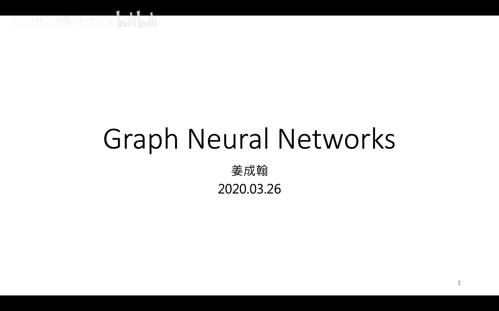

那各位听得到我的声音吗。

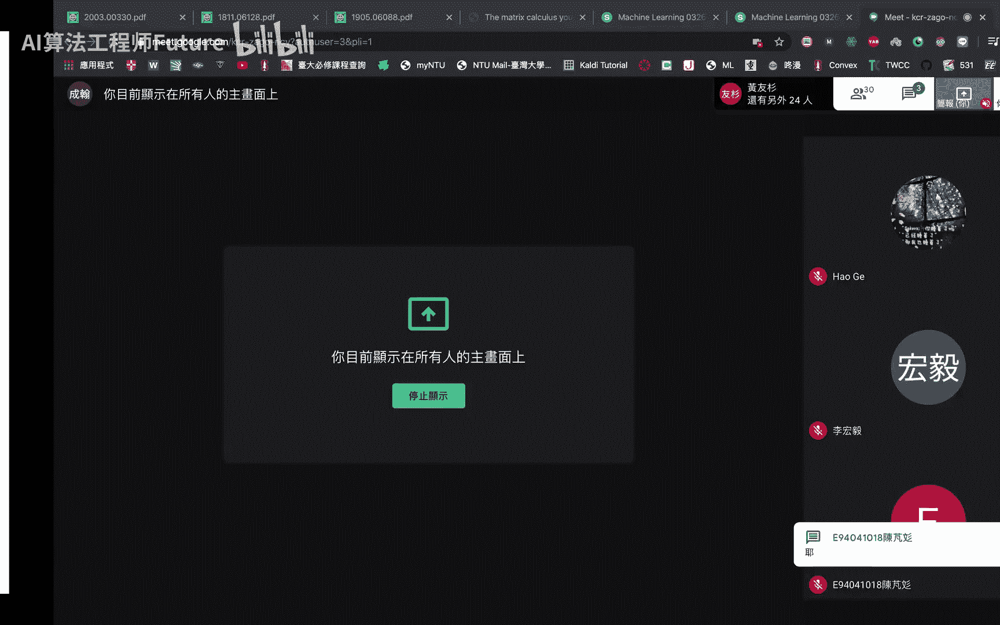

好那那我就开始讲，那以后从这礼拜开始，每个礼拜四都会是由助教来呃，讲就是新的内容，那这礼拜我要讲的是graph neural networks，那因为这里这个是第一个礼拜远距离教学，所以有些东西还在使。

那如果有不方便，请同学就是多多包涵，那呃一开始就是各位如果等下有问题的话。

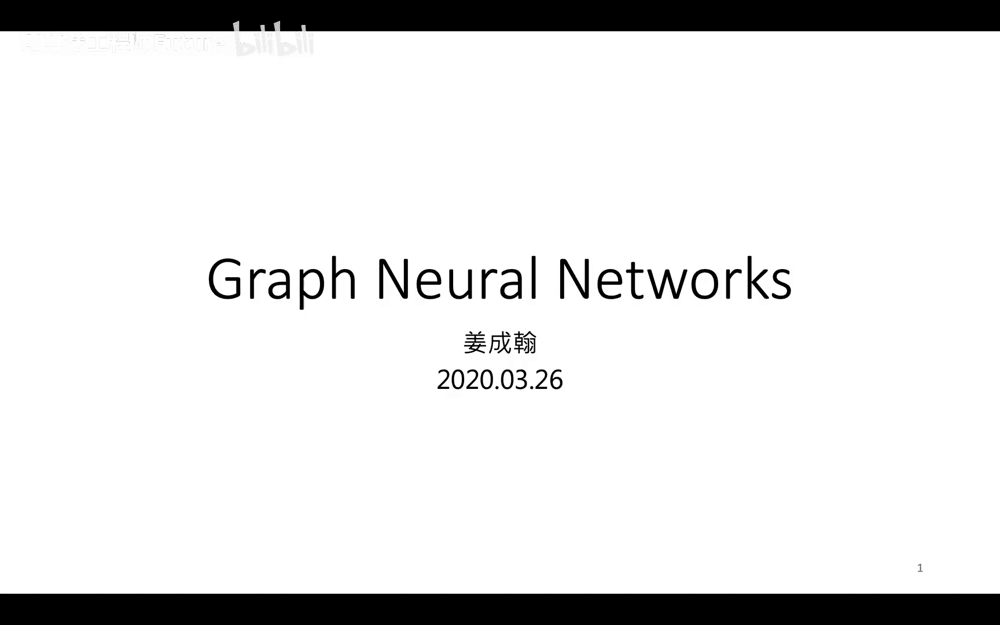

因为我如果要看那个google me的那个聊天室，会有麻烦，所以所以就是大家可以直接用slider，然后加进去对，然后我会急那个随时看slider有没有问题，然后如果有问题的话，我就会直接回答。

那我们就开始讲今天的那个课程。

那我们今天会进行的东西，大概就是会先讲一下，简单的介绍一下graph neural network，他在做的事情是什么东西，然后呢会简单介绍完之后，我们会来看一下我们今天会讲的内容，具体而言有什么东西。

然后介绍一些比较重要的task，还有呃DATASET，还有benchmark哦，今天的投影片是会哦，今天今天的应该会是是会录影的，我确定，但我没有录到呃，对我现在有我现在我现在是有在录音的。

所以应该是没有问题好，然后接下来我们讲完呃，这些task之后，我们会讲最重要的是两个方法，我们是怎么使用GNN的方法，聚氨根有两种方法，讲完之后我们会讲聚缘根的应用好，那我们就开始今天的介绍。

那graph neural network呢这个词它包含了两个关键字，一个就是graph，一个就是neural network，那我相信各位既然是修machine learning，然后也写过几次作业。

各位对neal network一定有一定的认识了嘛，这就是一个非常简单的multilayer perception，它有一个input layer，它output layer。

然后还有中间有很多hidden layer，然后hidden layer是由一些weight，还有BIOS所组成的一个SMODEL，那除了这种最简单最阳春的neon network之外。

那各位在写作业的时候应该有写到呃，用到cm n或者是嗯嗯，那甚至是如果你有想要用的话，你可以用更潮一点的transformer，那这些都是neural network的例子好。

那如果各位不知道那是什么的话，没关系，就是不重要，今天也不会用到这些东西好，那问题是大家知道new name，但我相信大家也知道grab是什么东西嘛，如果你有学过资料结构演算法的话。

那你一定对这个东西非常的熟悉，这是一个r b tree，那r b tree它就是一种特殊的GRAP，那我们知道grapes它是一种资料结构，这个资料结构它是定义在两种东西上面，一种是note。

一种是edge，所以在这颗rb tree上面，它的note就是这些红色跟黑色的东西，那我们可以看到note它会有不同的特性，有红色的节点，有黑色，红色的节点也有黑色的节点嘛。

然后我们也知道它的edge它也有不同的特呃性质，它的edge的性质就是这些方向，这些从root往下指的这些东西，那所以node有它的性质，age有它的性质好，那各位如果说呃你没有说过资料结构与算法。

你说你不知道这个是什么东西，没关系，那我相信各位应该有学过高中化学，高中化学你一定有画过长相这样的东西，你不一定化，你不一定认知它是什么分子，但是你就知道它应该是一个分子嘛，它是一个他就是某个分子。

那这个分子你也可以把它看成是一个graph，那这个graph上面的节点，就是这些可能没有画出来的碳原子，还有氢原子，然后他这个grab上面的edge呢，就是原子跟原子之间的见解好。

那所以我们在这个grab上面，如果我们把它当成一个grab，我们也看到他的node也是有不同的性质，它有不同的原子，那这个不同的原子就是不同的性质，那他的间接它的AGH它也有不同的性质。

它有一级建或是一又1/2键，那就算他全部都是一级键，碳氢键的一级键跟碳碳键的一级键，它也是不一样的，一级键好，那就算它是一样的碳，它都是碳碳键，那也会因为它碳碳键旁边，它的碳是接了什么东西而有所不同。

所以我们就可以看到grip，它他的edge不只是会因为它两边连接的节点不同，它还会因为这个节点，它连接到其他的节点的不同而有所不同，所以grab它是一个非常，就是有一种很连在一起的结构啊。

它就是一个连在一起的东西好，所以这是另外一个grab的例子，那大家可能会觉得这两个grab它都非常的小，那其实我们在处理的graph也可以有更大的，就是它的它的大小可以是更大的。

这是一个protein protein interaction的graph，那每一个上面每一个节点，它代表的就是身体某一个组织，它的某一种蛋白质，那两个蛋白质它有连在一起的话，它如果有一个edge。

就表示说他们两个是有interaction的，那这个protein protein interaction的graph，也是我们会处理到的graph1之一好，那如果各位说这三个东西你都不熟。

你觉得这个好像脱离你的日常生活太远了，那其实日常生活中也有一个大家一定都看过的，Grab，就是台北捷运路线图，那台北捷运路线图它的节点就是这些捷运站嘛，捷运站有不同的性质，它可能呃他可能是高架。

它可能是地面的，它可能是测试月台，可能是导师月台，那这些edge上面的edge，就是捷运站跟截面站之间连接，它也有不同的性质，它可以是高音量的，它可以是中运量的，它可以是轻轨，所以说grip它最重要。

我们要强调的就是它是由节点跟边组成的，节点有节点的性质，边有边的性质，好那接下来我们要问的是说好，那我们为什么会需要用到grab neural network呢，然后另外我们要怎么把一个grab。

塞到一个neural network里面，今天neural network长这个样子，那我要把它的input，原本我们这边放的可能是一个sequence，可能是一个文字的sequence。

可能是一张照片，但今天如果我想要把刚刚讲的那些GRAPP，放进来这个neural network里面，然后我要把它喂到这个model里面，那我要怎么让model可以。

同时知道他是grab的这个structure，而且我也要让他就是知道它，每一个node跟age的feature是什么，所以这就是graph neal node，它要处理最大的一个问题。

好那我们先跳过这个方法的部分，我们先来看一下grapneon network，可以做什么样的事情，那第一个假设说我有一个呃，有一有一有一大堆不同的分子，然后我想要训练出一个classifier。

然后告诉我说这个分子会不会导致突变，所以它就是一个很简单的supervise classification的问题，那我的data set就是我有很多label。

好的data告诉我说这个分子它是会导致突变的，有些分子是不会导致突变，然后我希望最后劝出一个classifier，然后这个classifier可以让我知道说呃，我这边今天丢进去一个他没有看过的分子。

然后我想要问他说这个东西会不会导致突变好，那这就是一个classification的问题，那除了classification有问题，那graph neural network它可以处理的。

还有其他的问题，像是generation好，然后大家都很努力的在开发新药，那开发新药的过程，我们就需要额投入大量的金钱，还有呃一些资源嘛，那如果我可以把开发新药的过程，因为开发新药，我们要做的事情。

我们就是要找出某一种化学的分子，然后这个分子可以有效地对抗病毒，那如果我可以用一个neural network，然后我劝出一个generation呃，Generator。

然后这个generator它可以生成出我想要的分子，那我们就可以省下很多很多开发的资源吗，好所以想法就是这样子，我可不可以有办法劝出一个generator，这个generator。

或者说他是一个decoder，他只要吃一些random noise，然后再加上我要求他呃，生成出某些特定有某些特定条件的一些分子，然后呢它就可以给我这些分子出来。

那这个Y这个condition它可以是说呃，我希望它是一个好合成，因为我最后就是生成出来的这个分子，我希望它是一个可以被我合成出来的药物嘛，所以我可能是希望这个Y它的conditions。

它是一个很好合成的药物，或者我希望它是一个成本很低的药物，或者我希望它是一个它是一个新药，它我我不希望他这个model劝出来，最后吐出来全部都是阿司匹林，是没有任何意义吗，所以我希望它是一个新药。

所以我可以加很多不同的condition，所以我只要衬出一个这样的model，那我就可以做到这件事情，那当然这个猫的话不一定生成出来都是合理的，化学分子啊，像是这些画红色的线，就是它生成出来是违反。

就是违反一些就是化学原理的好，那这个等一下我们也会讲，这个东西可以用什么方法来做到好，那这些东西我们刚才讲了前面两个例子，我们的input或是我们的output，大家都很很清楚，他就是个grab。

所以你可以很轻易的理解，为什么我们需要用graph neural network，但是有些东西你看起来它好像不是一个graph，你也完全不会觉得他是graph。

但是我们其实是可以用grab neon network来处理它。

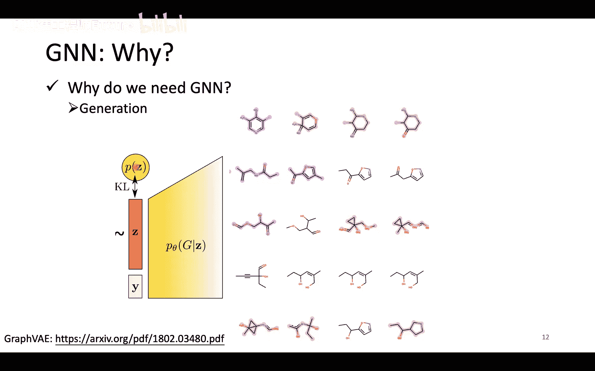

像是什么呢，像是下面这个例子，现在这个例子是最近日本很红的一部日剧，它是叫做特修斯之船，那他里面就有很多角色，然后剧情的部分呢我就不多讲，反正他最后就是要他要做的事情，就是他想要找到这个是主角。

然后他想要找到陷害他爸爸的凶手是谁好，那唉就是找凶手这个过程呢，我们可以把它看成是一个classification的问题，他有这么多角色，那每个角色呢它都有它的一些每个角色。

我们叫做他是一个entity，那entity他有他的attribute，所以他的attribute就包括他的名字，可能包括他的年龄，可能包括他的职业，可能包括他的呃，在哪里出生啊等等等等。

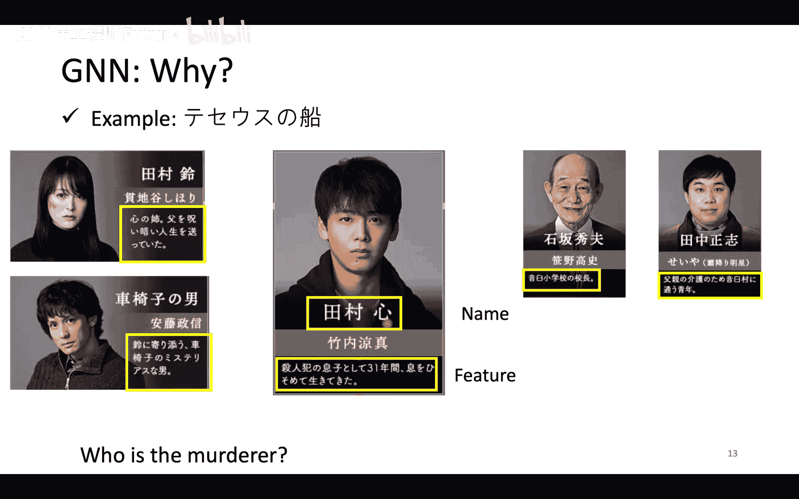

好，那这些东西呢，我就可以拿来当做是一个人的feature，然后劝出一个classifier，那这个QUALIFLY我们的确认的方法很简单，我们就是丢进这个人，他的名字，他刚才讲的那些feature。

然后我们就会告诉这个classify，假设我们已经有label，就是他就是主角，一定会知道哪些一定不是凶手啊，然后他们就可以劝他，就可以训练出一个CLASSI法，来告诉他说这个人不是凶手。

这个人不是凶手，这个人不是凶手，然后最后呢劝完一个科人来之后，然后我最后问他说这个人会不会是凶手，所以我在testing的时候，我就可以做这件事情，好那这件事情呃当然是一个，你当然是可以这样做。

因为你有这些teacher，你就可以直接劝出一个press版，但是有一个问题，我们是不是有忽略了什么东西，或者有没有什么我们可以利用的资讯，但是我没有完全利用到好，那各位在看日剧，日剧或者韩剧的时候。

一定会还或者是什么小说吗，有一个很重要的东西就是角色的关系。

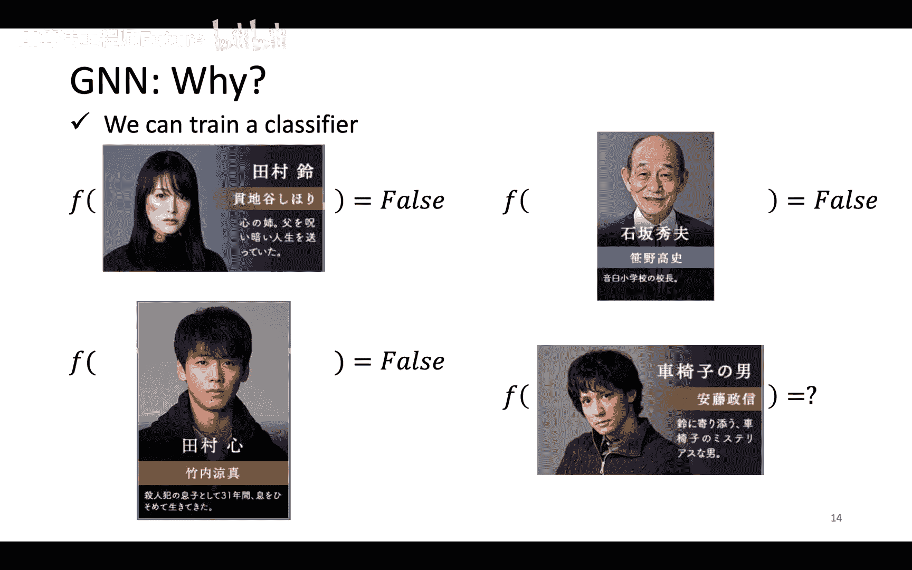

角色跟角色之间是有很复杂的关系的，它是一部穿越剧，所以他角色看起来很奇怪哈，他们两个是姐弟，他们两个是夫妻，他们两个是师生关系，他们俩是同僚的关系，他们是邻居的关系，还有很多很多不同复杂的关系。

那这些复杂的关系，是不是可以让我们在做classification的时候，有一些额外的资讯，可以帮助我们做更好的modeling，所以这样子的underlying structure。

还有relationship，就是我们用GNN的另外一个原因，我们要怎么样同时考虑这个entity，它的feature，并且考虑它跟其他entity之间的关系，而且我们不止要考虑这两个N的值之间的关系。

我们要同时考虑所有N的底之间的关系，所以这个时候我们就必须要用graph neural network好。

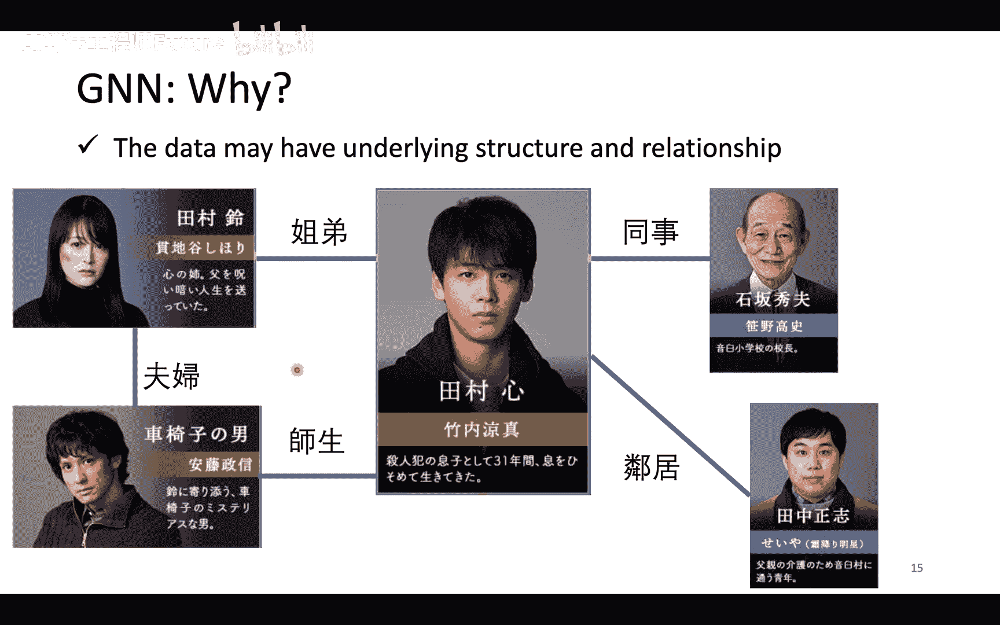

那问题是我们刚才讲到的graph neural network，他都是非常非常小的呃小的graph吗，那我们今天可能我们的data set非常的大，它可能是好几千个好几万个节点，那在这样的状况下面。

我们要怎么来做训练呢，哈还有另外一个问题，当我们今天的model非啊，当我们今天data a set非常非常大的时候，我们不可能可以把所有的呃，所有的data都做label。

那当我们没有办法把所有data都做label0的时候，我们要用什么样的方法，在同时利用我们有限的label以及这个grab，整个整个grab它的structure，这样的状况下面。

我们要利用这两个仅有的资讯，然后圈出一个好的model，那我们来看下面这个例子，诶好像有人的麦克风没有关系是吧，然后就是，好谢谢，好那那下面这个例子呢，呃这是一个很简单的graph。

那它上面有两种不同的node，一种是label node，一种是unlabel node，那在这个例子里面，我们可以看到label node跟unlabel node，它的数量是差不多的。

但是我们在某些应用上面，我们的unlabel node它可能是远大于label NO，那在这这种状况下面，我如果想要学到一个好的NO representation，也就是说我想要知道说这个node呃。

我想要抽出一个比较好的NO feature，那我要怎么利用我仅有的这些label data，以及它跟它旁边这些邻居的这些structure有关系，然后来训练出一个好的model呢。

那我们可以很直观的想就是近朱者赤，近墨者黑吗，一个节点跟它所连接的这个节点，它应该会有某种相似的关系，或者它会有某一说某某一些特定的关系，那我们就可以利用这些特定的关系。

然后来帮助我们的model学习一个好的，Node representation，好，那问题是我们要怎么做到这件事情，我们要怎么把他邻居的这些资讯arrogate，或是或我们说先不要用everyday。

我们说我们要怎么用它旁边的这些邻居，跟它相邻的邻居，然后来帮助我们的model做训练呢，好这就是我们要问的问题，那当然我们可以用一个我们我们先回想一下，我们在convolution里面做的事情。

我们在一个conclusion neon network里面做的事情呢，假设我要做conclusion，那我要对这这个人这个绿色的框框，我要用一个33的kernel说抗路去。

那我就会放一个坑润龙在上面嘛，然后跟他做相乘相加，然后再如果想要算跟这个黄色的con，做conversion的话，那我一样把这个curl移到旁边，然后一样做相乘相加好，那做完了之后。

我就可以得到它在下一层的feature map长什么样子，可是这件事情我们要怎么generalize到GRP上面呢，对我们有没有办法放了一个kernel在上面，然后呢给他做相乘相加。

外配上的东西来做CONUTION，这好像就不是这么的容易，好像不是那么的容易好，所以我们要怎么样，把我们的NO feature放到一个feature space里面。

然后我们想要用conclusion的方式好，那第一种解法，第一种解法就是说我们可以generalize，我们在CNN里面用的方法，也就是我们在CNN里面做的conclusion，是我们其实做什么事情呢。

我们是看他的邻居，然后我们用他的邻居来update这个teacher map，那第二种方法它比较神奇，它比较玄妙，它用了传统上我们在做signal processing的一套理论。

我们先把这个信号转到FURIDOMAIN里面，转到fury domain里面，我们再把呃转到FURDMIN的信号跟，转到fury dmt filter response做相乘相乘之后。

我们再做inverse fal transform，我们就可以得到我们最后经过filter的信号好，那我们第一堂课我们会focus在这个第一个solution，然后我们第二堂课会在比较深入的讲一下。

我们要怎么做grab signal processing好，所以我们来看一下，我们今天会讲到的内容有哪些，第一个我们会讲到的内容就是convolution。

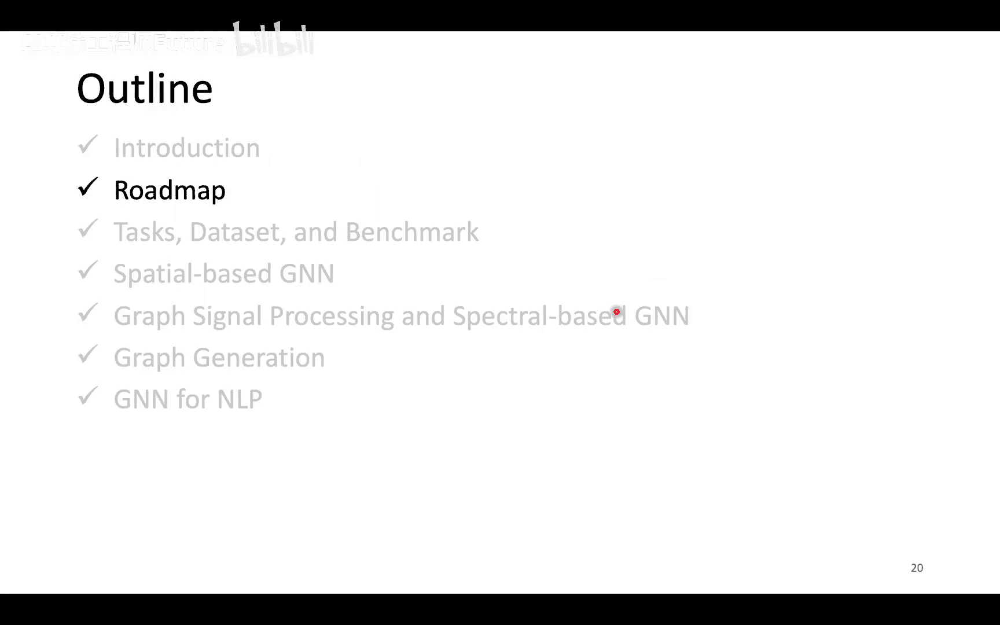

也就是我们要怎么在grab这这样的data structure。

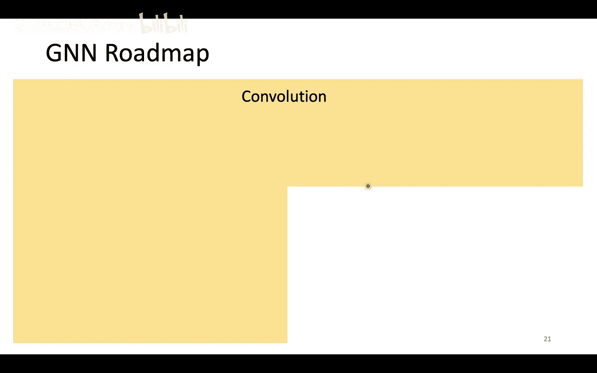

上面做convolution好，那有两种，一种是special base，一种叫做spectral base，也就是我们刚才讲的第一个解法跟第二个解法，那第一个解法大家呃。

我先把我们等下会讲到的方法列出来，大概有这几个方法，那现在大家看不懂education是什么，没关系，等下会详细解释好，然后spectral base，我也会讲几个比较重要的代表的一些model。

然后讲完这些东西之后，我们会来看一些比较偏理论分析的东西，很少非常少的理论，因为我知道大家也不会想听太多理论，所以我只会讲两个很简单的model好，那讲完理论的东西，那就是这么多的model里面。

大家最后其实最喜欢用的还是GAT跟GCN，这两个model好，我们讲完model的部分，我们就会来看一下我们要怎么用这些均衡的model，然后用在一些常见的task上面。

包括supervise presentication，像是我们刚才前面举到的两个例子，或是sei supervised learning，还有representation learning。

所谓的representation learning，就是我想要学到一个比较好的feature，不管是NO feature还是grab feature好，再来呢我们可以有时间的话。

我们可能可以讲一下我们要怎么做graph generation，就像我们刚才提到的，我们要怎么去合成呃，我们要怎么让greg neal network，他去合成一个新的分子出来好。

最后最后如果还有时间的话，我们会讲一些great neal network在natural language processing上面的应用，好，听起来neural network跟啊grave。

neural network跟natural language processing，听起来像是八竿子打不着的东西，但是就是有办法把它扯在一起好，那到这个地方看看各位有没有要问什么问题。

那如果没有问题的话，我们就继续讲。

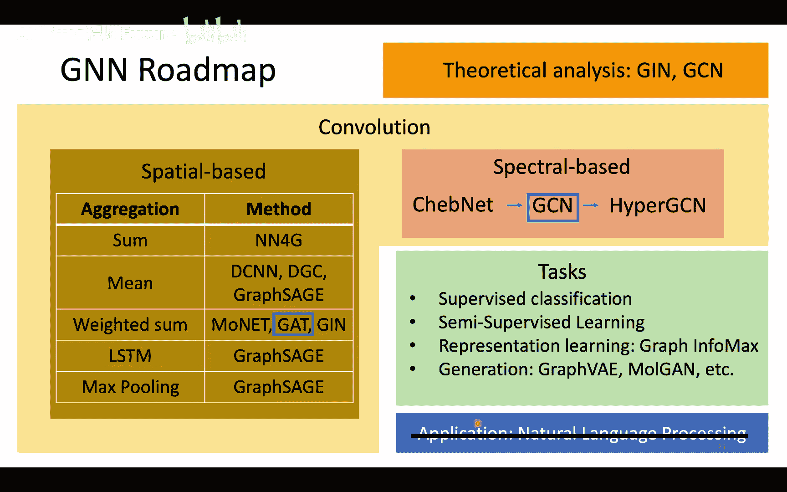

好，那我们现在简单讲一下graph，neural network上面会用到的test，然后还有DATASET，然后还有benchmark，那这个东西是呃，应该是这个月初才出来，有一组人。

就是因为大家在提出一个新的model的时候，你必须要说明说你的model有多好，那我们就是做实验来衡量说我们的model，他的performance有多好，但今天假设说AZ这人他提出A这个model。

然后他用了一个A这个data set，B这组人用了B这个data压set，C这组人用CC这个data set，那在这种状况下，我们很难去衡量说这个model。

我们很难客观的衡量不同的model之间的比较，所以我们要用一些benchmark ttask，然后来衡量model的performance，然后还有很重要的就是这些benchmark task。

你在切training set跟validation set的时候，必须要是一样的，你才能比较，那各位可能在做座位一或者座位二的时候，已经有发现一件事情，就是当你data tc很小的时候。

你就很容易OVERFIT，你可能会呃，看到你的分数在private public board上面是第一名，可是你在private board上面掉了100名。

这就是因为homo one它的DATASET非常小，所以如果你那个addon set，切的跟我们的public的那个data太像的话，那你就会OVERFIT很严重，然后你就会以为说你做的很好。

所以在区分根上面，当然也会有这个问题，所以必须要有一些比较好的data asset，比较大的data asset，比较公平的比较方式，然后来衡量说今天提出来一个新的model，它到底有多好好。

那衡量的方式，他的test包括了以下这五个，那以下这五个，我想我们等介绍完所有的model之后，我们再一起回来看这个部分，我们可以一起比较会比较清楚，所以我们这边先跳过。

我们先看spatial base，Graph，neal network好，那我们等一下这节课，就是剩下这节课，剩下半个小时，我们就介绍special base，Grab neural network。

好那special base grab your nework，我们先回忆一下conversion，neo level是怎么做的，所谓的conclusion neural network，我们做的事情。

假设有一个66的image，然后我们用一个33的kernel来做conclusion，那假设他的layer i它的feature map长这个样子。

然后在我们要想要用conclusion这个operation，然后来算出它在layer i加一的一个feature map，那我们用的是33的KERO，假设这个克隆长这个样子。

那如果我们对这个绿色的框框做conclusion，那它就是或者correlation，它就是把对应的位置相乘相加，也是做内积的动作，做完内积的动作，我们就可以算出绿色的这个格子是多少，然后我们也可以下。

那接下来我们就把这个KERO往往右边移，我们就可以算出黄色对应的这个格子，它有多少啊，好那问题是，接下来我们要把这个东西generalize到grab上面，那假设我这grab input grab。

它长这个样子，然后这个grab它在there i的时候，他的feature map是长这样子，也就是它的node每一个都有一个hidden的feature。

那我希望透过一个operation叫做conclusion，然后算出来它在layer i加一的这个feature map，那根据我们刚才的这个在CNN里面用那个方法好。

假设我们现在关心的是我们怎么把这个X30，这个三代表就是他的第三个node，然后零是它在第零层的B舍，然后这个B就是他在第一层的D舍好，我现在想要看这个东西，我要怎么update成这个东西好。

那做的方法很简单，就像我们刚才讲的那个方式是一样的，就是我我们要看他的，就是我们刚才在CN里面，我们就是看他九宫，如果是一个33的KERO，我们看的是他九宫格里面那个邻居嘛好。

所以现在在这个grab里面，这个节点它的邻居有谁，他的邻居有这个这个这个，所以我们就用这三个节点，他的这个这个ENT确，然后呢来update这个东西好。

那这件事情我们在GNN里面叫做irrigation，所谓的irrigation，就是我们用那or用neighbor的feature。

也就是这些neighbor feature来update下一层pen state，也就是说我们用这几个东西，然后来update它，好那额大部分我们在做EVISION的时候，除了用内杯之外。

还会用他自己的B去吧，好接下来讲，假设我做完了很多层的elevation之后，我今天要做的东西，不只是我想要知道每一个grab啊，每grab上的每一个节点，它的he跟的确我想要知道的。

还有就是这个grab整个grab的representation，那什么时候我会需要做这件事情呢，像是我们刚才在做，就是那个预测会不会突变的这个问题，我要预测的并不是每一个节。

每一个如果它是一个化学分子的话，我要预测的不是每一个原子，它的feature，我要预测的是整个化学分子的滴血，那这时候我就必须要有办法，把最后一层的这个每一个节点的滴血合起来。

变成代表它的grab的一个B选，那这件事情我们叫做read out，也就是把所有的节点集合起来，然后代表整个GRAP好，所以这个东西叫做real，所以我就可以拿最后这个东西来做。

整个breath label的classification或者prediction好，那我们来看一下实际大部分的model是怎么做的好，那第一个我们介绍的是nn for grab好。

Nn for grab，这个model呢他做法是这样，假设说我有一个IMPROGRAM，IMPROGRAM长这个样子，然后呢他有它是一个有五个节点，五个编的很简单的一个GRA，那input layer。

它每个节点它都会有它自己的input feature吗，那假设说你这是一个化学分子的话，那每一个原子每代表一个代表就是一个NO，那不同的原子它会有不同的B选项，你可以用任何跟原子有关的化学性质。

来当它的NO feature，那这个NO feature，我们必须要先经过一个embedding layer，然后来得到一个embedding，所以我们会先把它做类似embedding的事情。

那embedding的方式，当然就是我们就直接用一个embedding mesx，然后得到了他的这个的确，那对每一个节点都做一样的事情好，那现在重点来了，重点就是我们要怎么做ARRIDATION。

那我们假设说我们在下一层，我们先看这个节点，他要怎么它的呃，他的hien feature要怎么背update，那他update方式根据我们刚才讲的，就是做avigation invitation。

就是看他旁边这几个节点，它这个节点旁边有谁呢，旁边有这三个节点，所以我要把他们三个的东西，VIGATE到这个新的feature map上面，那android方式，这个nn for grab。

它这个model它用的是把这这三个东西全部加起来，在经过一个transform之后得到的东西，再加上原本的这个input dition好，所以我们就得到了他的这个，它在第一层这个节点。

它对应的递增的确好，所以我们再讲一下他做的方法是什么，它做的方法是，我们把旁边的邻居的东西先加起来，所以他用的是SM，它加起来之后再加上他原本input feature好。

那接下来我们讲完irrigation之后，我们来看他怎么做REOUT这件事情，那REOUT他做的方法是这样，假设说我叠了很多层之后，就是它也可以叠那个聚氨根，它也是可以叠很多层的，那叠很多层之后。

每一层都做一样的事情，那叠了很多层之后，假设我叠了三层，那我就把每一层的NO feature全部加起来，各自先相加，所以第一层我把它加起来变成这样，第二层我把它加起来变成这样。

第三层我把它加起来就是这样，全部加起来之后，各自经过一个transform再加起来，变成一个一个feature，就代表它整个graph的一个feature，所以它REOUT它，它是这样做的。

然后所以nn for grab的model他就这样做，接下来我们来看另外一个叫做DCNN的model，那DCNN它的名字叫diffusion，Conclusion，Neon network，好。

有人问说为什么要直接加起来，这样会比较好。

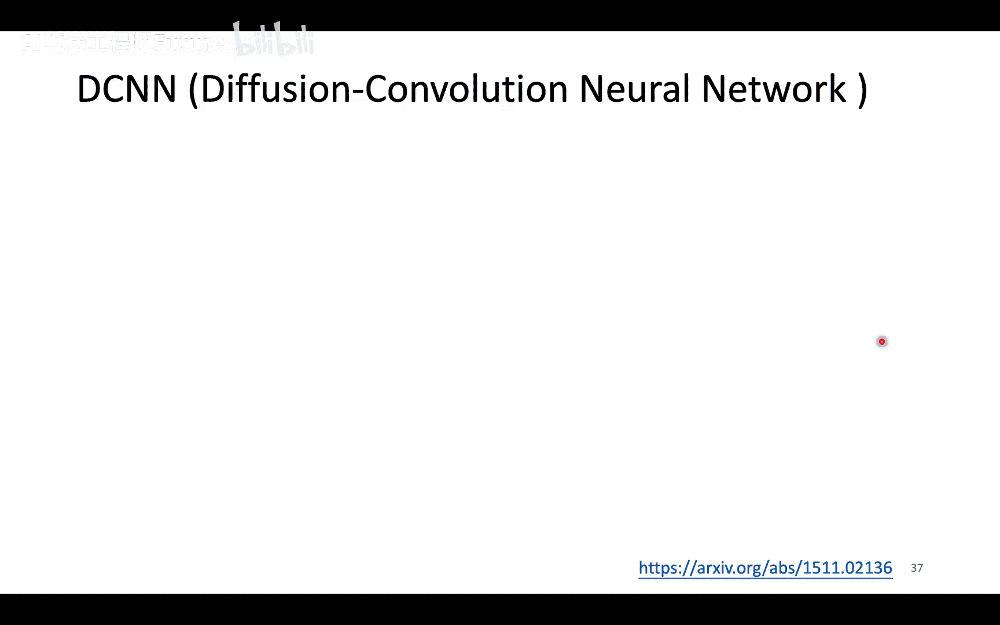

这样会比较好，那诶为什么要做相加呢，呃如果如果说我用相加的话，呃如果我不用相加，你可能也会问我说为什么我不要用相加，所以就是就是你要用什么方法都可以，那等一下还会有更多奇怪的方法。

那对我们等下可以看他还有很多其他方法，所以a regression的方法大部分都是用相加，那我觉得用相加有一个很重要的原因，就是因为你的grab上面他的那个每一个节点，它的邻居数量不一样。

所以如果你不用相加的话，可能会很难去处理，就是那个，呃好不同的很难去处理，你就数量不同这件事情好，那有人问说，为什么不要像conclusion这样，每一个连续把它权重加起来，呃这个是可以这样做，没有错。

那等下我们也会看到有人是这样做的，然后我现在电脑好像有点脏掉，所以我等他一下，好那还有没有其他问题。

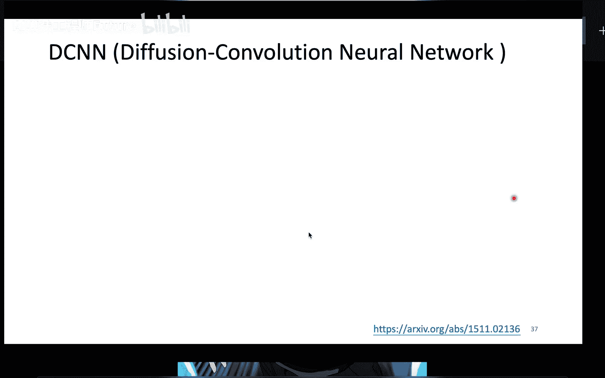

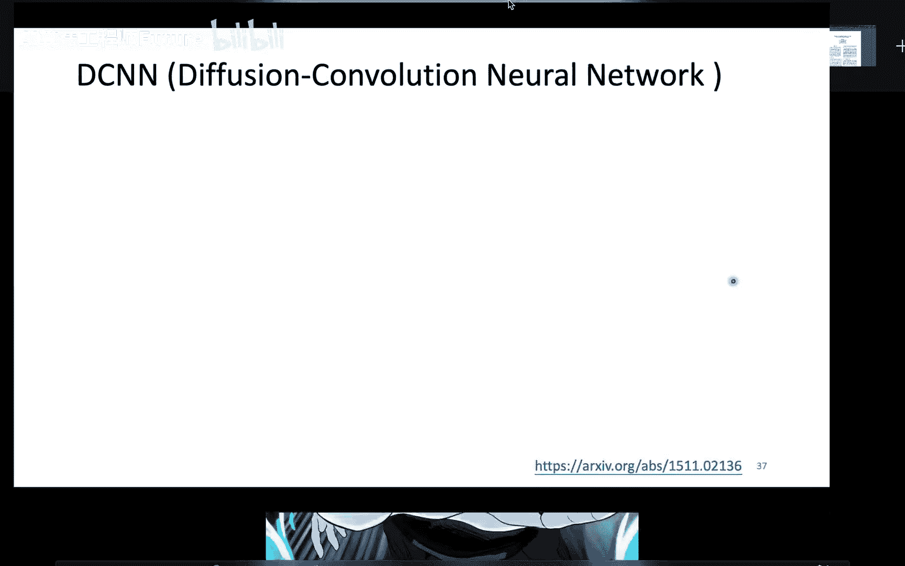

好那我们来看DCNN他这个model怎么做，DCN一样，假设我有一个input grab，长这个样子，那他做的方式，他在下一层的update方式很简单，就是呢，我把啊我们先看一下这个式子在写什么。

这个是告诉我们说，我把跟这个节点跟三这个节点距离是一的，节点全部加起来，所以跟三这个节点距离是一的，就是这123个节点，它们两它它跟这个V3它们的距离都是一，距离是一，距离是一，所以我们把它全部加起来。

然后取平均，他这边用的是平均吼好，取平均之后再做一个微分缝，所以每个节点我都可以做一样的事情，好那在第二层的时候，第二层他要做的事情比较特别，它并不是用这一层的feature来啊。

对他是用这一层的feature来啊，对那我们来看看怎么做的，他做的方式是，我把跟他距离是二的T恤加起来好，那跟这个节点距离是二的，有谁就是距离是二的，是这个这个还是一样，是他嘛，然后还有他自己回来。

距离也是二，所以我觉得把这两个节点它的必选加起来，但他加的不是这一层的B，它加的是这一层的B选好，所以在这种状况下面，假设我叠K层，它就可以看到他的KNEORHOOD里面的东西。

所以我每一个节点都做一样的事情，做完了之后呢，我可以把这些feature抬起来，就是这是呃，这是H00，这这这是第一个节点，第一个第一个节点，第二个节点，然后第四个节点的B确把它排成一个矩阵。

然后下一层也可以，然后假设我叠了很多层，那我就会有很多个矩阵，我把它全部叠在一起，叠在一起好，那假设我最后要做NO classiication，所以我要算出一个NO feature，那我们刚才有讲过。

我们刚才这是一个节点，这是一个节点嘛，所以同样的这个地方，它代表的是某一个节点的T确，那我们就把这个东西拉出来，然后他经过一个transform之后，我们就把它代表这个节点，它的B选。

好那另外一个很像的model叫做the fusion graph convolution，那这个model他做的事情，他刚才刚才这边是用什么，刚才这边是company any在一起嘛。

那这边就直接把它全部加起来，然后全部加起来之后，就就就就就就就做完了，好，好那我们接下来我们来看另外一个model，叫做mixture model network，好，那这个东西呢就是刚才有人问到说。

为什么要直接相加，我不能就是取WAP上吗，为什么呃，就是每个邻居他应该会有，应该是要有不同位，因为每个邻居他的重要性应该是不一样的，如果你直接无脑把它相加起来，好像没有考虑到一些额。

邻居跟邻居之间的一些权重好，那这个model的话主要就是要处理这个问题，好，那他做的方式很简单，就是一样，我们还是一样，拿刚才这个图，然后假设我update是这个东西，那他的邻居有这三个吗。

那我今天在做aggregation的时候，我不要只是用直接加起来的方式，我定义某一个权重的方式，来代表他们节点跟节点之间的距离好，那它定义的方式是这样，这三跟零，三跟二还有三跟四的距离。

它把它定义成是degree哦，这两个节节点的导数，也就是说他的这个节点它的degree是二，所以然后这个节点它的底部是三，所以这个U30就会是呃，这位是根号1/3，根号1/2，所以对于每一条边。

你都可以定义出它的一个U30，然后你再用这个U30，这个U30它就代表了某一个距离的概念嘛，所以你用这个距离，然后经过一个transform，然后来做waiting sum，所以你就不要直接相加。

你用它距离来做waiting，那当然这个距离你可以选任何你喜欢的东西，好那接下来这个距离是你一开始就定出来的吗，所以你可能会觉得就是一开始就定出来，还不够强硬，觉得应该要让model自己学。

那后面会有让model自己学的东西，好，接下来讲一个很有趣的，比较有趣的，也也是蛮有趣的model啊，叫做grab sa，那这一我们要讲，我只要讲出他的elevation。

除了用mean in main pulling，就是把它全把邻居全部加起来，或是next pin，就是一对邻居的feature做MAPIN，他还用了一种是LSTM，也就是说他用一个LSTM。

LTM都就是我们平常在处理时，control data的就是long short term memory的那个model，然后我们来把它的邻居的feature，喂到一个LDM里面。

然后把最后他的hidden state当做是他的output，然后拿这个东西来做update好，那你可能会说LSM他处理的就是squal data啊，可是我们拿了一个这这个邻居，他对于一个节点来说。

他的邻居不应该有任何的顺序也可以，所以说用SMLCM来做的时候，他就会随便乱sample出一个顺序，然后每次up背时，他都会sample不同的顺序，所以他最后可能就可以学到，说去忽略这个顺序的影响。

然后学到一个比较好，有可能可以选好，那但是呢就是用LCM，它的performance并不一定会特别好啊，那最后我们会比较一下所有包都有former，所以我这边都会先先暂时不讲实验的部分。

好在我们来讲graph attention network，那graph attention network它重点就是我不要做哦，我不止要做WAITSUM。

我这个waiting sum的那个weight，我要让他自己去学，那他做的方法就是我对邻居做attention，那什么叫做对邻居做attention呢，做的方法是这样的。

假设我有个IMPROGRAM长这个样子，然后这个INFOGRAPH呢假设我想要算的是这个节点，它的它在下一层的是跟REPENTATION要长什么样子，那我就对他的邻居做attention。

做attention的方式就是我要去看他邻居，不同的邻居，他的位置要怎么给，那给的方式就是我会去算这个跟，用这个跟这个B区，然后去算出一个我们叫做energy的东西。

然后对这两个它也可以去算一个energy，对这两个它也可以算一个energy，然后这个energy呢就代表了对于中间这个节点来说，H00它有多重要，对于它来说H20有多重要，对于它来说。

H40它有多重要，所以我们透过这一些energy或是透过这些weight，我们用这些weight来做wait su，然后得到下一层的hen reendation。

所以这个东西叫做grab attention networks好，所以每一个节点我都可以做这样的事情，就是对他的邻居做参数好，那great attention network就是我刚才前面有讲说。

大家最最喜欢用的其中一个就是它，好接下来我们来看一个稍微比较理论的东西，叫做gravitoricon network，那他是最近几年，因为最近前面那几天呃，前面那几个方式大家都是直接用。

大家也没有管说为什么他会work，那gravitemotion network，他就告诉我们说，有些方法是会work，有些方法是不会work，所以还有提供一些嗯理论的证明。

那理论证明我相信大家不会有兴趣，那我就讲一下他的结论，他的结论告诉我们说呢，我们在update的时候，最好可以用这样子的方式来做update，那这个方式是什么，这个方式就是说对于某一个节点B。

它在DK层的KATEVER分ATION，他要update方式，应该要先把他的邻居全部都加起来之后，然后再加上某一个concert乘以它的自己的，to the representation好。

所以重点就是我们这边要用fun，我们不要用main main pulling，我们也不要用max pin好，为什么不要用in ping呢，为什么不要用max pulling呢，我们先看下面这个例子。

假设有这两个不同的图，那我如果对我要对这个东西做elevation，我要对V做EVATION，那我对V做aggression的时候，如果我用的是main pulling，那你看这两个东西是一样的。

所以他曲面跟这三个曲面会是一样的，所以name pin在这样的状况下，它就没有办法分辨出这两个图是不同的图，好那同样的，如果我做max pin，他们两个是一样，他们两他们三个是一样。

所以我做max pin时候，max ping的结果，也没有办法分辨出这两个是不同的图，那另外假设像是这样子的图，它的max bin会会有问题吧，就是大家可以看就知道为什么会有问题。

所以main polin跟max pin是会有问题的，所以他就告诉我们说你要用就是你一定要用SM，不可用MAPIN，也不可以用max spin，然后另外呢再加上中间这个节点的的确好。

那这个ACOR龙呢他是说可以让model自己学，但是它它在自己的implementation里面，他告诉我们说用零就是X方等于零的时候，其实没有什么差的。

所以你可以把它看成就是你在做ALVATION的时候，你就是要把包括自己，然后还有所有邻居的东西全部加起来，然后再过一个multiplier perceptr，然后就可以达到好很好的效果好。

那大概是这个样子，到这个地方，不知道各位有没有什么问题，好那如果没有问题的话，我想我们在这边先休息个呃，10分钟好了，那等一下10分钟过后。

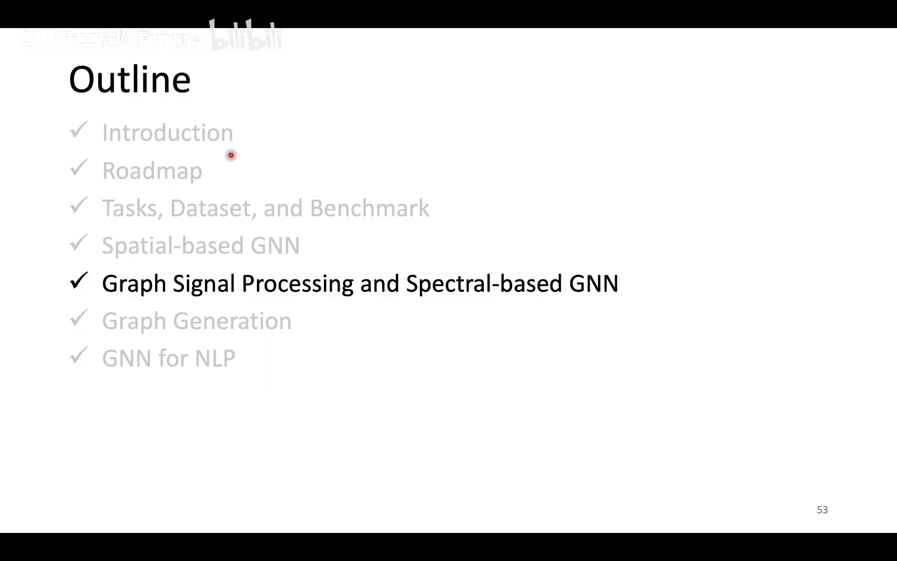