# 【官授搬运】2026年全新优化版李宏毅机器学习系统课程，这才是真正的初学者体系课程！—人工智能／深度学习／神经网络 - P34：6-选修-GNN-2 - AI算法工程师Future - BV1ruqABeEFX

好那我们就接着进入第二节课的课，那个内容大家听得到声音吗。

好那我们现在接着进入第二节课的内容，那大家现在听得到声音吗，好那我就先回答一下刚才有人问的问题，就是有人问说GNN有没有那个让那个诶。

就是有没有library啊。

那就是有一个library叫degrab library，然后他有很多个人已经写好了，就是我刚才讲了很多那个model，它里面都有implementation，那有其他的资源，那我等一下最后结束之后。

投影片后面会呃，就是我结束之后把投影片整理一下，然后附在投影片最后面，然后让各位看一下，如果有兴趣的话，可以看一下，有些人有整理好代码，那我在我整理一下，再把它放上去。

好那我就进入额第二节课的内容好，那第二节课的内容他比较比较神奇一点，所以希望各位可以就是额各位要撑住好，那接下来我们这节课要讲的是graph signal processing，这个东西。

然后还有spectral base of graph neural network now，为了怕大家忘记我们要做什么，我们再再次复习一次，我们要做的事情，就是说假如我们已经知道CNN。

我们在CN里面我们会做conversion，那CVLUTION做的事情就是给你一个kernel，然后你要去呃学术一个filter呃，你要去学术一个filter。

然后你给给定了一个kernel size是33，你要写出一个33的filter，然后他可以在这上面做抗LUTION，那问题是假设说我们今天要做的事情是，我们要在grab上面做。

做到这个所谓的filtering，那我们要怎么达到这件事情呢，我们有没有办法放一个33的kernel，在这个group上面，然后我就期待做这个33的kernel因能，然后放在这个节点上面。

它就可以看到它九宫格里面的邻居哦，这好像是不太合理的，因为你在grab上面根本就没有办法去定义说，他的九宫格在哪，他的邻居哪些是他的九宫格里面的邻居好，所以那我们想到的一个做法，就是有人就这样想。

有人说呢，那我们有没有办法把一个grab上面的signal，因为他这些feature，你可以把它看成是grab上面的某些signal，那我们把这些signal透过FURECTION索。

然后同时我们把某一个叫做filter的东西，我们也都要做future transform，那我们知道在fury domain里面，如果你在原本这个domain，你要做conclusion。

他在fre domain里面，他做的事情，其实就只要把他们两个乘起来，做multiplication就好了，所以如果我们可以直接对它做MULTIFICATION。

然后乘完之后的结果再来做inverse future transform，那我们就可以得到我们要的，这个经过filter的信号，好，那问题是这些东西要怎么做呢，好那为了要解释这个。

我们必须要先引入一些数学好，但是虽然说讲它是数学有点不太对，因为它其实是信号与系统的东西，所以等一下会有大量的信号与系统出现，那因为是信号与系统，我以前说的是李银山老师的信号与系统。

所以我等一下要讲的东西，大部分都是从李银山老师，他在讲信号与系统这堂课里面所用到的一些呃，简报内容好，那我们就来看大家很熟悉的合成分析好，我们说一个信号，我们可以把它看成是一个。

在一个N维空间里面的一个向量，那这个向量我们知道在向量空间里面，它是由一组basis经过线性组合合成的，所以我们说一组信号，我们可以看成是一组basis的合成，也就是它的线性组合。

那当我们想要知道这个线性组合里面，每一个不同的component，它的AK大小是多少之后，我们就要用分析，那分析的方式，就是我用整个信号，或是整个这个vector跟某一个特定的basis。

某一个特定的成分去做内积得到的东西，就会是他这个component的大小，所以这个就要分析好，那当然我们现在是假设是我们的这个背，这组basis，它是一组also normal basis，好。

那在ple man上面呢，有一个很或者说我们常用的一组basis，就是cos和sin的这一组basis，那假设对于一个周期性的信号，我们可以把它展开成是一个furious series。

那我们所选用的这一组basis，就是exponential j k omega0T的这一组basis，然后呢，它的这个不同的抗风能大小就由这个AK来决定，所以我们就有一些方式可以算出这个AK。

它的大小是多少号，所以这个就是future series，好那，我们说呢一组信号在时间呃，时时域的一组信号，我们可以看成是它是时域的basis，经过线性组合之后合成产生的。

那在time derman的这组basis呢是谁，就是站在time derman，站在时间轴上面的一排delta function。

那这排delta function就是time derman的这一组basis好，所以它透过这一这一这一对delta的线性组合，合成了整个TANDERMAN的某个信号，但同时我们也知道一一组信号。

一个信号或者是一个向量，它一个向量空间，它可能不只是有一种basis，它可以有很多不同的basis，所以除了用VZ组basis来表示，我们也可以用UZ组basis来表示，那我们就可以把同样的这个信号。

写成是另外一个basic下面展开出来的一个信号，那有大家也应该很熟悉，就是我们用的就是it's financial j omega t这一组basis，所以这个就是他的就是它的系数吗。

前面这个x j omega就是它的系数，这个就是他的那个basis好，所以同一个信号，我们可以用不同的方式来做合成，那future transform就是如果我想要找出。

就是这个x j omega他是多少的话，我们会用future transform，那这个就是一个他的basis，然后这个是他的这个整个就是一个in the product，就是一个分析的过程。

好那接下来我们讲spectrograph theory，那spectrograph theory，我们先定义一些符号，第一个给给定一个graph，它是一个由V跟一来代表的，那V的数量。

也就是vertex数量，节点数量，我们用N来表示那一个graph，我们可以给给你一个graph，给你一个jason in metric，就是你你会拿到一个他的adagency matrix吗。

那一个jency matrix就是告诉你说哪哪些节点，它是有相连的，那address是matrix，或说或者我们说他是一个weight matrix，那这个weight metric呢。

他如果这个这个entry它是零，代表说这两个节点并没有连在一起，那如果它有它这两个节点中间是有edge，连在一起的时候，那这个AIJ，它就会是它上面这两个节点之间的weight。

这那这两个节点之间的EDH的位好，那我们现在我们先只考虑on the rective graph，也就是我们的adjacency metric，它一定是一个对称矩阵的状况好。

那我们有adjacency matrix，那我们也会有另外一个matrix叫做degree matrix，那degree matrix它做它就是它是一个打压功能，Diagonal matrix。

那它每一个打印功能项就是这个节点，它有几个邻居好，那另外我们所谓的graph signal，就是说这个grab上面每一个节点，它可以有一个存量，或者它可以有一个向量来代表，他这个节点上面的signal。

那我们来实际看一个例子，假设有一个如图这个一个非常简单的一个graph，那这个graph上面呢我们定义这个是V0，V1V2V三，那它上面可以有一些信号，那写成f of0，F of one。

F of two，还有f of three，那这些信号呃，可以可能可以代表就是各种不同的意思，就像是假设它是一个很简单的一个城市路网图，那每一个节点代表不同的城市，那我可以说这个信号可以代表。

说这个城市的气温啊，或是人口增长数之类的，那就是看你这个信号定的什么都可以，好像我们刚才讲完了呃，graph他的什么是他的adjacency matrix，什么是他的degree metx。

然后它的信号是什么样的东西，那这个信号当然我们为了简单起见，我们讲的它是一个存量，但它也可以是一个向量，那向量就是把一个存量排在一起，它就变向量好，那接下来我们讲一下非常重要的一个概念。

叫做graph love Rush，那所谓的GRAVLABRUSSI呢，它的定义就是degree metric，减掉adjacency metric。

那degree matrix它是一个DIAGNO的矩阵型，它当然是对称，那我们刚才有讲过，我们现在考虑的是一个，On the directed gram，所以他的adjacency metric。

它也是一个对称矩阵，所以这两个相减之后，它也会是一个对称矩阵，而且它不只是一个对称矩阵，它还是一个半正定的对称矩阵，它是一个半正定的矩阵，也就是说它所有的I跟v vector，它都会是大于等于零的数好。

那对于一个这样子一个举证证，我们可以对它做spectrod composition，把它这样一个举证，假设我是一个44的RAPTION，那我就可以把它分解成U乘以，浪达乘以u transpose。

那这个U呢它的每一个column就代表了这个，呃这个打发现他的不同的I跟value，那这个la就代表它对应的I跟vector，所以diagonal每一项都是i x vector。

然后U它的每一个column都是嗯都是咳，都是哦，在这个浪姆达它是I跟value，然后U它的每个column是I跟vector，那我们在spectrograph theory的这个这个理论里面。

我们把这个lb打不同的LM，打这一些LM达叫做呢是frequency，这个grab the frequency，那我们把Z1Z1组icon vector叫做对应的basis好。

那今天先讲一下我们选出来的这些I跟vector，他要是or or also，它它一定是它一定是正正交，但是我们要求他就是强度一定是一，到这个地方应该就是现在应该是有交过了。

那接下来呢我们先看一个简单的例子，一样是刚才这张图，这张图呢假设我告诉你说，它上面的信号是F0f one f34，好M0m one two m3长这个样子，然后我可以把它写成一个矩阵的形式。

那矩阵的这个column，这个column vector呢，第一个entry，就代表了它在零这个节点上的信号大小，第二个roll，就代表了它在一这个位置的信号大小。

第三个roll或者说呃这是第零个roll，这是第一个roll，这是第三个roll的话，第这是第二个roll，它就代表它在第二个节点上面的信号大小，然后第三个roll，它代表的第三个节点上的信号大小。

那对于这个graph，我们可以写出他的adjacency metric，Adjacency metric，第一个road00就表示说零跟零有没有一个age吗，零一有没有一个H，零跟一有一个H。

然后呢零跟二之间有一个H好，零跟二之间有一个H，所以这边有一个H，然后零跟三中间没有H，所以这边就是零好，那另外我们也有它的degree matrix，它的degree mech长这个样子。

所以degree metric，每个答案都项目是把它那个roll，或是那个column这东西加起来，所以第一个roll加起来，第零个RO加起来是二，第一个RO加起来是三，第二个肉加起来是二。

第三个肉加起来是一，所以我们有degree matrix，我们有他的addressing metric，我们就可以算出来它的LAFASION。

然后LAPTION我们可以对它做I跟decomposition，然后算出来它的I跟vector和I跟value，所以我们就可以算出来它有这四个不同的I根，like i跟value，然后就像我们刚才讲。

它是一个半正定拉普拉特，他是一个半正定的矩阵，所以他算出来他的每一个I跟value，它都会是大于等于零的，所以他最小就是零，而且每一个graph不管是什么样的GRP，他的I跟vector。

它打PLOSION的I跟vector，他一定I跟value最小的一定是好，那零它对应到的这个I跟vector，就是这个0。5这一个第一个column，然后呢一对应到就是第二这个color。

三对应到就是这个color4对应到就是这个colon，好像我把它画在这个grab上会长什么样子的，会长成是这个样子，零这个frequency，它对应到的I跟value是这一组I跟value。

那我们把这个I跟value画在这grab上面，就会长这个样子，然后你可能会有点难接受，为什么可以把它画在grab上面，我们刚才讲说这个信号的第一个COLUMD，零个cad。

零个roll代表是它在零的大小吗，第一个row代表它的E的大小，第二个RO在第二个节点的大小，所以同样的这个I跟这个I跟vector，你也可以把它画在grad上面。

那第一个roll就代表号在第一个D0的RO，就代表他在D0的节点的大小，第一个roll就代表它在第一个节点的大小，第二个roll就代表它在第二个节点的大小，第三个roll就代表它在第三个节点的大小。

所以你画出来就会长这个样子，零它是一个全部都一样的，frequency等于一的时候，它是一个长这个样子的信号，frequency等于三的时候，它是一个长这样的信号，frequency等于四的时候。

它是一个长这样的信号，好那额，各位可能很难接受说，为什么这个东西代表的是频率，为什么这个东西代表的是1basis，那我们先来看，我们先忽略呃，就是我们刚才讲过的东西，我们现在看另外一个东西。

我们先来看一下discrete time fever basis，那discrete time fewer basis，大家都知道它有它应该是长这个样子，basis吧，它有DC component。

然后不同的频率的sin函数，然后当你频率越低的时候，它就是哪个都一样，那频率越来越高的时候，它就会变化越来越大，那频率大到某个程度的时候，它相邻两个就会是完全相反的东西好。

所以我们可以看到在discrete time fewer basis里面，我们可以看到它的频率越大的时候，它相邻两个信号点之间它的变化量就越大，所以它在最低频的时候，它相邻两个信号是完全一样。

但它在最高频的时候，它相邻两个信号，它的正负号是完全相反的，所以频率越大，相邻两点之间的信号变化量就越大，好那各位请记得这个概念，因为我们这个概念我们可以用来理解这个。

spectrograph theory里面，这个frequency的这个概念好，那我们来看一下我们要怎么去理解，vertex frequency是什么样的东西。

那我们假设我们把把PTION看成是一个grab，上面的operator，那我就可以用这个operator来做，对grab上面的信号做啊，做一个operation，那我做的方式就是。

我就把这个拉普拉选乘以这个信号，那我们来看看会发生什么事情，那我们知道一个LAPLOSION，它的定义就是D减A嘛，所以我把这个laption apply在F6上面，我把它乘开来之后。

它就变成DF减掉AF那我们一样，我们拿刚刚的那个很简单的grab，来当例子来看，那这是一个很简单的gram，那我们刚才有说他的signal，它的JENCYMESX。

还有他的green metrix是长这个样子，那假设说我这个LF，也就是我把这个拉passion apply在这个signal上面，我会得到一个某一个column vector叫做这个样子。

然后他的他会有四个NT，我把这四个NT分别叫做ABCD，那我们今天我们来看一下他第一个entry，也是我们来看A它是怎么被算出来的，那A它是怎么算的呢，A它的算法就是DF减AF，而且我们看的是第一个嘛。

所以它就是第一个column，第一个roll跟第一它的column相乘，然后呢再减掉AF，然后就会是这个东西，好像把它写出来，它会长这个样子，那长这个样子，我们再把它乘起来，会得到这样的一个式子。

那各位可以观察一下这个式子，它代表第一他第一个这个2×4，他这个这个二是哪来的，这个二是这边这个二，这个二是这个二嘛，这个二代表了V0，它有几个名邻居，也就是V2跟v one这两个邻居。

那这个四是哪来的呢，这个四是这个四嘛，所以这个四就是V0上面它的signal大小有多少，那减掉两个东西，那它分别减掉是谁，它分别减掉的是二跟四，那这个二跟四是谁，二跟四是它的两个邻居的信号大小。

好像我们把这个事整理一下，我们就可以得到LAFASHI，Lafasion，它的第一个lafasion apply在一个信号上面，它的第一个entry就会是他们两个的差，加上他们两个差。

也就是V0跟他那个的信号的差异的和好，所以当我们把laflation apply，在一个grab的信号上面，它某种程度上代表了这个，某一个某一个信号跟他旁边的节点的能量差异，但是他这个是差点它吗。

那如果我们要真的看能量的话，我们要把它平方，所以平方的方式就是我们取EXTRANSFS乘以L，再取F然后最后呢经过推导，我们可以得到这个东西，它代表的东西会是这个样子，那这个式子是什么意思呢。

这个式子它代表的是power of signal，Variation of turnotes，也就是某一个节点I跟某一个节点V，他们两个之间的信号能量差好，所以它代表了这个grab。

它的grab signal它有多smooth，那就像我们刚才在这边讲的，当我们这个grant，当我们的signal越smooth的时候，它相邻两个的信号能量差距应该是越小，那当它呃它的频率越大。

它越不smooth的时候，它相邻两个信号它的能量差距是越大的，所以我们就可以用这个东西，这个东西它代表了相邻两个节点，它的grab的siggrab signal，它的能量差异。

那我们就可以用这个东西来量化，某一个grab signal的频率大小是多少好，所以它代表了一种能量的概念，所以我们可以把这个能量概念拿来，当做是一种频率来使用好，那它跟频率有什么关系。

我们刚才讲说grab signal，我们定义的那些频率就是它的那些I跟value的啊，那跟那些I跟vector，它的频率就是它的I跟value，那我们来看一下。

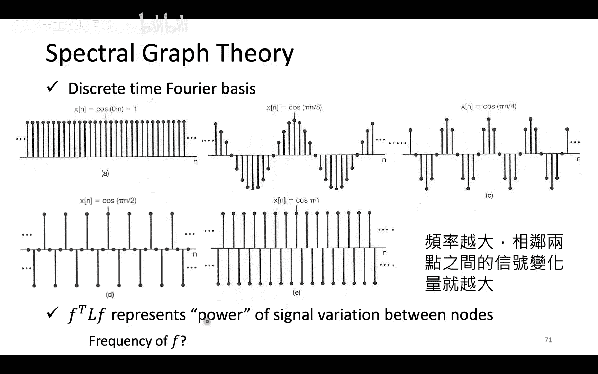

假设说我们把这个那个signal，刚前面讲的那些APF换成是这些hion vector，那我们把它乘一乘，就会发现刚刚讲的那些power difference，其实就是他的I跟value，所以说。

I跟vector，它对应的这个浪达代表的就是这个信号，跟它这个信号两两相邻的信号能量差距是多少，所以说当我们的纳姆达等于零的时候，表示它的两两相邻的信号能量差是零。

所以这就是一个DC component，那当它的频率越来越高的时候，表示出它两两相邻的能量差会越来越大哦，可是其实各位看这个图可能没有什么感觉，感觉不出来，他就是这这三个可能有点难看出来。

你你可以很轻轻易的理解说，这个就是一个DP逃脱的，可是你可能没有办法接受他，他们两个他的频率比较高好，那我们看一个特例，这个特例是这个样子，它是一个竖线上面的20个点，那数学上22。5。

我也可以把它看成是一个grab，只是它这个grab就是一个很简单的GRAP嘛，然后他的LIN是长这样，他的edge长这个样子，那我们把这个东西它的LAPTON算出来之后。

做I跟decomposition，我们可以得到他在la等于零的时候，它就是一个DC卡通的，然后他在浪大最大的时候，他就是一个长这个样子的东西，那你可以看到随着他的浪打越来越大。

也就是它的随着它的频率越来越高，他就是从一个呃频率比较低的sign，变成频率越来越高的sign，然后变成频率非常高的sign好，所以我们就可以我这样就是透过刚才的解释，各位可以接受说呃。

那个浪姆达它代表的是这一个I跟vector，它的频率大小好，那目前先讲到这个地方，那看一下大家有没有问题，好如果没有问题的话，我们就继续讲好，那提醒各位，我们为什么要讲这些东西。

就是因为我们要我们要去定义一个BIUBIU，transform嘛，所以我们要定义出filter权时，我们才能在GP上面做filter，那我们先来回忆一下，我们在传统信号与系统上面。

我们的fr传送做什么什么，然后他给你一个handle man的信号，你想要透过一个future transform，转换出一个他在frequency表面上面，不同频率大小。

对应的这个component的大小是多少，那我们在做这件事情的时候，我们就是做UR传送，那我们要怎么在grab上面也用同样的方式，把一个信号grab上面的信号。

转换到他的frequency domain呢，好那转换的方法长这个样子，式子写出来长这个样子，假设我有一个信号X，那我就把它乘以一个UTRANSFORCE，那这个u transform。

就是我们刚才前面讲到的那个I跟value的，那个I跟I跟vector的那个矩阵好，那我把它乘出来之后就会得到这个信号，它在呃frequency等name有一个信号好，那这个事实看起来有点难理解。

那我们直接来看一下呃，看一个比较比较好理解的东西呀，就是假如说我有一个信号，它在vertex轴面上面长这个样子，那这个X就是刚才我们前面一直讲到那个F，那我们把它乘以一个UTRANSPORT。

然后它UTRANSSPORT代表它每一个roll，都是刚才前面讲的一个I跟vector，那我们把它乘出来之后呢，合成出来就是它的spectral domain的一个信号，那我们来看他这个东西。

它实际上是在做什么事情，他做的事情呢其实就是，就是分析嘛，他要分析它每一个component的大小是什么，你在做few retur缝的时候，你就需要知道它每一个component a0。

a one a two a3A四A五，这个大小是多少，话说你在SPECTRODOMAIN的时候，你要做的事情也是，你要知道U0对应的这个la姆达零，它的这个component。

这个frequency component，它的大小是多少，u one对应的浪达one，它的这个component大小是多少，那你做的方式就是，你用幽灵这个basis跟X这个信号做内积。

你就可以分析出这个component大小有多少一样，u one这个basis跟X个信号做内积，你就可以得到了，它在拉姆达one的这个频率上面有多少的成分，所以一样纳姆达two跟纳达三做一样的事情。

你就可以得到它在SPECTR总man上面的信号，长什么样子，所以呢我们就可以知道，我们可以把一个grant signal透过furial transform，也就是乘以一个UTRANSFORCE。

我可以分析出你这个信号，在每一个不同频率成分上面，它的大小是多少，所以这个就是U0跟F的内积，就是FF就是我们前面讲的那个信号，就是这个x u one跟F的内积。

代表他在浪达one上面的这个这个成分有多大，那U2乘以F代表说它在浪达two，这个频率层面上面有多大，U3乘以F代表它在浪达三，这个频率上面的成分有多大，所以这两个基本上可以完全对应在一起好。

那还有另外一个问题，就是假设说我已经有这个东西了，那我要把它作为一个inverse transform回去，vertex romain好，我们我们把这个VER就是这个信号。

叫做vertex romain，这个信号叫做spectral main好，那我要想办法把这个信号转回去，那要怎么转呢，好那转的方法呢，我们先我们先想一下，我们要怎么把这个信号转回去。

这个然后我们用类比的方式来看看，我们要怎么在grab上面做一样的事情好，那我们做的方法就是说，假如说我给你一个这样的信号，它是FENCY种man的信号，那我想要请你把它还原出，它在PLE面的信号大小。

然后我要问你说他在T等于T0的时候，这个SC它应该是它的，这个在时域里面的信号大小是多少，那我们的做法你应该会这样做，你应该会先找出来cos欧米伽零，T0这个频率成分，它在T0的时候，它的大小是多少。

然后乘以它这个greency component，它的大小放在这里，然后再加上他在两倍平的时候，两倍平的这个basis，它在T等于T0的时候，它的信号大小乘以它的A2放在这里。

然后再加上他在三倍平的时候，T等于T0，然后乘以它的这个component的大小，放在这里加起来，然后一直加到N倍平的地方，然后你就可以还原出这个XT，它在T等于T0的时候，他的在时域的信号大小是多少。

好那一样，这个概念我们可以把它拓展到这个grab上面，假设说你已经有这样子的一个信号，你想要把它还原到vertex din上面，那你做的事情很简单，你就是看这个纳姆达零，它对应到的I跟value是它。

那我们就看这个I跟value，假设我想要还原出这个它在V0这个节点上面，它的信号大小是多少，那我就看这个I跟value，它在零的信号是这么大，那它在零格信号乘以这个component的大小是U。

零乘以F嘛，然后呢，再来再加上他在第二个basis，他的在零这个节点上面的信号大小，乘以这个component的大小，再加上第三个basis，它在零这个地方。

他的信号大小乘以它这个computer的大小，再加上第四个basis，它在零这个节点上面的信号大小，乘以这个component的大小，全部加起来之后，你就会得到这个东西，好说你把它写成数学式子的时候呢。

它其实就是X等于U，再乘以X的tag，就是excel，就是那个就是这个东西，然后你把它写出来会长这个样子，X等于U然后乘以X，那use现在它每个column就代表了每一个basis。

那我们来看一下这个东西，也就是我们这边圈起来，比这东西它是怎么被算出来，我们再看一次他算的方式呢，就是第一个basis，它在零的位置跟这个东西乘起来，加上第二个basis，他在零这个位置的大小。

在这个地方乘起来，加上第三个basic，它在零这个地方的大小，把它乘跟这个component的大小乘起来，再加上这个东西乘以，这个东西加起来就会是你这个信号的大小好，所以我们就已经得到应该啊。

INGRESPIRIT传送，它就是一个X等于U乘以X，这样子的一个式子好。

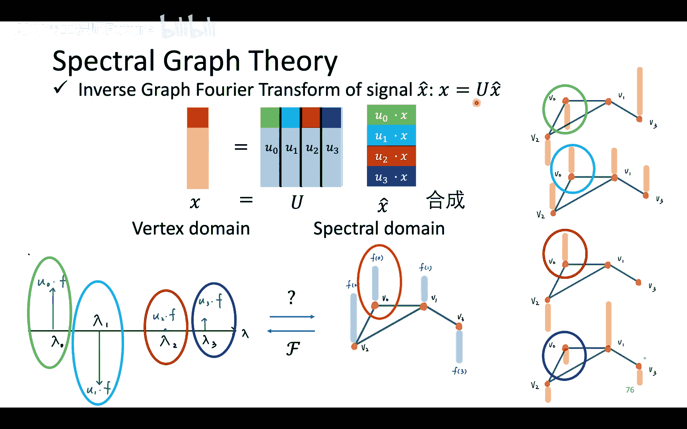

接下来我们要来讲filter future，就是说我我们是我们在我再提醒一下各位，为什么要讲前面这些东西，我们要讲前面这些东西，就是因为我们要找出一个，可以在grab上面做filter的方式。

那grab上面做filter的方式，我们必须要先定义出来GRP上面要怎么做，future transform跟inverse ual transform。

我们才能用user transform和inverse ual transform，然后transform到呃spectral domain，然后在spectral din上直接相乘。

也就是在做filter，然后就做完filter之后呢，我们再把它inverse transform，回到我们的verteal man好，那我们知道，假设说我们在frequency stm上面。

有一个信号长这个样子，然后呢我们用了一个impulse response，长这个样子的一个filter，那他最后做出来的信号就是经过FTER的信号，他在fancy1种内应该会是长这个样子吗。

你就是把这两个东西相乘乘起来，就是这个东西，好那spectrograph theory里面，他做这个，做这个filter也是一样的东西嘛，你刚才已经有转出来一个XTX。

这个x pet就是我们刚才讲说你一个信号，X经过grab ur transform之后得到那个信号，然后呢你把它乘以，你的某一个filter的frequency response，然后两个相乘之后。

你就会得到你经过filter的这个信号，Y h，好那如果我们要把它写成矩阵相乘的方式，我们要怎么写呢，我们就可以把它写成XXX乘以这个frequency，Response，那我们把它写成这个样子。

他就会等于这个东西好，那各位可以看看这个东西，就是西塔零除以X0head放在这里，Z和Y乘以X方head放在这里，这就相当于这个乘以这个等于这个这个乘以，这个等于这个这个乘以，这个等于这个这个乘以。

这个等于这个好，那这边之所以会把它写成GC到五浪达的意思，就表示说这个THEA不浪达这个频率响应，它是一个频率浪达的函数，好，它只是想表示这个意思而已，那讲完这个之后。

我们终于可以开始比较接近我们要讲的东西了，假设我们已经得到了一个这样子的y head，这这就是我们最后想要，这还不是我们最后想要做的东西，我们最后想要得到的是这个东西。

它在vertex onment上面的信号长什么样子，那我们这边它是一个呃spectral domain的信号吗，所以spectral domain的信号，我们要把它还原到vertex romain。

我们必须要做inverur transform，那inverse spy transform的方式，就是他的前面再乘以一个U，所以我们在前面把它乘以一个U之后。

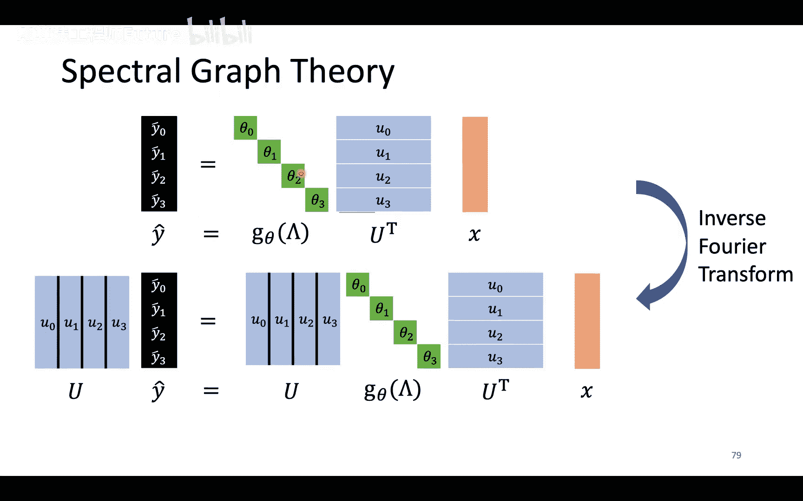

我们就可以得到我们最后要的信号就是Y好，所以今天我们想要劝出一个model，这个model要做什么事情呢，这个model他要做的事情就是给你一个input x，那我希望你可以学到一个filter。

这个叫做g sea of run吧，那这个g sea rua经过它的filter之后呢，我可以最后再出一个Y，也就是做做CONVUTION之后，我要得到Y，那我们把它写成数学式子的话。

就是Y会等于g c a of u乘以p cl long吧，然后再乘以U乘数，然后再乘以X它会等于GCGC的哦，因为这个把它放进去是一样的吧，这个这个是线性代数，反正你可以把这个U丢丢丢到里面。

然后你丢到里面之后呢，这个东西就是早发现，所以你要去学一个LAPULSION的多项式函数，这个区啊不不一定多项式函数，你要去学一个LAPULSION的函数，然后经过这个lapin的函数之后。

跟这个X相乘，你可以得到一个经过filter的信号Y，那你要学的参数，就是中间这个绿色框框框起来的，这个G4条浪的，好那这个g c of la或者g sea of l。

它可以是任何任何你想得到任何的函数，它可以是一个，假设奇怪一点，他可以是log i加油，因为这边这是一个矩阵嘛，所以这边要用的是identity，它可以是log i加油，那我们知道log i加油。

你可以直接把它用它的展开展开成这个样子好，那这样子的model它会有什么问题呢，它最大的问题，第一个问题就是这个东西是你要学的参数，你的model要学一个filter。

可是你这个filter的大小呢跟什么东西有关，跟你的input grab的大小是有关的，假设你今天的grab，给他了一个10万个节点的gram，你就要学一个有10万个参数的。

你的你要学的东西就是10万这个数量级，如果你今天的grab它只有十个节点，那你这个东西它就只会是一个思维的，打印能矩阵嘛，所以你的learning complexity。

它会depend on你的INPROGRAM的大小，这是一个不太好的事情啊，因为各位可以想想看，我们在做CNN的时候，不管你的graph啊，不管你input这个影像是多大。

你都可以用一个一样大的model去训练，但是如果按照我们用刚刚这个，fu turn的方法来做的话，今天只要有一个不同的GRA，我就必须要去学一个不同的参数，而且大小不一样，参数量还会有很明显的差距。

这是一个很很麻烦的事情，好那第二个问题，他还有另外一个问题，就是这个GCALL。

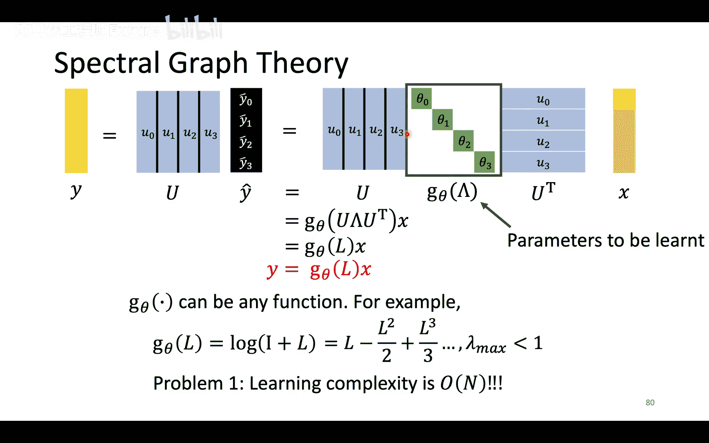

你选择的时候会让他这个model学到一些，你可能不希望他学到的东西，这是什么意思呢，我们来看一下，我们刚才讲说我们最后要学到的一个东西，就是我们要学一个GCAL，那GCAL我们刚才也讲说。

它可以是任意的函数，那假设我让他这个函数叫做cos l好了，那cos l我们可以把它经过它的展开，得到他是这个一个无穷的呃级数和吗，那这个级数和呢我们先来看一下，我们先看一下，假设GCAL他是L号的。

就是先不要管这一行，假设我们是GC好的话，等于L那我的Y就会等于GCL的L乘以X，那我们说GCTL等于L的时候，它就Y的就等于LX，那我们来看一下Y等于这个东西，在我们刚刚这个很简单的例子里面。

它会出现什么样的状况，那我们现在关心Y这个Y这个信号，它在它的第零个entry，也就是它在经过filter之后，它这个东西会变成什么，那他这个东西就是这个roll，跟这个COLUM的内积吗。

那这个roll你看一下他是在哪个地方等于零，它在第三个COLN要等于零，为什么它在第三个con会等于零呢，因为这个节点，他并没有跟第三个节点有任何的距离，是一的路径，所以说，所以说他在这个地方会是零。

那我们来看，假设说这个东西跟这个东西相乘的话，这上面第三个节点的信号，就没有办法影响到这个东西，因为0×-3是零嘛，好但是如果今天GC好，为我选的是L平方的话，那L平方我已经帮你算出来了。

它L平方长这个样子，你看一下，假设我用L平方这个rap8分当做filter，然后来乘以这个信号X，那我在第一个节，第零个节点上面得到的信号是什么呢，是这个L平方的第一个RO。

乘以这个X的第一个这个这个column，那你看这个RO每一个roll，每一个entry它都是非零的数字，表示说这个信号整个信号都会影响到它吗，那为什么呢，因为这个这个grab上面对于零这个节点来说。

所有的节点都是在他这都是在呃，有一条路径是二以内的test可以连到它，所以这个对于这个节点来说，他可以走一二这条路，对于这个节点来说，它可以走一二这条路，对于这个节点来说，他可以走这条路。

所以这个上面每一个节点信号，它都可以跑到一上面，所以经过我一次filter之后，它的信号就会被它它其他的那个影响好，那如果说我用了N次方的话，那根据某些定理，这个定理你可以自己认真看。

假设我用了K次方的话，就会导致说假设我用的是N次方，然后这个graph里面有N个节点，那你有N个节点grab，它除非是它除非不是connected gra，那他你给他乘N次。

他那个老婆UTION一定会是每一个，每一个entry都是都不是零，也就是说假设你把它展开到N次方的时候，你就会让经过一次filtering，然后让整个你就会让整个额，整个grab的信号互相影响。

那这件事情不是我们要做的事情，为什么呢，因为它不是localized，什么叫做local alize，包括来就是说假设我们在做CNN的时候，我们可以透过kernel size的选择。

然后我们来决定说我要看到多少的范围，像我们选择33的kernel，那对于他来说，他就只看得到他3×3的这个九宫格，对于他来说，他就只看到他这个3。3。90000个。

那如果我选择我想要看比较大的那个hook，那我就可以选一个大一点的kernel，所以对于他来说，我选了一个55的kernel，就可以看到这么多东西，我选择5×5就可以看到这么多东西。

所以他是一个localized的呃，localized的FTER，可是我们刚才前面讲的这个东西，假设我们选了它可以展开到N次方，那根据我们刚才的观察，我们可以发现，假设你给它弄到N次方。

它只有N个节点的话，他就会把他所有经过一次built，他就可以把他所有的整个，grab上面的东西都看过，那就并没有考虑到，只有考虑到他那个会里面的东西，所以这就是我们说他第二个问题。

就是他不是logo瓦，好那接下来我们来讲就是终于要开始讲model音，然后如果各位前面全部都听不懂呃，你可以尝试从这边开始听不懂没关系啊，如果你真的还是听不懂，我等一下会再叫你一次好，那我们就来讲一下。

第一个，我们要讲的就是spectral grab conversion，的第一个model叫做chat net，那这个trap net呢它它主打的就是它可以快，而且它可以localized。

那我们先来看一下他怎么做到localize，然后而且它可以处理我们刚才讲的第一个问题，就是他的learning complex是big all of n的，这个问题好难，他做的方式很简单。

就是我们刚才说你那个GC好了，你可以随便乱选哦，他说我们不要随便乱选，我们选东西，我们必须要让他是一个，这个老发现他的一个多项式函数，所以透过你选择让他是多项式函数的方式。

你就可以让它是k localize，根据我们刚才讲的，如果你最多只有到K次方，那他就只看得到他在K里面的那一个或，所以透过这样的方式，它就可以是k localize，而且呢它同时还解决第第第一个问题。

就是它现在要学的参数就变成C桃，CAKCTK这个参数嘛，所以他要学的参数你可以决定你要学多少，你要学的是big of k，因为你现在的这个这个filter，就是LAPLOSION的一个多项式函数。

所以你只要决定你多项式函数的这个系数，要是多少就好了，所以你要学的就是这一些多项式函数的系数好，但现在又出现了另外一个问题，现在出现的问题是这样，我们知道这个喇叭选呃，我们先看这个东西。

这两个东西是等价，因为你把这边乘以一个UCONSOURCE跟U，就是上面这个式子好，那假设说我们学出来个filter，是它的参数就是一条，OK那我要对它，我要用这个东西来对X做标准。

就是我要对他对X做CONVUTION，那我在做的过程中会有一个很高昂的运算成本，它的CONFI是N平方，因为我算出来这个C好K之后，我要把它乘以它的iem vector。

那这个I跟vector在乘的时候，你会出现了一个N平方的那个，Complexity，另外你要算N平方，你要算这个U，你要算他的i m vet，本身就是一个非常非常麻烦的事情，因为假设说你图非常的大的话。

那你就需要有，就是这个你就是要对一个很大的呃，对称矩阵做recode conversion，然后这件事情也是非常非常麻烦的，所以CHAPNE它必须要解决第三个问题。

就是他必须要解决掉time confessi，太高昂的问题哦，那他是怎么解决这件事情呢，好那他用了某一种很神奇的方式，他用了一个叫做trap shapinnoio的东西，好，那我们先我们先呃。

我们先看一下什么是trap shapinnomial，它是一种特别的PYNOMIAL的一个家庭，然后它定义的方式它是用recursive定义的方式，那T0of x它定义成是1T。

one of和X它定义成是2TK，我们X它定义它是递回的，去定义它，它会是2X乘以TK减1X减掉TK减二，X乘以X哦，TK减2X然后它的X必须要定义在-1~1，这是因为它有一些就是某些性质它必须要满足。

所以他把他限制在这个地方好，这chership for novel，它重点就是它有一个多项式函数，这个多项式函数呢它是用递回关注定义的好，那我们有了这个多项式函数，你也不知道要干嘛好。

那假设说我们把这个多项式函数在里面，这个X换成我们的，把发生的某一个，我们把这个喇叭选，或是把这个la经过某一个调整之后，调整成叫做拉姆达TIA，那这个浪姆达ta跟你们浪达关系是这个样子。

那这件事情只是为了，要让前面这个范围是被满足的，那各位可以先，各位各位可以不用去管为什么，反正就是你就是接受它，他要是这个样子就好好，所以我们就可以把这个X换成朗姆达特塔，所以T0of浪姆达特塔。

就是I就是identity messa，T n o t one，我们浪达TIA就是浪打ta tk我们浪打ta，根据TRATRASHPOINTINNO有它的定义，他就是这个样子，就是这个样子好。

那原本的这个原本的多项式函数，原本是长这个样子的，我们说我们要学的它是一个纳达的多项式函数，那la的多项式函数，我们要学的东西就是它的D塔可是什么，那现在我把它改成是我们要学的是这个东西。

我们要学的东西呢是由这个TRIBUTION，point nomo所组成的，这个多项式，他这个C条K框是多少好，那为什么要做这件事情，这件事情在干嘛呢，就这是这有点难理解，那我举一个比较简单的例子。

然后大家可能会比较可以接受，我们把一个多项式函数改成，用另外一个多项式函数组合会有什么好处，这个是我昨天从我高中的学习翻出来的。

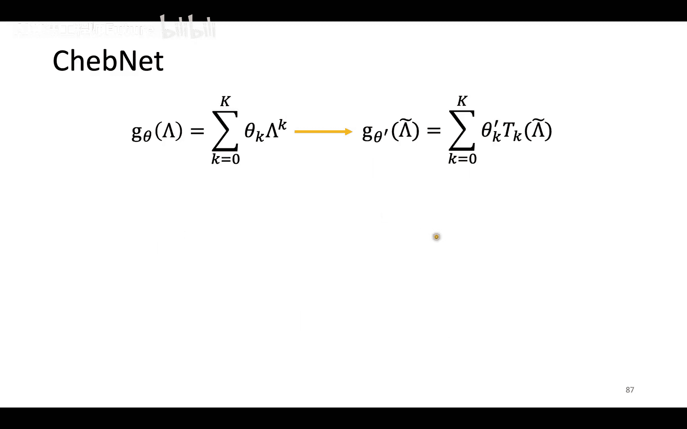

这个题目，大家可能会大家可能已经距离有点遥远，那我讲一下他在干嘛，他告诉我说有一个多项式函数长这个样子，然后呢他如果直接问你，说你要求F1。99的近似值，到小数第三位的时候。

那你就会就是你就会很自然的想到，你要用综合除法，然后先把它找出这个东西，然后你找出前面那些系数之后呢，你就可以把它直接带进去，然后这个每一项就会变成0。01，然后就变得很好，很好算嘛。

所以确定切那个缺缺陷，他做这个这个猫的话，做的事情也是很类似它做的事情，你就可以把它看成这个，原本这个浪老K就是这样的这边这个东西嘛，所以原本的技巧K就是这个三负七负二二十八，那我们想要经过某一个方式。

把它换成这个东西好，那你先不要管，各位可以先不要管，为什么要换成这个东西好，反正就是我们就是把它换成这个东西，换成这个东西之后呢，它的好处就是，当我们把某一个东西带进去的时候，他的这一项会非常好算。

所以我们把它换成这个东西的目的在于说，我们希望这个TKL拉姆达T导，它是很好算的，就让我在这个里面我们把1。99带进去，它这个会很好算，所以最后你要学的东西就是这个四条可靠。

也就是他这边的ABCDD好到这个地方。

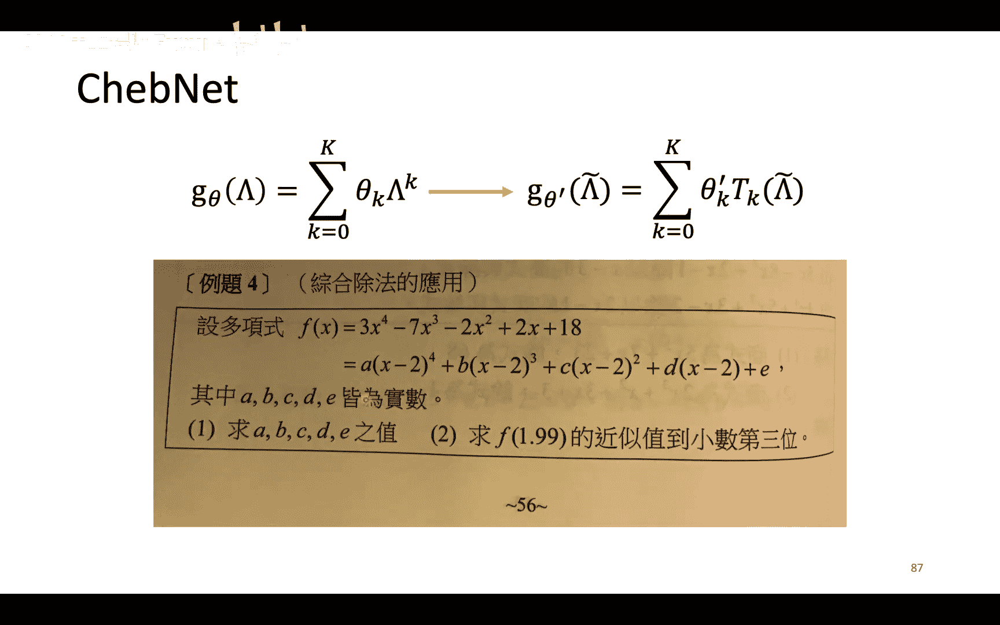

大家有问题啊，好如果没有的话，我先继续讲好，所以在再整理一次哦，我们为什么要用trap trap point in nomeal，我们用trap trap point innomo的意义在于说。

我们希望透过这个方式，我们可以让这个东西变得比较好算，因为原本如果我们用烂达，浪达K这个东西来算的话，它最后你在前后乘以一个U跟U，TRANSFORCE的时候，它会出现一个。

它会出现一个big of n平方的complexity，但是我们用cheership for nomo，来重新PARAMETRIZE的时候，你就可以让这件事情变得轻松很多，那我们看一下这是怎么做到的好。

那它跟这个东西它是递回也有关系好，所以我们已经接受了，就是假设我们已经接受了这件事情，那我们就可以把这个Y这个信号，它经过它filter就是GCAOL码，那我们刚才有说。

我们可以把它用那个check ture phenoo来PARAMETRI，那我们把它PARAME出来之后呢，我们先把它展开来，这个东西展开来就是C20theta0com。

然后T0l ta x加上c tone，from t y l ttx加加加到BKK加一项好，那咳这个东西呢，我们可以把它写成是另外一个递回呃，用这个递回式把它改一下。

那因为我们刚才有说trap trap pinnomo，它的递回是长这个样子，所以我们就可以把这些东西，换成是另外一个数列来表示，那我们就把这边标红色的这个T0，我们有特它乘以X当做是X。

然后替换有个有特塔XN当做是呃，就是把这个东西递回去，乘以一个X变成这个样子，然后我们定义这个东西，也就是这边这个东西定义成是XK8好，所以X08它就是x x one8，就是T1，然后跳上乘以X嘛。

就是这个东西乘X，然后呢因为他递回的这个定义，所以我们可以把它写成是XK8，它就是二乘以LQA乘以XK减一八，减掉XK减二八好，所以写成这样之后呢，我们就可以把这个式子改成这样子。

好像这个式子改成这个样子之后，其实我们要做的事情很简单，就是我们要找一个呃，我们要找一个filter的参数，它是这个THEA0prom到西塔k prom，然后它乘以一个这个X之后。

就会得到我们要filter的filter出来的这个信号，好，那现在最关键的问题就是，这个东西你要怎么算出来，那这个东西我们就可以根据递回的方式，把它算出来，那递回的因为它是递回的嘛。

所以你每一次在算的时候，你就不用乘以K次方，你就只要就是你用这个递回式算的时候，你每一次算它的COMPLEXI就只会有big of1，所以你算K格的话，你用递回式算，你只需要画big of k乘以一。

所以它就可以解决掉，刚刚前面讲到，我们需要用fire of n平方的那个CONTESD的问题好，所以各位如果前面的都听不懂，没有关系好，你可以再听最后的结论，就是我们要学到我们要学一个filter。

这个filter他要做的事情就是他要学一个参数，那这组参数再写在这里，那要做filter的方式，就是你先把你的signal用递回的方式算到K次方，然后放在这里，然后乘以一个wave matrix之后。

你就会得到你PUTER玩的信号，好到这个地方有问题吗，好如果没有问题，我就继续讲，是不是有麦克风没关啊，哦那，那你当然可以不止学一个filter吗，因为我们刚才说你这个是一组一组filter的参数。

你可以不止学一组filter，你可以学第一组FTER参数，我们就是这样做，然后呢你就算出第一个，第一个就是自由选项是CN里面，你可以有不止一个channel。

所以第一个channel output出来就是这样，然后你第二组参数呢你就一样，这个乘以这个加上这个乘以，这个加上这个乘以，这个加起来之后放在第二组标签，然后假设你弄了F2F2这么多个channel。

那就是做一样的事情好，所以shift啊，CHESHI呃，CHAPMAN就是讲到这个地方，到这边大家有问题吗，大家如果听不懂的话，你只要记得就是就是我们可以用某种方式，然后D回的算出这组参数。

然后这组参数可以让我们的confession可变得很低，然后它是可localized的，这样子，好那接下来讲完chapter，统一都没有的话，我们再来看GCN，那GCN它是大家最喜欢用的一个model。

那因为它非常非常简单，非常非常直观，但它又有好像有一些数学基础在后面，所以大家都很喜欢用它，那GCN它它的全名叫做graph conclusion network，那他做的方法很简单。

就是我们刚才讲说那个champshipinno meal，那就CHAPMAN，他用的是一个k localized的pinnomial filter，那如果我们这pinnomial filter。

我们选择让K等于一的时候，那刚才上前面那一页那个式子，它就会变成这个样子吗，那因为我们刚才有讲说，我们为了让它符合某些特定的条件呃，我们有把L换成LT塔，所以我们把这个l ta带进来。

带回来之后会变成这个式子，那假设说我今天用的这个L呢，它是一个normalized的老FASHINORMALIZE，老发现的定义在这里，那他normalize laplosion有一个很特别的特色。

就是它的浪达max，它的最大这个I跟value不会超过二，所以你就可以假设它大概是二，你就可以把这个式子化简成这个样子，然后化简成这个样子之后，你再用normalize吧，FASION的定义。

你就可以把这个式子，把这个L换成这个东西带进去，变成这个样子，那变成这个样子以后，你你可以要求你的model，就是你为了让你的model参数比较少，所以你不要让CA0跟c a one。

是两个完全独立的参数，你要求说C塔零跟CAN它差一个负号，你就可以把它变成是下面这个式子好，那下面这个式子，你在经过一个叫做renovalization trick的东西。

这个这个这个trick是作者自己取名字，反正他就是这样做，那也不要问我为什么他就是这样做，他就是这样做，那他做的方法就是，他把这个东西改成了这个I加D，-/21次方，AD2分之一次方。

变成了另外一个有加ta的好，那这边帮大家回忆一下，这个D是degree matrix，A就是adjacency matrix，然后现在D还是像是degree matrix好。

那它的renomalization trick，他做的方式是说这个detail a就是原本的啊，这我们先讲A好，这个ATT跟他A原本的关系，就是他把我觉得ency matrix的diagonal。

它如果不是零的话，它把它变成它，如果不是一的话，它把它变成一，也就是说它在原本的grab上面，每一个节点它都加一个self loop上去，所以对于哪一个这个对于他这个A跳槽来说。

他的打克隆的项一定都会是一好，他把这个东西叫做RENYYZH好，那它经过realization之后，你的这个filter就从原本的这个东西变成了Y，等于这个，这个东西，然后呢乘以C塔，再乘以HX好。

那重新整理一下式子，就变成是这个乘以，你的H就是上一层的he的那个NO representation，然后再乘以某一个weight，那这个weight就是这边这个theta。

你就会得到下一层的HL加一好，那这个式子看起来也不太友善，那我们看一个比较友善的式子好，那最后呢我们可以把它重新写成这个样子，好大家如果前面信号与系统部分听不懂，没关系，信号与系统现在已经全部都解释了。

我们现在讲的就是GCN的最核心的这个式子，这个式子告诉我们说你要update某一个V，它的feature map的话，你要做的事情，你就是把所有的那个他所有的NEOR，包括他自己全部加起来。

因为我们刚才已经加了一个self loo，所以你把他所有的东西加起来，那先经过你先把它的feature，经过一个传送之后加起来，取平均，再加一个bias，然后经过一个NVIDIAXVATION。

你就会得到它在下一层的P的x conversion，我再讲一次这个事，它代表的意思就是说我先把NO feature，这个XU经过一个transform之后，把所有的neighbor包含。

包含它自己加起来取平均，最后再加一个bus，经过一个LINUX分解啊，经过一个activation之后就会得到最后的H好，这个就是GCN，好那讲完了前面这些东西，我们回过头来看一下这个。

刚刚讲过的所有model的综合比较，那我们回来看一下benchmark test，那benchmark task有这五个哦，那因为刚才有讲过，你要做benchmark的话，一定要是，贝拉塞要够大。

然后你切的要够公平公平，那他就提出了这五个不同的task来做benchmark。

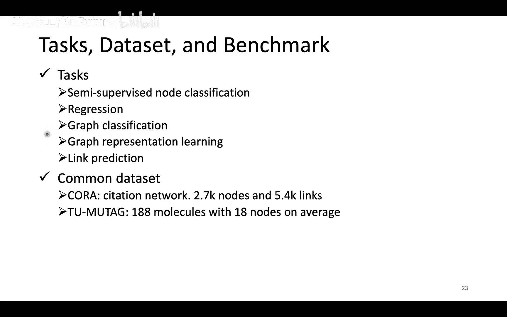

那第一个我们来看graph classification，也就是你要对一整张图做gravlevel classification，那他做的方式叫做用。

就是用annex跟塞拉ten做super pixel的classification，给你一张AMNEST或是塞巴ten的图片，然后这个这个data set呢。

它会先把这个东西透过某些演算法转成super pixel，然后呢这个super pixel每个super pixel之间会有一些link，然后你用这样的一张图。

你的GUN就要去做classification，然后你要区分的出这张图是九，这张图是五，这是一只青蛙，这是一台车子，所以这就是呃super pixel annex的这个test他要做的事情。

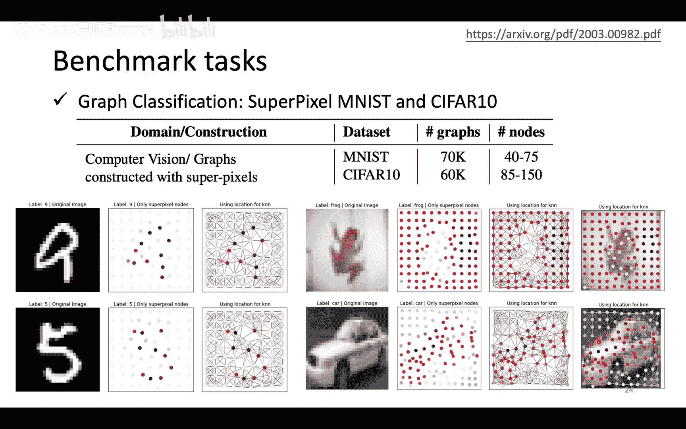

所以他要做的事情就是grab level quication，好，那第二个data set，它是叫做zg mol graph，Data，要set他要做的事情是regression。

它regression的方式是它会有很多不同的graph，那这些gram可能是，这大部分都是真实世界的分子，那这些真实世界分子，它的节点数量从9~3星都有。

那你要做的regression regression，就是像各位再做一做pm2。5预测好，那还要预测的东西不是PM2。0，他要预测的是分子的溶解度，所以你给你一个grab，你要透过这个分子。

然后来预测它的溶解度有多少好，那另外一个是node classification text，那它用的用头classic box model，然后来生成出很多不同的图。

然后这个data set里面他要做两件事情，你的test有两个，也就是说给你告诉你说，有一个pattern长这个样子，要请你在这个很多gram里面找出来这个pattern，所以你要去label说。

这个节点是不是属于这个pattern里面，这个节点是不是属于这个pattern里面的，一个点好，所以这个叫做grab pattern recognition好。

另外一个test叫做SEISUPERVICE，Grab costroom，也就是说从classic block model，它这样子的一个model，它会生成出很多不同的呃，它生成出很多不同的GRAP。

那每个GRAP它会有很多不同的community，或是它有不同的cluster，那你要做的事情就是你要想办法去identify，这些不同的class，这些不同的node分别属于哪些cluster。

所以你看这边很明显他就是属于D0的cluster，这边是第一个cluster，这边是第二个cluster，所以这也是一个note classification的task。

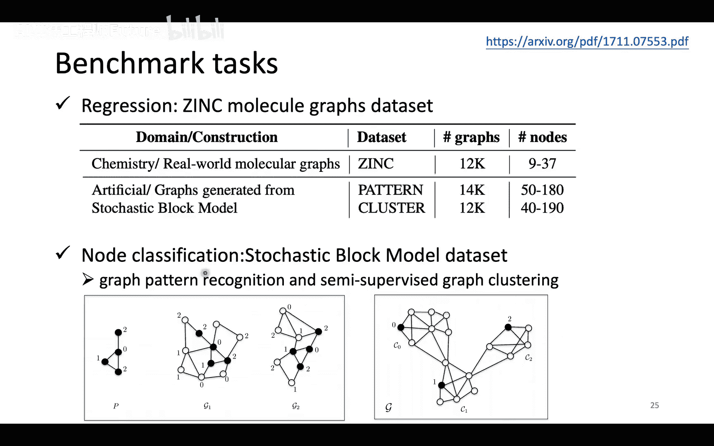

好第四个task叫做ash cft cation，那这个ash craft fication呢，他做的是traveling salesman problem。

那各位都知道kerinciation problem，他是一个np compiler的问题吗，那这个问题是什么，这个问题就是说有一个sales man，然后呢他要去很多不同的城市，然后他问你说这些。

他有没有办法就是给你一个grab，然后它每一个grab，grab上面每一个节点代表一个城市，然后grab跟grab之间的H，代表城市跟城市之间的路径，然后他要问你说，他有没有办法从某一个点开始走。

然后应该是呃对，应该是说到每一个点只能倒一次，然后不能走重复的路径，然后走从从一开始指定的那个点，然后绕一圈绕过所有的点，然后呢走到原来的点，所以它是一个h classification。

那它要classify的target，就是这个H是不是属于你的TSP，最后的最佳解的最最佳路径的一个一个H，所以它是一个h quication problem好，那他的加压线。

你可以看到这边加压塞grab都非常大。

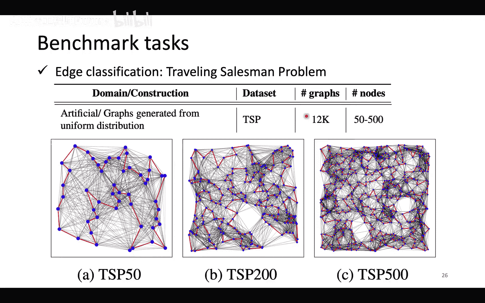

至少有好几好几万张图好，那我们来看一下刚才讲的那些所有的model，他的表现如何，那第一个我们来看一下我们刚才讲的GCN，那么没有发现说GCN，它其实就是最阳生的GCN，他表现并不会特别的好。

这个是MOPMOPMOP，就是说我在咳，那没有P就是说我完全不考虑grab the structure，我完全不考虑节点和节点之间的link，我就直接拿edge呃，我就直接拿NO feature来做做。

我就只有用到NO feature，我没有用到edge的关系，那这样子的状况下，mp这样完全不考虑grass structure，他都可以打爆GC，你居C是最烂的好，所以说他们其实我发现说GCN。

他并没有特别强，你看grab safe，它就明显就比它好很多，然后还有刚才讲的grab as movinetwork，然后还有monnet grab attention network。

所以graattention network其实也蛮强的，然后这个GTG资源就是G间的变种，那呃你可以把gt矩阵理解成就是GAT，加上GCN，他就是在做上面的时候啊，还有加一些weight哦。

所以说经过这件事情之后，他可以变得变得非常的强好。

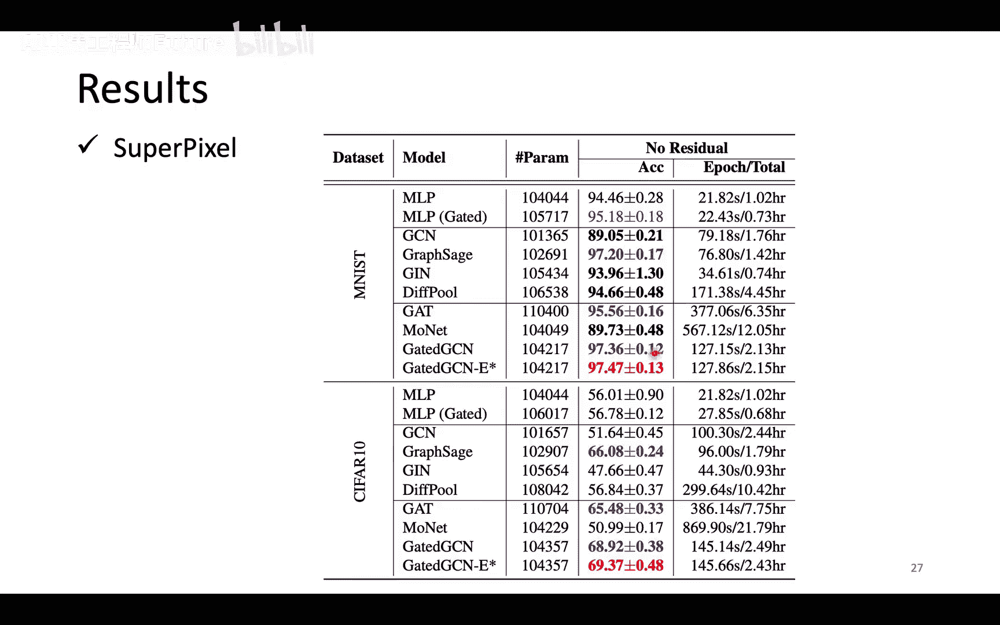

那我们来看第二个regression，这个DATASET，Regression，这个DATASET呢，它的它的那个衡量的结果是看就是main scare error。

所以mean in square error，看起来GCN它也是最惨的嘛，当然是比没有它没有MMP那么惨，但是他比就是他是军工里面最惨的一个，然后grapas morning network。

他是呃他是比较好的，那gt gcn还是一样。

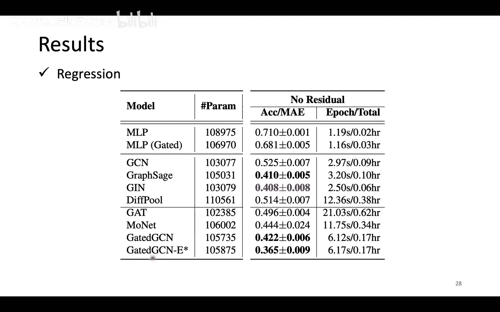

他是最强的，那接下来来看一下那个stochastic block，model的那两个data压set，那这2data压set呢一样，就是居间的表现并没有特别好，那其他的就是都比较好，那各位可以发现。

假设我有做，就是呃not waiting，就是我不要直接用相加的，我用wait sum的时候，这些model总是会大部分都是会比这个还要好的呀，那这个是GIN是例外。

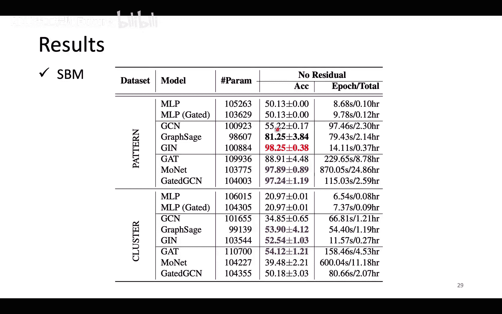

好那另外还有一个data set，最后一个data set就是traveling salesman的那个DATASET，那traveling salesman那个DATASET呢一样GCN很惨。

然后最好的还是一样是gt gcn好，那这个是用at once sce来算，因为它要它它是要去CREATIFY，说每个edge是不是属于最佳路径的那个H，然后他是算precision和recall。

然后再加起来算导数，加起来算f one好，那还有另外一个问题。

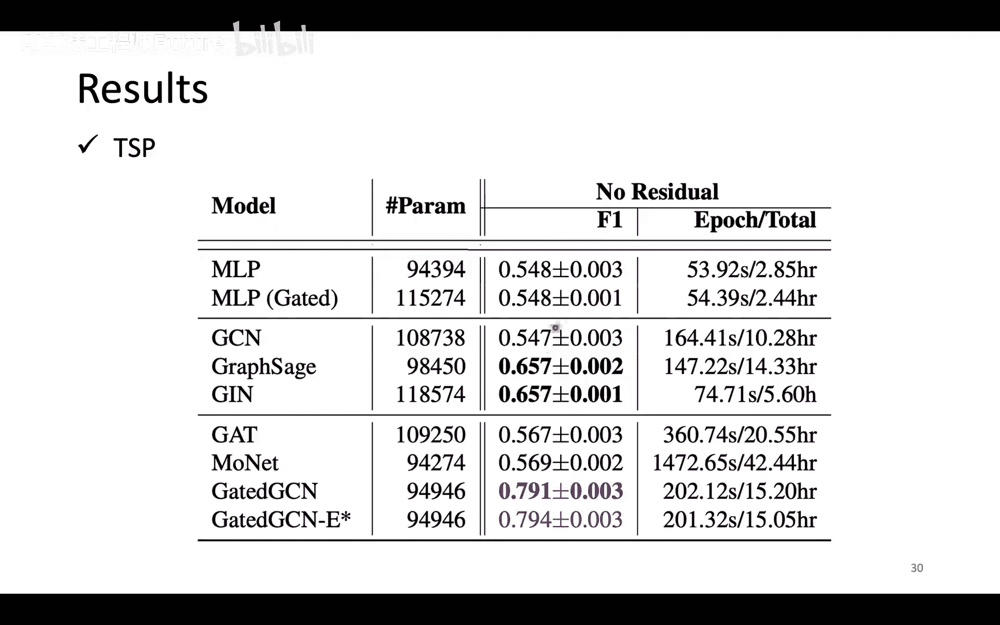

就是说层数吗，刚才我们讲这些我们都没有讲他要叠几层，那大家可能会觉得说好像会不会越越多层越好，但其实并不会，你看这个travel travel in salesman，就这个data压set里面。

你把G先叠到32，等他的performance在没有receu connection的状况下，会烂到只剩0。361，那GI什东西network都不会像居间那么惨，所以就有人很好奇，为什么居间会那么惨。

然后他们就有去分析说，居间他的某些特性会导致说呃。

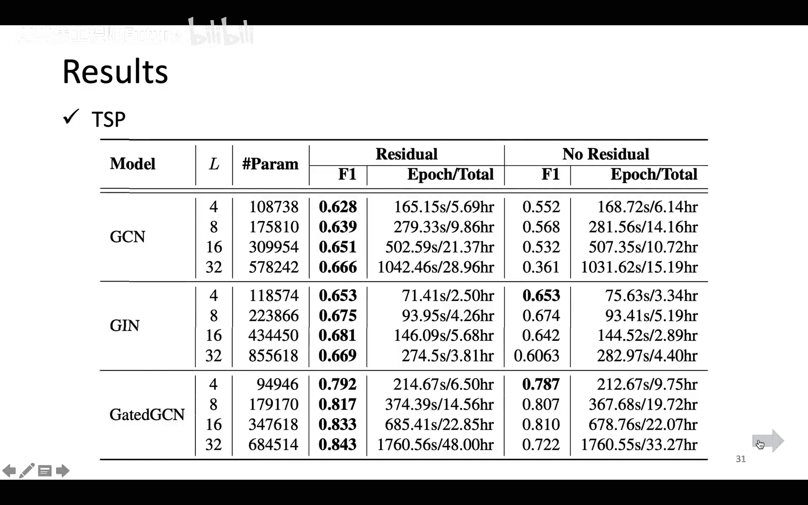

GCN在叠越多层的时候，他的这个expressive power或exponentially decay，那这个呃因为时间关系我没有打算细讲，但是总而言之，它的重点就告诉我们说。

你的车先到最后会有一个现象，就是你的NO feature经过很深很深的GCN之后，同样的一个SUBGRAM里面的东西，它会收敛在同样的地方，所以说这样呃，像是我们这边这个例子来说，这是一个GRAP。

它有两个component，第一个component在这里，第二个component在这里，经过你的区间之后，他最后NO one feature，No two feature，No 3feature。

它会收敛在同样的一个地方，456它同样是第二个bug，所以他会说用在同样的地方，所以GCN它当叠越多层，而且没有用于cu旁边CTION的时候，他就会有这个问题哦，那这个问题要怎么去解决呢。

有一个很简单的做法，就是你把他的edge drop掉就好了，那就是非常神奇，在算那个用，你在因为我们刚才说居间差费的方式，把所有的那个取平均嘛，那drop and他会告诉你说。

我们不要把所有NEIOR取平均，我们在取平均的时候，我们随便drop掉一些neighbor。

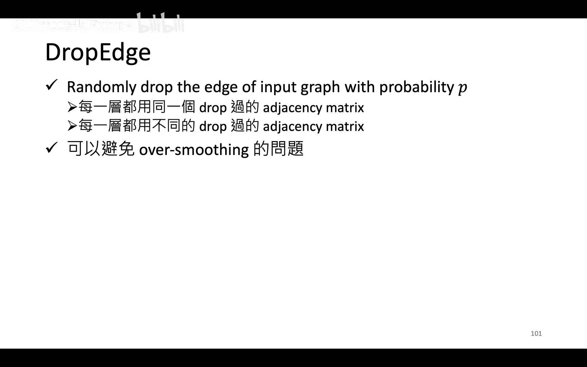

这样就可以避免掉刚刚讲的那个问题，因为他的实验结果也的确有显示，在你加drop edge之后，它会比你原本没有加drop edge还要好一点点，但事实上它还是比你原本浅一点的model还要懒。

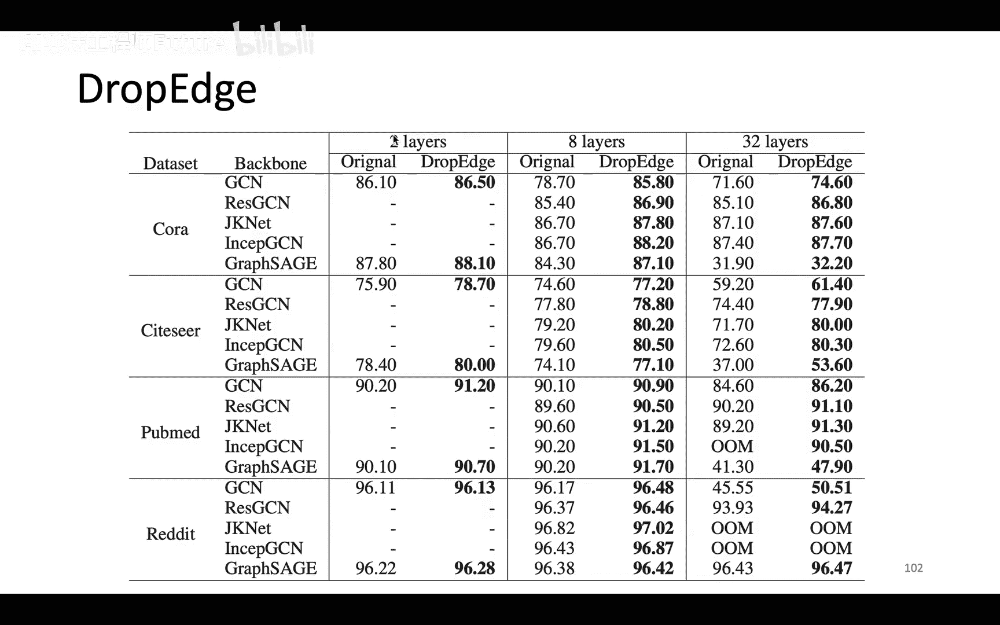

好接下来呃hyper gcn的我就不讲了，因为时间关系我就都不讲，然后grab generation，我简单讲一下grp generation，他在干嘛，那grp generation。

他这个就是你要去生成图片嘛，但生成图片的方式有很多不同的方式，第一个像是DAA1，或者是像是game，或者像是auto regressi，反正这些都是传统上我们会拿来用呃。

拿来用用的jeration model，那VA1就是你会有一个encoder，你会有一个encoder，那位到encoder里面是一个jency matrix。

然后还有他的h feature跟他的NO feature，然后你把它丢到VA里面，然后你生成出来的一样是一个H呃，Adjacency math，一样是一个h the feature meshes。

一样是一个NO feature methods好，所以透过V1传统V1的训练，你就可以训练出一个可以生成这个。

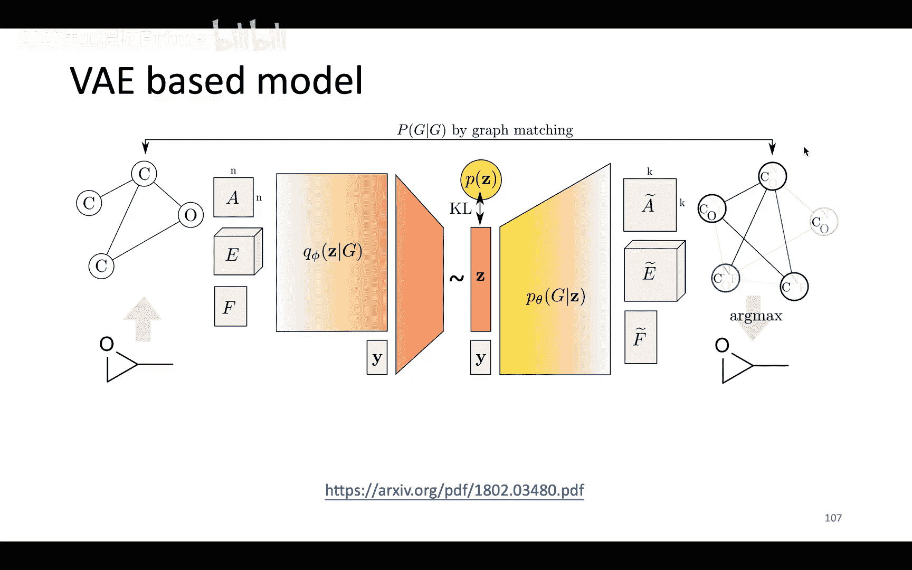

生成图片的model，那另外一个是用gain来做，用gain来做一样就是你用传统gain的方式，那今天他game丢进去的input feature。

因他丢到game里面的东西就是adjency mesh，然后还有它的feature matsues好。

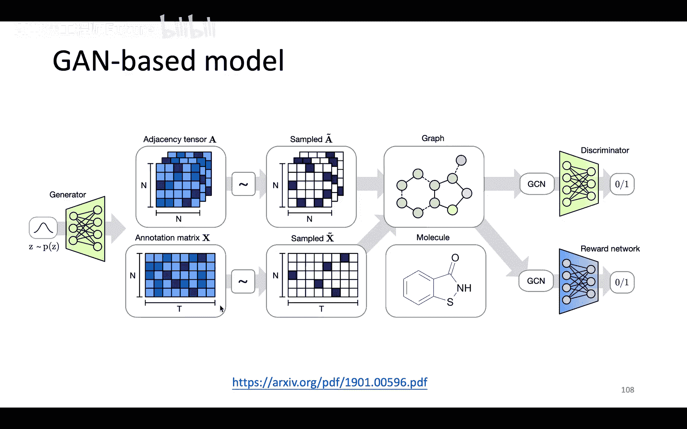

那另外一个auto regressive model，他做的方式就是你要生成呃，生成图的话，你就是先问这个model他要不要生成节点，然后你再问他要不要生成edge，然后他就会告诉你说他要不要生成嘛。

所以你就可以产生节点，然后产生节点，然后再来产生节点，完之后你再问他说你要不要生成edge，然后他就会告诉你，他不要生成A，他如果说要的话，你就加一个A在上面，然后就一直做一直做一直做做完好。

那最后呃时间的关系我就不讲了，最后一部分，反正各位要知道说，GN在NOP上面可以有很多很多的应用，那对这个就没时间讲，所以我就不讲了。

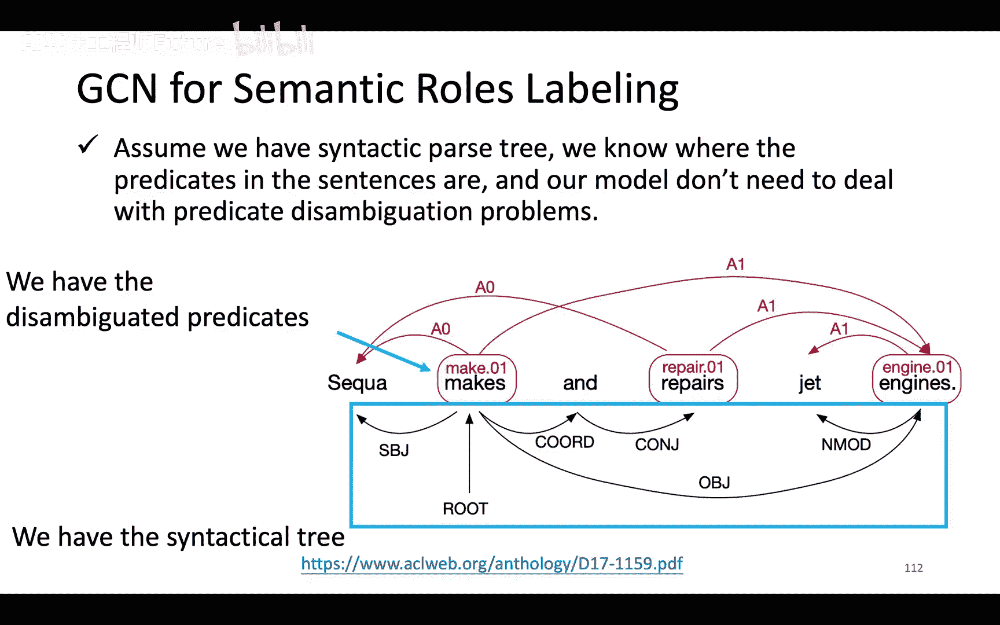

好所以我简单来回顾一下我们今天讲的东西，我们今天讲的东西，就包括说我们怎么把一个grab，丢到一个neon network里面，就是GNN嘛，那我们也讲到说有两种主要的方式。

一种是special face，一种是special face，那大家最喜欢用的special base的方法就是GAT，大家最喜欢用的special base的话就是GCN。

那如果你听不懂GCN的理论没有关系，因为如果只有看剧之间的事情，你也其实不会知道他是一个special base model。

那我们最后也简单的介绍了一些supervise classification，si supervise classification的test，那其实还有很多其他不同的test，都是GN可以用的。

那只有时间关系。

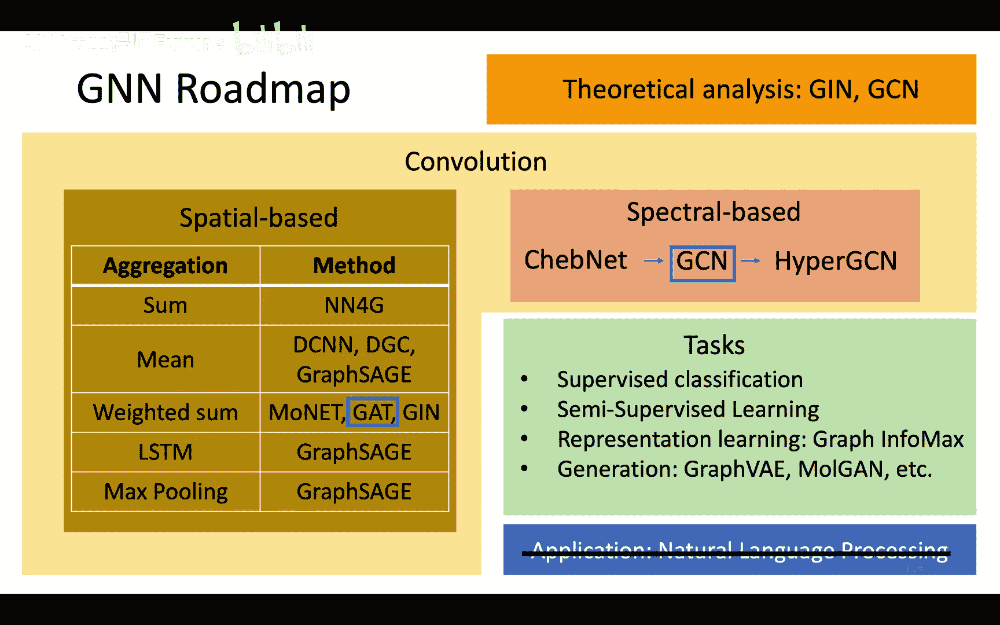

我们就没有讲LLP的部分好，那最后三维的部分就是像我刚才讲的，GAT跟G之间是大家最喜欢用的东西，那虽然说GCN它有一套很完整的理论，但是大家不太不太会去管他的理论是什么了。

那另外GNN或是GCN他有个严重的问题，就是你叠越深的时候，他的model performance会非常的烂，那这件事情大家还目前还是正在找，为什么好，最后就是说所以大家还是要去看那个理论分析。

那另外一个现在的趋势，就是大家很喜欢把一些其他在DILEARNING的东西，拿来用在graph new errow上面，像是deep graph。

INFORMMAX或是graf transformer或者grab bb，都有人在做，那做出来结果怎么样，我知道grad fd的结果并没有特别好啦，所以就是他没有他没有大家想象的那么好对。

然后最后GNN，它可以被用在很多不同的test上面，只要它是一个structure data，只要它是有一些data和PN之间有一些relation shift，很重要的时候。

那我们都可以用JN来解决好，那我们最后就讲到这里，大家如果有什么问题的话，可以再问，那如果没有问题的话，我们就可以准备结束了，诶好诶，大家有问题要问吗，哎有人要有人有人要说话是吗，没有啊。

好如果没有的话，我们就谢谢助教啦，学到很多，太棒了，谢谢谢谢谢谢助教。

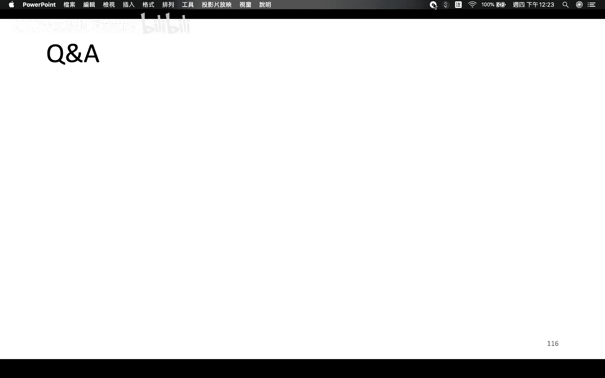